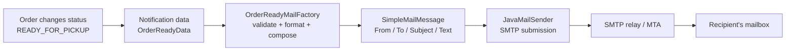

# Creating a Message from Business Data with Spring Framework Mail

When a Spring application sends a notification email, the message content is usually not a pre-written string. It is **created from business data**: an order ID, the recipient's name, a payment status, a booking deadline, a pickup location, an amount, or an event that just occurred. For **plain text emails (simple mail)**, Spring Framework Mail provides `SimpleMailMessage` to represent the message; `JavaMailSender` is responsible for sending it through the SMTP transport.

For example, when order `ORD-2026-184` moves to the `READY_FOR_PICKUP` status, the system wants to send:

```text
From: notifications@shop.example
To: alice@company.example
Subject: Order ORD-2026-184 is ready

Hello Alice,

Order ORD-2026-184 is ready for pickup.
Location: District 1 Pickup Counter
Pickup deadline: 17:00 on 15/11/2026 (Asia/Ho_Chi_Minh)

If you need support, please reply to this email.
```

This is a **message rendered from order data**, not a hard-coded email for Alice. The main challenge is to map the data correctly, format it appropriately for the reader, make sure the address and content are controlled, and then hand the message to the sender without mixing the mail-sending logic into the business logic.

## 1. The flow from business data to an email message

An easy-to-maintain organization separates **three responsibilities**:

1. **Business data source:** an event or data that the system has confirmed, for example `OrderReadyData`.
2. **Message builder (composer/factory):** receives business data and creates a new `SimpleMailMessage` containing the sender, recipient, subject, content, and optionally `Reply-To`.
3. **Sending service:** receives the created message and calls `JavaMailSender.send(...)`.



This flow lets you check the message content **without an SMTP connection**. When you change the wording, time, or language of the notification, the change is concentrated in the composer. When you change the SMTP provider, the content-creation code stays the same.

### The data source must reflect the real event

For example, an order should only be notified as "ready" after the business logic confirms the corresponding status. A message builder **should not query the database again on its own to decide whether the order is ready**; it receives normalized input from the business layer.

This is especially useful with a queue/outbox: when the mail-sending worker runs a few minutes late, the snapshot data in the job tells **exactly the information that should be notified at the moment the event occurred**. If you always re-read the current data, the email content may drift from the original event.

## 2. What does `SimpleMailMessage` contain?

`org.springframework.mail.SimpleMailMessage` is the **plain text** message type in Spring Framework Mail. It provides setters to describe the common fields:

| Property | Method | Appropriate data source |
| --- | --- | --- |
| Sender | `setFrom(String)` | A configured address that the SMTP provider allows sending from |
| Primary recipients | `setTo(String...)` | An email address confirmed by the business logic |
| Carbon copy recipients | `setCc(String...)` | A group/person who truly needs to receive a public copy |
| Blind carbon copy recipients | `setBcc(String...)` | A business need with controlled privacy |
| Reply address | `setReplyTo(String)` | A support mailbox or the department that handles replies |
| Subject | `setSubject(String)` | Event name + a controlled reference code |
| Content | `setText(String)` | Text rendered from business data |
| Sent date | `setSentDate(Date)` | The send time, if the application has an explicit requirement |

Minimal example:

```java
import org.springframework.mail.SimpleMailMessage;

SimpleMailMessage message = new SimpleMailMessage();
message.setFrom("notifications@shop.example");
message.setTo("alice@company.example");
message.setReplyTo("support@shop.example");
message.setSubject("Order ORD-2026-184 is ready");
message.setText("Your order is ready for pickup.");
```

The statements above **only create an in-memory object**. They have not opened an SMTP connection or sent an email; the sending happens when you call `mailSender.send(message)`.

`SimpleMailMessage` is not used to create HTML emails with `<b>` or `` tags, attachments, or MIME inline images. To use those features, create a `MimeMessage` with `MimeMessageHelper`. If you pass HTML to `setText`, the recipient will usually see the HTML characters as ordinary text.

## 3. Mapping business fields to email

Suppose the application has the business object:

```text
Order:
  id: ORD-2026-184
  status: READY_FOR_PICKUP
  customer.email: alice@company.example
  customer.displayName: Alice
  pickup.locationName: District 1 Pickup Counter
  pickup.deadline: 2026-11-15T10:00:00Z
  pickup.timeZone: Asia/Ho_Chi_Minh
```

This data **does not map one-to-one** to same-named properties in the email. You need rules:

| Business data | Email field | How to handle |
| --- | --- | --- |
| `customer.email` | `To` | Check it is non-empty, a valid address format, and that there is permission to send the notification |
| `customer.displayName` | Greeting line in `Text` | Normalize characters and provide a fallback if the name is missing |
| `order.id` | `Subject` and `Text` | Limit characters and prevent unwanted data from entering the subject |
| `order.status` | Chooses the **type** of notification | Only emit the event for the right status; do not print raw technical codes when not needed |
| `pickup.locationName` | `Text` | Use a location name the system has accepted |
| `pickup.deadline` | `Text` | Convert the `Instant` to the pickup location's time zone and format it readably |
| `app.mail.from` configuration | `From` | Use a sender that has been verified/allowed by the SMTP provider |
| `app.mail.reply-to` configuration | `Reply-To` | A mailbox that is actually managed to receive questions |

Do not send the whole `Order` entity through `toString()`. An entity may contain a home address, payment history, internal content, tokens, or unnormalized state. **Choose only the fields needed for the specific notification**.

### A data object dedicated to email

With Java 21, a `record` can serve as the input snapshot:

```java
package com.example.mail;

import java.time.Instant;
import java.time.ZoneId;

public record OrderReadyData(
        String orderId,
        String recipientEmail,
        String recipientName,
        String pickupLocation,
        Instant pickupDeadline,
        ZoneId pickupZone
) {
}
```

This object **is not necessarily a JPA entity**. It is the data needed to create an order-ready message. Choosing specific fields helps limit the information used, simplifies validation, and clarifies the interface between layers.

In an asynchronous sending system, if the record is serialized into a queue, there must be a serialization mechanism appropriate for `Instant` and `ZoneId`, or you store them in a standard form (`ISO-8601`, zone ID). Do not assume every queue can serialize a Java record automatically in the same way.

## 4. Creating a new message from a business object

Below is a complete example of a **simple mail builder**, which does not require SMTP to build the message. It only receives data and returns a `SimpleMailMessage`.

```java
package com.example.mail;

import java.time.ZonedDateTime;
import java.time.format.DateTimeFormatter;
import java.util.Locale;
import java.util.Objects;

import jakarta.mail.internet.AddressException;
import jakarta.mail.internet.InternetAddress;

import org.springframework.beans.factory.annotation.Value;
import org.springframework.mail.SimpleMailMessage;
import org.springframework.stereotype.Component;

@Component
public class OrderReadyMailFactory {

    private static final Locale VIETNAMESE =
            Locale.forLanguageTag("vi-VN");

    private static final DateTimeFormatter DEADLINE_FORMAT =
            DateTimeFormatter.ofPattern(
                    "HH:mm 'on' dd/MM/yyyy", VIETNAMESE);

    private final String fromAddress;
    private final String replyToAddress;

    public OrderReadyMailFactory(
            @Value("${app.mail.from}") String fromAddress,
            @Value("${app.mail.reply-to}") String replyToAddress) {
        this.fromAddress = validateAddress(fromAddress);
        this.replyToAddress = validateAddress(replyToAddress);
    }

    public SimpleMailMessage create(OrderReadyData data) {
        Objects.requireNonNull(data, "orderReadyData");

        String orderId = requiredSingleLine(data.orderId(), "orderId");
        if (!orderId.matches("[A-Za-z0-9-]{1,40}")) {
            throw new IllegalArgumentException("Invalid orderId");
        }

        String recipient = validateAddress(data.recipientEmail());
        String name = optionalSingleLine(data.recipientName(), "there");
        String location = requiredSingleLine(
                data.pickupLocation(), "pickupLocation");

        Objects.requireNonNull(data.pickupDeadline(), "pickupDeadline");
        Objects.requireNonNull(data.pickupZone(), "pickupZone");

        ZonedDateTime localDeadline = data.pickupDeadline()
                .atZone(data.pickupZone());

        String formattedDeadline = DEADLINE_FORMAT.format(localDeadline);

        String text = """
                Hello %s,

                Order %s is ready for pickup.
                Location: %s
                Pickup deadline: %s (%s)

                If you need support, please reply to this email.
                """.formatted(
                name,
                orderId,
                location,
                formattedDeadline,
                data.pickupZone().getId());

        SimpleMailMessage message = new SimpleMailMessage();
        message.setFrom(fromAddress);
        message.setReplyTo(replyToAddress);
        message.setTo(recipient);
        message.setSubject("Order " + orderId + " is ready");
        message.setText(text);
        return message;
    }

    private static String validateAddress(String rawAddress) {
        String value = requiredSingleLine(rawAddress, "email");
        try {
            InternetAddress address = new InternetAddress(value, true);
            address.validate();
            if (!value.equals(address.getAddress())) {
                throw new IllegalArgumentException(
                        "Expected one bare email address");
            }
            return value;
        } catch (AddressException exception) {
            throw new IllegalArgumentException(
                    "Invalid email address", exception);
        }
    }

    private static String requiredSingleLine(String raw, String field) {
        if (raw == null || raw.isBlank()) {
            throw new IllegalArgumentException(field + " is required");
        }
        String value = raw.trim();
        if (value.codePoints().anyMatch(Character::isISOControl)) {
            throw new IllegalArgumentException(
                    field + " contains control characters");
        }
        return value;
    }

    private static String optionalSingleLine(
            String raw, String fallback) {
        if (raw == null || raw.isBlank()) {
            return fallback;
        }
        return requiredSingleLine(raw, "recipientName");
    }
}
```

The example above deliberately keeps **message creation free of side effects**. The `create(...)` method does not query the database, does not open an SMTP connection, does not update the order status, and does not decide on its own when the business logic must emit an event.

Notable choices:

1. **Use the From/Reply-To addresses from configuration** instead of letting each order freely choose the sender.
2. **Validate the address by syntax** with `InternetAddress` and accept only a single bare address. This is not a test of whether the mailbox actually exists or can receive mail.
3. **Control single-line fields** so that abnormal data does not break the layout or spill into the subject. Here `orderId` is also constrained to an illustrative business format; a real application uses the ID rules of its own system.
4. **Format the deadline from an `Instant` and an explicit time zone**, avoiding confusion between a UTC instant and local time.
5. **Create `new SimpleMailMessage()` on every call**, not reusing a mutable message across requests.
6. **Produce clear plain text** with a greeting, the event, actionable data, and support guidance; do not put unnecessary technical data into the email.

Note: `Character.isISOControl` checks control characters, but it is not a general solution for normalizing all Unicode data, URLs, or user-provided text. For content from untrusted sources, the application still needs length rules, normalization, and appropriate data policies.

### Why format by time zone?

Suppose the deadline in the database is:

```text
2026-11-15T10:00:00Z
```

The pickup location has `ZoneId.of("Asia/Ho_Chi_Minh")`. Then the deadline in Vietnam time is:

```text
17:00 on 15/11/2026 (Asia/Ho_Chi_Minh)
```

If you only call `Instant.toString()`, the email shows UTC time, which easily misleads users. If you call `LocalDateTime.now()` without an explicit timezone, the result depends on the server configuration. **A business moment should be kept as an `Instant` or a type with an explicit timezone**, and then formatted at the display boundary.

In a multinational system, the data may contain the locale and timezone of each recipient or location. The message builder needs to format dates/times/amounts according to that context, instead of always using `vi-VN`. The example uses `vi-VN` and the pickup location's time zone to illustrate the approach.

## 5. Sending the message with `JavaMailSender`

Once you have the factory that creates the message, the sending class only needs to take the message and hand it to the SMTP transport:

```java
package com.example.mail;

import org.springframework.mail.SimpleMailMessage;
import org.springframework.mail.javamail.JavaMailSender;
import org.springframework.stereotype.Service;

@Service
public class OrderReadyNotificationSender {

    private final OrderReadyMailFactory factory;
    private final JavaMailSender mailSender;

    public OrderReadyNotificationSender(
            OrderReadyMailFactory factory,
            JavaMailSender mailSender) {
        this.factory = factory;
        this.mailSender = mailSender;
    }

    public void send(OrderReadyData data) {
        SimpleMailMessage message = factory.create(data);
        mailSender.send(message);
    }
}
```

This part only performs **composition → send**. `JavaMailSender` is a Spring interface; with Spring Boot that has the mail starter and the appropriate configuration, a sender bean can be auto-configured. To use it in a plain Spring Framework application, you must provide a corresponding `JavaMailSender` or `JavaMailSenderImpl` bean.

Spring Boot configuration example:

```groovy
// build.gradle
dependencies {
    implementation 'org.springframework.boot:spring-boot-starter-mail'
}
```

```yaml
# application.yml
spring:
  mail:
    host: smtp.provider.example
    port: 587
    username: ${SMTP_USERNAME}
    password: ${SMTP_PASSWORD}
    default-encoding: UTF-8
    properties:
      "[mail.smtp.auth]": "true"
      "[mail.smtp.starttls.enable]": "true"
      "[mail.smtp.starttls.required]": "true"
      "[mail.smtp.ssl.checkserveridentity]": "true"
      "[mail.smtp.connectiontimeout]": "5000"
      "[mail.smtp.timeout]": "10000"
      "[mail.smtp.writetimeout]": "10000"

app:
  mail:
    from: notifications@shop.example
    reply-to: support@shop.example
```

In this example, `spring.mail.username` and `spring.mail.password` are for **logging in to the SMTP server**; `app.mail.from` and `app.mail.reply-to` are **properties defined by the application itself**. They do not automatically change the SMTP username, the envelope sender, or the account's sending permissions.

The application needs to use a `From:` address that the SMTP provider allows. When you want a separate envelope sender for bounces, you must use the corresponding SMTP transport/provider configuration; do not infer that `message.setFrom(...)` decides every address that receives a DSN.

## 6. When should you create the message: inside the request or after the event?

The same factory can be used in many flows. What differs is **when the sender is called**.

### The simple way: send right after the business operation

```java
orderService.markReady(orderId);
OrderReadyData data = orderQuery.getReadyNotificationData(orderId);
notificationSender.send(data);
```

This is a conceptual code outline. It is easy to understand but puts the SMTP connection in the request-handling path; if the provider is slow or fails, the response time and the way the business result is reported will be affected. In addition, the transaction commit timing needs to be considered: the mail may have been sent but the data transaction rolls back afterwards.

### The decoupled way: create a notification job

```text
1. The order changes to READY_FOR_PICKUP.
2. In the same transaction, save the business state and an outbox record.
3. The transaction commits successfully.
4. A worker reads the outbox and creates a SimpleMailMessage from the data snapshot.
5. The worker submits the message through JavaMailSender.
6. Record the submit result, errors, and the retry schedule if needed.
```

This is the **transactional outbox** pattern, commonly used when a notification must be tied to a committed event. The outbox is an architectural choice, not a default component managed by `SimpleMailMessage` itself.

Example of conceptual outbox data:

```json
{
  "eventId": "order-ready-ORD-2026-184-v1",
  "eventType": "ORDER_READY_FOR_PICKUP",
  "recipientEmail": "alice@company.example",
  "recipientName": "Alice",
  "orderId": "ORD-2026-184",
  "pickupLocation": "District 1 Pickup Counter",
  "pickupDeadline": "2026-11-15T10:00:00Z",
  "pickupZone": "Asia/Ho_Chi_Minh",
  "state": "PENDING"
}
```

Do not store a JPA object with lazy-loading associations in the job for a worker to access outside a transaction. The snapshot should contain only the fields needed for the notification, have a clear format, handle versioning when the data structure changes, and have a retention policy.

### Why not send right away inside a transaction that has not committed?

Suppose:

```text
BEGIN TRANSACTION
  UPDATE order -> READY_FOR_PICKUP
  SMTP sends success
  Database error -> ROLLBACK
END
```

The customer has received an "order is ready" email, but the database has returned to the old state. SMTP does not participate in the database transaction in the way of a normal two-phase commit. Therefore, **committing before sending** or using an outbox can make business consistency clearer.

Do not use `@Async` as a guarantee that the message will not be lost: if the process stops after the commit but before the async task executes, the sending work can be lost without a durable queue/outbox.

## 7. Creating the subject and body from business data

A good subject states the action clearly and is short enough to read on a mobile device:

```text
Order ORD-2026-184 is ready
Payment ORD-2026-184 has been confirmed
Your appointment has been moved to 09:30 on 20/11
```

A plain text body should have:

1. **A greeting** (if there is a trustworthy name).
2. **The main event** the recipient needs to know.
3. **Actionable data**: order ID, destination, time, or instructions.
4. **The next step**, if needed.
5. **How to contact support** or an appropriate closing sentence.

Do not expose recipients to technical strings such as `READY_FOR_PICKUP`, `PAYMENT_CAPTURED`, `shipment_internal_state=3` if they have no context to understand them. Mapping technical states into user language is the responsibility of the message-creation layer.

### Avoid concatenating arbitrary content

An example that easily causes problems:

```java
message.setSubject("Notification: " + arbitraryUserInput);
message.setText("Order: " + order.toString());
```

`arbitraryUserInput` may contain newlines, control characters, very long text, or fake header data. `order.toString()` may expose internal information. Instead, use values verified against a schema, filter/limit the data, and **render only the fields that are allowed to appear in the email**.

For a plain text body, if user data needs to appear verbatim (for example, delivery notes), you should separate it into a clearly labeled paragraph, limit its length, and handle control characters per policy. If one day you switch to HTML, you must add appropriate HTML escaping/encoding; do not directly reuse a plain text string as uncontrolled HTML.

### Formatting money, dates, and quantities

Besides counter-pickup orders, a business email may contain an amount:

```java
import java.math.BigDecimal;
import java.text.NumberFormat;
import java.util.Currency;
import java.util.Locale;

Locale locale = Locale.forLanguageTag("vi-VN");
NumberFormat priceFormat = NumberFormat.getCurrencyInstance(locale);
priceFormat.setCurrency(Currency.getInstance("VND"));

String amountText = priceFormat.format(new BigDecimal("1250000"));
```

Keep money in the business logic as a `BigDecimal` or a money model with an explicit currency; only convert to a display string when creating the message. Do not use `double` to round money arbitrarily or directly concatenate unformatted decimals into the email.

Rounding rules, the number of fraction digits, and how to display by currency need to be agreed with accounting/payment business. `NumberFormat` is only a formatting tool; it does not decide which amounts are valid.

## 8. Simple and multilingual templates

For a few kinds of plain text emails, writing the content with a Java text block may be enough. When the system has dozens of notification types, multiple languages, or needs editors to update the wording, you should separate the template from the sending code.

One Spring option is to use **`MessageSource`** with resource bundles:

```properties
# messages_vi.properties
mail.orderReady.subject=Đơn hàng {0} đã sẵn sàng
mail.orderReady.greeting=Xin chào {0},
mail.orderReady.body=Đơn hàng {0} đã sẵn sàng để nhận tại {1}.
```

```properties
# messages_en.properties
mail.orderReady.subject=Order {0} is ready for pickup
mail.orderReady.greeting=Hello {0},
mail.orderReady.body=Order {0} is ready for pickup at {1}.
```

Example of calling `MessageSource`:

```java
import java.util.Locale;
import org.springframework.context.MessageSource;

Locale recipientLocale = Locale.forLanguageTag("vi-VN");

String subject = messageSource.getMessage(
        "mail.orderReady.subject",
        new Object[] { orderId },
        recipientLocale);

String greeting = messageSource.getMessage(
        "mail.orderReady.greeting",
        new Object[] { recipientName },
        recipientLocale);
```

The example above assumes `messageSource`, `orderId`, and `recipientName` have been provided in the corresponding service/factory. `MessageSource` helps choose wording by locale; it does not send email by itself, does not create the recipient, and does not handle sending mail through SMTP.

For Vietnamese text in `.properties`, you need to make sure the resource loader and charset are configured appropriately in the Spring version you are using. With Spring Boot, you can specify the encoding for message bundles:

```yaml
spring:
  messages:
    basename: messages
    encoding: UTF-8
```

If a long notification has multiple paragraphs/conditional content, you can use a plain text template engine or a clearly designed view model. Even when using a template engine, **the `From/To` addresses, subject, and body must be handled according to their own rules**; do not allow templates defined by untrusted users to define recipients themselves.

### Language fallback

If you do not know the recipient's locale, you can use the application's default language. When switching locale, remember to format **dates/times, amounts, units, and text** consistently. An email with an English body but a deadline in an unclear server time zone will be confusing even if the wording translation is correct.

## 9. Testing the message builder without SMTP

The biggest benefit of separating the factory is that you can check the content with a **pure `SimpleMailMessage` object**, with no network dependency.

JUnit 5 example (illustrating a test for a business rule):

```java
package com.example.mail;

import static org.junit.jupiter.api.Assertions.assertEquals;
import static org.junit.jupiter.api.Assertions.assertTrue;

import java.time.Instant;
import java.time.ZoneId;

import org.junit.jupiter.api.Test;
import org.springframework.mail.SimpleMailMessage;

class OrderReadyMailFactoryTest {

    @Test
    void createsVietnamesePlainTextFromBusinessSnapshot() {
        OrderReadyMailFactory factory = new OrderReadyMailFactory(
                "notifications@shop.example",
                "support@shop.example");

        OrderReadyData data = new OrderReadyData(
                "ORD-2026-184",
                "alice@company.example",
                "Alice",
                "District 1 Pickup Counter",
                Instant.parse("2026-11-15T10:00:00Z"),
                ZoneId.of("Asia/Ho_Chi_Minh"));

        SimpleMailMessage message = factory.create(data);

        assertEquals("notifications@shop.example", message.getFrom());
        assertEquals("support@shop.example", message.getReplyTo());
        assertEquals("alice@company.example", message.getTo()[0]);
        assertEquals(
                "Order ORD-2026-184 is ready",
                message.getSubject());
        assertTrue(message.getText().contains(
                "17:00 on 15/11/2026 (Asia/Ho_Chi_Minh)"));
    }
}
```

This test illustrates the **visible results** of creating a message: recipient, subject, sender, reply-to, and timezone. It does not require a real SMTP server. Fixed test data lets you evaluate template changes without depending on the date/time the test runs.

At the sender layer, if you need to verify that the message is passed to `JavaMailSender` at the right time, you can use a mock sender and `ArgumentCaptor<SimpleMailMessage>` instead of sending a real email. A separate SMTP integration test can use a mail capture/test server managed by the team to observe the submitted message. Do not send test emails to real customer addresses.

In an important notification-sending flow, you can extend the tests at the business level to confirm that **only an event that has committed, has the right status, and has the right recipient** creates a send job. This is a separate check from asserting the factory's subject.

## 10. Managing errors, send status, and retry

`JavaMailSender.send(...)` may throw `MailException` if it runs into an error creating/sending the message or is not accepted by the SMTP server. When sending from business data, the system needs to decide the **status of the notification** based on the submit result, instead of treating one call as proof that it was delivered to the inbox.

| Illustrative application status | Meaning |
| --- | --- |
| `PENDING` | The notification job has been created, not yet submitted through SMTP |
| `SUBMITTED` | The SMTP relay accepted the send operation in the submit attempt |
| `RETRY_SCHEDULED` | A temporary error was identified, and a retry has been scheduled |
| `PERMANENT_FAILURE` | A permanent error was confirmed (address or policy) |
| `UNKNOWN` | It is not known whether the relay received it, for example a timeout at a sensitive moment |
| `DELIVERED` | There is delivery evidence from the provider/monitoring source, if the system can track it |

For example, an SMTP `535` response at AUTH may be due to wrong credentials; retrying hundreds of times will not fix it. A `451` error at the mail transfer step may be temporary and suitable for backoff. A timeout after `DATA` can create an **uncertain state**: the server has received the message but the application does not see a response, so resending immediately risks a duplicate.

### A successful `send()` does not mean the recipient has read the email

```text
Create SimpleMailMessage
  -> JavaMailSender.send()
  -> SMTP submission server receives
  -> Relay/MTA forwards
  -> The recipient domain's MX/MDA receives and delivers into the mailbox
  -> The user opens the email
```

The final steps can occur **after** `send()` returns. Late delivery failures are usually reported through DSN/bounce or a webhook/provider event, if the infrastructure supports it. Therefore, a system that needs to report the final status must add a delivery tracking mechanism; `SimpleMailMessage` has no API to confirm that a user has read the mail.

### Preventing duplicate sends when an event is processed multiple times

For example, an `ORDER_READY_FOR_PICKUP` event may be received again by a consumer due to a queue retry, a worker crash, or a business request being called again. If every time sends an email, the customer will receive many identical messages.

One approach is to create an **idempotency key** from the event identity + the notification type + the recipient:

```text
notificationKey =
    eventId + ":" + templateType + ":" + recipientIdentity
```

In the database, you can put a unique constraint on the key of the notification job so that no duplicate jobs are created from the same event. However, the existence of a unique constraint **does not turn SMTP into an exactly-once protocol**: if the worker has sent but dies before recording the `SUBMITTED` status, a retry may send again. The system needs a policy to accept the risk, reconcile the provider ID if available, or an idempotency solution on the provider side.

The factory still only creates the message; ensuring idempotency belongs to the notification workflow and should not be put in `SimpleMailMessage`.

## 11. Addresses, privacy, and sensitive content

Business data often contains personal information. You need to limit the email to containing only the information the recipient needs in order to act.

### Validate the recipient address

`InternetAddress.validate()` can help detect some syntax errors. It **does not verify** that the recipient owns that mailbox, does not guarantee the domain has an MX, and does not guarantee the email will be accepted. Additional controls may include:

- The email has been verified by the user for the account in an appropriate flow.
- The recipient belongs to the right customer/order that the sender has the right to notify.
- Consent/subscription status is considered if this is a marketing email.
- Unsubscribe/bounce suppression lists are applied at the notification management layer when appropriate.
- The address belongs to the test environment when running development/staging.

Do not send personal order information to an address just because it has valid syntax.

### Do not put secret data in the subject

The subject is often displayed on lock screens, notification lists, or email history. Do not put an OTP, access token, password, card number, medical information, or unnecessary sensitive data into the subject. Even the email body is a channel that can be forwarded and stored long-term; follow the system's data classification policy.

### Do not log the whole email on errors

An operational log entry may contain:

```json
{
  "notificationId": "order-ready-ORD-2026-184-v1",
  "template": "ORDER_READY_FOR_PICKUP",
  "recipientDomain": "company.example",
  "state": "SUBMITTED",
  "smtpProvider": "smtp.provider.example"
}
```

This is an illustrative schema, not a log that Spring generates on its own. Do not log the SMTP password, tokens, the entire body, or every customer address into widely accessible logs. When debugging, mask personally identifying parts according to the security policy.

## 12. Common mistakes when creating `SimpleMailMessage`

### 12.1. Creating the message in a shared variable

```java
// Do not put this in a singleton service:
private final SimpleMailMessage reusable = new SimpleMailMessage();
```

If many requests call `reusable.setTo(...)`, `setSubject(...)`, `setText(...)` at the same time, the content between emails can get mixed up because `SimpleMailMessage` is a mutable object. **Create a new message for each email**; you can use a template with fixed values and then create a suitable copy, but you must avoid sharing a mutable object between threads.

### 12.2. Using uncontrolled business values as headers

```java
message.setSubject("Notification " + untrustedInput);
```

The subject must have a length limit and have unintended control characters removed. If you put a string containing CR/LF or special characters into a header field, the library may reject it or the content may not display as intended. For data that must keep its line breaks, put it into the body according to presentation rules, not into the subject.

### 12.3. Sending the raw business status code

```text
Your order is now: READY_FOR_PICKUP
```

Internal codes are suitable for logic, but an email for users should be written in easy-to-understand language, for example "The order is ready for pickup". Do not display stack traces, queue names, enum codes, or unnecessary technical information.

### 12.4. Not handling optional data

Some users have no display name, pickup note, or deadline. Directly concatenating a null field can produce an email like `Hello null` or `Pickup deadline: null`. For required fields, report a data error. For optional fields, define a fallback or hide the corresponding line according to the business logic.

### 12.5. Using the server's timezone as the display timezone

An email that says `10:00` without a time zone leaves the customer not knowing the deadline. Format based on the timezone of the location or the recipient, stating the necessary information clearly. Avoid depending on the default timezone of the machine running the application.

### 12.6. Sending SMTP directly inside a business transaction

If SMTP has accepted the message but the transaction rolls back, the email may notify a state that never happened. If correctness is important, organize sending after commit or a transactional outbox, with a plan for error handling and retry.

### 12.7. Combining multiple customers in `To` or `Cc`

When sending personal notifications, combining addresses may expose customer information to each other. You should create a separate message for each recipient. `Bcc` has specific uses but does not by itself solve all the problems of status tracking and personalization.

### 12.8. Creating HTML and then using `SimpleMailMessage`

```java
message.setText("<h1>Order is ready</h1>");
```

For simple mail, this is **plain text**. The recipient may see the literal `<h1>` tag. When you need HTML or attachments, use `MimeMessage` and `MimeMessageHelper` instead of trying to put MIME markup into `setText`.

### 12.9. Treating no exception from `send()` as delivered to the mailbox

A successful `JavaMailSender.send()` usually only confirms the submit result through the transport at that moment. The message can still bounce at a later hop, land in spam, or be blocked by the receiving server's policy. To track the delivery result, you need data from the MTA/provider.

## 13. Three illustrative scenarios

### Scenario A: Sending an order-ready notification

Data:

```text
orderId: ORD-2026-184
recipientName: Alice
recipientEmail: alice@company.example
pickupLocation: District 1 Pickup Counter
pickupDeadline: 2026-11-15T10:00:00Z
pickupZone: Asia/Ho_Chi_Minh
```

The email builder chooses the system's sender, uses the name Alice for the greeting, puts the order ID in the subject, and converts the deadline to Vietnam time. The result is the plain text message shown at the start of this lesson. When switching SMTP providers, you only need to change the sender configuration; the way business data is turned into wording does not need to change.

### Scenario B: An order is canceled after the notification is created

Suppose an order changes to the `READY_FOR_PICKUP` status, creates a mail-sending job, and is then canceled before the worker actually sends. There are two different business options:

- **Send the event that happened:** notify that at that moment the order was ready, then send a follow-up "canceled" message if needed.
- **Send by current status:** re-check the status before sending, and cancel or update the old job if the order has changed.

The two approaches have different meanings and must be designed explicitly. The factory should not decide this policy on its own, since its only task is to build the content. The notification management system needs to decide which event is still valid to send.

### Scenario C: A worker retries after losing the connection

A worker creates a `SimpleMailMessage` and sends it, but a timeout occurs while waiting for the SMTP response. You cannot conclude for certain that the relay has not received the message. If the worker recreates and sends immediately, the customer may receive two emails.

You need to store the notification ID, the `UNKNOWN` status when appropriate, reconcile information from the provider, and have a controlled retry policy. **A factory producing the same content does not mean SMTP guarantees exactly-once**.

## 14. Self-check questions

**1. Does `SimpleMailMessage` take business data directly, or does it need a converter?**

It only has the fields of an email. The application decides how to turn a business object into a recipient, subject, and body; a factory/composer keeps this rule centralized and easy to test.

**2. Why should you create a new `SimpleMailMessage` for each email?**

Because the message is mutable. Sharing it across requests/threads risks mixing up recipient addresses, subjects, and bodies.

**3. Why can't you just call `order.toString()` for the body?**

Because an entity contains technical or sensitive data, has a hard-to-read format, and has no clear rule about which fields are allowed to be sent to the customer.

**4. Why should you format an `Instant` by timezone?**

Because UTC time differs from local time. The deadline needs to be displayed in a timezone meaningful to the recipient or the location using the service.

**5. When sending personal email to many customers, should you put them all in `To`?**

Usually not. That may expose the recipient list; creating separate messages also helps customize the content and track status.

**6. Does `SimpleMailMessage.setText(...)` render HTML automatically?**

No. It is for plain text; for HTML/attachments, use `MimeMessage` with an appropriate helper.

**7. Does a successful `mailSender.send(...)` mean the recipient has read it?**

No. It is only the result of sending through the transport at the time of the call; delivery and read status are separate matters.

**8. Why should you store the notification job in the same transaction as the business logic?**

To limit the situation where the business state has been committed but the send request is lost, or the mail is sent before the transaction rolls back. Transactional outbox is one way to do this when this reliability requirement exists.

**9. Why is validating an email by syntax not enough?**

Because a syntactically valid address does not necessarily exist, belong to the right person, or be permitted to receive this kind of notification.

## Conclusion

**Creating a message from business data** is the process of turning an event snapshot into meaningful email fields: `From`, `To`, `Reply-To`, `Subject`, and `Text`. In Spring Framework Mail, `SimpleMailMessage` suits **plain text messages**; `JavaMailSender` is responsible for submitting through SMTP. Separating the message builder from the business logic and the SMTP connection helps with date/time formatting, input data control, applying templates/locales, independent testing, and handling changes to the sending infrastructure. If reliability is needed, add an outbox, per-notification status, retry/idempotency policies, and delivery data from the provider; **a correctly created message is only the first step of the email sending process**.
