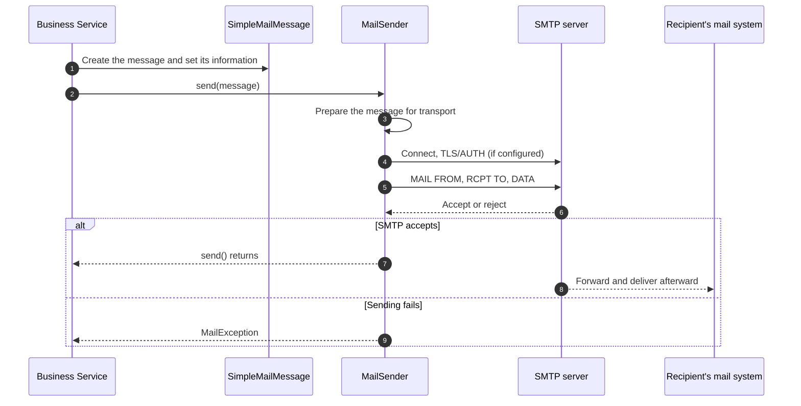
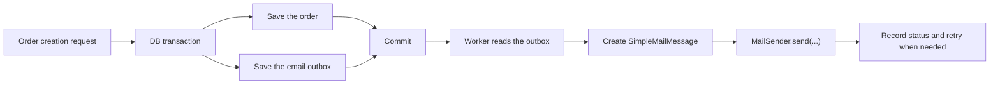

# Sending a Message via MailSender

In **Spring Framework Mail**, the simplest way to send a text email is to create a `SimpleMailMessage` object, fill in the sender address, recipients, subject, and content, and then call **`MailSender.send(...)`**. This approach suits sign-up notifications, operational alerts, schedule reminders, sending confirmation links, or any email that needs no HTML or attachments.

Core example:

```java
SimpleMailMessage message = new SimpleMailMessage();
message.setFrom("no-reply@example.org");
message.setTo("user@example.net");
message.setSubject("Welcome");
message.setText("Your account is ready.");

mailSender.send(message);
```

To use this correctly in a Spring application, you need to understand that **`MailSender` is an interface**, **`SimpleMailMessage` is the data for a simple message**, and it is the sender's implementation that actually connects and communicates with the SMTP server. The `send(...)` call also has an important boundary: a successful submission to SMTP does not mean the email has appeared in the recipient's inbox.

## 1. Where does MailSender sit in Spring Mail?

`org.springframework.mail.MailSender` is Spring's simple email sending interface, with two main methods:

```java
void send(SimpleMailMessage simpleMessage) throws MailException;

void send(SimpleMailMessage... simpleMessages) throws MailException;
```

Related components:

| Component | Responsibility |
|---|---|
| `MailSender` | The contract for sending one or more `SimpleMailMessage` objects. |
| `SimpleMailMessage` | A Java object holding plain text email information: sender, recipient, subject, text... |
| `JavaMailSender` | An interface that extends `MailSender`, adding the ability to create and send `MimeMessage`. |
| `JavaMailSenderImpl` | A common implementation that uses Jakarta Mail to connect to SMTP. |
| `MailException` | Spring's runtime exception reporting a problem preparing or sending an email. |
| SMTP server | Accepts or rejects the message, and may then forward it to the receiving system. |

Interface relationship:

```text
        MailSender
         /     \
        /       \ send(SimpleMailMessage)
       v         v
  JavaMailSender (extends MailSender)
         |
         v
  JavaMailSenderImpl
         |
         v
    Jakarta Mail / SMTP
```

This is a diagram describing the relationship at a conceptual level: `JavaMailSender` **extends** `MailSender`, and `JavaMailSenderImpl` fulfills the sending contract through Jakarta Mail. In Spring Boot, the auto-configured mail sender bean is usually a `JavaMailSender` implementation, so you can still **inject the `MailSender` type** into services that only need to send text email.

**API selection principle:** if a service only sends `SimpleMailMessage`, declaring the dependency as the `MailSender` type is usually enough. When you need HTML, MIME multipart, inline images, or file attachments, switch to the `JavaMailSender` API and `MimeMessageHelper`.

## 2. The flow of sending a SimpleMailMessage



In a typical synchronous send call:

1. **The application decides to send:** the business logic determines the recipient and content, for example after creating an account.
2. **Create the message:** Java code creates a `SimpleMailMessage` and sets the fields.
3. **Call the sender:** `MailSender.send(message)` receives the message to send.
4. **SMTP sending transport:** an implementation such as `JavaMailSenderImpl` uses the host, port, TLS, and authentication configuration to communicate with the SMTP server.
5. **Return the result:** if no error occurs during sending, the call finishes normally; if a problem occurs, Spring throws an appropriate `MailException`.
6. **Downstream process:** the server that received the message may forward it, queue it, filter it, or generate a bounce later.

The steps that build a `SimpleMailMessage` **do not open an SMTP connection**. Network communication happens when the sender performs the send or when the application deliberately tries a connection through another mechanism.

## 3. Preparing the mail sending environment

### 3.1. Using Spring Boot

In a Spring Boot application, the common dependency is the email starter:

```groovy
// build.gradle
dependencies {
    implementation 'org.springframework.boot:spring-boot-starter-mail'
}
```

The starter provides the libraries to integrate Spring Mail and Jakarta Mail. When the auto-configuration conditions are met and the SMTP information is provided, Spring Boot can register a `JavaMailSender` for injection into the application.

Example `application.yml` for SMTP submission using **port 587 + STARTTLS**:

```yaml
spring:
  mail:
    host: smtp.example.net
    port: 587
    username: ${SMTP_USERNAME}
    password: ${SMTP_PASSWORD}
    default-encoding: UTF-8
    properties:
      "[mail.smtp.auth]": true
      "[mail.smtp.starttls.enable]": true
      "[mail.smtp.starttls.required]": true
      "[mail.smtp.connectiontimeout]": 5000
      "[mail.smtp.timeout]": 5000
      "[mail.smtp.writetimeout]": 5000

app:
  mail:
    from: no-reply@example.org
```

This is an **illustrative** configuration; the address `smtp.example.net` must be replaced with the real server, and the TLS setup must follow the provider's requirements.

- `spring.mail.host` / `port`: specify the SMTP endpoint.
- `spring.mail.username` / `password`: login credentials, taken from environment variables in the example.
- `mail.smtp.auth`: enables SMTP authentication in this configuration.
- `mail.smtp.starttls.enable` and `required`: require the SMTP connection to be upgraded via STARTTLS before sensitive data is sent.
- The timeout properties: limit the wait time for connecting, reading, and writing data.
- `app.mail.from`: a property defined by the application itself. Spring Boot **does not automatically apply** this property as `From` for all messages; the service must read and use it.

Do not put the SMTP password in source code, committed files, or logs. Some services require an app password, a token, or a dedicated login mechanism; use the credentials supported by the provider.

### 3.2. Using plain Spring Framework

When you do not use Spring Boot auto-configuration, you can register a `JavaMailSenderImpl` yourself:

```java
import java.util.Properties;
import org.springframework.context.annotation.Bean;
import org.springframework.context.annotation.Configuration;
import org.springframework.mail.MailSender;
import org.springframework.mail.javamail.JavaMailSenderImpl;

@Configuration
public class MailConfiguration {

    @Bean
    public MailSender mailSender() {
        JavaMailSenderImpl sender = new JavaMailSenderImpl();
        sender.setHost("smtp.example.net");
        sender.setPort(587);
        sender.setUsername(System.getenv("SMTP_USERNAME"));
        sender.setPassword(System.getenv("SMTP_PASSWORD"));
        sender.setDefaultEncoding("UTF-8");

        Properties properties = sender.getJavaMailProperties();
        properties.put("mail.smtp.auth", "true");
        properties.put("mail.smtp.starttls.enable", "true");
        properties.put("mail.smtp.starttls.required", "true");
        properties.put("mail.smtp.connectiontimeout", "5000");
        properties.put("mail.smtp.timeout", "5000");

        return sender;
    }
}
```

The example registers the bean as the `MailSender` type because the service only needs to send plain text. If the same application also has to send HTML or attachments, you should publish the bean as the `JavaMailSender` or `JavaMailSenderImpl` type so that components needing the advanced API can still inject it.

## 4. Creating a SimpleMailMessage and setting the fields

`SimpleMailMessage` is a mutable (*mutable*) object. The setter methods represent the familiar pieces of information of an email:

| API | Meaning | Example |
|---|---|---|
| `setFrom(String)` | The sender address shown in the `From` header. | `no-reply@example.org` |
| `setReplyTo(String)` | The address that receives replies when the user clicks Reply. | `support@example.org` |
| `setTo(String...)` | One or more primary recipients. | `user@example.net` |
| `setCc(String...)` | Public carbon copy recipients. | `manager@example.net` |
| `setBcc(String...)` | Blind carbon copy recipients. | `audit@example.net` |
| `setSubject(String)` | The message subject. | `Registration confirmation` |
| `setText(String)` | The plain text content part. | `Your account is ready.` |
| `setSentDate(Date)` | The send date shown on the message. | `new Date()` |

Example with multiple recipients:

```java
SimpleMailMessage message = new SimpleMailMessage();

message.setFrom("no-reply@example.org");
message.setReplyTo("support@example.org");

message.setTo("alice@example.net", "bob@example.net");
message.setCc("teamlead@example.net");
message.setBcc("audit@example.net");

message.setSubject("Notification from the system");
message.setText("""
        Hello everyone,

        The weekly report has been updated.
        Please check the internal system.

        Best regards.
        """);

mailSender.send(message);
```

**Note about recipients:** `To`, `Cc`, and `Bcc` have different display and privacy purposes. A `Bcc` recipient is usually included in the SMTP envelope but does not appear in the `Bcc` header delivered to the other recipients. You should not use `To` or `Cc` for an email list whose recipients are not allowed to see one another.

### Display name and address syntax

`SimpleMailMessage` receives address values as `String`. When you only send automated notifications, the most maintainable approach is to use a bare address such as `no-reply@example.org`. If you need precise control over a Unicode display name, complex address parsing, or advanced MIME headers, `MimeMessageHelper` has dedicated APIs such as `setFrom(address, personal)`.

What matters is that **`setFrom(...)` sets the sender information in the message**. It does not by itself guarantee the application has the right to use that address with the SMTP provider. Some providers only allow sending from verified addresses or domains.

### `From` and the envelope sender are not necessarily the same

At the SMTP layer there is also the `MAIL FROM` command that specifies the **envelope sender**, usually related to delivery failure notices (*bounce*). The email's `From` header that the recipient sees and the envelope sender are two different layers of information. With the Jakarta Mail SMTP provider, the `mail.smtp.from` configuration can specify a separate envelope sender.

For example, the header `From: no-reply@example.org` can still go together with the envelope sender `bounces@example.org`. When preparing to send mail, you need to know which email provider you use and how the sending domain is verified.

## 5. Example of a Spring service sending a welcome email

Suppose the application needs to send a text email after creating an account. The service can depend directly on the `MailSender` interface and read the From address from configuration.

```java
import org.springframework.beans.factory.annotation.Value;
import org.springframework.mail.MailSender;
import org.springframework.mail.SimpleMailMessage;
import org.springframework.stereotype.Service;

@Service
public class WelcomeEmailService {

    private final MailSender mailSender;
    private final String from;

    public WelcomeEmailService(
            MailSender mailSender,
            @Value("${app.mail.from}") String from
    ) {
        this.mailSender = mailSender;
        this.from = from;
    }

    public void sendWelcomeEmail(String recipient, String displayName) {
        SimpleMailMessage message = new SimpleMailMessage();

        message.setFrom(from);
        message.setTo(recipient);
        message.setSubject("Welcome to the application");

        String safeName = (displayName == null || displayName.isBlank())
                ? "there"
                : displayName;

        message.setText("""
                Hello %s,

                Your account has been created successfully.
                You can sign in and start using the service.

                Best regards,
                The Application Team
                """.formatted(safeName));

        mailSender.send(message);
    }
}
```

Each time `sendWelcomeEmail(...)` is called, the service **creates a new `SimpleMailMessage`** and only then sets the recipient and body. This is an important design detail: the `WelcomeEmailService` bean can be used by many requests concurrently, while the message is a mutable object, so it should not be kept as a shared field to be modified and sent again.

The code above assumes `recipient` has been checked by the business logic at an appropriate level before the service is called. In a real system, you need to check the necessary input and avoid putting untrusted data into headers through arbitrary string concatenation.

### Calling the service from the business logic

```java
import org.springframework.stereotype.Service;

@Service
public class RegistrationService {

    private final AccountRepository accountRepository;
    private final WelcomeEmailService welcomeEmailService;

    public RegistrationService(
            AccountRepository accountRepository,
            WelcomeEmailService welcomeEmailService
    ) {
        this.accountRepository = accountRepository;
        this.welcomeEmailService = welcomeEmailService;
    }

    public void register(String email, String name) {
        accountRepository.createAccount(email, name);

        welcomeEmailService.sendWelcomeEmail(email, name);
    }
}
```

`AccountRepository` here is a hypothetical business component, included to clarify where the mail sending call is placed. For an application with transactions, a direct call like the one above needs to be evaluated in terms of commit timing and the error handling policy; the last part of this lesson presents a more durable option.

## 6. What does calling `MailSender.send(...)` actually do?

In the service:

```java
mailSender.send(message);
```

This method receives **one `SimpleMailMessage`**. With a common SMTP implementation, Spring converts the data from the message into a message for the transport and then performs the send through the configured mail server.

A typical SMTP session, omitting the handshake and authentication:

```text
C: MAIL FROM:<no-reply@example.org>
S: 250 Sender OK

C: RCPT TO:<user@example.net>
S: 250 Recipient OK

C: DATA
S: 354 End data with <CRLF>.<CRLF>

C: From: no-reply@example.org
C: To: user@example.net
C: Subject: Welcome
C:
C: Your account is ready.
C: .
S: 250 Message queued
```

This snippet is only illustrative. On a real system, the SMTP client also has the steps of opening a connection, `EHLO`, TLS, AUTH, additional headers, and an appropriate encoding.

Milestones to remember:

- **`250` after `RCPT TO`**: the server accepts the recipient at that step; it has not confirmed receipt of the whole content.
- **`250` after `DATA`**: the server accepts the message for further processing.
- **`send(...)` returns with no exception**: the application side has completed the send operation to SMTP as reported by the sender.
- **Whether it reached the Inbox**: depends on downstream mail systems, bounces, spam filtering, and the recipient's policies.

`MailSender` does not directly provide a result like "the user has read the message". If the problem needs delivery tracking, you must integrate events or logs from the email provider.

### Synchronous sending and latency

With the common `JavaMailSenderImpl`, the `send(...)` call is **synchronous**. The calling thread must wait for the send to SMTP to complete or fail. If it is called from an HTTP controller:

```text
HTTP request
    |
    v
RegistrationService
    |
    v
WelcomeEmailService
    |
    v
MailSender.send(...)
    |
    +---- Wait for the result from SMTP
    |
    v
HTTP response
```

HTTP response time may increase when SMTP is slow. The timeouts in the mail sending configuration help limit the wait time but **do not make the operation asynchronous**.

## 7. Distinguishing SimpleMailMessage and MimeMessage

`MailSender.send(SimpleMailMessage)` is a compact API for **text/plain** content. When the representation requirements exceed what `SimpleMailMessage` can do, you must use the appropriate MIME API.

| Need | `SimpleMailMessage` + `MailSender` | `MimeMessage` + `JavaMailSender` |
|---|---|---|
| Plain text email | Suitable | Also supported |
| Subject, From, To, Cc, Bcc, Reply-To | Supported | Supported |
| Rendered HTML body | No dedicated API | Yes, via `MimeMessageHelper` |
| Both plain text and HTML versions | No | Yes, via MIME alternative |
| Inline images using `cid:...` | No | Yes |
| File attachments | No | Yes |
| Multiple MIME part structure | No | Yes |

If you set:

```java
message.setText("<strong>Hello!</strong>");
```

on a `SimpleMailMessage`, the `<strong>` characters will be treated as **text**, not as HTML to render. To send HTML:

```java
MimeMessage mime = javaMailSender.createMimeMessage();
MimeMessageHelper helper = new MimeMessageHelper(
        mime,
        false,
        "UTF-8"
);

helper.setTo("user@example.net");
helper.setFrom("no-reply@example.org");
helper.setSubject("Notification");
helper.setText("<strong>Hello!</strong>", true);

javaMailSender.send(mime);
```

This MIME example is only to show **when you need to change APIs**. For the problem of sending simple text, keeping `MailSender` and `SimpleMailMessage` is enough.

## 8. Sending multiple messages with varargs

`MailSender` supports the overload:

```java
mailSender.send(firstMessage, secondMessage);
```

One scenario is sending two notifications with different purposes:

```java
SimpleMailMessage customer = new SimpleMailMessage();
customer.setFrom("no-reply@example.org");
customer.setTo("customer@example.net");
customer.setSubject("Order received");
customer.setText("Thank you. We have received your order.");

SimpleMailMessage operations = new SimpleMailMessage();
operations.setFrom("no-reply@example.org");
operations.setTo("ops@example.org");
operations.setSubject("New order");
operations.setText("Please check the admin system.");

mailSender.send(customer, operations);
```

This call is convenient when the sender implementation supports sending multiple messages in one call. But there are limits you need to understand:

1. **Varargs does not create an atomic transaction for emails.** One message may have been accepted by the server before another message fails.
2. **Do not assume every recipient has the same result.** Errors per recipient or per message may differ.
3. **It does not mean the provider opens only one connection in every case.** This depends on the implementation and how the transport is managed.
4. **It does not mean the email has been sent asynchronously or put into a durable queue.**

Some Spring implementations provide information about the messages that failed to send in a dedicated exception, but the business code still needs to be prepared to handle the possibility of **partial success**. For requirements to track the status of each email, you should manage each send request with its own ID and status.

### Sending the same content to many people

There are two ways with different meanings:

- **One message, many recipients:** call `message.setTo("a@example.net", "b@example.net")` and then `send(message)`. The recipients can see each other in the `To` header.
- **Multiple separate messages:** create one `SimpleMailMessage` for each recipient and then send them separately or use the varargs overload. This makes it easy to personalize content, keep headers separate, and track status per recipient.

Do not use multiple `To` addresses if the recipient list needs to be kept secret or the email must be personalized individually.

## 9. Safely reusing template content

A simple email may repeat the `From` or `Subject` fields. `SimpleMailMessage` has a **copy constructor**, which helps create a copy from a template:

```java
SimpleMailMessage template = new SimpleMailMessage();
template.setFrom("no-reply@example.org");
template.setReplyTo("support@example.org");
template.setSubject("Account notification");

SimpleMailMessage first = new SimpleMailMessage(template);
first.setTo("alice@example.net");
first.setText("Hello Alice, your account has been updated.");

SimpleMailMessage second = new SimpleMailMessage(template);
second.setTo("bob@example.net");
second.setText("Hello Bob, your account has been updated.");

mailSender.send(first, second);
```

The nice thing about this approach is that **each message sent still has its own instance**. Avoid code like:

```java
// An unsafe approach when the service is shared between requests:
private final SimpleMailMessage sharedMessage = new SimpleMailMessage();

// Request A: sharedMessage.setTo("alice@example.net");
// Request B: sharedMessage.setTo("bob@example.net");
// Request A: mailSender.send(sharedMessage);
```

Because `SimpleMailMessage` is mutable, two threads may overwrite each other's recipient or content. With a singleton service, use a template that is not changed after initialization and **copy** it before personalizing, or simply create a new message on each send.

When using a template, you also need to make sure information from a previous user is not carried over to the next user, for example `Bcc`, content, or a subject containing personal data.

## 10. Mail sending errors and `MailException`

`MailSender.send(...)` declares `MailException`. This is an **unchecked exception** in Spring, so Java does not require the method to write `throws MailException`.

Common kinds of errors:

| Error group | Example cause | How to handle |
|---|---|---|
| Wrong configuration | Incorrect host, port, TLS, or account | Fix the configuration and secrets before retrying. |
| `MailAuthenticationException` | SMTP AUTH failed | Check the credentials, account permissions, or auth mechanism. |
| `MailSendException` | An error in the sending process or transport | Look at the cause, the SMTP reply, and the connection status. |
| Message data error | Invalid address or missing information | Check the input and the message creation rules. |
| Temporarily cannot connect | Timeout, transient DNS error, server interruption | You may retry with a limit and backoff. |
| SMTP rejects the recipient | Address rejected or not allowed to relay | Handle according to the response code and server policy; avoid infinite retries. |

Example of catching the exception at the application boundary:

```java
import org.springframework.mail.MailException;
import org.springframework.mail.MailSender;
import org.springframework.mail.SimpleMailMessage;

public void sendNotification(MailSender sender, String recipient) {
    SimpleMailMessage message = new SimpleMailMessage();
    message.setFrom("no-reply@example.org");
    message.setTo(recipient);
    message.setSubject("Notification");
    message.setText("You have a new notification.");

    try {
        sender.send(message);
        // Only record that the SMTP send completed according to the sender.
        } catch (MailException ex) {
        // Record the failed status or hand it to the retry mechanism.
        // Do not log SMTP credentials or sensitive message content.
        throw ex;
    }
}
```

Catching `MailException` without recording or handling anything will make the business logic think the email has been sent. Conversely, retrying every exception indefinitely is also wrong: a wrong password or a permanently rejected address will not be fixed by sending continuously.

### A hard error: not knowing whether the server received the mail

Suppose the client has sent all of `DATA` but the connection is lost right before it reads the final response. The SMTP server may **have accepted** the email even though the application sees a network error.

When retrying automatically, the email risks **being sent twice**. For important notifications, you need to identify the send request, record each attempt, set a limited retry policy, and handle the uncertain-status case. `MailSender` does not itself provide a send-exactly-once guarantee.

### Do not infer delivery from the result of `send(...)`

Some steps that are often confused:

```text
mailSender.send(...) returns
    ↓
The SMTP server has processed the send operation
    ↓
The system forwards to the recipient's domain
    ↓
The receiving mail server may accept, defer, or reject
    ↓
The mail client may place it in the Inbox or Spam
    ↓
The recipient may or may not read the message
```

To know whether a message was **delivered**, **bounced**, or **complained about**, the system needs an event/status source from the mail provider or the operations infrastructure, not just the result of one Java call.

## 11. Placing mail sending in the business flow

When the business requires consistency, the timing of calling `send(...)` is very important.

For example, putting the mail sending command inside the transaction that saves an order:

```text
Begin DB transaction
    ↓
Save the order
    ↓
MailSender.send(...)
    ↓
Commit DB transaction
```

If the email has been accepted by SMTP but the DB transaction **rolls back**, the recipient may get a notification about an order that was not saved successfully. Conversely, sending after commit but having the application stop before sending may leave the user without an email.

A more durable architecture for important notifications is the **transactional outbox**:



A worker creates the `SimpleMailMessage` from the outbox record and then sends it. This approach reduces the risk of the business logic being committed while the send request is lost, and also lets the HTTP request return early. However, you need to handle idempotency and the uncertain send status to limit duplicate emails.

If the email is less important than the simplicity of the application, calling `MailSender.send(...)` directly can still be an appropriate decision. Choose deliberately based on latency, the possibility of losing the notification, and retry requirements.

## 12. Testing mail sending in the development environment

To learn how to use `MailSender` without sending real emails, you can use a **mail-capturing SMTP server** such as Mailpit or GreenMail. These tools receive email at a test endpoint and let you observe the content/headers without forwarding to the Internet.

For example, when a test SMTP server listens on `localhost:1025` and does not require AUTH/TLS:

```yaml
# application-dev.yml
spring:
  mail:
    host: localhost
    port: 1025
    default-encoding: UTF-8
    properties:
      "[mail.smtp.auth]": false
      "[mail.smtp.starttls.enable]": false

app:
  mail:
    from: no-reply@example.org
```

Note that the `localhost` configuration only works when the application and the SMTP test server have an appropriate network path. If you run in a container, `localhost` inside the container is the container itself, not the host machine; you need to choose the corresponding hostname/network.

A manual test flow:

1. Start the SMTP test server in the development environment.
2. Configure `spring.mail.host` and `port` to point to the test server.
3. Call the business logic that creates the `SimpleMailMessage`.
4. Open the test interface or mailbox to view `From`, `To`, `Subject`, and the body.
5. Check the application log if `send(...)` raises an exception.

This helps you observe **the application's actual sending behavior** without needing a real SMTP account in the development environment.

## 13. Common errors when sending via MailSender

| Symptom | Possible relation | What to look at |
|---|---|---|
| Spring reports it cannot find a `MailSender` bean | No starter/SMTP configuration yet, or the implementation is not registered | Check the `JavaMailSender`/`MailSender` bean and the initialization configuration. |
| SMTP authentication failed | Wrong username/password or auth mechanism | Secrets, account, TLS, and the provider's rules. |
| Connection timeout | The host/port is unreachable, a firewall, or a service problem | DNS, route, timeouts, and the SMTP endpoint. |
| Email shows literal `<b>` text | `SimpleMailMessage` is text/plain | Use `MimeMessage` if you need HTML. |
| Sent without error but the Inbox is empty | The email may be delayed, bounced, or spam | Log/email events on the sending service side and the receiving mailbox. |
| Sent once but there are two emails | The business logic called twice, or a retry after an uncertain status | Event code, logs, the send request, and the retry policy. |
| The recipient sees a list of other emails | Multiple recipients were put in `To` or `Cc` | Check privacy and how the message is split. |
| Recipient data gets mixed | A mutable `SimpleMailMessage` was reused across requests | Create a new message or copy the template before each send. |
| Vietnamese diacritics error | Inconsistent charset of body/header | Default encoding, the content creation process, and the actual MIME source. |
| `From` is rejected by the server | The domain/address is not allowed to send | Check domain authentication and the SMTP provider's policy. |

### An analysis scenario

Suppose the service calls `mailSender.send(message)` with no exception, but the user reports not seeing the confirmation email. Handle it layer by layer:

1. Determine whether the application called the mail sending service the right number of times and with the right recipient.
2. Look at the SMTP transaction log/information to know whether the provider accepted the message.
3. If the provider accepted it, check the queue, delivery, bounce, or suppression status from the sending system.
4. Check whether the recipient sees the message in Spam, the promotions tab, or whether a mail gateway blocked it.

Do not assume by default that the fault lies in `SimpleMailMessage` just because the user does not see the email. **Creating the message**, **SMTP acceptance**, and **final delivery** are different stages.

## 14. Frequently asked questions

**Do I need to call `saveChanges()` before sending a `SimpleMailMessage`?**  
No. `SimpleMailMessage` is not a `MimeMessage` and has no MIME header update lifecycle in that way. You only need to set the data and then call `MailSender.send(...)`; the sender implementation takes care of the transport steps.

**Do I need to call `mailSender.createMimeMessage()`?**  
No. The `createMimeMessage()` method belongs to `JavaMailSender` for MIME email. For plain text, creating `new SimpleMailMessage()` is enough.

**Can I send Vietnamese with `SimpleMailMessage`?**  
Yes. A Java string can contain Unicode. Configure an appropriate encoding (usually UTF-8) in the sender and make sure the source data is not read with the wrong encoding. The mail system creates a MIME text part with the corresponding charset/transfer encoding.

**Does `send(message)` return a result object or a message ID?**  
No. The method in `MailSender` has a return type of `void`. When you need a message ID, queue ID, or delivery event, you must get it from the appropriate mail layer or the provider's logging/event mechanism.

**Can I omit `From`?**  
Some transports/providers may infer the sender from configuration, but the behavior depends on the system and it may be rejected. For business notifications, you should set an explicit `From` address that the provider allows you to use.

**Is sending multiple messages via `send(messages...)` faster than calling repeatedly one by one?**  
It depends on the implementation, connection, and provider. The varargs overload mainly provides **a way to express a send request for multiple messages** in the API; it is not a commitment on performance, atomicity, or reliability.

**Should I catch the exception and always return HTTP 200?**  
Only if the API/business has a clear contract that the email is processed asynchronously and the request has been durably recorded. If a direct send fails without a mechanism to store and resend, returning success may hide the error from users and the operations team.

## 15. Takeaways

An operation to send a text email through Spring Framework Mail is built from three parts:

```java
SimpleMailMessage message = new SimpleMailMessage();
// Fill in From, To, Subject, Text.
mailSender.send(message);
```

- **`SimpleMailMessage`** is the data structure for a simple text email; each independent send should have its own instance.
- **`MailSender`** is the interface with `send(SimpleMailMessage)` and `send(SimpleMailMessage...)`; in a typical application, `JavaMailSenderImpl` does the SMTP work.
- **`MailSender.send(...)` is a synchronous call in the common implementation**, which can slow a request when SMTP is slow; timeouts and a queue architecture need to be considered.
- **`MailException`** reports errors in the send operation, but not every delivery error after SMTP acceptance becomes an exception in the application.
- **`SimpleMailMessage` only suits text/plain**. HTML, inline images, and attachments need `MimeMessage`/`MimeMessageHelper`.
- **Multiple messages in one call do not create atomicity** and may have partial results; important systems need separate status for each send request.
- **SMTP accepting a message is not Inbox confirmation**. When reliability is needed, you must track sending, retries, bounces, and delivery results at the appropriate layers.

For an application that only needs to send simple text notifications, `MailSender` combined with `SimpleMailMessage` keeps the code concise and cleanly separates responsibilities. When you understand the boundary between **preparing content**, **sending to SMTP**, and **delivery at the receiving system**, you can extend the mail sending flow while still controlling errors and side effects.
