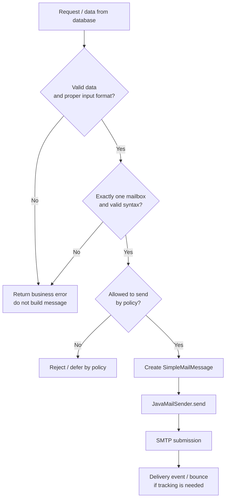
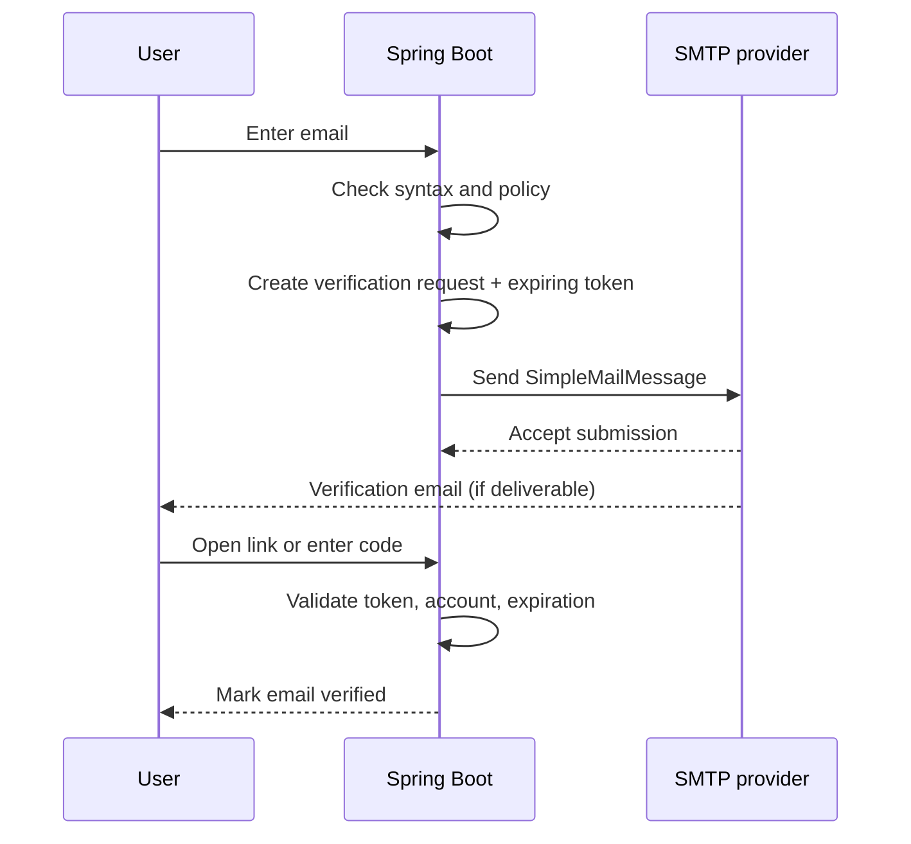

# Validating Addresses Before Creating a Message

A Spring Boot application sends a registration confirmation email with `JavaMailSender`. The user enters `an@example.net`, the system builds a `SimpleMailMessage`, sets the recipient, and then calls `send(...)`. This flow looks simple, but what happens if the entered value is an empty string, a disallowed list of addresses, has a newline character, or contains a display name instead of a bare email address?

**Validating addresses before creating a message** is the step that protects the boundary between business input data and the data that the email system will use for delivery. This step helps return errors early, unify recipient policy, limit misdirected sends, and reduce failures that can be detected before creating the mail object. In the **Simple mail** chapter of **Spring Framework Mail**, the `SimpleMailMessage` object is suitable when sending plain text and no complex MIME structure is needed. Although the API is simple, it does not replace application-level address validation.

A point to remember right from the start: **an address that is syntactically valid does not mean the mailbox exists, belongs to the right person, or is guaranteed to receive the message**. Those conclusions belong to different validation and verification layers.

## 1. Which validation layers does an email address go through?

Consider the input data:

```json
{
  "email": "an@example.net",
  "purpose": "ACCOUNT_VERIFICATION"
}
```

The application may need to answer several questions before sending:

| Layer | Question | Example |
|---|---|---|
| **Input data** | Is there a value, are there control characters, or does it exceed application limits? | `null`, `""`, `"an@example.net\r\nBcc:..."`. |
| **Mailbox syntax** | Is there exactly **one** email address accepted under application policy? | `an@example.net` vs `an@example.net,other@example.org`. |
| **Product rules** | Is this address allowed to be used for that feature? | Send internal notifications only to permitted domains, or block suppression lists. |
| **Ownership/consent** | Has the user verified the address and consented to receive that type of mail? | Confirmation link, verification code, marketing email opt-in. |
| **Delivery** | Can the mail system accept and deliver the message? | SMTP responses `2xx`/`4xx`/`5xx`, DSN/bounce, provider events. |

A typical input validator focuses on the **first three layers**. Ownership verification and delivery results are separate asynchronous or business flows.



This design separates **data errors that the user can fix immediately** from **network and delivery errors** that the system needs to track, retry, or report status for.

## 2. Distinguishing a bare address, a display name, and a recipient list

An email address in an application is usually stored in **addr-spec** form:

```text
an@example.net
```

In an Internet Message Format header, a mailbox can also have a **display name**:

```text
Nguyễn Văn An <an@example.net>
```

Distinguish:

- **`an@example.net`**: the email address used for routing.
- **`Nguyễn Văn An`**: the display name for the reader.
- **`Nguyễn Văn An <an@example.net>`**: the representation of an address with a display name in a header; it is not necessarily the input format that an API's `emailAddress` field expects to receive.

If an API requires **one bare email address**, the value `"Nguyễn Văn An <an@example.net>"` should be treated as **violating the input contract**, even if the email library can parse it into a valid mailbox.

Similarly:

```text
an@example.net,bob@example.org
```

This is a **list of two addresses**, not one address. A field meant for a single recipient must not accidentally turn into a mechanism for sending to multiple people just because the library interprets a comma as a separator.

### The To header differs from SMTP RCPT TO

In a single send, the message header may show:

```text
To: Nguyễn Văn An <an@example.net>
```

While SMTP uses the envelope command:

```text
RCPT TO:<an@example.net>
```

The display name does not participate in SMTP routing. Nor should the content of the `To:` header be treated as the sole proof of the actual recipient list: the system also has `Cc`, `Bcc`, and the SMTP envelope recipient list.

With **`SimpleMailMessage`**, setters usually take address strings. If you need a Unicode display name for `From`/`To` or rich MIME headers, consider **`MimeMessage` + `MimeMessageHelper`** instead of trying to concatenate `Name <email>` into a single string yourself.

## 3. Checking email syntax: what do you need to understand?

A typical email address has the form:

```text
local-part@domain
```

Examples:

```text
an@example.net
linh.nguyen@example.org
orders+invoice@example.com
```

### 3.1. Local-part does not contain only letters and digits

The part before `@` can contain some valid symbols such as dots, plus signs, underscores, and other characters according to email grammar. **A plus sign is not automatically an error**: `orders+invoice@example.com` is a valid address form and is often used for mail filtering.

Some addresses that are valid under Internet Message Format specifications have rare syntax, such as *quoted local-part*. Therefore, a regex that is too simple may **reject valid addresses**, while a regex that is too permissive may **accept values that violate the contract**.

You should not rely on rules such as:

- "The address must end with `.com`."
- "The domain name must have exactly one dot."
- "No `+` sign is allowed."
- "Only lowercase letters are accepted."
- "If the regex matches, the mailbox definitely exists."

An application may deliberately use a **formatting policy narrower than the RFC** for product needs, but it should state that this is a *product limitation*, not conclude that every other format is invalid under email standards.

### 3.2. Domain and local-part follow different rules

**Domain** has its own domain name system. Domains in email are case-insensitive in the way DNS handles them, and **IDN** (*Internationalized Domain Names*) may need to be converted to an ASCII-compatible form if the product supports internationalized domain names.

**Local-part** belongs to the receiving system. Under the traditional SMTP model, you should not arbitrarily convert the entire local-part to lowercase because doing so could change the destination address on some systems, even though many services in practice treat it case-insensitively.

Example:

```text
Sales@example.net
sales@example.net
```

You should not assume by default that the two addresses above are always the same mailbox in every system. If normalization is needed for comparison or deduplication, the application must have an explicit policy instead of lowercasing the whole address on its own.

### 3.3. Unicode addresses are a special case

Compare:

```text
Nguyễn Văn An <an@example.net>     // Unicode display name, ASCII address
nguyễn@example.net                 // Local-part contains Unicode
```

The first case can be represented in the header via MIME encoding. The second case falls under **Email Address Internationalization (EAI)** and may require **SMTPUTF8** along the delivery path.

If the application's **Simple mail** use case currently supports only ASCII addresses, state that policy clearly and reject values that have Unicode in the addr-spec. When EAI support is needed, you must examine the entire chain from validation, mail library, SMTP provider, and intermediate servers to the receiving system. **Merely adding a UTF-8 charset for the body does not automatically make a Unicode address deliverable.**

## 4. Why validate before creating a SimpleMailMessage?

Basic example:

```java
SimpleMailMessage message = new SimpleMailMessage();
message.setTo(rawEmail);
message.setSubject("Account confirmation");
message.setText("Please confirm your email address.");
mailSender.send(message);
```

If `rawEmail` comes from an unvalidated request, the application passes untrusted data into the message. The fact that a setter **does not immediately throw an error** does not mean the data is valid; some errors only surface when the message is converted into outgoing data or when the SMTP server processes it.

Recommended order:

```text
rawEmail from request/database
    ↓
Check required, control characters
    ↓
Check syntax for exactly one address
    ↓
Check recipient policy and sending permission
    ↓
Create SimpleMailMessage
    ↓
setTo / setFrom / setSubject / setText
    ↓
JavaMailSender.send(...)
```

Thanks to this:

1. Return an early, meaningful error: "Invalid email address", instead of letting the user see a stack trace from the mail layer.
2. Reduce wasted work creating and sending emails when the data is clearly wrong.
3. Separate data policy from SMTP configuration.
4. Avoid accidentally accepting a list of addresses in a field intended for **one person**.
5. Control malicious data cases targeting headers or the sending flow.
6. Ensure the same rule is applied before saving an address, before changing an email, and before requesting a send.

Creating a message is still a lightweight operation, so **the main value lies in responsibility boundaries and correctness**, not in saving a few Java assignments.

## 5. Using Jakarta Mail InternetAddress to validate syntax

In the Spring Mail ecosystem, **`jakarta.mail.internet.InternetAddress`** is an appropriate API for parsing/validating mailbox syntax. It understands many email address rules better than a hand-written regex.

Simple example:

```java
import jakarta.mail.internet.AddressException;
import jakarta.mail.internet.InternetAddress;

public boolean hasValidMailboxSyntax(String input) {
    try {
        InternetAddress address = new InternetAddress(input, true);
        address.validate();
        return true;
    } catch (AddressException | NullPointerException ex) {
        return false;
    }
}
```

This is only an **introductory example on syntax**. When you want an API to accept strictly **one bare address**, you need additional input and data-type checks, because:

- `InternetAddress` can also handle address syntax with a **display name**, comments, or list structures in some parse methods.
- `validate()` checks only part of the syntax rules according to the library's implementation; it does not prove the mailbox is real.
- Not every case undesirable under product policy is treated by the library as a syntax error.
- You need to check for control characters before passing data into header/address strings.

### 5.1. Validating strictly one bare address

An example validator class for an application that **deliberately accepts only one ASCII addr-spec**:

```java
package com.example.mail;

import jakarta.mail.internet.AddressException;
import jakarta.mail.internet.InternetAddress;

import java.nio.charset.StandardCharsets;

public final class RecipientEmailValidator {

    private RecipientEmailValidator() {}

    public static String requireSingleAsciiAddress(String raw) {
        if (raw == null) {
            throw new IllegalArgumentException("Email address is required");
        }

        // Example UI policy: strip only leading and trailing whitespace.
        String value = raw.strip();
        if (value.isEmpty()) {
            throw new IllegalArgumentException("Email address is blank");
        }

        if (value.codePoints().anyMatch(Character::isISOControl)) {
            throw new IllegalArgumentException(
                    "Email address contains control characters");
        }

        // Product decision: this simple mail flow supports only
        // ASCII addr-spec. Do not apply if the product supports SMTPUTF8.
        if (!StandardCharsets.US_ASCII.newEncoder().canEncode(value)) {
            throw new IllegalArgumentException(
                    "Only ASCII email addresses are supported");
        }

        try {
            InternetAddress[] parsed = InternetAddress.parse(value, true);
            if (parsed.length != 1) {
                throw new IllegalArgumentException(
                        "Exactly one email address is required");
            }

            InternetAddress mailbox = parsed[0];
            mailbox.validate();

            // Reject display names, groups, or structures where parsing
            // transformed the input into an addr-spec different from what the user entered.
            if (mailbox.isGroup()
                    || mailbox.getPersonal() != null
                    || !value.equals(mailbox.getAddress())) {
                throw new IllegalArgumentException(
                        "A plain email address is required");
            }

            return value;
        } catch (AddressException ex) {
            throw new IllegalArgumentException(
                    "Invalid email address syntax", ex);
        }
    }
}
```

Meaning of each step:

| Step | Decision |
|---|---|
| Check `null`/blank | Do not create a message if the recipient is missing. |
| `strip()` | Remove **leading and trailing** whitespace per form policy; do not alter local-part content. |
| Check control characters | Reject CR, LF, NUL, and other control characters before creating headers. |
| ASCII policy | Limits the scope of the illustrative sending flow; if EAI is needed, design for it separately. |
| `InternetAddress.parse(value, true)` | Parses the address in strict mode; catches several formatting errors. |
| `parsed.length == 1` | Prevents one input from containing two mailboxes. |
| `validate()` | Checks mailbox syntax according to Jakarta Mail. |
| `isGroup()`/`getPersonal()`/compare `getAddress()` | Accepts only a bare email string per the API contract. |
| Return `value` | Produces a validated value to pass onward into business logic. |

**Limitation of the example:** this class enforces a **specific input policy** rather than proving that every RFC-allowed address is supported. Nor does it check MX, ownership, or delivery outcomes. If the project's environment still uses **`javax.mail`** instead of **`jakarta.mail`** in an older Spring/Jakarta version, the imports must match the version; the example here is for the Spring Boot 3 / Jakarta Mail ecosystem.

### 5.2. Why not just use `value.contains("@")`?

Checking `contains("@")` will accept strings that are clearly unsuitable:

```text
@
an@@example.net
 an@example.net, attacker@example.org
```

At the same time, it does not address:

- Whitespace in inappropriate places.
- Values containing display names or multiple addresses.
- Quoting rules of local-part.
- Control characters and product policy.
- The boundary between ordinary ASCII addresses and EAI addresses.

Using a parsing library together with explicit input rules makes code easier to maintain.

## 6. Is Bean Validation at the API layer enough?

In a Spring Boot REST API, **Jakarta Bean Validation** can be used to reject malformed data as soon as the request arrives.

Example DTO:

```java
import jakarta.validation.constraints.Email;
import jakarta.validation.constraints.NotBlank;
import jakarta.validation.constraints.Size;

public record SendVerificationRequest(
        @NotBlank
        @Email
        @Size(max = 254)
        String email
) {}
```

With Spring Boot, if the project needs Bean Validation and does not yet have the corresponding dependency:

```groovy
dependencies {
    implementation 'org.springframework.boot:spring-boot-starter-validation'
    implementation 'org.springframework.boot:spring-boot-starter-mail'
}
```

And a controller using it:

```java
import jakarta.validation.Valid;
import org.springframework.http.ResponseEntity;
import org.springframework.web.bind.annotation.PostMapping;
import org.springframework.web.bind.annotation.RequestBody;
import org.springframework.web.bind.annotation.RequestMapping;
import org.springframework.web.bind.annotation.RestController;

@RestController
@RequestMapping("/api/account")
public class VerificationController {

    private final VerificationService verificationService;

    public VerificationController(VerificationService verificationService) {
        this.verificationService = verificationService;
    }

    @PostMapping("/send-verification")
    public ResponseEntity<Void> send(
            @Valid @RequestBody SendVerificationRequest request) {
        verificationService.requestVerification(request.email());
        return ResponseEntity.accepted().build();
    }
}
```

`VerificationService` in the example is an application-defined service to check policy, create a durable send request, and send the email. The `202 Accepted` controller illustrates an API that **accepts a request for processing**; it does not mean the message has been delivered to the mailbox. If the service only sends synchronously or does not use a queue, choose the HTTP status according to the API's actual contract.

**Notes on `@Email`:**

1. `@Email` validates format according to the **Bean Validation provider** in use; it is not equivalent to checking every RFC rule in full.
2. `@Email` does not replace `@NotBlank`; the email constraint itself may accept `null` according to how standard constraints work.
3. `@Size(max = 254)` is an example of an **API character-policy limit**. SMTP limits are measured in **octets** on the protocol structure; do not equate Java character count with transmitted byte count.
4. `@Email` does not enforce that the input is strictly **one addr-spec per the product contract** in every implementation.
5. Continue using the business validator before creating `SimpleMailMessage`, especially when data can come from a database, message broker, or internal job without passing through a controller.

Bean Validation fits early checks at the **HTTP boundary**; a business validator helps enforce the same policy across **all entry paths**.

## 7. Integrating the validator into the Simple mail flow

### 7.1. Spring Boot configuration

To send email via SMTP submission with STARTTLS:

```yaml
spring:
  mail:
    host: ${MAIL_HOST}
    port: 587
    username: ${MAIL_USERNAME}
    password: ${MAIL_PASSWORD}
    protocol: smtp
    properties:
      "[mail.smtp.auth]": true
      "[mail.smtp.starttls.enable]": true
      "[mail.smtp.starttls.required]": true
      "[mail.smtp.ssl.checkserveridentity]": true
      "[mail.smtp.connectiontimeout]": 5000
      "[mail.smtp.timeout]": 10000
      "[mail.smtp.writetimeout]": 10000

app:
  mail:
    from: ${MAIL_FROM}
```

These properties are an example configuration for a provider that supports **SMTP submission on port 587 + STARTTLS**. For a provider using implicit TLS on port 465, reconfigure the connection type accordingly. Credentials must be supplied from environment variables or a secret management system, not hardcoded into the repository.

### 7.2. Validate the address before creating SimpleMailMessage

```java
package com.example.mail;

import org.springframework.beans.factory.annotation.Value;
import org.springframework.mail.SimpleMailMessage;
import org.springframework.mail.javamail.JavaMailSender;
import org.springframework.stereotype.Service;

@Service
public class VerificationMailService {

    private final JavaMailSender mailSender;
    private final String fromAddress;

    public VerificationMailService(
            JavaMailSender mailSender,
            @Value("${app.mail.from}") String fromAddress) {
        this.mailSender = mailSender;
        // "From" also needs a trusted and valid source.
        this.fromAddress =
                RecipientEmailValidator.requireSingleAsciiAddress(fromAddress);
    }

    public void sendVerification(String rawRecipient, String verificationLink) {
        // 1. Ensure data has the right format before building the message.
        String recipient =
                RecipientEmailValidator.requireSingleAsciiAddress(rawRecipient);

        // 2. Here the application can also check sending permission,
        // account status, and suppression policy.

        // 3. Create the message only after validation succeeds.
        SimpleMailMessage message = new SimpleMailMessage();
        message.setFrom(fromAddress);
        message.setTo(recipient);
        message.setSubject("Confirm your email address");
        message.setText(
                "Please open the following link to confirm: " + verificationLink);

        // 4. Hand off to the SMTP transport.
        mailSender.send(message);
    }
}
```

In this example:

- `rawRecipient` can come from a form, a database, or a send request.
- `requireSingleAsciiAddress(...)` separates address validation from message creation.
- `fromAddress` is determined from trusted configuration and validated when creating the service.
- `SimpleMailMessage` holds only plain text; creating the message after validation makes the purpose of each step clear.
- `JavaMailSender.send(...)` performs submission, but **does not confirm the user has read the email**.

This is a **minimal sending flow** to illustrate the processing order. For a real verification email, `verificationLink` must contain a sufficiently random token with an expiration, bound to the corresponding account or request, usable only per policy, and generated by the application's security service. Do not log the full link containing the token. For large-scale workflows, you can store send requests in an outbox and send through a worker.

### 7.3. Should you validate the address right before every send?

**Yes**, if earlier data has no guarantee of having been checked under the same contract or could have been altered. However, there is no need to repeat expensive checks or network operations every time.

A good way to organize it:

1. Validate when the user creates/updates the address.
2. Store it in a structured field (for example, a dedicated `email_address` field).
3. Verify ownership when the business logic requires it.
4. Before creating the email, check conditions that **can still change**: whether the account is allowed to send, whether the address is on a suppression list, and whether the user has opted out of marketing email.
5. The syntax validator can be reused at the sending boundary to guard legacy or non-HTTP data paths.

If the system has an `EmailAddress` type/value object constructed solely through a trusted validator, the sending layer can accept that type directly. The key point is that **the validity invariant must be preserved**, not that you are forced to re-parse a string everywhere.

## 8. Validating multiple To, Cc, and Bcc recipients

`SimpleMailMessage` can set multiple addresses for `To`, `Cc`, and `Bcc`. For list-shaped input, validate **each element** under the same policy while also checking the recipient count limit.

Example of a function validating a recipient array:

```java
import java.util.LinkedHashSet;
import java.util.List;

public final class RecipientLists {
    private RecipientLists() {}

    public static String[] validatedRecipients(List<String> rawRecipients) {
        if (rawRecipients == null || rawRecipients.isEmpty()) {
            throw new IllegalArgumentException("At least one recipient is required");
        }
        if (rawRecipients.size() > 20) {
            throw new IllegalArgumentException("Too many recipients");
        }

        LinkedHashSet<String> checked = new LinkedHashSet<>();
        for (String raw : rawRecipients) {
            String value =
                    RecipientEmailValidator.requireSingleAsciiAddress(raw);
            if (!checked.add(value)) {
                throw new IllegalArgumentException("Duplicate recipient");
            }
        }
        return checked.toArray(String[]::new);
    }
}
```

Here, the limit of 20 recipients is an **illustrative product policy**. Using `LinkedHashSet` preserves insertion order and rejects **exact duplicate strings**. It does **not** assert that addresses differing in letter case, aliases, or plus signs are different or identical mailboxes. If the business needs to reconcile aliases, have a rule confirmed by product/provider policy rather than normalizing on your own and misdelivering mail.

Applying it:

```java
String[] recipients = RecipientLists.validatedRecipients(input.recipients());

SimpleMailMessage message = new SimpleMailMessage();
message.setFrom("notifications@example.com");
message.setTo(recipients);
message.setSubject("General announcement");
message.setText("Announcement content.");
mailSender.send(message);
```

**Privacy note:** when using `To` or `Cc`, recipients can usually see other people's addresses in the header. Do not use a single message with all addresses to send personal content or individual invoices. When personalized emails are needed, create **one message per recipient**. `Bcc` can hide addresses from other recipients, but does not replace privacy design, consent management, or per-recipient result tracking.

## 9. Security: CRLF injection, out-of-scope addresses, and untrusted data

### 9.1. Header injection

If the application builds headers via string concatenation and accepts newline characters in user data, an attacker may try to inject additional recipient fields:

```text
User input:
an@example.net\r\nBcc: attacker@example.org
```

If data is placed into raw headers unsafely, the `Bcc` part may be interpreted as a new recipient. This is why you should:

- Reject CR, LF, and control characters in address fields.
- Never assemble `To:`, `Cc:`, `Bcc:` headers yourself.
- Use typed setters and a parsing library.
- Never allow a single-address input to turn into multiple unexpected recipients.

Actual protection also depends on the library, version, and how the API is used. **Do not treat a single setter or a single regex as the sole defense** when input is untrusted.

### 9.2. Do not turn email sending into an open relay

An endpoint such as:

```text
POST /send-email
{
  "to": "arbitrary@example.net",
  "subject": "...",
  "body": "..."
}
```

if open to any user and sending directly, can be abused to distribute spam, even when every address is **syntactically valid**. Protection must live in the business layer:

- Authenticate and authorize the requester.
- Restrict the **sending purpose**: verification email, invoice, reminder, support, etc.
- Control allowed recipients based on the related action/account.
- Enforce rate limits, quotas, anti-duplication, and anomaly monitoring.
- Do not let the client pick an arbitrary `From` address or arbitrary content when policy forbids it.
- For marketing emails, control consent, unsubscribe, and exclusion lists.

**A syntactically valid address is only the first technical condition**, not a license to send mail.

### 9.3. Domain allowlist and denylist

An internal system may require sending only to `@example.com` or permitted partner domains. If this check exists, you must extract the **domain properly from the parsed address** and not use:

```java
email.endsWith("example.com")
```

because simple string matching can lead to policy errors when handling subdomains, whitespace, or non-addr-spec values. Perform the domain check after syntax parsing, specify clearly whether subdomains are accepted, and compare domain names in a DNS-appropriate manner.

For example, if only the exact domain `example.com` is permitted, an illustrative approach after the validator has confirmed a standard ASCII email form is to split the domain at the last `@` and compare using `equalsIgnoreCase`. For applications that must fully support quoted local-part, address literals, or EAI, use an appropriate dedicated address parser/policy instead of assuming simple splitting is sufficient.

### 9.4. Do not log addresses and tokens indiscriminately

Email addresses are data that can relate to individuals. When validation errors need to be observed:

- Record error codes such as `EMAIL_MISSING`, `EMAIL_SYNTAX_INVALID`, `RECIPIENT_NOT_ALLOWED`.
- Use a correlation ID/notification ID to correlate events.
- Log only the domain or a masked address form if required for operations.
- Avoid writing full recipient addresses, links with verification tokens, OTPs, or message bodies to public logs.
- Avoid long-term retention of information unnecessary for investigation and user support.

## 10. Checks that should not be treated as proof a mailbox exists

### 10.1. Is DNS MX enough?

DNS lookups can signal a **domain's ability to receive mail**, but do not prove that a specific mailbox exists. A domain without an MX record also **does not automatically mean it cannot receive email**: SMTP has a fallback rule to address records under protocol conditions. Conversely, a domain publishing a **Null MX** may actively declare that it accepts no email.

In addition:

- DNS can change after the check.
- DNS queries can fail temporarily.
- A domain with a valid MX can still reject a specific recipient.
- An email gateway or receiving policy can reject mail even when DNS is normal.

For typical Simple mail flows, you should not **block every send based on a simple MX query**. If the product needs DNS checks, you must handle timeouts, caching, retries, and an "unknown result" state.

### 10.2. Is sending SMTP VRFY or probing RCPT TO reliable?

It cannot be treated as a universal check. Many servers disable `VRFY`, give generic responses, restrict probing, use catch-all, or refuse to disclose mailbox details to prevent address harvesting.

Automatically opening SMTP sessions to "probe" each address can generate unnecessary traffic and be treated as address harvesting. Mailbox verification via SMTP probing should not be implemented as a mandatory step of a normal registration form.

### 10.3. Verifying ownership by email

For registration or changing an email address, the standard approach is **sending a verification link or code**:



The application marks `verified=true` only after the user **proves access to the email** by completing the verification flow. The fact that `JavaMailSender.send(...)` throws no error, or that the provider reports `delivered`, does not itself prove the user owns the address.

Depending on the notification type, **a verification message may have to be sent before the address is marked verified**. Therefore, do not set a blanket rule "the email must be verified before any email can be sent", accidentally preventing the verification email itself from being sent.

## 11. Classifying errors to handle them properly

A mail sending workflow can encounter three main groups of errors:

| Group | When does it occur? | Example | How to handle |
|---|---|---|---|
| **Validation** | Before creating the message | Blank address, contains two mailboxes, violates policy | Return an input error or stop the send request; do not try SMTP. |
| **SMTP submission** | When calling `JavaMailSender.send(...)` | Authentication error, timeout, `550`/`553` at send hop | Log the cause in a controlled way, classify retry, and notify appropriately. |
| **Asynchronous delivery** | After the SMTP server has accepted | Bounce, DSN, provider event `deferred`/`failed` | Correlate with the attempt/recipient and update delivery status. |

Even with an address that parsed successfully, the SMTP server can still reject it because the address does not exist or due to anti-spam policy. **A validator cannot replace SMTP responses and delivery events.**

### 11.1. Distinguishing user-fixable errors from system errors

When an email has invalid syntax, return a neutral message, for example:

```text
The email address format is invalid.
Please check and re-enter it.
```

When the SMTP server is temporarily unavailable:

```text
Unable to send email right now.
Your request has been recorded for retry.
```

The second message is **only accurate if the system has genuinely persisted the request** for retry. If there is no queue/outbox yet, do not tell the user that the system has saved it and will resend.

### 11.2. Do not use mail exceptions as your main validator

Code like the following is problematic:

```java
try {
    message.setTo(rawEmail);
    mailSender.send(message);
} catch (Exception ex) {
    return "Invalid email";
}
```

Because an exception can come from an SMTP password, DNS, TLS, firewall, quota, overloaded server, or oversized message. Lumping everything into "Invalid email" causes users to edit their address in vain and destroys incident observability.

Separate syntax checking from the sending step and classify `MailException` based on context, root cause, and server response when available.

## 12. Mental testing with input cases

For the example validator `requireSingleAsciiAddress`, predict the outcome:

| Input value | Expectation per example policy | Reason |
|---|---|---|
| `an@example.net` | Accepted if the parser passes it | A common ASCII addr-spec. |
| ` orders+invoice@example.org ` | Strip leading/trailing whitespace then check | A `+` sign in local-part is not an error. |
| `""` or whitespace-only string | Rejected | No address present. |
| `an@@example.net` | Rejected | Does not follow normal address structure. |
| `an@example.net,bob@example.org` | Rejected | Two addresses in a field meant for one recipient. |
| `An <an@example.net>` | Rejected | The API expects a bare addr-spec, not a display name. |
| `an@example.net\r\nBcc: x@example.org` | Rejected | Contains control characters; header injection risk if mishandled. |
| `nguyễn@example.net` | Rejected in the example | The current flow specifies ASCII-only; SMTPUTF8 support needs separate design. |
| `an@example.invalid` | May pass syntax | Valid formatting does not guarantee the domain is deliverable. |

**This is an expectation table for the illustrative application policy**, not a list proving every valid/invalid string across all RFCs. Email addresses have many variants; if the product needs broad compatibility, define the accepted format set and test against that set.

### Exercise 1 — Validator and policy

Write a service using `RecipientEmailValidator.requireSingleAsciiAddress(...)` to create a `SimpleMailMessage` only after the input is valid. If the requirement allows sending only to the `example.com` domain, add an **exact domain** check after parsing and explain why `endsWith("example.com")` is not a safe enough check.

### Exercise 2 — Two entry paths

An application has a REST endpoint and a scheduled job that both send emails. The controller has `@Email`, while the scheduled job reads addresses from a legacy database. At which layers would you place the validator to ensure both flows use the same policy?

### Exercise 3 — Recipient list

Given the data:

```json
[
  "an@example.net",
  "linh@example.net",
  "an@example.net"
]
```

Decide whether duplicate addresses are allowed, what error message to return, and why you should not automatically lowercase the local-part to prevent duplicates without rules from the receiving system.

### Exercise 4 — Valid address that fails to receive mail

`an@example.net` passes the validator and `send(...)` completes normally, yet a few minutes later the provider reports a bounce. Distinguish the roles of **syntax validation**, **SMTP submission**, and **delivery status**; design an appropriate place to store status for each stage.

### Exercise 5 — Ownership verification

Account registration requires the email to be verified. Design the flow for sending the verification link, token expiration, unverified/verified state, and resend rate limits. Why must you not automatically mark `verified=true` just because SMTP accepted the message?

## 13. Takeaways and references

When using **`SimpleMailMessage`** in Spring Framework Mail, follow this order:

1. **Validate input data and address syntax**: non-`null`, non-blank, no control characters, strictly one mailbox per policy.
2. **Check business policy**: the requester has permission to send, the address is permitted, rate limits and suppression/consent apply.
3. **Only then create the message** with `SimpleMailMessage` and populate `From`, `To`, `Subject`, `Text`.
4. **Call `JavaMailSender.send(...)`**, handle submission errors separately, and track delivery if the business requires it.
5. **Verify email ownership through an independent flow**, rather than inferring it from syntax checks, DNS, or an SMTP `250` response.

Foundational references for deeper reading:

- **Spring Framework Reference — Email:** `MailSender`, `JavaMailSender`, and `SimpleMailMessage`.
- **Spring Framework API — SimpleMailMessage:** the `setFrom`, `setTo`, `setCc`, `setBcc`, `setSubject`, and `setText` setters.
- **Jakarta Mail API — InternetAddress:** parsing, strict mode, `validate()`, and how mailboxes are represented.
- **Jakarta Bean Validation:** `@Email`, `@NotBlank`, `@Size`, and the limits of DTO-level validation.
- **RFC 5321 — Simple Mail Transfer Protocol:** routing and address rules at the SMTP layer.
- **RFC 5322 — Internet Message Format:** mailbox syntax and email headers.
- **RFC 6531 / RFC 6532:** internationalized email addresses and headers (SMTPUTF8/EAI).
- **RFC 7505 — A "Null MX" No Service Resource Record for Domains That Accept No Mail:** domains that explicitly declare they accept no email.

**Validating addresses before creating a message helps the application handle bad data proactively and reduces the risk of misdirected sends.** It does not prove an address exists or that a message will arrive. When you properly distinguish *syntax*, *recipient policy*, *ownership verification*, and *delivery outcome*, the Simple mail flow becomes easier to maintain, easier to observe, and safer.
