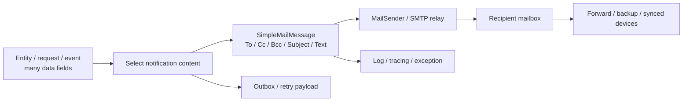

# Keeping Content Free of Unintended Sensitive Data

In **Spring Framework Mail**, sending a plain text email is very simple: create a `SimpleMailMessage`, set the sender, recipient, subject, and body, and then call `MailSender.send(...)`. This very simplicity makes it easy for developers to pass data straight from an entity, request, or log into an email. A line such as `message.setText(order.toString())` can expose an address, phone number, payment details, or token that the author did not intend to send.

Email is a valuable notification channel, but once sent, content often exists in many places: the recipient's mailbox, mail relays, backups, synced devices, and forwarded messages. The application **cannot reliably recall** a secret that has been put into an email. Therefore, content safety must be decided **before** building `SimpleMailMessage`, not after the mail provider accepts the message.

This lesson presents a practical workflow to send only **data that is necessary, permitted, and appropriate for the recipient**. The focus is on simple text mail in Spring Framework Mail: `MailSender`, `SimpleMailMessage`, template design, recipient control, protecting logs/outbox, and testing against unintended data exposure. Examples use Spring Boot 3.x, Java 21, and Jakarta Mail; the design thinking also applies to plain Spring Framework.

## 1. What does "free of unintended sensitive data" mean?

Not every email has to be completely anonymous. The recipient's email address itself can be personal data. An order confirmation email may need an order ID or processing status to be useful; a password reset email may have to carry a link with a short-lived token. The key point is that **every piece of information that appears has a clear reason and has been designed to go through email**.

Content is considered safer when it satisfies all of the following at once:

1. **Purposeful:** the information genuinely helps the recipient complete a task or understand the notification.
2. **Right recipient:** the sender has verified that the mailbox is permitted to receive that content.
3. **Minimal:** does not include extra properties just because they are already present in the entity or DTO.
4. **Context-appropriate:** the level of detail matches the notification type and the sensitivity of the data.
5. **Time-bound / access-controlled when needed:** sensitive data stays behind authentication in the application; links with tokens must be protected according to policy.
6. **No leaks in auxiliary places:** logs, queues, outbox, tracing, and exceptions do not record additional unintended sensitive content.

Example for the same event "order has been received":

| Content | Should it appear in the email? | Reason |
|---|---|---|
| "Your order has been received." | Usually yes | Sufficient to notify of the event |
| Public reference code for the customer | Possibly, per policy | Helps with lookup, but must not grant access by code alone |
| Link to an order page that requires login | Usually appropriate | Lets the user view details themselves after authentication |
| Entire `Order` entity as JSON | No | Contains internal fields and easily changes when the model evolves |
| Full payment card number / CVV | No | Unnecessary for the notification |
| Application access token or session cookie | No | Can grant unintended access |
| Full shipping address | Only when the business genuinely needs it and has evaluated it | Personal data, easily exposed through forwarding |
| Stack trace / database connection string | No | Internal information, may contain secrets |

The goal is **data minimization**: reducing the data present in the email to what is necessary, even when the application has access to much more information.

## 2. Where a simple text email can expose data

The risk does not lie only in `setText()`. Information can appear in multiple fields and systems:



| Location | Common risk | Example |
|---|---|---|
| `To` / `Cc` / `Bcc` | Sending to the wrong person or disclosing the recipient list | Putting all customers into To |
| `From` / `Reply-To` | Displaying the wrong identity, replies going to an uncontrolled mailbox | Letting the caller choose From freely |
| `Subject` | Exposing information right on the lock screen / push notification | "Lab test results for Nguyen..." |
| `Text` | Putting secret data into the main body | Printing the full user JSON or token |
| URL in text | Token or query parameter that grants access | Link containing a session token |
| Outbox / message broker | Storing a copy of secrets for a long time | Serializing the whole entity for retry |
| Log / APM / tracing | Creating a copy in an observability system with broader access | Logging `message.toString()` |
| SMTP relay / mailbox | Content stored outside the application's control | Shared mailbox or forwarded message |

An email can **leak nothing in `setText()` yet still leak in `Subject` or the recipient list**. You need to control the entire message and the data supporting the send operation.

## 3. Determine sensitivity levels before writing templates

To decide which fields are allowed to be sent, classify data by sensitivity level and intended use. For example, a learning/ordering application could classify as follows:

| Data group | Example | Recommended email policy |
|---|---|---|
| Public content | Product name, general instructions, system maintenance window | Can be included directly if in the right context |
| Basic personal info | Name, email, order ID, study schedule | Send only when truly needed and to the right recipient |
| Sensitive information | Home address, health info, financial info, other customer data | Limit in email; prefer viewing after signing in |
| Authentication secrets | Passwords, password hashes, refresh tokens, session tokens, API keys | Do not include in ordinary notification emails |
| Internal operational data | Stack traces, database URLs, configuration secrets, internal IDs/notes | Do not include in user-facing emails |
| Narrow-purpose tokens | Password reset link, email confirmation link | Only in a designed workflow; one-time/short-lived token, restricted scope, and not logged |

Classification must be based on system policy, applicable legal requirements, and user expectations. For example, sending an OTP code via email can be part of the product; in that case the code must be treated as a **temporary secret permitted specifically for the verification workflow**, with an expiration, attempt limit, and must not appear in logs or other notifications. Do not turn the "avoid secrets" rule into an absolute ban that breaks necessary functionality.

### 3.1. Email is not a fully controlled secret store

Once an email leaves the application:

- The recipient can read it from multiple devices.
- The provider can store copies, make backups, or process the message for spam filtering.
- The recipient can forward it or take screenshots.
- The content can appear in previews on a lock screen.
- The email can be read by mailbox administrators or anyone with access to the account.

TLS on the connection from the application to the SMTP server protects **one transport hop** as configured. It **does not automatically provide end-to-end encryption** for content across every relay and while resting in the mailbox. Information that should only be viewed after authentication should stay inside your system, with a notification or link to the appropriate page.

## 4. Do not pass entities, requests, or exceptions straight into an email

This is a common mistake when mail-sending code is written too close to the domain model:

```java
// Example of what NOT to do.
SimpleMailMessage mail = new SimpleMailMessage();
mail.setTo(account.getEmail());
mail.setSubject("Account information");
mail.setText(account.toString());  // Very likely to contain sensitive fields!
mailSender.send(mail);
```

If `Account.toString()` is auto-generated by the IDE or Lombok, it can print every field of the entity. A later change, such as adding `passwordHash`, `recoveryToken`, `phoneNumber`, or `internalNote`, can cause new data to appear in emails without anyone touching the mail-sending code.

Similar patterns to avoid:

```java
// Do not pass the whole business model to the renderer.
mail.setText(objectMapper.writeValueAsString(customer));

// Do not send the raw request if it contains a password or token.
mail.setText(registrationRequest.toString());

// Do not expose stack traces in customer emails.
mail.setText(exception.toString());

// Do not use raw debug logs as the body of bulk notifications.
mail.setText(debugLog);
```

All of these make the **content contract** depend on data structures outside the email boundary. When the object changes, the email changes along with it without going through a field-selection step.

### 4.1. Select fields via an allowlist instead of trying to scrub a blacklist

A safer approach is to define precisely which values are allowed into each template:

```text
Business event (many fields)
        ↓
EmailIntent / ApprovedVariables
        ↓
Specific template, clear version
        ↓
SimpleMailMessage
        ↓
MailSender.send(...)
```

Example:

| Template | Allowed values | Values not in the contract |
|---|---|---|
| `account-setting-changed` | Categorized change type, timestamp if needed, login instructions | Password, hash, recovery token, raw IP |
| `order-accepted` | Status, public reference code, link to the order page | Payment credentials, internal notes, JSON entity |
| `course-enrollment` | Public course name, enrollment status | Access token, other personal data |
| `system-maintenance` | Time window and scope of affected services | Stack traces, internal hosts, server config |

When a template has an explicit list of permitted fields, adding new properties to an entity will not automatically cause the email to include extra data.

### 4.2. Why is regex scrubbing for sensitive strings not enough?

An easy idea to reach for is rendering the whole object and then using regex to replace passwords/addresses. This approach is unreliable:

- Fields can be renamed (`password` to `credential`).
- Data can be encoded or nested deep inside JSON.
- A regex pattern cannot recognize every token or account number.
- False-positive redaction can make the content business-incorrect.
- A new sensitive field will slip through if no rule exists for it yet.

Redaction is useful as an **additional defense layer for logs**, but for user-facing emails, choose data via an allowlist right from the start.

## 5. Designing SimpleMailMessage templates with selected data

Suppose the system emits a security-settings-changed event. The event at the business layer may contain a lot of internal information for auditing; the email only needs to notify that a change occurred and instruct the recipient to check if they did not make it.

### 5.1. An event containing data the email is not allowed to use

```java
package com.example.mail;

import java.time.Instant;
import java.util.UUID;

public record AccountSecurityEvent(
        UUID accountId,
        String verifiedEmail,
        ChangeType changeType,
        Instant occurredAt,
        String ipAddress,
        String sessionToken,
        String internalAuditNote
) {
    public enum ChangeType {
        PASSWORD_CHANGED,
        TWO_FACTOR_ENABLED,
        RECOVERY_OPTIONS_UPDATED
    }
}
```

The event has `ipAddress`, `sessionToken`, and `internalAuditNote`, but those fields **do not belong in the notification content**. Do not pass the entire event to a template engine capable of rendering any field and hope the template author remembers not to use them.

### 5.2. Creating content from the set of permitted values

```java
package com.example.mail;

import java.time.ZoneId;
import java.time.format.DateTimeFormatter;
import java.util.Locale;

import org.springframework.beans.factory.annotation.Value;
import org.springframework.mail.MailSender;
import org.springframework.mail.SimpleMailMessage;
import org.springframework.stereotype.Service;

@Service
public class SecurityNoticeMailService {

    private static final DateTimeFormatter TIME_FORMAT =
            DateTimeFormatter.ofPattern("dd/MM/yyyy HH:mm", Locale.forLanguageTag("vi-VN"))
                    .withZone(ZoneId.of("Asia/Ho_Chi_Minh"));

    private final MailSender sender;
    private final String fromAddress;

    public SecurityNoticeMailService(
            MailSender sender,
            @Value("${app.mail.from}") String fromAddress) {
        this.sender = sender;
        this.fromAddress = fromAddress;
    }

    public void sendSecurityChangeNotice(AccountSecurityEvent event) {
        // Precondition: this email has already been linked and verified
        // for the corresponding account per the business workflow.
        String description = switch (event.changeType()) {
            case PASSWORD_CHANGED -> "sign-in password";
            case TWO_FACTOR_ENABLED -> "two-factor authentication";
            case RECOVERY_OPTIONS_UPDATED -> "account recovery options";
        };

        String occurredAt = TIME_FORMAT.format(event.occurredAt());

        SimpleMailMessage message = new SimpleMailMessage();
        message.setFrom(fromAddress);
        message.setTo(event.verifiedEmail());
        message.setSubject("Account security change notice");
        message.setText("""
                A change to your %s was recorded at %s.

                If you did not make this change, please open the application
                directly and check the Account Security section or contact support.

                This is an automated notification.
                """.formatted(description, occurredAt));

        sender.send(message);
    }
}
```

In this design:

1. `changeType` is a **finite enum**, mapped to safe descriptions. Do not pass an arbitrary user-entered string as security content.
2. `occurredAt` is presented in the chosen time zone. Timestamps can also be sensitive data in some domains; include them only when needed.
3. The email does not contain `accountId`, `ipAddress`, `sessionToken`, or `internalAuditNote`.
4. Instructs the recipient to open the application themselves via a known path, reducing the risk of mistakenly sending a URL with a token or untrusted domain.
5. `MailSender` is only responsible for the sending operation; verifying that the email is verified and permitted to receive notifications must be checked **beforehand** in the business workflow.

The code does not verify on its own that the email exists or belongs to the account owner. It illustrates **how to build minimal content** in a system that already has a reliable recipient verification and update flow.

### 5.3. Do not let String.format accidentally become an entry point for new data

`String.format(...)` or `formatted(...)` does not decide on its own which fields are allowed to be sent. If later someone replaces `description` with `event.toString()`, the risk comes right back. What keeps a template safe is the **permitted-field contract and how values are constructed**, not the formatting syntax alone.

With a template engine, pass in a dedicated DTO:

```java
public record SecurityNoticeTemplateData(
        String safeChangeDescription,
        String formattedOccurredAt
) {}
```

The renderer can access only these two fields. Do not pass an entity or a `Map<String, Object>` containing all properties and hope the template reads only what is needed. If a template needs more data, change the DTO explicitly with someone responsible for reviewing its meaning.

## 6. Controlling the subject: Subject can also expose data

Email notifications on lock screens or in inbox lists usually display the **Subject** before the body. Therefore, even when the main body is safe, an overly specific subject still leaks information.

Examples:

| Subject to avoid using broadly | Less revealing Subject |
|---|---|
| "Your temporary password: 123456" | "Account access instructions" |
| "Lab result details for [full name]" | "You have a new notification in your account" |
| "Your account balance is..." | "New notification from the service" |
| "Order [full street address] delivered" | "Your order has been updated" |
| "DB error with connection string..." | "System alert requiring attention" |

Do not put passwords, OTPs, tokens, health/financial info, or private content into the Subject. For workflows using verification codes over email, put the code in the body according to security design; email client display/auto-fill features should be weighed per product, but never as an excuse to put long-lived credentials into the subject.

### 6.1. Do not use arbitrary data as the Subject

Example to avoid:

```java
mail.setSubject("Error processing: " + exception.getMessage());
```

An exception may contain emails, customer IDs, URLs with tokens, internal paths, or connection configuration. The Subject can also end up in dashboards, push notifications, and mobile devices. If you need to distinguish incidents, use a permitted internal code:

```java
mail.setSubject("Request processing alert");
mail.setText("A request with a safe reference code needs to be checked in the system.");
```

Even a reference code needs review: it should not grant access on its own, carry a secret, or expose an ID string with sensitive meaning.

## 7. Right content to the wrong recipient is still a leak

The right to read email content depends heavily on the **recipient address**. Even a carefully controlled body becomes an incident if sent to an unauthorized person.

Common scenarios:

- An account recently changed its email, but a background job still uses the old address now owned by someone else.
- An API lets the caller pass any recipient without checking permissions.
- Taking an email from an unverified form and sending account content to it.
- Creating one message with a list of customers in `To`, exposing all addresses.
- Creating a `Cc` that accidentally includes a manager/partner who does not need to know the information.
- Reusing a mutable `SimpleMailMessage` across threads, changing the recipient while keeping the text from a previous request.

### 7.1. Process for determining recipients

For account notifications:

1. Obtain the recipient from a verified profile or workflow, not directly from an arbitrary request parameter.
2. Check current state: account is active, address is verified, notification type is allowed.
3. If the email is generated asynchronously, define the policy when the address changes while queued: freeze the verified recipient at event time or re-check before sending, depending on business rules.
4. Split each recipient into an independent sending intent if the content has personal data or needs per-recipient retry tracking.
5. Never send person A's data inside a message addressed to person B simply because an ID or parameter was passed by mistake.

### 7.2. To, Cc, and Bcc

`SimpleMailMessage` supports:

```java
mail.setTo("alice@example.test");
mail.setCc("manager@example.test");
mail.setBcc("audit@example.test");
```

However, **the fact that the API allows adding recipients does not mean everyone is allowed to see the content**. Cc is usually publicly visible to other recipients. Bcc usually does not appear in headers delivered to them, yet the Bcc recipient themselves can still read the entire body. Do not use Bcc as a content authorization control mechanism.

For emails sent to many customers, a sensible default is **one message per recipient**, especially when there is a per-user reference code or personal data. Sending a single mail to a list of different recipients does not guarantee privacy on its own even when Bcc is used properly.

## 8. Controlling links, verification codes, and tokens

Notification emails often want to guide the recipient back to the application. Two kinds of links must be distinguished:

**Regular link** leading to a page that requires signing in:

```text
https://app.example.test/account/security
```

**Tokenized link** that can grant a specific capability, such as confirming an email address or resetting a password:

```text
https://app.example.test/reset-password?token=<opaque-one-time-token>
```

In the second case, the token is a form of **temporary bearer credential**. If someone else obtains the token before it expires and while unused, they can perform the action the token authorizes.

When the business requires sending a tokenized link:

1. Generate a sufficiently random token using a suitable cryptographic random number generator.
2. Restrict the token's scope to **one action and one account**.
3. Set a short expiration, limit usage count, and invalidate after successful use.
4. Store a hash/token verifier per appropriate design whenever possible; do not write the raw token to logs, tracing, errors, or analytics.
5. Construct URLs from a fixed/approved HTTPS domain; do not take the hostname directly from an untrusted `Host` header.
6. Consider leakage via browser history, referrer, analytics tools, and email security link scanners; the token-consuming endpoint must be designed safely.
7. Do not use a verification token as a long-lived session token or general access token.

For example, in a security-change notification where the recipient does not need to act immediately, you can **send no tokenized link at all** and simply instruct them to sign in to the application. In a confirmation email, the token may be a necessary part of the workflow, but must be protected separately.

### 8.1. Avoid pasting URLs from untrusted requests

Unsafe example:

```java
// Host is taken from the request without verification.
String link = request.getScheme() + "://" + request.getServerName()
        + "/confirm?token=" + token;
```

If the application or reverse proxy does not configure host validation properly, a request with an unexpected host can cause the email to contain a link pointing to an attacker-controlled domain.

Instead, the application needs a **configured and controlled public base URL**, such as `https://app.example.test`, along with strict checking of path/parameter parts. For notifications that do not require a token, a link to a login-protected page is usually safer.

## 9. Email data is not HTML, yet still needs input constraints

`SimpleMailMessage.setText(String)` sets the plain text part. A string like:

```java
mail.setText("<strong>Hello</strong>");
```

is usually displayed as text containing `<` and `>` in mail clients rather than rendered as HTML. This reduces one class of HTML injection risk, but **does not automatically remove sensitive information** or misleading strings.

You still need to:

- Limit the length of each field.
- Never put uncontrolled data into Subject, From, Reply-To, or recipient lists.
- Use curated business names/descriptions instead of raw user input.
- Control CR/LF and control characters in header values supplied by the application.
- Avoid misleading content such as lookalike domains or links from unclear sources.
- Set the UTF-8 charset properly so Vietnamese names/text do not suffer encoding errors.

Do not assemble raw SMTP headers into `setText()` expecting `JavaMailSender` to treat them as headers. That API is for the text body; headers must be set through the corresponding meaningful setters.

### 9.1. Why do Subject and Text need different policies?

`Text` can span multiple lines, whereas `Subject` is a header field. If Subject is built from a user-supplied value, invalid newlines or control characters should not be allowed; they can cause confusion and make header handling harder.

Example of a Subject-restriction policy:

```java
package com.example.mail;

public final class MailSubjectPolicy {

    private MailSubjectPolicy() {}

    public static String requireSafeSubject(String value) {
        if (value == null || value.isBlank() || value.length() > 120) {
            throw new IllegalArgumentException("Invalid mail subject");
        }
        for (int i = 0; i < value.length(); i++) {
            if (Character.isISOControl(value.charAt(i))) {
                throw new IllegalArgumentException(
                        "Control character in mail subject");
            }
        }
        return value;
    }
}
```

This is an **illustrative policy** for headers, not a validator for all languages and all Unicode edge cases. In multilingual systems, you must decide limits by code points/bytes and control the encoded header length. For security notifications, the simpler direction is to use a fixed template Subject and avoid putting user input into headers.

## 10. Do not put message content into logs, tracing, and exceptions

Leakage risk does not stop at the email sent to the customer. Even when the recipient is right, the logging system can accidentally create another copy containing full personal data.

Examples to avoid:

```java
// Examples of what NOT to do in production logs.
logger.info("Sending mail: {}", message);
logger.debug("Body: {}", message.getText());
logger.error("Mail failed for {}: {}", message.getTo(), message.getText());
```

`SimpleMailMessage.toString()` or generic formatters/loggers can expose the message's fields. Exceptions from the transport can also contain addresses and SMTP responses. Therefore, do not log the whole email object or full exception details at broadly accessible levels.

### 10.1. Log using identifiers and safe events

Prefer logging operational information sufficient for investigation:

```json
{
  "event": "mail.send_attempt",
  "notificationId": "7609c04a-d235-43f8-8b8c-2f609dcc5f75",
  "templateId": "account-security-changed",
  "attempt": 1,
  "transport": "primary-smtp",
  "result": "ACCEPTED_BY_RELAY",
  "durationMs": 310
}
```

When an error occurs:

```json
{
  "event": "mail.send_attempt",
  "notificationId": "7609c04a-d235-43f8-8b8c-2f609dcc5f75",
  "templateId": "account-security-changed",
  "attempt": 2,
  "result": "TEMPORARY_FAILURE",
  "errorCategory": "SMTP_4XX"
}
```

The notification ID can be used to look up the access-controlled record in the database; general logs do not need to contain text, subject, full email address, tokens, or secrets.

**Note:** log only safely processed exception types/messages. An SMTP code/error category can be useful, yet raw provider error messages sometimes contain recipient information or content unsuitable for logging.

### 10.2. Metrics do not use personal data as labels

Useful metrics:

```text
mail_delivery_attempts_total{template="account-security-changed",outcome="accepted"}
mail_delivery_attempts_total{template="account-security-changed",outcome="retry"}
mail_outbox_due_count
mail_oldest_due_age_seconds
```

Do not use email addresses, tokens, or notification IDs as Prometheus metric labels: they have **high cardinality** and can push personal data into the monitoring system. To investigate a specific notification, use the ID in appropriately access-controlled logs.

### 10.3. Tracing and HTTP error responses

If a controller calls the mail-sending service, do not return `MailException.getMessage()` verbatim to the API client, because the error may contain the host, account, or recipient address. Convert it into an application error code with a correlation ID, and keep detailed diagnostics only in controlled operational storage.

With OpenTelemetry/APM, do not automatically place `message.getText()`, tokenized URLs, or `Authorization` headers into span attributes. Trace tags should use `templateId`, normalized error codes, and a general provider name.

## 11. Outbox and retry are also places that store sensitive data

In systems that require reliable delivery, the application may store send requests in a database outbox or message broker before a worker calls `MailSender`. If the outbox stores the full email body or an entity containing private information, that data will additionally persist in:

- The production database and its backups.
- CDC replicas, data warehouses, or analytics systems if pipelines collect it.
- Dead-letter queues and failed send records.
- Exported debug/support data.
- Retry histories, worker logs, or dashboards.

Therefore, **email protection must begin with the queue payload**, not only with the message at send time.

### 11.1. Store a minimal intent instead of the full entity

Example outbox intent for a security-settings notification:

```json
{
  "notificationId": "7609c04a-d235-43f8-8b8c-2f609dcc5f75",
  "templateId": "account-security-changed",
  "templateVersion": 2,
  "recipientReference": "account-42",
  "eventType": "TWO_FACTOR_ENABLED",
  "occurredAt": "2026-11-12T08:30:00Z"
}
```

Idea:

1. `templateId` identifies the exact email type.
2. `eventType` is a displayable enum after mapping, not the raw event.
3. `recipientReference` is an access-controlled lookup key; the worker must decide how to fetch the verified recipient address.
4. `templateVersion` helps resends use the approved wording if reproduction is required.
5. The payload contains no session token, password hash, or audit notes.

**Boundary to decide:** If the worker looks up recipient information at send time, the address may have changed. If the outbox stores a snapshot of the address at intent-creation time, that personal email remains in the database longer. The choice depends on business rules and retention policy; what to avoid is accidentally expanding the payload without control.

### 11.2. If rendered content must be stored

Some businesses need to store the exact email version as generated for audit or retry purposes. In that case:

- Store only **allowlisted content**, not the original entity.
- Encrypt data at rest as required and manage keys securely.
- Restrict access for applications, workers, support staff, and analytics pipelines.
- Define appropriate retention periods and deletion policies; do not keep indefinitely by default.
- Block secrets from entering uncontrolled debug dumps, backups, or error messages.
- Do not use the outbox database as storage for passwords, API keys, or sessions.

Likewise, dead-letter queues used for failure handling must restrict access because they can contain messages meant for users.

## 12. MailException is not a reason to broadcast internal data

In Spring Mail, exceptions such as `MailParseException`, `MailAuthenticationException`, and `MailSendException` have distinct roles:

| Error type | Main meaning | How the application should respond |
|---|---|---|
| `MailParseException` | Message/headers cannot be validly built or parsed | Inspect input data and template; do not email debug output to customers |
| `MailAuthenticationException` | Failed to authenticate with SMTP | Alert operators about configuration/secrets; do not include credentials in alerts |
| `MailSendException` | Failure executing send, connection, or SMTP response | Classify cause; controlled retry, record state |

Example not to write:

```java
try {
    mailSender.send(message);
} catch (MailException ex) {
    SimpleMailMessage alert = new SimpleMailMessage();
    alert.setTo("all-users@example.test");
    alert.setSubject("Mail error");
    alert.setText(ex.toString());
    mailSender.send(alert);
}
```

This snippet has multiple issues: sending error details to an inappropriate list, potentially exposing addresses/hosts/secrets, reusing the very infrastructure that is failing to send the alert, and risking an error loop. Operational alerts should go through a monitoring system or access-controlled internal channel with normalized data.

If you need to retry `MailSendException`, still distinguish SMTP `4xx`, `5xx`, connection failures, and cases where SMTP may have received DATA while the client lost the response. **Do not retry indefinitely** and do not attach the email body to retry logs.

## 13. Organizing Spring Mail configuration and protecting SMTP secrets

Not only email content, but transport configuration also holds secrets: username, password, SMTP tokens, or provider credentials.

With Spring Boot:

```groovy
dependencies {
    implementation 'org.springframework.boot:spring-boot-starter-mail'
}
```

Example STARTTLS configuration:

```yaml
spring:
  mail:
    host: ${SMTP_HOST}
    port: ${SMTP_PORT:587}
    username: ${SMTP_USERNAME}
    password: ${SMTP_PASSWORD}
    default-encoding: UTF-8
    properties:
      "[mail.smtp.auth]": "true"
      "[mail.smtp.starttls.enable]": "true"
      "[mail.smtp.starttls.required]": "true"
      "[mail.smtp.connectiontimeout]": "5000"
      "[mail.smtp.timeout]": "10000"
      "[mail.smtp.writetimeout]": "10000"

app:
  mail:
    from: ${MAIL_FROM}
```

Environment variables here are illustrative. In production, manage secrets through a controlled mechanism, least-privilege access, and rotation when needed. Do not put `SMTP_PASSWORD` into source control, startup logs, debug endpoints, or message content.

Set the provider's proper TLS mode, verify certificates, and set finite timeouts. **TLS protects only part of the transmission path; it does not turn email content into safe storage for any kind of secret.**

If using implicit TLS on port 465, configure SSL appropriately per provider rather than just changing the port in a STARTTLS 587 configuration.

## 14. Error notices should direct users back to the application

In many cases, an email does not need sensitive details to remain useful:

**Security change case:** "An account security setting was just updated. If this wasn't you, please open the application and contact support."

**New invoice case:** "A new invoice is ready. Sign in to your account to view or download the invoice."

**Health/financial information case:** "You have a new notification in your account. Please sign in to view details."

**System error case:** "Your request is taking longer than expected to process. You can check its status in the application."

The common thread is that the email **notifies of the event**, while detailed data stays behind login and authorization checks. That also reduces impact if a mailbox is forwarded or displayed on a shared device.

Do not use the phrase "sign in to view" to hide everything, because overly vague emails can lose value or be mistaken for phishing. Provide enough public context, the service name, and clear access instructions, while avoiding suspicious links or urging users to reveal passwords.

## 15. Testing against unintended data exposure

A test that only verifies `MailSender.send()` was called once is not enough to prevent information leakage. You need to check **the actual content requested to be sent**, especially when a domain event contains sensitive fields.

### 15.1. Creating a fake MailSender to capture messages

```java
package com.example.mail;

import java.util.ArrayList;
import java.util.List;

import org.springframework.mail.MailSender;
import org.springframework.mail.SimpleMailMessage;

public final class CapturingMailSender implements MailSender {

    private final List<SimpleMailMessage> sent = new ArrayList<>();

    @Override
    public void send(SimpleMailMessage message) {
        sent.add(new SimpleMailMessage(message));
    }

    @Override
    public void send(SimpleMailMessage... messages) {
        for (SimpleMailMessage message : messages) {
            send(message);
        }
    }

    public List<SimpleMailMessage> sent() {
        return List.copyOf(sent);
    }
}
```

This fake is meant for single-threaded tests. It copies the message at send time so later mutations to the original object do not skew the observed data.

### 15.2. Testing an event that contains secret information

```java
package com.example.mail;

import static org.junit.jupiter.api.Assertions.assertEquals;
import static org.junit.jupiter.api.Assertions.assertFalse;
import static org.junit.jupiter.api.Assertions.assertTrue;

import java.time.Instant;
import java.util.UUID;

import org.junit.jupiter.api.Test;
import org.springframework.mail.SimpleMailMessage;

class SecurityNoticeMailServiceTest {

    @Test
    void sendsOnlyApprovedDetails() {
        CapturingMailSender sender = new CapturingMailSender();
        SecurityNoticeMailService service =
                new SecurityNoticeMailService(
                        sender, "noreply@example.test");

        AccountSecurityEvent event = new AccountSecurityEvent(
                UUID.randomUUID(),
                "learner@example.test",
                AccountSecurityEvent.ChangeType.TWO_FACTOR_ENABLED,
                Instant.parse("2026-11-12T08:30:00Z"),
                "198.51.100.10",
                "secret-session-token-do-not-email",
                "Internal-only audit information"
        );

        service.sendSecurityChangeNotice(event);

        assertEquals(1, sender.sent().size());
        SimpleMailMessage mail = sender.sent().get(0);

        assertEquals("learner@example.test", mail.getTo()[0]);
        assertEquals(
                "Account security change notice", mail.getSubject());
        assertTrue(mail.getText().contains("two-factor authentication"));
        assertFalse(mail.getText().contains(event.sessionToken()));
        assertFalse(mail.getText().contains(event.internalAuditNote()));
        assertFalse(mail.getText().contains(event.ipAddress()));
        assertFalse(mail.getSubject().contains(event.sessionToken()));
    }
}
```

This test illustrates one principle: **deliberately put fake secret data into the event to verify it does not appear in the output**. It does not prove every new field in the future is safe; a DTO/template with an explicit allowlist reduces the need to chase individual sensitive field names.

Do not use real personal data or real credentials in tests. Canary strings such as `secret-session-token-do-not-email` are test-controlled dummy data.

### 15.3. Additional boundary tests

| Scenario | What to verify |
|---|---|
| Entity adds a new field `apiKey` | The template has no access to pick up the new field automatically |
| Recipient changes email | Verification rules and send permissions remain accurate |
| Subject has user-provided content | No secret exposure, no invalid control characters |
| Bulk sending | To/Cc lists are not exposed across customers |
| MailSendException contains recipient | Logs/error responses do not contain sensitive addresses or content |
| Retry after worker restart | Outbox does not become an out-of-policy secret store |
| Notification contains confirmation link | Token has proper scope/expiration and does not leak into logs |
| Simulated mail server receives message | Raw headers and text reflect only permitted message content |

For integration tests, use a simulated SMTP server such as Mailpit to verify serialization and the sending path, without putting real secrets into the test server. Content unit tests and SMTP integration tests answer **two different questions**: what content the application creates, and whether the test delivery path works.

## 16. Incident process when an email is found to have leaked information

If a message has been sent by mistake with sensitive data attached, you cannot simply fix the template and assume the incident is gone. Response steps should follow the organization's operations plan and information security policy:

1. **Stop further exposure:** halt the failing job/template or freeze the related outbox queue.
2. **Determine scope:** which notifications, which recipients, what time window, and what kinds of data were in the content.
3. **Do not amplify the incident during investigation:** restrict logs and read access, avoid forwarding the full email containing secrets over unnecessary channels.
4. **Revoke or rotate affected secrets:** tokens, API keys, or credentials if they may have been exposed.
5. **Apply appropriate notification/legal assessment procedures** if the incident affects personal or protected data.
6. **Fix the root cause:** replace passing whole entities with an allowlist, add content tests, and tighten observability limits.
7. **Check places holding copies:** outbox, DLQ, logs, tracing, backups, and support systems according to permissions and current retention policies.

Do not rely on "email recall" to erase all copies. Even when a mail service has a recall feature under certain conditions, the content may already have been read, synced, or forwarded.

## 17. Hands-on exercise: from an over-sharing email to a minimal template

Suppose the application has a `UserAccount` containing email, name, account ID, password hash, refresh token, phone number, address, and verification status. After a user enables two-factor authentication, the system needs to send a notification email.

### Part A — Identify leakage paths

Look at the initial code:

```java
SimpleMailMessage mail = new SimpleMailMessage();
mail.setFrom("noreply@example.test");
mail.setTo(userAccount.getEmail());
mail.setSubject("Account information: " + userAccount.getId());
mail.setText(userAccount.toString());
mailSender.send(mail);
```

Point out which data could be exposed in Subject and Text, what places might receive copies after sending, and why `toString()` is not a stable content contract.

### Part B — Switch to an allowlist

Define the `account-security-changed` template containing only:

- Fixed subject "Account security change notice".
- Safe description based on the change-type enum.
- Timestamp of the change if business policy permits.
- Instructions to open the application directly to check.

Do not put password hashes, tokens, phone numbers, addresses, or raw audit events into the template. Use `SimpleMailMessage` with one verified recipient.

### Part C — Prevent misdirected sends

Simulate a scenario where the email address changed while a mail-sending event was already queued beforehand. Choose a policy to resolve the address at event time vs send time, then explain your reasoning in terms of business requirements and access control. Verify that customer lists are not leaked via To/Cc.

### Part D — Test with a fake MailSender

Create `CapturingMailSender`, use an event with `sessionToken` and `internalAuditNote` containing canaries, and assert Subject/Text do not contain them. Add checks that logs/exceptions do not record the full message when the provider fails to send.

### Part E — Extend to a tokenized workflow

Design an address confirmation email: the token is allowed to appear **only** in the confirmation link, with narrow scope and short lifetime. Describe how to store the token hash and control logs, expiration, usage count, and URL host; compare with a regular notification email that needs no token.

### Part F — Outbox and recoverability

Design an outbox payload containing only `notificationId`, `templateId`, `recipientReference`, and the approved set of variables. Describe how a worker builds `SimpleMailMessage`, sends with `MailSender`, classifies errors, and deletes/retains data per retention policy. Show that retries do not cause extra sensitive information to appear.

## 18. Principles you can apply immediately

When writing a simple text email in Spring Framework Mail, start with the **content contract**: what the recipient needs to know, which fields are allowed to appear, and which fields must remain inside the application behind authentication. Use an **allowlist** template/DTO, create a new `SimpleMailMessage` for each send, verify the right recipient, keep Subject minimal, and never pass whole entities, requests, or exceptions into `setText()`.

Once the email is built properly, continue protecting data in **logs, tracing, outbox, retry, and providers**. Use TLS and credentials properly, while remembering that they do not turn a mailbox into an end-to-end secret store. For tokens that must be sent, design scope, expiration, single-use, and non-logging rules right in the workflow.

Keeping content free of unintended sensitive data is a **property of data and access-control design**, not an automatic toggle on `MailSender`. When every field appearing in an email has a clear business reason, the application is easier to test, easier to operate, and less impacted if a message is forwarded, misdirected, or stored in unexpected places.
