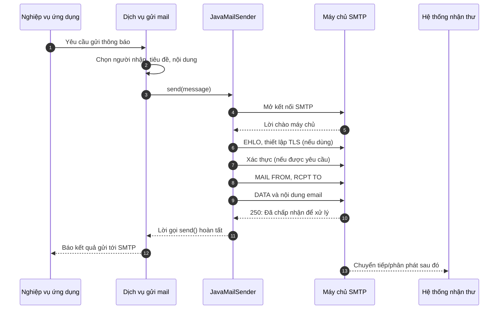

# Luồng gửi email từ ứng dụng đến máy chủ thư

Khi người dùng đăng ký tài khoản, đặt lại mật khẩu hoặc nhận thông báo, ứng dụng thường phải gửi email. Trong **Spring Framework Mail**, ứng dụng tạo nội dung thư rồi giao cho một **máy chủ SMTP** chịu trách nhiệm tiếp nhận và chuyển tiếp. Hiểu rõ ranh giới này giúp lập trình viên cấu hình đúng kết nối, xác định thời điểm gửi thành công và xử lý lỗi hợp lý.

Sau bài này, bạn có thể lần theo đường đi của một email từ lời gọi `JavaMailSender.send(...)` đến phản hồi của máy chủ thư; phân biệt phần mà Spring thực hiện với phần do hạ tầng email đảm nhiệm.

## 1. Các thành phần tham gia

| Thành phần | Vai trò |
|---|---|
| **Mã nghiệp vụ** | Quyết định khi nào cần gửi email, người nhận và nội dung. |
| **Spring Framework Mail** | Cung cấp `MailSender`, `JavaMailSender` và các lớp hỗ trợ để xây dựng, gửi thông điệp. |
| **Jakarta Mail** | Thực hiện các chi tiết định dạng thông điệp và giao tiếp với SMTP thông qua thư viện mail bên dưới Spring. |
| **Máy chủ SMTP submission** | Nhận email từ ứng dụng, thường xác thực tài khoản và áp dụng chính sách gửi. |
| **Hệ thống chuyển tiếp / máy chủ nhận** | Tìm đường đến miền người nhận, nhận thư, lọc thư rác và đưa thư vào hộp thư nếu được chấp nhận. |

**SMTP** (Simple Mail Transfer Protocol) là giao thức dùng để truyền email giữa các tác nhân gửi thư. Ở phía ứng dụng, ta thường dùng một SMTP server đã được cấu hình sẵn, chẳng hạn dịch vụ email của tổ chức. Ứng dụng không cần tự tìm máy chủ thư của từng người nhận.

Có hai ranh giới cần nhớ:

- **Ứng dụng → máy chủ SMTP submission:** phạm vi trực tiếp của một lần gọi gửi mail trong Spring.
- **Máy chủ đã nhận thư → hộp thư người nhận:** quy trình tiếp theo của hệ thống email, có thể diễn ra muộn hơn và chịu nhiều chính sách, bộ lọc khác.

## 2. Sơ đồ luồng gửi



Sơ đồ minh họa trường hợp máy chủ đồng ý nhận thư. Nếu thất bại ở bất kỳ bước nào trước lúc chấp nhận, `send(...)` có thể phát sinh ngoại lệ. Sau phản hồi chấp nhận, việc thư có tới hộp thư đích hay không còn phụ thuộc các hệ thống phía sau.

## 3. Từng giai đoạn trong một lần gửi

### Bước 1: Nghiệp vụ phát sinh yêu cầu gửi

Ví dụ, sau khi người dùng đăng ký thành công, dịch vụ nghiệp vụ yêu cầu gửi email chào mừng. Ở thời điểm này ứng dụng cần xác định:

- Địa chỉ gửi (`From`), địa chỉ nhận (`To`, có thể có `Cc`/`Bcc`).
- Tiêu đề (`Subject`), nội dung văn bản hoặc HTML, tệp đính kèm nếu có.
- Loại thông điệp và ngữ cảnh nghiệp vụ, chẳng hạn mã yêu cầu hoặc ngôn ngữ hiển thị.

Không nên đưa thông tin nhạy cảm không cần thiết vào email hoặc log. Nếu ứng dụng dựng HTML từ dữ liệu người dùng, dữ liệu đó phải được escape/encode phù hợp.

### Bước 2: Spring tạo đối tượng email

Spring hỗ trợ hai cách phổ biến:

| Nhu cầu | API | Đặc điểm |
|---|---|---|
| Email văn bản thuần | `SimpleMailMessage` + `JavaMailSender.send(SimpleMailMessage)` | Phù hợp thông báo đơn giản. |
| Email HTML, nhiều phần, tệp đính kèm | `MimeMessage` + `MimeMessageHelper` + `JavaMailSender.send(MimeMessage)` | Biểu diễn nội dung theo MIME và các header phức tạp hơn. |

`MimeMessage` đến từ Jakarta Mail, còn `MimeMessageHelper` là tiện ích Spring để thiết lập người gửi, người nhận, charset, HTML và attachment. Nội dung tiếng Việt nên được biểu diễn với mã hóa ký tự phù hợp, thường là UTF-8.

### Bước 3: Mở kết nối đến máy chủ SMTP

`JavaMailSender` sử dụng các thông tin kết nối đã được cấu hình: hostname, port, phương thức bảo vệ đường truyền, tài khoản và timeout. Có hai cấu hình submission phổ biến:

| Cổng | Cách bảo vệ kết nối | Lưu ý |
|---|---|---|
| **587** | SMTP, sau đó nâng cấp sang TLS qua `STARTTLS` | Thông dụng khi ứng dụng gửi email qua dịch vụ SMTP. |
| **465** | TLS được thiết lập ngay từ đầu kết nối (implicit TLS/SMTPS) | Dùng khi nhà cung cấp yêu cầu cổng này. |
| **25** | Thường dùng để chuyển tiếp giữa các máy chủ email | Không mặc định chọn để ứng dụng đăng nhập gửi mail. |

Với cổng 587, client thường nhận lời chào SMTP, gửi `EHLO` để xem các khả năng được hỗ trợ, yêu cầu `STARTTLS`, bắt tay TLS, rồi gửi `EHLO` lại trên kết nối đã bảo vệ. Nếu server yêu cầu xác thực, client thực hiện `AUTH` sau khi có kết nối an toàn. Một số máy chủ dùng cơ chế khác hoặc dịch vụ relay nội bộ không yêu cầu xác thực; cấu hình thực tế phải theo nhà cung cấp.

**TLS bảo vệ đường truyền giữa ứng dụng và máy chủ SMTP đang kết nối**, không tự động đồng nghĩa email được mã hóa đầu cuối cho người nhận. Bật tùy chọn *required* nếu ứng dụng bắt buộc phải có STARTTLS, tránh âm thầm gửi qua đường truyền không được bảo vệ.

### Bước 4: Khai báo phong bì SMTP

Sau khi kết nối và xác thực, client bắt đầu một giao dịch gửi thư với các lệnh:

- `MAIL FROM:<no-reply@example.net>`: địa chỉ gửi trong **phong bì SMTP** (envelope sender), thường dùng cho định tuyến thông báo lỗi/bounce.
- `RCPT TO:<user@example.org>`: địa chỉ nhận trong **phong bì SMTP**. Một thông điệp có thể có nhiều lệnh `RCPT TO`.
- `DATA`: bắt đầu truyền phần header và nội dung thư sau khi server phản hồi cho phép.

Phong bì SMTP và header hiển thị trong email là hai khái niệm khác nhau:

| Phong bì SMTP | Header trong email |
|---|---|
| `MAIL FROM`, `RCPT TO` là thông tin giao thức cho việc vận chuyển. | `From:`, `To:`, `Subject:` được ghi bên trong thông điệp. |
| Dùng để xác định nơi chuyển thư và nơi báo lỗi. | Dùng để mô tả thư cho phần mềm đọc mail và các bộ lọc. |
| Có thể khác header do quy tắc relay, bounce hoặc Bcc. | `Bcc` thông thường không được tiết lộ trong các header gửi đến người nhận. |

Máy chủ SMTP có thể từ chối một số người nhận ở bước `RCPT TO` (ví dụ địa chỉ không được relay) trước khi nhận nội dung thư.

### Bước 5: Truyền nội dung và nhận phản hồi

Sau `DATA`, ứng dụng chuyển header và body đã được thư viện mail định dạng. Trong giao thức SMTP, một dòng chỉ có dấu chấm (`.`) kết thúc dữ liệu. Client mail xử lý việc thoát dấu chấm, xuống dòng và các chi tiết định dạng thay cho mã nghiệp vụ.

Một phiên SMTP **minh họa rút gọn**, lược bỏ phản hồi phụ, dữ liệu xác thực và chi tiết bắt tay TLS:

```text
S: 220 smtp.example.net ESMTP ready
C: EHLO app.example.net
S: 250-STARTTLS
S: 250 OK
C: STARTTLS
S: 220 Ready to start TLS
   [Bắt tay TLS thành công]
C: EHLO app.example.net
S: 250-AUTH PLAIN LOGIN
S: 250 OK
   [Client và server thực hiện xác thực SMTP]
S: 235 2.7.0 Authentication successful
C: MAIL FROM:<no-reply@example.net>
S: 250 2.1.0 OK
C: RCPT TO:<user@example.org>
S: 250 2.1.5 OK
C: DATA
S: 354 End data with <CRLF>.<CRLF>
C: From: no-reply@example.net
C: To: user@example.org
C: Subject: Welcome
C:
C: Your account is ready.
C: .
S: 250 2.0.0 Queued as ABC123
C: QUIT
S: 221 2.0.0 Bye
```

Trong ví dụ, `250 2.0.0 Queued` sau `DATA` nghĩa là máy chủ **đã chấp nhận thư để xử lý tiếp**. Nó không phải xác nhận thư đã xuất hiện trong Inbox. Một máy chủ có thể chấp nhận thư, sau đó phát hiện lỗi phân phát và gửi bounce; thư cũng có thể bị lọc vào Spam.

### Bước 6: Máy chủ thư thực hiện phần việc tiếp theo

Từ đây, hạ tầng thư có thể đưa email vào hàng đợi, chọn máy chủ đích bằng bản ghi MX của miền nhận, chuyển tiếp qua SMTP, áp dụng kiểm tra chống spam, rồi phân phát vào mailbox. Bản ghi DNS **MX của miền người nhận** chủ yếu phục vụ giai đoạn chuyển tiếp phía máy chủ; ứng dụng chỉ cần cấu hình đúng địa chỉ máy chủ SMTP mà nó sẽ kết nối.

Các cơ chế như SPF, DKIM và DMARC ảnh hưởng đến khả năng email được máy chủ đích tin cậy và chấp nhận. Chúng thường do đơn vị vận hành domain/dịch vụ gửi thư cấu hình; tạo `MimeMessage` trong Spring không tự động thiết lập đầy đủ các cơ chế đó.

## 4. Ví dụ tối thiểu với Spring Mail

Giả sử một ứng dụng Spring Boot sử dụng `spring-boot-starter-mail` (chứa hạ tầng Spring Mail và Jakarta Mail). Boot có thể tự tạo bean `JavaMailSender` từ cấu hình `spring.mail.*`. Trong dự án Spring Framework thuần, ta có thể tự đăng ký bean `JavaMailSenderImpl` với các thuộc tính tương đương.

### 4.1. Cấu hình SMTP

Ví dụ dùng cổng 587 với STARTTLS bắt buộc:

```yaml
# application.yml
spring:
  mail:
    host: smtp.example.net
    port: 587
    username: ${MAIL_USERNAME}
    password: ${MAIL_PASSWORD}
    properties:
      "[mail.smtp.auth]": true
      "[mail.smtp.starttls.enable]": true
      "[mail.smtp.starttls.required]": true
      "[mail.smtp.connectiontimeout]": 5000
      "[mail.smtp.timeout]": 5000
      "[mail.smtp.writetimeout]": 5000

app:
  mail:
    from: no-reply@example.net
```

`MAIL_USERNAME` và `MAIL_PASSWORD` là biến môi trường được cung cấp ở môi trường chạy. Không ghi mật khẩu thực vào mã nguồn hoặc commit cấu hình chứa bí mật. Địa chỉ `from` phải được nhà cung cấp SMTP cho phép gửi; xác thực SMTP thành công không có nghĩa được giả danh mọi địa chỉ gửi.

Các timeout trong ví dụ tính bằng mili giây. Giá trị cụ thể cần điều chỉnh theo hạ tầng và yêu cầu của ứng dụng.

### 4.2. Gửi email văn bản thuần

```java
import org.springframework.beans.factory.annotation.Value;
import org.springframework.mail.SimpleMailMessage;
import org.springframework.mail.javamail.JavaMailSender;
import org.springframework.stereotype.Service;

@Service
public class WelcomeMailService {
    private final JavaMailSender mailSender;
    private final String from;

    public WelcomeMailService(
            JavaMailSender mailSender,
            @Value("${app.mail.from}") String from) {
        this.mailSender = mailSender;
        this.from = from;
    }

    public void sendWelcome(String recipient) {
        SimpleMailMessage message = new SimpleMailMessage();
        message.setFrom(from);
        message.setTo(recipient);
        message.setSubject("Chào mừng bạn");
        message.setText("Tài khoản của bạn đã sẵn sàng.");

        mailSender.send(message);
    }
}
```

Khi chạy `sendWelcome("user@example.org")`, Spring chuyển `SimpleMailMessage` thành dữ liệu gửi mail và dùng kết nối SMTP. Lời gọi `send(...)` mặc định thực hiện theo kiểu đồng bộ: luồng đang gọi chờ đến khi thao tác gửi đến SMTP hoàn tất hoặc phát sinh lỗi, trừ khi chính ứng dụng chủ động bố trí việc gửi vào hàng đợi hay luồng khác.

### 4.3. Khi cần HTML hoặc tệp đính kèm

```java
import jakarta.mail.MessagingException;
import jakarta.mail.internet.MimeMessage;
import org.springframework.mail.javamail.JavaMailSender;
import org.springframework.mail.javamail.MimeMessageHelper;

public void sendHtml(JavaMailSender sender, String from, String recipient)
        throws MessagingException {
    MimeMessage mime = sender.createMimeMessage();
    MimeMessageHelper helper = new MimeMessageHelper(mime, "UTF-8");

    helper.setFrom(from);
    helper.setTo(recipient);
    helper.setSubject("Thông báo tài khoản");
    helper.setText("<h1>Chào mừng</h1><p>Tài khoản đã sẵn sàng.</p>", true);

    sender.send(mime);
}
```

Tham số `true` của `setText(html, true)` cho biết nội dung là HTML. Khi tạo email nhiều phần hoặc đính kèm tệp, dùng constructor `MimeMessageHelper` có bật multipart và API `addAttachment(...)`. Ngoại lệ `MessagingException` có thể xuất hiện trong giai đoạn chuẩn bị MIME; các lỗi gửi SMTP thường được Spring biểu diễn qua họ `MailException`.

## 5. Phân biệt các trạng thái thành công và thất bại

Giả sử ứng dụng gọi `mailSender.send(message)`. Có ít nhất ba mức kết quả khác nhau:

| Trạng thái | Điều có thể kết luận |
|---|---|
| Không kết nối, bị từ chối đăng nhập hoặc bị SMTP từ chối thư | Thao tác gửi tới SMTP thất bại; ứng dụng cần xử lý ngoại lệ. |
| SMTP trả phản hồi chấp nhận sau `DATA` | Máy chủ đã nhận trách nhiệm xử lý thư tiếp; `send(...)` thông thường kết thúc không có ngoại lệ. |
| Hệ thống cuối cùng đã phân phát tới mailbox | Cần dữ liệu từ phía dịch vụ mail, ví dụ delivery event/webhook hoặc log; lời gọi `send(...)` đơn lẻ không chứng minh được điều này. |

Một số mã SMTP thường gặp:

| Mã | Ý nghĩa khái quát | Cách nhìn từ ứng dụng |
|---|---|---|
| `2xx`, ví dụ `250` | Hoàn thành thành công bước SMTP tương ứng | Tiếp tục các bước còn lại; `250` sau `DATA` là dấu hiệu server chấp nhận thư. |
| `3xx`, ví dụ `354` | Server yêu cầu client gửi thêm dữ liệu | Không phải lỗi. |
| `4xx`, ví dụ `421` hoặc `450` | Lỗi tạm thời | Có thể thử lại theo chính sách retry có giới hạn. |
| `5xx`, ví dụ `535`, `550`, `554` | Lỗi thường được xem là lâu dài cho thao tác hiện tại | Kiểm tra xác thực, địa chỉ và chính sách; không retry vô hạn. |

Trong Spring, lỗi gửi có thể xuất hiện dưới dạng `MailAuthenticationException`, `MailSendException` hoặc một lớp con khác của `MailException`. Để xác định nguyên nhân thực tế, xem loại lỗi, thông điệp, cause gốc và mã phản hồi SMTP (nếu có), đồng thời tránh ghi thông tin đăng nhập hay toàn bộ nội dung thư vào log.

Lưu ý: sự cố mạng ở sát thời điểm máy chủ chấp nhận thư có thể khiến ứng dụng **không chắc** email đã được nhận hay chưa. Vì vậy retry mù quáng có nguy cơ gửi trùng. Với email quan trọng, nên có mã sự kiện nghiệp vụ, lưu trạng thái gửi và chính sách xử lý trường hợp kết quả không rõ ràng.

## 6. Thiết kế luồng gửi trong ứng dụng thực tế

Việc gửi trực tiếp từ luồng xử lý HTTP dễ hiểu nhưng khiến thời gian phản hồi phụ thuộc mạng và máy chủ SMTP. Luồng đơn giản:

```text
HTTP request
  → xử lý nghiệp vụ
  → JavaMailSender.send(...)
  → SMTP phản hồi
  → HTTP response
```

Nếu hệ thống cần độ tin cậy cao hoặc lưu lượng lớn, có thể tách xử lý:

```text
HTTP request
  → lưu thay đổi nghiệp vụ và yêu cầu gửi mail
  → trả HTTP response

Worker gửi mail
  → đọc yêu cầu gửi
  → JavaMailSender.send(...)
  → ghi trạng thái / retry có kiểm soát
```

Một cách triển khai bền vững là **transactional outbox**: lưu yêu cầu gửi trong cùng transaction với thay đổi nghiệp vụ, rồi worker xử lý bản ghi sau commit. Cách này giảm nguy cơ nghiệp vụ đã lưu nhưng yêu cầu gửi bị mất. Nó không tự bảo đảm email chỉ được gửi đúng một lần; worker vẫn cần quản lý thử lại, trùng lặp và trạng thái không xác định.

Khi vận hành, hãy chú ý:

- Đặt timeout để kết nối SMTP không chặn vô thời hạn.
- Phân biệt lỗi tạm thời với lỗi cấu hình hoặc lỗi địa chỉ.
- Theo dõi số lần gửi, số lần thất bại, độ trễ và mã phản hồi mà không lộ dữ liệu nhạy cảm.
- Tuân thủ hạn mức gửi, địa chỉ gửi đã xác thực và chính sách của nhà cung cấp.
- Kiểm thử luồng SMTP trong môi trường phát triển bằng máy chủ bắt thư như Mailpit hoặc GreenMail; tránh gửi nhầm đến người dùng thật.

## 7. Tình huống lần theo luồng

Một người dùng nhập email `linh@example.org` để nhận thông báo đăng ký:

1. `RegistrationService` hoàn tất nghiệp vụ và gọi `WelcomeMailService.sendWelcome(...)`.
2. `WelcomeMailService` tạo `SimpleMailMessage` với `From`, `To`, `Subject` và body.
3. `JavaMailSender` tạo phiên giao tiếp đến `smtp.example.net:587`, thiết lập STARTTLS và xác thực.
4. Máy chủ chấp nhận phong bì và nội dung thư, trả `250` sau khi nhận `DATA`.
5. Lời gọi `send(...)` trả về. Ứng dụng có thể ghi nhận **đã được SMTP chấp nhận**.
6. Máy chủ gửi tiếp đến hệ thống mail của `example.org`. Email có thể đến Inbox, Spam, bị trì hoãn hoặc bị từ chối sau đó.

Nếu chỉ có log “`send()` hoàn tất” mà người dùng không thấy email, cần kiểm tra phía dịch vụ mail: message ID/queue ID, trạng thái relay, bounce, spam và chính sách domain. Chạy lại `send()` ngay mà không biết tình trạng có thể tạo email trùng.

## Ghi nhớ

- `JavaMailSender` là điểm tích hợp Spring Mail giúp ứng dụng gửi thông điệp qua SMTP; mã nghiệp vụ không phải tự gõ các lệnh SMTP.
- Kết nối, TLS, xác thực, phong bì (`MAIL FROM`/`RCPT TO`), `DATA` và phản hồi server là các bước cốt lõi từ ứng dụng đến máy chủ thư.
- `250` sau `DATA` cho biết **máy chủ SMTP đã chấp nhận email để xử lý**, chưa xác nhận người nhận đã đọc hoặc thậm chí đã nhận thư.
- Khi hệ thống cần đáng tin cậy, quản lý riêng yêu cầu gửi, kết quả SMTP và kết quả phân phát cuối cùng.
