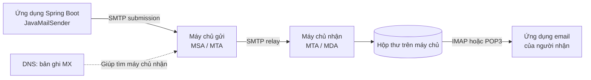

# SMTP, IMAP và POP3 trong hệ sinh thái thư điện tử

Khi người dùng nhấn **Gửi** trong ứng dụng email, thông điệp không đi thẳng từ màn hình người gửi sang hộp thư người nhận. Nó đi qua các máy chủ có nhiệm vụ tiếp nhận, chuyển tiếp và lưu trữ thư. Khi người nhận mở ứng dụng email, một giao thức khác được dùng để truy cập thư đã lưu.

Ba giao thức nền tảng trong quy trình này là:

- **SMTP (Simple Mail Transfer Protocol):** gửi và chuyển tiếp email.
- **IMAP (Internet Message Access Protocol):** truy cập và đồng bộ thư trên máy chủ.
- **POP3 (Post Office Protocol version 3):** lấy thư từ máy chủ về ứng dụng khách, thường theo mô hình tải thư về để xử lý cục bộ.

Trong **Spring Framework Mail**, việc phân biệt ba giao thức giúp chúng ta hiểu vì sao ứng dụng Spring Boot thường cấu hình SMTP để gửi email thông báo, nhưng phải dùng cơ chế khác nếu cần đọc email đến.

## 1. Bức tranh tổng thể: một email đi từ đâu đến đâu?

Giả sử hệ thống Spring Boot cần gửi mã xác nhận đăng ký cho `recipient@example.net`:



Các thuật ngữ trong sơ đồ:

| Thành phần | Vai trò |
|---|---|
| **MUA** (Mail User Agent) | Ứng dụng người dùng sử dụng để soạn, gửi hoặc đọc email, ví dụ ứng dụng mail trên điện thoại. |
| **MSA** (Mail Submission Agent) | Tiếp nhận thư do ứng dụng khách gửi lên, thường có xác thực người gửi. |
| **MTA** (Mail Transfer Agent) | Chuyển tiếp email giữa các máy chủ; có thể xếp hàng và thử gửi lại. |
| **MDA** (Mail Delivery Agent) | Đưa email đã được chấp nhận vào hộp thư đích hoặc kho lưu trữ. |
| **Mailbox** | Nơi lưu thư mà người nhận có thể truy cập. |

Một nhà cung cấp có thể kết hợp nhiều vai trò trong cùng hệ thống; sơ đồ thể hiện **trách nhiệm logic**, không nhất thiết là sáu máy vật lý riêng biệt. Khi gửi đến một tên miền khác, hệ thống gửi thường tra cứu bản ghi **MX trong DNS** để xác định máy chủ tiếp nhận email của tên miền đó. Nếu gặp sự cố tạm thời, MTA có thể đưa thư vào hàng đợi và gửi lại sau.

Điểm cần nhớ: **SMTP vận chuyển thư đến hệ thống nhận; IMAP/POP3 giúp ứng dụng khách truy cập thư đã nằm trong hộp thư.**

## 2. SMTP: giao thức gửi và chuyển tiếp email

### 2.1. SMTP giải quyết vấn đề gì?

SMTP là giao thức giao tiếp theo mô hình máy khách–máy chủ, sử dụng TCP và trao đổi lệnh/phản hồi. Nó xuất hiện ở hai chặng thường gặp:

1. **Submission:** ứng dụng Spring Boot hoặc ứng dụng email gửi thư lên máy chủ dịch vụ email, thường qua cổng **587** hoặc **465**.
2. **Relay/transfer:** máy chủ gửi chuyển thư sang máy chủ tiếp nhận của tên miền đích, thường qua cổng **25**.

SMTP không được thiết kế để người dùng duyệt nhiều thư mục, tìm thư chưa đọc hay đồng bộ trạng thái đã đọc. Đó là nhiệm vụ của IMAP hoặc POP3.

### 2.2. Phong bì SMTP khác với nội dung email

Một email có ít nhất hai lớp thông tin:

| Lớp | Ví dụ | Công dụng |
|---|---|---|
| **Phong bì SMTP** (envelope) | `MAIL FROM:<bounce@example.com>`, `RCPT TO:<recipient@example.net>` | Máy chủ dùng để định tuyến thư, xử lý thất bại hoặc trả thư. |
| **Header và nội dung** (message) | `From:`, `To:`, `Subject:`, phần thân | Người dùng nhìn thấy khi đọc thư; có thể chứa nội dung văn bản, HTML và tệp đính kèm. |

`MAIL FROM` không bắt buộc trùng với trường `From:` hiển thị cho người nhận. Người nhận ở `RCPT TO` cũng không nhất thiết xuất hiện trong `To:`; **BCC** là ví dụ quan trọng: địa chỉ nhận nằm trong phong bì nhưng không được hiển thị như người nhận thông thường. Vì thế không thể xác định toàn bộ người nhận thực tế chỉ bằng cách đọc header.

**MIME** (Multipurpose Internet Mail Extensions) bổ sung cách biểu diễn nội dung email như văn bản UTF-8, HTML, nhiều phần nội dung và tệp đính kèm. MIME mô tả **định dạng thông điệp**; SMTP vẫn đảm nhiệm **vận chuyển** thông điệp đó.

### 2.3. Một phiên SMTP diễn ra thế nào?

Ví dụ sau minh họa các bước chính sau khi ứng dụng kết nối tới máy chủ submission hỗ trợ STARTTLS. Đây là bản lược giản để hiểu giao thức, không phải lệnh dùng trực tiếp để đăng nhập dịch vụ thật.

```text
S: 220 smtp.example.com Service ready
C: EHLO app.example.com
S: 250-smtp.example.com
S: 250-STARTTLS
S: 250 AUTH PLAIN LOGIN
C: STARTTLS
S: 220 Ready to start TLS
   [Hai bên thiết lập TLS, máy khách kiểm tra chứng chỉ]
C: EHLO app.example.com
S: 250-smtp.example.com
S: 250 AUTH PLAIN LOGIN
   [Ứng dụng xác thực qua kênh TLS, nếu máy chủ yêu cầu]
C: MAIL FROM:<bounce@example.com>
S: 250 OK
C: RCPT TO:<recipient@example.net>
S: 250 OK
C: DATA
S: 354 End data with <CRLF>.<CRLF>
C: From: Notifications <notify@example.com>
C: To: recipient@example.net
C: Subject: Xac nhan dang ky
C:
C: Day la email xac nhan.
C: .
S: 250 Queued for delivery
C: QUIT
S: 221 Bye
```

Các mốc cần hiểu:

- `EHLO` giới thiệu máy khách và nhận danh sách khả năng máy chủ; sau khi nâng cấp sang TLS bằng `STARTTLS`, máy khách gửi `EHLO` lại.
- `AUTH` xác thực danh tính máy khách khi máy chủ submission yêu cầu. Không truyền thông tin đăng nhập qua kết nối chưa được bảo vệ.
- `MAIL FROM` và một hoặc nhiều `RCPT TO` khai báo phong bì chuyển phát.
- `DATA` bắt đầu phần header và nội dung; dòng chỉ chứa dấu chấm kết thúc dữ liệu theo quy tắc SMTP.
- Mã phản hồi **2xx** thường là thành công ở bước hiện tại, **4xx** là lỗi tạm thời có thể thử lại, còn **5xx** thường là lỗi lâu dài cần xử lý nguyên nhân.

**`250 Queued for delivery` chỉ cho biết máy chủ ở chặng đó đã chấp nhận thư.** Nó không chứng minh thư đã đến Inbox, đã vượt bộ lọc spam hoặc đã được người nhận mở. Ứng dụng gửi thư cần tách biệt trạng thái *được SMTP chấp nhận* với trạng thái *được phát đến người nhận*.

## 3. IMAP: truy cập và đồng bộ hộp thư trên máy chủ

IMAP cho phép ứng dụng email tương tác với thư **đang được quản lý trên máy chủ**. Thay vì coi thao tác nhận thư chỉ là tải một danh sách thông điệp, IMAP cung cấp mô hình hộp thư với nhiều thư mục và trạng thái thư.

Những khả năng phổ biến:

- Liệt kê và mở các hộp thư/thư mục như `INBOX`, `Sent`, `Archive` (tên thư mục có thể khác tùy máy chủ).
- Lấy header, nội dung hoặc từng phần thông điệp theo nhu cầu, giúp khách hàng không phải tải mọi tệp đính kèm ngay lập tức.
- Đồng bộ cờ trạng thái như `\Seen` (đã đọc), `\Answered` (đã trả lời), `\Flagged` (đánh dấu), `\Deleted` (đánh dấu xóa).
- Tìm kiếm trên máy chủ, quản lý thư mục và hỗ trợ nhiều thiết bị cùng truy cập một tài khoản.
- Nhận thông báo thay đổi gần thời gian thực thông qua cơ chế **IMAP IDLE** khi máy chủ và máy khách hỗ trợ.

Ví dụ: bạn đọc một email trên điện thoại. Với IMAP, cờ `\Seen` có thể được cập nhật trên máy chủ để ứng dụng trên laptop hiển thị thư đó là đã đọc. Email vẫn có thể được lưu ngoại tuyến bằng bộ nhớ đệm của từng ứng dụng; **IMAP không có nghĩa là luôn phải kết nối mạng mới đọc được thư**.

Trong IMAP, **số thứ tự thông điệp** có thể thay đổi khi nội dung hộp thư thay đổi. Ứng dụng đồng bộ nên dùng **UID cùng UIDVALIDITY** để nhận diện thư một cách ổn định trong phạm vi một hộp thư, và lưu ý UID không phải mã định danh toàn cục vĩnh viễn. Thư được đánh dấu `\Deleted` không nhất thiết bị xóa vật lý ngay; lệnh expunge hoặc thao tác tương ứng mới hoàn tất việc loại bỏ trên máy chủ.

IMAP là giao thức **truy cập thư**, không thay thế SMTP để gửi email. Một ứng dụng email thông thường có thể dùng **SMTP để gửi + IMAP để đọc và đồng bộ**.

## 4. POP3: tải thư về từ máy chủ

POP3 có mô hình đơn giản hơn IMAP: ứng dụng khách kết nối tới máy chủ, xem những thư có thể tải về, lấy nội dung và có thể yêu cầu xóa thư khỏi máy chủ.

Một phiên POP3 cơ bản có thể gồm:

```text
S: +OK POP3 server ready
C: USER mailbox@example.net
S: +OK
C: PASS [mat-khau-minh-hoa]
S: +OK
C: STAT
S: +OK 2 3500
C: LIST
S: +OK 2 messages
   ...
C: RETR 1
S: +OK message follows
   [Header va noi dung thong diep]
C: DELE 1
S: +OK message marked
C: QUIT
S: +OK goodbye
```

Ví dụ dùng `USER`/`PASS` để minh họa lệnh cổ điển; khi dùng thực tế phải bảo vệ kết nối bằng TLS và tuân theo cơ chế xác thực của nhà cung cấp. Các lệnh chính:

- `STAT`: lấy số lượng thư và tổng kích thước trong vùng thư hiện có.
- `LIST`: liệt kê thông tin cơ bản về các thư.
- `RETR`: tải nội dung đầy đủ của một thư.
- `DELE`: **đánh dấu** thư để xóa; thao tác xóa thường được áp dụng khi phiên chuyển sang trạng thái cập nhật sau `QUIT` thành công.

POP3 **không mặc định bắt buộc xóa thư sau khi tải**. Việc giữ bản sao trên máy chủ hay xóa sau khi nhận là hành vi của ứng dụng khách và cấu hình tài khoản. Tuy nhiên, POP3 không cung cấp cơ chế đồng bộ nhiều thư mục và cờ trạng thái phong phú như IMAP. Đây là lý do POP3 thường kém phù hợp nếu một hộp thư được sử dụng đồng thời trên điện thoại, máy tính bảng và laptop.

## 5. So sánh SMTP, IMAP và POP3

| Tiêu chí | SMTP | IMAP | POP3 |
|---|---|---|---|
| Mục đích chính | Gửi/chuyển tiếp thư | Đọc và đồng bộ hộp thư | Tải thư về máy khách |
| Hướng trao đổi thường gặp | Máy khách gửi → server, server → server | Server hộp thư ↔ ứng dụng đọc | Server hộp thư → ứng dụng đọc |
| Quản lý thư mục phía server | Không | Có | Không phải chức năng cốt lõi |
| Đồng bộ cờ đã đọc/đã trả lời | Không | Có | Không có cơ chế tương đương IMAP |
| Phù hợp nhiều thiết bị | Kết hợp với giao thức đọc | Rất phù hợp | Hạn chế hơn |
| Dùng để gửi email trong Spring Boot | **Có** | Không | Không |

Không nên xem ba giao thức là ba lựa chọn thay thế ngang hàng: **SMTP trả lời câu hỏi “gửi thế nào?”, còn IMAP và POP3 trả lời câu hỏi “lấy và quản lý thư đến thế nào?”**.

### Các cổng thường gặp

| Giao thức / mục đích | Cổng TCP | Bảo vệ kết nối và lưu ý |
|---|---:|---|
| SMTP server-to-server relay | **25** | Có thể nâng cấp bằng STARTTLS; không phải cổng submission thông dụng cho ứng dụng khách. |
| SMTP message submission | **587** | Thông dụng với STARTTLS; cấu hình ứng dụng nên yêu cầu TLS khi gửi thông tin xác thực. |
| SMTP submission qua TLS ngay từ đầu | **465** | **Implicit TLS**: thiết lập TLS trước khi trao đổi lệnh SMTP. |
| IMAP | **143** | Có thể sử dụng STARTTLS nếu máy chủ hỗ trợ và máy khách yêu cầu. |
| IMAP qua TLS | **993** | Implicit TLS (`imaps`). |
| POP3 | **110** | Có thể hỗ trợ nâng cấp bảo mật; không nên gửi mật khẩu trên kết nối thuần. |
| POP3 qua TLS | **995** | Implicit TLS (`pop3s`). |

**STARTTLS và implicit TLS khác nhau ở thời điểm bắt đầu mã hóa:** STARTTLS khởi tạo kết nối giao thức trước rồi nâng cấp; implicit TLS bắt đầu bằng bắt tay TLS. Trong cả hai trường hợp, ứng dụng phải xác thực chứng chỉ máy chủ, kiểm tra đúng tên máy chủ và tránh hạ cấp xuống truyền thông không mã hóa khi chính sách yêu cầu TLS.

## 6. Xác thực, bảo mật và khả năng thư đến đích

Có hai lớp xác thực dễ bị nhầm lẫn:

**Xác thực máy khách gửi thư (SMTP AUTH):** giúp máy chủ submission xác định ứng dụng/tài khoản nào được phép gửi. Cơ chế cụ thể có thể là tên đăng nhập và mật khẩu ứng dụng, OAuth2 hoặc phương thức do nhà cung cấp hỗ trợ. Thông tin đăng nhập cần nằm trong secret hoặc biến môi trường, không ghi cứng vào source code.

**Xác thực tên miền gửi (SPF, DKIM, DMARC):** giúp hệ thống nhận đánh giá email có được gửi hợp lệ thay mặt tên miền hay không.

- **SPF:** tên miền công bố máy chủ hoặc dịch vụ nào được phép gửi thay mặt tên miền theo thông tin kiểm tra của SPF.
- **DKIM:** email có chữ ký mật mã; hệ thống nhận dùng khóa công khai được công bố qua DNS để kiểm chứng.
- **DMARC:** sử dụng kết quả SPF/DKIM cùng quan hệ căn chỉnh với miền trong trường `From:` để đưa ra chính sách và nhận báo cáo.

Các cơ chế này **không thay thế TLS**, cũng không bảo đảm email chắc chắn đến Inbox. Email có thể bị từ chối, chậm phát hoặc vào spam do danh tiếng địa chỉ/tên miền, nội dung, chính sách hệ thống nhận và những yếu tố khác.

Đối với ứng dụng gửi mã OTP hoặc thông báo quan trọng, cần thiết kế thêm: hàng đợi gửi, giới hạn tốc độ, xử lý lỗi SMTP 4xx/5xx, kiểm soát gửi trùng và theo dõi sự kiện bounce/delivery nếu nhà cung cấp có hỗ trợ. Không đánh đồng việc gọi hàm gửi thành công với việc người dùng thực sự đã nhận thư.

## 7. Liên hệ trực tiếp với Spring Framework Mail

### 7.1. Spring Boot gửi email bằng SMTP

Spring Boot có thể tự cấu hình `JavaMailSender` khi ứng dụng bổ sung Spring Boot Mail starter và khai báo thông tin máy chủ SMTP. Với dự án Gradle dùng Spring Boot:

```groovy
dependencies {
    implementation 'org.springframework.boot:spring-boot-starter-mail'
}
```

Ví dụ `application.yml` cho máy chủ SMTP submission cổng 587:

```yaml
spring:
  mail:
    host: ${MAIL_HOST}
    port: 587
    username: ${MAIL_USERNAME}
    password: ${MAIL_PASSWORD}
    properties:
      mail:
        smtp:
          auth: true
          starttls:
            enable: true
            required: true
          connectiontimeout: 5000
          timeout: 5000
          writetimeout: 5000

app:
  mail:
    from: ${MAIL_FROM}
```

Các biến môi trường `MAIL_HOST`, `MAIL_USERNAME`, `MAIL_PASSWORD` và `MAIL_FROM` phải được cung cấp ở nơi triển khai. Địa chỉ `From` phải phù hợp chính sách xác thực và tên miền được nhà cung cấp cho phép. Cấu hình trên dùng **STARTTLS trên 587**; nếu nhà cung cấp yêu cầu **implicit TLS trên 465**, cần đổi cả cổng lẫn cấu hình TLS tương ứng, không chỉ thay số cổng.

Ví dụ dịch vụ gửi email văn bản thuần:

```java
import org.springframework.beans.factory.annotation.Value;
import org.springframework.mail.SimpleMailMessage;
import org.springframework.mail.javamail.JavaMailSender;
import org.springframework.stereotype.Service;

@Service
public class NotificationMailService {
    private final JavaMailSender mailSender;
    private final String from;

    public NotificationMailService(
            JavaMailSender mailSender,
            @Value("${app.mail.from}") String from) {
        this.mailSender = mailSender;
        this.from = from;
    }

    public void sendWelcomeEmail(String recipient) {
        SimpleMailMessage message = new SimpleMailMessage();
        message.setFrom(from);
        message.setTo(recipient);
        message.setSubject("Chào mừng đến với hệ thống");
        message.setText("Tài khoản của bạn đã được tạo thành công.");

        mailSender.send(message);
    }
}
```

Trong ví dụ này:

1. `JavaMailSender` là abstraction của Spring để **gửi** email; triển khai bên dưới sử dụng Jakarta Mail và SMTP.
2. `SimpleMailMessage` phù hợp email văn bản thuần. Email HTML, nhiều phần nội dung hoặc tệp đính kèm thường dùng `MimeMessage` cùng `MimeMessageHelper`.
3. `mailSender.send(...)` có thể ném `MailException` khi gửi không thành công ở tầng ứng dụng/SMTP. Thành công tại đây không đồng nghĩa người nhận đã đọc hoặc thậm chí đã nhận vào Inbox.
4. Với ứng dụng nghiệp vụ, nên cân nhắc gửi bất đồng bộ hoặc qua hàng đợi để lỗi và độ trễ của dịch vụ email không chặn luồng xử lý chính; khi cần bảo đảm sự kiện gửi không bị mất, có thể áp dụng transactional outbox.

Lưu ý cách đặt tên: **Spring Framework Mail / `JavaMailSender` chủ yếu giải quyết việc gửi email**. Nó không biến SMTP thành giao thức đọc hộp thư.

### 7.2. Nếu ứng dụng Spring cần đọc thư đến thì sao?

Giả sử hệ thống xử lý yêu cầu hỗ trợ được gửi tới `support@example.com`. Lúc này có các lựa chọn:

- Dùng **Jakarta Mail** với `Store`/`Folder` và giao thức `imap`/`imaps` hoặc `pop3`/`pop3s` để đọc hộp thư.
- Dùng **Spring Integration Mail** khi cần đưa email đến vào một luồng tích hợp, poll mailbox hoặc sử dụng adapter nhận thư phù hợp.
- Nếu nhà cung cấp hỗ trợ webhook/API sự kiện nhận thư, cân nhắc kiến trúc đó theo nhu cầu hệ thống.

Chỉ thêm `spring-boot-starter-mail` **không tự sinh ra một bộ tiếp nhận email đến theo lịch**. Cần chủ động thiết kế cách kết nối, lưu trạng thái đồng bộ, phân quyền truy cập, xử lý thư trùng, lỗi mạng và bảo mật. Nếu mailbox được đồng bộ trên nhiều thiết bị hoặc dịch vụ, IMAP thường là lựa chọn phù hợp hơn POP3.

## 8. Các tình huống để chọn đúng giao thức

| Tình huống | Giao thức/cơ chế thích hợp | Vì sao? |
|---|---|---|
| Spring Boot gửi email xác nhận đăng ký | **SMTP submission** hoặc API gửi mail của nhà cung cấp | Hệ thống cần đưa thông điệp vào hạ tầng vận chuyển thư. |
| Người dùng đọc cùng một hộp thư trên điện thoại và laptop | **IMAP** để nhận/đồng bộ, **SMTP** để gửi | Thư mục và trạng thái đọc cần nhất quán trên nhiều thiết bị. |
| Chương trình đơn giản định kỳ tải thư về một máy | **POP3**, nếu đáp ứng yêu cầu nghiệp vụ | Lấy thư về thuận tiện nhưng khả năng đồng bộ hạn chế. |
| Hệ thống nội bộ đọc và phân loại thư hỗ trợ | **IMAP** hoặc inbound mail API | Cần truy cập thư đến, theo dõi thư đã xử lý và có thể cần đồng bộ thư mục. |
| Hai nhà cung cấp email chuyển thư cho nhau | **SMTP relay** | Đây là chặng vận chuyển giữa các máy chủ. |

### Một số nhầm lẫn thường gặp

**“Cấu hình IMAP là đủ để gửi email.”** Không đúng. IMAP quản lý và đọc thư; gửi email thông thường vẫn dùng SMTP submission hoặc API gửi thư.

**“POP3 luôn xóa email khỏi máy chủ.”** Không đúng. Hành vi xóa phụ thuộc lệnh máy khách gửi và cấu hình giữ thư trên máy chủ.

**“SMTP trả về 250 nghĩa là email đã đến Inbox.”** Không đúng. Đó là xác nhận ở bước xử lý/chuyển giao hiện tại, không phải bằng chứng đọc thư hay kết quả phân loại spam.

**“Cổng 465 và 587 chỉ khác con số.”** Không đúng. Cổng 465 thường dùng TLS ngay khi kết nối, còn 587 thường bắt đầu SMTP rồi nâng cấp qua STARTTLS; cấu hình bảo mật phải khớp dịch vụ.

**“SMTP AUTH, SPF, DKIM, DMARC là cùng một loại đăng nhập.”** Không đúng. SMTP AUTH xác thực ứng dụng đang gửi tới máy chủ submission; SPF/DKIM/DMARC giúp hệ thống nhận xác minh và áp dụng chính sách về danh tính tên miền gửi.

## 9. Tự kiểm tra kiến thức

1. Một ứng dụng Spring Boot cần gửi email chứa liên kết đặt lại mật khẩu. Nó sẽ sử dụng SMTP, IMAP hay POP3 ở bước gửi? Khi gọi hàm gửi không báo lỗi, hệ thống đã biết chắc người dùng nhận được email chưa?
2. Người dùng đọc email trên điện thoại rồi mở laptop và mong thấy trạng thái “đã đọc”. IMAP hỗ trợ tình huống này như thế nào? Vì sao POP3 thường kém thuận tiện hơn?
3. Vì sao `MAIL FROM` trong phiên SMTP có thể khác trường `From:` trong nội dung email? BCC liên quan gì đến sự khác biệt này?
4. Trên cổng 587, STARTTLS cần diễn ra khi nào so với bước xác thực? Nếu nhà cung cấp chỉ chấp nhận implicit TLS trên 465 thì ứng dụng cần thay đổi điều gì?
5. Một thông điệp được máy chủ SMTP trả về `250 Queued`, nhưng người dùng không thấy ở Inbox. Hãy nêu ít nhất ba điểm cần kiểm tra ở những chặng phía sau.

**Ghi nhớ:** SMTP phụ trách **gửi và chuyển tiếp**; IMAP phụ trách **truy cập và đồng bộ**; POP3 phụ trách **tải thư về**. Trong Spring Boot, `JavaMailSender` phục vụ luồng gửi qua SMTP, còn xử lý thư đến cần thiết kế một luồng nhận riêng bằng IMAP, POP3 hoặc API phù hợp.
