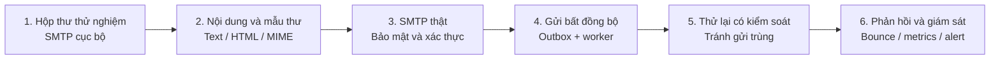
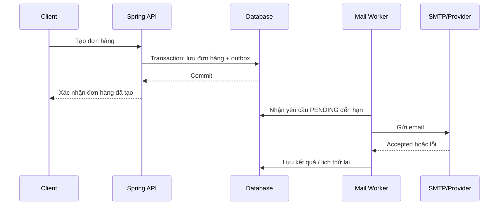
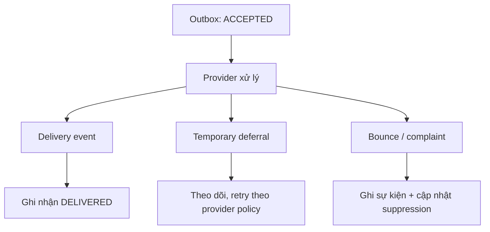

# Lộ trình từ thư thử nghiệm đến hệ thống gửi thư đáng tin cậy

Gửi thành công một email từ ứng dụng Spring là cột mốc đầu tiên, nhưng chưa đủ để có một hệ thống gửi thư đáng tin cậy. Ở môi trường thử nghiệm, ta thường chỉ cần thấy thư xuất hiện trong hộp thư giả lập. Trong thực tế, máy chủ SMTP có thể quá tải, kết nối bị ngắt, địa chỉ nhận không tồn tại, thư bị đánh dấu là spam hoặc người dùng nhận hai bản giống nhau sau một lần thử lại.

Bài học này xây dựng một lộ trình có thể thực hiện theo từng giai đoạn trong **Spring Framework Mail**: gửi thư đầu tiên, tạo nội dung đúng chuẩn, cấu hình an toàn, tách việc gửi khỏi yêu cầu HTTP, xử lý lỗi và thử lại, ghi nhận phản hồi từ nhà cung cấp, rồi vận hành dựa trên số liệu. Ví dụ sử dụng Java 21, Spring Boot 3.x và thư viện Jakarta Mail; các nguyên lý về SMTP, độ tin cậy và trạng thái gửi cũng áp dụng cho ứng dụng Spring Framework không dùng Boot.

## 1. Hiểu đúng mục tiêu: "gửi thành công" nghĩa là gì?

Một thông báo qua email đi qua nhiều ranh giới:

1. **Ứng dụng ghi nhận yêu cầu gửi**: sự kiện nghiệp vụ đã tạo ra ý định gửi email.
2. **Hệ thống xử lý việc gửi**: một tiến trình lấy yêu cầu và thực hiện lệnh gọi SMTP hoặc API của nhà cung cấp.
3. **Máy chủ gửi chấp nhận thư**: SMTP trả về phản hồi chấp nhận, hoặc API trả về trạng thái tiếp nhận.
4. **Hệ thống phía người nhận xử lý thư**: thư có thể được phát, tạm hoãn, trả lại hoặc lọc.
5. **Người nhận tương tác**: có thể đọc, nhấp liên kết hoặc bỏ qua thư; những sự kiện này không đồng nghĩa với việc thư đã được gửi.

Phương thức `JavaMailSender.send(...)` trả về bình thường chỉ chứng tỏ thao tác gửi đã hoàn tất ở mức mà giao thức và thư viện đang quan sát. Nó **không chứng minh thư đã vào hộp thư đến, được mở hay được đọc**. Nếu hệ thống chỉ dựa vào một giá trị boolean `sent = true`, người vận hành sẽ khó phân biệt lỗi ứng dụng, lỗi đường truyền và thư bị trả lại sau đó.

| Khái niệm | Ý nghĩa thực tế | Có thể xác nhận từ đâu? |
|---|---|---|
| `QUEUED` / `PENDING` | Yêu cầu gửi đã được lưu để xử lý | Cơ sở dữ liệu hoặc hàng đợi của ứng dụng |
| `PROCESSING` | Worker đã nhận yêu cầu gửi | Trạng thái worker/lease |
| `ACCEPTED` | SMTP relay hoặc nhà cung cấp đã nhận trách nhiệm xử lý | Kết quả gửi SMTP/API |
| `DELIVERED` | Nhà cung cấp báo đã giao tới hệ thống đích theo định nghĩa của họ | Sự kiện delivery từ nhà cung cấp (nếu có) |
| `BOUNCED` | Hệ thống đích hoặc nhà cung cấp từ chối/trả lại thư | Bounce/event/webhook |
| `PERMANENT_FAILURE` | Hệ thống quyết định không thử gửi lại | Kết quả phân loại lỗi và chính sách thử lại |

> Mục tiêu vận hành hợp lý là **không làm mất ý định gửi**, **không thử lại vô hạn**, **giảm gửi trùng**, và **biết chính xác hệ thống quan sát được gì**. Không nên hứa "exactly once" khi dùng SMTP thông thường, vì có những trường hợp thư đã được máy chủ chấp nhận nhưng ứng dụng chưa kịp ghi nhận kết quả.

## 2. Bản đồ hành trình



Mỗi cột mốc trả lời một câu hỏi khác nhau:

- **Thư có được tạo và gửi đúng định dạng không?** — kiểm tra với SMTP cục bộ.
- **Người nhận có đọc được nội dung ở nhiều ứng dụng email không?** — chuẩn hóa MIME, text fallback, HTML và liên kết.
- **Ứng dụng có giao tiếp an toàn với máy chủ thật không?** — TLS, tài khoản, cấu hình, domain.
- **Nếu ứng dụng dừng giữa chừng thì yêu cầu gửi có mất không?** — lưu ý định gửi trong cơ sở dữ liệu.
- **Nếu nhà cung cấp tạm thời lỗi thì có tự phục hồi không?** — phân loại lỗi, retry, backoff, idempotency.
- **Nếu email bị bounce hoặc bị khiếu nại thì hệ thống có biết và xử lý không?** — feedback, suppression, metric và cảnh báo.

## 3. Cột mốc 1 — Gửi thư trong môi trường thử nghiệm

### 3.1. Dùng SMTP giả lập để kiểm tra luồng gửi

**Mailpit** là một công cụ SMTP giả lập nhận email rồi hiển thị chúng qua giao diện web. Nó không chuyển thư ra Internet, nên phù hợp để luyện tập và tránh gửi nhầm cho khách hàng thật.

Ví dụ khởi động bằng Docker:

```bash
docker run --rm --name mailpit -p 1025:1025 -p 8025:8025 axllent/mailpit
```

- SMTP lắng nghe tại `localhost:1025`.
- Giao diện xem thư tại `http://localhost:8025`.
- Nếu Spring chạy trong một container khác của cùng mạng Docker Compose, dùng tên service `mailpit` thay cho `localhost`.
- Trong dự án thực tế, nên ghim phiên bản image đã kiểm chứng để môi trường CI có thể tái lập.

Với Spring Boot, thêm dependency:

```groovy
dependencies {
    implementation 'org.springframework.boot:spring-boot-starter-mail'
}
```

Spring Boot tự cấu hình `JavaMailSender` nếu dependency và cấu hình phù hợp có mặt. Với ứng dụng Spring Framework thuần, bạn cần khai báo `JavaMailSenderImpl` và các thư viện Jakarta Mail tương ứng.

Tạo cấu hình cho profile cục bộ trong `application-local.yml`:

```yaml
spring:
  mail:
    host: localhost
    port: 1025
    default-encoding: UTF-8
    properties:
      mail:
        smtp:
          auth: false
          starttls:
            enable: false

app:
  mail:
    from: demo@example.test
```

Chạy ứng dụng với profile `local` để cấu hình này có hiệu lực. Không dùng cấu hình `auth: false` và `starttls.enable: false` cho máy chủ SMTP thật yêu cầu bảo mật.

### 3.2. Tạo một dịch vụ gửi thư văn bản

`JavaMailSender` là abstraction của Spring cho việc gửi email. `SimpleMailMessage` chứa các trường cơ bản như người gửi, người nhận, tiêu đề và nội dung text.

```java
package com.example.mail;

import org.springframework.beans.factory.annotation.Value;
import org.springframework.mail.SimpleMailMessage;
import org.springframework.mail.javamail.JavaMailSender;
import org.springframework.stereotype.Service;

@Service
public class WelcomeMailService {

    private final JavaMailSender mailSender;
    private final String from;

    public WelcomeMailService(
            JavaMailSender mailSender,
            @Value("${app.mail.from}") String from) {
        this.mailSender = mailSender;
        this.from = from;
    }

    public void sendWelcome(String recipient) {
        SimpleMailMessage message = new SimpleMailMessage();
        message.setFrom(from);
        message.setTo(recipient);
        message.setSubject("Chào mừng bạn");
        message.setText("Tài khoản của bạn đã được tạo thành công.");

        mailSender.send(message);
    }
}
```

Trong luồng thử nghiệm, gọi `sendWelcome("learner@example.test")` từ một hành động có chủ đích (chẳng hạn lệnh thử nghiệm nội bộ). Mở Mailpit và kiểm tra người gửi, người nhận, tiêu đề, nội dung cùng mã hóa tiếng Việt.

Đừng đặt lời gọi thử gửi tự động trong logic khởi động dùng chung cho production: mỗi lần ứng dụng khởi động lại có thể tạo thêm thư.

### 3.3. Điểm cần hiểu sau thư đầu tiên

Việc thấy thư ở Mailpit xác nhận rằng ứng dụng đã cấu hình đúng luồng **Spring → SMTP cục bộ → hộp thư giả lập**. Đây là một thử nghiệm tích hợp quan trọng, nhưng chưa kiểm chứng TLS, xác thực SMTP, DNS, danh tiếng tên miền hay khả năng gửi thật.

## 4. Cột mốc 2 — Tạo email người dùng có thể đọc và sử dụng

### 4.1. Chọn định dạng thích hợp

| Nhu cầu | API thường dùng | Ghi chú |
|---|---|---|
| Thông báo text đơn giản | `SimpleMailMessage` | Dễ dùng, không có HTML/attachment |
| Thư HTML và bản dự phòng text | `MimeMessage` + `MimeMessageHelper` | Nên có cả hai phần cho nhiều email client |
| Tệp đính kèm, ảnh inline | `MimeMessageHelper` ở chế độ multipart | Cần giới hạn kích thước và kiểm tra đầu vào |
| Nội dung theo mẫu/ngôn ngữ | Template engine tạo nội dung rồi chuyển cho mail service | Tách dữ liệu nghiệp vụ khỏi phần trình bày |

Ví dụ tạo email gồm text thuần và HTML:

```java
package com.example.mail;

import jakarta.mail.MessagingException;
import jakarta.mail.internet.MimeMessage;
import org.springframework.beans.factory.annotation.Value;
import org.springframework.mail.javamail.JavaMailSender;
import org.springframework.mail.javamail.MimeMessageHelper;
import org.springframework.stereotype.Service;
import org.springframework.web.util.HtmlUtils;

@Service
public class AccountNotificationMailService {

    private final JavaMailSender sender;
    private final String from;

    public AccountNotificationMailService(
            JavaMailSender sender,
            @Value("${app.mail.from}") String from) {
        this.sender = sender;
        this.from = from;
    }

    public void sendAccountCreated(String to, String displayName)
            throws MessagingException {
        String safeName = HtmlUtils.htmlEscape(displayName);
        String plainText = "Xin chào " + displayName
                + ", tài khoản của bạn đã được tạo.";
        String html = "<html><body><p>Xin chào <strong>"
                + safeName
                + "</strong>, tài khoản của bạn đã được tạo.</p></body></html>";

        MimeMessage message = sender.createMimeMessage();
        MimeMessageHelper helper =
                new MimeMessageHelper(message, true, "UTF-8");
        helper.setFrom(from);
        helper.setTo(to);
        helper.setSubject("Xác nhận tạo tài khoản");
        helper.setText(plainText, html);

        sender.send(message);
    }
}
```

Trong đoạn code này:

1. `createMimeMessage()` tạo thông điệp Jakarta Mail.
2. `MimeMessageHelper` thiết lập UTF-8 và giúp thao tác với cấu trúc MIME.
3. `setText(plainText, html)` tạo hai cách biểu diễn nội dung.
4. `HtmlUtils.htmlEscape(...)` mã hóa tên hiển thị trước khi chèn vào HTML, tránh để đầu vào người dùng trở thành thẻ HTML.

Ở hệ thống lớn, template HTML nên nằm trong tệp riêng và được render bằng engine có hỗ trợ escape theo ngữ cảnh. Đối với URL, kiểm tra nguồn tạo URL và chỉ sử dụng domain đáng tin cậy; HTML escaping không thay thế kiểm tra liên kết.

### 4.2. Phân tách dữ liệu và bản mẫu

Một yêu cầu gửi thư có thể bao gồm:

```text
templateId: account-created
templateVersion: 3
locale: vi-VN
recipient: learner@example.test
variables:
  displayName: Minh
```

Từ thông tin đó, tầng dựng mẫu sinh ra `subject`, `plainText` và `html`. Cách chia trách nhiệm phù hợp:

- **Nghiệp vụ** quyết định khi nào cần gửi, loại thông báo và người nhận.
- **Renderer** chọn bản mẫu/ngôn ngữ, kiểm tra biến bắt buộc và tạo nội dung.
- **Mail adapter** chuyển nội dung sang `SimpleMailMessage` hoặc `MimeMessage` rồi gọi `JavaMailSender`.
- **Delivery workflow** quyết định thời điểm gửi, số lần thử và trạng thái; không nhét các quyết định này vào template.

Không đưa mật khẩu, mã OTP, access token hay các dữ liệu bí mật vào log. Với link đặt lại mật khẩu, dùng token ngắn hạn, một lần sử dụng, URL HTTPS thuộc domain kiểm soát; lưu và xử lý token theo chính sách bảo mật riêng.

### 4.3. Những chi tiết dễ bỏ sót trong email thực tế

- Định dạng tiếng Việt phải nhất quán UTF-8 ở subject, text và HTML.
- Email HTML cần có phương án text thuần cho client không hỗ trợ HTML.
- Người gửi (`From`) nên là địa chỉ thuộc domain được phép gửi; `Reply-To` có thể khác tùy nghiệp vụ.
- Liên kết nên là URL tuyệt đối HTTPS, hướng tới đúng môi trường; tránh link `localhost` lọt vào thư thật.
- Với tệp đính kèm, kiểm tra định dạng, nguồn dữ liệu, kích thước, antivirus/chính sách nội dung và giới hạn nhà cung cấp. Không đưa dữ liệu nhạy cảm vào attachment nếu chưa có cơ chế bảo vệ.
- Template cần nêu rõ loại thư: giao dịch (xác thực, hóa đơn) hay tiếp thị. Thư tiếp thị phải tuân thủ quy định về đồng ý nhận và hủy đăng ký hiện hành.

## 5. Cột mốc 3 — Chuyển sang SMTP thật một cách an toàn

### 5.1. Những tham số tối thiểu

Một tài khoản SMTP production thường cần host, port, username, password hoặc credential chuyên dụng, địa chỉ gửi và chế độ TLS. Cấu hình tham khảo cho máy chủ hỗ trợ **STARTTLS trên cổng 587**:

```yaml
spring:
  mail:
    host: ${SMTP_HOST}
    port: ${SMTP_PORT:587}
    username: ${SMTP_USERNAME}
    password: ${SMTP_PASSWORD}
    default-encoding: UTF-8
    properties:
      mail:
        smtp:
          auth: true
          starttls:
            enable: true
            required: true
          connectiontimeout: 5000
          timeout: 10000
          writetimeout: 10000

app:
  mail:
    from: ${MAIL_FROM}
```

Các giá trị môi trường trên chỉ là ví dụ. Trong triển khai thực tế, lấy secret từ hệ thống quản lý bí mật hoặc cấu hình runtime có bảo vệ, giới hạn quyền truy cập và hỗ trợ xoay vòng credential. Không commit username/password vào kho mã nguồn.

**Phân biệt hai chế độ TLS thường gặp:**

- **Cổng 587 + STARTTLS:** kết nối ban đầu được nâng cấp lên TLS; ví dụ trên đặt `starttls.required: true` để tránh âm thầm gửi khi không thể nâng cấp.
- **Cổng 465 + implicit TLS (SMTPS):** thiết lập TLS ngay từ đầu; cấu hình phải dùng chế độ SSL tương ứng (ví dụ thuộc tính `mail.smtp.ssl.enable=true`) theo yêu cầu nhà cung cấp.

Không thay đổi cổng mà giữ nguyên các thuộc tính TLS một cách máy móc. Trong cả hai trường hợp, xác thực chứng chỉ máy chủ theo cấu hình TLS chuẩn; không tắt kiểm tra chứng chỉ để chữa lỗi kết nối.

### 5.2. Domain gửi và khả năng đến hộp thư

Một email hợp lệ về mặt MIME vẫn có thể không được hệ thống nhận tin tưởng. Khi gửi bằng domain thật, cần phối hợp người quản trị DNS và nhà cung cấp email để thiết lập:

- **SPF:** công bố máy chủ/dịch vụ được phép gửi thay mặt domain.
- **DKIM:** nhà cung cấp ký thư, hệ thống nhận kiểm tra chữ ký theo bản ghi DNS.
- **DMARC:** quy định cách xử lý thông điệp không vượt qua kiểm tra phù hợp và nơi nhận báo cáo.
- **Domain/địa chỉ phản hồi:** xử lý bounce và phản hồi theo cơ chế của nhà cung cấp.

Các bản ghi này thuộc hạ tầng email và DNS, không được Spring Mail tự tạo chỉ nhờ gọi `send()`. Cần kiểm tra domain được nhà cung cấp xác minh, sự phù hợp giữa From và cơ chế xác thực, cùng chính sách giới hạn gửi.

### 5.3. Kiểm soát dữ liệu và quyền gửi

Ngay từ giai đoạn kết nối thật, hãy đặt ra giới hạn:

1. Tách tài khoản/thông số gửi giữa môi trường thử nghiệm và production.
2. Không cho phép bất kỳ người dùng nào truyền tùy ý `from`, `replyTo` hoặc nội dung HTML không kiểm soát.
3. Kiểm tra và chuẩn hóa người nhận ở ranh giới nghiệp vụ; áp dụng rate limit cho các hành động phát sinh thư.
4. Áp dụng hạn mức gửi theo tenant, người dùng hoặc loại thông báo để giảm lạm dụng.
5. Chặn gửi vào các địa chỉ đã từ chối nhận hoặc bị đánh dấu không thể gửi.

## 6. Cột mốc 4 — Đưa việc gửi email ra khỏi luồng HTTP

### 6.1. Vì sao gọi SMTP ngay trong request dễ gặp vấn đề?

Giả sử API tạo đơn hàng làm ba việc: ghi đơn hàng vào database, gọi SMTP gửi xác nhận, rồi trả HTTP 200. Nếu kết nối SMTP mất 10 giây, API cũng bị kéo dài. Nếu gửi email lỗi, ứng dụng phải quyết định xem có hủy việc tạo đơn hàng hay không. Nếu database commit thành công rồi ứng dụng dừng trước khi gửi thư, không còn dấu vết nào cho biết thư cần được gửi.

Giải pháp cho các thông báo quan trọng là lưu **ý định gửi** cùng giao dịch nghiệp vụ, sau đó để một worker độc lập thực hiện gửi. Mẫu thường dùng là **Transactional Outbox**.



Phản hồi HTTP ở đây xác nhận nghiệp vụ (ví dụ đơn hàng đã tạo), không khẳng định email đã đến người nhận. Nếu chức năng cần hiển thị tiến độ email, cung cấp trạng thái gửi riêng.

### 6.2. Cấu trúc outbox minh họa

Bảng dưới đây là **sơ đồ dữ liệu gợi ý**, cần điều chỉnh theo database và mô hình dữ liệu thực tế:

```sql
CREATE TABLE mail_outbox (
    id UUID PRIMARY KEY,
    deduplication_key VARCHAR(200) NOT NULL UNIQUE,
    recipient VARCHAR(320) NOT NULL,
    template_id VARCHAR(100) NOT NULL,
    payload_json TEXT NOT NULL,
    status VARCHAR(32) NOT NULL,
    attempts INT NOT NULL DEFAULT 0,
    next_attempt_at TIMESTAMP NOT NULL,
    lease_until TIMESTAMP NULL,
    provider_message_id VARCHAR(255) NULL,
    last_error_code VARCHAR(100) NULL,
    created_at TIMESTAMP NOT NULL,
    updated_at TIMESTAMP NOT NULL
);
```

Các trường có vai trò cụ thể:

- `deduplication_key` đại diện **một thông báo nghiệp vụ**, chẳng hạn `order-confirmed:order-123:customer-456`; unique constraint giúp chống việc ghi cùng ý định gửi nhiều lần.
- `status` ghi nhận tiến độ xử lý, không đánh đồng tiếp nhận với giao thành công.
- `attempts` và `next_attempt_at` cho phép lên lịch retry.
- `lease_until` dùng để thu hồi bản ghi worker đang xử lý nếu worker gặp sự cố.
- `provider_message_id` hỗ trợ đối chiếu với sự kiện của nhà cung cấp, nếu tích hợp cung cấp định danh này.

Để gửi cho nhiều người, nên tạo từng bản ghi gửi (hoặc từng recipient-delivery) nhằm theo dõi retry/bounce riêng; không dùng chung một trạng thái cho các người nhận có kết quả khác nhau.

### 6.3. Ghi ý định gửi cùng giao dịch nghiệp vụ

Trong service nghiệp vụ dùng `@Transactional`, ghi cả bản ghi chính và một bản ghi outbox trước khi commit:

```java
@Transactional
public Order placeOrder(CreateOrderCommand command) {
    Order order = orderRepository.save(
            Order.from(command));

    mailOutboxRepository.save(
            MailOutbox.pending(
                    "order-confirmed:" + order.getId(),
                    order.getCustomerEmail(),
                    "order-confirmed",
                    order.getId().toString()));

    return order;
}
```

Đây là **mã minh họa luồng nghiệp vụ**; `Order`, `MailOutbox` và các repository là lớp do ứng dụng tự định nghĩa. Điểm cốt lõi nằm ở một transaction: hoặc dữ liệu đơn hàng và ý định gửi cùng được commit, hoặc cùng rollback.

Nếu chỉ gọi `@Async` ngay sau `save()`, tác vụ chạy nền vẫn có thể bị mất khi tiến trình dừng hoặc trong khoảng giữa commit và đưa việc vào executor. `@Async` hữu ích cho thực thi bất đồng bộ trong một tiến trình, nhưng không thay thế kho lưu bền vững khi yêu cầu gửi không được mất.

### 6.4. Worker nên xử lý ra sao?

Một worker chạy định kỳ hoặc nhận tín hiệu từ hàng đợi sẽ thực hiện vòng đời:

```text
1. Chọn các bản ghi PENDING/RETRY có next_attempt_at <= now.
2. Claim bản ghi bằng thao tác nguyên tử; gắn lease để worker khác không lấy cùng lúc.
3. Render template và gửi qua JavaMailSender / provider adapter.
4. Nếu được chấp nhận: ghi ACCEPTED, thời điểm và mã đối chiếu (nếu có).
5. Nếu thất bại tạm thời: tăng attempts, đặt RETRY + next_attempt_at.
6. Nếu lỗi vĩnh viễn: ghi PERMANENT_FAILURE và mã lỗi an toàn.
7. Thu hồi các lease hết hạn để xử lý tác vụ bỏ dở.
```

Ở PostgreSQL, có thể dùng cơ chế chọn và khóa hàng như `FOR UPDATE SKIP LOCKED` để nhiều worker cùng claim. Với database khác, cần cơ chế claim tương đương. Không giữ transaction khóa bản ghi xuyên suốt thời gian chờ SMTP: claim và commit ngắn, thực hiện I/O ngoài transaction, sau đó cập nhật kết quả bằng điều kiện quyền sở hữu lease. Điều này giảm khóa dài và tránh worker cũ ghi đè kết quả của worker mới.

Khi cần thông lượng lớn, có thể thêm message broker (RabbitMQ, Kafka, v.v.) để đánh thức worker. Tuy vậy, nguồn dữ liệu bền vững và cơ chế xử lý trùng phải được thiết kế rõ ràng; chỉ thêm broker không tự làm SMTP trở thành exactly-once.

## 7. Cột mốc 5 — Retry đúng lỗi, giảm gửi trùng và có điểm dừng

### 7.1. Phân loại trước khi thử lại

Spring Mail có các ngoại lệ như `MailAuthenticationException`, `MailSendException`, `MailPreparationException` và các lỗi trong nguyên nhân lồng nhau. Phân loại nên dựa trên loại lỗi, mã SMTP và hợp đồng của nhà cung cấp, thay vì retry mọi `MailException`.

| Tình huống | Ví dụ | Hướng xử lý gợi ý |
|---|---|---|
| Lỗi cấu hình | Sai password, không thể xác thực | Dừng retry tự động kéo dài; cảnh báo người vận hành |
| Lỗi tạm thời | Timeout, quá tải, SMTP 4xx | Thử lại có giới hạn và tăng thời gian chờ |
| Lỗi người nhận vĩnh viễn | Địa chỉ không tồn tại, SMTP 5xx xác định | Đánh dấu thất bại, cân nhắc suppression |
| Lỗi nội dung | Thiếu biến template, MIME không hợp lệ | Sửa dữ liệu/template; tránh lặp gửi vô ích |
| Trạng thái chưa rõ | Mất kết nối khi SMTP có thể đã chấp nhận | Xử lý cẩn thận khả năng gửi trùng; dùng cơ chế đối chiếu nếu có |

Không phải mọi mã 5xx đều giống nhau; nhà cung cấp có thể dùng mã mở rộng và chính sách riêng. Vì vậy, production nên ghi mã lỗi đã chuẩn hóa, không suy đoán chỉ từ câu chữ của exception.

### 7.2. Exponential backoff có jitter

Thử lại quá nhanh có thể làm nhà cung cấp tiếp tục quá tải. Một chính sách mẫu:

```text
Thất bại lần 1: chờ khoảng 1 phút
Thất bại lần 2: chờ khoảng 5 phút
Thất bại lần 3: chờ khoảng 15 phút
Thất bại lần 4: chờ khoảng 1 giờ
Sau giới hạn đã định: chuyển PERMANENT_FAILURE / DEAD_LETTER để xử lý
```

Đây là các mốc **minh họa**, không phải giá trị mặc định của Spring Mail. Có thể áp dụng công thức `min(base × 2^n, maximumDelay) + jitter`, sau đó tuân thủ thêm hướng dẫn `Retry-After`/rate limit của nhà cung cấp nếu có.

Cần đặt đồng thời giới hạn số lần thử, tổng thời gian được phép thử và tốc độ gửi tổng thể. Những thư có hạn dùng ngắn (ví dụ mã xác nhận) phải dừng khi không còn giá trị.

### 7.3. Idempotency thực tế có giới hạn

Hai cơ chế bảo vệ bổ sung cho nhau:

1. **Deduplicate khi tạo yêu cầu**: unique `deduplication_key` ngăn cùng một sự kiện nghiệp vụ tạo nhiều outbox.
2. **Deduplicate khi gọi nhà cung cấp**: nếu API của nhà cung cấp hỗ trợ idempotency key, truyền khóa ổn định và giữ lại kết quả.

SMTP tiêu chuẩn thường **không có khóa idempotency xuyên các lần thử gửi**. Nếu worker gửi thành công nhưng crash trước khi cập nhật database, worker khác có thể gửi thêm một lần. Vì thế, thiết kế phải thừa nhận giao hàng **at-least-once** ở ranh giới này và giảm tác động bằng đối chiếu, giới hạn retry, thông điệp có thể chịu được trùng lặp và cơ chế riêng cho hành động nhạy cảm.

Không lấy header `Message-ID` làm bằng chứng chắc chắn rằng hệ thống nhận sẽ loại bỏ bản sao; nhiều máy chủ vẫn có thể chấp nhận hai thư có cùng header.

## 8. Cột mốc 6 — Nhận phản hồi sau khi provider chấp nhận thư

### 8.1. Tại sao ACCEPTED chưa phải DELIVERED?

Máy chủ SMTP trung gian có thể trả về thành công rồi sau đó mới phát hiện hộp thư đích đầy, địa chỉ không tồn tại hoặc policy từ chối thư. Với API của nhà cung cấp, lệnh gửi thường chỉ có nghĩa hệ thống đã nhận yêu cầu để xử lý.

Nếu nhà cung cấp hỗ trợ event/webhook, xây dựng đường phản hồi:



Webhook cần xác thực chữ ký hoặc cơ chế bảo mật do nhà cung cấp quy định, kiểm tra replay, lưu sự kiện gốc ở phạm vi cần thiết, và **deduplicate event ID** vì provider có thể gửi lại sự kiện. Cập nhật trạng thái theo quy tắc có thứ tự: event đến muộn không được vô tình biến `BOUNCED` thành `ACCEPTED`.

Với SMTP relay không cung cấp callback, đừng tự đặt `DELIVERED` chỉ vì lệnh gửi trả về thành công. Trong trường hợp đó, trạng thái cao nhất có thể xác minh chỉ là `ACCEPTED`, trừ khi có kênh phản hồi đáng tin cậy khác.

### 8.2. Bounce, complaint và danh sách không gửi

Phản hồi gửi thư liên quan trực tiếp tới khả năng gửi về sau:

- **Hard bounce** thường cho thấy địa chỉ không hợp lệ hoặc bị từ chối dứt khoát. Xem xét đưa vào danh sách chặn gửi theo chính sách.
- **Soft bounce/deferral** có thể tạm thời; áp dụng hướng dẫn từ provider và retry phù hợp, tránh thử vô hạn.
- **Spam complaint** là tín hiệu phải hạn chế gửi tiếp và rà soát nguồn đồng ý nhận thư.
- **Unsubscribe** phải được xử lý theo loại thông báo, trạng thái đồng ý và quy định áp dụng; không gửi marketing tiếp cho người đã hủy.

Nên lưu lý do suppression có thể kiểm toán, thời điểm, nguồn dữ liệu và phạm vi áp dụng. Ví dụ, quyết định dừng email tiếp thị không tự động có nghĩa phải chặn mọi thông báo giao dịch thiết yếu; điều này cần chính sách nghiệp vụ và pháp lý cụ thể.

## 9. Quan sát vận hành: log, metric và cảnh báo

Nếu chỉ ghi `"Mail sent"` vào log, gần như không thể điều tra sự cố. Một bản ghi quan sát cần gắn với định danh yêu cầu mà không lộ dữ liệu nhạy cảm.

Ví dụ log có cấu trúc:

```json
{
  "event": "mail.delivery_attempt",
  "notificationId": "6a0f0b41-0e07-4b0d-990f-061eaaaf0081",
  "templateId": "order-confirmed",
  "attempt": 2,
  "result": "TEMPORARY_FAILURE",
  "errorCode": "SMTP_TEMPORARY",
  "provider": "primary-smtp",
  "durationMs": 1270
}
```

Không đưa body email, token xác nhận, password SMTP hay toàn bộ địa chỉ nhận vào log truy cập rộng rãi. Nếu cần tra cứu theo người nhận, dùng phương án bảo vệ/phân quyền hoặc định danh nội bộ phù hợp.

| Chỉ số | Câu hỏi mà chỉ số trả lời |
|---|---|
| `mail_outbox_pending` | Có bao nhiêu yêu cầu chưa xử lý? |
| `mail_oldest_pending_age_seconds` | Yêu cầu lâu nhất đã chờ bao lâu? |
| `mail_send_attempts_total{result}` | Tỷ lệ thành công, lỗi tạm thời, lỗi vĩnh viễn là bao nhiêu? |
| `mail_provider_accept_latency_seconds` | Mất bao lâu từ lúc tạo ý định đến lúc provider chấp nhận? |
| `mail_bounce_total` / `mail_complaint_total` | Chất lượng địa chỉ nhận và danh tiếng gửi biến động ra sao? |
| `mail_dead_letter_total` | Có bao nhiêu yêu cầu đã hết khả năng thử lại tự động? |

Nên kết hợp dashboard với cảnh báo khi backlog tăng bất thường, tuổi bản ghi pending vượt ngưỡng, lỗi xác thực hàng loạt, bounce/complaint tăng hoặc worker ngừng hoạt động. Ngưỡng cụ thể phụ thuộc loại thư và nhu cầu nghiệp vụ; ví dụ yêu cầu mã xác nhận có SLA ngắn hơn email tổng kết hằng ngày.

**Phân biệt hai độ trễ**: thời gian *ứng dụng → provider accepted* do bạn kiểm soát tương đối tốt; thời gian *provider → mailbox delivered* phụ thuộc thêm mạng, bộ lọc và hệ thống nhận. Không dùng một biểu đồ cho cả hai rồi gọi chung là "delivery latency".

## 10. Kiểm thử theo từng ranh giới

Một bài học gửi email đáng tin cậy nên được kiểm tra qua những lớp tình huống khác nhau:

| Lớp kiểm thử | Cần chứng minh | Công cụ/cách thực hiện |
|---|---|---|
| Tạo nội dung | Template có đủ biến, text/HTML hợp lệ, link đúng môi trường | Test renderer độc lập |
| Tích hợp SMTP | Spring thực sự gửi đúng From/To/subject/body | Mailpit hoặc SMTP test server |
| Lỗi truyền nhận | Timeout, mất kết nối, lỗi xác thực được phân loại | SMTP stub/fault injection |
| Độ bền nghiệp vụ | Rollback không tạo outbox; commit tạo đúng một ý định | Integration test với DB thực hoặc tương đương |
| Xử lý cạnh tranh | Hai worker không đồng thời claim cùng một việc | Test lease/transaction song song |
| Crash và retry | Worker chết giữa chừng; việc còn được xử lý lại có kiểm soát | Dừng worker tại điểm giả lập |
| Phản hồi provider | Webhook trùng, sai chữ ký, đến muộn được xử lý an toàn | Test event handler |
| Trình bày email | Hiển thị được trên client mục tiêu, có text fallback | Thử nghiệm trên các email client đại diện |

Một kịch bản kiểm thử tích hợp có giá trị:

1. Tạo nghiệp vụ và xác nhận database có đúng một outbox.
2. Cho worker gửi qua Mailpit; xác nhận có thư trong giao diện.
3. Tạo lại cùng event với cùng deduplication key; xác nhận không có outbox thứ hai.
4. Tắt SMTP giả lập; xác nhận worker lưu lỗi tạm thời và lên lịch thử lại.
5. Bật lại SMTP; xác nhận worker gửi tiếp và chuyển sang `ACCEPTED`.
6. Giả lập crash sau khi SMTP đã chấp nhận nhưng trước khi ghi DB; ghi nhận khả năng phát sinh bản sao và chính sách hạn chế.

Không dùng hộp thư khách hàng thật trong test tự động. Kiểm thử end-to-end với nhà cung cấp thật nên chạy trên môi trường được kiểm soát, có người nhận thử nghiệm, quota và chi phí rõ ràng.

## 11. Lộ trình triển khai theo mốc nghiệm thu

| Mốc | Thành quả cần có trước khi chuyển mốc |
|---|---|
| **A — Local SMTP** | Có thể gửi text tiếng Việt, xem email trong Mailpit, hiểu ý nghĩa của `send()` |
| **B — MIME và template** | Có HTML + text fallback; biến được escape; link và attachment được kiểm soát |
| **C — Kết nối production** | SMTP sử dụng TLS phù hợp, credentials được bảo vệ, From/domain đã xác minh, hạn mức rõ ràng |
| **D — Gửi bền vững** | Ý định gửi được commit cùng nghiệp vụ; worker claim và ghi trạng thái độc lập với HTTP |
| **E — Khôi phục lỗi** | Có phân loại lỗi, backoff, giới hạn retry, deduplication và xử lý lease hết hạn |
| **F — Vận hành** | Có metric/cảnh báo; bounce, complaint, suppression và webhook được xử lý nếu nhà cung cấp hỗ trợ |

Có thể triển khai từng mốc theo mức độ quan trọng của thông báo. Ví dụ, một tiện ích gửi thư nội bộ tần suất thấp có thể dừng ở mốc C; hệ thống đặt hàng, bảo mật tài khoản hoặc thông báo giao dịch có yêu cầu khôi phục sau sự cố thường cần tiến đến D–F.

## 12. Những lỗi thiết kế thường gặp

**Nhầm accepted với delivered.** Gọi `send()` không lỗi không chứng minh thư nằm trong inbox. Hãy đặt tên trạng thái theo bằng chứng thực tế.

**Gửi SMTP bên trong transaction database đang mở.** Thao tác mạng có thể chậm và giữ khóa quá lâu; kết quả SMTP cũng không thể rollback cùng transaction. Lưu outbox trong transaction, rồi gửi bên ngoài.

**Dùng `@Async` để bảo đảm không mất thư.** Tác vụ nằm trong bộ nhớ vẫn có thể mất khi ứng dụng dừng. Cần persistence/queue có cơ chế khôi phục khi yêu cầu gửi quan trọng.

**Retry vô hạn hoặc mọi lỗi đều retry.** Sai password và template thiếu dữ liệu không tự hết lỗi; cần phân loại, giới hạn và cảnh báo.

**Cho rằng unique key của database bảo đảm đúng một email ngoài đời.** Nó chỉ bảo vệ bước ghi yêu cầu; crash ở ranh giới SMTP vẫn có thể tạo bản sao.

**Đưa secret vào source và log.** Password SMTP, token reset, nội dung nhạy cảm cần chính sách bảo vệ riêng. Hạn chế dữ liệu được lưu trong outbox và thời gian lưu giữ.

**Đẩy hàng loạt không kiểm soát.** Một đợt gửi đột biến có thể chạm quota và ảnh hưởng tất cả thư khác; cần rate limit, ưu tiên và tách nhóm khi cần.

**Không có đường nhận bounce/unsubscribe.** Hệ thống tiếp tục gửi tới địa chỉ không hợp lệ làm tăng lỗi và suy giảm chất lượng gửi.

## 13. Bài thực hành tổng hợp

Giả sử ứng dụng quản lý đặt hàng cần gửi email xác nhận sau khi đơn hàng được tạo. Hãy xây dựng theo ba lần mở rộng:

**Lần 1 — Chạy được tại máy phát triển**

- Tạo Spring Boot application với `spring-boot-starter-mail`.
- Kết nối Mailpit bằng profile `local` và gửi một `SimpleMailMessage`.
- Nâng cấp sang `MimeMessageHelper` có text, HTML, nội dung tiếng Việt và đường dẫn xem đơn hàng thuộc domain thử nghiệm.
- Giải thích vì sao nhìn thấy thư ở Mailpit chưa tương đương giao thư tới khách hàng.

**Lần 2 — Không mất yêu cầu khi ứng dụng gặp sự cố**

- Tạo `mail_outbox` và một khóa nghiệp vụ như `order-confirmed:<orderId>`.
- Ghi đơn hàng và outbox trong cùng transaction.
- Viết worker claim bản ghi đến hạn, gửi email và cập nhật `ACCEPTED` hoặc `RETRY`.
- Thử tắt SMTP, khởi động lại ứng dụng, bật SMTP rồi quan sát tiến trình khôi phục.

**Lần 3 — Có thể vận hành và điều tra**

- Áp dụng retry có giới hạn và đưa bản ghi không thể xử lý vào trạng thái cần can thiệp.
- Bổ sung log có `notificationId`, thống kê pending/attempt/error và cảnh báo backlog.
- Nếu dịch vụ gửi thật cung cấp webhook, mô phỏng `delivered`, `bounce` và webhook gửi trùng; xác minh quy tắc cập nhật trạng thái.
- Trình bày trường hợp crash sau SMTP accepted trước khi lưu DB, nêu rõ giới hạn exactly-once và cách giảm ảnh hưởng.

Khi hoàn thành các bước này, bạn đã đi từ thao tác gửi thư đơn lẻ tới một **quy trình xử lý thông báo có thể khôi phục và quan sát được**. Trọng tâm của Spring Framework Mail là xây dựng và gửi thông điệp qua `JavaMailSender`; độ tin cậy từ đầu đến cuối đến từ cách ứng dụng tổ chức dữ liệu, giao dịch, worker, chính sách thử lại, phản hồi của nhà cung cấp và giám sát vận hành.
