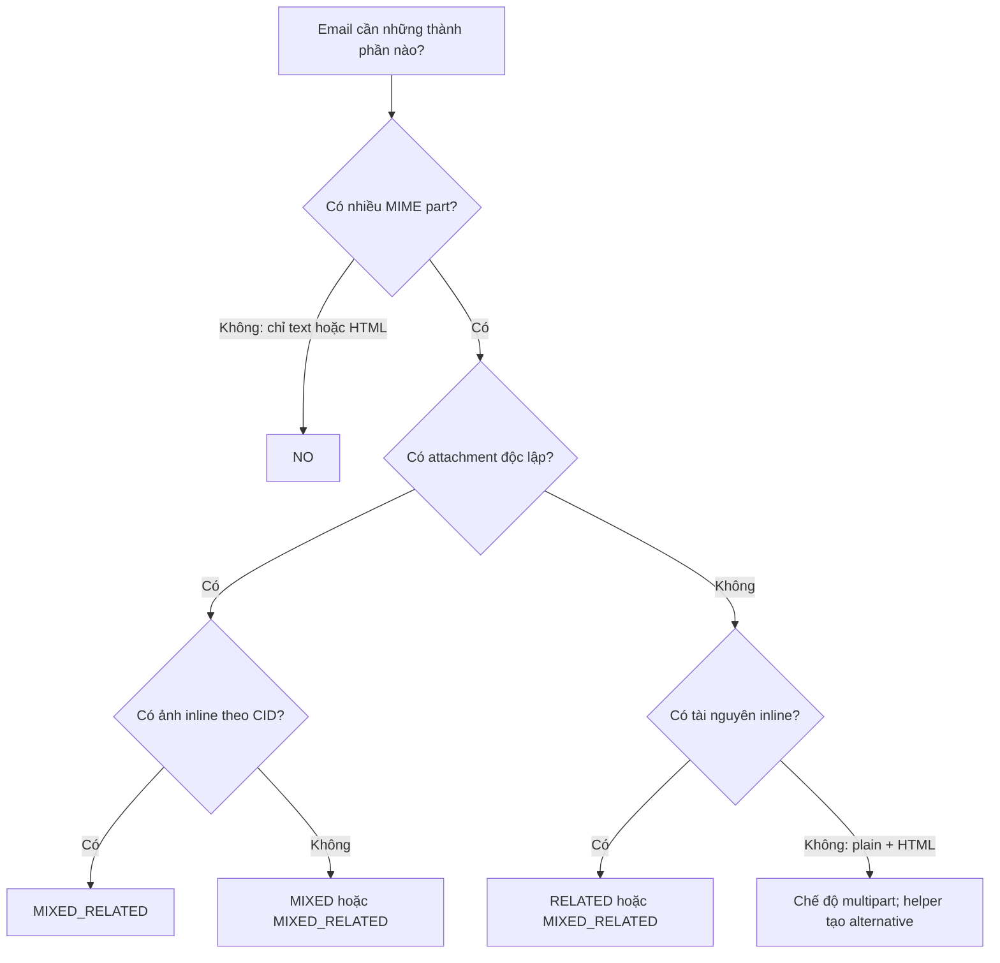

# Multipart mode và lựa chọn chế độ phù hợp

Khi gửi email với **Spring Framework Mail**, một thông điệp chỉ có vài dòng chữ có thể được tạo bằng `MimeMessageHelper` mà không cần cấu trúc MIME nhiều phần. Nhưng khi email có **hai phiên bản văn bản và HTML**, **ảnh xuất hiện trong nội dung** hoặc **tệp đính kèm**, các phần phải được sắp xếp thành một cây MIME có ngữ nghĩa rõ ràng. Lúc này, tham số **multipart mode** của `MimeMessageHelper` quyết định cách Spring tổ chức những phần đó.

Chọn chế độ không đúng có thể khiến ứng dụng đọc thư hiển thị ảnh thành file đính kèm, lặp cả bản text và HTML, không thấy ảnh theo `cid:` hoặc phân biệt nhầm đâu là nội dung chính. Vì vậy, chọn multipart mode là một quyết định về **cấu trúc thông điệp và khả năng tương thích mail client**, chứ không phải lựa chọn trang trí email.

Bài học giải thích bốn chế độ `MULTIPART_MODE_*` của `MimeMessageHelper`, quan hệ với `multipart/mixed`, `multipart/related`, `multipart/alternative`, cách chọn theo nhu cầu, ví dụ Java gửi thư thực tế và những giới hạn cần nhớ khi kiểm tra trên các mail client.

## 1. Vì sao một email cần multipart?

Một email văn bản đơn giản có thể có một body duy nhất:

```text
MimeMessage
└── text/plain; charset=UTF-8
    "Tài khoản của bạn đã được tạo."
```

Một email HTML đơn thuần cũng có thể chỉ có một body:

```text
MimeMessage
└── text/html; charset=UTF-8
    "<p>Tài khoản của bạn đã được tạo.</p>"
```

Trong hai trường hợp này, **không bắt buộc** dùng `multipart/*`. Nhưng một thông điệp có thể cần nhiều thành phần cùng lúc:

- Bản `text/plain` để các client chỉ đọc văn bản vẫn hiểu nội dung.
- Bản `text/html` để hỗ trợ trình bày, liên kết và định dạng.
- Ảnh logo được HTML tham chiếu thông qua `cid:brandLogo`.
- PDF để người dùng tải về.

Các thành phần này không có cùng vai trò. Một số là **các cách biểu diễn thay thế** của cùng nội dung; một số là **tài nguyên liên quan** để dựng HTML; một số lại là **tệp đính kèm độc lập**. MIME cung cấp những loại `multipart/*` khác nhau để mô tả các quan hệ đó.

### Một thông điệp nhiều phần trông như thế nào?

```text
MimeMessage
└── multipart/mixed
    ├── multipart/related
    │   ├── multipart/alternative
    │   │   ├── text/plain
    │   │   └── text/html
    │   └── image/png; Content-ID: <brandLogo>
    └── application/pdf; attachment; filename="report.pdf"
```

Cây này không phải do người dùng nhìn thấy trực tiếp trong Inbox. Nó là cấu trúc mà mail client đọc để quyết định **hiển thị nội dung nào, lấy ảnh ở đâu và đưa tệp nào vào danh sách attachment**.

## 2. Ba loại multipart cần hiểu trước khi chọn mode

### 2.1. `multipart/alternative` — các phiên bản thay thế nhau

`multipart/alternative` thường chứa một bản text và một bản HTML thể hiện **cùng thông tin nghiệp vụ**:

```text
multipart/alternative
├── text/plain
└── text/html
```

Theo nguyên tắc của MIME, các phương án nên đi từ biểu diễn đơn giản hơn đến giàu hơn. Với cặp thông dụng **plain text và HTML**, đặt **plain trước, HTML sau**. Mail client có thể chọn phiên bản mà nó hỗ trợ và được phép hiển thị.

Nếu để hai phần text và HTML ngang hàng trong `multipart/mixed`, có client có thể hiển thị cả hai như nội dung khác nhau. `alternative` nói rõ rằng chúng **cùng một thông điệp ở hai định dạng**, nên không cần trình bày đồng thời.

Trong Spring, API:

```java
helper.setText(plainText, htmlText);
```

là cách thuận tiện tạo hai bản thay thế. **Helper phải được khởi tạo ở chế độ multipart** để dùng overload hai tham số này.

### 2.2. `multipart/related` — các phần phụ thuộc nhau để hiển thị

Ví dụ HTML tham chiếu logo:

```html
<p>Xin chào!</p>

```

Logo có thể được gửi như một MIME part:

```text
Content-Type: image/png
Content-ID: <brandLogo>
Content-Disposition: inline
```

`multipart/related` cho biết HTML và tài nguyên được tham chiếu thuộc về **cùng một nội dung trình bày**. Trong dạng đơn giản, phần gốc để hiển thị thường được đặt đầu tiên; chuẩn MIME related cũng hỗ trợ chỉ định root bằng tham số `start`.

```text
multipart/related
├── text/html với src="cid:brandLogo"
└── image/png; Content-ID: <brandLogo>
```

Lưu ý: `cid:brandLogo` trong HTML phải khớp `Content-ID: <brandLogo>` của ảnh. Không phải client nào cũng hiển thị inline resource giống nhau. Một số client còn hiển thị ảnh trong danh sách attachment dù ảnh được đánh dấu `inline`.

### 2.3. `multipart/mixed` — nhiều thành phần cùng gửi

`multipart/mixed` thường được dùng khi message có **nội dung chính và tệp đính kèm**:

```text
multipart/mixed
├── text/plain: "Xem báo cáo đính kèm."
└── application/pdf
    Content-Disposition: attachment
    filename="report.pdf"
```

Hai part cùng tồn tại nhưng **không phải hai bản thay thế của cùng nội dung**. Mail client thường cố gắng trình bày body chính và cung cấp attachment để người đọc mở hoặc tải về.

Nếu body HTML có ảnh inline và còn có PDF attachment, cấu trúc thường có cả `related` bên trong `mixed` để diễn đạt đúng vai trò của hai loại tài nguyên.

### Tóm tắt ba quan hệ

| Loại MIME | Câu hỏi nó trả lời | Trường hợp phổ biến |
|---|---|---|
| `multipart/alternative` | “Chọn **một** phiên bản nội dung nào?” | Plain text và HTML |
| `multipart/related` | “Những phần nào **phụ thuộc vào nhau để dựng nội dung**?” | HTML và ảnh theo `cid:` |
| `multipart/mixed` | “Những thành phần **cùng tồn tại** trong email là gì?” | Body và file đính kèm |

Ba loại này có thể **lồng nhau**, không loại trừ nhau. Multipart mode của `MimeMessageHelper` chủ yếu quyết định **khung cấu trúc** để helper thêm body, inline và attachment vào đúng vị trí.

## 3. Bốn multipart mode của `MimeMessageHelper`

Spring cung cấp các constant sau:

```java
MimeMessageHelper.MULTIPART_MODE_NO
MimeMessageHelper.MULTIPART_MODE_MIXED
MimeMessageHelper.MULTIPART_MODE_RELATED
MimeMessageHelper.MULTIPART_MODE_MIXED_RELATED
```

Có thể hình dung cấu trúc mà helper thiết lập:

| Mode | Hình dạng chính | Điểm mạnh / giới hạn |
|---|---|---|
| **`NO`** | Không tạo multipart | Gọn cho text hoặc HTML đơn phần; không thể thêm inline/attachment qua helper như multipart. |
| **`MIXED`** | Gốc `multipart/mixed` | Đưa body và các phần khác vào một nhóm mixed; một số mail client có thể xem inline resource giống attachment. |
| **`RELATED`** | Gốc `multipart/related` | Gắn body và tài nguyên liên quan với nhau; attachment độc lập có thể bị client xử lý không như mong đợi. |
| **`MIXED_RELATED`** | `multipart/mixed` bên ngoài, `multipart/related` bên trong | Tách attachment khỏi nhóm body/ảnh inline; lựa chọn linh hoạt cho email có cả hai. |

Các constant mô tả **cấu trúc MIME tạo ra**, không phải chế độ mã hóa ký tự, mức bảo mật SMTP hay loại nội dung HTML.

### 3.1. `MULTIPART_MODE_NO`

Ví dụ:

```java
MimeMessage message = mailSender.createMimeMessage();
MimeMessageHelper helper =
        new MimeMessageHelper(message, false, "UTF-8");

helper.setFrom("no-reply@example.org");
helper.setTo("user@example.net");
helper.setSubject("Xác nhận");
helper.setText("Tài khoản đã được kích hoạt.");

mailSender.send(message);
```

Constructor với `multipart=false` tương đương với việc không khởi tạo cấu trúc multipart trong helper. Khi chỉ cần **một body text/plain** hoặc **một body text/html**, cách này đủ dùng.

HTML đơn phần:

```java
helper.setText("<p>Tài khoản đã được kích hoạt.</p>", true);
```

Đối số `true` trong `setText(String, boolean)` có nghĩa body là HTML; nó **không** bật multipart. Một thông điệp có thể là `text/html` mà vẫn là **single-part**.

Không dùng mode `NO` nếu bạn định gọi `addInline(...)` hoặc `addAttachment(...)` thông qua helper, hoặc muốn tạo bản plain và HTML bằng overload `setText(plain, html)`. Các thao tác cần multipart sẽ không phù hợp với helper đang ở trạng thái non-multipart.

### 3.2. `MULTIPART_MODE_MIXED`

Ví dụ:

```java
MimeMessageHelper helper = new MimeMessageHelper(
        message,
        MimeMessageHelper.MULTIPART_MODE_MIXED,
        "UTF-8"
);
```

Hình dạng tổng quát:

```text
multipart/mixed
├── phần nội dung chính
├── tài nguyên inline nếu được thêm
└── attachment nếu được thêm
```

Với mode này, body, inline resource và attachment có thể nằm ở cùng tầng `mixed`. Cách sắp xếp đơn giản có thể dùng được trong một số môi trường, nhưng mối liên hệ giữa HTML và ảnh theo `cid:` **không được diễn đạt bằng một nhóm `related` riêng**. Một số mail client có thể coi ảnh inline là attachment hoặc không render ảnh như mong muốn.

Nếu email **chỉ có body và attachment**, mode `MIXED` là một cấu trúc hợp lý. Nếu thêm ảnh inline mà muốn tối ưu khả năng tương thích, thường nên cân nhắc `MIXED_RELATED`.

### 3.3. `MULTIPART_MODE_RELATED`

Ví dụ:

```java
MimeMessageHelper helper = new MimeMessageHelper(
        message,
        MimeMessageHelper.MULTIPART_MODE_RELATED,
        "UTF-8"
);
```

Hình dạng:

```text
multipart/related
├── phần nội dung chính
└── các tài nguyên liên quan để dựng nội dung
```

Mode này phù hợp khi phần HTML cần ảnh inline hoặc tài nguyên phụ trợ và email **không cần attachment độc lập**. Nếu thêm attachment vào nhóm related ở cấp gốc, một số client có thể hiểu tệp đó như tài nguyên phục vụ hiển thị, thay vì file đính kèm thông thường.

Vì vậy, `RELATED` thường đáng cân nhắc cho email **HTML + ảnh theo CID, không có file tải về**, còn `MIXED_RELATED` rõ ràng hơn khi thêm PDF hoặc tài liệu khác.

### 3.4. `MULTIPART_MODE_MIXED_RELATED`

Ví dụ:

```java
MimeMessageHelper helper = new MimeMessageHelper(
        message,
        MimeMessageHelper.MULTIPART_MODE_MIXED_RELATED,
        "UTF-8"
);
```

Hình dạng chung:

```text
multipart/mixed
├── multipart/related
│   ├── phần nội dung chính
│   └── ảnh/tài nguyên inline liên quan
└── attachment độc lập
```

Nếu dùng `helper.setText(plainText, htmlText)`, phần nội dung chính còn có thể chứa `multipart/alternative`:

```text
multipart/mixed
├── multipart/related
│   ├── multipart/alternative
│   │   ├── text/plain
│   │   └── text/html
│   ├── image/png; Content-ID: <brandLogo>
│   └── image/jpeg; Content-ID: <banner>
├── application/pdf; attachment
└── text/csv; attachment
```

Đây là lựa chọn thực dụng khi một thông điệp có **body HTML, ảnh inline và attachment cùng lúc**. Nó giữ tài nguyên liên quan đến phần trình bày trong `related` và giữ các file tải về ở `mixed` bên ngoài.

Constructor ngắn gọn:

```java
new MimeMessageHelper(message, true, "UTF-8");
```

sử dụng **chế độ multipart mặc định của `MimeMessageHelper`**, thường là `MIXED_RELATED` trong Spring Framework hiện đại. Khi mục tiêu bài học hoặc nghiệp vụ cần một hình dạng MIME cụ thể, dùng constant tường minh giúp người đọc code nhận ra chủ đích và dễ thảo luận về tương thích.

## 4. Sơ đồ lựa chọn mode theo nhu cầu



Sơ đồ là **hướng dẫn lựa chọn ban đầu**. Nó không phải quy định rằng mọi mail client đều hiển thị đúng khi chọn một mode cụ thể. Với email quan trọng, cần xem MIME source và kết quả trên các client mục tiêu.

### Ma trận lựa chọn nhanh

| Email muốn gửi | Mode nên cân nhắc | Lý do |
|---|---|---|
| Chỉ văn bản thuần | `NO` | Không cần cây multipart. |
| Chỉ HTML, không ảnh CID hay attachment | `NO` | Một body `text/html` là đủ. |
| Có plain text và HTML cho cùng nội dung | Multipart-enabled helper; có thể dùng `MIXED_RELATED` | `setText(plain, html)` cần multipart để tạo `alternative`. |
| HTML + logo inline, không attachment | `RELATED` hoặc `MIXED_RELATED` | Giữ HTML và logo trong nhóm tài nguyên liên quan. |
| Văn bản hoặc HTML + một PDF đính kèm, không inline | `MIXED` hoặc `MIXED_RELATED` | Tách body và file độc lập. |
| Plain + HTML + ảnh CID + PDF | `MIXED_RELATED` | Phân biệt `alternative`, `related` và `mixed`. |
| Nhiều PDF/CSV, không inline | `MIXED` hoặc `MIXED_RELATED` | Các attachment thuộc nhóm mixed. |
| Thư được dùng trong nhiều mail client không đồng nhất | Chọn mode theo thành phần, kiểm tra trên client thực | Không có một mode bảo đảm tương thích tuyệt đối. |

Không cần dùng `MIXED_RELATED` trong mọi trường hợp chỉ vì nó có nhiều khả năng. Một email chỉ có plain text có thể giữ ở chế độ `NO` để cấu trúc dễ hiểu hơn.

## 5. Ví dụ Spring Boot: cấu hình và gửi MIME hoàn chỉnh

Giả sử dự án dùng `spring-boot-starter-mail` và có một máy chủ SMTP submission. Dependency Gradle:

```groovy
dependencies {
    implementation 'org.springframework.boot:spring-boot-starter-mail'
}
```

Cấu hình ví dụ cho cổng 587 và STARTTLS:

```yaml
spring:
  mail:
    host: smtp.example.net
    port: 587
    username: ${SMTP_USERNAME}
    password: ${SMTP_PASSWORD}
    default-encoding: UTF-8
    properties:
      "[mail.smtp.auth]": true
      "[mail.smtp.starttls.enable]": true
      "[mail.smtp.starttls.required]": true
      "[mail.smtp.connectiontimeout]": 5000
      "[mail.smtp.timeout]": 5000
      "[mail.smtp.writetimeout]": 5000
```

Các giá trị SMTP chỉ để minh họa; máy chủ thực tế, cơ chế TLS và danh tính gửi phải theo yêu cầu của nhà cung cấp. Bí mật được cấp từ môi trường chạy, không viết trực tiếp trong source code.

Chuẩn bị tài nguyên:

```text
src/main/resources/
└── mail/
    ├── brand-logo.png
    └── welcome-guide.pdf
```

Viết service:

```java
import jakarta.mail.MessagingException;
import jakarta.mail.internet.MimeMessage;
import org.springframework.core.io.ClassPathResource;
import org.springframework.mail.javamail.JavaMailSender;
import org.springframework.mail.javamail.MimeMessageHelper;
import org.springframework.stereotype.Service;

@Service
public class WelcomeMailService {

    private final JavaMailSender mailSender;

    public WelcomeMailService(JavaMailSender mailSender) {
        this.mailSender = mailSender;
    }

    public void sendWelcome(String recipient) throws MessagingException {
        // Mỗi yêu cầu gửi dùng một MimeMessage riêng.
        MimeMessage message = mailSender.createMimeMessage();

        // Chọn mode rõ ràng khi có cả ảnh inline và PDF.
        MimeMessageHelper helper = new MimeMessageHelper(
                message,
                MimeMessageHelper.MULTIPART_MODE_MIXED_RELATED,
                "UTF-8"
        );

        helper.setFrom("no-reply@example.org");
        helper.setTo(recipient);
        helper.setSubject("Chào mừng bạn");

        String plainText = """
                Chào bạn!

                Tài khoản đã được kích hoạt.
                Xem tài liệu welcome-guide.pdf đính kèm.
                """;

        String htmlText = """
                <html>
                  <body>
                    
                    <h1>Chào mừng bạn!</h1>
                    <p>Tài khoản đã được kích hoạt.</p>
                    <p>Xem tài liệu đính kèm để bắt đầu.</p>
                  </body>
                </html>
                """;

        // Helper tạo alternative: plain trước, HTML sau.
        helper.setText(plainText, htmlText);

        // Thêm ảnh sau khi body đã được đặt.
        helper.addInline(
                "brandLogo",
                new ClassPathResource("mail/brand-logo.png"),
                "image/png"
        );

        // File tải về được đưa vào nhánh mixed ngoài cùng.
        helper.addAttachment(
                "welcome-guide.pdf",
                new ClassPathResource("mail/welcome-guide.pdf"),
                "application/pdf"
        );

        mailSender.send(message);
    }
}
```

### Điều gì xảy ra ở từng lệnh?

| Lệnh | Tác động |
|---|---|
| `createMimeMessage()` | Tạo message mới, chưa gửi SMTP. |
| Constructor với `MULTIPART_MODE_MIXED_RELATED` | Chuẩn bị khung MIME gồm mixed ngoài cùng và related bên trong. |
| `setFrom(...)`, `setTo(...)`, `setSubject(...)` | Đặt các header cần thiết. |
| `setText(plain, html)` | Tạo hai phiên bản thay thế; cho phép client chọn văn bản hoặc HTML. |
| `addInline("brandLogo", ...)` | Thêm MIME part ảnh có Content-ID để HTML tham chiếu bằng `cid:brandLogo`. |
| `addAttachment(...)` | Thêm file PDF như attachment độc lập ở nhóm mixed. |
| `mailSender.send(message)` | Bắt đầu thao tác gửi thông điệp đã được tạo đến SMTP. |

Đây là thiết kế phổ biến cho email cần nhiều dạng nội dung. Thứ tự **`setText(...)` trước `addInline(...)`** được Spring khuyến nghị nhằm tránh một số mail client gặp khó khi nhận dạng phần nội dung chính.

## 6. Ví dụ nhỏ hơn theo từng trường hợp

### 6.1. Plain text: không bật multipart

```java
MimeMessage message = mailSender.createMimeMessage();
MimeMessageHelper helper =
        new MimeMessageHelper(message, false, "UTF-8");

helper.setFrom("notice@example.org");
helper.setTo("user@example.net");
helper.setSubject("Thông báo");
helper.setText("Hệ thống đã ghi nhận yêu cầu.");

mailSender.send(message);
```

Đây là lựa chọn gọn nhất khi không cần nhiều part. Nếu hệ thống chỉ gửi văn bản, cũng có thể dùng `SimpleMailMessage` qua `MailSender`.

### 6.2. HTML đơn phần: không bắt buộc multipart

```java
MimeMessage message = mailSender.createMimeMessage();
MimeMessageHelper helper =
        new MimeMessageHelper(message, false, "UTF-8");

helper.setFrom("notice@example.org");
helper.setTo("user@example.net");
helper.setSubject("Thông báo HTML");
helper.setText(
        "<html><body><h1>Xin chào!</h1></body></html>",
        true
);

mailSender.send(message);
```

`true` ở `setText(html, true)` chỉ định HTML, khác với `true` ở constructor `new MimeMessageHelper(message, true)` vốn bật multipart.

### 6.3. Plain text và HTML: cần multipart khi dùng overload hai chuỗi

```java
MimeMessage message = mailSender.createMimeMessage();
MimeMessageHelper helper =
        new MimeMessageHelper(message, true, "UTF-8");

helper.setTo("user@example.net");
helper.setFrom("notice@example.org");
helper.setSubject("Xác nhận đăng ký");
helper.setText(
        "Đăng ký thành công. Truy cập https://example.org/account",
        "<p>Đăng ký thành công. " +
        "<a href=\"https://example.org/account\">Mở tài khoản</a></p>"
);

mailSender.send(message);
```

Helper sẽ dùng cấu trúc alternative cho hai body. Dù mẫu này không có ảnh hay PDF, constructor `multipart=true` giúp gọi được API `setText(plain, html)`. Nếu muốn một cây chỉ có `multipart/alternative` ở cấp gốc, bạn có thể xây MIME thủ công bằng Jakarta Mail; đó là nhu cầu kiểm soát cấu trúc riêng, không phải bắt buộc đối với mọi ứng dụng Spring.

### 6.4. HTML và ảnh inline, không có attachment

```java
MimeMessage message = mailSender.createMimeMessage();
MimeMessageHelper helper = new MimeMessageHelper(
        message,
        MimeMessageHelper.MULTIPART_MODE_RELATED,
        "UTF-8"
);

helper.setTo("user@example.net");
helper.setFrom("notice@example.org");
helper.setSubject("Thẻ thành viên");

helper.setText(
        "<p>Đây là thẻ của bạn:</p>" +
        "",
        true
);

helper.addInline(
        "membershipCard",
        new ClassPathResource("mail/member-card.png"),
        "image/png"
);

mailSender.send(message);
```

Ví dụ giả định file `mail/member-card.png` tồn tại. Nếu sau này thêm PDF cần người dùng tải về, cân nhắc chuyển từ `RELATED` sang `MIXED_RELATED` để phân biệt attachment với inline.

### 6.5. Body và PDF, không có ảnh inline

```java
MimeMessage message = mailSender.createMimeMessage();
MimeMessageHelper helper = new MimeMessageHelper(
        message,
        MimeMessageHelper.MULTIPART_MODE_MIXED,
        "UTF-8"
);

helper.setTo("user@example.net");
helper.setFrom("reports@example.org");
helper.setSubject("Báo cáo");
helper.setText("Báo cáo của bạn nằm trong file PDF đính kèm.");

helper.addAttachment(
        "report.pdf",
        new ClassPathResource("mail/report.pdf"),
        "application/pdf"
);

mailSender.send(message);
```

Trong trường hợp này, `MIXED` đã diễn đạt đúng việc gửi body và một attachment độc lập. Nếu thêm logo inline vào body HTML, chọn `MIXED_RELATED` sẽ biểu đạt quan hệ HTML/ảnh rõ ràng hơn.

## 7. Thứ tự gọi API và thứ tự các part có giống nhau không?

Đây là hai vấn đề liên quan nhưng cần phân biệt:

1. **Thứ tự gọi method khi xây message:** ví dụ `setText(...)` trước `addInline(...)`.
2. **Thứ tự các part trong MIME source:** ví dụ `text/plain` trước `text/html` trong `multipart/alternative`.

Với `MimeMessageHelper`, Spring tự tạo các part và chọn vị trí phù hợp trong multipart. Không nên dựa vào việc gọi `addAttachment(...)` sớm hay muộn để thay đổi những quy tắc ngữ nghĩa của MIME. Ngay cả khi bạn có thể tạo các part theo một thứ tự tùy ý, mail client vẫn đọc cấu trúc theo `Content-Type` và quan hệ giữa các phần.

### Thứ tự với `multipart/alternative`

Khi gọi:

```java
helper.setText(plainText, htmlText);
```

ý định là hai phiên bản của cùng nội dung. Plain text thường đứng **trước**, HTML đứng **sau**, để client hiểu mức độ ưu tiên.

Không nên đặt hai bản có nội dung nghiệp vụ khác nhau. Nếu bản HTML có mã xác nhận hoặc một đường dẫn bắt buộc nhưng bản text thiếu, người dùng chọn chế độ chỉ đọc văn bản sẽ không thao tác được.

### Thứ tự với ảnh inline

Khi dùng ảnh theo CID, nên thực hiện:

```java
helper.setText(htmlText, true);
helper.addInline("logo", logoResource, "image/png");
```

thay vì thêm ảnh trước khi đặt body. Một số mail reader xử lý liên kết CID không đúng nếu cấu trúc message được xây theo thứ tự bất lợi. Cần kiểm tra ID được dùng trong HTML và MIME part khớp chính xác.

### Đặt attachment đúng nhóm

Nếu helper dùng `MIXED_RELATED`, attachment độc lập sẽ thuộc root `mixed`, còn ảnh inline thuộc nhóm `related` bên trong. Điều này quan trọng hơn việc một mail client đặt biểu tượng attachment ở trên hay dưới nội dung trong giao diện.

## 8. Content-ID, Content-Disposition và Content-Type

Multipart mode thiết lập **khung quan hệ**, còn những header của từng part cho biết **nó là loại dữ liệu gì** và **được dùng như thế nào**.

| Thông tin | Ví dụ | Ý nghĩa |
|---|---|---|
| `Content-Type` | `text/html; charset=UTF-8` | Xác định loại body và bộ mã văn bản. |
| `Content-Type` | `multipart/related; boundary="..."` | Khai báo tập part liên quan; `boundary` phân tách chúng trong MIME source. |
| `Content-ID` | `<brandLogo>` | Định danh part để HTML có thể tham chiếu bằng `cid:brandLogo`. |
| `Content-Disposition` | `inline` | Gợi ý rằng tài nguyên gắn với nội dung hiển thị. |
| `Content-Disposition` | `attachment; filename="report.pdf"` | Gợi ý part là tệp đính kèm để tải về. |
| `Content-Transfer-Encoding` | `base64` hoặc `quoted-printable` | Quy định cách biểu diễn dữ liệu khi truyền qua hệ thống email. |

Một file có `Content-Disposition: inline` **không chắc chắn** sẽ được hiển thị inline trên mọi client. Mail reader còn cân nhắc cây MIME, Content-ID, loại media, chính sách bảo mật và cách render riêng.

### `cid:` không giống URL của ảnh bên ngoài

```html
<!-- Ảnh đi theo email qua MIME part -->


<!-- Ảnh được yêu cầu qua mạng -->

```

Ảnh `cid:` được tham chiếu từ những part trong message; ảnh URL ngoài cần client tải từ Internet và có thể bị chặn hoặc đi qua proxy. Multipart mode liên quan trực tiếp đến **ảnh inline được đính kèm theo MIME**, không làm ảnh từ URL ngoài tự động trở thành file trong message.

Dù dùng ảnh CID hay ảnh ngoài, đừng đặt toàn bộ thông tin quan trọng chỉ trong ảnh; giữ văn bản phù hợp và alt text để người dùng vẫn hiểu thư nếu ảnh không được hiển thị.

## 9. Encoding không phải multipart mode

`"UTF-8"` và `MULTIPART_MODE_MIXED_RELATED` xuất hiện gần nhau trong constructor:

```java
new MimeMessageHelper(
    message,
    MimeMessageHelper.MULTIPART_MODE_MIXED_RELATED,
    "UTF-8"
);
```

Nhưng chúng giải quyết hai vấn đề khác nhau:

- **Multipart mode:** quyết định **cây các phần** (`mixed`, `related` và nhóm nội dung).
- **Encoding:** chỉ định cách biểu diễn **ký tự văn bản** trong subject, tên hiển thị và text/HTML khi helper tạo message.

UTF-8 không có nghĩa mọi part là văn bản. PDF và PNG vẫn là **dữ liệu nhị phân**, thường được Jakarta Mail mã hóa qua Content-Transfer-Encoding thích hợp để vận chuyển.

Trong Spring Boot, `spring.mail.default-encoding=UTF-8` có thể cung cấp encoding mặc định cho message được tạo qua sender; việc truyền `"UTF-8"` tường minh vào constructor helper giúp định nghĩa charset ngay tại nơi soạn thư.

## 10. Khả năng tương thích giữa các mail client

Việc một cây MIME hợp lệ theo chuẩn không bảo đảm mọi mail client sẽ hiển thị giống nhau. Các họ ứng dụng như Gmail, Outlook, Apple Mail và nhiều ứng dụng di động có engine HTML, quy tắc an toàn và cách phân loại attachment khác nhau. Cấu trúc lồng nhau giúp mô tả đúng ý định, còn kết quả thực tế cần được quan sát trên những client người nhận thường dùng.

| Hiện tượng | Khả năng liên quan | Hướng xử lý |
|---|---|---|
| Ảnh logo hiện như file đính kèm | Ảnh và body không được nhóm theo related phù hợp, hoặc client hiển thị inline part theo chính sách riêng | Dùng `RELATED`/`MIXED_RELATED`, kiểm tra Content-ID và mail client đích. |
| HTML hiển thị nhưng ảnh CID bị vỡ | `src="cid:..."` không khớp Content-ID, resource thiếu hoặc client không xử lý như mong đợi | Đối chiếu ID và MIME part; kiểm tra ảnh thực tế. |
| PDF hiển thị thành phần của nội dung hoặc không có biểu tượng tải xuống | Attachment bị đặt trong nhóm related hoặc thiếu metadata phù hợp | Dùng `MIXED`/`MIXED_RELATED`, xem Content-Disposition. |
| Người nhận thấy cả hai bản text và HTML | Hai bản không được nhóm trong alternative, hoặc client hiểu sai cấu trúc | Dùng `setText(plain, html)` với helper multipart; xem raw MIME. |
| Client chỉ hiển thị plain text | Người dùng tắt HTML, client không hỗ trợ HTML, hoặc thứ tự alternative bị sai | Bảo đảm plain text có đủ thông tin, theo dõi cấu trúc MIME. |
| Một email hoạt động trên webmail nhưng lỗi ở desktop | Khác biệt renderer, cách xử lý inline và attachment | Thử các client mục tiêu, điều chỉnh cấu trúc/HTML khi có bằng chứng. |
| Attachment không đọc được | Resource bị lỗi, stream đã hết hoặc transfer encoding không đúng | Kiểm tra nguồn dữ liệu, size, loại content và MIME source. |

Những trường hợp này có thể liên quan đến **cấu trúc MIME**, **resource**, **HTML/CSS** hoặc **chính sách của mail client**. Không nên thay multipart mode ngẫu nhiên trước khi xác định part nào đang bị hiểu sai.

### HTML email không giống HTML trình duyệt

Nhiều mail client không hỗ trợ đầy đủ CSS/JavaScript như một trình duyệt. Dù `MIXED_RELATED` đã sắp xếp đúng body, ảnh và file, một layout CSS phức tạp vẫn có thể bị phá vỡ. Multipart mode không thay thế việc thiết kế HTML email đơn giản, có text fallback và bố cục kiểm thử trên các client mục tiêu.

## 11. Cách xem cây MIME thực sự được tạo

Khi cần xác định cấu trúc message, nên xem **raw message source** thay vì chỉ nhìn giao diện Inbox. Có thể dùng máy chủ SMTP bắt thư trong môi trường phát triển, ví dụ Mailpit hoặc GreenMail, để quan sát message và các part mà không gửi email ra người dùng thật.

Một quy trình quan sát:

1. Cấu hình `JavaMailSender` trỏ tới SMTP test server trong môi trường phát triển.
2. Gửi một email với mode bạn muốn kiểm tra.
3. Xem source gốc của thông điệp tại hộp thư thử nghiệm.
4. Tìm header `MIME-Version`, `Content-Type: multipart/...` và các `boundary`.
5. Dựng lại cây các part; xem đâu là `mixed`, `related` và `alternative`.
6. Kiểm tra các part có `Content-ID` khớp với những `cid:` trong HTML.
7. Kiểm tra `Content-Disposition` và filename của PDF/CSV.
8. Mở cùng một email qua các client mục tiêu để quan sát những khác biệt thực tế.

Ví dụ raw MIME rút gọn, các boundary chỉ mang tính minh họa:

```text
MIME-Version: 1.0
Content-Type: multipart/mixed; boundary="mix"

--mix
Content-Type: multipart/related; boundary="rel"

--rel
Content-Type: multipart/alternative; boundary="alt"

--alt
Content-Type: text/plain; charset=UTF-8

Xin chào! Xem PDF đính kèm.

--alt
Content-Type: text/html; charset=UTF-8

<p>Xin chào!</p>


--alt--

--rel
Content-Type: image/png
Content-ID: <brandLogo>
Content-Disposition: inline

[encoded PNG bytes]
--rel--

--mix
Content-Type: application/pdf
Content-Disposition: attachment; filename="report.pdf"

[encoded PDF bytes]
--mix--
```

Thư viện mail thực tế có thể thêm header, mã hóa ký tự, Content-Transfer-Encoding và boundary khác. Điều cần quan sát là **quan hệ giữa các phần**, không phải giá trị chuỗi boundary do thư viện sinh.

### Dùng `MimeMessage.writeTo(...)` để quan sát khi cần

`MimeMessage` của Jakarta Mail cung cấp:

```java
message.writeTo(outputStream);
```

API này ghi biểu diễn Internet mail ra stream, hữu ích khi kiểm tra cấu trúc trong môi trường kiểm soát. **`writeTo(...)` không gửi message qua SMTP.** Dữ liệu có thể chứa địa chỉ người nhận, mã xác nhận, nội dung nhạy cảm và attachment; không xuất thẳng toàn bộ MIME ra log production.

## 12. Những lỗi lập trình liên quan multipart mode

### 12.1. Không bật multipart nhưng gọi `addAttachment(...)`

Ví dụ:

```java
MimeMessageHelper helper =
        new MimeMessageHelper(message, false, "UTF-8");

helper.addAttachment("guide.pdf", pdfResource);
```

Helper chưa được khởi tạo với cấu trúc multipart. Khi thêm một part cần multipart, API có thể ném lỗi (chẳng hạn `IllegalStateException`). Cách xử lý là chọn constructor multipart trước khi thêm resource, không phải cố sửa từng header thủ công.

### 12.2. Không bật multipart nhưng gọi `setText(plain, html)`

```java
MimeMessageHelper helper =
        new MimeMessageHelper(message, false, "UTF-8");

helper.setText(plainText, htmlText);
```

Overload có hai chuỗi phải tổ chức một nhóm `multipart/alternative`, nên không phù hợp với helper non-multipart. Nếu chỉ muốn một bản HTML, có thể dùng `helper.setText(htmlText, true)` ở mode `NO`. Nếu muốn cả plain và HTML, dùng một constructor multipart.

### 12.3. Thêm inline resource trước body

```java
helper.addInline("logo", logoResource, "image/png");
helper.setText(htmlText, true);
```

Dù thứ tự gọi có thể không gây lỗi Java ở mọi tình huống, một số mail reader có thể xử lý quan hệ giữa HTML và ảnh inline không đúng. Mẫu nên dùng:

```java
helper.setText(htmlText, true);
helper.addInline("logo", logoResource, "image/png");
```

### 12.4. Đặt ID không khớp

```java
helper.setText("", true);
helper.addInline("logo", logoResource, "image/png");
```

`brandLogo` và `logo` khác nhau, nên client không thể liên kết ảnh theo tham chiếu dự kiến. Cần dùng một ID thống nhất, không kèm dấu ngoặc nhọn ở tham số của `addInline(...)`:

```java
helper.addInline("brandLogo", logoResource, "image/png");
```

### 12.5. Cố dùng attachment như ảnh inline

Một ảnh cần hiển thị **bên trong HTML** nên được thêm với `addInline(...)` và có tham chiếu CID phù hợp. Một ảnh được cung cấp cho người dùng **tải về như file riêng** nên dùng `addAttachment(...)`. Hai API có chủ đích khác nhau dù đều có thể truyền một tài nguyên `image/png`.

### 12.6. Dùng một `MimeMessage` mutable cho nhiều request

`MimeMessage` và `MimeMessageHelper` thao tác trên trạng thái có thể thay đổi. Không nên để một instance chung rồi nhiều request cùng sửa `To`, `Subject`, body hay attachment. Mỗi tác vụ gửi nên tạo một message mới qua `mailSender.createMimeMessage()`.

## 13. Chọn multipart mode có quyết định SMTP gửi thành công không?

Multipart mode quyết định **cách đóng gói nội dung email**, còn SMTP là giao thức vận chuyển. Khi gọi:

```java
mailSender.send(message);
```

một triển khai SMTP sẽ mở kết nối, thiết lập TLS/xác thực theo cấu hình, gửi phong bì `MAIL FROM`/`RCPT TO` rồi truyền thông điệp ở `DATA`.

Nếu server chấp nhận nội dung, lời gọi có thể hoàn tất mà không có ngoại lệ. Tuy nhiên:

- SMTP server có thể chấp nhận một message nhưng mail client vẫn hiển thị ảnh CID không đúng.
- Mail server có thể từ chối một email vì dung lượng attachment vượt giới hạn.
- Một thư có cấu trúc MIME tốt vẫn có thể bị lọc spam hoặc có HTML bị giảm chức năng.
- Một lần gửi được SMTP chấp nhận không chứng minh thư đã đến Inbox hoặc đã được người dùng đọc.

Cần phân biệt các nhóm lỗi:

| Lớp | Ví dụ | Nơi kiểm tra |
|---|---|---|
| Xây dựng MIME | Mode chưa bật multipart, Content-ID sai, resource không đọc được | Code `MimeMessageHelper`, cây MIME, dữ liệu attachment. |
| SMTP transport | Sai host, TLS, auth, kết nối timeout, quota | Cấu hình sender và phản hồi SMTP/provider. |
| Phân phát | Bounce, lọc spam, từ chối miền nhận | Hệ thống gửi thư và sự kiện delivery. |
| Hiển thị ở client | Ảnh CID không hiện, attachment bị phân loại khác | Raw MIME và mail client thực tế. |

Đừng nhầm một lỗi hiển thị với lỗi gửi thất bại. Nếu SMTP chấp nhận message và email đã đến người nhận nhưng logo bị hiển thị như file đính kèm, ưu tiên kiểm tra cây MIME và cách client hiểu các part.

## 14. Nguồn dữ liệu attachment và thời điểm đọc

`MimeMessageHelper` cho phép thêm file từ `Resource`, `InputStreamSource` hoặc các nguồn tương ứng. Việc thư viện mail **đọc thực tế nội dung** có thể diễn ra khi message được ghi thành MIME để gửi, thay vì ngay lúc gọi `addAttachment(...)`.

Ví dụ PDF được tạo trong bộ nhớ:

```java
import org.springframework.core.io.ByteArrayResource;

byte[] pdfData = reportService.createPdf();
helper.addAttachment(
        "report.pdf",
        new ByteArrayResource(pdfData),
        "application/pdf"
);
```

Ở đây `reportService.createPdf()` là ví dụ một hàm nghiệp vụ trả về byte PDF. Dùng `ByteArrayResource` cho phép đọc dữ liệu nhiều lần nếu thư viện cần truy cập lại nội dung. Nếu dùng một stream chỉ đọc được một lượt hoặc một file đã bị xóa trước lúc gửi, message có thể không được serialize thành công.

Multipart mode đúng **không sửa được nguồn attachment lỗi**, cũng không bỏ qua giới hạn kích thước email của SMTP provider. MIME encoding có thể làm kích thước truyền tải lớn hơn tổng byte gốc của các attachment.

## 15. Khi nào cần kiểm soát MIME trực tiếp thay vì dùng helper?

`MimeMessageHelper` phù hợp với phần lớn ứng dụng gửi email: nó tiết kiệm việc tự tạo `MimeMultipart`, `MimeBodyPart`, đặt header và sắp xếp part. Nhưng có những hệ thống cần cấu trúc MIME đặc thù, chẳng hạn:

- Một bên nhận chỉ chấp nhận một hình dạng multipart cụ thể theo hợp đồng tích hợp.
- Email cần `multipart/alternative` nằm ở gốc mà không có khung `mixed/related`.
- Cần tạo các loại multipart không được helper hỗ trợ trực tiếp, hoặc các quan hệ phức tạp giữa nhiều nhóm.
- Cần thao tác với MIME source đến từ hệ thống bên ngoài.

Trong những trường hợp đó, có thể sử dụng API Jakarta Mail để xây dựng `MimeMultipart` và `MimeBodyPart` thủ công rồi gán vào `MimeMessage`. Đổi lại, code cần tự quản lý thứ tự, Content-Type, Content-ID, Content-Disposition, encoding, nguồn dữ liệu và khả năng tương thích.

Với một email thông thường có plain/HTML, ảnh và attachment, nên bắt đầu bằng `MimeMessageHelper` và chọn đúng multipart mode. Chỉ chuyển sang MIME thủ công khi có **yêu cầu cấu trúc cụ thể** mà helper không biểu diễn đủ.

## 16. Ghi nhớ khi chọn multipart mode

- **`MULTIPART_MODE_NO`:** dùng cho email chỉ có một body text hoặc HTML, không có thêm inline resource hay attachment qua helper.
- **`MULTIPART_MODE_MIXED`:** cung cấp `multipart/mixed`, phù hợp khi có body và attachment; cân nhắc hạn chế khi dùng inline resource.
- **`MULTIPART_MODE_RELATED`:** cung cấp `multipart/related`, phù hợp khi body phụ thuộc ảnh CID/tài nguyên inline và không cần file đính kèm độc lập.
- **`MULTIPART_MODE_MIXED_RELATED`:** cung cấp `mixed` bên ngoài và `related` bên trong, thường là lựa chọn rõ ràng khi email có cả ảnh inline và attachment.
- **`setText(plainText, htmlText)`** tạo hai bản nội dung thay thế nhau, cần helper ở chế độ multipart. **`setText(html, true)`** có thể dùng cho HTML đơn phần.
- **`setText(...)` trước `addInline(...)`** là thứ tự nên áp dụng khi có ảnh được HTML tham chiếu.
- **`Content-ID`, `Content-Disposition` và cây MIME** đều ảnh hưởng tới cách mail client hiểu từng part; mode chỉ là bước thiết lập cấu trúc.
- **UTF-8**, SMTP TLS và kết quả phân phát email là các vấn đề khác với multipart mode.
- **Kiểm tra raw MIME và client thực tế** khi cần đảm bảo người đọc nhìn thấy body, ảnh và tệp đính kèm đúng ý định.

Khi lựa chọn mode, hãy xác định **đâu là nội dung thay thế nhau (`alternative`), đâu là tài nguyên phục vụ trình bày (`related`), và đâu là file độc lập (`mixed`)**. Từ ba quan hệ đó, việc chọn `MULTIPART_MODE_NO`, `MIXED`, `RELATED` hay `MIXED_RELATED` sẽ trở thành quyết định kỹ thuật có cơ sở, dễ bảo trì và dễ kiểm tra.
