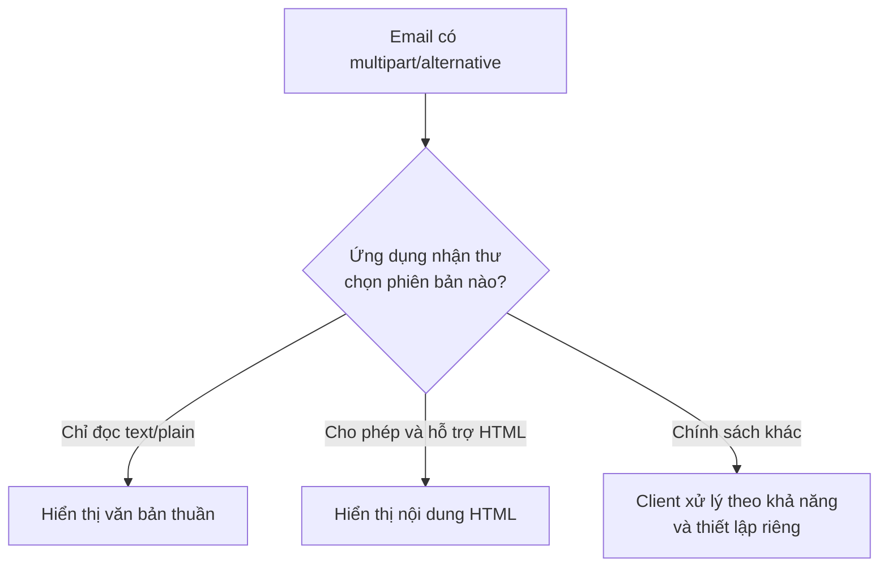
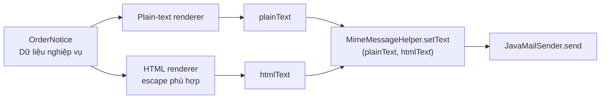
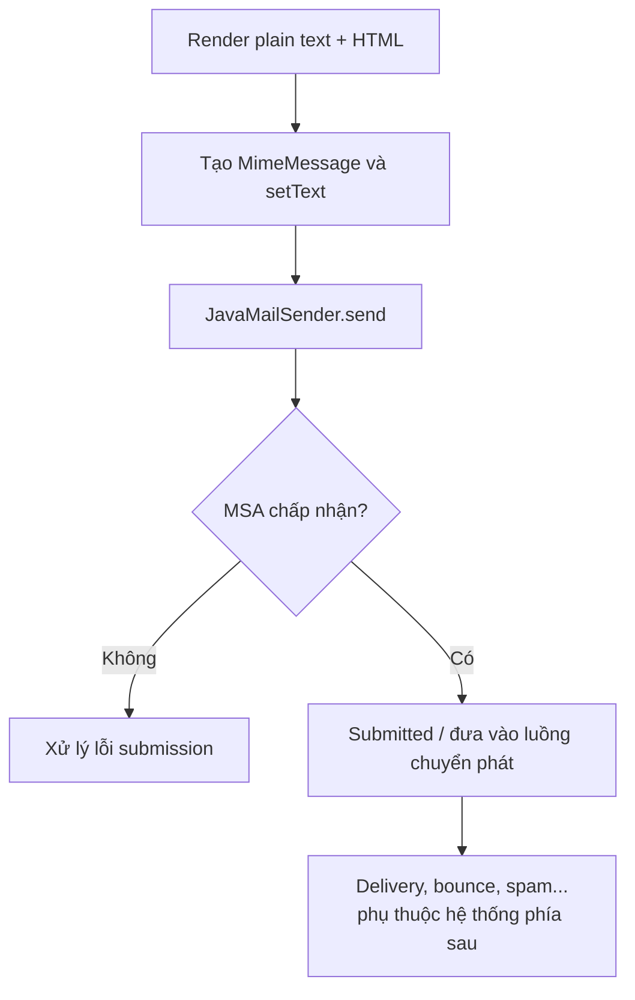

# Gửi plain text và HTML trong cùng một email với MimeMessageHelper

Khi gửi email giao dịch bằng Spring Framework Mail, ứng dụng thường muốn nội dung **hiển thị đẹp trên mail client hỗ trợ HTML** nhưng vẫn **đọc đầy đủ trên client chỉ dùng văn bản thuần**. Cách giải quyết không phải gửi hai email độc lập. Thay vào đó, ta đặt hai **phiên bản trình bày của cùng một nội dung** trong một MIME message, sử dụng `multipart/alternative`.

Spring cung cấp phương thức rất phù hợp:

```java
helper.setText(plainText, htmlText);
```

Ở đây, `plainText` là nội dung của phần `text/plain` và `htmlText` là nội dung của phần `text/html`. Đối tượng `MimeMessageHelper` tạo các MIME part cần thiết, còn `JavaMailSender` chuyển **một thông điệp** đến máy chủ SMTP đã cấu hình. Ứng dụng đọc thư chọn phiên bản phù hợp với khả năng hiển thị và tùy chọn của người dùng.

Bài học này trình bày ý nghĩa của hai phiên bản, cấu trúc MIME, các overload của `setText`, cách tạo một email hoàn chỉnh trong Spring, những lưu ý về mã hóa tiếng Việt, HTML an toàn, ảnh nội tuyến, tệp đính kèm và xử lý các tình huống hiển thị không như mong đợi.

## 1. Plain text và HTML khác nhau như thế nào?

Một email có thể được trình bày dưới hai dạng phổ biến:

| Dạng nội dung | MIME type | Mục đích | Ví dụ |
|---|---|---|---|
| Văn bản thuần | `text/plain` | Đọc nội dung dưới dạng chữ và xuống dòng | `Đơn hàng của bạn đã được xác nhận.` |
| HTML | `text/html` | Hiển thị cấu trúc, liên kết, màu sắc và bố cục mà mail client hỗ trợ | `<p>Đơn hàng của bạn <strong>đã được xác nhận</strong>.</p>` |

Ví dụ, cùng một thông báo xác nhận đơn hàng có hai phiên bản.

**Plain text**:

```text
Xin chào An,

Đơn hàng DH-2048 đã được xác nhận.
Tổng tiền: 450.000 ₫

Xem chi tiết:
https://shop.example.org/orders/DH-2048

Trân trọng,
Đội ngũ cửa hàng
```

**HTML**:

```html
<!doctype html>
<html lang="vi">
  <body>
    <h2>Đơn hàng đã được xác nhận</h2>
    <p>Xin chào An,</p>
    <p>Đơn hàng <strong>DH-2048</strong> đã được xác nhận.</p>
    <p>Tổng tiền: <strong>450.000 ₫</strong></p>
    <p>
      <a href="https://shop.example.org/orders/DH-2048">
        Xem chi tiết đơn hàng
      </a>
    </p>
    <p>Trân trọng,<br>Đội ngũ cửa hàng</p>
  </body>
</html>
```

Hai phiên bản phải truyền tải **cùng sự kiện nghiệp vụ và thông tin quan trọng**. HTML có thể bổ sung định dạng hoặc hình ảnh; plain text vẫn cần nêu đủ mã đơn, số tiền, đường dẫn và chỉ dẫn cần thiết. Không nên để plain text chỉ ghi “Vui lòng mở HTML để đọc” nếu nội dung có ý nghĩa với người nhận.

### Plain text không có nghĩa là “SMTP không mã hóa”

Trong ngữ cảnh bài học, `plain text` nói đến **định dạng phần thân email (`text/plain`)**. Nó khác hoàn toàn với câu hỏi liệu ứng dụng có kết nối đến SMTP server qua TLS hay không.

- `text/plain` và `text/html` là kiểu nội dung MIME.
- STARTTLS và implicit TLS bảo vệ kênh truyền đến máy chủ SMTP.
- Một email có hai phiên bản MIME vẫn có thể được truyền qua TLS.
- TLS giữa ứng dụng và SMTP server không tự biến toàn bộ quá trình chuyển phát thành mã hóa đầu cuối.

Vì vậy, không cần thay cấu hình SMTP chỉ để thêm phiên bản text/plain và HTML trong cùng một email.

## 2. Vì sao dùng `multipart/alternative`?

MIME mở rộng email truyền thống để thông điệp có thể chứa nhiều loại nội dung. Kiểu `multipart/alternative` diễn đạt rằng **các part là những phương án biểu diễn thay thế của cùng nội dung**.

Ví dụ một email có thể có cấu trúc:

```text
MimeMessage
└── multipart/alternative
    ├── text/plain; charset=UTF-8
    │   "Đơn hàng đã được xác nhận.
    │    Xem: https://shop.example.org/orders/2048"
    └── text/html; charset=UTF-8
        "<p><strong>Đơn hàng đã được xác nhận.</strong></p>
         <a href='https://shop.example.org/orders/2048'>Xem đơn</a>"
```

Các part này **không phải hai thư được gửi cho người nhận hai lần**. Chúng cùng nằm trong **một thông điệp**, thường có chung `From`, `To`, `Subject`, `Date` và `Message-ID`.

Theo ý nghĩa của `multipart/alternative`, các part thường được sắp xếp từ phiên bản ít đặc tính hiển thị hơn tới phiên bản có đặc tính phong phú hơn: **plain text trước, HTML sau**. Một mail client có thể chọn bản HTML khi có khả năng hiển thị HTML; client chỉ sử dụng văn bản hoặc người dùng tắt HTML có thể chọn bản text/plain.



Quyết định cuối cùng thuộc mail client hoặc hệ thống xử lý email. Ứng dụng gửi không thể buộc mọi client chọn HTML, cũng không thể dựa vào việc có HTML để bảo đảm người nhận nhìn thấy bố cục giống nhau.

### MIME source minh họa

Một email đơn giản có thể được biểu diễn như sau; boundary chỉ là ví dụ:

```text
From: notifications@example.org
To: an@example.net
Subject: Xac nhan don hang
MIME-Version: 1.0
Content-Type: multipart/alternative; boundary="part-boundary-01"

--part-boundary-01
Content-Type: text/plain; charset=UTF-8
Content-Transfer-Encoding: quoted-printable

Don hang DH-2048 da duoc xac nhan.

--part-boundary-01
Content-Type: text/html; charset=UTF-8
Content-Transfer-Encoding: quoted-printable

<p>Don hang <strong>DH-2048</strong> da duoc xac nhan.</p>

--part-boundary-01--
```

Đây là sơ đồ định dạng để dễ đọc, không phải yêu cầu tự tạo boundary hoặc tự nối MIME headers trong Java. Nội dung thực tế sẽ được Jakarta Mail chuyển mã phù hợp, và Spring Mail có thể dùng cây multipart lồng nhau tùy constructor của `MimeMessageHelper`.

## 3. Các phương thức `setText` thường dùng

`MimeMessageHelper` có những overload với ý nghĩa khác nhau:

| Lời gọi | Nội dung được tạo | Khi sử dụng |
|---|---|---|
| `setText(String text)` | Phần thân văn bản thuần | Email chỉ có plain text |
| `setText(String text, boolean html)` | Chọn **một** phiên bản text hoặc HTML | `false`: text/plain; `true`: text/html |
| **`setText(String plainText, String htmlText)`** | **Hai phiên bản thay thế** plain text và HTML | Email muốn client tự chọn cách hiển thị |

Ví dụ:

```java
// Chỉ có plain text
helper.setText("Xin chào bạn!");

// Chỉ có HTML
helper.setText("<p>Xin chào <strong>bạn</strong>!</p>", true);

// Có cả plain text và HTML của cùng một email
helper.setText(
        "Xin chào bạn!",
        "<p>Xin chào <strong>bạn</strong>!</p>");
```

Hai lời gọi đầu tiên không tương đương lời gọi cuối. Truyền `true` vào `setText(html, true)` **không tự sinh bản text/plain**. Ngược lại, gửi các thẻ HTML qua `setText(html, false)` có thể khiến mail client hiển thị nguyên `<p>`, `<strong>` vì dữ liệu được khai báo là văn bản thuần.

### Bật multipart trước khi dùng hai phiên bản

Phương thức `setText(plainText, htmlText)` cần `MimeMessageHelper` được khởi tạo trong **multipart mode**.

```java
MimeMessage message = mailSender.createMimeMessage();
MimeMessageHelper helper =
        new MimeMessageHelper(message, true, "UTF-8");

helper.setText(
        "Thông báo đã được gửi.",
        "<p>Thông báo <strong>đã được gửi</strong>.</p>");
```

Nếu tạo helper không có multipart mode rồi gọi overload chứa hai phiên bản, bạn có thể gặp lỗi vì helper không có cấu trúc multipart để chứa những part thay thế. Khi chỉ cần body text/plain hoặc chỉ cần body HTML, có thể tạo helper không multipart:

```java
MimeMessageHelper plainOnly =
        new MimeMessageHelper(message, false, "UTF-8");
plainOnly.setText("Nội dung chỉ là văn bản thuần", false);
```

Trong ví dụ này, `false` ở constructor chọn **không bật multipart**; `false` ở `setText(..., false)` chọn **không coi body là HTML**. Đây là hai tham số của hai API khác nhau, dù cùng kiểu boolean.

Nếu cần cấu trúc cụ thể cho inline images hoặc attachments, có thể sử dụng constructor có `multipartMode` rõ ràng, ví dụ `MimeMessageHelper.MULTIPART_MODE_MIXED_RELATED`.

## 4. Chuẩn bị ứng dụng Spring Boot

Ứng dụng dùng Spring Boot và Spring Mail thường thêm dependency mail starter.

**Gradle**:

```groovy
dependencies {
    implementation 'org.springframework.boot:spring-boot-starter-mail'
}
```

**Maven**:

```xml
<dependency>
    <groupId>org.springframework.boot</groupId>
    <artifactId>spring-boot-starter-mail</artifactId>
</dependency>
```

Sau đó cấu hình SMTP server để `JavaMailSender` có thể nộp thư. Ví dụ nhà cung cấp yêu cầu cổng 587, STARTTLS và SMTP AUTH:

```yaml
spring:
  mail:
    host: ${SMTP_HOST}
    port: 587
    username: ${SMTP_USERNAME}
    password: ${SMTP_PASSWORD}
    default-encoding: UTF-8
    properties:
      "[mail.smtp.auth]": true
      "[mail.smtp.starttls.enable]": true
      "[mail.smtp.starttls.required]": true
      "[mail.smtp.ssl.checkserveridentity]": true
      "[mail.smtp.connectiontimeout]": 5000
      "[mail.smtp.timeout]": 10000
      "[mail.smtp.writetimeout]": 10000

app:
  mail:
    from: ${MAIL_FROM}
```

Trong đó:

- `spring.mail.host`, `port`: endpoint SMTP submission do nhà cung cấp cấp, không phải địa chỉ MX của mỗi người nhận.
- `username`, `password`: thông tin xác thực khi server yêu cầu.
- `default-encoding`: charset mặc định, nên thống nhất với nội dung Unicode của ứng dụng.
- `mail.smtp.starttls.enable` và `required`: nâng cấp và **yêu cầu bắt buộc** TLS trên cổng 587.
- `mail.smtp.ssl.checkserveridentity`: xác minh hostname trong chứng chỉ của máy chủ SMTP.
- `app.mail.from`: thuộc tính **ứng dụng tự đặt** để đọc địa chỉ người gửi.

Các biến môi trường `SMTP_HOST`, `SMTP_USERNAME`, `SMTP_PASSWORD` và `MAIL_FROM` phải được cung cấp bởi môi trường triển khai hoặc secret manager. Không đưa mật khẩu SMTP vào repository hoặc log.

Khi nhà cung cấp dùng **cổng 465 với implicit TLS**, đổi sang cấu hình tương ứng: `port: 465` và `"[mail.smtp.ssl.enable]": true`, vẫn giữ hostname/TLS verification hợp lệ. Việc gửi hai phiên bản nội dung trong MIME không ảnh hưởng đến lựa chọn STARTTLS/implicit TLS.

### Về namespace và phiên bản

Ví dụ Java ở bài này dùng `jakarta.mail` tương ứng Spring Framework 6+ và Spring Boot 3+. Với dự án cũ dùng Spring Framework 5/Spring Boot 2, import MIME có thể thuộc `javax.mail`. Chọn thư viện phù hợp với phiên bản dự án; không trộn hai namespace trong cùng cấu hình.

## 5. Ví dụ đầy đủ: một email có cả plain text và HTML

Hãy viết dịch vụ gửi thông báo xác nhận tài khoản. Hai body cung cấp cùng thông tin; HTML thêm cấu trúc và một đường liên kết.

```java
package com.example.notification;

import jakarta.mail.MessagingException;
import jakarta.mail.internet.MimeMessage;
import org.springframework.beans.factory.annotation.Value;
import org.springframework.mail.javamail.JavaMailSender;
import org.springframework.mail.javamail.MimeMessageHelper;
import org.springframework.stereotype.Service;

@Service
public class WelcomeMailService {

    private final JavaMailSender mailSender;
    private final String fromAddress;

    public WelcomeMailService(
            JavaMailSender mailSender,
            @Value("${app.mail.from}") String fromAddress) {
        this.mailSender = mailSender;
        this.fromAddress = fromAddress;
    }

    public void sendWelcome(String recipient) throws MessagingException {
        String plainText = """
                Chào mừng bạn đến với Example!

                Tài khoản của bạn đã được tạo thành công.
                Bạn có thể đăng nhập tại:
                https://app.example.org/login

                Nếu bạn không đăng ký tài khoản, vui lòng liên hệ
                support@example.org.

                Trân trọng,
                Đội ngũ Example
                """;

        String htmlText = """
                <!doctype html>
                <html lang="vi">
                  <body>
                    <h2>Chào mừng bạn đến với Example!</h2>
                    <p>Tài khoản của bạn đã được tạo thành công.</p>
                    <p>
                      <a href="https://app.example.org/login">
                        Đăng nhập vào tài khoản
                      </a>
                    </p>
                    <p>
                      Nếu bạn không đăng ký tài khoản, vui lòng liên hệ
                      <a href="mailto:support@example.org">
                        support@example.org
                      </a>.
                    </p>
                    <p>Trân trọng,<br>Đội ngũ Example</p>
                  </body>
                </html>
                """;

        MimeMessage message = mailSender.createMimeMessage();
        MimeMessageHelper helper = new MimeMessageHelper(
                message,
                true,        // Cho phép multipart/alternative
                "UTF-8");

        helper.setFrom(fromAddress);
        helper.setTo(recipient);
        helper.setSubject("Chào mừng bạn đến với Example");
        helper.setText(plainText, htmlText);

        mailSender.send(message);
    }
}
```

Giải thích từng bước:

1. `mailSender.createMimeMessage()` tạo một đối tượng MIME message. Đây là thông điệp sẽ được gửi đi; hai body không phải hai đối tượng email độc lập.
2. `new MimeMessageHelper(message, true, "UTF-8")` khởi tạo helper có multipart mode và charset UTF-8.
3. `setFrom`, `setTo`, `setSubject` đặt các message header cần thiết.
4. `setText(plainText, htmlText)` xây dựng các phần nội dung thay thế `text/plain` và `text/html`.
5. `mailSender.send(message)` dùng SMTP transport để chuyển một message đến máy chủ được cấu hình.

Chương trình không cần tự chèn `Content-Type: multipart/alternative`, tạo chuỗi `boundary` hay mã hóa nội dung sang base64. Jakarta Mail sẽ dựng phần MIME thích hợp dựa trên các API đã gọi.

Trong ví dụ, body HTML chỉ chứa nội dung do ứng dụng kiểm soát. Khi đưa dữ liệu người dùng, đơn hàng hoặc URL động vào HTML, cần bảo vệ dữ liệu trước khi chèn như trình bày ở phần bảo mật bên dưới.

**Ý nghĩa của `send()` thành công:** thư đã được xử lý thành công ở chặng submission theo phản hồi của hạ tầng gửi; không thể kết luận người nhận đã mở email, đã xem bản HTML hay thậm chí thư đã được phát vào inbox.

## 6. Kiểu MIME được tạo ra thực sự trông ra sao?

Khi dùng `MimeMessageHelper(message, true, "UTF-8")`, Spring có thể tạo **cấu trúc multipart lồng nhau** thay vì chỉ một root `multipart/alternative`. Đây là cách hỗ trợ dễ dàng cả tài nguyên inline và attachment về sau.

Một cây MIME logic điển hình:

```text
MimeMessage
└── multipart/mixed
    └── multipart/related
        └── multipart/alternative
            ├── text/plain; charset=UTF-8
            └── text/html; charset=UTF-8
```

Việc lồng như trên phản ánh cấu trúc hỗ trợ của helper; **phần chứa text và HTML vẫn mang ý nghĩa alternative**, tức là hai cách trình bày của cùng nội dung. Tùy phiên bản Jakarta Mail, multipart mode và việc có thêm inline/attachment hay không, cây thực tế có thể khác.

Các loại multipart có vai trò riêng:

| MIME type | Ý nghĩa |
|---|---|
| `multipart/alternative` | Các cách biểu diễn thay thế của cùng nội dung |
| `multipart/related` | Nội dung chính và tài nguyên phụ thuộc để hiển thị, như HTML và ảnh CID |
| `multipart/mixed` | Gom các phần độc lập, thường gồm nội dung thư và tệp đính kèm |

Nói cách khác, khi thấy `multipart/mixed` ở root, không nên kết luận ngay rằng email thiếu `multipart/alternative`. Cần xem cây part bên trong để thấy hai phiên bản text và HTML.

## 7. Tạo bản plain text chất lượng từ cùng dữ liệu nghiệp vụ

Với thông báo có giá trị động, cả hai body nên được tạo từ **cùng một model nghiệp vụ**, thay vì duy trì hai nguồn dữ liệu dễ lệch nhau.

Ví dụ:

```java
public record OrderNotice(
        String orderCode,
        String totalDisplay,
        String detailUrl) {
}
```

Giả sử các trường đã được kiểm tra và tính toán từ hệ thống (không lấy nguyên URL tùy ý từ request). Có thể render bản plain text:

```java
String plainText = """
        Đơn hàng %s đã được xác nhận.
        Tổng tiền: %s

        Xem chi tiết:
        %s
        """.formatted(
                notice.orderCode(),
                notice.totalDisplay(),
                notice.detailUrl());
```

Với HTML, điều quan trọng là **escape dữ liệu trong đúng ngữ cảnh**. Nếu dùng Spring Web, tiện ích `org.springframework.web.util.HtmlUtils.htmlEscape(...)` giúp escape văn bản khi đặt vào text node HTML:

```java
import org.springframework.web.util.HtmlUtils;

String safeOrderCode = HtmlUtils.htmlEscape(notice.orderCode());
String safeTotal = HtmlUtils.htmlEscape(notice.totalDisplay());

String htmlText = """
        <h2>Đơn hàng đã được xác nhận</h2>
        <p>Mã đơn: <strong>%s</strong></p>
        <p>Tổng tiền: <strong>%s</strong></p>
        """.formatted(safeOrderCode, safeTotal);
```

`HtmlUtils` thuộc module `spring-web`; nếu dự án chỉ có mail starter mà không có Spring Web, cần sử dụng một thư viện/template engine escape HTML phù hợp thay vì giả định lớp này luôn có mặt. Đối với ứng dụng nhiều mẫu HTML, template engine có chính sách escape tự động thường dễ duy trì hơn.

**Cần phân biệt escape text node và escape URL:** việc gọi `htmlEscape(...)` trên một chuỗi không làm URL tùy ý trở nên an toàn để đặt trong `href`. URL phải được hệ thống cấp phép (scheme `https`, host tin cậy, path/parameter được tạo đúng), rồi mới được mã hóa an toàn cho ngữ cảnh thuộc tính HTML. Tránh ghép trực tiếp `href` từ input chưa kiểm soát.

### Nội dung hai phiên bản cần tương đương

Khi cùng một email có plain text và HTML, nội dung quan trọng nên thống nhất:

| Thông tin | Plain text | HTML |
|---|---|---|
| Trạng thái đơn hàng | Có | Có |
| Mã đơn hàng | Có | Có |
| Số tiền và đơn vị tiền | Có | Có |
| Đường dẫn xem chi tiết | URL đầy đủ | Link có nhãn rõ ràng |
| Liên hệ hỗ trợ | Địa chỉ rõ ràng | Có thể dùng `mailto:` |
| Chỉ dẫn bảo mật quan trọng | Có | Có |

Ví dụ không nên: HTML nói mã OTP có hiệu lực 5 phút nhưng plain text nói 10 phút. Đây là lỗi nội dung nghiệp vụ, không phải lỗi SMTP. Hai phiên bản nên được render từ một dữ liệu thống nhất, rồi truyền đồng thời cho `setText(plainText, htmlText)`.

### Có nên chuyển HTML sang plain text tự động?

Có thể dùng một công cụ chuyển HTML sang text khi template đã có sẵn, nhưng việc **loại bỏ thẻ HTML đơn giản** thường không tạo ra bản text chất lượng: đường dẫn có thể mất đích, danh sách và bảng mất cấu trúc, dấu xuống dòng biến mất. Với email nghiệp vụ quan trọng, nên soạn hai template tương đương từ cùng dữ liệu hoặc dùng converter biết giữ lại liên kết, thứ tự, bảng và nội dung văn bản có ý nghĩa.

## 8. Unicode và ký tự tiếng Việt

Với email tiếng Việt, cần thống nhất charset giữa plain text, HTML và nguồn dữ liệu. Ví dụ `UTF-8` giúp giữ các ký tự như `Đơn hàng đã xác nhận`, `Cảm ơn bạn` và `₫`.

Ở API:

```java
MimeMessageHelper helper =
        new MimeMessageHelper(message, true, "UTF-8");
helper.setSubject("Thông báo xác nhận đơn hàng");
helper.setText(
        "Đơn hàng đã được xác nhận.",
        "<p>Đơn hàng <strong>đã được xác nhận</strong>.</p>");
```

Jakarta Mail tạo `Content-Type` và `Content-Transfer-Encoding` phù hợp khi biểu diễn ký tự Unicode dưới dạng byte. Trong MIME source, văn bản có thể được mã hóa bằng `quoted-printable` hoặc `base64`; đó là cách vận chuyển, không có nghĩa email không còn là plain text/HTML về ngữ nghĩa.

Ví dụ một part plain text có thể xuất hiện:

```text
Content-Type: text/plain; charset=UTF-8
Content-Transfer-Encoding: quoted-printable

=C4=90=C6=A1n h=C3=A0ng =C4=91=C3=A3 x=C3=A1c nh=E1=BA=ADn.
```

Ứng dụng đọc thư sẽ giải mã về nội dung `Đơn hàng đã xác nhận.` nếu MIME được xử lý đúng.

Nếu dữ liệu đã bị hỏng khi đọc từ database hoặc file template, đặt UTF-8 ở helper **không khôi phục được** ký tự đã mất. Cần bảo đảm nguồn template và dữ liệu cũng được lưu, đọc đúng mã hóa.

### HTML có cần thẻ meta charset không?

Có thể khai báo `<meta charset="UTF-8">` trong HTML, nhưng với email MIME, **charset của MIME part** như `Content-Type: text/html; charset=UTF-8` là thông tin quan trọng cho bộ giải mã email. Cấu hình charset của `MimeMessageHelper` vẫn cần thiết; chỉ thêm meta tag không thay thế được nó.

## 9. Gửi HTML cùng ảnh nội tuyến và plain text

Email HTML đôi khi cần logo hoặc biểu đồ hiển thị ở vị trí cụ thể. Có thể thêm tài nguyên nội tuyến bằng `addInline(...)`, với HTML tham chiếu `cid:...`.

Ví dụ dùng logo PNG đã đóng gói trong `src/main/resources/mail/logo.png`:

```java
import jakarta.mail.internet.MimeMessage;
import org.springframework.core.io.ClassPathResource;
import org.springframework.mail.javamail.MimeMessageHelper;

MimeMessage message = mailSender.createMimeMessage();
MimeMessageHelper helper = new MimeMessageHelper(
        message,
        MimeMessageHelper.MULTIPART_MODE_MIXED_RELATED,
        "UTF-8");

helper.setFrom("notifications@example.org");
helper.setTo("customer@example.net");
helper.setSubject("Chào mừng bạn");

String plainText = """
        Chào mừng bạn đến với Example!

        Bạn có thể truy cập https://app.example.org để bắt đầu.
        """;

String htmlText = """
        <html>
          <body>
            <p></p>
            <h2>Chào mừng bạn đến với Example!</h2>
            <p>Truy cập <a href="https://app.example.org">ứng dụng</a>
               để bắt đầu.</p>
          </body>
        </html>
        """;

// Đặt nội dung text/HTML trước khi thêm tài nguyên inline.
helper.setText(plainText, htmlText);
helper.addInline(
        "example-logo",
        new ClassPathResource("mail/logo.png"),
        "image/png");

mailSender.send(message);
```

Điều cần chú ý:

1. `cid:example-logo` trong HTML trỏ đến MIME part được đặt ID thông qua `addInline("example-logo", ...)`.
2. Khi truyền `contentId` cho helper, dùng `"example-logo"`, không tự thêm dấu `<` và `>`; helper đảm nhận cách tạo header.
3. Đặt `setText(...)` trước `addInline(...)` là thứ tự được Spring khuyến nghị để giảm vấn đề tương thích với các mail client.
4. Plain text **không cần chứa thẻ ``**, nhưng phải nói đầy đủ thông tin chính của thư, vì người đọc có thể không thấy ảnh.
5. `multipart/related` biểu diễn mối quan hệ HTML với ảnh; `multipart/alternative` vẫn dùng cho hai dạng nội dung. Tùy mail client, ảnh inline có thể được liệt kê thêm như một attachment.

Không dựa vào hình ảnh để chuyển tải **thông tin quan trọng duy nhất** như mã OTP, giá tiền hay thời hạn. Người đọc ở chế độ chỉ văn bản hoặc có chính sách chặn ảnh vẫn phải nhận được thông tin cần thiết.

### Kết hợp cả tệp đính kèm

Nếu cần email có hai body và một tài liệu PDF:

```java
import org.springframework.core.io.ByteArrayResource;

helper.setText(
        "Báo cáo đã sẵn sàng. Vui lòng xem PDF đính kèm.",
        "<p>Báo cáo đã sẵn sàng. "
                + "Vui lòng xem <strong>PDF đính kèm</strong>.</p>");

helper.addAttachment(
        "report.pdf",
        new ByteArrayResource(pdfBytes),
        "application/pdf");
```

Ví dụ giả định `helper` đã bật multipart mode và `pdfBytes` là dữ liệu PDF hợp lệ từ nguồn được phép. Khi cùng dùng ảnh inline và attachment, `MULTIPART_MODE_MIXED_RELATED` là lựa chọn thường thích hợp để thể hiện `related` và `mixed`. Không cố tự nối attachment vào bản `text/plain` bằng cú pháp khác thường; MIME part đính kèm độc lập với hai lựa chọn hiển thị nội dung.

Với tệp lớn, cân nhắc file resource hoặc link tải được bảo vệ thay vì giữ toàn bộ dữ liệu trong RAM và đóng gói base64.

## 10. Tạo template riêng cho text và HTML

Với một email đơn giản, hai Java text block có thể đủ. Với nhiều loại thư và nhiều ngôn ngữ, nên đặt template ra ngoài lớp service:

```text
src/main/resources/mail/
├── order-confirmed.txt
└── order-confirmed.html
```

**`order-confirmed.txt`**:

```text
Xin chào {customerName},

Đơn hàng {orderCode} đã được xác nhận.
Tổng tiền: {total}

Xem chi tiết:
{detailUrl}

Trân trọng,
Đội ngũ cửa hàng
```

**`order-confirmed.html`**:

```html
<html lang="vi">
  <body>
    <p>Xin chào <strong>{customerName}</strong>,</p>
    <p>Đơn hàng <strong>{orderCode}</strong> đã được xác nhận.</p>
    <p>Tổng tiền: <strong>{total}</strong></p>
    <p><a href="{detailUrl}">Xem chi tiết</a></p>
    <p>Trân trọng,<br>Đội ngũ cửa hàng</p>
  </body>
</html>
```

Các chuỗi `{customerName}`, `{orderCode}`, `{total}` và `{detailUrl}` trong ví dụ là **placeholder minh họa**. Spring Mail không tự render chúng; bạn cần dùng bộ template riêng hoặc mã ứng dụng để thay thế bằng dữ liệu nghiệp vụ đã được kiểm soát.

Template engine nên có **HTML escaping theo ngữ cảnh**; dữ liệu chèn trong text node và thuộc tính `href` cần được xử lý khác nhau. Đừng dùng nhiều phép `String.replace` tùy tiện trên HTML có dữ liệu chưa kiểm soát, vì chúng dễ phá cấu trúc hoặc tạo lỗ hổng injection.

Một hướng tổ chức:



Hai renderer phải lấy dữ liệu từ cùng một bản ghi/thời điểm nhất quán. Nếu HTML và plain text được render trong hai bước tách rời có cập nhật dữ liệu giữa chừng, nội dung như giá tiền hoặc thời hạn có thể lệch nhau.

### Đa ngôn ngữ

Ứng dụng có thể có các cặp template:

```text
mail/vi/order-confirmed.txt
mail/vi/order-confirmed.html
mail/en/order-confirmed.txt
mail/en/order-confirmed.html
```

Chọn cả hai phiên bản theo **cùng locale**, cùng múi giờ hiển thị và cùng thông tin nghiệp vụ. Đừng để plain text tiếng Việt nhưng HTML tiếng Anh nếu người dùng đã chọn tiếng Việt. Với số tiền hoặc ngày giờ, hãy định dạng theo locale/múi giờ dự định trước khi render vào hai template.

## 11. Trợ năng và tương thích mail client

Một lý do quan trọng để có plain text là **không phụ thuộc hoàn toàn vào chế độ HTML**. Một số người dùng tắt HTML, một số ứng dụng truy cập email bằng công cụ dòng lệnh, và các cơ chế trợ năng có thể xử lý từng loại nội dung khác nhau.

Các thực hành giúp hai bản sử dụng được:

- Viết **subject mô tả rõ** mục đích thông điệp; không để người đọc phải xem logo mới hiểu email.
- Trong plain text, ghi URL đầy đủ và mô tả ngắn gọn tác dụng của liên kết.
- Trong HTML, dùng tiêu đề, đoạn văn, danh sách và nhãn liên kết có ý nghĩa như “Xem hóa đơn” thay vì nhiều nút “Nhấn vào đây”.
- Dùng `alt` hữu ích cho ảnh có ý nghĩa; ảnh trang trí không nên là cách duy nhất truyền thông tin.
- Đừng phụ thuộc chỉ vào màu sắc hoặc CSS để biểu diễn trạng thái.
- Nội dung mang tính hành động như thời hạn OTP, liên hệ hỗ trợ và đường dẫn xác nhận cần hiện diện ở cả hai bản.
- Tránh HTML phức tạp, JavaScript và những kỹ thuật trình bày mà mail client thường chặn hoặc hỗ trợ không nhất quán.

Ví dụ một email thông báo bị lỗi có cả phần văn bản và HTML nhưng text/plain chỉ chứa:

```text
Phiên bản HTML có thông tin chi tiết. Vui lòng mở HTML.
```

Người đọc dạng text sẽ mất những thông tin quan trọng. Thay vào đó, phải đưa trạng thái lỗi, mã liên quan và cách xử lý vào plain text:

```text
Thanh toán cho đơn hàng DH-2048 chưa hoàn tất.

Bạn có thể thử lại trong tài khoản:
https://app.example.org/orders/DH-2048/payment

Nếu cần hỗ trợ, liên hệ support@example.org.
```

## 12. Bảo mật khi chứa HTML và plain text trong cùng email

Một message có hai dạng MIME không tự động an toàn hơn. Cả hai bản đều có thể mang dữ liệu nhạy cảm, còn HTML có thêm rủi ro từ nội dung đánh dấu và URL.

### Escape dữ liệu khi render HTML

Nếu tên khách hàng là `<script>alert(1)</script>`, đưa trực tiếp chuỗi đó vào HTML có thể tạo markup không mong muốn. Các mail client thường lọc script, nhưng không nên dựa vào bộ lọc phía nhận để bảo vệ toàn bộ ứng dụng.

Nên:

1. Escape các biến được chèn vào **nội dung văn bản HTML**.
2. Kiểm soát các biến đi vào **thuộc tính HTML**, đặc biệt `href` và `src`.
3. Chỉ tạo link từ scheme và domain được ứng dụng tin cậy, tránh liên kết giả mạo hoặc redirect không kiểm soát.
4. Hạn chế chèn HTML do người dùng tự nhập. Nếu nghiệp vụ cho phép rich text, phải có chính sách sanitize HTML phù hợp.
5. Không đưa token/mật khẩu hoặc dữ liệu riêng tư không cần thiết vào email, bất kể ở bản plain text hay HTML.

Đối với plain text, dù không có HTML execution, vẫn cần xử lý nội dung người dùng cho rõ ràng và không làm sai lệch thông báo. Chẳng hạn một tên chứa nhiều dòng có thể tạo khối thông điệp khiến người đọc hiểu nhầm; cần giới hạn độ dài và cách biểu diễn.

### TLS và quyền gửi

Kết nối đến SMTP server phải có TLS và AUTH theo chính sách. Điều này độc lập với kiểu MIME. Bật HTML **không** thay thế `mail.smtp.starttls.required`; có plain text **không** có nghĩa kết nối SMTP được phép gửi không mã hóa.

### Link và ảnh từ máy chủ bên ngoài

HTML có thể chứa ảnh remote dạng `https://...`. Một số mail client chặn ảnh remote mặc định để bảo vệ quyền riêng tư; việc tải ảnh còn có thể tiết lộ metadata truy cập. Với nội dung quan trọng, hãy viết đầy đủ thông tin ở cả plain text và HTML thay vì đặt toàn bộ nội dung trong ảnh. Nếu dùng CID image, cần đóng gói đúng MIME part và chấp nhận khác biệt giữa client.

### Không tin vào `Content-Type` như một cơ chế kiểm soát truy cập

Kiểu `text/plain` hoặc `text/html` chỉ mô tả cách giải thích nội dung. Nó không xác thực người gửi, người nhận, quyền xem hay độ tin cậy của một đường liên kết. Ứng dụng vẫn phải xác định đúng đối tượng được phép nhận và kiểm soát dữ liệu trước khi gửi.

## 13. Gửi trong ứng dụng thực tế: thời điểm, lỗi và trạng thái

`JavaMailSender` gửi qua SMTP server đã cấu hình. Việc tạo body text/plain và HTML là bước **soạn thông điệp**; việc nộp email là bước **truyền gửi**.



Một số lưu ý trong dịch vụ:

- `setText(...)` có thể ném `MessagingException` khi xây dựng MIME part; lỗi từ `mailSender.send(...)` thường được Spring biểu diễn bằng ngoại lệ thuộc họ `MailException`.
- `send(...)` trả về bình thường thường biểu thị bước submission thành công, **không chứng minh người nhận đã thấy HTML hoặc plain text**.
- Nếu dùng queue/outbox, nên render cả hai phiên bản từ **dữ liệu nhất quán**, có thể chốt template version để tránh thay đổi nội dung ngoài ý muốn khi retry.
- Timeout, SMTP AUTH, TLS và phản hồi 4xx/5xx cần được xử lý ở lớp gửi. Lỗi 4xx thường cho phép retry có giới hạn; lỗi cấu hình/5xx thường cần sửa nguyên nhân.
- Nếu SMTP server chấp nhận thư nhưng kết nối mất ngay trước khi client đọc phản hồi, retry có thể gửi trùng. SMTP không tự bảo đảm exactly-once.

Trong hệ thống có yêu cầu quan sát trạng thái delivery, cần thêm sự kiện từ mail provider hoặc hệ thống vận chuyển. Việc hai bản MIME tồn tại trong một thông điệp không thay đổi các giới hạn của SMTP.

## 14. Các lỗi và hiểu nhầm thường gặp

| Hiện tượng | Nguyên nhân thường gặp | Cách xử lý |
|---|---|---|
| Người nhận thấy thẻ `<p>`, `<strong>` | Gửi HTML dưới dạng `text/plain` | Dùng `setText(html, true)` hoặc `setText(plain, html)` |
| Email chỉ có HTML, không thấy plain text | Dùng `setText(html, true)` thay vì overload hai chuỗi | Gọi `setText(plainText, htmlText)` với helper multipart |
| Lỗi khi gọi `setText(plain, html)` | Helper chưa bật multipart mode | Khởi tạo helper với `true` hoặc multipart mode tương ứng |
| Cùng một email hiển thị hai body nối tiếp | MIME structure được tạo thủ công sai hoặc client xử lý không chuẩn | Để helper tạo `multipart/alternative`; kiểm tra raw MIME source |
| Client chỉ hiển thị plain text | Thiết lập của người đọc, client không hỗ trợ hoặc không cho HTML | Bảo đảm bản plain text đầy đủ |
| Client chỉ hiển thị HTML | Đây có thể là hành vi bình thường khi client chọn HTML | Kiểm tra raw MIME nếu cần xác nhận bản plain text tồn tại |
| Ảnh CID không hiển thị | Không có `addInline`, sai Content-ID, thứ tự part chưa phù hợp, client chặn | Dùng cùng ID trong HTML và helper; gọi `setText` trước `addInline` |
| Ảnh hiển thị ở danh sách attachment | Client liệt kê tài nguyên inline hoặc cấu trúc MIME không phù hợp | Dùng multipart mode thích hợp; kiểm tra trên client mục tiêu |
| Tiếng Việt bị lỗi | Charset không nhất quán ở file/template/SMTP | Dùng UTF-8 từ dữ liệu nguồn đến MIME |
| Text và HTML ghi hai số tiền khác nhau | Render hai bản từ nguồn hoặc thời điểm khác nhau | Dùng cùng view model và kiểm soát template version |
| Liên kết trong bản text bị mất | Chỉ tạo nút HTML có `href`, bỏ URL khỏi plain text | Đặt URL đầy đủ và mô tả rõ trong bản text |
| Script hoặc HTML lạ trong body | Dữ liệu người dùng không được escape/sanitize | Dùng template engine escape đúng ngữ cảnh |
| `send()` thành công nhưng chưa tới inbox | Submission xong, delivery tiếp theo có thể bị hoãn/bounce/lọc | Theo dõi provider events, bounce và trạng thái miền gửi |

### Kiểm tra raw MIME trong môi trường thử nghiệm

Khi muốn biết liệu email có thật sự chứa cả hai part, có thể gửi đến SMTP sink như Mailpit ở môi trường phát triển hoặc xem “Show original/View source” của mail client.

Hãy đọc cấu trúc MIME thay vì chỉ quan sát một màn hình hiển thị. Trong raw source, tìm:

```text
Content-Type: multipart/alternative
Content-Type: text/plain; charset=UTF-8
Content-Type: text/html; charset=UTF-8
```

Chúng có thể nằm **trong các part lồng nhau**, không nhất thiết là ba dòng liên tiếp. Phần plain text và HTML thường có `Content-Transfer-Encoding` riêng. Không dùng sự xuất hiện của một dòng `Content-Type` ở root để kết luận toàn bộ cấu trúc.

Trong môi trường test, có thể trỏ `JavaMailSender` đến SMTP sink local (ví dụ port 1025), nhưng cấu hình không TLS/không AUTH chỉ dành cho mạng phát triển được kiểm soát, không dùng cho SMTP production. Tránh ghi toàn bộ MIME source của email chứa token, hóa đơn, thông tin cá nhân hoặc dữ liệu nhạy cảm vào log chung.

## 15. Câu hỏi thường gặp

**`helper.setText(plainText, htmlText)` có gửi hai email không?** Không. Nó tạo hai part thay thế trong **một MimeMessage**. `mailSender.send(message)` vẫn gửi một thông điệp đến danh sách người nhận.

**Vì sao phải dùng multipart mode?** Vì thông điệp cần chứa nhiều part: `text/plain` và `text/html`. Constructor không multipart phù hợp với một phần nội dung đơn; overload hai chuỗi cần hỗ trợ multipart.

**Bản text/plain có bắt buộc không?** SMTP không bắt buộc mọi thư HTML phải có thêm bản plain text. Tuy nhiên, nếu muốn hỗ trợ client chỉ dùng text và tăng tính dễ đọc, nên cung cấp bản text có nội dung tương đương.

**Khi client hiện HTML, bản text/plain có bị bỏ đi khỏi email không?** Không. Cả hai part vẫn nằm trong thông điệp; client lựa chọn hiển thị một trong hai theo cách của nó.

**Lệnh `setText(body, true)` có ý nghĩa giống `setText(plain, html)` không?** Không. Boolean `true` đánh dấu **một body là HTML**, còn overload hai chuỗi tạo **hai phiên bản thay thế**.

**Có thể dùng `SimpleMailMessage` để tạo HTML và text trong cùng thư không?** Không theo API của `SimpleMailMessage`. Loại này thích hợp cho body text đơn giản; hãy dùng `MimeMessage` và `MimeMessageHelper` khi cần multipart/alternative.

**Có thể có thêm ảnh inline và file PDF trong email này không?** Có. Sau khi bật multipart mode, bạn có thể dùng `addInline(...)` và `addAttachment(...)`. Cần tổ chức `related`/`mixed` phù hợp, và bản plain text vẫn cần chứa thông tin cần thiết dù thiếu ảnh.

**Có thể chỉ gửi HTML rồi nhờ mail client tự chuyển thành text không?** Một số client có cơ chế hiển thị riêng nhưng không bảo đảm sẽ tạo bản text đầy đủ, đặc biệt với liên kết hoặc nội dung trong bảng. Khi cần bản text, nên tạo chủ động bằng `setText(plainText, htmlText)`.

**HTML có cần chứa `<html>` và `<body>` không?** Không bắt buộc trong mọi trường hợp; nhiều mail client xử lý HTML fragment. Tuy nhiên, có cấu trúc rõ ràng và markup đơn giản thường giúp template dễ duy trì. Cần kiểm tra client mục tiêu vì mức hỗ trợ CSS/HTML khác nhau.

**Đặt UTF-8 ở helper có đủ để sửa mọi lỗi tiếng Việt không?** Chưa chắc. Nếu chuỗi Java hoặc file template đã sai mã hóa, helper không thể khôi phục nội dung. Cần đúng encoding từ nguồn dữ liệu đến MIME part.

**Có cần tự tạo MIME boundary và Content-Type không?** Thông thường không. `MimeMessageHelper` và Jakarta Mail quản lý việc tổ chức part, boundary, charset và content-transfer-encoding.

**Có thể tạo một template HTML đẹp nhưng bản text không cần đầy đủ không?** Về mặt kỹ thuật có thể, nhưng người đọc chỉ dùng plain text có thể bỏ lỡ thông tin. Với email giao dịch, cần đảm bảo các nội dung quan trọng thống nhất ở cả hai bản.

**`multipart/alternative` là gửi email cùng lúc cho hai địa chỉ?** Không. Nó chỉ mô tả **nhiều cách biểu diễn của một nội dung trong một email**, hoàn toàn khác các trường `To`, `Cc` và `Bcc`.

**SMTP provider có thể chỉnh sửa MIME không?** Tùy nhà cung cấp, các hệ thống trung gian có thể thêm hoặc biến đổi một số header/nội dung theo chính sách. Nếu cần chẩn đoán khác biệt, hãy so sánh MIME được tạo trong ứng dụng, bản nhận được và dấu vết provider.

## 16. Tài liệu kỹ thuật tham khảo

- **Spring Framework Mail — `MimeMessageHelper`:** API `setText(String)`, `setText(String, boolean)`, `setText(String, String)` và các multipart mode.
- **Spring Framework Mail — `JavaMailSender`:** tạo `MimeMessage` và gửi qua hạ tầng mail.
- **Jakarta Mail — `MimeMessage` / `MimeMultipart`:** cấu trúc và biểu diễn thông điệp MIME.
- **RFC 2045–2049 — MIME:** `Content-Type`, `text/plain`, `text/html`, `multipart/alternative`, mã hóa và tổ chức part.
- **RFC 5322 — Internet Message Format:** cấu trúc header và body của email.
- **Spring Boot Mail:** cách cấu hình SMTP sender và charset bằng `spring.mail.*`.

---

**Ghi nhớ:** khi muốn **plain text và HTML trong cùng một email**, hãy tạo `MimeMessageHelper` ở **multipart mode** rồi gọi **`setText(plainText, htmlText)`**. Hai chuỗi phải có nội dung nghiệp vụ tương đương và được mã hóa đúng charset; bản HTML cần escape dữ liệu phù hợp, còn bản plain text cần dễ hiểu và đủ thông tin. Với ảnh nội tuyến hoặc attachment, bổ sung `addInline`/`addAttachment` trên cấu trúc MIME phù hợp. `JavaMailSender.send(...)` vẫn gửi **một thông điệp** qua SMTP.
