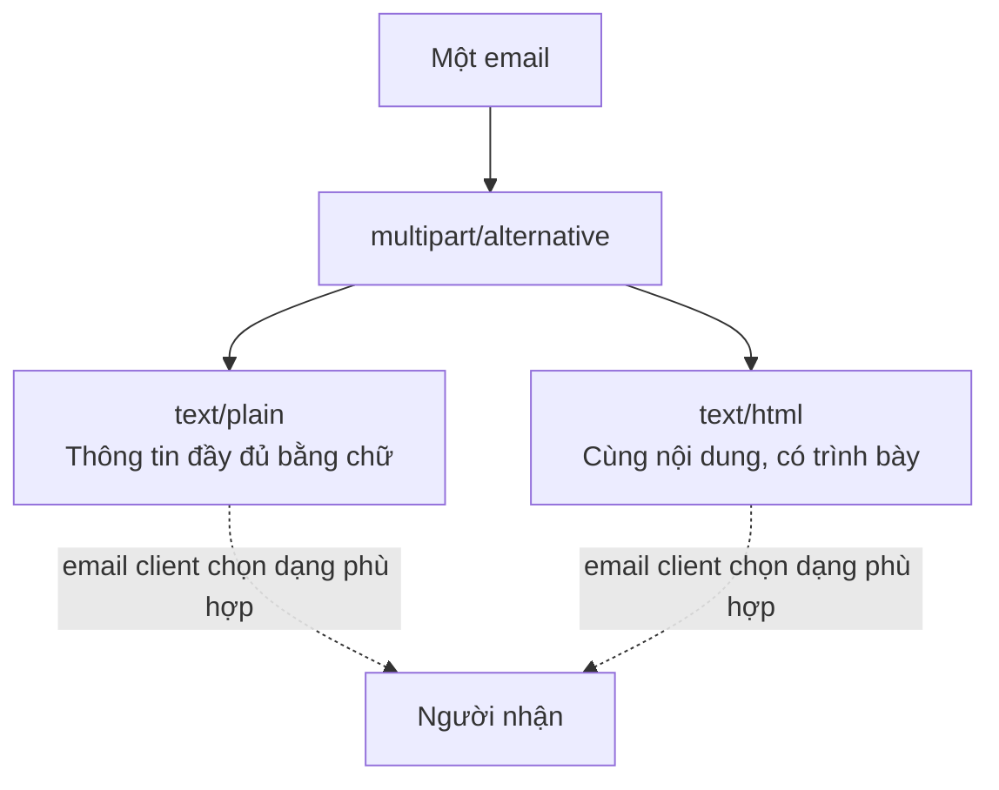

# `MimeMessageHelper.setText` với hai phiên bản nội dung: plain text và HTML

Trong Spring Framework Mail, một thông điệp email có thể được trình bày dưới **hai phiên bản nội dung tương đương**: văn bản thuần (`text/plain`) và HTML (`text/html`). Mỗi phiên bản phục vụ một nhóm ứng dụng đọc thư, môi trường hiển thị hoặc nhu cầu tiếp cận khác nhau. Thay vì gửi hai email độc lập, ứng dụng đặt **cả hai cách biểu diễn vào cùng một MIME message** bằng phương thức:

```java
helper.setText(plainText, htmlText);
```

Đây là một overload quan trọng của `org.springframework.mail.javamail.MimeMessageHelper`. Nó giúp ứng dụng gửi email giàu định dạng mà vẫn có một phiên bản text đọc được khi email client không hỗ trợ HTML, khi người dùng chọn chế độ xem text hoặc khi hệ thống tự động cần xử lý nội dung đơn giản.

Ví dụ, cùng một thông báo đơn hàng có thể chứa:

```text
[text/plain]
Xin chào Alice,
Đơn hàng ORD-184 đã sẵn sàng.
Xem chi tiết: https://shop.example/orders/ORD-184
```

```html
<!-- [text/html] -->
<p>Xin chào <strong>Alice</strong>,</p>
<p>Đơn hàng <strong>ORD-184</strong> đã sẵn sàng.</p>
<p><a href="https://shop.example/orders/ORD-184">Xem chi tiết đơn hàng</a></p>
```

Người nhận thông thường chỉ nhìn thấy **một** trong hai phiên bản, do email client lựa chọn. Hai bản không phải hai lần gửi và không tạo hai notification riêng.

## 1. Vì sao cần cả `text/plain` và `text/html`?

HTML giúp email có tiêu đề, liên kết, nút gọi hành động, bảng trình bày, kiểu chữ và ảnh inline. Nhưng môi trường đọc thư không đồng nhất: một số ứng dụng hỗ trợ HTML rất hạn chế, có chế độ chỉ đọc text, lọc nội dung HTML hoặc dùng trình đọc hỗ trợ tiếp cận theo cách riêng.

Văn bản thuần có những lợi ích độc lập:

- **Đọc được khi không render HTML.** Thông điệp vẫn thể hiện nội dung và hướng dẫn quan trọng.
- **Dễ trích xuất và xử lý tự động.** Một số hệ thống nghiệp vụ, bộ đọc, công cụ lưu trữ và chuyển tiếp ưu tiên văn bản thuần.
- **Hữu ích cho khả năng tiếp cận.** Người dùng có thể chọn chế độ đọc text; vẫn cần viết nội dung rõ ràng và có cấu trúc, không chỉ thêm một bản text qua loa.
- **Chống phụ thuộc vào CSS/ảnh.** Nội dung chính không biến mất khi hình bị chặn hoặc template HTML bị thay đổi.
- **Không ép người nhận dùng HTML.** Email client có thể tự chọn phiên bản mà nó hiểu và người dùng mong muốn.

| Tiêu chí | Phiên bản `text/plain` | Phiên bản `text/html` |
| --- | --- | --- |
| Nội dung | Chữ, dòng trống, URL dưới dạng văn bản | Phần tử HTML và liên kết có nhãn |
| Hiển thị | Không có HTML/CSS | Có cấu trúc, định dạng, ảnh theo hỗ trợ của client |
| Liên kết | Thường ghi đầy đủ URL | Có thể dùng `<a href="...">` |
| Bố cục | Dựa trên đoạn, dòng và dấu câu | Dựa trên HTML và CSS được email client chấp nhận |
| Ảnh inline qua `cid:` | Không render ảnh | Có thể dùng `` |
| Mục đích | Giữ trọn ý nghĩa khi không render HTML | Trình bày thông tin thân thiện và giàu hình thức |

**Không nên xem plain text là “phiên bản phụ không quan trọng”.** Với email thông báo quan trọng (hạn thanh toán, xác nhận lịch hẹn, thông báo trạng thái), cả hai phiên bản nên truyền đạt **cùng sự kiện, số liệu và hành động cần làm**.

## 2. `setText(plainText, htmlText)` tạo cấu trúc MIME nào?

MIME (Multipurpose Internet Mail Extensions) cho phép một email mang nhiều phần nội dung có `Content-Type` khác nhau. Khi có hai cách biểu diễn của **cùng một nội dung**, cấu trúc phổ biến là **`multipart/alternative`**:

```text
MimeMessage
└── multipart/alternative
    ├── text/plain; charset=UTF-8
    │   └── Nội dung thuần
    └── text/html; charset=UTF-8
        └── Nội dung HTML
```

`multipart/alternative` thể hiện rằng các part là **những cách trình bày thay thế cho cùng thông điệp**. Đây là khác biệt nền tảng với `multipart/mixed`, nơi các part thường biểu diễn những thành phần khác nhau như nội dung thư và tệp đính kèm.



Theo quy tắc MIME, các phiên bản thường được sắp từ **dạng đơn giản đến dạng phong phú hơn**: text thuần trước, HTML sau. Email client có thể chọn biểu diễn cuối cùng mà nó hỗ trợ và người dùng ưu tiên. Vì vậy:

- Người nhận **không nhất thiết thấy cả hai đoạn nối tiếp**.
- Ứng dụng không cần tạo hai giao dịch SMTP riêng.
- Nếu HTML bị chặn, client có thể dùng part plain text.
- Nếu client có thể hiển thị HTML, nhiều client sẽ ưu tiên HTML, nhưng cách lựa chọn thực tế là do client quyết định.

### Raw MIME minh họa

```mime
MIME-Version: 1.0
From: notifications@shop.example
To: alice@company.example
Subject: Order ORD-184 is ready
Content-Type: multipart/alternative; boundary="alternative-184"

--alternative-184
Content-Type: text/plain; charset=UTF-8
Content-Transfer-Encoding: quoted-printable

Hello Alice,
Order ORD-184 is ready.
View details: https://shop.example/orders/ORD-184

--alternative-184
Content-Type: text/html; charset=UTF-8
Content-Transfer-Encoding: quoted-printable

<html><body>
  <p>Hello <strong>Alice</strong>,</p>
  <p>Order <strong>ORD-184</strong> is ready.</p>
  <a href="https://shop.example/orders/ORD-184">View details</a>
</body></html>
--alternative-184--
```

Đây là **ví dụ cấu trúc để đọc**, không phải source `.eml` hoàn chỉnh được bảo đảm hợp lệ trong mọi chi tiết: cách mã hóa chuyển dòng, phần thân với `quoted-printable`, dấu ranh giới và header có thể khác trong email do Jakarta Mail thực sự tạo. Trường `Content-Transfer-Encoding` dùng để truyền dữ liệu qua mail transport, **không thay đổi ý nghĩa** rằng hai part là hai phiên bản của cùng thông điệp.

### Nếu có cả ảnh inline và attachment thì sao?

Khi thư vừa có hai phiên bản nội dung, vừa có ảnh inline hoặc PDF đính kèm, MIME sẽ có **nhiều lớp multipart lồng nhau**. Một cây logic thường gặp:

```text
multipart/mixed
├── multipart/related
│   ├── multipart/alternative
│   │   ├── text/plain
│   │   └── text/html     <-- 
│   └── image/png         <-- Content-ID: <logo@shop.example>
└── application/pdf       <-- attachment
```

Trong Spring, `MimeMessageHelper` sử dụng chế độ multipart phù hợp để xây dựng cây MIME. Cấu trúc cụ thể có thể khác tùy constructor, chế độ và phiên bản triển khai, nhưng các ý nghĩa giữ nguyên:

1. `multipart/alternative`: **plain text và HTML thay thế nhau**.
2. `multipart/related`: **HTML và tài nguyên được HTML tham chiếu**, ví dụ hình có Content-ID.
3. `multipart/mixed`: **nội dung chính và các attachment độc lập**.

Một số email client giải mã các cấu trúc MIME hơi khác nhau, nên khi gặp vấn đề hiển thị cần kiểm tra thư MIME thực tế thay vì chỉ nhìn HTML.

## 3. Các overload của `MimeMessageHelper.setText`

`MimeMessageHelper` có nhiều cách đặt nội dung. Cần hiểu đúng tham số để tránh vô tình gửi HTML dưới dạng text thuần.

| Cách gọi | Ý nghĩa | Khi nên dùng |
| --- | --- | --- |
| `helper.setText("Hello")` | Đặt **một** phiên bản text thuần | Chỉ có văn bản đơn giản |
| `helper.setText(html, true)` | Đặt **một** phiên bản HTML | Cần HTML nhưng không tạo bản plain text bằng overload này |
| `helper.setText(text, false)` | Đặt **một** phiên bản text thuần | Muốn tường minh nội dung không phải HTML |
| **`helper.setText(plainText, htmlText)`** | Đặt **hai** phiên bản vào multipart/alternative | Cần cả HTML và bản text tương đương |

So sánh trực tiếp:

```java
// Chỉ có plain text:
helper.setText("Đơn hàng đã sẵn sàng.");

// Chỉ có HTML:
helper.setText("<strong>Đơn hàng đã sẵn sàng.</strong>", true);

// Có cả hai phiên bản của cùng một nội dung:
helper.setText(
        "Đơn hàng đã sẵn sàng.",
        "<p><strong>Đơn hàng đã sẵn sàng.</strong></p>");
```

**Đừng nhầm `setText(String text, boolean html)` với `setText(String plainText, String htmlText)`.** Overload thứ hai không nhận cờ boolean mà nhận *hai chuỗi nội dung* riêng biệt.

### Không tự động biến HTML thành plain text

Lời gọi:

```java
helper.setText(plainText, htmlText);
```

**không yêu cầu Spring tự trích xuất plain text từ HTML**. Ứng dụng phải cung cấp **cả hai chuỗi**. Nếu `plainText` thiếu URL, giá trị quan trọng hoặc điều kiện sử dụng mà HTML có, thì người đọc chế độ text sẽ thiếu thông tin.

Ngược lại, việc chỉ lấy HTML rồi xóa mọi thẻ bằng regex không bảo đảm có bản text tốt: nhãn link có thể mất URL, bảng mất quan hệ giữa các cột, danh sách mất cấu trúc và hình minh họa mất ý nghĩa.

## 4. Tạo email hai phiên bản trong Spring Boot

Với ứng dụng Spring Boot, thêm mail starter nếu chưa có:

```groovy
// build.gradle
dependencies {
    implementation 'org.springframework.boot:spring-boot-starter-mail'
}
```

Ví dụ cấu hình SMTP submission qua STARTTLS:

```yaml
# application.yml
spring:
  mail:
    host: smtp.provider.example
    port: 587
    username: ${SMTP_USERNAME}
    password: ${SMTP_PASSWORD}
    default-encoding: UTF-8
    properties:
      "[mail.smtp.auth]": "true"
      "[mail.smtp.starttls.enable]": "true"
      "[mail.smtp.starttls.required]": "true"
      "[mail.smtp.ssl.checkserveridentity]": "true"
      "[mail.smtp.connectiontimeout]": "5000"
      "[mail.smtp.timeout]": "10000"
      "[mail.smtp.writetimeout]": "10000"

app:
  mail:
    from: notifications@shop.example
```

`spring.mail.username` và `spring.mail.password` là thông tin đăng nhập SMTP, không phải nội dung `From:` của email. `app.mail.from` là thuộc tính **ứng dụng tự định nghĩa**, cần được dùng rõ ràng khi tạo thư. Tài khoản SMTP phải có quyền gửi với domain/địa chỉ `From:` theo chính sách nhà cung cấp.

### Service Java hoàn chỉnh

Ví dụ dưới đây tạo **một email có hai nội dung tương đương**, có mã đơn hàng và đường dẫn xem chi tiết:

```java
package com.example.mail;

import jakarta.mail.MessagingException;
import jakarta.mail.internet.MimeMessage;

import org.springframework.beans.factory.annotation.Value;
import org.springframework.mail.javamail.JavaMailSender;
import org.springframework.mail.javamail.MimeMessageHelper;
import org.springframework.stereotype.Service;
import org.springframework.web.util.HtmlUtils;

@Service
public class OrderReadyMailService {

    private final JavaMailSender mailSender;
    private final String fromAddress;

    public OrderReadyMailService(
            JavaMailSender mailSender,
            @Value("${app.mail.from}") String fromAddress) {
        this.mailSender = mailSender;
        this.fromAddress = fromAddress;
    }

    public void sendReadyNotice(
            String recipientEmail,
            String customerName,
            String orderId) throws MessagingException {

        // Ví dụ giả định các giá trị đã được lớp nghiệp vụ kiểm soát.
        // Kiểm tra orderId theo schema để không tạo path tùy ý.
        if (!orderId.matches("[A-Za-z0-9-]{1,40}")) {
            throw new IllegalArgumentException("Invalid orderId");
        }

        String orderUrl = "https://shop.example/orders/" + orderId;

        String plainText = """
                Xin chào %s,

                Đơn hàng %s của bạn đã sẵn sàng.
                Xem chi tiết: %s

                Cảm ơn bạn đã mua hàng.
                """.formatted(customerName, orderId, orderUrl);

        // Nội dung động đưa vào HTML phải được escape phù hợp.
        String safeName = HtmlUtils.htmlEscape(customerName);
        String safeOrderId = HtmlUtils.htmlEscape(orderId);
        String safeUrl = HtmlUtils.htmlEscape(orderUrl);

        String htmlText = """
                <!doctype html>
                <html>
                  <body>
                    <p>Xin chào <strong>%s</strong>,</p>
                    <p>Đơn hàng <strong>%s</strong> của bạn đã sẵn sàng.</p>
                    <p><a href="%s">Xem chi tiết đơn hàng</a></p>
                    <p>Cảm ơn bạn đã mua hàng.</p>
                  </body>
                </html>
                """.formatted(safeName, safeOrderId, safeUrl);

        MimeMessage message = mailSender.createMimeMessage();
        MimeMessageHelper helper = new MimeMessageHelper(
                message,
                MimeMessageHelper.MULTIPART_MODE_MIXED_RELATED,
                "UTF-8");

        helper.setFrom(fromAddress);
        helper.setTo(recipientEmail);
        helper.setSubject("Đơn hàng " + orderId + " đã sẵn sàng");
        helper.setText(plainText, htmlText);

        mailSender.send(message);
    }
}
```

Giải thích:

1. `mailSender.createMimeMessage()` tạo đối tượng email theo Jakarta Mail.
2. Constructor `MimeMessageHelper(..., MULTIPART_MODE_MIXED_RELATED, "UTF-8")` bật multipart để hỗ trợ các phần MIME, và chỉ định charset tạo nội dung.
3. `setFrom`, `setTo`, `setSubject` đặt header và người nhận cho message.
4. **`setText(plainText, htmlText)`** đặt hai phiên bản vào cây MIME.
5. `mailSender.send(message)` submit email qua SMTP transport.

Trong ví dụ, `orderId` được ràng buộc để phù hợp với segment đường dẫn; nếu ID của dự án có quy tắc khác, cần dùng **quy tắc riêng của ứng dụng** và encode URL theo ngữ cảnh trước khi đưa vào HTML. `HtmlUtils.htmlEscape` dùng để escape ký tự trong HTML, nhưng **không kiểm tra độ tin cậy của URL**; nếu URL do người dùng nhập, còn phải kiểm soát scheme, host, path và quyền truy cập.

`customerName` cần được chuẩn hóa và có fallback nếu rỗng, áp dụng giới hạn độ dài/ký tự điều khiển ở lớp dữ liệu. Escape HTML giải quyết một phần rủi ro render nhưng không tự bảo vệ subject hay nội dung text khỏi dữ liệu sai nghiệp vụ.

### Vì sao dùng chế độ `MULTIPART_MODE_MIXED_RELATED`?

Đây là chế độ thường dùng khi ứng dụng có thể mở rộng email sang **HTML, inline image và attachment**. Nó cung cấp cấu trúc MIME tương thích với các nhu cầu đó. Trong ví dụ chỉ có hai phiên bản nội dung, cũng có thể chọn cách tạo helper multipart đơn giản; điều trọng tâm là **`setText(plainText, htmlText)` tạo alternative parts**, không phải việc bắt buộc luôn dùng đúng một chế độ multipart duy nhất.

Nếu dự án chỉ gửi plain text, `SimpleMailMessage` thường gọn hơn. Nếu dự án gửi text + HTML, nên dùng `MimeMessage` và helper, vì `SimpleMailMessage` không có cơ chế biểu diễn MIME alternatives.

## 5. Thiết kế hai phiên bản sao cho tương đương

Hai phần **không cần giống nhau từng ký tự**, nhưng cần giữ cùng ý nghĩa. Ví dụ HTML có nút `Xem đơn hàng`; trong plain text, người đọc cần một URL đầy đủ để có thể sao chép hoặc truy cập.

| Thông tin | HTML | Plain text nên có |
| --- | --- | --- |
| Lời chào | `<p>Xin chào <strong>Alice</strong></p>` | `Xin chào Alice,` |
| Mã đơn hàng | Hiển thị in đậm | Giữ đúng mã đơn hàng |
| Nút hành động | `<a href="...">Xem đơn hàng</a>` | `Xem đơn hàng: https://...` |
| Danh sách mặt hàng | `<ul><li>...</li></ul>` | Dòng gạch đầu dòng `- ...` |
| Bảng thời gian | `<table>...` | Những cặp nhãn–giá trị theo dòng |
| Logo/ảnh | `` | Văn bản tên thương hiệu hoặc ý nghĩa của ảnh |
| Cảnh báo quan trọng | Khung nổi bật và màu sắc | Câu chữ rõ ràng, không phụ thuộc màu |
| Footer hỗ trợ | Link hoặc khối thông tin | Địa chỉ hỗ trợ và hướng dẫn trực tiếp |

### Không để HTML có thông tin quan trọng mà text thiếu

Ví dụ HTML:

```html
<p>Hạn thanh toán: <strong>20/11/2026 17:00</strong>.</p>
<a href="https://shop.example/pay/ORD-184">Thanh toán</a>
```

Bản text **không phù hợp**:

```text
Vui lòng xem phiên bản HTML để biết chi tiết.
```

Bản text **phù hợp hơn**:

```text
Hạn thanh toán: 17:00 ngày 20/11/2026 (Asia/Ho_Chi_Minh).
Thanh toán: https://shop.example/pay/ORD-184
```

Quy tắc thực dụng: một người chỉ đọc `text/plain` phải **hiểu được điều gì đã xảy ra, có cần hành động không, và thực hiện bằng cách nào** mà không buộc phải mở phiên bản HTML.

### Plain text không cần dùng ký pháp HTML

Không đặt thẻ `<p>`, `<strong>`, `<table>` vào `plainText`; email client đọc text sẽ hiển thị chúng như ký tự thường. Có thể dùng dòng trống, dấu câu, dấu gạch đầu dòng và các nhãn rõ nghĩa:

```text
ĐƠN HÀNG ORD-184

Trạng thái: Sẵn sàng nhận hàng
Địa điểm: Quầy số 2, tầng 1
Hạn nhận: 17:00 ngày 15/11/2026

Chi tiết: https://shop.example/orders/ORD-184
```

Tránh tạo text bằng cách xóa thẻ HTML theo regex đơn giản; kết quả có thể dính chữ, mất nội dung trong bảng và làm mất URL của `<a href>`.

## 6. Từ dữ liệu nghiệp vụ đến hai template

Khi có nhiều loại email, viết cả hai chuỗi ngay trong service gửi có thể làm lẫn logic nghiệp vụ với nội dung trình bày. Một cấu trúc khác là tạo **view model dùng chung**, rồi render hai template:

```text
OrderReadyEvent / DB snapshot
          |
          v
OrderReadyMailModel
  - name
  - orderId
  - localDeadline
  - orderUrl
          |
          +---------------------+
          |                     |
          v                     v
  order-ready.txt        order-ready.html
          |                     |
          v                     v
       plainText              htmlText
          |                     |
          +----------+----------+
                     v
         helper.setText(plainText, htmlText)
```

Ví dụ cấu trúc thư mục template:

```text
src/main/resources/
└── templates/
    └── mail/
        ├── order-ready.txt
        └── order-ready.html
```

Template text có thể dùng:

```text
Xin chào {{name}},
Đơn hàng {{orderId}} đã sẵn sàng.
Xem chi tiết: {{orderUrl}}
```

Template HTML tương ứng:

```html
<p>Xin chào <strong>{{name}}</strong>,</p>
<p>Đơn hàng <strong>{{orderId}}</strong> đã sẵn sàng.</p>
<p><a href="{{orderUrl}}">Xem chi tiết</a></p>
```

Ký hiệu `{{...}}` ở đây là **minh họa placeholder** chứ không phải cú pháp mặc định của Spring hoặc Thymeleaf. Nếu dùng Thymeleaf, FreeMarker hoặc engine khác, phải dùng cú pháp của engine tương ứng và cấu hình cách escape cho từng context.

### Thiết kế renderer có hai đầu ra

Một giao diện đơn giản:

```java
public record MailBody(String plainText, String htmlText) {
}

public interface OrderReadyMailRenderer {
    MailBody render(OrderReadyMailModel model);
}
```

Service gửi có thể sử dụng:

```java
MailBody body = renderer.render(model);
helper.setText(body.plainText(), body.htmlText());
```

Nhờ vậy, quy tắc SMTP độc lập với quy tắc render. Cùng một `OrderReadyMailModel` giúp đồng bộ số tiền, deadline, địa chỉ liên hệ và link giữa hai bản. Nếu cần đa ngôn ngữ, renderer còn có thể nhận `Locale` và timezone để định dạng các giá trị nhất quán.

Với liên kết, không nên lấy URL bất kỳ do template hoặc người dùng cung cấp mà đưa thẳng vào `href`. Ứng dụng nên xây URL từ base URL tin cậy và dữ liệu được encode/kiểm soát, rồi escape HTML theo ngữ cảnh thuộc tính.

## 7. Kết hợp `setText` hai phiên bản với ảnh inline

Khi HTML có logo hoặc mã QR nhúng bằng `cid:`, plain text vẫn tồn tại **song song**, nhưng không thể hiển thị ảnh. Cần để lại ý nghĩa quan trọng của ảnh trong chữ.

Ví dụ, sau khi tạo `MimeMessageHelper` multipart:

```java
import org.springframework.core.io.ClassPathResource;

String logoCid = "brand-logo@shop.example";

String plainText = """
        Shop Example
        Đơn hàng ORD-184 đã sẵn sàng.
        Xem chi tiết: https://shop.example/orders/ORD-184
        """;

String htmlText = """
        <html><body>
          
          <p>Đơn hàng <strong>ORD-184</strong> đã sẵn sàng.</p>
          <a href="https://shop.example/orders/ORD-184">Xem chi tiết</a>
        </body></html>
        """;

// Đặt phần nội dung trước khi thêm tài nguyên inline.
helper.setText(plainText, htmlText);
helper.addInline(
        logoCid,
        new ClassPathResource("mail/images/logo.png"),
        "image/png");
```

Ví dụ giả định `helper` đã được tạo với chế độ multipart thích hợp và file ảnh có tại `src/main/resources/mail/images/logo.png`.

Điểm cần nhớ:

- `src="cid:brand-logo@shop.example"` liên kết đến part ảnh có header `Content-ID: <brand-logo@shop.example>`.
- Tham số `addInline` nhận **ID không kèm `cid:` và không kèm dấu `<...>`**.
- Với `MimeMessageHelper`, nên gọi **`setText(...)` trước `addInline(...)`** để giữ cấu trúc phù hợp với nhiều mail client.
- Bản plain text cần có tên thương hiệu và URL quan trọng, vì nó không render ``.
- Ảnh nhúng tăng dung lượng MIME email. Nếu thông tin bắt buộc chỉ nằm trong QR/ảnh mà không có fallback, người đọc text có thể không dùng được thư.

### Vậy `multipart/alternative` nằm ở đâu khi có ảnh?

Khi kết hợp hai phiên bản với ảnh inline, `multipart/alternative` có thể là một nhánh **bên trong** cấu trúc `multipart/related`/ `multipart/mixed` do helper tạo. Không nên diễn giải `setText(plainText, htmlText)` là tạo hai root message độc lập; nó vẫn nằm trong **một** `MimeMessage` cùng một lần submit.

## 8. Kết hợp hai phiên bản với attachment

Nếu email có bản text, HTML và hóa đơn PDF, có thể viết:

```java
import org.springframework.core.io.ClassPathResource;

helper.setText(plainText, htmlText);
helper.addAttachment(
        "invoice-ORD-184.pdf",
        new ClassPathResource("mail/docs/invoice-ORD-184.pdf"));
```

Hai phiên bản text/html là **alternatives**; tệp PDF là một **attachment bổ sung**. Trong HTML và plain text nên ghi rõ có file đính kèm:

```text
Hóa đơn PDF được đính kèm trong email này.
```

Đừng cố đưa PDF vào `setText`: overload này nhận nội dung văn bản, không phải file nhị phân. Nếu muốn gắn tệp, dùng `addAttachment` hoặc API MIME phù hợp.

Khi có attachment lớn, kích thước thực tế của email có thể vượt kích thước file do mã hóa Base64 và overhead của MIME. Nhà cung cấp SMTP hoặc máy chủ nhận có thể từ chối thông điệp lớn; đó là vấn đề giới hạn thư, không phải việc có hai bản text/HTML làm SMTP gửi hai lần.

## 9. Charset và khả năng hiển thị tiếng Việt

Tiếng Việt có dấu, tên người nhận và biểu tượng Unicode cần được mã hóa phù hợp. Với email dạng MIME, charset áp dụng cho các text parts, còn `Content-Transfer-Encoding` quy định cách đưa dữ liệu qua mail transport.

```java
MimeMessage message = mailSender.createMimeMessage();
MimeMessageHelper helper = new MimeMessageHelper(
        message,
        MimeMessageHelper.MULTIPART_MODE_MIXED_RELATED,
        "UTF-8");
```

Cấu hình này giúp helper tạo các part văn bản theo UTF-8. Với Spring Boot, có thể cấu hình:

```yaml
spring:
  mail:
    default-encoding: UTF-8
```

`default-encoding` là cấu hình của sender cho việc tạo nội dung; constructor helper truyền charset tường minh sẽ giúp ý định rõ trong method tạo email. Jakarta Mail có thể chọn `quoted-printable` hoặc `base64` khi serialize part, tùy nội dung và implementation. Hai kiểu encoding này **không có nghĩa email bị mã hóa bảo mật**; chúng phục vụ tính tương thích khi vận chuyển.

Ví dụ raw header minh họa:

```text
Content-Type: text/plain; charset=UTF-8
Content-Transfer-Encoding: quoted-printable
```

Và part HTML:

```text
Content-Type: text/html; charset=UTF-8
Content-Transfer-Encoding: quoted-printable
```

Email client giải mã phần MIME trước khi hiển thị. Nếu thấy ký tự lỗi như `á` hoặc `?` thay vì tiếng Việt, hãy kiểm tra **nguồn dữ liệu, template charset, MIME headers và client**; không vội sửa bằng cách tự Base64 hóa toàn bộ chuỗi trước khi gọi `setText`.

## 10. Bảo vệ dữ liệu khi tạo cả text và HTML

`setText(plainText, htmlText)` giúp tạo cấu trúc MIME, **không làm nhiệm vụ lọc dữ liệu đầu vào của ứng dụng**. Dữ liệu nghiệp vụ có thể đến từ người dùng, hệ thống khác hoặc database và cần được xử lý theo context hiển thị.

### Escape HTML đúng ngữ cảnh

Ví dụ tên người dùng:

```text
Alice <script>alert('x')</script>
```

Nếu nối trực tiếp vào HTML, dữ liệu được diễn giải thành markup khi client render (nhiều email client có bộ lọc riêng, nhưng ứng dụng không nên phụ thuộc vào đó). Với nội dung hiển thị, dùng HTML escaping thích hợp:

```java
String escapedName = HtmlUtils.htmlEscape(customerName);
String html = "<p>Xin chào " + escapedName + "</p>";
```

`HtmlUtils.htmlEscape` là công cụ escape ký tự HTML, không phải bộ lọc nội dung HTML cho phép chấp nhận markup tùy ý. Nếu template cho phép người dùng soạn HTML, phải có quy trình sanitize/allowlist phù hợp với yêu cầu bảo mật.

### URL trong HTML và URL trong text

```java
String url = trustedBaseUrl + encodedPath;
String html = "<a href=\"" + HtmlUtils.htmlEscape(url) + "\">Mở đơn hàng</a>";
String plain = "Mở đơn hàng: " + url;
```

Ở đây `trustedBaseUrl` là base URL đã được cấu hình tin cậy, còn `encodedPath` đã được encode theo quy tắc URL phù hợp; cả hai là biến ví dụ trong ngữ cảnh có sẵn. **HTML escaping không thay thế việc kiểm tra scheme/host hoặc encode URL**. Không dùng `javascript:`, `data:` hoặc URL do người dùng đưa vào `href` khi không được kiểm soát.

### Subject và header cũng cần kiểm soát

Các chuỗi đi vào `helper.setSubject(...)`, `setFrom(...)`, `setTo(...)` có ngữ cảnh khác HTML. Không áp dụng HTML escaping cho địa chỉ nhận hoặc subject rồi coi như đã xác thực. Hãy dùng validation theo schema nghiệp vụ, kiểm soát ký tự điều khiển, quyền gửi và định dạng địa chỉ email.

Nếu email có giá trị nhạy cảm, cả **plain text lẫn HTML** đều chứa nội dung đó bên trong MIME message. Việc có bản plain text không tự làm email an toàn hơn; email có thể bị lưu, chuyển tiếp hoặc trích xuất. Chỉ đưa dữ liệu cần thiết vào thư và tuân thủ chính sách bảo vệ thông tin của sản phẩm.

## 11. Kiểm tra cấu trúc MIME mà không cần gửi email thật

Một cách quan sát trực tiếp kết quả của `setText(plainText, htmlText)` là tạo `MimeMessage` trong bộ nhớ, ghi thành `.eml` và xem cấu trúc `multipart/alternative`.

Ví dụ Java:

```java
import java.io.ByteArrayOutputStream;
import java.nio.charset.StandardCharsets;
import java.util.Properties;

import jakarta.mail.Session;
import jakarta.mail.internet.MimeMessage;

import org.springframework.mail.javamail.MimeMessageHelper;

public class AlternativeMailSourceExample {

    public static void main(String[] args) throws Exception {
        Session session = Session.getInstance(new Properties());
        MimeMessage message = new MimeMessage(session);

        MimeMessageHelper helper = new MimeMessageHelper(
                message,
                MimeMessageHelper.MULTIPART_MODE_MIXED_RELATED,
                "UTF-8");

        helper.setFrom("notifications@shop.example");
        helper.setTo("alice@company.example");
        helper.setSubject("Thông báo");
        helper.setText(
                "Xin chào Alice!\nĐơn hàng đã sẵn sàng.",
                "<p>Xin chào <strong>Alice</strong>!</p>"
                        + "<p>Đơn hàng đã sẵn sàng.</p>");

        message.saveChanges();

        try (ByteArrayOutputStream out = new ByteArrayOutputStream()) {
            message.writeTo(out);
            String rawEml = out.toString(StandardCharsets.UTF_8);
            System.out.println(rawEml);
        }
    }
}
```

Đây là **ví dụ chẩn đoán trong môi trường phát triển**, không mở kết nối SMTP. Nó giúp quan sát MIME headers và boundaries thực tế. Nội dung source có thể chứa tên/email/ngữ liệu cá nhân, vì vậy chỉ sử dụng địa chỉ giả lập và không in email production vào log.

### Cách đọc kết quả

Trong raw MIME, hãy tìm:

1. `MIME-Version: 1.0`.
2. Một `multipart/alternative` (có thể nằm trong các nhóm multipart khác).
3. Part có `Content-Type: text/plain; charset=UTF-8`.
4. Part có `Content-Type: text/html; charset=UTF-8`.
5. Hai phần đều chứa **cùng thông tin nghiệp vụ** theo cách trình bày phù hợp.
6. Nếu có ảnh `cid:`, MIME part `Content-ID` tương ứng phải hiện diện và nằm trong cấu trúc liên quan.

Không nên chỉ kiểm tra chuỗi `message.getContent().toString()`: khi message là multipart, `getContent()` có thể trả về một đối tượng `Multipart` chứ không phải nội dung plain text hoặc HTML đã ghép sẵn.

### Ví dụ kiểm tra hai phiên bản bằng Jakarta Mail

Nếu cần đọc MIME tree có nhiều lớp, có thể duyệt các part bằng Jakarta Mail:

```java
import jakarta.mail.Multipart;
import jakarta.mail.Part;

static void printMimeStructure(Part part, String indent) throws Exception {
    System.out.println(indent + part.getContentType());

    Object content = part.getContent();
    if (content instanceof Multipart multipart) {
        for (int i = 0; i < multipart.getCount(); i++) {
            printMimeStructure(multipart.getBodyPart(i), indent + "  ");
        }
    }
}
```

Hàm trên minh họa cách duyệt nhiều lớp multipart, không phải một bộ xác nhận MIME đầy đủ. Nó không so sánh tự động ý nghĩa hai phiên bản và cũng không xác nhận khả năng email client render được mọi HTML. Để quan sát thực tế trên nhiều ứng dụng đọc thư, dùng địa chỉ test và xem MIME source của thông điệp đã nhận.

## 12. Những sai lầm thường gặp

### Sai lầm 1: Gọi `setText(html)` và mong hiển thị HTML

```java
helper.setText("<h1>Đơn hàng đã sẵn sàng</h1>");
```

Với overload một tham số, chuỗi được đặt dưới dạng **text thuần**. Người đọc có thể thấy nguyên thẻ `<h1>`. Nếu chỉ cần HTML, dùng `setText(html, true)`; nếu cần cả hai phiên bản, dùng `setText(plainText, htmlText)`.

### Sai lầm 2: Nhầm overload hai tham số

```java
helper.setText("Hello", true);        // text + boolean
helper.setText("Hello", "<b>Hello</b>"); // plainText + htmlText
```

Hai cách gọi có ý nghĩa khác nhau. Không truyền hai chuỗi rồi nghĩ tham số thứ hai là một loại flag.

### Sai lầm 3: Bản plain text chỉ có lời nhắc “xem HTML”

Vì `multipart/alternative` để client **chọn một biểu diễn**, bản text thiếu thông tin sẽ làm một nhóm người đọc không sử dụng được email. Hãy cung cấp thông tin quan trọng, deadline, link đầy đủ và hướng dẫn hành động trong bản text.

### Sai lầm 4: Gửi hai email riêng biệt

```java
// Không phải cách tạo multipart/alternative:
sendOnePlainEmail();
sendOneHtmlEmail();
```

Hai lời gọi có thể tạo hai email độc lập cho cùng người nhận. Overload `setText(plainText, htmlText)` mới biểu diễn **hai nội dung trong một thư**.

### Sai lầm 5: Dùng `SimpleMailMessage` cho HTML

`SimpleMailMessage` thích hợp cho email text thuần. Khi cần MIME alternatives, dùng `MimeMessage` và `MimeMessageHelper`; không cố chèn HTML dưới dạng chuỗi text thuần.

### Sai lầm 6: Nhầm `multipart/alternative` với `multipart/mixed`

`alternative` mang nhiều cách hiển thị của cùng một nội dung; `mixed` thường mang các thành phần bổ sung như attachment. Nếu một client hiển thị plain text và HTML thành hai attachment riêng, cần xem MIME tree thực tế và cách các part được tạo.

### Sai lầm 7: Gọi `addInline` trước `setText`

Với inline resource, Spring khuyến nghị **`setText` trước, `addInline` sau** để tránh một số mail reader không phân giải đúng các part liên quan. Khi debug, xem cả `Content-ID`, `cid:` và `multipart/related`.

### Sai lầm 8: Không escape dữ liệu động trong HTML

Ghép tên người dùng hoặc ghi chú tùy ý vào HTML mà không escape có thể khiến markup bị thay đổi và tạo rủi ro bảo mật. Hãy xử lý theo đúng ngữ cảnh: text node, attribute, URL, subject và địa chỉ nhận không phải một loại dữ liệu.

### Sai lầm 9: Hai phiên bản ghi số liệu khác nhau

Ví dụ text ghi thời hạn **17:00**, HTML ghi **19:00**, do mỗi template tính lại giờ từ timezone khác nhau. Tạo một **view model đã chuẩn hóa** rồi render cả hai phiên bản từ cùng dữ liệu hiển thị.

### Sai lầm 10: Dùng ảnh thay toàn bộ thông điệp

HTML có `` nhưng text chỉ ghi “đã gửi ảnh”. Nếu client không hiển thị ảnh hoặc người đọc chỉ dùng plain text, nội dung cốt lõi mất đi. Cần có câu chữ fallback mô tả thông tin cần thiết.

### Sai lầm 11: Đặt `Content-Type` thủ công rồi trông chờ helper tự sửa

Nếu lập trình viên tự tạo multipart/header không phù hợp trước khi helper xử lý, MIME tree có thể bị hỏng hoặc bị các client hiểu sai. Tốt nhất dùng đúng API helper cho text/HTML, inline và attachment; chỉ thao tác MIME cấp thấp khi thực sự cần và hiểu cấu trúc.

### Sai lầm 12: Đồng nhất `send()` thành công với việc HTML đã hiển thị

`JavaMailSender.send(message)` thành công chỉ cho biết thao tác submission không báo lỗi tại thời điểm gọi. Nó không chứng minh thư đã đến inbox hay email client dựng HTML như mong đợi. Cần phân biệt **gửi SMTP, phát thư, lựa chọn MIME alternative và render HTML**.

## 13. Câu hỏi tự kiểm tra

**1. `helper.setText(plainText, htmlText)` gửi mấy email?**

Một email, với hai biểu diễn nội dung được đóng gói theo MIME alternatives. Client chọn phần phù hợp khi hiển thị.

**2. Tại sao cần `multipart/alternative`?**

Để biểu diễn các phiên bản khác nhau của **cùng nội dung logic**, ví dụ text thuần và HTML, thay vì coi chúng là hai thành phần độc lập như một attachment.

**3. `setText(html, true)` có tự tạo plain text không?**

Không. Cách gọi này đặt một phiên bản HTML. Nếu muốn text fallback, cung cấp cả hai chuỗi trong overload `setText(plainText, htmlText)`.

**4. Vì sao không nên tạo plain text bằng cách xóa thẻ HTML bằng regex?**

Vì cấu trúc bảng, danh sách, xuống dòng và đặc biệt các URL trong `href` có thể bị mất hoặc trở nên khó hiểu. Nên render bản text với ngữ nghĩa rõ ràng từ cùng dữ liệu nghiệp vụ.

**5. Khi có hình `cid:` trong HTML, text thuần có hiển thị hình đó không?**

Không. Bản text phải chứa thông tin cần thiết dưới dạng chữ; hình inline là tài nguyên của biểu diễn HTML.

**6. Khi dùng `MimeMessageHelper.addInline`, nên gọi `setText` trước hay sau?**

Nên gọi `setText` trước, rồi mới `addInline` theo khuyến nghị dùng helper của Spring.

**7. Vì sao phải escape tên người nhận trong HTML dù email client lọc script?**

Vì dữ liệu không tin cậy không được quyền thay đổi markup ngoài ý định; lọc nội dung của client là cơ chế phía nhận, không thay thế việc xây dựng HTML an toàn của ứng dụng.

**8. `mailSender.send()` thành công có bảo đảm client hiển thị HTML?**

Không. Việc nhận thư và hiển thị phụ thuộc mail relay, máy chủ đích, cấu trúc MIME và email client.

**9. Nếu dùng `multipart/mixed` cho attachment, còn có thể có `multipart/alternative` không?**

Có. MIME cho phép lồng cấu trúc: nhóm alternative làm nội dung chính, còn attachment nằm trong nhóm mixed ở cấp phù hợp.

**10. Làm sao kiểm tra một email có thật sự mang hai phiên bản?**

Xem raw MIME source/`.eml`, tìm `multipart/alternative` với hai part `text/plain` và `text/html`, hoặc duyệt MIME tree bằng API Jakarta Mail.

## Kết luận

**`MimeMessageHelper.setText(plainText, htmlText)` là cách tạo một email với hai phiên bản nội dung thay thế nhau:** `text/plain` và `text/html`. Chúng được đóng gói trong cấu trúc MIME alternative, để email client chọn biểu diễn phù hợp, **không phải gửi hai thư**. Trong Spring Framework Mail, hãy tạo `MimeMessage`, dùng `MimeMessageHelper` với charset phù hợp, xây hai bản từ cùng dữ liệu nghiệp vụ, giữ nội dung tương đương, escape HTML động theo ngữ cảnh và dùng `setText` trước khi thêm inline resources. Khi gặp lỗi hiển thị, kiểm tra cấu trúc `multipart/alternative` và các part liên quan trong email thực tế thay vì chỉ nhìn source HTML hoặc kết quả của SMTP submission.
