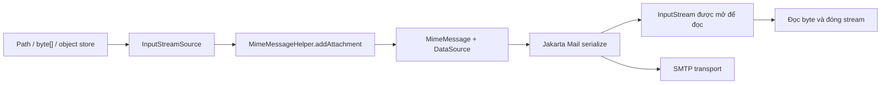
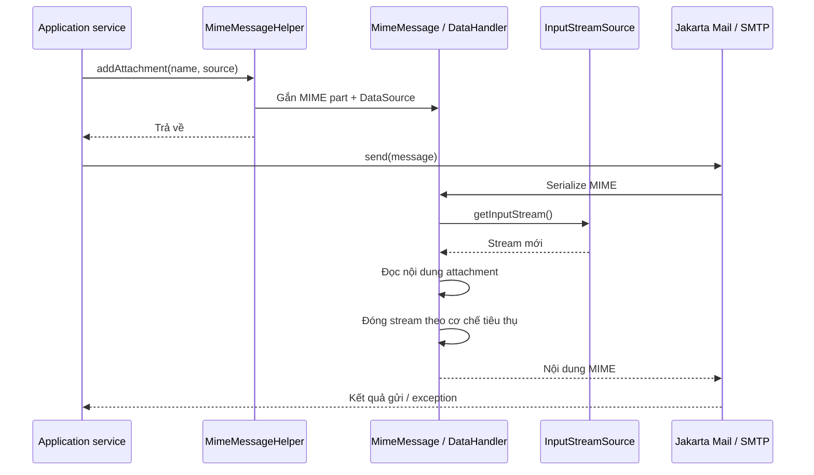
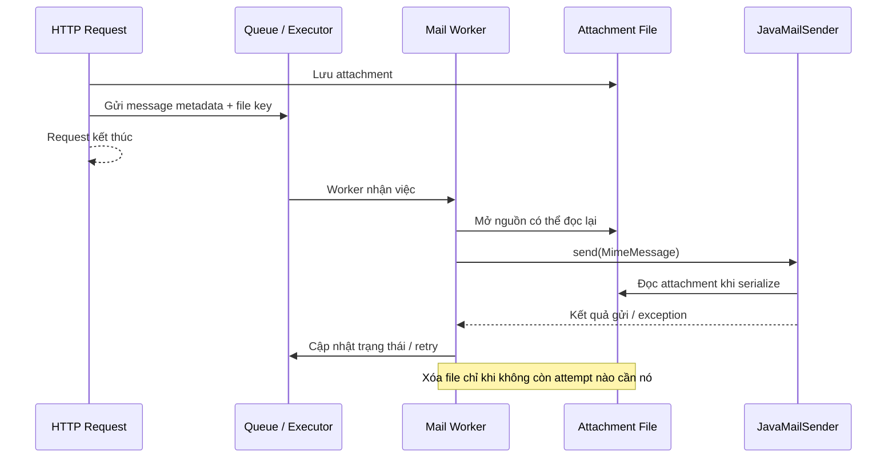

# Đóng InputStream và quyền sở hữu tài nguyên trong MimeMessageHelper

Gửi email có tệp đính kèm bằng Spring Framework Mail thường bắt đầu rất đơn giản: tạo `MimeMessage`, dùng `MimeMessageHelper` và gọi `addAttachment(...)`. Tuy nhiên, khi dữ liệu đính kèm đến từ `InputStream`, một câu hỏi quan trọng xuất hiện: **ai chịu trách nhiệm mở, đóng, lưu giữ và giải phóng tài nguyên, vào thời điểm nào?**

Nếu đóng stream ngay sau `addAttachment()`, email có thể gửi một phần hoặc thất bại khi Jakarta Mail bắt đầu đọc nội dung. Nếu đưa vào một stream đã mở sẵn và chỉ đọc được một lần, quá trình dựng hoặc gửi MIME có thể cần đọc lại và gây lỗi. Ngược lại, nếu ứng dụng mở file, stream hoặc kết nối tải dữ liệu mà không có chính sách đóng, hệ thống có thể rò rỉ file descriptor, kết nối mạng, bộ nhớ và tệp tạm. Những vấn đề này đặc biệt dễ phát sinh khi dùng `@Async`, retry hoặc hàng đợi gửi email.

Bài học tập trung vào **hợp đồng `InputStreamSource` của Spring**, cách `MimeMessageHelper` liên kết attachment với nguồn dữ liệu, phạm vi sở hữu của `InputStream`, sự khác biệt giữa `ByteArrayResource`, `FileSystemResource` và `InputStreamResource`, cùng những mẫu code an toàn cho gửi đồng bộ và gửi qua worker. Các ví dụ dùng Spring Framework 6.x, Spring Boot 3.x, Java 21 và các API `jakarta.mail.*`.

> **Nguyên tắc cốt lõi:** `MimeMessageHelper.addAttachment(...)` thường chỉ **gắn nguồn dữ liệu** vào MIME message; nó không có nghĩa toàn bộ attachment đã được đọc, tải lên SMTP hay được giữ an toàn trong bộ nhớ. Hãy cung cấp **nguồn có thể mở một stream mới mỗi lần được yêu cầu**, và duy trì tuổi thọ dữ liệu gốc đến khi mọi thao tác cần đọc hoàn tất.

## 1. Phân biệt stream, nguồn dữ liệu và MIME message

Ba đối tượng dễ bị nhầm làm một:

| Đối tượng | Vai trò | Vòng đời cần quản lý |
|---|---|---|
| `InputStream` | **Một lần đọc** byte từ một nguồn như file, mạng hoặc bộ nhớ | Có trạng thái vị trí đọc; cần được đóng khi không còn dùng |
| `InputStreamSource` | **Khả năng cung cấp stream** khi có người yêu cầu `getInputStream()` | Nguồn gốc phải còn tồn tại; mỗi lần gọi cần stream đọc được độc lập |
| `MimeMessage` và MIME part | **Mô tả nội dung cần gửi**, gồm header và các part/attachment | Có thể được serialize sau khi helper đã dựng xong; không sở hữu tất cả file nguồn theo mặc định |

Xem luồng điển hình:



Sơ đồ phân biệt **thời điểm tạo mô tả attachment** với **thời điểm tiêu thụ nội dung**. Cụ thể, trong đường đi `MimeMessageHelper.addAttachment(String, InputStreamSource, ...)`, Spring có thể đặt một `DataSource` lên MIME part và chuyển tiếp `getInputStream()` đến `InputStreamSource` khi Jakarta Mail cần dữ liệu. Vì thế, không được giả định rằng khi `addAttachment()` trả về thì dữ liệu tệp đã được đọc hết.

### 1.1. Một InputStream có trạng thái, không phải một tệp

Ví dụ:

```java
try (InputStream in = Files.newInputStream(path)) {
    byte[] first = in.readNBytes(10);
    byte[] rest = in.readAllBytes();
}
```

Trong ví dụ trên, `rest` tiếp tục đọc **từ vị trí hiện tại**, không bắt đầu lại từ đầu. Sau `close()`, phần lớn stream không thể đọc tiếp. Muốn đọc lại toàn bộ file, nên **mở stream khác**, ví dụ gọi `Files.newInputStream(path)` lần nữa.

Một tham chiếu `InputStream` không tự cung cấp tính năng rewind hoặc replay. Một số stream có `mark/reset` nhưng chỉ hoạt động khi implementation hỗ trợ và thường có giới hạn; không thể coi đây là giải pháp chung cho attachment.

### 1.2. Ai sở hữu tài nguyên?

Cần tách hai câu hỏi:

1. **Ai sở hữu stream đã mở?** Đối tượng chủ động mở stream để tự đọc thường phải đóng nó bằng `try-with-resources`. Khi bạn cung cấp một nguồn cho thư viện, cơ chế tiêu thụ của thư viện sẽ lấy stream, nhưng bạn cần tuân thủ hợp đồng và xác minh hành vi quản lý stream của implementation đang dùng.
2. **Ai sở hữu dữ liệu gốc?** File tạm, object trên storage, buffer trong bộ nhớ hoặc tài nguyên remote có thể vẫn thuộc ứng dụng. Việc một stream được đóng **không có nghĩa file nguồn đã được xóa** hay vòng đời object-store key đã kết thúc.

Ví dụ, `FileSystemResource` có thể mở nhiều stream từ cùng một file. Jakarta Mail có thể đóng những stream đã mở, nhưng ứng dụng vẫn phải quyết định **khi nào được xóa file tạm**. Đây là hai lớp sở hữu độc lập.

## 2. Hợp đồng của InputStreamSource: phải đọc lại được

Spring định nghĩa `org.springframework.core.io.InputStreamSource` với thao tác:

```java
public interface InputStreamSource {
    InputStream getInputStream() throws IOException;
}
```

Ý nghĩa của interface là **mỗi lần gọi `getInputStream()` trả về một stream có thể đọc nội dung từ đầu**, chứ không phải một tham chiếu duy nhất bị dùng lại. Đây là yêu cầu đặc biệt quan trọng với JavaMail vì nội dung có thể cần được đọc **nhiều lần** trong quá trình xử lý MIME.

Một cách tư duy đúng:

```text
getInputStream() lần 1 -> InputStream A, vị trí = 0
getInputStream() lần 2 -> InputStream B, vị trí = 0
getInputStream() lần 3 -> InputStream C, vị trí = 0

A, B, C là những stream đọc cùng dữ liệu;
việc đọc hoặc đóng A không phá khả năng đọc của B/C.
```

Không nên phụ thuộc vào số lần `getInputStream()` sẽ được gọi. Provider mail có thể cần mở nguồn để chuẩn bị encoding, ước tính nội dung hoặc serialize; việc gọi `MimeMessage.writeTo(...)` trong test cũng có thể khiến nội dung được đọc thêm lần nữa. API của ứng dụng phải chịu được các lần mở lại hợp lệ, thay vì thiết kế chỉ chạy được trong một đường đi tình cờ.

### 2.1. Mẫu sai: đóng stream trước khi gửi

```java
// Không nên làm.
InputStream in = Files.newInputStream(reportPath);
try {
    helper.addAttachment(
            "report.pdf",
            new InputStreamResource(in),
            "application/pdf");
} finally {
    in.close();
}

mailSender.send(message); // Có thể cần đọc attachment sau đó.
```

Ngoài chuyện stream đã đóng, `InputStreamResource` còn có vấn đề lớn hơn: nó bọc **một stream đã mở sẵn**. Spring `MimeMessageHelper` trong các phiên bản thông dụng có thể chủ động từ chối một `Resource` mang stream đang mở, vì attachment yêu cầu nguồn có thể đọc lại. Nếu nó lọt qua một tầng khác, stream đã bị tiêu thụ hoặc đóng vẫn khiến các lần đọc kế tiếp thất bại.

### 2.2. Mẫu sai: giữ cùng một stream trong lambda

```java
// Không nên làm: mỗi lần getInputStream đều trả cùng một object.
InputStream shared = Files.newInputStream(reportPath);
InputStreamSource source = () -> shared;

helper.addAttachment("report.pdf", source, "application/pdf");
mailSender.send(message);
```

Lambda trông giống một factory nhưng thực chất không tạo nguồn đọc mới. Sau lần đọc đầu, vị trí stream thay đổi; nếu bị đóng, lần sau không thể dùng. Việc giữ tham chiếu chung còn dễ tạo race condition khi nhiều thread/serializer cùng đọc.

### 2.3. Mẫu đúng: lambda mở stream mới từ Path

```java
Path reportPath = Path.of("/srv/app/reports/monthly.pdf");

InputStreamSource source =
        () -> Files.newInputStream(reportPath, StandardOpenOption.READ);

helper.addAttachment("bao-cao.pdf", source, "application/pdf");
mailSender.send(message);
```

Trong ví dụ trên cần import `java.nio.file.Path`, `java.nio.file.Files`, `java.nio.file.StandardOpenOption` và `org.springframework.core.io.InputStreamSource`. Mỗi lần Jakarta Mail gọi `getInputStream()`, lambda mở stream từ đầu. **Điều kiện:** file vẫn tồn tại, quyền đọc vẫn hợp lệ và nội dung không bị thay đổi trong suốt thời gian gửi.

Lưu ý một câu lệnh lambda đúng **không tự tạo chính sách dọn dẹp file**. Nếu file là tệp tạm do ứng dụng tạo, code nghiệp vụ vẫn phải quản lý thời điểm xóa sau khi sử dụng.

## 3. Ba loại Resource thường gặp và sự khác biệt

Spring Core cung cấp nhiều cách biểu diễn nguồn dữ liệu. Chọn đúng loại là một phần quan trọng của việc giữ hợp đồng đọc lại.

| Loại | Dữ liệu nền | `getInputStream()` có thể đọc từ đầu nhiều lần? | Phù hợp cho attachment |
|---|---|---|---|
| `ByteArrayResource` | Mảng `byte[]` trong bộ nhớ | Có, thông thường trả `ByteArrayInputStream` mới | **Có**, file nhỏ/vừa |
| `FileSystemResource` | File trên hệ thống tệp | Có, mở stream file mới mỗi lần | **Có**, file lớn hơn hoặc tệp đã lưu |
| `InputStreamResource` | Một `InputStream` đã được mở | **Không**, thường chỉ một lần đọc | **Tránh dùng** trực tiếp với `MimeMessageHelper.addAttachment` |
| `ClassPathResource` | Resource nằm trên classpath | Thường mở lại được nếu resource tồn tại và class loader hỗ trợ | Có thể, với file tĩnh đi kèm ứng dụng |
| `InputStreamSource` tự viết | Tùy implementation | Chỉ nếu triển khai đúng hợp đồng | Có, nếu mỗi lần mở stream mới và giữ dữ liệu ổn định |

`ByteArrayResource` thuận tiện vì nguồn là mảng byte có thể tạo nhiều stream riêng, nhưng làm dữ liệu đính kèm ở trong heap. `FileSystemResource` thuận tiện với file có kích thước lớn hơn vì đọc từ hệ thống tệp khi cần, đổi lại phải giữ file tồn tại trong suốt quá trình gửi và bảo đảm quyền truy cập.

### 3.1. ByteArrayResource: ít vấn đề vòng đời stream, tốn bộ nhớ

```java
byte[] pdf = reportRenderer.renderPdf(reportId);

helper.addAttachment(
        "bao-cao.pdf",
        new ByteArrayResource(pdf),
        "application/pdf");

mailSender.send(message);
```

Ở đây `reportRenderer` là thành phần của ứng dụng, không phải lớp của Spring. `ByteArrayResource` tạo các stream đọc từ mảng byte; không có file descriptor nền cần đóng sau mỗi lần đọc. Không cần và cũng không có lợi khi tự mở một `InputStream` bên ngoài rồi truyền vào helper.

Đổi lại, cần:

- Giới hạn kích thước PDF/CSV được render.
- Dự tính chi phí bộ nhớ khi nhiều email được gửi đồng thời.
- Nhớ rằng quá trình chuyển sang MIME/Base64 có thể tạo thêm buffer/overhead.
- Tránh giữ `byte[]` lớn trong hàng đợi in-memory hoặc cache lâu hơn yêu cầu.

Không mặc định `ByteArrayResource` là an toàn với attachment vài trăm MB chỉ vì nó dễ viết code. Nếu nhiều worker đồng thời giữ nhiều byte array, heap có thể tăng nhanh và gây GC pressure hoặc OutOfMemoryError.

### 3.2. FileSystemResource: mở lại được, cần quản lý file gốc

```java
Path reportPath = Path.of("/srv/app/reports/report-1042.pdf");
FileSystemResource resource = new FileSystemResource(reportPath);

helper.addAttachment("report-1042.pdf", resource, "application/pdf");
mailSender.send(message);
```

`FileSystemResource` đại diện cho file và có thể mở stream mới khi được yêu cầu. Trong phần code này **không cần tự gọi `resource.getInputStream()` để đọc trước**. Chính thư viện gửi mail sẽ yêu cầu dữ liệu khi serialize attachment.

Với file do dịch vụ khác cung cấp, ứng dụng phải làm rõ:

- File có thể bị xóa trong lúc mail chưa gửi xong không?
- File có thể bị ghi đè giữa hai lần `getInputStream()` không?
- Worker chạy trên máy khác có đọc được cùng Path không?
- Có chính sách bảo vệ quyền truy cập và dọn dẹp tệp không?

Đừng gắn resource trỏ tới file trong thư mục request tạm rồi xếp hàng gửi ở worker khác mà không đảm bảo file vẫn tồn tại và worker có quyền đọc.

### 3.3. InputStreamResource: không phải giải pháp chung cho attachment

`InputStreamResource` đặc biệt hữu ích trong một số ngữ cảnh nơi dữ liệu được **stream một lần**; nó đại diện cho stream đã mở. Nhưng đối với `MimeMessageHelper.addAttachment(...)`, đặc tính này đi ngược yêu cầu có thể đọc lại của mail provider.

Ví dụ cần tránh:

```java
try (InputStream in = remoteService.openPdfStream(reportId)) {
    InputStreamResource resource = new InputStreamResource(in);
    helper.addAttachment("report.pdf", resource);
    mailSender.send(message);
}
```

Ngay cả khi `try-with-resources` bao cả `send()`, vấn đề **single-use** vẫn không biến mất. `try-with-resources` đảm bảo stream do mình mở được đóng khi ra khỏi block, nhưng không biến `InputStreamResource` thành một nguồn có thể replay.

Nếu chỉ có một nguồn đọc một lần từ network, cần **materialize** nó thành:

1. `byte[]` có giới hạn kích thước rồi tạo `ByteArrayResource`, hoặc
2. Một file tạm được quản lý rồi tạo `FileSystemResource`, hoặc
3. Một object trong storage có thể mở stream mới qua key/version bền vững.

## 4. addAttachment không có nghĩa attachment đã được tải

Một ví dụ đầy đủ:

```java
MimeMessage mime = mailSender.createMimeMessage();
MimeMessageHelper helper =
        new MimeMessageHelper(mime, true, "UTF-8");

helper.setFrom("notifications@example.test");
helper.setTo("alice@example.test");
helper.setSubject("Báo cáo của bạn");
helper.setText("Tệp PDF được gửi kèm email này.");

FileSystemResource resource =
        new FileSystemResource(Path.of("/srv/app/out/report.pdf"));
helper.addAttachment("report.pdf", resource, "application/pdf");

// Đến lúc này chỉ biết MIME message đã được xây dựng.
// Không thể kết luận dữ liệu file đã được đọc hết hoặc gửi đi.

mailSender.send(mime);
```

Để hiểu thời điểm đọc dữ liệu, hãy xét:



Đây là **sơ đồ vòng đời khái niệm**; thứ tự và số lần gọi `getInputStream()` có thể khác giữa implementation và lần serialize. Đặc biệt, có thể gọi `MimeMessage.writeTo(...)` để xuất MIME trong test hoặc hệ thống có lớp transport khác. Điều không được phép suy ra từ sơ đồ là Spring luôn đọc nội dung đúng một lần ngay trong `addAttachment()`.

### 4.1. MIME có thể được serialize nhiều lần

Trước khi gửi, ứng dụng có thể xuất thông điệp thành `.eml` để chẩn đoán trong môi trường thử nghiệm:

```java
mime.saveChanges();

try (OutputStream out = Files.newOutputStream(debugEmlPath)) {
    mime.writeTo(out);
}

// Sau bước debug, ứng dụng vẫn gọi:
mailSender.send(mime);
```

Quá trình `writeTo(...)` có thể yêu cầu nội dung attachment, và `send(...)` có thể yêu cầu lại. Nếu nguồn dữ liệu chỉ đọc một lần, bước debug có thể khiến lần gửi thật thất bại hoặc cho ra attachment rỗng.

Trong production, không lưu toàn bộ MIME với dữ liệu khách hàng chỉ để debug. Tệp `.eml` có thể chứa body, header, địa chỉ email, token và cả attachment; nếu dùng trong test, tạo dữ liệu giả và xóa đúng chính sách.

### 4.2. Khi JavaMail gọi getInputStream() lần thứ hai

Một implementation mail có thể gọi `DataSource.getInputStream()` nhiều lần khi:

- Xác định cách mã hóa `Content-Transfer-Encoding`.
- Serialize nội dung ra SMTP.
- Ghi thông điệp ra một `OutputStream` để kiểm thử.
- Một thành phần khác trong pipeline cần đọc MIME part.
- Ứng dụng chủ động gửi lại hoặc serialize lại một `MimeMessage` đang giữ.

Danh sách này nêu lý do **tại sao phải hỗ trợ đọc lại**, không phải cam kết mọi phiên gửi đều có đúng những lần đọc trên. Ngược lại, nếu một test đơn giản chỉ gọi một lần và thành công, điều đó chưa chứng minh một stream single-use là hợp lệ.

## 5. Ai đóng InputStream do JavaMail mở?

Khi `MimeMessageHelper` nhận một `InputStreamSource`, Spring kết nối nó với cơ chế MIME `DataSource/DataHandler`. Khi tầng Jakarta Mail/activation cần dữ liệu, nó lấy một `InputStream` từ nguồn. Trong đường xử lý thông thường, **tầng chủ động tiêu thụ stream chịu trách nhiệm đóng stream được cấp** sau khi đọc xong, bao gồm cả khi I/O gặp lỗi.

Điều đó khác với việc bạn truyền **một stream do ứng dụng mở sẵn**: ứng dụng không nên giả định framework sẽ luôn đóng hộ một stream được chia sẻ, đặc biệt nếu stream được giữ bên ngoài, bị dùng bởi component khác hoặc không theo hợp đồng `InputStreamSource`.

Quy tắc sở hữu thực tế:

| Tình huống | Ai mở stream? | Ai cần đóng? | Ai quản lý tài nguyên nền? |
|---|---|---|---|
| Ứng dụng trực tiếp đọc file để tạo `byte[]` | Ứng dụng | Ứng dụng bằng `try-with-resources` | Ứng dụng quản lý file/buffer |
| `ByteArrayResource` cấp `ByteArrayInputStream` | Resource khi được yêu cầu | Bên đọc; đóng stream bộ nhớ không giữ OS handle | Ứng dụng quản lý vòng đời mảng byte |
| `FileSystemResource` cấp file stream cho MIME | Resource/consumer khi đọc attachment | Tầng tiêu thụ theo hợp đồng mail provider | Ứng dụng quản lý sự tồn tại/xóa file |
| `InputStreamSource` custom trả stream từ object storage | Source khi được gọi | Tầng nhận stream sau khi đọc, theo hợp đồng implementation | Ứng dụng quản lý key, quyền đọc và vòng đời object |
| Ứng dụng tự mở `InputStream`, bọc bằng `InputStreamResource` | Ứng dụng | Ứng dụng phải đóng stream nó mở; nhưng cách bọc này **không phù hợp** cho attachment cần đọc lại | Ứng dụng |
| Stream của request upload | Server/multipart framework hoặc code lấy stream | Theo API upload và ownership thực tế | Phụ thuộc tuổi thọ request/temporary upload |

**Không có một câu “MimeMessageHelper luôn đóng mọi tài nguyên” đúng cho mọi loại resource.** API helper không tự động xóa file gốc, không đóng `Connection`/`Client` do code khác sở hữu, không xóa object trên storage và không thể biết khi nào một worker bất đồng bộ đã hết cần dữ liệu. Hãy xác định riêng **stream đang mở** và **resource nền được tham chiếu**.

### 5.1. Khi tự đọc stream, dùng try-with-resources

Ví dụ chuyển một nguồn đọc một lần thành byte array cho tệp có giới hạn kích thước:

```java
private byte[] readSmallAttachment(Path path) throws IOException {
    long maxBytes = 5L * 1024 * 1024;
    if (Files.size(path) > maxBytes) {
        throw new IllegalArgumentException("Attachment too large");
    }

    try (InputStream in = Files.newInputStream(path)) {
        // Bản demo giả định file ổn định; hệ thống thật cần
        // giới hạn số byte đã đọc để phòng file tăng kích thước.
        byte[] result = in.readAllBytes();
        if (result.length > maxBytes) {
            throw new IllegalArgumentException("Attachment too large");
        }
        return result;
    }
}
```

`try-with-resources` đóng stream **ngay sau khi ứng dụng đọc xong và trả về byte[]**. Sau đó có thể tạo `new ByteArrayResource(result)`; Jakarta Mail không cần stream gốc nữa.

Đây là mẫu đúng vì hai giai đoạn tách biệt: **ứng dụng tự đọc và đóng** stream ban đầu, còn attachment sau đó dựa trên **dữ liệu trong bộ nhớ có thể đọc lại**.

## 6. Mẫu chuẩn cho tệp nhỏ: ByteArrayResource

Giả sử một báo cáo CSV có kích thước dưới giới hạn được phép. Ta có thể render thành `byte[]`, tạo `ByteArrayResource` rồi gửi:

```java
package com.example.mail;

import jakarta.mail.MessagingException;
import jakarta.mail.internet.MimeMessage;
import org.springframework.core.io.ByteArrayResource;
import org.springframework.mail.javamail.JavaMailSender;
import org.springframework.mail.javamail.MimeMessageHelper;
import org.springframework.stereotype.Service;

import java.nio.charset.StandardCharsets;

@Service
public class SmallReportMailService {

    private final JavaMailSender mailSender;

    public SmallReportMailService(JavaMailSender mailSender) {
        this.mailSender = mailSender;
    }

    public void sendCsv(String recipient, String csvText)
            throws MessagingException {
        byte[] csv = csvText.getBytes(StandardCharsets.UTF_8);

        if (csv.length > 5L * 1024 * 1024) {
            throw new IllegalArgumentException("CSV exceeds size limit");
        }

        MimeMessage message = mailSender.createMimeMessage();
        MimeMessageHelper helper =
                new MimeMessageHelper(message, true, "UTF-8");

        helper.setFrom("reports@example.test");
        helper.setTo(recipient);
        helper.setSubject("Báo cáo CSV");
        helper.setText("Bạn có một báo cáo CSV đính kèm.");

        helper.addAttachment(
                "bao-cao.csv",
                new ByteArrayResource(csv),
                "text/csv; charset=UTF-8");

        mailSender.send(message);
    }
}
```

Ưu điểm:

- Không giữ file descriptor mở trong lúc dựng MIME.
- `ByteArrayResource` có thể cấp stream mới cho các lần đọc.
- Đơn giản khi nội dung nhỏ và tạo nhanh.
- Dữ liệu attachment có thể được tái sử dụng ổn định trong một lần gửi.

Hạn chế:

- Có thể giữ nhiều bản dữ liệu ở heap trong giai đoạn render, mã hóa và gửi.
- Khi file quá lớn hoặc concurrency cao, mức tiêu thụ bộ nhớ tăng nhanh.
- `byte[]` vẫn là dữ liệu có thể nhạy cảm; đừng giữ trong cache lâu hoặc dump heap tùy tiện.

Một giới hạn kích thước nên áp dụng lên **byte thực**, không chỉ độ dài `String`. Với dữ liệu đến từ network, cũng cần giới hạn trong lúc đọc; chỉ nhìn metadata `Content-Length` do nguồn không tin cậy cung cấp là chưa đủ.

## 7. Mẫu chuẩn cho tệp lớn hơn: FileSystemResource

Đối với báo cáo lớn hoặc attachment được tạo trên đĩa, dùng một file tồn tại ổn định và `FileSystemResource`:

```java
package com.example.mail;

import java.nio.file.Path;

import jakarta.mail.MessagingException;
import jakarta.mail.internet.MimeMessage;
import org.springframework.core.io.FileSystemResource;
import org.springframework.mail.javamail.JavaMailSender;
import org.springframework.mail.javamail.MimeMessageHelper;
import org.springframework.stereotype.Service;

@Service
public class DiskReportMailService {

    private final JavaMailSender mailSender;

    public DiskReportMailService(JavaMailSender mailSender) {
        this.mailSender = mailSender;
    }

    public void sendReport(String recipient, Path existingPdf)
            throws MessagingException {

        MimeMessage message = mailSender.createMimeMessage();
        MimeMessageHelper helper =
                new MimeMessageHelper(message, true, "UTF-8");

        helper.setFrom("reports@example.test");
        helper.setTo(recipient);
        helper.setSubject("Báo cáo đã sẵn sàng");
        helper.setText("Vui lòng xem tệp PDF đính kèm.");

        FileSystemResource resource =
                new FileSystemResource(existingPdf);

        helper.addAttachment("bao-cao.pdf", resource, "application/pdf");
        mailSender.send(message);
    }
}
```

Service nhận `existingPdf` với tiền đề:

- File đã được tạo xong trước khi gọi.
- File hợp lệ, không vượt giới hạn kích thước và được phép gửi tới recipient.
- File vẫn tồn tại, đọc được và **không bị thay đổi** trong khi gửi.
- Ownership của file được định nghĩa ở tầng gọi; service này **không tự xóa file** vì không biết có thành phần khác đang dùng hay không.

Trên nền tảng Windows, xóa file trong lúc còn stream giữ handle có thể gây lỗi file-in-use. Trên một số hệ thống khác, unlink file đang mở có thể thành công nhưng gây sự khác biệt khi Jakarta Mail mở thêm stream mới theo path. Vì vậy, **đừng xóa file cho tới khi tất cả lần đọc mà workflow cần đã hoàn tất**.

### 7.1. Vì sao không tự mở file ở tầng gửi?

Không cần:

```java
// Không nên làm khi đã có FileSystemResource.
InputStream in = Files.newInputStream(existingPdf);
helper.addAttachment("bao-cao.pdf", new InputStreamResource(in));
```

Việc mở file trước khi helper cần dữ liệu vừa tăng thời gian giữ handle, vừa làm mất khả năng mở lại và khiến ownership khó quản lý. `FileSystemResource` chính là cách biểu diễn “đây là file, khi cần hãy mở stream mới”.

## 8. Tệp tạm: xóa lúc nào là đúng?

Tệp tạm là tài nguyên do ứng dụng tạo và phải có quy tắc dọn dẹp. Điều nguy hiểm là xóa quá sớm:

```java
Path temp = Files.createTempFile("report-", ".pdf");
Files.write(temp, reportBytes);

MimeMessage message = mailSender.createMimeMessage();
MimeMessageHelper helper =
        new MimeMessageHelper(message, true, "UTF-8");
helper.addAttachment("report.pdf", new FileSystemResource(temp));

Files.deleteIfExists(temp); // Sai: MIME part có thể chưa đọc.
mailSender.send(message);
```

Sau `addAttachment()`, MIME message chỉ có **tham chiếu tới nguồn**. Nếu file đã bị xóa, khi `mailSender.send(...)` cần đọc, `getInputStream()` có thể ném `FileNotFoundException` hoặc một lỗi I/O khác.

### 8.1. Với lời gọi gửi đồng bộ

Nếu chắc chắn đang dùng sender đồng bộ thông dụng như `JavaMailSenderImpl`, message chỉ dùng cho **một lần gửi trong cùng phương thức**, không có công việc khác cần file sau đó, có thể bảo vệ bằng `try/finally`:

```java
public void sendGeneratedPdf(
        String recipient, byte[] pdfBytes) throws Exception {

    Path temp = Files.createTempFile("mail-report-", ".pdf");
    try {
        Files.write(temp, pdfBytes);

        MimeMessage message = mailSender.createMimeMessage();
        MimeMessageHelper helper =
                new MimeMessageHelper(message, true, "UTF-8");

        helper.setFrom("reports@example.test");
        helper.setTo(recipient);
        helper.setSubject("Báo cáo của bạn");
        helper.setText("Báo cáo PDF được đính kèm.");
        helper.addAttachment(
                "bao-cao.pdf",
                new FileSystemResource(temp),
                "application/pdf");

        // Đọc/serialize và thao tác SMTP diễn ra trong lời gọi này
        // đối với JavaMailSenderImpl đồng bộ thông thường.
        mailSender.send(message);
    } finally {
        Files.deleteIfExists(temp);
    }
}
```

**Phạm vi áp dụng rất quan trọng:** mẫu này giả định `mailSender.send(...)` là lời gọi đồng bộ và message không được giữ để tái sử dụng. Nếu `mailSender` là wrapper đẩy việc gửi sang thread/queue khác rồi trả về ngay, `finally` chạy trước khi attachment được đọc và làm hỏng lần gửi.

Ngoài ra, `Files.deleteIfExists(temp)` cũng có thể ném `IOException`. Trong một phương thức production cần giữ lỗi gốc khi SMTP thất bại, nên xử lý lỗi cleanup riêng (ví dụ ghi metric/cảnh báo) để không che mất nguyên nhân gửi. Không được bỏ qua file tạm bị rò rỉ; cần cơ chế quét file quá hạn để phục hồi khi JVM crash trước `finally`.

### 8.2. Dọn dẹp file là trách nhiệm khác với đóng stream

Giả sử thư viện đã đóng mọi stream mà nó mở. File vẫn còn trên disk:

```text
File đã tạo --+--> stream A (đã đóng)
             +--> stream B (đã đóng)
             +--> đường dẫn temp vẫn tồn tại
```

Ứng dụng phải xóa path hoặc trả lại quyền sở hữu cho thành phần khác. Ngược lại, nếu xóa file mà stream vẫn đang được sử dụng, behavior khác nhau theo OS và kiểu storage. Do đó, **quyết định xóa phải dựa trên hoàn tất workflow sử dụng dữ liệu**, không dựa trên việc đã gọi `addAttachment()` hoặc một stream riêng lẻ đã được đóng.

## 9. Khi nhận dữ liệu là MultipartFile từ HTTP upload

Một controller có thể nhận:

```java
@PostMapping("/mail/upload")
public ResponseEntity<Void> send(
        @RequestParam("file") MultipartFile uploadedFile) {
    // ...
}
```

`MultipartFile` cung cấp cách đọc nội dung, nhưng dữ liệu bên dưới có thể được framework lưu trong bộ nhớ hoặc trong file tạm **gắn với vòng đời của HTTP request**. Nếu đưa một đối tượng upload vào job chạy lâu sau khi request kết thúc, framework có thể đã dọn tệp tạm và lần đọc sau thất bại.

### 9.1. Với tệp nhỏ và gửi đồng bộ trong request

Có thể lấy `byte[]` của upload sau khi áp dụng giới hạn:

```java
if (uploadedFile.getSize() > MAX_ATTACHMENT_BYTES) {
    throw new IllegalArgumentException("File exceeds allowed size");
}

byte[] attachment = uploadedFile.getBytes();

if (attachment.length > MAX_ATTACHMENT_BYTES) {
    throw new IllegalArgumentException("File exceeds allowed size");
}

helper.addAttachment(
        safeAttachmentName,
        new ByteArrayResource(attachment),
        trustedContentType);

mailSender.send(message);
```

Ví dụ này giả định `MAX_ATTACHMENT_BYTES`, `safeAttachmentName`, `trustedContentType` và `message` đã được tầng ứng dụng thiết lập. MIME helper nhận nguồn có thể đọc lại, tách khỏi tuổi thọ stream một lần của upload. Dù vậy, gửi SMTP trong HTTP request có thể làm request kéo dài; với thông báo quan trọng nên chuyển sang một workflow bất đồng bộ có lưu trữ bền vững.

### 9.2. Khi cần gửi bất đồng bộ

Không nên làm:

```java
// Không nên xếp hàng nguyên MultipartFile để đọc sau.
mailQueue.submit(() -> sendAttachment(uploadedFile));
```

Thay vào đó:

1. Kiểm tra quyền upload, loại tệp và giới hạn dung lượng.
2. Lưu file vào một vị trí bền vững như object storage hoặc một filesystem dùng chung được quản lý.
3. Ghi metadata/khoá của file cùng ý định gửi vào outbox/queue.
4. Worker lấy file theo key và mở stream mới qua `InputStreamSource` khi cần.
5. Sau khi workflow kết thúc và hết thời gian giữ lại, dọn dẹp dữ liệu theo policy.

Tức là dữ liệu upload phải **sống lâu hơn request** nếu công việc xử lý sống lâu hơn request.

## 10. Mẫu cho nguồn từ object storage hoặc dịch vụ bên ngoài

Đối với dữ liệu đang ở S3-compatible storage, Azure Blob, database hoặc API bên ngoài, nguyên tắc vẫn là: cấp **một stream mới mỗi lần yêu cầu**, không trả về stream đã bị đọc.

Giả sử ứng dụng có abstraction `ObjectStore`:

```java
public interface ObjectStore {
    InputStream openReadStream(String objectKey) throws IOException;
}
```

Có thể tạo nguồn:

```java
String key = "reports/2026/11/report-1042.pdf";

InputStreamSource source =
        () -> objectStore.openReadStream(key);

helper.addAttachment(
        "bao-cao.pdf",
        source,
        "application/pdf");
mailSender.send(message);
```

`ObjectStore` là interface do ứng dụng tự thiết kế. Bên trong, mỗi lần `openReadStream(key)` phải trả một luồng mới và liên kết mạng/HTTP tương ứng phải được đóng đúng khi stream được tiêu thụ. Ngoài ra, nếu object có thể bị thay đổi, nên sử dụng **version ID** hoặc key bất biến để bảo đảm những lần đọc đều ra đúng một tập byte.

### 10.1. Không mở HTTP response rồi trả stream ra khỏi try-with-resources

Ví dụ anti-pattern:

```java
InputStreamSource source = () -> {
    try (InputStream in = httpResponseBodyStream()) {
        return in; // Sai: stream đã đóng trước khi caller đọc.
    }
};
```

Một kiểu sai khác là giữ một `HTTP Response` hoặc network connection dùng chung cho nhiều lần gọi. Muốn dùng làm `InputStreamSource`, mỗi lần phải thiết lập nguồn đọc độc lập hoặc materialize dữ liệu ở một nơi có thể mở lại.

### 10.2. Đóng stream mạng có thể kéo theo đóng response

Với một số HTTP client hoặc SDK object store, đóng stream trả về là cách nhả underlying HTTP connection hoặc response body. Vì thế:

- Dùng API mở stream đúng tài liệu SDK.
- Đảm bảo bên tiêu thụ stream đóng stream cả khi copy lỗi.
- Không dựa trên giả định mạng tự đóng khi garbage collector chạy.
- Giới hạn thời gian kết nối/đọc và kích thước nội dung.
- Không trả lại cùng một response body cho nhiều lời gọi `getInputStream()`.

Nếu không xác định rõ được quyền sở hữu của stream remote, mẫu **tải về file tạm có kiểm soát rồi dùng `FileSystemResource`** thường dễ kiểm thử và dễ quản lý hơn, đặc biệt cho retry dài hạn.

## 11. @Async, queue và retry: vòng đời nguồn phải dài hơn công việc

Khi có `@Async` hoặc một worker gửi email, dòng thời gian thay đổi:



Một lambda async mang tham chiếu tới `MultipartFile`, `InputStream` hoặc `FileSystemResource` của file temp request có thể trở nên vô hiệu trước khi worker dùng. Dùng **file key và dữ liệu lưu bền vững** dễ phục hồi hơn một Java object cầm stream.

### 11.1. Tạo mới MimeMessage cho mỗi attempt

Trong một worker:

```text
claim delivery job
    |
    +-- load immutable attachment key/version
    +-- create fresh MimeMessage
    +-- create MimeMessageHelper
    +-- addAttachment using repeatable source
    +-- send synchronously
    +-- persist outcome / nextAttemptAt
```

Nếu SMTP tạm thời không sẵn sàng, lần gửi tiếp theo nên dựng lại message từ **intent + nguồn dữ liệu còn tồn tại**. Đừng lưu `MimeMessage` chứa stream một lần trong bộ nhớ và hy vọng nó còn nguyên sau retry hoặc JVM restart.

Một `MimeMessage` có thể bị Jakarta Mail sửa header hoặc boundary khi `saveChanges()`/serialization. Với hệ thống cần tái lập, lưu những thông tin cần thiết trong outbox: template/version, recipient, attachment storage key/version, nội dung đã duyệt, thời điểm tạo và idempotency key của nghiệp vụ.

### 11.2. Đừng xóa file ngay khi attempt đầu tiên thất bại

Nếu file tạm là nguồn attachment cho retry, không thể xóa ngay trong `finally` của một attempt khi workflow còn dự kiến thử lại.

Ví dụ:

```text
T0: Tạo file /storage/report-A.pdf
T1: Attempt #1 -> SMTP 451, cần retry
T2: Worker kết thúc attempt
T3: Attempt #2 bắt đầu sau 5 phút
T4: SMTP relay chấp nhận thư
T5: Job hoàn tất, hết nhu cầu truy cập file
T6: Cleanup file theo retention policy
```

Xóa ở T2 khiến T3 không còn dữ liệu để gửi. Phải gắn chính sách dọn dẹp với **vòng đời job**, không phải từng lần `send()` riêng lẻ.

### 11.3. Tính bất biến khi retry

Vì helper có thể mở nguồn nhiều lần, file/object phải có **nội dung ổn định**. Nếu một đường dẫn trỏ tới file báo cáo được ghi đè mỗi giờ, attempt #1 và attempt #2 có thể gửi các phiên bản khác nhau dù vẫn dùng cùng `notificationId`.

Nên:

- Dùng key duy nhất theo phiên bản báo cáo hoặc hash nội dung.
- Ghi file hoàn chỉnh vào một tên mới, sau đó mới công bố cho worker.
- Không ghi đè file đang có người đọc.
- Giữ metadata loại nội dung và tên đính kèm theo từng intent.
- Đặt thời hạn giữ file đủ cho retry, xử lý thủ công và chính sách lưu trữ.

**Repeatable read** không chỉ là “mở được stream mới”, mà còn cần mở ra **cùng byte** cho cùng một yêu cầu gửi.

## 12. Dữ liệu nhạy cảm và quyền truy cập tài nguyên

Tệp đính kèm thường chứa thông tin cá nhân, tài chính hoặc dữ liệu nội bộ. Khi quản lý vòng đời file/stream, cần quản lý cả quyền truy cập:

- Không lấy path trực tiếp từ input người dùng rồi cho `FileSystemResource` đọc tùy ý; tránh path traversal.
- Tạo tên lưu trữ nội bộ độc lập với tên hiển thị `filename` của MIME.
- Dùng thư mục riêng, permission tối thiểu, tránh tệp tạm có quyền đọc toàn hệ thống.
- Không log đầy đủ path nhạy cảm, URL có token hoặc nội dung attachment khi gửi thất bại.
- Giới hạn dung lượng và loại file trước khi đưa vào hàng gửi.
- Kiểm soát phạm vi object-store key và quyền worker chỉ đọc những tệp phù hợp.
- Mã hóa dữ liệu at rest theo chính sách; dọn dẹp object/file sau thời hạn giữ lại.
- Không nghĩ rằng TLS SMTP làm file tạm trên disk tự được bảo vệ.

Tên đính kèm được hiển thị cho người nhận cũng cần được chuẩn hóa. `helper.addAttachment("../secret.pdf", resource)` không có nghĩa Spring sẽ cấp quyền đọc file tương ứng với đường dẫn đó; tên đính kèm và vị trí lưu là hai khái niệm riêng. Tên hiển thị từ người dùng cần giới hạn ký tự điều khiển, dấu phân cách đường dẫn và độ dài.

### 12.1. Temp file và sự cố crash

`finally { Files.deleteIfExists(path); }` giải quyết đường chạy bình thường hoặc exception Java, nhưng không chạy nếu process bị kill hoặc máy chủ mất điện. Đối với các tệp tạm:

1. Tạo trong thư mục dành riêng cho ứng dụng.
2. Đặt tên ngẫu nhiên, không trộn thông tin cá nhân.
3. Lưu thời điểm tạo hoặc metadata quản lý.
4. Có cleanup job tìm file quá hạn **không thuộc job đang chạy hoặc chờ retry**.
5. Tránh xóa tệp đang được worker khác sử dụng; dùng ownership/lease/reference count hoặc trạng thái job.
6. Giới hạn tổng dung lượng thư mục và cảnh báo khi tăng bất thường.

Nếu storage dùng nhiều host/container, một cleanup job chỉ nhìn local filesystem có thể không đủ. Cần chọn vị trí lưu phù hợp topology thực tế.

## 13. Lỗi gặp khi nguồn attachment không còn đọc được

| Hiện tượng | Nguyên nhân có thể | Cách xử lý |
|---|---|---|
| `FileNotFoundException` khi gửi | File temp bị xóa sau `addAttachment()` hoặc không có trên worker | Giữ file tới lúc serialize xong; dùng storage bền vững |
| `Stream closed` | Stream mở sẵn bị đóng trước lúc Jakarta Mail đọc | Cấp `InputStreamSource` mở stream mới |
| `InputStream has already been read` | Dùng `InputStreamResource` một lần đọc | Chuyển sang `ByteArrayResource`/`FileSystemResource` |
| File đính kèm rỗng hoặc bị cắt | Trả cùng stream đã đọc dở, nguồn thay đổi | Mở stream mới từ offset 0, bảo vệ dữ liệu bất biến |
| `Too many open files` | Không đóng stream/socket do code tự mở, nhiều job đồng thời | Thiết lập ownership rõ ràng, giới hạn concurrency, dùng try-with-resources |
| Windows không xóa được temp file | Stream/handle còn mở hoặc phần mềm khác giữ file | Chỉ xóa sau lúc dùng xong, điều tra stream chưa đóng |
| Memory tăng mạnh | Render tất cả attachment vào `byte[]`, gửi hàng loạt song song | Giới hạn dung lượng, dùng file/object storage và backpressure |
| Retry thất bại sau restart | Lưu `InputStream`/`MultipartFile` thay vì storage key | Lưu intent bền vững cùng nguồn còn truy cập được |
| Hai lần gửi dùng nội dung khác nhau | File bị ghi đè giữa các lần đọc/attempt | Lưu attachment theo version/key bất biến |
| Email timeout nhưng file đã xóa | Cleanup gắn với attempt thay vì job | Tách trạng thái gửi và lifecycle attachment |

### 13.1. Phân biệt lỗi tài nguyên với lỗi SMTP

Ví dụ Jakarta Mail không mở được file đính kèm vì file không còn tồn tại. Đây là **lỗi nguồn dữ liệu**, không phải dấu hiệu SMTP server đang quá tải. Nếu worker tự phân loại mọi `MailSendException` thành lỗi tạm thời và retry, nó có thể thử lại nhiều lần mà không khôi phục được nguồn.

Phân loại hữu ích:

```text
ATTACHMENT_MISSING
ATTACHMENT_UNREADABLE
ATTACHMENT_TOO_LARGE
ATTACHMENT_CONTENT_CHANGED
SMTP_TEMPORARY_FAILURE
SMTP_PERMANENT_FAILURE
SMTP_UNKNOWN_RESULT
```

Cách phân loại phải dựa trên nguyên nhân và bằng chứng thực tế. Một số lỗi đọc attachment có thể bị bọc trong ngoại lệ Jakarta Mail/Spring; code cần chẩn đoán chuỗi nguyên nhân và giai đoạn xảy ra lỗi, không chỉ tên exception trên cùng.

Khi thiếu file nguồn do xóa quá sớm, **retry SMTP không tự tạo lại file**. Cần tái tạo attachment từ dữ liệu nghiệp vụ hoặc phục hồi từ storage, rồi mới lên lịch gửi lại.

## 14. Kiểm thử repeatability và việc đóng stream

Để kiểm tra nguồn có đáp ứng hợp đồng, cần phân biệt:

1. **Unit test cho `InputStreamSource`:** mỗi lần gọi trả stream mới, cùng byte từ đầu, đóng stream không phá nguồn.
2. **Integration test MIME:** tạo `MimeMessage`, gắn attachment và serialize qua Jakarta Mail.
3. **Integration test gửi:** gửi qua SMTP giả lập, xác nhận dữ liệu đến đúng.
4. **Kiểm tra cleanup:** file được giữ trong lúc gửi, được xóa đúng lúc sau khi workflow không còn sử dụng, kể cả khi gửi lỗi.

### 14.1. Unit test một nguồn đọc lặp lại

Ví dụ nguồn dựa trên mảng byte:

```java
package com.example.mail;

import static org.junit.jupiter.api.Assertions.assertArrayEquals;
import static org.junit.jupiter.api.Assertions.assertNotSame;

import java.io.InputStream;
import java.nio.charset.StandardCharsets;
import org.junit.jupiter.api.Test;
import org.springframework.core.io.ByteArrayResource;

class AttachmentSourceTest {

    @Test
    void byteArraySourceGivesIndependentStreams() throws Exception {
        byte[] expected =
                "báo cáo thử nghiệm".getBytes(StandardCharsets.UTF_8);
        ByteArrayResource source = new ByteArrayResource(expected);

        try (InputStream first = source.getInputStream();
             InputStream second = source.getInputStream()) {
            assertNotSame(first, second);
            assertArrayEquals(expected, first.readAllBytes());
            assertArrayEquals(expected, second.readAllBytes());
        }

        // Đóng hai stream không làm mất byte[] nền.
        try (InputStream third = source.getInputStream()) {
            assertArrayEquals(expected, third.readAllBytes());
        }
    }
}
```

Test này chứng minh thuộc tính độc lập của các stream trong `ByteArrayResource`, không phụ thuộc SMTP.

### 14.2. Unit test nguồn từ Path

```java
package com.example.mail;

import static org.junit.jupiter.api.Assertions.assertArrayEquals;
import static org.junit.jupiter.api.Assertions.assertNotSame;

import java.io.InputStream;
import java.nio.file.Files;
import java.nio.file.Path;
import org.junit.jupiter.api.Test;
import org.junit.jupiter.api.io.TempDir;
import org.springframework.core.io.InputStreamSource;

class PathSourceTest {

    @TempDir
    Path tempDir;

    @Test
    void opensFromStartOnEveryCall() throws Exception {
        Path file = tempDir.resolve("report.txt");
        byte[] expected = new byte[] {1, 2, 3, 4};
        Files.write(file, expected);

        InputStreamSource source = () -> Files.newInputStream(file);

        try (InputStream a = source.getInputStream();
             InputStream b = source.getInputStream()) {
            assertNotSame(a, b);
            assertArrayEquals(expected, a.readAllBytes());
            assertArrayEquals(expected, b.readAllBytes());
        }
    }
}
```

Nếu thay lambda bằng `() -> sharedInputStream`, test mở hai stream độc lập sẽ thất bại về mặt hợp đồng. Chỉ viết test “gửi một lần thành công” thường không phát hiện được lỗi này.

### 14.3. Serialize MimeMessage trong test

Có thể tạo MIME message mà không gửi SMTP:

```java
import java.io.ByteArrayOutputStream;
import java.nio.charset.StandardCharsets;
import java.util.Properties;

import jakarta.mail.Session;
import jakarta.mail.internet.MimeMessage;
import org.springframework.core.io.ByteArrayResource;
import org.springframework.mail.javamail.MimeMessageHelper;

byte[] attachment = "test-data".getBytes(StandardCharsets.UTF_8);

MimeMessage mime = new MimeMessage(Session.getInstance(new Properties()));
MimeMessageHelper helper =
        new MimeMessageHelper(mime, true, "UTF-8");
helper.setFrom("sender@example.test");
helper.setTo("recipient@example.test");
helper.setSubject("Attachment test");
helper.setText("Xem tệp đính kèm.");
helper.addAttachment(
        "report.txt",
        new ByteArrayResource(attachment),
        "text/plain");

mime.saveChanges();

ByteArrayOutputStream first = new ByteArrayOutputStream();
mime.writeTo(first);

ByteArrayOutputStream second = new ByteArrayOutputStream();
mime.writeTo(second);

// Một nguồn hợp lệ cần chịu được việc serialize nhiều lần.
// Không phụ thuộc cứng vào số lần DataSource.getInputStream() được gọi.
```

Những thao tác này dùng stream trong bộ nhớ do `ByteArrayResource` cấp; không cần tạo SMTP thật. Để kiểm tra nội dung sau decode, nên parse MIME part tương ứng thay vì so sánh raw chuỗi vì folding header, boundary và encoding có thể thay đổi.

### 14.4. Test dọn file temp theo trạng thái gửi

Sử dụng một `JavaMailSender` fake hoặc SMTP stub có thể:

- Chặn giữa lúc serialize và đọc attachment để chứng minh file phải còn tồn tại.
- Trả lỗi và xác nhận cleanup ở trường hợp gửi đồng bộ không retry.
- Chạy lại job retry và xác nhận file vẫn tồn tại giữa các attempts.
- Kiểm tra cleanup job không xóa file đang có lease.
- Kiểm tra lỗi xóa file được báo cáo mà không làm mất thông tin lỗi gửi gốc.

Không biến các bài test này thành lời khẳng định mọi provider đóng stream theo cùng thứ tự. Điều cần kiểm tra là **nguồn sống đủ lâu**, mở lại được và tài nguyên được giải phóng đúng theo contract của hệ thống.

## 15. Lựa chọn kiến trúc theo kích thước và thời gian tồn tại

| Bối cảnh | Cách cấp attachment nên ưu tiên | Ai quản lý dữ liệu nền? |
|---|---|---|
| File nhỏ render ngay lúc gửi | `ByteArrayResource` từ byte array đã kiểm soát | Service hoặc worker giữ byte trong thời gian gửi |
| File có sẵn trên cùng host, gửi đồng bộ | `FileSystemResource` | Thành phần sở hữu file; giữ tới lúc send hoàn tất |
| File tạm do service vừa tạo | `FileSystemResource` và cleanup sau gửi đồng bộ | Service tạo temp file và xóa sau khi chắc chắn không cần nữa |
| Upload gửi ngay trong request, file nhỏ | `MultipartFile.getBytes()` rồi `ByteArrayResource` | Request/service, giới hạn dung lượng |
| Upload gửi sau khi request kết thúc | Lưu bền vững, worker mở qua file/object-store key | Workflow/outbox/storage |
| Báo cáo lớn cần retry nhiều lần | Object key/version bất biến hoặc file bền vững | Storage lifecycle gắn với job và retention |
| Remote stream chỉ đọc một lần | Tải có giới hạn vào byte array hoặc file tạm | Ứng dụng đóng remote stream và quản lý bản copy |
| Email có nhiều attachment | Mỗi part dùng một repeatable source riêng | Quản lý toàn bộ tập nguồn tới hết workflow |

Càng kéo dài thời gian từ lúc chuẩn bị đến lúc thực sự gửi, càng không phù hợp với stream đã mở sẵn hoặc file tạm phụ thuộc request. Với hệ thống phân tán nhiều worker, **khóa dữ liệu bền vững** thường là hợp đồng an toàn hơn `Path` local trên một host.

## 16. Những câu hỏi cần tự trả lời khi thiết kế

**“Tôi đã đóng InputStream bằng try-with-resources, tại sao email vẫn lỗi?”**

Vì `try-with-resources` chỉ quản lý đóng stream đó; nó không bảo đảm attachment có thể được đọc lại. Nếu bạn bọc stream vào `InputStreamResource` rồi đóng trước khi Jakarta Mail serialize, nguồn đã không còn sử dụng được. Hãy chuyển sang `ByteArrayResource` hoặc nguồn mở mới stream.

**“Gọi addAttachment rồi đóng stream có được không?”**

Không an toàn nếu attachment còn trỏ tới stream đó. `addAttachment()` không có nghĩa đã copy hết byte. Hơn nữa, `InputStreamResource` không phù hợp với hợp đồng đọc lại, dù bạn chưa đóng stream.

**“Tôi có cần tự close stream của FileSystemResource không?”**

Nếu bạn **không tự gọi** `resource.getInputStream()` mà chỉ giao resource cho `MimeMessageHelper`, bạn không có một stream do chính mình mở để đóng. Tầng mail provider là bên mở/tiêu thụ các stream theo hợp đồng. Nhưng bạn vẫn chịu trách nhiệm quản lý file nguồn, và nếu tự mở stream ở một nhánh code khác, phải đóng stream đó.

**“Khi nào được xóa file sau mailSender.send()?”**

Với sender **đồng bộ** đã hoàn tất serialize và không có retry/message reuse/consumer khác, có thể cleanup sau khi lời gọi kết thúc (kể cả trong `finally`). Với async queue hoặc retry, cần giữ file cho đến khi mọi attempt được phép đã hoàn tất và không còn consumer nào cần đọc.

**“JavaMail đọc tệp đính kèm đúng một lần, phải không?”**

Không được dựa vào giả định đó. Contract `InputStreamSource` tồn tại để hỗ trợ việc đọc lại. Một số đường xử lý MIME có thể mở stream nhiều lần; code phải chuẩn bị cho tình huống hợp lệ này.

**“Nếu tôi dùng ByteArrayResource thì đã giải quyết mọi vấn đề chưa?”**

Đã giải quyết phần lớn vấn đề **stream single-use**, nhưng chưa giải quyết giới hạn bộ nhớ, quyền gửi attachment, dữ liệu nhạy cảm, kích thước SMTP và độ bền job sau restart. Cần chọn giải pháp phù hợp tải thực tế.

**“Gửi thành công có nghĩa file đã đến hộp thư người nhận?”**

Không. `JavaMailSender.send(...)` hoàn tất theo transport không phải xác nhận inbox delivery. SMTP relay có thể đã chấp nhận thư nhưng sau đó gửi bounce hoặc bộ lọc mail có thể xử lý khác. Xử lý trạng thái nhận thư là chủ đề của delivery feedback/provider.

## 17. Bài thực hành

### Bài A — Chứng minh addAttachment là lazy

Tạo một `InputStreamSource` do bạn tự triển khai, mỗi lần `getInputStream()` tăng một bộ đếm và trả một `ByteArrayInputStream` mới. Gắn vào `MimeMessageHelper.addAttachment(...)`, gọi `MimeMessage.writeTo(...)` và quan sát thời điểm bộ đếm tăng. Không ràng buộc test vào một con số gọi cố định; mục tiêu là nhận ra thời điểm tiêu thụ có thể khác thời điểm cấu hình attachment.

### Bài B — So sánh ba loại Resource

Thử cùng một attachment ở các dạng:

1. `ByteArrayResource`.
2. `FileSystemResource`.
3. `InputStreamResource` bọc stream mở sẵn.

Giải thích vì sao hai nguồn đầu phù hợp với hợp đồng đọc lại, còn nguồn thứ ba có thể bị helper từ chối hoặc không đọc được lần hai. Dùng file test, không dùng dữ liệu thật.

### Bài C — Tệp tạm và cleanup

Viết một service tạo PDF giả trên disk rồi gửi email đồng bộ. Đặt cleanup trong `finally`, sau đó mô phỏng sender ném exception. Quan sát việc dọn file và cách xử lý lỗi dọn dẹp để không che mất lỗi gửi. Giải thích vì sao thiết kế này không được sao chép nguyên cho job có retry bất đồng bộ.

### Bài D — Upload và gửi bất đồng bộ

Cho controller nhận `MultipartFile`. Ở lần đầu, cố truyền nguyên đối tượng vào `@Async`, sau đó sửa thành luồng lưu file bền vững và truyền storage key vào worker. Thiết kế chính sách giữ file đến khi trạng thái job là hoàn tất/hết retry.

### Bài E — Repeatable remote source

Tạo một fake object store có phương thức `openReadStream(key)` trả stream mới từ dữ liệu bất biến. Gắn một `InputStreamSource` vào helper, serialize MIME hai lần và xác nhận nội dung attachment vẫn giống nhau. Thử implementation trả cùng một stream để thấy vi phạm hợp đồng.

### Bài F — Rò rỉ tài nguyên và nhiều worker

Giả lập nhiều worker gửi những file lớn; đo số stream/file handle đang mở, heap và độ dài hàng đợi. Áp dụng giới hạn concurrency, policy đóng stream, cleanup tệp quá hạn và theo dõi các trường hợp file thiếu, hết quyền đọc hoặc bị thay đổi giữa các attempts.

## 18. Tổng kết

Trong `MimeMessageHelper`, **attachment là một nguồn dữ liệu mà Jakarta Mail có thể đọc sau khi lời gọi `addAttachment()` kết thúc**. Vì thế, đừng đưa vào một `InputStream` đã mở rồi đóng ngay, và đừng nghĩ `InputStreamResource` có thể thay thế một nguồn đọc lại được. Hợp đồng quan trọng là `InputStreamSource.getInputStream()` phải cung cấp **stream mới, bắt đầu từ đầu và có dữ liệu ổn định** mỗi lần được yêu cầu.

Với file nhỏ, dùng `ByteArrayResource`; với file trên disk, dùng `FileSystemResource`; với nguồn remote, xây dựng một factory mở stream mới hoặc materialize dữ liệu vào storage có thể đọc lại. Khi ứng dụng tự đọc stream, dùng `try-with-resources` để đóng; khi thư viện tiêu thụ stream được cấp, tuân thủ cơ chế ownership của provider và **không tự xóa dữ liệu nền quá sớm**.

Cuối cùng, **đóng stream**, **xóa file** và **hoàn tất workflow gửi** là ba mốc khác nhau. Tệp tạm có thể được xóa sau khi lần gửi đồng bộ hoàn tất nếu không còn ai dùng; với `@Async`, outbox hoặc retry, vòng đời attachment phải được quản lý theo toàn bộ job và chính sách lưu giữ. Thiết kế đúng những ranh giới này sẽ giúp gửi MIME attachment ổn định, không rò rỉ tài nguyên và không mất dữ liệu giữa các lần thử gửi.
