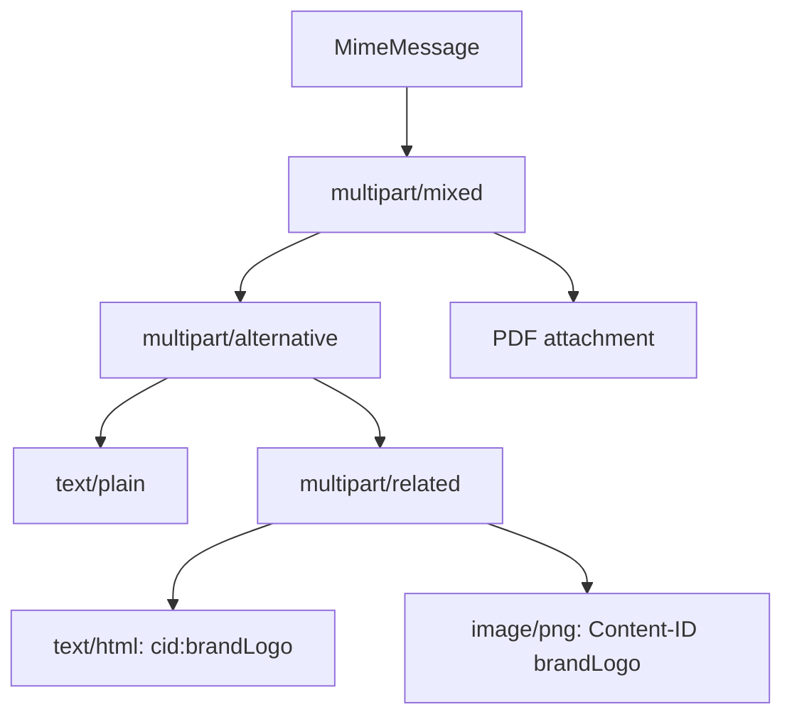

# Giới hạn của helper khi cần MIME structure đặc biệt

Trong **Spring Framework Mail**, `MimeMessageHelper` giúp tạo email HTML, bản text dự phòng, ảnh inline và tệp đính kèm mà không phải thao tác trực tiếp với từng MIME part. Với đa số email giao dịch, cách này vừa ngắn gọn vừa dễ bảo trì. Tuy nhiên, **`MimeMessageHelper` không phải công cụ xây dựng mọi cấu trúc MIME tùy ý**.

Khi ứng dụng cần một cây `multipart/*` khác với các kiểu Spring đã hỗ trợ, thêm phần `text/calendar` với quan hệ đặc biệt, chuyển tiếp một email dưới dạng `message/rfc822`, tạo báo cáo phân phát hoặc ký/mã hóa S/MIME, việc chỉ gọi `setText(...)`, `addInline(...)` và `addAttachment(...)` có thể không đủ. Lúc đó, lập trình viên cần hiểu **ranh giới của helper**, cấu trúc MIME mà hệ thống nhận mong đợi và thời điểm sử dụng API **Jakarta Mail** trực tiếp.

Bài này trình bày các giới hạn đó, cách nhận biết khi nào nên chuyển sang `MimeMultipart`/`MimeBodyPart`, ví dụ tạo một cấu trúc MIME đặc biệt trong ứng dụng Spring và những lưu ý về encoding, vòng đời message, tương thích mail client và xử lý lỗi.

## 1. MimeMessageHelper giải quyết được những gì?

Spring Mail có ba lớp vai trò thường gặp:

| Thành phần | Vai trò |
|---|---|
| `JavaMailSender` | Tạo `MimeMessage` và thực hiện gửi qua mail transport. |
| `MimeMessage` | Đối tượng Jakarta Mail lưu header và body theo định dạng Internet mail/MIME. |
| `MimeMessageHelper` | Tiện ích Spring thao tác trên `MimeMessage` để dựng các trường và loại nội dung phổ biến. |

Luồng đơn giản:

```java
MimeMessage message = mailSender.createMimeMessage();

MimeMessageHelper helper = new MimeMessageHelper(
        message,
        MimeMessageHelper.MULTIPART_MODE_MIXED_RELATED,
        "UTF-8"
);

helper.setFrom("no-reply@example.org");
helper.setTo("user@example.net");
helper.setSubject("Thông báo");
helper.setText(
        "Đây là nội dung văn bản.",
        "<p>Đây là nội dung <strong>HTML</strong>.</p>"
);

mailSender.send(message);
```

Helper có thể hỗ trợ:

- Đặt các header thường dùng: `From`, `To`, `Cc`, `Bcc`, `Reply-To`, `Subject`.
- Tạo body `text/plain` hoặc `text/html`.
- Tạo hai phiên bản nội dung qua `setText(plainText, htmlText)`.
- Thêm tài nguyên inline được HTML tham chiếu qua `cid:...`.
- Thêm attachment từ file, `Resource` hoặc nguồn dữ liệu khác.
- Thiết lập một trong các **multipart mode** có sẵn, cùng charset dùng để soạn nội dung.

Đối với thư chào mừng, hóa đơn PDF, email marketing đơn giản hoặc thông báo có logo, các chức năng đó thường là đủ. **Không cần viết MIME thủ công chỉ vì email có nhiều part**.

## 2. MIME structure là một cây, không chỉ là danh sách attachment

Một email có thể là một body duy nhất:

```text
MimeMessage
└── text/plain; charset=UTF-8
```

Hoặc là một cây các phần lồng nhau:

```text
MimeMessage
└── multipart/mixed
    ├── multipart/alternative
    │   ├── text/plain
    │   └── multipart/related
    │       ├── text/html
    │       └── image/png; Content-ID: <brandLogo>
    └── application/pdf; attachment
```

Các loại phổ biến có ý nghĩa riêng:

| MIME content type | Quan hệ giữa các phần |
|---|---|
| `multipart/alternative` | Những phiên bản thay thế của cùng nội dung; client thường chọn một phiên bản có thể hiển thị. |
| `multipart/related` | Nội dung chính và tài nguyên cần thiết để dựng nó, như HTML và ảnh theo CID. |
| `multipart/mixed` | Các thành phần cùng tồn tại, như phần nội dung chính và các file tải về. |
| `message/rfc822` | Một thông điệp email khác được đóng gói như một phần nội dung. |
| `text/calendar` | Nội dung lịch/iCalendar; có thể đi cùng bản text/HTML trong một cấu trúc được thiết kế phù hợp. |
| `multipart/signed` | Nội dung và phần chữ ký số liên kết theo định dạng MIME ký số. |
| `multipart/report` | Cấu trúc báo cáo có định nghĩa riêng, ví dụ các dạng thông báo trạng thái phân phát. |

Việc biết một email “có HTML, logo, PDF” chưa đủ để suy ra **vị trí chính xác** của các part. Thư viện tạo MIME phải chọn parent/child, thứ tự và metadata tương ứng.

Ví dụ, `multipart/alternative` có bản text trước rồi bản HTML sau vì đây là **các lựa chọn**. Ngược lại, PDF attachment nên nằm **cùng tầng với phần nội dung**, thường dưới `multipart/mixed`, chứ không phải một bản alternative.

## 3. Những cấu trúc multipart có sẵn trong helper

`MimeMessageHelper` có bốn chế độ chính:

| Constant | Khung MIME helper dựng |
|---|---|
| `MULTIPART_MODE_NO` | Không khởi tạo multipart; dành cho một body đơn giản. |
| `MULTIPART_MODE_MIXED` | Một nhóm `multipart/mixed` ở gốc. |
| `MULTIPART_MODE_RELATED` | Một nhóm `multipart/related` ở gốc. |
| `MULTIPART_MODE_MIXED_RELATED` | `multipart/mixed` ngoài cùng chứa `multipart/related` cho nội dung và tài nguyên inline. |

Ví dụ lựa chọn chế độ:

```java
MimeMessageHelper helper = new MimeMessageHelper(
        message,
        MimeMessageHelper.MULTIPART_MODE_MIXED_RELATED,
        "UTF-8"
);
```

Chế độ `MIXED_RELATED` thường phù hợp với email gồm plain text, HTML, logo inline và attachment; helper bố trí nội dung của nó vào những nhóm đã được thiết lập. Nếu gọi `setText(plain, html)`, helper có thể bổ sung nhóm `multipart/alternative` ở vị trí tương ứng.

Với cấu trúc thông dụng, kết quả có dạng khái niệm:

```text
multipart/mixed
├── multipart/related
│   ├── multipart/alternative
│   │   ├── text/plain
│   │   └── text/html
│   └── image/png; Content-ID: <brandLogo>
└── application/pdf; attachment
```

**Giới hạn nằm ở hình dạng được định nghĩa sẵn.** Helper không cung cấp một API chung kiểu `createMultipart("alternative")` rồi `insertPartAt(path, index)` để tạo bất kỳ cây MIME lồng nhau nào. Nó cung cấp các thao tác cấp cao cho một số nhu cầu thường gặp.

## 4. Khi nào giới hạn trở thành vấn đề?

Có nhiều yêu cầu mà **kết quả mong muốn** khác với hình dạng helper mặc định.

### 4.1. Bắt buộc root là `multipart/alternative`

Một hệ thống nhận có thể yêu cầu thông điệp ở dạng:

```text
MimeMessage
└── multipart/alternative
    ├── text/plain
    └── text/html
```

`MimeMessageHelper.setText(plain, html)` hỗ trợ ý tưởng alternative, nhưng khi dùng helper multipart, phần alternative có thể được **lồng bên trong khung mixed/related** mà mode đã khởi tạo. Helper không có constant riêng tương đương “tạo `multipart/alternative` trực tiếp ở root”.

Nếu đây chỉ là thư gửi người dùng thông thường, không nhất thiết cần root alternative. Nếu đối tác yêu cầu **đúng một cấu trúc root**, hãy cân nhắc tạo `MimeMultipart("alternative")` trực tiếp rồi gắn vào `MimeMessage`.

### 4.2. HTML và ảnh inline phải là **một** alternative riêng

Có trường hợp cần cây:

```text
multipart/alternative
├── text/plain
└── multipart/related
    ├── text/html
    ├── image/png; Content-ID: <brandLogo>
    └── image/jpeg; Content-ID: <banner>
```

Ở đây, **toàn bộ nhánh HTML + ảnh inline** là phiên bản giàu nội dung hơn so với plain text. Điều đó khác với cách bố trí thông dụng của helper, nơi `multipart/alternative` có thể nằm bên trong nhóm `related`.

Hai cấu trúc có thể được những mail client phổ biến xử lý tương tự, nhưng **không hoàn toàn giống nhau về cây MIME**. Khi bên nhận yêu cầu đúng kiểu lồng nhau, hoặc một mail client cụ thể gặp vấn đề với cách lồng phổ biến, cần quyền kiểm soát ở cấp `MimeMultipart`/`MimeBodyPart`.

### 4.3. Nhiều loại part đặc biệt trong alternative

Một lời mời họp có thể cần:

```text
multipart/alternative
├── text/plain
├── text/html
└── text/calendar; method=REQUEST; charset=UTF-8
```

`MimeMessageHelper` không có một overload cấp cao kiểu `setText(plain, html, calendar)`. Cũng không thể dùng `addAttachment("invite.ics", ...)` và tự mặc định rằng mọi mail client sẽ nhận diện nó như một **lời mời lịch** ở vị trí và ngữ nghĩa mong muốn.

Việc tạo email lịch còn đòi hỏi iCalendar/iTIP có các trường như `UID`, `DTSTART`, `DTEND`, `METHOD`, `ORGANIZER`, `ATTENDEE` theo nghiệp vụ. **Có `text/calendar` không tự bảo đảm lời mời được mọi client chấp nhận.**

### 4.4. Forward một email nguyên dạng dưới `message/rfc822`

Nút “Forward as attachment” trong nhiều client có thể tạo:

```text
multipart/mixed
├── text/plain: "Tôi gửi lại thư để bạn kiểm tra."
└── message/rfc822: một email hoàn chỉnh
```

`addAttachment(...)` thường phục vụ attachment file hoặc tài nguyên. Nếu yêu cầu đích đến là **một part có MIME type `message/rfc822` chứa nguyên message cùng các header của nó**, việc dùng `MimeBodyPart` và `setContent(...)`/`DataHandler` thích hợp sẽ rõ ràng hơn so với cố coi email gốc như một file văn bản.

### 4.5. MIME được ký hoặc mã hóa

Cấu trúc S/MIME có thể dùng `multipart/signed`, hoặc các dạng phần tử mật mã khác. Đây không chỉ là việc thêm một file `signature.p7s` vào `multipart/mixed`: chữ ký phải được tính trên **nội dung được biểu diễn theo quy tắc chuẩn**, kèm đúng content type và các tham số thuật toán.

`MimeMessageHelper` không phải API ký số hoặc mã hóa S/MIME. Cần dùng thư viện chuyên dụng, tạo/hoàn thiện cấu trúc MIME đúng quy tắc mật mã, rồi mới gửi bằng `JavaMailSender`. Sau khi ký, **không được chỉnh sửa tùy ý các byte/part đã ký** vì có thể làm chữ ký không còn hợp lệ.

Tương tự, `multipart/report` dành cho báo cáo có cấu trúc theo chuẩn, không phải một nhóm tệp đính kèm tùy ý có nhãn “report”.

### 4.6. Bắt buộc kiểm soát thứ tự hoặc header của từng part

Một tích hợp đặc thù có thể yêu cầu:

- Part nội dung chính hoặc MIME root được chỉ định bằng tham số `start`.
- Một thứ tự part cụ thể bên trong `multipart/alternative`.
- `Content-ID`, `Content-Location`, `Content-Disposition` hoặc subtype không được helper cung cấp trực tiếp theo ý muốn.
- Một dạng `multipart/*` mở rộng mà helper không nhận tham số subtype.
- Những body part được lồng ở các cấp khác nhau với cách nhận dạng riêng.

Helper có thể tạo header và các nhóm phổ biến, nhưng **không hứa hẹn cho phép điều khiển mọi tham số và quan hệ trong cây**. Nếu phải khớp một hợp đồng MIME đặc biệt, nên dựng cấu trúc có chủ đích bằng Jakarta Mail.

## 5. Ranh giới quyết định: helper hay Jakarta Mail trực tiếp?

Một cách chọn API:

| Yêu cầu | Cách tiếp cận phù hợp |
|---|---|
| Chỉ văn bản hoặc HTML | `MimeMessageHelper` ở mode không multipart. |
| Plain và HTML thay thế nhau | `MimeMessageHelper.setText(plain, html)` với mode multipart. |
| HTML + ảnh inline | `MimeMessageHelper` ở mode `RELATED` hoặc `MIXED_RELATED`. |
| HTML/ảnh inline + PDF, CSV đính kèm | `MimeMessageHelper` ở mode `MIXED_RELATED`. |
| Root phải là `multipart/alternative` đúng nghĩa | Dựng `MimeMultipart("alternative")` trực tiếp. |
| Nhánh alternative chứa một nhóm `related` hoàn chỉnh | Tạo cây `MimeBodyPart`/`MimeMultipart` bằng Jakarta Mail. |
| Lời mời lịch với `text/calendar` được đặt theo hợp đồng | Xây part calendar bằng Jakarta Mail hoặc thư viện chuyên biệt cho email lịch. |
| Forward message dưới `message/rfc822` | Dựng part thông điệp trực tiếp. |
| S/MIME signed/encrypted | Thư viện S/MIME chuyên dụng và Jakarta Mail. |
| Phải kiểm soát boundary, root, thứ tự, subtype đặc biệt | MIME API cấp thấp, cân nhắc cẩn thận các ràng buộc của chuẩn. |

**Không nên chọn API cấp thấp chỉ vì muốn “linh hoạt tối đa”.** Nó làm tăng số trách nhiệm phải quản lý và rủi ro tương thích. Bắt đầu với helper; chỉ chuyển khi **cấu trúc MIME yêu cầu cụ thể** nằm ngoài các thao tác helper hỗ trợ.

## 6. Ví dụ bài toán: HTML kèm ảnh là một nhánh alternative

Giả sử cần email gồm:

1. Bản `text/plain` để client không hiển thị HTML vẫn đọc được.
2. Bản HTML cùng ảnh logo inline, được gom trong **một nhóm `multipart/related`**.
3. PDF ở ngoài như attachment.

Cây mục tiêu:

```text
multipart/mixed
├── multipart/alternative
│   ├── text/plain
│   └── multipart/related
│       ├── text/html
│       └── image/png; Content-ID: <brandLogo>
└── application/pdf; attachment; filename="report.pdf"
```

Điểm khác biệt với cấu trúc `MIXED_RELATED` thông dụng là **nhánh `related` nằm bên trong nhánh alternative HTML**, thay vì alternative nằm bên trong related. Đây là ví dụ có ích về trường hợp cần **tự quyết định quan hệ cha–con** của các part.



Một email theo cây này vẫn có thể được gửi bằng `JavaMailSender`. Phần cần thay đổi là **cách xây `MimeMessage`**, không phải toàn bộ hạ tầng SMTP.

## 7. Xây cấu trúc tùy biến bằng Jakarta Mail

Các lớp chính:

| Lớp | Chức năng |
|---|---|
| `MimeMultipart` | Nhóm nhiều MIME part, ví dụ `alternative`, `related`, `mixed`. |
| `MimeBodyPart` | Đại diện một part; chứa text, HTML, hình ảnh, attachment hoặc multipart con. |
| `MimeMessage` | Message ở cấp ngoài cùng, chứa header và content root. |
| `DataHandler` | Đóng gói nội dung và kiểu dữ liệu để part có thể đọc/serialize. |
| `ByteArrayDataSource` | Cung cấp dữ liệu byte cùng MIME type, tiện cho ví dụ nguồn đã có trong bộ nhớ. |
| `Part` | Các constant và API liên quan đến disposition, chẳng hạn `INLINE` và `ATTACHMENT`. |

Với Spring Boot, có thể dùng `spring-boot-starter-mail` và tiếp tục nhận bean `JavaMailSender` như bình thường. Phần tạo MIME sẽ sử dụng các API Jakarta Mail mà starter hỗ trợ.

Ví dụ tài nguyên trong classpath:

```text
src/main/resources/
└── mail/
    ├── brand-logo.png
    └── report.pdf
```

### Ví dụ Java đầy đủ

```java
import jakarta.activation.DataHandler;
import jakarta.mail.Message;
import jakarta.mail.MessagingException;
import jakarta.mail.Part;
import jakarta.mail.internet.InternetAddress;
import jakarta.mail.internet.MimeBodyPart;
import jakarta.mail.internet.MimeMessage;
import jakarta.mail.internet.MimeMultipart;
import jakarta.mail.util.ByteArrayDataSource;
import java.io.IOException;
import java.io.InputStream;
import org.springframework.core.io.ClassPathResource;
import org.springframework.mail.javamail.JavaMailSender;
import org.springframework.stereotype.Service;

@Service
public class CustomMimeMailService {

    private final JavaMailSender mailSender;

    public CustomMimeMailService(JavaMailSender mailSender) {
        this.mailSender = mailSender;
    }

    public void sendReport(String recipient)
            throws MessagingException, IOException {

        // 1. Dùng Spring để tạo message có mail Session phù hợp.
        MimeMessage message = mailSender.createMimeMessage();
        message.setFrom(
                new InternetAddress("reports@example.org")
        );
        message.setRecipients(
                Message.RecipientType.TO,
                InternetAddress.parse(recipient, true)
        );
        message.setSubject("Báo cáo tháng", "UTF-8");

        // 2. Bản plain text: alternative thứ nhất.
        MimeBodyPart plainPart = new MimeBodyPart();
        plainPart.setText(
                "Báo cáo tháng của bạn đã sẵn sàng.\n" +
                "Xem tệp report.pdf đính kèm.",
                "UTF-8"
        );

        // 3. Nhánh HTML có tài nguyên inline.
        MimeBodyPart htmlPart = new MimeBodyPart();
        htmlPart.setContent(
                """
                <html>
                  <body>
                    
                    <h1>Báo cáo tháng</h1>
                    <p>Xem tệp report.pdf đính kèm.</p>
                  </body>
                </html>
                """,
                "text/html; charset=UTF-8"
        );

        MimeBodyPart logoPart = new MimeBodyPart();
        logoPart.setDataHandler(new DataHandler(
                new ByteArrayDataSource(
                        readResource("mail/brand-logo.png"),
                        "image/png"
                )
        ));
        logoPart.setHeader("Content-ID", "<brandLogo>");
        logoPart.setDisposition(Part.INLINE);

        MimeMultipart related = new MimeMultipart("related");
        related.addBodyPart(htmlPart);
        related.addBodyPart(logoPart);

        // Cả HTML và logo trở thành một alternative duy nhất.
        MimeBodyPart htmlWithLogoPart = new MimeBodyPart();
        htmlWithLogoPart.setContent(related);

        MimeMultipart alternative = new MimeMultipart("alternative");
        alternative.addBodyPart(plainPart);
        alternative.addBodyPart(htmlWithLogoPart);

        MimeBodyPart mainContentPart = new MimeBodyPart();
        mainContentPart.setContent(alternative);

        // 4. PDF là attachment độc lập với nội dung HTML.
        MimeBodyPart pdfPart = new MimeBodyPart();
        pdfPart.setDataHandler(new DataHandler(
                new ByteArrayDataSource(
                        readResource("mail/report.pdf"),
                        "application/pdf"
                )
        ));
        pdfPart.setFileName("report.pdf");
        pdfPart.setDisposition(Part.ATTACHMENT);

        // 5. Root mixed chứa nội dung chính và PDF.
        MimeMultipart mixed = new MimeMultipart("mixed");
        mixed.addBodyPart(mainContentPart);
        mixed.addBodyPart(pdfPart);

        message.setContent(mixed);

        // 6. JavaMailSender gửi message do Jakarta Mail tạo.
        mailSender.send(message);
    }

    private static byte[] readResource(String path) throws IOException {
        ClassPathResource resource = new ClassPathResource(path);
        try (InputStream stream = resource.getInputStream()) {
            return stream.readAllBytes();
        }
    }
}
```

Trong ví dụ:

- `MimeMultipart("related")` chứa HTML và logo, trong đó HTML là part đầu tiên để thể hiện nội dung gốc theo bố cục này.
- `MimeMultipart("alternative")` chứa bản plain text trước, sau đó là **một body part có content là `related`**.
- `MimeMultipart("mixed")` chứa nhánh nội dung chính và PDF attachment.
- `setContent(...)` gắn một `MimeMultipart` vào `MimeBodyPart` hoặc vào `MimeMessage`.
- `Content-ID: <brandLogo>` khớp với `cid:brandLogo` trong HTML.
- `DataHandler` và `ByteArrayDataSource` cung cấp byte của ảnh/PDF. Không dùng charset văn bản để chuyển mã dữ liệu nhị phân.
- `JavaMailSender.send(message)` tiếp tục là điểm gửi SMTP.

**Điều đáng học ở đây là việc lồng part.** Các part được tạo từ trong ra ngoài, rồi gắn vào đúng parent. Mỗi nhóm `alternative`, `related` và `mixed` được tạo **vì quan hệ nội dung tương ứng**, không vì mong muốn thêm nhiều tầng cho phức tạp.

### Vì sao chọn `ByteArrayDataSource`?

Ở ví dụ này, hai tài nguyên nằm trong classpath, được đọc toàn bộ thành `byte[]`. Đây là cách dễ hiểu, giúp nguồn dữ liệu **có thể được đọc lại khi thư viện serialize message**.

Với attachment rất lớn, giữ toàn bộ byte trong bộ nhớ có thể gây tốn RAM. Khi đó, nên dùng nguồn dữ liệu/stream phù hợp với thư viện mail và bảo đảm có thể mở stream mới khi cần, đồng thời xét giới hạn dung lượng SMTP. Một số `InputStreamSource` chỉ cung cấp một stream dùng một lần không thích hợp nếu Jakarta Mail cần đọc dữ liệu nhiều lượt.

## 8. Quy tắc khi dựng cây MIME thủ công

### 8.1. Tạo từ các part lá, sau đó mới lồng nhóm

Cách dễ theo dõi là:

1. Tạo các part lá: `text/plain`, `text/html`, `image/png`, `application/pdf`.
2. Đặt metadata cần thiết cho từng part, như charset, Content-ID, disposition và filename.
3. Tạo những nhóm nội dung cấp thấp nhất, chẳng hạn `multipart/related`.
4. Đưa nhóm đó thành một `MimeBodyPart` để có thể gắn vào parent như `multipart/alternative`.
5. Đưa nhóm nội dung chính vào `multipart/mixed` nếu còn attachment.
6. Gán multipart gốc vào `MimeMessage`, rồi gửi bằng `JavaMailSender`.

Khác với helper, Jakarta Mail cho phép bạn điều khiển **mỗi quan hệ cha–con**. Đổi lại, việc đặt sai parent hoặc thứ tự có thể dẫn đến thông điệp khó hiển thị.

### 8.2. Không đặt text và HTML thành hai file song song nếu chúng là alternative

Cấu trúc không phù hợp với ý định:

```text
multipart/mixed
├── text/plain
└── text/html
```

Một số client có thể hiển thị cả hai bản hoặc xử lý bản HTML như phần phụ. Nếu nội dung là **hai cách biểu diễn cùng một thông điệp**, dùng:

```text
multipart/alternative
├── text/plain
└── text/html
```

Dạng thứ hai truyền đạt ý nghĩa chính xác hơn.

### 8.3. Thứ tự alternative có ngữ nghĩa

Trong `multipart/alternative`, thường đặt bản plain text trước và bản có khả năng trình bày phong phú hơn sau. Khi một alternative giàu nội dung là `multipart/related` (HTML + ảnh), **cả nhóm** có thể đứng sau bản plain text.

Không nên dựa vào việc một client cụ thể luôn chọn HTML. Client có thể bị cấu hình để chỉ hiển thị text, hoặc có chính sách bảo mật khác.

### 8.4. Chọn root của related cẩn thận

Với `multipart/related`, nếu không có tham số `start`, phần đầu tiên thường được hiểu là root. Trong ví dụ, `htmlPart` đứng trước `logoPart`. Khi cấu trúc phức tạp hơn, có thể cần chỉ định root bằng Content-ID và tham số thích hợp theo chuẩn liên quan.

Nếu gửi một tập tài nguyên mà không thể xác định nội dung gốc, client có thể hiểu nhầm ảnh hoặc một phần khác làm body chính.

### 8.5. Đừng tự ghép boundary bằng string

Một MIME multipart thực tế có các header kiểu:

```text
Content-Type: multipart/mixed; boundary="----=_Part_12345"
```

và mỗi part được phân tách bằng các marker tương ứng. Khi dùng `MimeMultipart` và `MimeBodyPart`, hãy để thư viện tạo và quản lý boundary. Việc tự nối chuỗi boundary hoặc tự xây raw MIME dễ gây lỗi khi lồng nhóm, mã hóa header, xuống dòng và escape dữ liệu.

### 8.6. Charset khác Content-Transfer-Encoding

`UTF-8` cho biết cách chuyển **ký tự** thành byte. `base64` hoặc `quoted-printable` là cách biểu diễn **byte** trên đường vận chuyển. Jakarta Mail có thể tạo những header và cách mã hóa phù hợp khi hoàn thiện message.

Nếu một part là text:

```text
Content-Type: text/html; charset=UTF-8
Content-Transfer-Encoding: quoted-printable
```

còn một part ảnh có thể là:

```text
Content-Type: image/png
Content-Transfer-Encoding: base64
```

Không nên áp dụng UTF-8 cho byte PNG/PDF như thể chúng là chuỗi văn bản.

## 9. Giữ helper và MIME thủ công cùng nhau: có thể nhưng cần xác định quyền sở hữu

Về kỹ thuật, `MimeMessageHelper` thao tác trên một `MimeMessage` của Jakarta Mail. Vì vậy, mã có thể:

- Dùng helper để điền các header quen thuộc, sau đó gắn body MIME xây thủ công.
- Hoặc tự tạo body bằng API Jakarta Mail rồi dùng `JavaMailSender` chỉ để gửi.
- Hoặc tạo toàn bộ header/body trực tiếp bằng Jakarta Mail ngay từ đầu.

Nhưng có **rủi ro khi trộn các thao tác xây body**. Helper thường giữ các tham chiếu đến multipart mà nó khởi tạo trong constructor. Nếu sau đó ứng dụng gọi `message.setContent(customRoot)` rồi tiếp tục gọi `helper.addInline(...)` hoặc `helper.addAttachment(...)`, helper có thể đang bổ sung dữ liệu vào **cây multipart cũ**, không phải root mới mà message đang sử dụng.

Ví dụ dễ gây nhầm:

```java
MimeMessage message = mailSender.createMimeMessage();
MimeMessageHelper helper = new MimeMessageHelper(message, true);

helper.setText("Nội dung ban đầu");

// Đổi root content bằng một cây khác:
message.setContent(customRoot);

// Tiếp tục thao tác với helper như thể nó vẫn sở hữu root:
helper.addAttachment("report.pdf", attachment);
```

`customRoot` và `attachment` trong đoạn trên là biến minh họa. Vấn đề nằm ở **quyền sở hữu cấu trúc**: helper và code thủ công không nhất thiết cùng thao tác trên cùng một cây sau khi root đã bị thay thế.

**Khuyến nghị thực hành:** chọn một nơi chịu trách nhiệm xây dựng **body MIME** của từng message. Có thể dùng helper để đặt header nếu thích, nhưng sau khi chuyển sang cây thủ công, hãy để mã Jakarta Mail quản lý đầy đủ các body part. Tránh gọi lại các API làm thay đổi content của helper sau đó.

## 10. Một ví dụ tùy biến khác: text/calendar

Một email lịch có thể được mô tả như sau:

```text
MimeMessage
└── multipart/alternative
    ├── text/plain
    ├── text/html
    └── text/calendar; charset=UTF-8; method=REQUEST
```

Ở cấp Jakarta Mail, một part calendar có thể được tạo bằng API tương tự:

```java
MimeBodyPart calendarPart = new MimeBodyPart();
calendarPart.setContent(
        icsContent,
        "text/calendar; charset=UTF-8; method=REQUEST"
);

MimeMultipart alternatives = new MimeMultipart("alternative");
alternatives.addBodyPart(plainPart);
alternatives.addBodyPart(htmlPart);
alternatives.addBodyPart(calendarPart);

message.setContent(alternatives);
```

`icsContent` là nội dung iCalendar hợp lệ đã được tạo ở một bước khác. Đoạn này **chỉ minh họa cấu trúc MIME**; để có lời mời lịch thực sự, phải tạo đúng dữ liệu VCALENDAR/VEVENT, METHOD, UID, thời gian, người tổ chức, người tham dự và các quy tắc iTIP liên quan. Một số mail client có quy tắc riêng về disposition, alternative và hỗ trợ cập nhật/hủy lời mời.

Chỉ thêm một file `invite.ics` bằng `helper.addAttachment(...)` không đồng nghĩa mọi client sẽ xử lý nó như lời mời có thể chấp nhận trực tiếp. Khi yêu cầu là tương tác lịch nghiêm túc, nên dùng thư viện tạo iCalendar và kiểm tra kết quả trên client mà người dùng sử dụng.

## 11. S/MIME, chữ ký và nội dung mã hóa cần thư viện chuyên biệt

Chữ ký số khác với tệp đính kèm thông thường. Một email ký số có thể yêu cầu cấu trúc:

```text
multipart/signed
├── nội dung được ký
└── application/pkcs7-signature
```

Các header của `multipart/signed` còn có thể mang tham số thuật toán và protocol theo chuẩn áp dụng. Thứ tự, cách biểu diễn và **byte thực tế của nội dung được ký** rất quan trọng.

Một thao tác kiểu:

```java
helper.addAttachment("signature.p7s", signatureBytes);
```

không biến một email bình thường thành S/MIME signed hợp lệ. Cần giải pháp mật mã/S/MIME xử lý:

- Khóa ký và chứng chỉ;
- Dữ liệu MIME cần ký;
- Cách canonicalize và tạo chữ ký;
- Định dạng signed hoặc encrypted message;
- Kiểm tra chữ ký và tương thích ở phía nhận.

Tương tự, email được mã hóa S/MIME có quy tắc bao bọc nội dung và quản lý chứng chỉ người nhận riêng. `MimeMessageHelper` có thể vẫn hữu ích ở bước tạo nội dung **trước khi ký hoặc mã hóa**, nhưng không thay thế công việc của thư viện S/MIME.

**Sau khi một phần nội dung đã được ký, đừng sửa subject/body/part một cách tùy tiện rồi cho rằng chữ ký vẫn hợp lệ.** Việc thêm hoặc biến đổi byte nội dung nằm trong phạm vi chữ ký có thể làm kiểm chứng thất bại.

## 12. `message/rfc822` và chuyển tiếp nguyên một email

Nếu mục tiêu là gửi một thư đã nhận như **attachment dạng message**, cây có thể là:

```text
multipart/mixed
├── text/plain: "Tôi gửi lại email để bạn kiểm tra."
└── message/rfc822
    └── From, To, Subject, body... của email gốc
```

Điểm cần phân biệt:

- Gửi **ảnh chụp văn bản** của email: có thể là một file text đính kèm.
- Gửi **message nguyên dạng**: cần giữ thông tin message như header, body và MIME parts ở dạng `message/rfc822`.

Jakarta Mail có các API để biểu diễn `MimeMessage` và đưa đối tượng message vào một body part có content type phù hợp. Cách dựng phụ thuộc vào việc nguồn là đối tượng message đã parse hay một raw message stream. Nếu code chỉ gọi `addAttachment(...)` với một chuỗi đã format sẵn, có thể mất ngữ nghĩa “email lồng trong email” mà client mong đợi.

Khi chuyển tiếp dữ liệu bên ngoài, phải xem xét quyền riêng tư: header của thư gốc có thể chứa người nhận, Message-ID, các địa chỉ nội bộ hoặc nội dung nhạy cảm không nên chuyển tiếp.

## 13. Không sửa raw MIME của bên ngoài một cách tùy tiện

Có hệ thống nhận một MIME message có sẵn và cần chuyển tiếp hoặc bổ sung thông tin. Ví dụ:

```java
MimeMessage parsed = mailSender.createMimeMessage(inputStream);
```

`inputStream` chứa một email theo Internet message format. Sau khi parse, nội dung có thể là một cây multipart phức tạp, chứa header mà hệ thống bên ngoài đã tạo.

Nếu muốn **giữ nguyên cấu trúc và nội dung gốc**, không nên mặc định dùng helper mới để “lắp lại toàn bộ” message. Điều đó có thể thay đổi:

- Cấu trúc multipart và thứ tự alternative;
- `Content-ID` và các liên kết `cid:`;
- Tên file, Content-Disposition, charset hoặc transfer encoding;
- Những header phục vụ threading, chữ ký hoặc hệ thống trung gian.

Với thông điệp đã ký, thay đổi byte thuộc phạm vi chữ ký có thể làm hỏng khả năng xác minh.

Nếu nghiệp vụ là **tạo email mới dựa trên dữ liệu cũ**, hãy trích xuất phần dữ liệu thực sự cần dùng rồi dựng một `MimeMessage` mới có cấu trúc hợp đồng rõ ràng. Nếu nghiệp vụ là **chuyển tiếp nguyên trạng**, cần lựa chọn cách bao bọc hoặc chuyển tiếp thích hợp và giữ nguyên thông tin cần bảo toàn.

## 14. Vòng đời và thời điểm message được hoàn thiện

Một điểm thường bị bỏ sót là `MimeMessage` có thể được xây dần trong bộ nhớ:

```text
JavaMailSender.createMimeMessage()
        ↓
Tạo header và MIME parts
        ↓
Gán multipart root bằng setContent(...)
        ↓
Hoàn thiện dữ liệu MIME khi cần
        ↓
JavaMailSender.send(message)
        ↓
SMTP nhận hoặc từ chối
```

Jakarta Mail cung cấp `saveChanges()` và `writeTo(OutputStream)` để cập nhật một số header và ghi biểu diễn MIME. Thư viện mail sender có thể thực hiện công đoạn hoàn thiện trước lúc gửi. Vì vậy, với luồng Spring phổ biến, **không cần tự gọi `saveChanges()` chỉ để cho email được gửi**.

Tuy nhiên, khi có yêu cầu kiểm tra hay ký số dựa trên **byte MIME đã serialize**, cần hiểu chính xác khi nào thông điệp được hoàn thiện và liệu lần serialize/gửi sau đó có làm thay đổi các header/byte trong phạm vi cần giữ nguyên hay không. Không nên ký một biểu diễn tạm rồi tiếp tục thay đổi message mà không có quy trình phù hợp.

`MimeMessage.writeTo(...)` chỉ ghi MIME ra stream, **không gửi SMTP**. Có thể dùng để quan sát cấu trúc khi phát triển, nhưng nội dung raw có thể chứa địa chỉ người nhận, mã xác nhận và attachment; không dump toàn bộ ra production log.

## 15. Xử lý lỗi ở cấp MIME và cấp SMTP

Khi bỏ helper để dùng Jakarta Mail trực tiếp, lỗi có thể xuất hiện ở **giai đoạn tạo nội dung** hoặc **giai đoạn gửi**.

| Giai đoạn | Ví dụ lỗi | Nhóm cần xem |
|---|---|---|
| Tạo header/địa chỉ | Địa chỉ không hợp lệ hoặc header sai. | `AddressException` / `MessagingException` |
| Xây MIME part | Nội dung không phù hợp, thao tác part lỗi. | `MessagingException` |
| Đọc ảnh/PDF | File không có, không đọc được, nguồn stream lỗi. | `IOException` hoặc lỗi đọc dữ liệu trong lúc serialize |
| Serialize multipart | DataSource không đọc lại được, cấu trúc/encoding lỗi. | `MessagingException` và cause liên quan |
| SMTP connection | Timeout, DNS, TLS, authentication. | `MailException` phía Spring và cause gốc |
| SMTP gửi message | Server từ chối sender, recipient, dung lượng hoặc nội dung. | `MailSendException`/ngoại lệ SMTP liên quan |
| Phân phát sau khi SMTP chấp nhận | Bounce, spam, delay, chặn ở phía đích. | Event/log của hạ tầng email, không nhất thiết xuất hiện ở `send(...)` |

Một service có thể khai báo lỗi xây MIME riêng:

```java
public void sendReport(String recipient)
        throws MessagingException, IOException {
    MimeMessage message = buildCustomMessage(recipient);
    mailSender.send(message);
}
```

`buildCustomMessage(...)` ở ví dụ là phương thức giả định tự xây MIME và có thể phát sinh checked exception. `mailSender.send(...)` từ Spring thường báo lỗi vận chuyển qua `MailException`, là unchecked exception.

**Đừng coi “cấu trúc MIME được tạo thành công” là “email đã được gửi”.** Và `send(...)` trả về bình thường thường chỉ có nghĩa thao tác chuyển giao cho SMTP hoàn tất, chưa xác nhận mail đã tới Inbox người nhận.

### Trạng thái gửi không rõ và nguy cơ gửi trùng

Một kết nối có thể mất ngay sau khi server nhận nội dung nhưng trước khi ứng dụng đọc phản hồi cuối cùng. Nếu retry mù quáng, email có nguy cơ gửi trùng. MIME helper hay API thủ công đều không tự giải quyết bài toán này. Với email nghiệp vụ quan trọng, cần quản lý **request ID, queue/outbox, lịch sử lần thử và trạng thái SMTP/delivery** ở lớp ứng dụng.

## 16. Tương thích mail client là một yêu cầu thực tế

Một cây MIME hợp lệ vẫn có thể được các mail client xử lý khác nhau. Một số khác biệt thường nằm ở:

- Cách client chọn alternative giữa plain text và HTML.
- Cách client xác định phần gốc của `related`.
- Việc ảnh inline có bị hiển thị thêm như attachment hay không.
- Việc client nhận diện `text/calendar` là lời mời họp hay một file văn bản.
- Mức hỗ trợ CSS và khả năng hiển thị ảnh trong HTML.
- Cách xử lý Content-Disposition, Content-ID, filename và encoding tên file.
- Chính sách chặn nội dung ngoài hoặc quét attachment của nhà cung cấp.

Khi dùng MIME structure đặc biệt, điều cần kiểm tra **không chỉ là có exception hay không** mà là cây thực tế và cách các client mục tiêu hiểu cây đó.

### Cách quan sát MIME source

Có thể dùng môi trường SMTP thử nghiệm như Mailpit/GreenMail hoặc một hộp thư kiểm thử để nhận email, rồi xem **raw message source**. Tìm:

1. `MIME-Version` và `Content-Type` ở cấp root.
2. Các chuỗi `boundary` của từng multipart và mối quan hệ lồng nhau.
3. Thứ tự các part bên trong `multipart/alternative`.
4. `Content-ID` của ảnh và `cid:` được tham chiếu trong HTML.
5. `Content-Disposition` và `filename` của attachment.
6. Các loại part đặc biệt như `text/calendar`, `message/rfc822` hoặc `multipart/signed`.
7. Charset và Content-Transfer-Encoding của các body text.

Ví dụ raw MIME rút gọn của cấu trúc đặc biệt:

```text
MIME-Version: 1.0
Content-Type: multipart/mixed; boundary="mix"

--mix
Content-Type: multipart/alternative; boundary="alt"

--alt
Content-Type: text/plain; charset=UTF-8

Báo cáo của bạn đã sẵn sàng.

--alt
Content-Type: multipart/related; boundary="rel"

--rel
Content-Type: text/html; charset=UTF-8

<p>Báo cáo đã sẵn sàng.</p>


--rel
Content-Type: image/png
Content-ID: <brandLogo>
Content-Disposition: inline

[encoded image data]
--rel--

--alt--

--mix
Content-Type: application/pdf
Content-Disposition: attachment; filename="report.pdf"

[encoded PDF data]
--mix--
```

Mẫu trên minh họa **quan hệ và thứ tự**. Header mã hóa, boundary và dữ liệu thực có thể khác do thư viện sinh ra.

### Phân biệt cấu trúc sai và client hiển thị khác

Nếu một ảnh bị hiển thị như attachment, có ít nhất hai khả năng:

- **Cấu trúc không diễn đạt đúng quan hệ**: ảnh không nằm trong nhóm related phù hợp, Content-ID sai hoặc MIME root không xác định như mong đợi.
- **Client có chính sách hiển thị riêng**: ảnh đúng vị trí MIME nhưng vẫn hiện ở khu vực attachment.

Chỉ khi nhìn raw MIME và quan sát cùng thông điệp trên các client khác nhau mới có cơ sở để chọn thay đổi cấu trúc.

## 17. Các hiểu nhầm thường gặp

| Hiểu nhầm | Cách hiểu đúng |
|---|---|
| “`MimeMessageHelper` hỗ trợ attachment nên hỗ trợ mọi MIME subtype.” | Helper hỗ trợ các thao tác phổ biến, không phải API dựng mọi cây MIME và chuẩn đặc biệt. |
| “`setText(plain, html)` luôn tạo root `multipart/alternative`.” | Hình dạng root phụ thuộc multipart mode; alternative có thể được lồng trong một nhóm khác. |
| “`MIXED_RELATED` tương đương mọi cấu trúc kết hợp mixed, related và alternative.” | Nó chọn một cách bố trí cụ thể; nếu cần related nằm bên trong nhánh HTML alternative, có thể phải dựng thủ công. |
| “`addAttachment("invite.ics", ...)` luôn tạo lịch mời họp.” | Lời mời lịch cần dữ liệu iCalendar/iTIP và MIME placement phù hợp, còn phụ thuộc client. |
| “Thêm file chữ ký vào helper là email S/MIME signed.” | Ký số cần quy trình mật mã và cấu trúc chuẩn, thường bằng thư viện riêng. |
| “Có thể thay root MIME rồi tiếp tục dùng helper bình thường.” | Helper có thể giữ tham chiếu tới multipart cũ, gây thao tác trên cấu trúc không còn được gửi. |
| “Cần tự nhập boundary để kiểm soát cấu trúc.” | Hãy để `MimeMultipart` quản lý boundary và serializing; kiểm soát ở cấp part/subtype. |
| “Email không lỗi SMTP nghĩa là cây MIME tương thích với mọi client.” | Server chấp nhận thư và client hiển thị đúng là hai vấn đề khác nhau. |
| “Tự dựng MIME đồng nghĩa không dùng được Spring Mail nữa.” | Vẫn dùng `JavaMailSender.createMimeMessage()` và `send(...)`; chỉ phần tạo nội dung cần API Jakarta Mail. |

## 18. Nguyên tắc thiết kế lâu dài

Một ứng dụng gửi email thường có lợi khi tách:

```text
Business service
    ↓
Email content model (người nhận, dữ liệu template, attachment)
    ↓
Message builder
    ├── MimeMessageHelper: cấu trúc phổ biến
    └── Jakarta Mail trực tiếp: cấu trúc đặc biệt
    ↓
JavaMailSender
    ↓
SMTP server
```

Với cách tổ chức này:

- Business service không cần hiểu mọi loại `multipart/*`.
- Builder quyết định **cây MIME** theo hợp đồng của loại email.
- Sender chỉ chịu trách nhiệm kết nối và gửi.
- Cấu hình SMTP, timeout, TLS và credential có thể được quản lý tập trung.
- Nếu một định dạng đặc biệt cần sửa cấu trúc, thay đổi được giới hạn trong builder tương ứng.

Đối với hệ thống có lưu lượng lớn hoặc gửi mail quan trọng, thông tin nghiệp vụ cần gửi nên được lưu bền vững nếu cần queue/retry. Không nên dùng cùng một `MimeMessage` mutable cho nhiều yêu cầu đồng thời; hãy tạo message mới cho từng tác vụ gửi độc lập.

## 19. Ghi nhớ

- **`MimeMessageHelper` phù hợp với những email thường gặp**: plain/HTML, alternative, inline resource và attachment.
- **Multipart mode của helper có tập lựa chọn cố định**: `NO`, `MIXED`, `RELATED` và `MIXED_RELATED`; không phải ngôn ngữ xây dựng cây MIME tùy ý.
- **Các cây tương đương về hiển thị có thể khác nhau về cấu trúc**. Khi bên nhận yêu cầu root/subtree cụ thể, phải kiểm soát cấp part.
- **`MimeMultipart` và `MimeBodyPart`** là API Jakarta Mail dùng để dựng nhóm MIME có subtype, thứ tự, quan hệ cha–con và metadata riêng.
- **`JavaMailSender` vẫn gửi được message tùy biến**: có thể tạo qua `createMimeMessage()`, tự dựng body rồi gọi `send(message)`.
- **Tránh trộn hai cơ chế cùng sửa body** sau khi đã thay thế MIME root; nên xác định rõ code nào sở hữu cấu trúc.
- **Lời mời lịch, email lồng nhau, báo cáo phân phát và S/MIME** có quy tắc riêng vượt ra ngoài việc thêm attachment thông thường.
- **Kiểm tra raw MIME và mail client mục tiêu** để xác nhận cấu trúc và cách hiển thị, đồng thời quản lý lỗi SMTP và delivery như những tầng riêng.

Hãy chọn `MimeMessageHelper` khi nó diễn đạt chính xác loại email bạn cần. Khi hợp đồng tích hợp yêu cầu một **MIME structure đặc biệt**, dùng API Jakarta Mail trực tiếp để xây dựng cây đúng ngữ nghĩa, rồi tiếp tục tận dụng Spring `JavaMailSender` cho phần vận chuyển. Cách phân chia này giữ mã nghiệp vụ rõ ràng và giúp những trường hợp đặc biệt được kiểm soát ở đúng tầng kỹ thuật.
