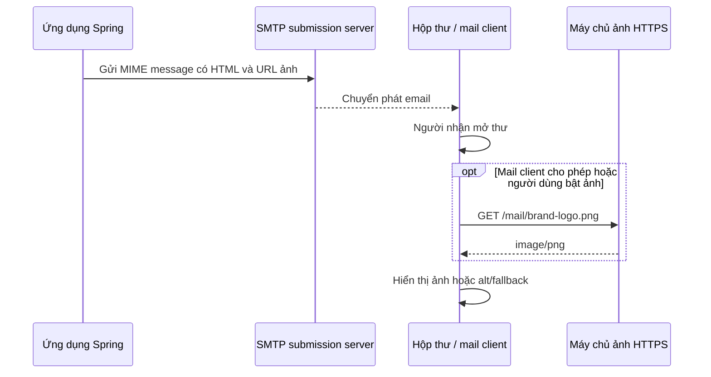

# Hình ảnh từ URL công khai và tài nguyên inline trong email HTML với Spring Framework Mail

Email HTML có thể hiển thị logo, hình sản phẩm, biểu đồ hoặc banner ngay trong nội dung thư. Khi xây dựng email bằng **Spring Framework Mail**, có hai cách phổ biến để đưa hình ảnh vào thuộc tính `src` của thẻ ``:

1. **Hình ảnh từ URL công khai (remote image):** email HTML chứa một địa chỉ HTTPS; ứng dụng đọc email có thể tải ảnh từ máy chủ đó khi hiển thị thư.
2. **Tài nguyên inline (CID image):** ứng dụng đưa byte ảnh vào chính thông điệp MIME, gán `Content-ID` cho phần ảnh và dùng `src="cid:..."` trong HTML để tham chiếu.

Ví dụ hai thẻ HTML có thể nhìn tương tự nhau:

```html
<!-- Ảnh nằm trên một máy chủ web -->


<!-- Ảnh được đóng gói bên trong thông điệp email -->

```

Nhưng đường đi của dữ liệu rất khác nhau. Với URL công khai, người nhận có thể cần kết nối mạng để tải ảnh và chịu chính sách chặn ảnh ngoài của mail client. Với CID, dữ liệu ảnh được gửi kèm email dưới dạng MIME part; không cần tải đúng ảnh đó từ máy chủ web khi xem thư, nhưng client phải hỗ trợ hiển thị tài nguyên inline và email trở nên lớn hơn.

Trong Spring, `JavaMailSender` đảm nhận gửi email; `MimeMessageHelper` giúp tạo HTML, thêm MIME part bằng `addInline(...)` và quản lý cấu trúc `multipart/related`. Bài này trình bày cách làm đầy đủ, giới hạn tương thích, những điểm cần lưu ý khi bảo mật và cách chọn giải pháp cho từng tình huống.

## 1. Hình ảnh trong HTML email khác ảnh trên trang web

Ở trang web, trình duyệt thường tải ảnh từ `src` theo các quy tắc web. Trong email, **mail client** quyết định có tải, hiển thị, cache hoặc thay thế hình ảnh hay không. Nhiều client cố ý chặn ảnh từ URL bên ngoài để giảm nguy cơ theo dõi người đọc và nội dung không mong muốn.

Một đoạn HTML có thể hợp lệ nhưng không bảo đảm được hiển thị giống nhau trên Gmail, Outlook, Apple Mail, ứng dụng di động, webmail hoặc bộ lọc của doanh nghiệp. Vì thế cần phân biệt:

| Khái niệm | Ý nghĩa |
|---|---|
| **HTML body** | Phần nội dung email có MIME type `text/html` |
| **Remote image** | Ảnh được trỏ đến bằng URL, thường `https://...` |
| **Inline MIME resource** | Dữ liệu ảnh nằm trong email, được tham chiếu qua `Content-ID` và `cid:` |
| **Attachment** | Một MIME part được dự định xử lý như tệp đính kèm riêng |
| **`alt` text** | Văn bản thay thế khi ảnh không hiển thị hoặc người đọc dùng công cụ trợ năng |
| **`multipart/related`** | Nhóm nội dung chính và tài nguyên mà nội dung chính tham chiếu |

Từ **inline** có thể gây nhầm: trong HTML/CSS, một phần tử ảnh xuất hiện trong bố cục có thể được gọi là ảnh inline, nhưng trong MIME, **inline resource** thường nói đến một part gửi kèm, có `Content-ID` để phần HTML tham chiếu. Một ảnh URL hiện bên trong đoạn văn không vì thế mà trở thành tài nguyên inline của MIME.

## 2. Cách thứ nhất: dùng hình ảnh từ URL công khai

Với ảnh remote, nội dung email chỉ chứa **đường dẫn ảnh**, không chứa toàn bộ byte ảnh. Ví dụ:

```html
<!doctype html>
<html lang="vi">
  <body>
    <h2>Cảm ơn bạn đã đặt hàng</h2>
    <p>
      
    </p>
    <p>Đơn hàng DH-2048 đã được xác nhận.</p>
  </body>
</html>
```

Hostname `static.example.org` ở đây chỉ là ví dụ minh họa, không phải URL ảnh thực để triển khai. Trong dự án thật, dùng hostname và URL HTTPS được tổ chức quản lý hoặc cấp phép.

### Điều kiện để ảnh từ URL hiển thị

Ứng dụng đọc thư có thể hiển thị ảnh nếu:

- `src` chứa URL tuyệt đối hợp lệ và có thể truy cập từ môi trường người nhận.
- Máy chủ/CDN cho phép tải nội dung qua HTTPS với chứng chỉ hợp lệ.
- Ảnh trả về dữ liệu thực của định dạng mà client hỗ trợ (thường PNG, JPEG hoặc GIF).
- URL vẫn hoạt động khi người nhận mở email sau nhiều giờ, ngày hoặc tháng.
- Chính sách riêng tư và bảo mật của mail client cho phép tải ảnh hoặc người dùng đã chọn hiển thị chúng.

Không dùng đường dẫn local như `C:\images\logo.png`, `/home/app/logo.png` hoặc đường dẫn tương đối `/assets/logo.png`. Đường dẫn đó chỉ có ý nghĩa trong môi trường cụ thể của ứng dụng gửi, không nhất thiết có ý nghĩa trên thiết bị người nhận.

### Hình ảnh URL được tải vào thời điểm nào?

Luồng điển hình:



Một số dịch vụ email còn **tải ảnh thông qua proxy, cache ảnh hoặc quét ảnh trước khi hiển thị**, nên máy chủ nguồn có thể không nhận được request trực tiếp từ trình duyệt hay thiết bị người đọc. Bởi vậy không nên dựa vào log tải ảnh như bằng chứng chắc chắn rằng người nhận đã thực sự đọc thư.

### Ưu và nhược điểm của remote image

**Ưu điểm:**

- Email thường nhỏ hơn vì không gửi kèm byte của ảnh.
- Một logo/banner có thể được dùng lại trên rất nhiều email.
- Ảnh có thể được phân phối qua CDN và được cache.
- Dễ quản lý kho nội dung hình ảnh dùng chung và tạo URL theo phiên bản.

**Hạn chế:**

- Ảnh phụ thuộc vào máy chủ HTTPS và thời gian tồn tại của URL.
- Mail client có thể không tải ảnh ngoài hoặc cần người dùng đồng ý.
- Hình được cập nhật tại URL cũ có thể hiển thị khác sau này, hoặc bị giữ trong cache; không thể kiểm soát nhất quán.
- Ảnh remote có thể làm lộ dữ liệu truy cập hoặc bị xem là yếu tố theo dõi, tùy thiết kế URL và cách client tải.

Với logo nhỏ, ảnh sản phẩm được phân phối bằng CDN hoặc banner marketing, remote image thường thuận tiện khi hệ thống chấp nhận sự phụ thuộc vào mạng và chính sách hiển thị của người nhận.

## 3. Cách thứ hai: tài nguyên inline bằng `Content-ID` và `cid:`

Với ảnh inline, hình được gửi **cùng thông điệp email**, dưới dạng một MIME part riêng. Part ảnh có `Content-Type`, thường có `Content-ID` và có thể có `Content-Disposition: inline`.

Ví dụ mô tả header của một part PNG:

```text
Content-Type: image/png
Content-ID: <shop-logo>
Content-Disposition: inline
Content-Transfer-Encoding: base64

iVBORw0KGgoAAA... (dữ liệu ảnh đã rút gọn)
```

Đoạn HTML tham chiếu ảnh:

```html

```

Các mảnh ghép liên quan:

| Thành phần | Vai trò |
|---|---|
| `Content-Type: image/png` | Cho client biết part chứa ảnh PNG |
| `Content-ID: <shop-logo>` | Định danh của part MIME |
| `cid:shop-logo` | URL trong HTML dùng để tham chiếu part có Content-ID khớp |
| `Content-Disposition: inline` | Gợi ý client hiển thị part trong nội dung thư |
| `multipart/related` | Gắn phần HTML với các tài nguyên phụ thuộc của nó |

**Điểm quan trọng:** `Content-Disposition: inline` tự nó không chỉ định vị trí ảnh trong HTML. Để ảnh hiện ở vị trí mong muốn, HTML phải chứa `cid:...` tương ứng, và MIME part phải có `Content-ID` khớp cùng cấu trúc phù hợp.

### Cấu trúc multipart của email có ảnh inline

Một email có phần plain text, HTML và ảnh có thể có cấu trúc logic:

```text
MimeMessage
└── multipart/related
    ├── multipart/alternative
    │   ├── text/plain; charset=UTF-8
    │   └── text/html; charset=UTF-8
    │       
    └── image/png
        Content-ID: <shop-logo>
        Content-Disposition: inline
```

`multipart/alternative` chứa các phương án biểu diễn cùng nội dung, còn `multipart/related` kết nối HTML với tài nguyên ảnh được tham chiếu. Nếu email còn đính kèm PDF, `multipart/mixed` thường xuất hiện ở tầng ngoài để gom nội dung thư với các attachment độc lập.

**Lưu ý:** đây là cây minh họa. `MimeMessageHelper` có thể tạo cấu trúc lồng nhau khác đôi chút tùy multipart mode và phiên bản thư viện; điều quan trọng là các part có mối liên hệ và header đúng.

### CID không phải URL để mở trên trình duyệt

`cid:shop-logo` không phải URL HTTP/HTTPS. Nó tham chiếu một phần bên trong **cùng thông điệp MIME**. Không thể gửi email chỉ có `` rồi kỳ vọng mail client tự tìm ảnh từ ổ đĩa của ứng dụng. Phải thêm ảnh vào message khi tạo thư bằng API như `MimeMessageHelper.addInline(...)`.

### Ưu và nhược điểm của inline resource

**Ưu điểm:**

- Dữ liệu ảnh được đóng gói ngay trong email, không phụ thuộc vào URL ảnh công khai vẫn tồn tại.
- Có thể phù hợp cho logo, hình minh họa nhỏ hoặc biểu đồ riêng của thông điệp.
- Cho phép HTML tham chiếu một nội dung cụ thể bằng Content-ID.

**Hạn chế:**

- Email lớn hơn vì phải mang dữ liệu ảnh, thường với `Content-Transfer-Encoding: base64`.
- Không phải client nào cũng xử lý CID và bố cục MIME giống nhau.
- Một số client hiển thị hình inline như một attachment bổ sung.
- Việc thay đổi ảnh sau khi gửi khó hơn vì bản ảnh đã nằm trong thông điệp.
- Với thư có nhiều ảnh lớn, có thể gặp giới hạn kích thước message của SMTP provider.

Inline không có nghĩa ảnh chắc chắn được render trên mọi thiết bị. Một số mail client vẫn chặn các loại nội dung hoặc hiển thị tài nguyên theo cách riêng.

## 4. So sánh trực tiếp hai cách dùng ảnh

| Tiêu chí | Ảnh URL công khai | Ảnh inline (CID) |
|---|---|---|
| `src` trong HTML | `https://...` | `cid:...` |
| Byte ảnh nằm ở đâu? | Trên website/CDN | Trong MIME message |
| Email có lớn hơn do ảnh không? | Thường không đáng kể | Có, tăng theo tổng byte ảnh và encoding |
| Cần tải ảnh lúc người nhận mở email? | Thường có, trừ trường hợp đã cache/proxy | Không cần truy cập URL ảnh ngoài cho part đã gửi |
| Bị chặn bởi chính sách client? | Có thể | Cũng có thể |
| Phụ thuộc vào URL còn sống? | Có | Không |
| Thay ảnh sau khi đã gửi? | Có thể ảnh mới xuất hiện khi URL được tải lại; cache có thể giữ ảnh cũ | Nội dung ảnh đã gắn với email |
| Có cần `addInline`? | Không | Có, hoặc phải tự dựng MIME part |
| Có cần `Content-ID`? | Không | Có để HTML tham chiếu qua `cid:` |
| Có thể xuất hiện như attachment? | Không tạo MIME attachment của chính ảnh remote | Một số client vẫn liệt kê MIME part ảnh |
| Tình huống phổ biến | Banner, ảnh sản phẩm, logo dùng chung | Logo nhỏ, biểu đồ riêng, ảnh cần kèm trong message |
| Rủi ro đặc trưng | Quyền riêng tư, URL hết hạn, phụ thuộc CDN | Kích thước, MIME structure, khả năng tương thích CID |

Có thể **kết hợp cả hai** trong một email: logo nhỏ dùng CID, ảnh sản phẩm dùng HTTPS. Quyết định nên dựa trên kích thước, độ bền tài nguyên, tính riêng tư và mức tương thích yêu cầu, thay vì luôn áp dụng một cách cho mọi hình.

## 5. Chuẩn bị Spring Boot Mail và cấu hình SMTP

Với Spring Boot, có thể dùng mail starter:

```groovy
dependencies {
    implementation 'org.springframework.boot:spring-boot-starter-mail'
}
```

Ví dụ `application.yml` cho SMTP submission port 587 + STARTTLS:

```yaml
spring:
  mail:
    host: ${SMTP_HOST}
    port: 587
    username: ${SMTP_USERNAME}
    password: ${SMTP_PASSWORD}
    default-encoding: UTF-8
    properties:
      "[mail.smtp.auth]": true
      "[mail.smtp.starttls.enable]": true
      "[mail.smtp.starttls.required]": true
      "[mail.smtp.ssl.checkserveridentity]": true
      "[mail.smtp.connectiontimeout]": 5000
      "[mail.smtp.timeout]": 10000
      "[mail.smtp.writetimeout]": 10000

app:
  mail:
    from: ${MAIL_FROM}
```

Trong đó:

- `spring.mail.host`, `port`, `username`, `password` kết nối đến SMTP submission server đã được cấp quyền.
- `mail.smtp.starttls.enable` và `required` bật và yêu cầu STARTTLS trên 587.
- `mail.smtp.ssl.checkserveridentity` giúp xác minh hostname trên chứng chỉ TLS.
- `default-encoding: UTF-8` hỗ trợ nội dung tiếng Việt trong MIME.
- `app.mail.from` là thuộc tính do **ứng dụng tự định nghĩa**, không phải một thuộc tính tự động chọn địa chỉ gửi của Spring.

Các giá trị `SMTP_*` nên đến từ biến môi trường hoặc secret manager. Nếu provider yêu cầu **cổng 465 và implicit TLS**, dùng `port: 465` và `"[mail.smtp.ssl.enable]": true` theo tài liệu của provider. Cách nhúng ảnh trong HTML độc lập với việc chọn cổng SMTP.

**Phiên bản:** các ví dụ dưới đây dùng `jakarta.mail` tương ứng Spring Framework 6+ / Spring Boot 3+. Dự án cũ dùng Spring Framework 5 / Boot 2 có thể cần `javax.mail`; phải chọn đúng nhóm dependency và import.

## 6. Ví dụ A: gửi email HTML có hình ảnh từ URL công khai

Khi ảnh nằm trên CDN, **không cần tải byte ảnh về ứng dụng để gửi email**. Chỉ tạo thẻ `` chứa URL HTTPS trong HTML.

```java
package com.example.mail;

import jakarta.mail.MessagingException;
import jakarta.mail.internet.MimeMessage;
import org.springframework.beans.factory.annotation.Value;
import org.springframework.mail.javamail.JavaMailSender;
import org.springframework.mail.javamail.MimeMessageHelper;
import org.springframework.stereotype.Service;

@Service
public class RemoteImageMailService {
    private final JavaMailSender mailSender;
    private final String fromAddress;

    public RemoteImageMailService(
            JavaMailSender mailSender,
            @Value("${app.mail.from}") String fromAddress) {
        this.mailSender = mailSender;
        this.fromAddress = fromAddress;
    }

    public void sendOrderNotice(String recipient)
            throws MessagingException {

        String plainText = """
                Đơn hàng của bạn đã được xác nhận.

                Xem chi tiết tại:
                https://shop.example.org/orders

                Trân trọng,
                Đội ngũ cửa hàng
                """;

        String htmlText = """
                <!doctype html>
                <html lang="vi">
                  <body>
                    
                    <h2>Đơn hàng đã được xác nhận</h2>
                    <p>Cảm ơn bạn đã mua hàng.</p>
                    <p>
                      <a href="https://shop.example.org/orders">
                        Xem chi tiết đơn hàng
                      </a>
                    </p>
                  </body>
                </html>
                """;

        MimeMessage message = mailSender.createMimeMessage();
        MimeMessageHelper helper = new MimeMessageHelper(
                message, true, "UTF-8");
        helper.setFrom(fromAddress);
        helper.setTo(recipient);
        helper.setSubject("Đơn hàng đã xác nhận");
        helper.setText(plainText, htmlText);

        mailSender.send(message);
    }
}
```

Giải thích:

1. `helper.setText(plainText, htmlText)` tạo hai phiên bản thay thế, để client chỉ đọc văn bản vẫn có nội dung chính.
2. `src="https://..."` yêu cầu mail client tải ảnh qua web khi được cho phép; không có lệnh `addInline`.
3. SMTP chỉ chuyển **HTML chứa URL** và phần plain text. Ảnh có thể thay đổi hoặc không còn khả dụng sau khi gửi.
4. Thuộc tính `alt` cung cấp văn bản thay thế, `width` giúp dự kiến kích thước hiển thị. Không nên chỉ dựa vào CSS vì mail client có thể bỏ qua một số quy tắc.

Mẫu URL trong ví dụ phục vụ minh họa. Trong sản phẩm, hãy dùng tên miền HTTPS mà bạn kiểm soát và bảo đảm ảnh có thể truy cập từ phía người nhận mà không cần cookie đăng nhập của hệ thống nội bộ.

### Có thể dùng URL nội bộ hoặc yêu cầu đăng nhập không?

Nếu `src` là `http://localhost:8080/logo.png`, người nhận không nhìn thấy máy chủ local của người gửi. Nếu ảnh yêu cầu session cookie của ứng dụng, mail client hoặc dịch vụ proxy có thể không có cookie đó. Đối với remote image, hãy dùng tài nguyên thực sự được cấp quyền để tải theo thiết kế của hệ thống.

Nếu hình ảnh là **thông tin riêng tư**, không nên chỉ biến nó thành URL công khai để email có thể tải. Hãy cân nhắc CID image, hoặc gửi liên kết đến trang được xác thực để người nhận xem nội dung trong ứng dụng thay vì phơi bày dữ liệu qua URL ảnh.

## 7. Ví dụ B: nhúng ảnh inline từ classpath bằng `addInline(...)`

Giả sử ứng dụng đóng gói logo vào:

```text
src/main/resources/mail/logo.png
```

Khi build, tài nguyên này có thể được đọc qua `ClassPathResource`. Trong HTML, dùng URL CID:

```html

```

Dịch vụ Spring:

```java
package com.example.mail;

import jakarta.mail.MessagingException;
import jakarta.mail.internet.MimeMessage;
import org.springframework.beans.factory.annotation.Value;
import org.springframework.core.io.ClassPathResource;
import org.springframework.mail.javamail.JavaMailSender;
import org.springframework.mail.javamail.MimeMessageHelper;
import org.springframework.stereotype.Service;

@Service
public class InlineLogoMailService {
    private final JavaMailSender mailSender;
    private final String fromAddress;

    public InlineLogoMailService(
            JavaMailSender mailSender,
            @Value("${app.mail.from}") String fromAddress) {
        this.mailSender = mailSender;
        this.fromAddress = fromAddress;
    }

    public void sendWelcome(String recipient)
            throws MessagingException {

        MimeMessage message = mailSender.createMimeMessage();
        MimeMessageHelper helper = new MimeMessageHelper(
                message,
                MimeMessageHelper.MULTIPART_MODE_RELATED,
                "UTF-8");

        helper.setFrom(fromAddress);
        helper.setTo(recipient);
        helper.setSubject("Chào mừng bạn");

        String plainText = """
                Chào mừng bạn đến với cửa hàng Example!

                Truy cập https://shop.example.org để bắt đầu.
                """;

        String htmlText = """
                <!doctype html>
                <html lang="vi">
                  <body>
                    <p>
                      
                    </p>
                    <h2>Chào mừng bạn!</h2>
                    <p>Truy cập https://shop.example.org để bắt đầu.</p>
                  </body>
                </html>
                """;

        // Đặt HTML trước, rồi thêm part ảnh mà HTML tham chiếu.
        helper.setText(plainText, htmlText);
        helper.addInline(
                "brand-logo",
                new ClassPathResource("mail/logo.png"),
                "image/png");

        mailSender.send(message);
    }
}
```

Trong ví dụ:

- `MULTIPART_MODE_RELATED` cho phép tạo cấu trúc MIME có nội dung HTML và tài nguyên liên quan.
- `setText(plainText, htmlText)` tạo hai phiên bản nội dung cho cùng một email.
- `addInline("brand-logo", ...)` gắn byte ảnh với một Content-ID. Helper tạo cách biểu diễn header cần thiết cho part.
- `"image/png"` mô tả chính xác loại dữ liệu của logo PNG.
- `cid:brand-logo` trong HTML phải khớp với chuỗi `brand-logo` truyền cho helper.

**Không đặt dấu `<` và `>` vào tham số content ID** khi gọi `addInline`. Trong MIME source, Content-ID thường được biểu diễn thành `<brand-logo>`, còn tham chiếu HTML dùng `cid:brand-logo`.

### Thứ tự tạo MIME part rất quan trọng

Với Spring `MimeMessageHelper`, nên thực hiện theo thứ tự:

1. Tạo `MimeMessage` và `MimeMessageHelper` ở multipart mode.
2. Đặt `From`, `To`, `Subject`.
3. **Gọi `setText(...)` để tạo phần nội dung.**
4. **Gọi `addInline(...)` để thêm ảnh**, tham chiếu bằng Content-ID tương ứng.
5. Nếu cần, thêm attachment.
6. Gọi `mailSender.send(message)`.

Spring khuyến nghị đặt text trước khi thêm inline resources vì một số mail client phụ thuộc cách sắp xếp part. Nếu gọi `addInline(...)` trước rồi thay cấu trúc text sau, ảnh có thể không được nhận diện hoặc hiển thị ổn định.

### Khi có nhiều ảnh nội tuyến

Mỗi ảnh được tham chiếu độc lập cần một Content-ID phù hợp:

```java
helper.setText(
        "Báo cáo tuần đã sẵn sàng.",
        """
        <p></p>
        <h2>Báo cáo tuần</h2>
        <p></p>
        """);

helper.addInline(
        "company-logo",
        new ClassPathResource("mail/logo.png"),
        "image/png");

helper.addInline(
        "sales-chart",
        new ClassPathResource("mail/sales-chart.png"),
        "image/png");
```

Trong thực tế, ảnh báo cáo có thể được sinh động theo dữ liệu của từng người nhận; khi đó dùng một `ByteArrayResource` hay nguồn dữ liệu có thể đọc lại, như phần tiếp theo.

## 8. Nhúng ảnh được tạo động dưới dạng `byte[]`

Hình ảnh không nhất thiết phải tồn tại sẵn trong classpath. Biểu đồ, QR phục vụ nghiệp vụ hoặc ảnh thu nhỏ có thể được tạo tại thời điểm gửi. Khi đã có byte ảnh, sử dụng `ByteArrayResource`:

```java
import org.springframework.core.io.ByteArrayResource;

byte[] chartPng = /* tạo hoặc đọc ảnh PNG từ nguồn được phép */;

String plainText = """
        Báo cáo tuần đã sẵn sàng.

        Bạn có thể xem các số liệu trong tài khoản.
        """;

String htmlText = """
        <h2>Báo cáo tuần</h2>
        <p>Biểu đồ minh họa:</p>
        
        """;

helper.setText(plainText, htmlText);
helper.addInline(
        "weekly-chart",
        new ByteArrayResource(chartPng),
        "image/png");
```

Đoạn code giả định `helper` đã được tạo ở multipart mode, `chartPng` là PNG hợp lệ và dữ liệu có quyền được gửi đến người nhận.

### Vì sao không truyền một `InputStream` dùng một lần?

Jakarta Mail có thể phải đọc MIME resource nhiều lần khi chuẩn bị hoặc gửi email. Vì vậy, các overload nhận `InputStreamSource` cần nguồn có thể trả một `InputStream` mới cho mỗi lần yêu cầu.

`ByteArrayResource` đáp ứng nhu cầu này bằng cách tạo luồng đọc lại từ byte array trong bộ nhớ. `ClassPathResource` hoặc `FileSystemResource` thường cũng có thể mở lại dữ liệu khi nguồn còn tồn tại. Một `InputStreamResource` bao quanh duy nhất một stream đã mở có thể gây lỗi hoặc hết dữ liệu khi mail transport đọc lại.

Với hình nhỏ, `ByteArrayResource` đơn giản. Với ảnh lớn, giữ toàn bộ byte trong RAM cho hàng nghìn email có thể tốn bộ nhớ; hãy cân nhắc file resource, nguồn lưu trữ có cơ chế stream lặp lại được hoặc URL ảnh được kiểm soát.

### Trường hợp ảnh được tải từ nguồn bên ngoài

Nếu hệ thống có tính năng “nhận URL ảnh rồi đưa ảnh vào email inline”, quá trình **server tự tải URL để lấy byte** có nguy cơ SSRF hoặc truy cập các endpoint nội bộ không mong muốn. Chỉ cho phép nguồn ảnh được cấp phép, kiểm soát redirect, scheme, host/IP, timeout và giới hạn kích thước dữ liệu tải về.

Việc nhận URL công khai để điền thẳng vào `` và việc **backend chủ động fetch URL** là hai hành vi khác nhau. Dù dùng cách nào, URL do người dùng cung cấp phải được kiểm soát theo chính sách sản phẩm để tránh lạm dụng và rò rỉ dữ liệu.

## 9. Kết hợp ảnh inline với file attachment

Một email có thể cần logo inline và hóa đơn PDF để tải về. Khi đó dùng `MimeMessageHelper.MULTIPART_MODE_MIXED_RELATED` là một lựa chọn phổ biến vì nó hỗ trợ quan hệ `related` giữa HTML và ảnh, đồng thời có cấu trúc `mixed` cho attachment.

Ví dụ:

```java
import org.springframework.core.io.ByteArrayResource;
import org.springframework.core.io.ClassPathResource;

MimeMessage message = mailSender.createMimeMessage();
MimeMessageHelper helper = new MimeMessageHelper(
        message,
        MimeMessageHelper.MULTIPART_MODE_MIXED_RELATED,
        "UTF-8");

helper.setFrom("billing@example.org");
helper.setTo("customer@example.net");
helper.setSubject("Hóa đơn của bạn");

helper.setText(
        "Hóa đơn đã sẵn sàng. Vui lòng xem PDF đính kèm.",
        """
        <p></p>
        <p>Hóa đơn của bạn đã sẵn sàng.</p>
        <p>Vui lòng xem tệp PDF đính kèm.</p>
        """);

helper.addInline(
        "invoice-logo",
        new ClassPathResource("mail/logo.png"),
        "image/png");

helper.addAttachment(
        "invoice.pdf",
        new ByteArrayResource(invoicePdf),
        "application/pdf");

mailSender.send(message);
```

`invoicePdf` trong ví dụ là biến `byte[]` chứa PDF hợp lệ, được tạo từ dữ liệu của người nhận đã xác thực. Không chèn mã hóa base64 của PDF thủ công vào body.

Cây MIME minh họa:

```text
MimeMessage
└── multipart/mixed
    ├── multipart/related
    │   ├── multipart/alternative
    │   │   ├── text/plain; charset=UTF-8
    │   │   └── text/html; charset=UTF-8
    │   └── image/png
    │       Content-ID: <invoice-logo>
    │       Content-Disposition: inline
    └── application/pdf
        Content-Disposition: attachment; filename="invoice.pdf"
```

Phân biệt:

- `addInline(...)` tạo part ảnh để HTML tham chiếu bằng `cid:`.
- `addAttachment(...)` tạo part tệp riêng để client hiển thị trong khu vực attachment hoặc cho tải về.
- Một mail client vẫn có thể hiển thị ảnh inline trong danh sách file, vì `Content-Disposition` là thông tin hướng dẫn hiển thị; client có quyền xử lý theo chính sách riêng.

## 10. Những kỹ thuật ảnh HTML nên và không nên dùng trong email

### Kích thước ảnh và hiển thị trên điện thoại

Email HTML nên chỉ định kích thước phù hợp và tránh ảnh quá lớn:

```html

```

`width` là gợi ý độ rộng khi dựng email; `max-width` và `height:auto` giúp hiển thị linh hoạt ở client có hỗ trợ. Không phải CSS nào cũng được áp dụng nhất quán giữa các mail client, vì vậy cần kiểm tra trên các client mục tiêu.

Khi cần hỗ trợ Outlook hoặc những client ít hỗ trợ CSS, có thể phải dùng bảng HTML để bố cục email và các thuộc tính trình bày tương thích. Những lựa chọn này liên quan đến thiết kế template, không thay đổi cơ chế `addInline`.

### Dùng `alt` cho thông tin thay thế

Vì ảnh có thể bị chặn, hãy cung cấp `alt`:

```html

```

`alt` nên mô tả mục đích của ảnh. Nếu ảnh chỉ để trang trí và thông tin đã có trong văn bản, có thể dùng `alt=""` theo chính sách trợ năng. Đối với biểu đồ hoặc ảnh chứa con số quan trọng, cần bổ sung **số liệu/diễn giải bằng văn bản** trong HTML và bản plain text, vì `alt` ngắn thường không đủ thay thế toàn bộ biểu đồ.

### Tránh dựa vào ảnh nền, SVG hoặc CSS phức tạp

Các kỹ thuật như `background-image`, SVG, animation, CSS external hoặc script có mức hỗ trợ rất khác nhau. Một số client lọc hoặc không tải tài nguyên đó. PNG và JPEG thường dễ tương thích hơn cho ảnh thông dụng; GIF có thể hoạt động nhưng không phải client nào cũng phát animation như mong muốn.

Không đặt nội dung quan trọng duy nhất (mã OTP, thời hạn, tổng tiền) lên một banner ảnh. Nếu người nhận tắt ảnh, họ vẫn phải đọc được nội dung nghiệp vụ.

### Không dùng `data:` URI như phương án mặc định

Trên trang web, có thể tạo ảnh dạng:

```html

```

Nhưng nhiều mail client **hạn chế hoặc loại bỏ data URI** vì chính sách bảo mật và khả năng tương thích. Cách này cũng làm HTML part tăng kích thước. Khi cần đóng gói ảnh vào email, ưu tiên MIME part với `cid:` và `addInline(...)` thay vì đặt toàn bộ base64 trong `src`.

### URL công khai không đồng nghĩa URL thiếu kiểm soát

Một URL ảnh dùng trong email nên là endpoint do tổ chức quản lý, có HTTPS, nội dung được xác định, giới hạn tải và không yêu cầu session cookie không thể chia sẻ. Không dùng URL công khai để phát lộ ảnh nội bộ chỉ vì người dùng cần xem nó trong email.

## 11. Tối ưu kích thước email và tốc độ tải

Với ảnh remote, phần HTML chỉ chứa URL, nên email ít bị phình to vì dữ liệu ảnh. Tuy nhiên, thời gian người nhận thấy ảnh phụ thuộc CDN, mạng và cách client quyết định tải.

Với CID, ảnh được đóng gói trong MIME. Dữ liệu nhị phân thường được mã hóa base64, khiến kích thước biểu diễn tăng khoảng **một phần ba**, chưa kể xuống dòng và MIME headers. Ví dụ một ảnh gốc 120 KB có thể chiếm lớn hơn 160 KB trong phần truyền tải MIME.

| Chi phí | Ảnh URL | Ảnh inline |
|---|---|---|
| Dung lượng email | Chỉ URL và HTML liên quan | Gồm byte ảnh + mã hóa + MIME metadata |
| Băng thông gửi SMTP | Thấp hơn nếu không có ảnh nhúng khác | Tăng theo số và kích thước ảnh |
| Băng thông lúc xem | Có thể tải ảnh từ CDN/proxy | Dùng dữ liệu ảnh trong message đã nhận |
| Tái sử dụng giữa nhiều email | Có thể cache ảnh theo URL | Mỗi email thường chứa một bản ảnh riêng |
| Quota message size | Ít chịu ảnh hưởng từ ảnh remote | Có thể nhanh đạt giới hạn kích thước |

Khi tối ưu:

1. Thu nhỏ ảnh đến kích thước hiển thị phù hợp thay vì gửi ảnh gốc nhiều megapixel.
2. Chọn PNG cho logo có ít màu/độ nét cao; JPEG thường phù hợp với ảnh chụp, tùy nội dung.
3. Chỉ inline những ảnh thật sự cần và có kích thước hợp lý.
4. Nếu hình chứa dữ liệu lớn hoặc thay đổi liên tục, cân nhắc đường dẫn đến trang được xác thực thay cho nhúng tất cả vào email.
5. Đo tổng kích thước email MIME khi cần đáp ứng hạn mức của provider, vì quota áp dụng cho **message đã được mã hóa**, không chỉ tổng kích thước file gốc.

## 12. Bảo mật và quyền riêng tư

### Remote image có thể được dùng để theo dõi mở thư

Một URL ảnh có thể chứa định danh riêng của từng người nhận hoặc từng thông điệp. Khi ảnh được tải, máy chủ ảnh có thể ghi nhận thời điểm và một số metadata của request. Tuy nhiên, việc mail client dùng proxy, cache hoặc prefetch làm cho sự kiện tải ảnh **không đồng nghĩa chắc chắn con người đã đọc thư**.

Trong sản phẩm, hãy tôn trọng chính sách quyền riêng tư và mục đích sử dụng dữ liệu. Không tự tạo tracking pixel hoặc gắn token cá nhân nhạy cảm vào URL chỉ để đo số lần mở email. Tránh để dữ liệu như email cá nhân, mã xác thực hoặc session token xuất hiện trực tiếp trong query string của ảnh công khai.

### Ảnh inline và quyền truy cập dữ liệu

Ảnh nhúng vào MIME được gửi **cùng thông điệp** và có thể được lưu, chuyển tiếp hoặc tải về. Đừng nhúng ảnh chứa dữ liệu bí mật rồi giả định người nhận không thể sao chép vì nó chỉ hiện “trong body”.

Nếu hình là biểu đồ tài chính hoặc báo cáo cá nhân, xác định đúng người nhận và phạm vi thông tin trước khi thêm part. Khi người nhận forward email, nội dung nhúng có thể tiếp tục đi theo thư.

### Nguy cơ từ dữ liệu HTML chưa được kiểm soát

Nếu ứng dụng chèn tên khách hàng, mô tả sản phẩm hoặc URL vào HTML, hãy escape và xác thực **theo đúng ngữ cảnh**. Ví dụ:

- Nội dung giữa `<p> ... </p>` cần escape ký tự có ý nghĩa HTML.
- Giá trị `src` và `href` cần kiểm soát scheme/hostname, xử lý mã hóa thuộc tính và chính sách URL.
- Không để người dùng tùy ý tạo `cid:` trỏ đến part không được cấp phép hoặc chèn MIME header qua dữ liệu chưa lọc.
- Không tự nối HTML hoặc header từ dữ liệu chứa ký tự xuống dòng không kiểm soát.

Một template engine có chức năng escape phù hợp thường dễ quản lý hơn việc ghép hàng loạt chuỗi HTML bằng dấu `+`.

### Ảnh public khác việc server download ảnh tùy ý

Nếu HTML chỉ chứa `src="https://..."`, ứng dụng Spring không nhất thiết truy cập URL đó khi gửi; mail client sẽ quyết định tải sau. Nếu backend nhận URL và tự lấy ảnh để tạo CID, backend đang thực hiện kết nối HTTP ra ngoài và cần cơ chế phòng ngừa SSRF.

Những biện pháp cho tính năng import ảnh có thể gồm danh sách host được phép, xác minh địa chỉ sau DNS/redirect, giới hạn cổng/scheme, timeout, giới hạn byte, kiểm tra định dạng file và tách quyền egress của dịch vụ. Không cho phép một chuỗi URL không tin cậy trở thành quyền truy cập tùy ý vào mạng nội bộ.

### TLS SMTP không thay thế bảo mật nội dung

SMTP STARTTLS bảo vệ chặng truyền dữ liệu từ ứng dụng đến server theo cấu hình; nó không khiến URL ảnh riêng tư trở nên an toàn và không bảo đảm mã hóa đầu cuối cho email. Việc xác thực miền gửi, xử lý SPF/DKIM/DMARC, kiểm soát người nhận và quản lý dữ liệu vẫn cần thực hiện độc lập.

## 13. Lỗi thường gặp và cách xác định nguyên nhân

| Triệu chứng | Nguyên nhân có thể | Hướng xử lý |
|---|---|---|
| Ảnh URL hiện biểu tượng bị hỏng | URL sai, 404, HTTPS/chứng chỉ lỗi, ảnh không truy cập công khai | Truy cập URL từ môi trường ngoài, kiểm tra response và MIME type |
| Ảnh URL không tải dù URL hoạt động | Client chặn ảnh ngoài hoặc dùng proxy/cache khác | Kiểm tra thiết lập “Display images” và chính sách client; cung cấp `alt` |
| Ảnh URL hoạt động lúc gửi nhưng hỏng về sau | File bị xóa, URL hết hạn, thay host/CDN | Dùng URL có vòng đời phù hợp, quản lý phiên bản tài nguyên |
| Ảnh CID không hiện | `cid:` không khớp `Content-ID` hoặc chưa `addInline` | Dùng cùng ID ở HTML/helper và kiểm tra MIME source |
| Ảnh inline hiện như file đính kèm | Client tự liệt kê MIME resource hoặc multipart mode chưa hợp lý | Dùng `multipart/related`/`MIXED_RELATED`; kiểm tra trên client mục tiêu |
| Ảnh bị hỏng sau khi đổi thứ tự gọi helper | Thêm `addInline` trước khi đặt text hoặc sửa cấu trúc MIME | Gọi `setText(...)` trước, `addInline(...)` sau |
| Gặp lỗi đọc luồng ảnh | `InputStreamSource` không mở lại được, file đã bị xóa | Dùng `ByteArrayResource`/`ClassPathResource` hoặc nguồn tạo stream mới |
| Một số ảnh hiển thị, số khác không | Content-ID trùng nhau, content type sai, kiểu ảnh client không hỗ trợ | Dùng ID khác nhau, MIME type chính xác, ảnh PNG/JPEG |
| Email bị từ chối vì quá lớn | Nhiều ảnh inline, base64 và attachment tăng kích thước | Giảm số ảnh, resize/compress, dùng remote URL cho ảnh phù hợp |
| HTML hiện nguyên thẻ `` | Body được gửi dưới dạng `text/plain` | Dùng `helper.setText(html, true)` hoặc overload plain + HTML |
| HTML có ảnh nhưng bản plain text không rõ nội dung | Toàn bộ thông tin đặt trong ảnh | Bổ sung text nghiệp vụ và liên kết quan trọng vào cả hai bản |
| Gửi thành công nhưng người dùng không thấy ảnh | Chính sách hiển thị của client, proxy hoặc lọc nội dung | Phân biệt trạng thái SMTP với hiển thị ở máy nhận |

### Kiểm tra MIME source của thư

Trong môi trường thử nghiệm, dùng SMTP sink như Mailpit để xem thông điệp hoặc tính năng “Show original/View source” của ứng dụng nhận thư. Hãy xác định đúng cây part:

```text
Content-Type: multipart/related
...
Content-Type: text/html; charset=UTF-8
...

...
Content-Type: image/png
Content-ID: <brand-logo>
Content-Disposition: inline
```

Ở email có `multipart/mixed` bên ngoài, `related` có thể xuất hiện ở tầng lồng nhau. Đừng chỉ xem một dòng `Content-Type` đầu tiên rồi kết luận thiếu ảnh inline.

Với ảnh URL, mở bản HTML và kiểm tra `src`, rồi kiểm tra URL HTTPS từ một môi trường mạng phù hợp. Cần nhớ rằng trình duyệt có thể hiển thị ảnh từ URL trong khi mail client vẫn chặn.

Không ghi toàn bộ MIME source của email có dữ liệu cá nhân hoặc token nhạy cảm vào log chung chỉ để debug.

## 14. Thiết kế template email có cả plain text và HTML

Một email thân thiện nên có cả plain text và HTML, dù bản HTML có ảnh. Ví dụ cấu trúc dữ liệu nghiệp vụ:

```java
public record OrderMailView(
        String orderCode,
        String totalFormatted,
        String detailUrl,
        String imageUrl) {
}
```

Ứng dụng có thể render:

**Plain text**:

```text
Đơn hàng DH-2048 đã được xác nhận.
Tổng tiền: 450.000 ₫

Xem chi tiết:
https://shop.example.org/orders/DH-2048
```

**HTML**:

```html
<div>
  
  <h2>Đơn hàng DH-2048 đã được xác nhận</h2>
  <p>Tổng tiền: 450.000 ₫</p>
  <p>
    <a href="https://shop.example.org/orders/DH-2048">
      Xem chi tiết
    </a>
  </p>
</div>
```

Ở phiên bản CID, chỉ cần thay `src` bằng `cid:brand-logo` và gọi `addInline(...)` với ID tương ứng. Phần văn bản nghiệp vụ vẫn giữ nguyên.

Nếu có nhiều locale (tiếng Việt, tiếng Anh), render cả hai phiên bản từ **cùng dữ liệu và cùng locale**. Với ảnh chứa text, cần cung cấp bản dịch hoặc văn bản mô tả tương đương; nếu ảnh chứa giá/điều khoản thì đừng để dữ liệu trong ảnh khác dữ liệu trong text.

### Dùng template engine

Spring Mail không tự render placeholder trong file HTML. Nếu có các template như `mail/order-confirmed.html` và `mail/order-confirmed.txt`, ứng dụng cần một renderer/template engine thích hợp. Với HTML, engine nên xử lý escaping an toàn theo ngữ cảnh; URL ảnh cần qua chính sách allowlist hoặc được sinh từ hệ thống đáng tin.

Đừng dùng phép `String.replace` để thay dữ liệu trong HTML khi dữ liệu có thể chứa ký tự `<`, `&`, dấu nháy hoặc URL tùy ý. Phần text/plain cũng nên được render từ model đã kiểm tra để tránh lộ dữ liệu không đúng người nhận.

## 15. Gửi email chứa ảnh và theo dõi delivery

Khi gọi `mailSender.send(message)`, ứng dụng nộp một thông điệp MIME đến server SMTP. Một phản hồi thành công từ server submission thường cho biết **thư đã được chấp nhận xử lý tiếp**.

Điều đó không có nghĩa:

- Email chắc chắn đã được chuyển đến inbox cuối cùng.
- Người nhận đã mở thư.
- Mail client đã tải ảnh remote từ HTTPS.
- Mail client đã hiển thị mọi ảnh inline.
- Người nhận đã xem bản HTML thay vì bản plain text.

Nếu nghiệp vụ cần biết trạng thái phát thư, hãy dùng sự kiện delivery/bounce từ mail provider hoặc hệ thống vận chuyển. Đối với ảnh remote, tải ảnh không phải bằng chứng đáng tin cậy để kết luận người dùng đã đọc email, vì proxy và prefetch có thể tạo request mà không có người đọc trực tiếp.

Trong hàng đợi gửi bất đồng bộ, ảnh CID dạng file/resource phải còn truy cập được khi worker thật sự tạo và gửi MIME message. Nếu tài nguyên nằm trong vùng lưu trữ tạm rồi bị xóa trước khi worker chạy, có thể gặp lỗi tạo MIME hoặc dữ liệu ảnh không đầy đủ.

## 16. Chọn giải pháp theo tình huống

| Nhu cầu | Gợi ý | Lý do |
|---|---|---|
| Logo nhỏ xuất hiện cùng email xác nhận tài khoản | CID inline hoặc HTTPS công khai theo mức tương thích mong muốn | Cả hai đều phù hợp; CID tránh phụ thuộc URL khi mở thư |
| Banner marketing nhiều ảnh, cập nhật nội dung theo chiến dịch | Ảnh HTTPS từ CDN | Email nhỏ hơn và tài nguyên dùng chung |
| Biểu đồ cá nhân được tạo cho một báo cáo riêng | CID inline nếu dữ liệu được phép gửi | Đóng gói hình cụ thể trong thông điệp |
| Ảnh sản phẩm từ catalog công khai | URL HTTPS | Có thể tái dùng ảnh từ hệ thống catalog |
| Ảnh chỉ dành cho người đã đăng nhập | Xem xét CID hoặc liên kết đến trang được xác thực | Tránh tạo URL công khai làm lộ dữ liệu riêng |
| Email có HTML, logo và PDF hóa đơn | `MIXED_RELATED` + `addInline` + `addAttachment` | Tách quan hệ ảnh và attachment |
| Email thông báo cần hoạt động khi ảnh bị chặn | Bản plain text đầy đủ + HTML có `alt` | Giữ thông tin quan trọng ở dạng văn bản |
| Báo cáo chứa nhiều ảnh rất lớn | Link đến trang/tệp được cấp quyền | Tránh vượt giới hạn message và lãng phí băng thông |

Không có một lựa chọn hoàn hảo cho mọi email. Cách hợp lý là quyết định dựa trên **quyền truy cập, kích thước, độ bền tài nguyên, hỗ trợ của client và nội dung nghiệp vụ cần đọc khi không có ảnh**.

## 17. Câu hỏi thường gặp

**Ảnh từ URL công khai có cần `helper.addInline(...)` không?** Không. Khi HTML dùng ``, email chỉ chứa URL. `addInline` dành cho MIME part gửi kèm và tham chiếu qua `cid:`.

**Có thể dùng `` trong email không?** Không nên. Đường dẫn tương đối không có base URL đáng tin cậy ở mail client. Dùng URL HTTPS tuyệt đối cho remote image hoặc CID cho part nhúng.

**Dùng CID có chắc chắn ảnh hiện không?** Không. Mail client có thể xử lý khác nhau, chặn nội dung hoặc hiển thị MIME part như attachment. Kiểm tra trên các client mục tiêu.

**Ảnh CID có cần Internet khi người nhận mở thư không?** Dữ liệu ảnh nằm trong message đã nhận, nên không cần tải chính ảnh đó từ URL web ngoài. Tuy nhiên, người nhận vẫn cần có thông điệp và ứng dụng email phù hợp; các tài nguyên khác trong HTML vẫn có thể cần mạng.

**`cid:logo` và `Content-ID: <logo>` có phải hai ID khác nhau?** Không. Chúng tham chiếu cùng định danh theo quy tắc CID. Trong Spring helper, truyền chuỗi content ID như `"logo"`, còn trong HTML dùng `cid:logo`.

**Có thể thêm nhiều ảnh inline trong cùng một email không?** Có. Gọi `addInline(...)` cho từng ảnh với Content-ID phân biệt và tham chiếu từng ID trong HTML.

**Vì sao ảnh inline xuất hiện như một tệp đính kèm?** Một số mail client liệt kê mọi MIME part có dữ liệu ảnh trong khu vực attachment. Nếu HTML vẫn hiển thị đúng, đây có thể chỉ là cách client trình bày; nếu không, kiểm tra cấu trúc `multipart/related`.

**Có thể dùng ảnh base64 trực tiếp trong `src="data:image/...">` không?** Về cú pháp HTML có thể, nhưng nhiều mail client không hỗ trợ hoặc chặn. Với dữ liệu ảnh gửi kèm, `addInline` + CID thường là cách tương thích hơn.

**Spring Mail có tự tìm ảnh từ đường dẫn trong HTML rồi nhúng vào email không?** Không. `MimeMessageHelper.setText(html, true)` chỉ đặt nội dung HTML. Muốn có CID image, ứng dụng phải gọi `addInline` và cung cấp byte/resource thật.

**Có cần `setText(...)` trước `addInline(...)` không?** Nên làm như vậy. Spring khuyến nghị thứ tự này để phù hợp với cách tổ chức MIME và khả năng tương thích của mail client.

**Ảnh remote có thể hiển thị khi người nhận offline không?** Nếu chưa từng tải/cache ảnh, thường không. CID image đã nằm trong message nên có thể hiển thị offline nếu mail client có dữ liệu thư và hỗ trợ part đó.

**Làm sao biết ảnh đã được người nhận xem?** Không thể kết luận chắc chỉ từ SMTP hoặc request HTTP tải ảnh. Proxy, cache, prefetch và chế độ chặn ảnh làm tín hiệu rất khó diễn giải; không dựa vào đó để xác nhận người nhận đọc thư.

**Lỗi gửi SMTP có phải do URL ảnh không truy cập được?** Nếu chỉ chèn URL vào HTML, server SMTP thường không tải URL đó để gửi. SMTP có thể chấp nhận email dù ảnh remote bị hỏng khi xem. Ngược lại, nếu backend chủ động tải ảnh về để tạo CID, lỗi fetch ảnh có thể xảy ra trước bước SMTP.

**MIME type ảnh nên đặt gì?** Dùng loại tương ứng với dữ liệu thực, như `image/png` hoặc `image/jpeg`. Không khai báo `image/png` cho dữ liệu JPEG chỉ vì tên file mang đuôi PNG.

**Có thể chỉ gửi HTML mà không có plain text?** Có thể, nhưng bản plain text giúp người dùng và client không dùng HTML vẫn đọc được thông tin quan trọng. `helper.setText(plainText, htmlText)` là cách phù hợp khi cần cả hai.

## 18. Tài liệu kỹ thuật liên quan

- **Spring Framework Mail — `JavaMailSender` và `MimeMessageHelper`:** tạo MIME message, `setText(...)`, `addInline(...)`, `addAttachment(...)` và các multipart mode.
- **Jakarta Mail — `MimeMessage`, `MimeMultipart` và `InternetHeaders`:** các thành phần cấu trúc thông điệp.
- **RFC 2045–2049 — MIME:** nguyên tắc `Content-Type`, `multipart/related`/`alternative` và mã hóa nội dung.
- **RFC 2387 — Multipart/Related:** quan hệ nội dung chính và tài nguyên liên quan.
- **RFC 2392 — Content-ID and Message-ID URLs:** cách tham chiếu part MIME qua `cid:`.
- **RFC 2183 — Content-Disposition:** metadata gợi ý hiển thị `inline` và `attachment`.
- **Spring Boot Mail Configuration:** `spring.mail.*` và `spring.mail.properties.*` cho SMTP transport.

---

**Ghi nhớ:** với email HTML, ảnh từ URL công khai dùng `` và phụ thuộc chính sách tải ảnh của client; ảnh MIME inline dùng `` kết hợp `MimeMessageHelper.addInline(...)` để đưa byte ảnh vào chính email. Khi thêm ảnh inline, tạo helper ở multipart mode, **đặt text/HTML trước rồi thêm inline resource**, cung cấp Content-ID và MIME type nhất quán. Dù chọn cách nào, hãy giữ thông tin quan trọng ở dạng văn bản, dùng `alt` phù hợp và kiểm tra cách hiển thị trên các mail client cần hỗ trợ.
