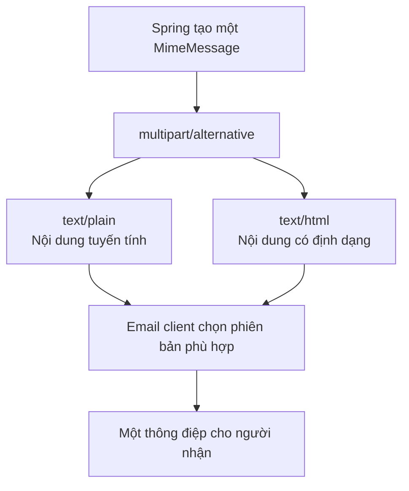

# Plain text thay thế cho khả năng truy cập trong email HTML

Một email HTML có thể trình bày đẹp với logo, nút bấm, bảng và màu sắc, nhưng không phải người nhận nào cũng đọc thư bằng giao diện hiển thị HTML đầy đủ. Có người dùng ứng dụng đọc thư ở chế độ văn bản thuần, có người cần công nghệ hỗ trợ, có hệ thống tự động trích xuất nội dung email, hoặc môi trường bảo mật hạn chế nội dung HTML. Vì vậy, khi xây dựng email HTML trong **Spring Framework Mail**, ứng dụng nên cung cấp thêm một phiên bản **`text/plain` mang cùng thông tin và hành động quan trọng**.

Spring hỗ trợ cách làm này qua `MimeMessageHelper`:

```java
helper.setText(plainText, htmlText);
```

Hai chuỗi không tạo ra hai email độc lập. Chúng là **hai phiên bản thay thế của cùng một nội dung** trong một `MimeMessage`, thường được đóng gói bằng MIME `multipart/alternative`. Ứng dụng đọc thư chọn phiên bản phù hợp với khả năng và lựa chọn của người dùng.

**Phân biệt quan trọng:** có bản plain text là một **biện pháp tăng khả năng truy cập và khả năng tương thích**, nhưng **không đủ để khẳng định email đã accessible**. Bản HTML vẫn cần cấu trúc dễ hiểu, văn bản thay thế cho ảnh, liên kết có nhãn rõ, độ tương phản phù hợp và không dựa duy nhất vào màu sắc. Bản text cũng cần được viết và trình bày để người đọc hiểu được, không chỉ là các thẻ HTML bị xóa đi.

## 1. Vì sao email HTML cần một bản văn bản thuần?

Giả sử ứng dụng gửi email xác nhận lịch hẹn. Ở bản HTML, người nhận thấy:

```html
<h1>Lịch hẹn đã được xác nhận</h1>
<p>Xin chào An,</p>
<p>Lịch hẹn <strong>APT-204</strong> của bạn vào
   <strong>09:30 ngày 20/11/2026</strong> tại Chi nhánh Quận 1.</p>
<p><a href="https://appointments.example/appointments/APT-204">
  Xem chi tiết lịch hẹn
</a></p>
```

Nếu một email client chỉ xử lý `text/plain`, phần HTML này không phải một bản thông báo dễ dùng: người đọc có thể nhìn thấy các thẻ, thuộc tính và nội dung chưa được trình bày. Bản plain text tương đương nên là:

```text
LỊCH HẸN ĐÃ ĐƯỢC XÁC NHẬN

Xin chào An,

Mã lịch hẹn: APT-204
Thời gian: 09:30 ngày 20/11/2026 (Asia/Ho_Chi_Minh)
Địa điểm: Chi nhánh Quận 1

Xem chi tiết lịch hẹn:
https://appointments.example/appointments/APT-204

Nếu cần hỗ trợ, vui lòng trả lời email này.
```

Người dùng bản text **không phải chuyển sang HTML** mới biết thời gian, địa điểm hoặc đường dẫn. Hai phiên bản khác hình thức nhưng giữ nguyên ý nghĩa.

### Những tình huống bản plain text có giá trị

| Bối cảnh | Bản plain text giúp gì? | Điều không nên hiểu nhầm |
| --- | --- | --- |
| Email client ở chế độ chỉ đọc text | Cung cấp nội dung mà không cần bộ render HTML | Không phải mọi client đều tự chọn text khi có lỗi CSS |
| Người dùng chủ động chọn plain text | Thông điệp vẫn đầy đủ và có URL sử dụng được | Plain text không tự bảo đảm dễ đọc nếu bố cục kém |
| Công cụ đọc hỗ trợ hoặc quy trình tiếp cận riêng | Cung cấp một biểu diễn tuyến tính, ít phụ thuộc trực quan | Screen reader cũng có thể đọc HTML có cấu trúc tốt |
| Hệ thống lưu trữ, lọc hoặc trích xuất thông tin | Có nội dung đơn giản để xử lý | Không được mặc định các hệ thống chỉ đọc plain text |
| Ảnh, CSS hoặc nội dung ngoại vi không khả dụng | Nội dung quan trọng vẫn có trong bản text nếu được chọn | Chặn ảnh trong bản HTML không nhất thiết kích hoạt chuyển sang bản text |
| Kết nối hoặc thiết bị hạn chế | Có cách biểu diễn gọn và ít phụ thuộc tài nguyên | Tổng kích thước email vẫn bao gồm HTML và MIME parts |

Một số email client hiển thị HTML nhưng **không tải ảnh từ xa**. Trong trường hợp đó, client có thể tiếp tục hiển thị HTML và **không tự chuyển qua `text/plain`**. Bởi vậy phải thiết kế cả **HTML tự thân có khả năng truy cập** và **plain text có đầy đủ thông tin**.

## 2. Khả năng truy cập: không chỉ là loại bỏ HTML

Trong bài này, khả năng truy cập (*accessibility*) được hiểu là người nhận có thể **tiếp nhận, hiểu và thực hiện hành động** từ email trong các điều kiện và nhu cầu sử dụng khác nhau.

Một email dễ tiếp cận thường đáp ứng các nguyên tắc:

1. **Thông tin quan trọng được thể hiện bằng chữ.** Không để số tiền, hạn chót, mã đơn hàng hoặc yêu cầu hành động nằm duy nhất trong hình ảnh.
2. **Thứ tự đọc có ý nghĩa.** Nội dung được trình bày theo trình tự: sự kiện, chi tiết, hành động, hỗ trợ.
3. **Liên kết có ngữ cảnh.** Không buộc người đọc đoán ý nghĩa của chuỗi "Bấm vào đây" lặp lại nhiều lần.
4. **Không dùng màu sắc làm tín hiệu duy nhất.** Ví dụ "mục màu đỏ cần xử lý" phải đi kèm nhãn văn bản.
5. **Không phụ thuộc vào bảng, cột hoặc CSS để hiểu quan hệ dữ liệu.** Ở bản text, các trường nên có nhãn rõ.
6. **Hỗ trợ ngôn ngữ, số và thời gian phù hợp.** Ngày giờ và múi giờ phải có ý nghĩa cho người nhận.
7. **Nội dung không bị mất khi hình ảnh/HTML không được hiển thị.** Bản text và các fallback trong HTML cùng tham gia giải quyết vấn đề.

Ví dụ một phần HTML trình bày trạng thái bằng màu:

```html
<span style="color:red">●</span> Thanh toán chưa hoàn tất
```

Khi chuyển sang text, đừng chỉ giữ `●`. Hãy ghi:

```text
Trạng thái thanh toán: CHƯA HOÀN TẤT
Hành động cần làm: hoàn tất thanh toán trước 17:00 ngày 20/11/2026.
```

**Bản plain text không cần mô phỏng thiết kế trực quan**, mà cần truyền tải nội dung có thể hành động được. Cấu trúc tốt cho người dùng cũng giúp log, lưu trữ và bộ đọc tự động xử lý dễ dàng hơn, nhưng không nên thay thế việc kiểm tra yêu cầu tiếp cận của người dùng thực tế.

## 3. MIME `multipart/alternative`: cơ chế vận chuyển hai phiên bản

MIME cho phép một email chứa nhiều part. Khi những part là **các cách biểu diễn thay thế của cùng một thông điệp**, chúng được nhóm bằng `multipart/alternative`:

```text
Một MimeMessage
└── multipart/alternative
    ├── text/plain; charset=UTF-8
    │   └── Bản văn bản thuần hoàn chỉnh
    └── text/html; charset=UTF-8
        └── Bản HTML tương đương
```



Theo cách sử dụng MIME thông thường, `text/plain` được đặt trước `text/html`, với phiên bản phong phú hơn ở sau. Email client sẽ chọn part mà nó hỗ trợ và người dùng ưu tiên. **Client không bắt buộc phải hiển thị cả hai part nối nhau**, bởi chúng là alternative chứ không phải hai mảnh thông tin bổ sung.

### Ví dụ cấu trúc raw email

```mime
MIME-Version: 1.0
From: notifications@appointments.example
To: an@example.net
Subject: Appointment confirmed
Content-Type: multipart/alternative; boundary="alt-204"

--alt-204
Content-Type: text/plain; charset=UTF-8
Content-Transfer-Encoding: quoted-printable

Appointment APT-204 is confirmed.
Time: 09:30 on 20/11/2026 (Asia/Ho_Chi_Minh)
Details: https://appointments.example/appointments/APT-204

--alt-204
Content-Type: text/html; charset=UTF-8
Content-Transfer-Encoding: quoted-printable

<html><body>
  <h1>Appointment confirmed</h1>
  <p>APT-204: 09:30 on 20/11/2026</p>
  <a href="https://appointments.example/appointments/APT-204">View details</a>
</body></html>
--alt-204--
```

Đây là **ví dụ sơ đồ**: phần `quoted-printable` và line endings của MIME thật đã được đơn giản hóa để dễ đọc. Thông điệp thực tế do Jakarta Mail tạo có thể chọn `quoted-printable` hoặc `base64` tùy dữ liệu và transport. Các kiểu `Content-Transfer-Encoding` đó phục vụ việc **mã hóa vận chuyển**, không phải cơ chế bảo mật nội dung.

### Khi email còn có inline image hoặc attachment

Nếu HTML dùng logo nhúng `cid:` và thư còn có file PDF đính kèm, cây MIME có thể gồm:

```text
multipart/mixed
├── multipart/related
│   ├── multipart/alternative
│   │   ├── text/plain        <-- thông tin quan trọng bằng chữ
│   │   └── text/html         <-- 
│   └── image/png             <-- Content-ID: <logo@appointments.example>
└── application/pdf           <-- attachment độc lập
```

Ba cấu trúc có vai trò khác nhau:

| MIME subtype | Ý nghĩa |
| --- | --- |
| `multipart/alternative` | Nhiều biểu diễn thay thế của cùng nội dung |
| `multipart/related` | Nội dung gốc và tài nguyên liên quan, như ảnh CID |
| `multipart/mixed` | Các thành phần ghép chung như body và attachment |

Khi dùng Spring, cấu trúc chính xác còn phụ thuộc chế độ của `MimeMessageHelper`, nhưng **plain text vẫn cần thể hiện nội dung chính** ngay cả khi HTML kèm hình ảnh hoặc PDF.

## 4. `MimeMessageHelper.setText(plainText, htmlText)` trong Spring

Spring Framework Mail cung cấp `JavaMailSender` và `MimeMessageHelper` để tạo các email MIME. Các overload dễ nhầm:

| Phương thức | Kết quả |
| --- | --- |
| `setText("Hello")` | Chỉ một phần văn bản thuần |
| `setText("<b>Hello</b>", true)` | Chỉ một phần HTML |
| `setText("Hello", false)` | Chỉ một phần văn bản thuần |
| **`setText("Hello", "<b>Hello</b>")`** | **Hai phần text/plain và text/html thay thế nhau** |

Ví dụ:

```java
// Chỉ HTML, không tự có plain text fallback:
helper.setText("<p>Đơn hàng đã sẵn sàng.</p>", true);

// Hai bản cùng ý nghĩa:
helper.setText(
        "Đơn hàng đã sẵn sàng.",
        "<p>Đơn hàng đã sẵn sàng.</p>");
```

**Spring không tự chuyển HTML thành bản text hoàn chỉnh.** Ứng dụng phải cung cấp `plainText` và `htmlText` đã được biên soạn hoặc render. Nếu bản text chỉ chứa "Hãy xem nội dung HTML", người dùng chọn chế độ đọc text vẫn bị mất thông tin quan trọng.

Để dùng overload hai phiên bản, nên tạo `MimeMessageHelper` với chế độ multipart thích hợp:

```java
MimeMessage message = mailSender.createMimeMessage();
MimeMessageHelper helper = new MimeMessageHelper(
        message,
        MimeMessageHelper.MULTIPART_MODE_MIXED_RELATED,
        "UTF-8");

helper.setText(plainText, htmlText);
```

Chế độ `MULTIPART_MODE_MIXED_RELATED` phù hợp khi về sau cần ảnh inline hoặc attachment. Với thông điệp chỉ có text và HTML, có thể chọn cấu trúc multipart khác phù hợp; điểm chính vẫn là **hai bản nội dung của một `MimeMessage`**.

## 5. Ví dụ hoàn chỉnh: Email xác nhận lịch hẹn có plain text thay thế

Giả sử dữ liệu nghiệp vụ đã được xác nhận gồm:

```text
appointmentId: APT-204
recipient: an@example.net
recipientName: An
scheduledAt: 2026-11-20T02:30:00Z
timeZone: Asia/Ho_Chi_Minh
location: Chi nhánh Quận 1
```

Để tránh hai phiên bản khác nhau về thời gian và tên địa điểm, nên **chuẩn hóa dữ liệu một lần** rồi đưa vào cả hai renderer.

### DTO dữ liệu đã xác nhận

```java
package com.example.mail;

import java.time.Instant;
import java.time.ZoneId;

public record AppointmentNotice(
        String appointmentId,
        String recipientEmail,
        String recipientName,
        String location,
        Instant scheduledAt,
        ZoneId timeZone
) {
}
```

Đây là DTO dành riêng cho email, không phải toàn bộ entity database. Nó chứa đúng các trường cần thiết để soạn thông báo.

### Service dùng `JavaMailSender`

```java
package com.example.mail;

import java.time.ZonedDateTime;
import java.time.format.DateTimeFormatter;
import java.util.Locale;
import java.util.Objects;

import jakarta.mail.MessagingException;
import jakarta.mail.internet.MimeMessage;

import org.springframework.beans.factory.annotation.Value;
import org.springframework.mail.javamail.JavaMailSender;
import org.springframework.mail.javamail.MimeMessageHelper;
import org.springframework.stereotype.Service;
import org.springframework.web.util.HtmlUtils;

@Service
public class AppointmentConfirmationEmailService {

    private static final DateTimeFormatter DATE_TIME_FORMAT =
            DateTimeFormatter.ofPattern(
                    "HH:mm 'ngày' dd/MM/yyyy",
                    Locale.forLanguageTag("vi-VN"));

    private final JavaMailSender mailSender;
    private final String fromAddress;

    public AppointmentConfirmationEmailService(
            JavaMailSender mailSender,
            @Value("${app.mail.from}") String fromAddress) {
        this.mailSender = mailSender;
        this.fromAddress = fromAddress;
    }

    public void send(AppointmentNotice notice) throws MessagingException {
        Objects.requireNonNull(notice, "notice");
        Objects.requireNonNull(notice.scheduledAt(), "scheduledAt");
        Objects.requireNonNull(notice.timeZone(), "timeZone");

        // Ví dụ yêu cầu mã ID đúng schema để tạo URL an toàn.
        String id = Objects.requireNonNull(notice.appointmentId());
        if (!id.matches("[A-Za-z0-9-]{1,40}")) {
            throw new IllegalArgumentException("Invalid appointment ID");
        }

        // Các trường một dòng đã được chuẩn hóa/kiểm soát từ nghiệp vụ.
        String name = notice.recipientName();
        String location = notice.location();
        if (name == null || name.isBlank()) {
            name = "bạn";
        }
        if (location == null || location.isBlank()) {
            throw new IllegalArgumentException("Location is required");
        }

        ZonedDateTime localTime = notice.scheduledAt()
                .atZone(notice.timeZone());
        String formattedTime = DATE_TIME_FORMAT.format(localTime)
                + " (" + notice.timeZone().getId() + ")";

        String detailsUrl =
                "https://appointments.example/appointments/" + id;

        String plainText = """
                LỊCH HẸN ĐÃ ĐƯỢC XÁC NHẬN

                Xin chào %s,

                Mã lịch hẹn: %s
                Thời gian: %s
                Địa điểm: %s

                Xem chi tiết lịch hẹn:
                %s

                Nếu cần hỗ trợ, vui lòng phản hồi email này.
                """.formatted(name, id, formattedTime, location, detailsUrl);

        String htmlText = """
                <!doctype html>
                <html lang="vi">
                  <body>
                    <h1>Lịch hẹn đã được xác nhận</h1>
                    <p>Xin chào %s,</p>
                    <p><strong>Mã lịch hẹn:</strong> %s</p>
                    <p><strong>Thời gian:</strong> %s</p>
                    <p><strong>Địa điểm:</strong> %s</p>
                    <p><a href="%s">Xem chi tiết lịch hẹn</a></p>
                    <p>Nếu cần hỗ trợ, vui lòng phản hồi email này.</p>
                  </body>
                </html>
                """.formatted(
                HtmlUtils.htmlEscape(name),
                HtmlUtils.htmlEscape(id),
                HtmlUtils.htmlEscape(formattedTime),
                HtmlUtils.htmlEscape(location),
                HtmlUtils.htmlEscape(detailsUrl));

        MimeMessage message = mailSender.createMimeMessage();
        MimeMessageHelper helper = new MimeMessageHelper(
                message,
                MimeMessageHelper.MULTIPART_MODE_MIXED_RELATED,
                "UTF-8");

        helper.setFrom(fromAddress);
        helper.setTo(notice.recipientEmail());
        helper.setSubject("Xác nhận lịch hẹn " + id);
        helper.setText(plainText, htmlText);

        mailSender.send(message);
    }
}
```

Đoạn code minh họa dùng Java hỗ trợ text blocks và `String.formatted(...)`, Spring Framework Mail và Jakarta Mail. Nó giả định dữ liệu nghiệp vụ đã được kiểm soát quyền nhận, cú pháp email và giới hạn độ dài ở các tầng phù hợp. `HtmlUtils.htmlEscape` phục vụ escape nội dung đưa vào HTML, **không thay thế kiểm tra địa chỉ người nhận, URL hay logic nghiệp vụ**.

Trong ứng dụng thật, nên kiểm soát thêm ký tự điều khiển, chiều dài trường tên/địa điểm và dữ liệu có thể chứa xuống dòng để tránh nội dung bất thường. URL trong ví dụ được xây từ host tin cậy và ID có quy tắc rõ; nếu xây URL từ dữ liệu tùy ý, phải kiểm tra scheme/host và encode path/query theo ngữ cảnh trước khi escape HTML.

### Cấu hình Spring Boot tối thiểu để gửi qua SMTP

```groovy
dependencies {
    implementation 'org.springframework.boot:spring-boot-starter-mail'
}
```

```yaml
spring:
  mail:
    host: smtp.provider.example
    port: 587
    username: ${SMTP_USERNAME}
    password: ${SMTP_PASSWORD}
    default-encoding: UTF-8
    properties:
      "[mail.smtp.auth]": "true"
      "[mail.smtp.starttls.enable]": "true"
      "[mail.smtp.starttls.required]": "true"
      "[mail.smtp.ssl.checkserveridentity]": "true"
      "[mail.smtp.connectiontimeout]": "5000"
      "[mail.smtp.timeout]": "10000"
      "[mail.smtp.writetimeout]": "10000"

app:
  mail:
    from: notifications@appointments.example
```

`spring.mail.username`/`password` dùng cho SMTP AUTH, còn `app.mail.from` là cấu hình tự định nghĩa được service sử dụng để đặt header người gửi. Các giá trị credential phải lấy từ secret của môi trường, không lưu mật khẩu thật trong mã nguồn.

`send()` submit thư qua SMTP. Khi nó trả về bình thường, điều đó **không bảo đảm người nhận đã mở thư hay email client đã hiển thị bản HTML/text đúng ý**. Khả năng gửi, khả năng phát tới mailbox và khả năng truy cập của nội dung là ba khía cạnh khác nhau.

## 6. Từ một dữ liệu nguồn đến hai phiên bản đồng nhất

Một nguy cơ lớn khi soạn hai bản bằng tay là **sai lệch thông tin**:

```text
Plain text: Hạn chót 17:00 ngày 20/11/2026
HTML:       Hạn chót 19:00 ngày 20/11/2026
```

Nếu các bản render tính ngày giờ ở hai vị trí khác nhau, người đọc có thể nhận hướng dẫn mâu thuẫn. Vì vậy, nên định nghĩa một **view model** đã chuẩn hóa:

```java
public record AppointmentMailView(
        String name,
        String appointmentId,
        String formattedLocalTime,
        String location,
        String detailsUrl
) {
}
```

Luồng dựng nội dung:

```text
AppointmentEvent / database snapshot
           |
           v
Chuẩn hóa dữ liệu: thời gian, múi giờ,
tên, địa điểm, URL đáng tin
           |
           v
AppointmentMailView
     /            \
    v              v
Plain text        HTML template
    \              /
     v            v
   helper.setText(plainText, htmlText)
```

Trong dự án có nhiều thông báo, có thể tạo hai template riêng:

```text
src/main/resources/templates/mail/
├── appointment-confirmed.txt
└── appointment-confirmed.html
```

Ví dụ nội dung template khái niệm:

```text
LỊCH HẸN ĐÃ ĐƯỢC XÁC NHẬN

Xin chào {{name}},
Mã lịch hẹn: {{appointmentId}}
Thời gian: {{formattedLocalTime}}
Địa điểm: {{location}}
Chi tiết: {{detailsUrl}}
```

```html
<h1>Lịch hẹn đã được xác nhận</h1>
<p>Xin chào <strong>{{name}}</strong>,</p>
<p>Mã lịch hẹn: <strong>{{appointmentId}}</strong></p>
<p>Thời gian: <strong>{{formattedLocalTime}}</strong></p>
<p>Địa điểm: {{location}}</p>
<p><a href="{{detailsUrl}}">Xem chi tiết lịch hẹn</a></p>
```

Ký hiệu `{{...}}` ở đây là **placeholder minh họa**, không phải cú pháp mặc định của mọi template engine. Nếu dùng Thymeleaf, FreeMarker hoặc engine khác, phải chọn cú pháp và cơ chế escape phù hợp. **Cùng một view model** giúp đồng bộ dữ liệu, nhưng hai template vẫn phải được thiết kế cho môi trường hiển thị của chúng.

### Những nguyên tắc giữ hai bản tương đương

| Dữ liệu hoặc hành động | Bản HTML | Bản text tương đương |
| --- | --- | --- |
| Trạng thái | Badge màu xanh “Đã xác nhận” | `Trạng thái: Đã xác nhận` |
| Deadline | Nổi bật bằng chữ đậm/màu | Ghi ngày, giờ, múi giờ rõ |
| Link hành động | `<a href="...">Xem chi tiết</a>` | `Xem chi tiết: https://...` |
| Danh sách | `<ul><li>...</li></ul>` | `- Mục 1`, `- Mục 2` |
| Bảng đơn hàng | Các cột “Sản phẩm / Số lượng” | `Sản phẩm: ...; Số lượng: ...` theo từng dòng |
| Ảnh minh họa | `` | Viết rõ thông tin có ý nghĩa nếu ảnh truyền tải nội dung |
| CTA nổi bật | Nút có nhãn “Xác nhận lịch hẹn” | Dòng hướng dẫn và URL đầy đủ |
| Thông tin liên hệ | Icon điện thoại/email + link | Nhãn `Hỗ trợ:` và địa chỉ liên hệ |
| Thông tin pháp lý | Footer nhỏ | Vẫn có nội dung theo yêu cầu pháp lý/nghiệp vụ |

**Tương đương không có nghĩa giống từng dòng**. HTML có thể dùng bảng và CSS, trong khi text diễn đạt cùng thông tin bằng nhãn và dấu xuống dòng. Mục tiêu là người dùng không bị mất một thao tác quan trọng chỉ vì chọn một cách hiển thị khác.

## 7. Trình bày bản plain text cho người đọc và công nghệ hỗ trợ

Một bản text dễ đọc cần **định dạng đơn giản nhưng có cấu trúc rõ**. Những cách làm hữu ích:

- Mở đầu bằng một câu tóm tắt hoặc tiêu đề nội dung.
- Chia thành các đoạn ngắn, có dòng trống giữa các chủ đề.
- Dùng nhãn rõ như `Thời gian:`, `Địa điểm:`, `Mã đơn:`, `Hành động cần làm:`.
- Với danh sách, dùng dấu `- ` ở đầu từng dòng thay vì dồn nhiều mục trên một dòng.
- Viết URL tuyệt đối, rõ đích đến và có nhãn đi kèm.
- Đặt thời hạn kèm múi giờ hoặc bối cảnh địa phương.
- Tránh đoạn ASCII art, khung tạo bởi ký tự `+----+`, bảng căn cột bằng nhiều dấu cách hoặc các hàng ký hiệu trang trí.
- Hạn chế viết toàn chữ IN HOA, viết tắt khó hiểu và chuỗi dấu câu kéo dài.
- Nếu thông tin là tùy chọn, tránh các dòng kiểu `Địa điểm: null` hoặc `Hạn chót: undefined`.

### Vì sao bảng ASCII có thể kém tiếp cận?

Ví dụ khó đọc:

```text
+-----------+-------+----------+
| SP        | SL    | Gia      |
+-----------+-------+----------+
| Ao so mi  | 2     | 250000   |
+-----------+-------+----------+
```

Nhiều trình đọc text, thiết bị nhỏ hoặc công nghệ hỗ trợ khó giữ đúng vị trí các cột. Chuyển sang cấu trúc tuyến tính:

```text
Sản phẩm 1: Áo sơ mi
Số lượng: 2
Đơn giá: 250.000 VND

Tổng tiền: 500.000 VND
```

Bản text có thể dài hơn chút nhưng rõ thứ tự và quan hệ giữa các nhãn–giá trị. Với báo cáo nhiều cột phức tạp, nên cân nhắc đưa người dùng đến trang web có giao diện accessible thay vì ép toàn bộ bảng lớn vào email.

### Liên kết có nhãn cụ thể

Không nên viết:

```text
Nhấp vào đây: https://appointments.example/appointments/APT-204
Nhấp vào đây: https://appointments.example/help
```

Nên viết:

```text
Xem chi tiết lịch hẹn:
https://appointments.example/appointments/APT-204

Liên hệ hỗ trợ:
https://appointments.example/help
```

Ở HTML, nhãn `Xem chi tiết lịch hẹn` phải mô tả đích của link mà không bắt người đọc dựa vào vị trí hay màu của nút. Ở text, URL thường được hiển thị đầy đủ. Cần kiểm soát đường dẫn để tránh URL không an toàn hoặc quá dài gây vỡ dòng.

### Dữ liệu nhạy cảm trong URL

Một URL rất dài chứa access token hoặc thông tin khách hàng có thể gây rò rỉ khi email bị forward hoặc được lưu lại. Bản plain text khiến URL hiển thị trực tiếp, nhưng **ngay cả bản HTML, URL thật cũng đã nằm trong thuộc tính `href` của thông điệp**. Vì vậy phải thiết kế link theo chính sách bảo mật: host tin cậy, quyền truy cập phù hợp, token đủ ngắn hạn nếu cần, không nhúng dữ liệu bí mật không cần thiết vào URL.

## 8. Plain text fallback và khả năng tiếp cận của bản HTML

Để nâng khả năng truy cập thực tế, đừng dựa vào bản text như lý do để bỏ qua chất lượng HTML. Người nhận chọn HTML vẫn cần dùng được nội dung đó.

### Thẻ có ngữ nghĩa và thứ tự đọc

Ở phần có thể dùng HTML semantic một cách tương thích với email client, nên có tiêu đề rõ, đoạn văn theo thứ tự đọc tự nhiên và liên kết mô tả được hành động:

```html
<h1>Lịch hẹn đã được xác nhận</h1>
<p>Mã lịch hẹn: <strong>APT-204</strong></p>
<p>Thời gian: 09:30 ngày 20/11/2026</p>
<p><a href="https://appointments.example/appointments/APT-204">
  Xem chi tiết lịch hẹn
</a></p>
```

Email client có mức hỗ trợ HTML khác trình duyệt; một số loại thẻ/thuộc tính có thể bị lọc hoặc bị chỉnh sửa. Vì vậy nên ưu tiên cấu trúc đơn giản và nội dung tuần tự thay vì bố cục phức tạp làm sai thứ tự đọc khi chuyển sang màn hình nhỏ.

### Văn bản thay thế của hình ảnh

```html
<!-- Hình mang nội dung thương hiệu -->


<!-- Hình trang trí thuần túy -->

```

Nếu hình ảnh **truyền tải thông tin**, `alt` cần mô tả ý nghĩa; nếu chỉ trang trí, `alt=""` thường phù hợp để tránh phần trang trí gây nhiễu trong trình đọc hỗ trợ. Không đặt thông tin quan trọng chỉ bên trong ảnh, kể cả khi đã có `alt`; bản text và HTML có chữ nên vẫn mang thông tin chính.

Với hình chứa QR dùng để kiểm tra vé, có thể cần thêm mã đặt chỗ dạng chữ hoặc hướng dẫn thay thế, tùy nghiệp vụ và rủi ro bảo mật. Không phải mọi mã QR đều có thể chuyển thành một dòng URL an toàn để gửi.

### Tương phản màu và liên kết

Trong HTML email, không dựa duy nhất vào chữ màu đỏ/xanh để chỉ trạng thái. Nút hành động nên có **nhãn có nghĩa**, màu đủ tương phản và kích thước chạm phù hợp theo thiết kế thực tế. Một nút CSS có thể mất màu hoặc mất style ở một số client; phần chữ và `href` vẫn phải dùng được.

Người dùng chỉ đọc plain text cũng cần một mô tả trạng thái bằng chữ, nhưng việc có text fallback không giải quyết cho người dùng đang chọn HTML có độ tương phản thấp. Hai biểu diễn phải được chú ý độc lập.

## 9. Kết hợp ảnh `cid:` với hai phiên bản nội dung

Trong Spring, `MimeMessageHelper` cho phép gắn hình nhúng. Ví dụ:

```java
import org.springframework.core.io.ClassPathResource;

String cid = "brand-logo@appointments.example";

String plainText = """
        Appointments Example

        Lịch hẹn APT-204 đã được xác nhận.
        Chi tiết: https://appointments.example/appointments/APT-204
        """;

String htmlText = """
        <html><body>
          
          <h1>Lịch hẹn đã được xác nhận</h1>
          <p>Mã lịch hẹn: APT-204</p>
          <a href="https://appointments.example/appointments/APT-204">
            Xem chi tiết lịch hẹn
          </a>
        </body></html>
        """;

// helper đã được tạo ở chế độ multipart phù hợp.
helper.setText(plainText, htmlText);
helper.addInline(
        cid,
        new ClassPathResource("mail/images/logo.png"),
        "image/png");
```

Giả sử file ảnh được đặt ở `src/main/resources/mail/images/logo.png`. `Content-ID` của MIME part ảnh sẽ tương ứng với `cid:brand-logo@appointments.example` trong HTML. **Plain text không thể render hình này**, nên văn bản tên dịch vụ và đường dẫn vẫn phải có trong bản text.

Với `MimeMessageHelper`, nên gọi **`setText(...)` trước `addInline(...)`** để giữ cấu trúc MIME phù hợp với nhiều email client. Không đặt chỉ dẫn quan trọng chỉ trong ảnh; ảnh có thể không hiển thị vì chính sách client, thiếu MIME part hoặc giới hạn kích thước.

## 10. Đa ngôn ngữ, thời gian và định dạng số

Khả năng tiếp cận không chỉ là công nghệ hỗ trợ. Nếu email được gửi cho người dùng nói ngôn ngữ khác, chuỗi đã dịch đúng chưa, đơn vị và thời gian có rõ chưa cũng quyết định họ hiểu thông báo hay không.

Một chiến lược là tạo **mô hình hiển thị theo locale** rồi render cả text và HTML:

```text
Domain event
   |
   v
Resolve recipient locale / time zone
   |
   v
Format time, amount, labels once
   |
   +--> render plain text
   |
   +--> render HTML
   |
   v
MimeMessageHelper.setText(plainText, htmlText)
```

Nếu thời hạn lưu trong database là `Instant`:

```java
import java.time.Instant;
import java.time.ZoneId;
import java.time.format.DateTimeFormatter;
import java.util.Locale;

Instant scheduledAt = Instant.parse("2026-11-20T02:30:00Z");
ZoneId zone = ZoneId.of("Asia/Ho_Chi_Minh");

DateTimeFormatter formatter = DateTimeFormatter
        .ofPattern("HH:mm 'ngày' dd/MM/yyyy",
                Locale.forLanguageTag("vi-VN"));

String displayTime = formatter.format(scheduledAt.atZone(zone))
        + " (" + zone.getId() + ")";
```

Kết quả để dùng trong **cả hai phiên bản**:

```text
09:30 ngày 20/11/2026 (Asia/Ho_Chi_Minh)
```

Nếu hai renderer tự chuyển timezone hoặc format số tiền riêng rẽ, plain text và HTML có thể mâu thuẫn. Với tiền, nên dùng loại dữ liệu có currency rõ (`BigDecimal` và mã tiền, hoặc kiểu Money nghiệp vụ) trước khi format theo locale; không để bản text ghi `1000.00` nhưng bản HTML ghi `1.000.000` chỉ vì format sai.

### Ngôn ngữ HTML và email header

Với HTML, có thể khai báo `lang="vi"` hoặc ngôn ngữ tương ứng khi client giữ thuộc tính này. Điều đó hỗ trợ công nghệ đọc phù hợp với ngôn ngữ. Trong MIME, charset `UTF-8` giúp truyền chữ có dấu; **charset không thay thế ngôn ngữ khai báo**, và bản plain text không có cấu trúc HTML để đặt thuộc tính `lang` cho từng đoạn.

Nếu ứng dụng gửi song ngữ, cần suy nghĩ cách viết rõ ràng trong cả hai part, không chỉ chuyển bản HTML sang hai ngôn ngữ mà bỏ quên plain text.

## 11. Kiểm tra cấu trúc MIME trong bộ nhớ

Một email có thể được tạo trước khi gửi để xem liệu Jakarta Mail đã đóng gói đủ hai phần hay chưa. Việc này giúp hiểu cấu trúc MIME mà không cần một SMTP server.

Ví dụ Java:

```java
import java.io.ByteArrayOutputStream;
import java.nio.charset.StandardCharsets;
import java.util.Properties;

import jakarta.mail.Session;
import jakarta.mail.internet.MimeMessage;
import org.springframework.mail.javamail.MimeMessageHelper;

public class PlainTextAlternativeSourceExample {

    public static void main(String[] args) throws Exception {
        Session session = Session.getInstance(new Properties());
        MimeMessage message = new MimeMessage(session);

        MimeMessageHelper helper = new MimeMessageHelper(
                message,
                MimeMessageHelper.MULTIPART_MODE_MIXED_RELATED,
                "UTF-8");

        helper.setFrom("notifications@appointments.example");
        helper.setTo("an@example.net");
        helper.setSubject("Xác nhận lịch hẹn");
        helper.setText(
                "Lịch hẹn APT-204 đã được xác nhận.\n"
                        + "Chi tiết: https://appointments.example/appointments/APT-204",
                "<h1>Lịch hẹn đã được xác nhận</h1>"
                        + "<p>Mã lịch hẹn APT-204</p>"
                        + "<a href=\"https://appointments.example/appointments/APT-204\">"
                        + "Xem chi tiết</a>");

        message.saveChanges();

        try (ByteArrayOutputStream output = new ByteArrayOutputStream()) {
            message.writeTo(output);
            String rawEmail = output.toString(StandardCharsets.UTF_8);
            System.out.println(rawEmail);
        }
    }
}
```

Đây là **ví dụ kỹ thuật trong môi trường phát triển**. Nó không gửi thư; nó xuất raw MIME của một `MimeMessage` đã được tạo. Không dùng email và nội dung dữ liệu cá nhân thực tế khi ghi `.eml` hoặc in source ra log.

Trong raw source, cần hiểu các dấu hiệu:

```text
Content-Type: multipart/alternative
  Content-Type: text/plain; charset=UTF-8
  Content-Type: text/html; charset=UTF-8
```

Trong chế độ MIME lồng nhau, `multipart/alternative` có thể nằm bên trong `multipart/related` hoặc `multipart/mixed`, không nhất thiết là `Content-Type` ở top-level. `Message.getContent()` cũng có thể trả về `Multipart` chứ không phải một chuỗi; muốn xử lý source theo cấu trúc cần duyệt các body parts.

### Một ví dụ duyệt MIME tree

```java
import jakarta.mail.Multipart;
import jakarta.mail.Part;

static void printMimeTypes(Part part, String indentation)
        throws Exception {
    System.out.println(indentation + part.getContentType());

    Object content = part.getContent();
    if (content instanceof Multipart multipart) {
        for (int i = 0; i < multipart.getCount(); i++) {
            printMimeTypes(multipart.getBodyPart(i), indentation + "  ");
        }
    }
}
```

Hàm này chỉ cho biết **các loại MIME trong cây thông điệp**, không tự khẳng định hai bản có cùng nghĩa hay email accessible. Với sản phẩm thực, việc đánh giá khả năng tiếp cận cần xem **nội dung được người dùng tiếp nhận**, chứ không chỉ số lượng MIME part.

## 12. Hướng kiểm thử và đánh giá trong quy trình phát triển

Với email có hai phiên bản, hệ thống nên có các lớp kiểm tra riêng theo mục tiêu:

| Mục tiêu | Cách kiểm tra phù hợp |
| --- | --- |
| Có cả hai MIME part | Quan sát `multipart/alternative` và `Content-Type` của các part |
| Dữ liệu nghiệp vụ đồng nhất | So sánh ID, số tiền, deadline, địa điểm, URL giữa text và HTML |
| Plain text dùng được độc lập | Đọc riêng text part mà không nhìn HTML |
| HTML dùng được khi ảnh bị chặn | Xem email HTML với remote images bị tắt |
| Email client khác nhau | Gửi thử tới các ứng dụng đọc thư mục tiêu và quan sát |
| Screen reader/đọc hỗ trợ | Kiểm tra thứ tự đọc, nhãn link, nội dung ảnh và điều hướng thực tế |
| Unicode/tiếng Việt | Xem nội dung có dấu và timezone trên cả hai bản |
| Nội dung có dữ liệu người dùng | Kiểm tra escaping, URL tin cậy và trường bị giới hạn độ dài |
| Kết quả phát thư | Quan sát SMTP/provider event, tách khỏi việc render MIME |

Một unit test có thể tạo `MimeMessage` trong bộ nhớ để xác định có hai kiểu content, và một test riêng xác nhận các chuỗi quan trọng xuất hiện trong cả hai biểu diễn. Nhưng **tự động tìm cùng một `orderId` chưa chứng minh hai bản có cùng ý nghĩa**, nhất là khi HTML có nút hành động hoặc thông tin truyền đạt qua màu/hình.

### Các trường hợp nên cố ý đưa vào dữ liệu test

- Người nhận không có tên hiển thị: phải có lời chào thay thế.
- Hạn chót sát nửa đêm: cần định dạng timezone chính xác.
- Tên chứa dấu tiếng Việt, ký tự `&`, `<`, `"`: HTML phải escape phù hợp, text vẫn phải đọc được.
- Link dài hoặc có query: text có URL khả dụng và HTML có nhãn có nghĩa.
- Nhiều sản phẩm hoặc nhiều mục lịch hẹn: text có cấu trúc danh sách tuyến tính.
- Ảnh logo không tải: HTML vẫn có nội dung và `alt` hợp lý.
- Thông báo mức độ khẩn cấp: text mô tả bằng chữ, không chỉ bằng màu.

Tách kiểm tra **nội dung** khỏi kiểm tra **giao vận**: một test với SMTP capture chứng minh thông điệp được gửi vào test relay, nhưng không thể thay cho việc quan sát cách các client hoặc công nghệ hỗ trợ đọc message.

## 13. Những lỗi thường gặp với plain text fallback

### 13.1. Chỉ gọi `setText(html, true)`

```java
helper.setText("<h1>Thông báo</h1>", true);
```

Đây là một bản HTML. Nếu muốn có text alternative, cần cung cấp `plainText` và gọi:

```java
helper.setText(plainText, htmlText);
```

### 13.2. Dùng `SimpleMailMessage` để gửi HTML

`SimpleMailMessage` biểu diễn văn bản thuần, không có hai MIME alternatives. Việc gọi:

```java
simpleMessage.setText("<strong>Thông báo</strong>");
```

không làm nội dung được render thành HTML. Khi cần bản HTML và text đồng thời, dùng `MimeMessage` với `MimeMessageHelper`.

### 13.3. Bản text chỉ ghi “hãy bật HTML”

```text
This email contains HTML. Please switch to HTML view.
```

Bản text này **không phải fallback có ích** vì người nhận không thấy nội dung hoặc hành động. Thay bằng bản diễn đạt đầy đủ thông tin thiết yếu, kể cả link hoặc kênh hỗ trợ.

### 13.4. Tự xóa các thẻ HTML bằng regex

Ví dụ xóa `<[^>]+>` có thể làm mất đường dẫn trong `href`, dính văn bản giữa hai ô bảng, phá danh sách và bỏ qua ý nghĩa ảnh. Nếu cần tự tạo text từ HTML, phải dùng công cụ xử lý HTML đúng nghĩa và có quy tắc chuyển đổi ngữ nghĩa, nhưng **render hai template từ cùng view model** thường rõ ràng và kiểm soát được hơn.

### 13.5. Chỉ chứa link trong nút HTML

Một bản HTML có:

```html
<a href="https://appointments.example/appointments/APT-204">
  Xem lịch hẹn
</a>
```

nhưng text lại không có URL khiến người chỉ đọc text không thực hiện được thao tác. Bản text nên có cả **nhãn và URL đầy đủ**.

### 13.6. Bỏ mất hạn chót, cảnh báo và thông tin pháp lý

Không nên rút gọn bản text tới mức bỏ các điều kiện sử dụng, tổng tiền hoặc hạn thanh toán. Nếu một thông tin bắt buộc ảnh hưởng quyết định của người dùng, nó phải hiện diện ở cả hai phiên bản.

### 13.7. Biến bảng HTML thành bảng ASCII khó đọc

Bảng với dấu `|`, `+` và dãy khoảng trắng có thể khó hiểu trên thiết bị hẹp và trình đọc hỗ trợ. Chuyển dữ liệu thành các dòng nhãn–giá trị hoặc danh sách rõ ràng.

### 13.8. Trông chờ plain text tự sửa mọi lỗi accessibility của HTML

Người dùng có thể tiếp tục chọn HTML dù ảnh bị chặn hoặc CSS kém tương thích. Bản HTML vẫn cần chữ thay thế, nhãn link, thứ tự đọc và độ tương phản phù hợp. Text alternative là **một lựa chọn bổ sung**, không phải giải pháp thay thế mọi nỗ lực accessible HTML.

### 13.9. Sử dụng charset không phù hợp

Nếu tiếng Việt bị lỗi mã hóa, người đọc sẽ khó hiểu cả hai bản. Dùng UTF-8 nhất quán từ nguồn dữ liệu, template đến `MimeMessageHelper`; không tự mã hóa Base64 chuỗi rồi đặt vào `setText`.

### 13.10. Nội dung text và HTML khác ngữ cảnh

HTML ghi `Đã xác nhận` nhưng text ghi `Đang chờ`, hoặc một bản có giờ UTC và bản kia có giờ Việt Nam. Nên tính toán trạng thái và giá trị hiển thị **một lần** trước khi render hai biểu diễn.

### 13.11. Đặt attachment thay vì alternative

Hai file `message.txt` và `message.html` đính kèm vào thư **không tương đương** `multipart/alternative`. Với `setText(plainText, htmlText)`, email client có thể chọn cách hiển thị phù hợp ngay trong nội dung thư mà không phải mở attachment.

### 13.12. Nhầm gửi SMTP thành công với khả năng đọc thư

`JavaMailSender.send()` có thể hoàn tất mà HTML thiếu `alt`, plain text không có link, hoặc email client hiển thị sai cấu trúc. SMTP kiểm soát việc trao đổi thư, không xác nhận nội dung dễ tiếp cận. Việc kiểm tra rendering và trải nghiệm đọc phải được thực hiện riêng.

## 14. Ba tình huống thực tế

### Tình huống A: Email hóa đơn có nút thanh toán

Bản HTML có nút "Thanh toán hóa đơn" màu nổi bật nhưng bản text chỉ ghi "Hóa đơn của bạn đã sẵn sàng". Người dùng chọn text không biết phải mở đâu để thanh toán.

**Cách xử lý:** bản text cần có mã hóa đơn, tổng tiền, hạn thanh toán và đường dẫn thanh toán rõ ràng. Bản HTML cũng cần liên kết có nhãn, không dựa duy nhất vào màu nút. Cả hai phải dùng URL được ứng dụng tạo từ nguồn tin cậy.

### Tình huống B: Thư vé điện tử có hình QR

Bản HTML chứa một mã QR nhúng qua `cid:`. Người nhận dùng client chỉ đọc text, nên không xem được QR.

**Cách xử lý:** tùy yêu cầu an ninh và nghiệp vụ, bổ sung mã đặt chỗ bằng chữ và hướng dẫn xuất trình/nhận vé theo một phương án thay thế. Không tự gửi token nhạy cảm dưới dạng plain URL nếu chính sách không cho phép. `alt` trên hình QR cũng cần mô tả chức năng, nhưng không thay cho phương án thực hiện được khi ảnh không hiển thị.

### Tình huống C: Email thay đổi lịch hẹn có hai múi giờ

Bản HTML dùng giờ địa phương của khách, còn bản text vô tình xuất giờ UTC. Người dùng đọc text đến muộn bảy giờ.

**Cách xử lý:** chuẩn hóa `Instant` và `ZoneId` sang một giá trị hiển thị duy nhất trước khi render, rồi đưa cùng chuỗi ngày giờ vào cả HTML và text. Trong email, ghi rõ múi giờ hoặc địa phương áp dụng.

## 15. Câu hỏi tự kiểm tra

**1. `helper.setText(plainText, htmlText)` gửi bao nhiêu email?**

Một email, gồm hai phiên bản nội dung được nhóm bằng MIME alternatives. Việc client chọn cách hiển thị không tạo thêm giao dịch SMTP.

**2. Khi HTML bị chặn ảnh từ xa, email client có luôn chuyển sang text không?**

Không. Client có thể vẫn hiển thị HTML mà không tải ảnh. Vì thế HTML cần có nội dung đọc được khi ảnh bị ẩn, đồng thời thư có plain text alternative.

**3. Có bản plain text nghĩa là email đã đáp ứng mọi yêu cầu accessibility?**

Không. Cả HTML và text cần được thiết kế có nghĩa, có cấu trúc, liên kết rõ, thông tin không phụ thuộc màu hoặc ảnh và được quan sát trong môi trường người dùng mục tiêu.

**4. Vì sao không nên dùng regex xóa thẻ HTML để tạo bản text?**

Vì có thể mất URL của liên kết, phá cấu trúc bảng/danh sách và bỏ thông tin quan trọng vốn chỉ thể hiện bằng markup.

**5. Trong bản text, nút HTML `Xem chi tiết` nên biểu diễn thế nào?**

Dùng nhãn hành động và URL tuyệt đối, ví dụ `Xem chi tiết lịch hẹn: https://...`.

**6. `multipart/alternative` khác `multipart/mixed` ra sao?**

`alternative` nhóm nhiều cách trình bày của cùng nội dung; `mixed` thường chứa các phần bổ sung độc lập như attachment. Chúng có thể được lồng nhau.

**7. Bản text có thể chứa hình `cid:` không?**

Nó có thể chứa chuỗi ký tự `cid:`, nhưng text/plain không tự render ảnh như HTML. Nội dung quan trọng của hình phải được thể hiện bằng chữ hoặc một phương án thay thế phù hợp.

**8. Vì sao nên dùng một view model để render hai template?**

Để đồng bộ dữ liệu nghiệp vụ như thời gian, địa điểm, trạng thái và URL, tránh hai bản đưa thông tin mâu thuẫn.

**9. Cấu hình UTF-8 có thay việc viết bản text dễ hiểu không?**

Không. UTF-8 bảo đảm truyền chữ có dấu; nội dung vẫn cần cách diễn đạt, thứ tự và cấu trúc phù hợp.

**10. Gọi `send()` thành công có chứng minh plain text đọc được không?**

Không. Thành công của SMTP submission không xác nhận nội dung MIME hay trải nghiệm đọc. Cần xem MIME parts và cách hiển thị thực tế.

## Kết luận

**Plain text thay thế là thành phần quan trọng của email HTML dễ tiếp cận**: nó giúp người nhận vẫn hiểu sự kiện, số liệu và hành động cần làm ngay cả khi chọn hoặc chỉ có thể đọc văn bản thuần. Trong Spring Framework Mail, tạo một `MimeMessage` và gọi **`MimeMessageHelper.setText(plainText, htmlText)`** để cung cấp hai biểu diễn theo `multipart/alternative`. Hai bản phải tương đương về nội dung, có link và thời hạn đầy đủ, dùng charset/locale phù hợp và được tạo từ dữ liệu nghiệp vụ chung. Đồng thời, bản HTML vẫn cần tiêu đề, nhãn liên kết, văn bản thay thế cho ảnh, thứ tự đọc và cách diễn đạt không phụ thuộc màu sắc. **Mục tiêu không chỉ là có đủ hai MIME part, mà là người nhận thực sự có thể đọc, hiểu và hành động với email trong cách hiển thị họ sử dụng.**
