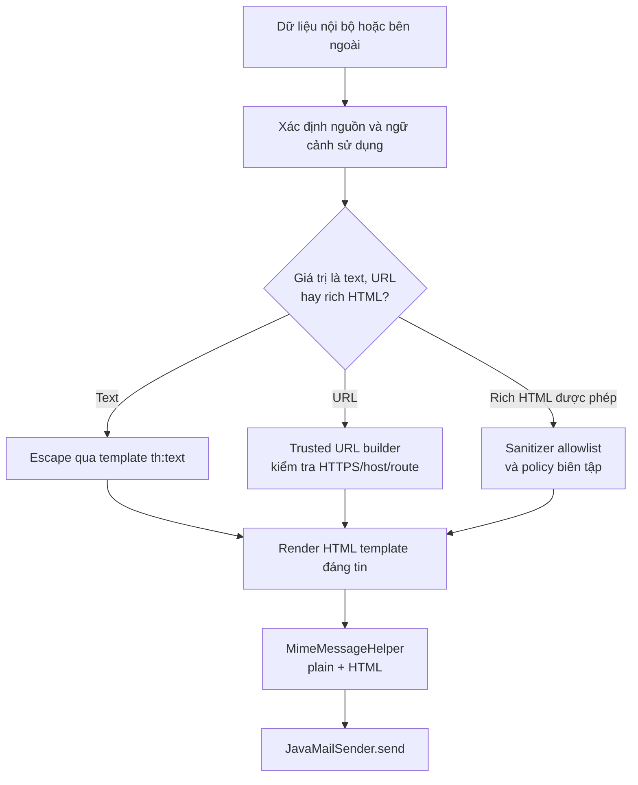

# Không đưa script hoặc nội dung động nguy hiểm vào email

Một hệ thống Spring Boot gửi email xác nhận tài khoản bằng HTML. Nhóm phát triển muốn tạo nút “Xác nhận ngay”, hiển thị tên người dùng và thông tin yêu cầu. Một lập trình viên đề xuất đặt JavaScript vào email để đếm ngược thời hạn xác nhận; người khác lấy nguyên nội dung mô tả do khách hàng nhập rồi nối vào chuỗi HTML. Những ý tưởng này đặt ra hai vấn đề khác nhau:

1. **Email HTML không phải một trang web đầy đủ.** Phần lớn ứng dụng email hiện đại chặn hoặc loại bỏ JavaScript, form tương tác, iframe và nhiều loại nội dung chủ động.
2. **Dữ liệu động không được kiểm soát có thể biến email thành nội dung gây hiểu lầm hoặc độc hại.** Việc một email client có bộ lọc bảo mật không giúp ứng dụng gửi được phép bỏ qua escaping, kiểm tra đường dẫn hay chính sách nội dung.

Trong **Spring Framework Mail**, `JavaMailSender`, `MimeMessage` và `MimeMessageHelper` giúp tạo, đóng gói và gửi email dạng MIME. **Chúng không phải bộ lọc HTML, không chạy JavaScript và không tự bảo đảm mọi nội dung HTML đều an toàn.** Bài học này giải thích cách thiết kế email HTML an toàn, phân biệt **cá nhân hóa hợp lệ** với **nội dung chủ động nguy hiểm**, và đưa ra ví dụ Spring Boot có thể áp dụng cho email giao dịch.

## 1. HTML email khác gì một trang web?

Email HTML sử dụng phần MIME có `Content-Type: text/html`. Tuy nhiên, môi trường hiển thị phụ thuộc vào ứng dụng nhận: Gmail, Outlook, Apple Mail, webmail của doanh nghiệp, ứng dụng di động hoặc một hệ thống bảo mật trung gian. Mỗi nơi có thể áp dụng bộ lọc và bộ máy render khác nhau.

| Khả năng | Trang web thông thường | Email HTML thông thường |
|---|---|---|
| HTML cơ bản: `p`, `h1`, `table`, `a` | Hỗ trợ | Thường được hỗ trợ, nhưng trình bày có thể khác. |
| CSS | Hỗ trợ rộng | Hỗ trợ **không đồng nhất**; một số selector/thuộc tính bị bỏ qua. |
| JavaScript | Có thể chạy theo chính sách bảo mật web | Thường bị chặn, loại bỏ hoặc không được thực thi. |
| Form nhập liệu và gửi dữ liệu | Có thể dùng | Không đáng tin cậy; thường bị vô hiệu hóa hoặc xử lý khác nhau. |
| iframe, embed, object | Có thể dùng theo chính sách web | Thường bị chặn hoặc làm sạch. |
| Nội dung tải từ domain ngoài | Có thể tải theo chính sách trình duyệt | Có thể bị chặn, proxy hóa hoặc chỉ tải khi người nhận cho phép. |
| Cookie/local storage/API trình duyệt | Có thể truy cập trong ngữ cảnh web | Không thể dựa vào chúng từ HTML email. |
| Responsive layout | CSS/media query tương đối phổ biến | Phụ thuộc email client; cần bố cục dự phòng. |

**Đừng viết email như một SPA thu nhỏ.** Một email tốt phải truyền tải thông tin cốt lõi bằng **nội dung tĩnh có thể đọc được** và các liên kết HTTPS tới trang web hoặc ứng dụng được bảo vệ. Khi cần tương tác phức tạp, hãy đưa người dùng tới một trang riêng có xác thực, phân quyền và kiểm soát bảo mật đầy đủ.

### 1.1. Ví dụ không nên làm

Đoạn HTML này là **minh họa một thiết kế không phù hợp**:

```html
<!-- KHÔNG đưa vào email gửi cho người dùng -->
<h2>Xác nhận đơn hàng</h2>
<script>
  // Mong đợi email client chạy JavaScript: không đáng tin cậy.
  document.body.append("Đếm ngược 60 giây...");
</script>
<form action="https://example.com/confirm" method="post">
  <input name="code" placeholder="Mã xác nhận">
  <button type="submit">Gửi</button>
</form>
```

Những rủi ro:

- Script thường không chạy, vì thế bộ đếm ngược không hoạt động.
- Form có thể bị xóa hoặc không thể gửi như lập trình viên mong đợi.
- Người dùng có thể không thấy nút, thấy bố cục vỡ hoặc không hiểu cần làm gì.
- Nếu email client hoặc hệ thống hiển thị trung gian tồn tại lỗ hổng, nội dung chủ động sẽ trở thành rủi ro bảo mật thay vì một tính năng đáng tin cậy.

Thay bằng nội dung tĩnh và liên kết:

```html
<h2>Xác nhận đơn hàng</h2>
<p>Yêu cầu của bạn đang chờ xác nhận.</p>
<p>
  <a href="https://accounts.example.com/orders/DH1024">
    Xem và xác nhận trên trang tài khoản
  </a>
</p>
<p>Nếu bạn không yêu cầu thao tác này, hãy bỏ qua email.</p>
```

Ví dụ liên kết ở đây minh họa đường dẫn thuộc **domain do hệ thống quản lý**. Trong sản phẩm thật, phải tạo URL từ cấu hình tin cậy, gắn định danh/token khi cần, kiểm tra quyền truy cập tại trang đích và tuyệt đối không coi việc người dùng **nhìn thấy** đường dẫn là đã được xác thực.

## 2. “Nội dung động” có luôn nguy hiểm không?

**Không.** Email có thể được cá nhân hóa rất nhiều mà vẫn an toàn.

Ví dụ nội dung động hợp lệ:

- Tên người nhận: `Nguyễn Văn An`.
- Mã đơn hàng: `DH1024`.
- Số tiền đã định dạng: `1.250.000 ₫`.
- Thời điểm hẹn: `14:30 ngày 15/11/2026`.
- Danh sách sản phẩm, trạng thái giao hàng, tên gói dịch vụ.
- Một liên kết đến trang xác minh/tài khoản được tạo từ domain đáng tin cậy.

Vấn đề không nằm ở việc **dữ liệu thay đổi giữa các email**, mà ở việc đưa dữ liệu không tin cậy vào ngữ cảnh có thể được hiểu là **HTML markup, thuộc tính, CSS, URL hoặc lệnh chủ động**.

| Loại nội dung | Ví dụ | Cách xử lý phù hợp |
|---|---|---|
| Giá trị văn bản động | Tên khách hàng, địa chỉ giao hàng | **HTML-escape** trước khi đặt vào text node. |
| Thuộc tính HTML động | `alt`, `title` | Escape theo **ngữ cảnh thuộc tính**, dùng template engine. |
| URL động | Liên kết xác minh, xem hóa đơn | Tạo/kiểm tra URL từ nguồn đáng tin, chỉ chấp nhận scheme/domain cho phép; sau đó escape thuộc tính. |
| Đoạn HTML do doanh nghiệp biên tập | Nội dung thông báo có định dạng | Ưu tiên template được kiểm soát hoặc sanitizer allowlist phù hợp. |
| HTML do người dùng nhập | Bình luận, mô tả sự cố, nội dung UGC | Mặc định hiển thị **dưới dạng văn bản đã escape**; không render trực tiếp thành markup. |
| Script hoặc sự kiện JavaScript | `script`, `onclick`, `onload` | Không đưa vào email. |
| Form, iframe, object, embed | Trường mật khẩu, form chuyển tiền | Không đưa vào email; chuyển sang trang web xác thực. |
| CSS/URL không tin cậy | `style`, `url(...)`, external stylesheet | Không cho dữ liệu tùy ý điều khiển; dùng CSS tĩnh và tài nguyên đã duyệt. |

**Quy tắc nền tảng:** *Template là code được kiểm soát; dữ liệu nghiệp vụ là dữ liệu*. Không trộn hai vai trò bằng cách nối chuỗi không có escaping.

## 3. Những thành phần HTML không nên đưa vào email

### 3.1. `script` và JavaScript inline

Không nên đưa JavaScript vào email dưới bất kỳ dạng nào:

```html
<!-- Đều không phù hợp cho HTML email -->
<script src="https://example.com/app.js"></script>
<script>alert("Hello");</script>
<a href="javascript:alert('clicked')">Bấm vào đây</a>

<button onclick="submitOrder()">Xác nhận</button>
```

Những kỹ thuật đó phụ thuộc khả năng chạy JavaScript, vốn bị hầu hết mail client chặn. Bên cạnh vấn đề không hoạt động, chúng còn là các **dạng đầu vào nguy hiểm** nếu được chuyển tiếp đến một hệ thống render HTML kém an toàn.

Email gửi đi nên chứa:

- Văn bản có ý nghĩa.
- Thẻ HTML trình bày đơn giản.
- Liên kết `https://...` đã được kiểm tra.
- Hình ảnh/tài nguyên được cho phép và không cần script để hiển thị.

Không tạo nội dung chỉ có thể đọc được sau khi JavaScript khởi chạy.

### 3.2. Event handler trong thuộc tính

Những thuộc tính bắt đầu bằng `on...` có thể gắn hành vi khi xảy ra sự kiện, chẳng hạn `onclick`, `onerror` hoặc `onload`.

```html
<!-- Ví dụ không an toàn, không đưa vào email -->

<a href="https://example.com" onclick="runCode()">Xem chi tiết</a>
```

Không phụ thuộc vào việc “email client chắc chắn xóa những thuộc tính này”. Hệ thống gửi phải chủ động tạo HTML không chứa chúng, vì nội dung có thể đi qua các bộ xử lý, preview hoặc hệ thống lưu trữ HTML khác nhau.

### 3.3. iframe, object, embed và nội dung nhúng

```html
<!-- KHÔNG dùng cho HTML email thông thường -->
<iframe src="https://example.com/dashboard"></iframe>
<object data="https://example.com/document"></object>
<embed src="https://example.com/animation">
```

Các phần tử này không phải cách đáng tin cậy để hiển thị dashboard, biểu mẫu hay tài liệu trong email. Thay bằng một **đoạn tóm tắt tĩnh** và liên kết HTTPS tới trang đã được bảo vệ.

### 3.4. Form nhập thông tin nhạy cảm

Không yêu cầu người dùng nhập **mật khẩu, mã OTP, thông tin thanh toán hoặc dữ liệu bí mật** vào một form HTML trong email. Email có thể bị chuyển tiếp, chụp màn hình, hiển thị qua gateway hoặc bị giả mạo. Nhiều email client chặn form; một form nếu hoạt động cũng có thể tạo thói quen nguy hiểm cho người dùng.

Thay vì:

```html
<!-- Thiết kế không nên áp dụng -->
<form action="https://example.com/login" method="post">
  <input type="password" name="password">
  <button>Đăng nhập</button>
</form>
```

hãy dùng:

```html
<p>Để quản lý tài khoản, vui lòng truy cập trang chính thức.</p>
<a href="https://accounts.example.com/login">Mở trang đăng nhập</a>
```

Trang đích phải tự kiểm tra **TLS, xác thực, CSRF, phân quyền, thời hạn phiên và kiểm soát dữ liệu đầu vào**. Không được chuyển trách nhiệm đó sang một nút trong email.

### 3.5. SVG và hình ảnh mang nội dung chủ động

SVG là định dạng hình ảnh dựa trên XML và trong những ngữ cảnh có thể có script, external reference hoặc thành phần chủ động. Việc cho phép tải lên SVG rồi đưa thẳng vào email như HTML/inline code có thể tạo rủi ro khi đi qua các hệ thống hiển thị khác nhau.

Nếu cần logo, biểu đồ đơn giản, hoặc hình minh họa, lựa chọn thực dụng thường là **PNG/JPEG được tạo từ nguồn đáng tin**, dùng `alt` tương ứng. Với SVG hoặc file do người dùng cung cấp, cần một chính sách kiểm tra/chuyển đổi chuyên biệt; không tin tưởng chỉ vì `Content-Type: image/svg+xml`.

## 4. HTML injection: nguy hiểm dù script thường không chạy

Giả sử form cho phép khách hàng nhập tên:

```text
Nguyễn Văn An
```

Lập trình viên tạo email:

```java
// KHÔNG NÊN: nội dung từ người dùng được nối trực tiếp thành HTML.
String html = "<p>Xin chào " + customerName + "</p>"
        + "<p>Đơn hàng của bạn đã được ghi nhận.</p>";
```

Nếu `customerName` chứa ký tự giống markup, chẳng hạn:

```text
<strong>Khách VIP</strong>
```

thì nội dung gửi đi không còn là *tên người dùng dạng văn bản*. Nó có thể trở thành **HTML do người dùng điều khiển**.

Nội dung còn có thể giả mạo thương hiệu, chèn liên kết đến domain khác, tạo lời kêu gọi chuyển tiền hoặc làm thay đổi bố cục. Không cần JavaScript chạy mới có nguy cơ: **HTML injection có thể biến email thành một thông điệp gây hiểu lầm**.

### 4.1. Escape văn bản thay vì “lọc ký tự xấu” thủ công

Nếu dữ liệu chỉ có vai trò văn bản, hãy HTML-escape trước khi render:

| Ký tự | Biểu diễn HTML thường gặp |
|---|---|
| `&` | `&amp;` |
| `<` | `&lt;` |
| `>` | `&gt;` |
| `"` | `&quot;` trong ngữ cảnh thuộc tính |
| `'` | Có thể được biểu diễn bằng entity phù hợp theo ngữ cảnh |

Trong Java, **không nên tự viết hàm thay thế ký tự tùy tiện** nếu dự án đã dùng template engine có escaping theo ngữ cảnh. Tính đúng đắn còn phụ thuộc thứ tự thay thế, bộ mã và vị trí được chèn vào HTML.

Ví dụ HTML mong muốn sau khi escape:

```html
<p>Xin chào &lt;strong&gt;Khách VIP&lt;/strong&gt;</p>
```

Người nhận thấy chuỗi `<strong>Khách VIP</strong>` như **văn bản**, không phải một thẻ HTML thật.

### 4.2. HTML escaping không đồng nghĩa URL validation

Giả sử template sử dụng:

```html
<a th:href="${actionUrl}">Xác nhận</a>
```

Template engine có thể escape ký tự để chúng không phá vỡ **cú pháp thuộc tính HTML**. Nhưng nếu `actionUrl` bị kẻ xấu điều khiển, nó vẫn có thể trỏ tới một trang giả mạo hoặc sử dụng URL scheme nguy hiểm. **Escaping giải quyết cú pháp, không quyết định liên kết nào được phép.**

Vì thế cần **hai bước riêng**:

1. Kiểm tra/khởi tạo URL đáng tin cậy: scheme `https`, hostname trong allowlist, path do ứng dụng kiểm soát, token hợp lệ.
2. Để template engine escape URL trong thuộc tính `href` theo ngữ cảnh HTML.

Không dùng `contains("example.com")` hay `endsWith("example.com")` trên chuỗi URL thô để quyết định liên kết tin cậy; những cách này dễ sai với hostname, userinfo, subdomain hoặc cách biểu diễn URL.

## 5. URL trong email: chỉ sử dụng đích đến được kiểm soát

### 5.1. Các nhóm URL nên tránh

| Loại URL/giá trị | Vấn đề |
|---|---|
| `javascript:...` | Không phải liên kết điều hướng an toàn; có thể kích hoạt script trong những môi trường cho phép. |
| `data:...` | Có thể nhúng nội dung tùy ý; không phù hợp làm liên kết tác vụ tin cậy. |
| `file:...` | Liên quan tài nguyên cục bộ; không phải đích điều hướng hợp lệ cho email gửi người dùng. |
| `http://...` | Kết nối không mã hóa; không phù hợp với link đăng nhập/xác minh hay dữ liệu nhạy cảm. |
| Link do người dùng nhập mà chưa kiểm tra | Có thể dẫn đến phishing, redirect không mong muốn hoặc domain không được phép. |
| Link rút gọn không do hệ thống kiểm soát | Che khuất đích thực và khó đánh giá độ tin cậy. |
| Link chứa bí mật lâu dài | Có nguy cơ bị lộ qua chuyển tiếp email, lịch sử, log hoặc hệ thống trung gian. |

Nút “Xác nhận tài khoản” trong email nên là **một thẻ `a` với HTTPS URL**, không phải JavaScript event handler.

### 5.2. Ví dụ kiểm tra URI trước khi đưa vào template

Giả sử dịch vụ chỉ cho phép liên kết xác minh thuộc **`accounts.example.com`**, trên HTTPS cổng mặc định hoặc 443, với đường dẫn cố định bắt đầu bằng `/verify`.

```java
import java.net.URI;
import java.util.Locale;

public final class MailLinks {

    private MailLinks() {}

    public static URI requireVerificationLink(String rawUrl) {
        if (rawUrl == null || rawUrl.isBlank()) {
            throw new IllegalArgumentException("Verification URL required");
        }

        URI uri = URI.create(rawUrl);
        if (!uri.isAbsolute()
                || !"https".equalsIgnoreCase(uri.getScheme())
                || uri.getHost() == null
                || uri.getRawUserInfo() != null
                || uri.getRawFragment() != null) {
            throw new IllegalArgumentException("Unsafe verification URL");
        }

        String host = uri.getHost().toLowerCase(Locale.ROOT);
        if (!host.equals("accounts.example.com")) {
            throw new IllegalArgumentException("Unexpected URL host");
        }

        int port = uri.getPort();
        if (port != -1 && port != 443) {
            throw new IllegalArgumentException("Unexpected URL port");
        }

        String path = uri.getRawPath();
        if (!"/verify".equals(path)) {
            throw new IllegalArgumentException("Unexpected URL path");
        }

        return uri;
    }
}
```

Đây là **validator minh họa cho một luồng URL cụ thể**. Nó không phải thư viện kiểm tra mọi kiểu URL, và không thay thế bước **tạo token, cấp quyền, kiểm tra expiry hoặc chống dùng lại** ở backend. Chính sách path chính xác ở ví dụ hạn chế open redirect/path confusion; với những dự án cần nhiều đường dẫn, nên **tạo URL từ cấu hình domain cố định và route đã được định nghĩa**, thay vì mở rộng bằng những phép kiểm tra chuỗi tùy ý.

Khi tự tạo link xác minh, nên để **ứng dụng tạo link từ base URL được cấu hình đáng tin cậy** và encode token trong query/path đúng quy tắc, thay vì chấp nhận một URL đích tùy ý từ HTTP request. Một số tác vụ có token nằm trong URL phải cân nhắc log, referrer, proxy và khả năng chuyển tiếp email; token cần ngẫu nhiên, thời hạn ngắn và phạm vi quyền tối thiểu.

### 5.3. Liên kết dẫn tới trang đăng nhập/xác minh, không thực hiện hành động nhạy cảm qua GET đơn thuần

Một số hệ thống gửi link để người dùng xác minh email hoặc đặt lại mật khẩu. Cần cân nhắc các hệ thống bảo mật mail **tự quét/truy cập liên kết** trước khi người nhận bấm.

Nếu một request `GET /delete-account?token=...` tự động thực hiện hành động không thể hoàn tác, công cụ quét link có thể vô tình kích hoạt nó. Với tác vụ nhạy cảm, nên dùng liên kết đưa đến **trang xác nhận** rồi yêu cầu một hành động có ý thức, kết hợp cơ chế xác thực/ủy quyền thích hợp. Không thiết kế hành động phá hủy chỉ dựa vào việc URL được mở.

## 6. Spring Mail gửi HTML nhưng không tự “làm sạch” HTML

### 6.1. Phân biệt các lớp

| Thành phần | Trách nhiệm |
|---|---|
| `JavaMailSender` | Tạo và gửi thông điệp qua Jakarta Mail/SMTP transport. |
| `MimeMessage` | Biểu diễn email MIME: header, body, các phần nội dung. |
| `MimeMessageHelper` | Giúp đặt `From`, `To`, `Subject`, text/HTML, attachment, inline resources. |
| Template engine (ví dụ Thymeleaf) | Tạo chuỗi HTML từ template và dữ liệu; có thể escape biểu thức khi sử dụng đúng API. |
| Validator và chính sách nghiệp vụ | Kiểm soát URL, dữ liệu được phép, nội dung gửi và phạm vi người nhận. |
| Sanitizer allowlist (khi cần) | Giới hạn tập HTML được phép đối với dữ liệu rich text không tin cậy. |
| Email client | Hiển thị thông điệp theo chính sách của người nhận; không được xem là lớp bảo vệ duy nhất. |

Ví dụ trực tiếp:

```java
MimeMessage message = mailSender.createMimeMessage();
MimeMessageHelper helper =
        new MimeMessageHelper(message, false, "UTF-8");

helper.setFrom("notifications@example.com");
helper.setTo("an@example.net");
helper.setSubject("Thông báo từ hệ thống");
helper.setText(htmlContent, true);

mailSender.send(message);
```

Tham số `true` trong `setText(htmlContent, true)` nghĩa là **phần thân được đánh dấu là HTML**, **không** có nghĩa Spring đã loại bỏ `script` hoặc đảm bảo `htmlContent` an toàn. Nếu `htmlContent` được tạo từ chuỗi người dùng không kiểm tra, lỗi nằm ở **quá trình xây dựng nội dung** trước đó.

### 6.2. Gửi cả `text/plain` và `text/html`

Một cách phù hợp với nhiều email client là tạo cả **phiên bản văn bản thuần** và **phiên bản HTML**:

```java
MimeMessage message = mailSender.createMimeMessage();
MimeMessageHelper helper =
        new MimeMessageHelper(message, true, "UTF-8");

helper.setFrom("notifications@example.com");
helper.setTo("an@example.net");
helper.setSubject("Xác nhận đăng ký");
helper.setText(
        "Cảm ơn bạn đã đăng ký. Hãy mở trang xác minh từ liên kết trong email.",
        "<h1>Xác nhận đăng ký</h1><p>Cảm ơn bạn đã đăng ký.</p>"
                + "<p><a href=\"https://accounts.example.com/verify\">"
                + "Xác minh tài khoản</a></p>");

mailSender.send(message);
```

Overload `setText(String plainText, String htmlText)` xây dựng dạng **`multipart/alternative`** và cần helper có **multipart enabled**. Trong thực tế, **plain text nên chứa thông tin và URL tương đương**, không chỉ nói “xem HTML” như đoạn minh họa ngắn ở trên. Người dùng có thể dùng client không hiển thị HTML hoặc bộ đọc màn hình, vì vậy bản plain text là phần nội dung có giá trị thực.

Đối với email chỉ có text đơn giản, `SimpleMailMessage` còn gọn hơn và tránh được nhiều vấn đề HTML.

## 7. Dùng Thymeleaf để chèn dữ liệu động an toàn

Khi nội dung email có tên khách hàng, mã đơn hàng và liên kết, việc nối chuỗi HTML trực tiếp trong Java rất khó kiểm soát. Một **template engine** tách phần HTML được biên tập khỏi dữ liệu động.

Trong hệ sinh thái Spring Boot, có thể sử dụng **Thymeleaf**. Ví dụ này giả định dự án đã thêm dependency Thymeleaf phù hợp với phiên bản Spring Boot và đã cấu hình template resolver theo convention của ứng dụng.

### 7.1. Template HTML dùng `th:text`

File `src/main/resources/templates/mail/verification.html`:

```html
<!doctype html>
<html lang="vi" xmlns:th="http://www.thymeleaf.org">
<head>
  <meta charset="UTF-8">
  <title>Xác minh tài khoản</title>
</head>
<body style="font-family: Arial, sans-serif; color: #222;">
  <table role="presentation" cellpadding="0" cellspacing="0"
         style="max-width: 600px; width: 100%;">
    <tr>
      <td>
        <h1>Xác minh tài khoản</h1>
        <p>
          Xin chào <strong th:text="${displayName}">bạn</strong>,
        </p>
        <p>
          Chúng tôi đã nhận được yêu cầu đăng ký tài khoản.
          Hãy bấm liên kết sau để tiếp tục.
        </p>
        <p>
          <a th:href="${verificationUrl}"
             href="https://accounts.example.com/"
             style="background: #154f8d; color: #fff;
                    padding: 12px 18px; text-decoration: none;">
            Xác minh tài khoản
          </a>
        </p>
        <p>Nếu bạn không yêu cầu đăng ký, hãy bỏ qua email này.</p>
      </td>
    </tr>
  </table>
</body>
</html>
```

Trong Thymeleaf:

- **`th:text`** chèn giá trị vào text node theo dạng **escaped text**, thích hợp với tên khách hàng và dữ liệu văn bản không tin cậy.
- **`th:href`** đưa giá trị vào thuộc tính URL; nó giúp tạo/escape thuộc tính theo template engine, **nhưng không xác minh domain hoặc scheme của URL**.
- **`th:utext`** chèn **unescaped HTML**. Không dùng `th:utext` cho dữ liệu trực tiếp từ người dùng, API ngoài hoặc database chưa được kiểm soát.
- HTML/CSS trong template là **cấu trúc tĩnh được code review**, không phải mã được sinh từ dữ liệu tự do.

Ví dụ người dùng có tên:

```text
<b>Quản trị viên</b>
```

`th:text` khiến client thấy chữ `<b>Quản trị viên</b>`, chứ không coi giá trị đó là thẻ `b`. Đây là hành vi mong muốn với **tên**, vì tên là dữ liệu văn bản.

### 7.2. Java service: render rồi gửi MIME

Ví dụ Spring Boot với `JavaMailSender` và `SpringTemplateEngine`:

```java
package com.example.mail;

import jakarta.mail.MessagingException;
import jakarta.mail.internet.MimeMessage;
import org.springframework.beans.factory.annotation.Value;
import org.springframework.mail.javamail.JavaMailSender;
import org.springframework.mail.javamail.MimeMessageHelper;
import org.springframework.stereotype.Service;
import org.thymeleaf.TemplateEngine;
import org.thymeleaf.context.Context;

import java.net.URI;
import java.util.Locale;

@Service
public class VerificationEmailSender {

    private final JavaMailSender mailSender;
    private final TemplateEngine templateEngine;
    private final String fromAddress;

    public VerificationEmailSender(
            JavaMailSender mailSender,
            TemplateEngine templateEngine,
            @Value("${app.mail.from}") String fromAddress) {
        this.mailSender = mailSender;
        this.templateEngine = templateEngine;
        this.fromAddress = fromAddress;
    }

    public void send(
            String recipient,
            String displayName,
            String verificationUrl) throws MessagingException {

        // URL đã được tạo từ cấu hình tin cậy ở tầng nghiệp vụ
        // và phải thỏa chính sách định tuyến của sản phẩm.
        URI safeUrl = MailLinks.requireVerificationLink(verificationUrl);

        // Dữ liệu dạng văn bản được escape bởi th:text trong template.
        Context context = new Context(Locale.forLanguageTag("vi-VN"));
        context.setVariable("displayName", displayName);
        context.setVariable("verificationUrl", safeUrl.toASCIIString());

        String html = templateEngine.process(
                "mail/verification", context);

        String plain = "Xin chào " + displayName
                + ". Vui lòng xác minh tài khoản tại: "
                + safeUrl.toASCIIString()
                + ". Nếu bạn không yêu cầu đăng ký, hãy bỏ qua email.";

        MimeMessage message = mailSender.createMimeMessage();
        MimeMessageHelper helper =
                new MimeMessageHelper(message, true, "UTF-8");

        helper.setFrom(fromAddress);
        helper.setTo(recipient);
        helper.setSubject("Xác minh tài khoản");
        helper.setText(plain, html);

        mailSender.send(message);
    }
}
```

`MailLinks` trong ví dụ là utility đã định nghĩa ở phần trước. Để hoàn thiện trong ứng dụng thật, cần kiểm tra **recipient**, chính sách gửi, giới hạn độ dài của `displayName` và quá trình phát hành token. Lớp trên tập trung minh họa **tách render HTML khỏi SMTP transport**. Đặc biệt, `plain` chỉ là chuỗi text nên không cần HTML-escape, nhưng vẫn phải kiểm soát ký tự điều khiển, độ dài và nội dung để không tạo email gây hiểu lầm.

Dependency thông dụng khi dùng Spring Boot với Gradle:

```groovy
dependencies {
    implementation 'org.springframework.boot:spring-boot-starter-mail'
    implementation 'org.springframework.boot:spring-boot-starter-thymeleaf'
}
```

`application.yml` cho SMTP submission có STARTTLS:

```yaml
spring:
  mail:
    host: ${MAIL_HOST}
    port: 587
    username: ${MAIL_USERNAME}
    password: ${MAIL_PASSWORD}
    protocol: smtp
    default-encoding: UTF-8
    properties:
      "[mail.smtp.auth]": true
      "[mail.smtp.starttls.enable]": true
      "[mail.smtp.starttls.required]": true
      "[mail.smtp.ssl.checkserveridentity]": true
      "[mail.smtp.connectiontimeout]": 5000
      "[mail.smtp.timeout]": 10000
      "[mail.smtp.writetimeout]": 10000

app:
  mail:
    from: ${MAIL_FROM:notifications@example.com}
```

Đây là cấu hình minh họa cho một provider hỗ trợ **cổng 587 và STARTTLS**. Các biến môi trường phải được cấp từ hệ thống triển khai, không ghi mật khẩu SMTP vào repository. Provider dùng implicit TLS cổng 465 cần một cấu hình TLS/transport tương ứng. Cấu hình TLS của SMTP giúp bảo vệ **kết nối gửi**, không tự làm HTML được sanitize và cũng không bảo đảm thư được người nhận đọc.

### 7.3. Những ví dụ thường sai khi dùng Thymeleaf

Sai vì render tên người dùng như HTML:

```html
<!-- KHÔNG dùng với tên hoặc dữ liệu không tin cậy -->
<p th:utext="${displayName}">Tên người dùng</p>
```

Sai vì lấy URL tùy ý và tin rằng `th:href` đã bảo vệ mọi thứ:

```java
context.setVariable("verificationUrl", request.getRedirectUrl());
```

Sai vì ghép thuộc tính HTML thủ công:

```java
// KHÔNG NÊN: biến dữ liệu người dùng thành markup trực tiếp.
String html = "<a href=\"" + request.getUrl() + "\">Xác nhận</a>";
```

Đúng hơn:

1. Lấy URL từ **trusted link builder**, không từ redirect tùy ý.
2. Kiểm tra domain, scheme, route và token ở backend.
3. Chuyển **giá trị logic** vào context.
4. Dùng `th:text` và `th:href` để render đúng ngữ cảnh.
5. Không đưa `th:utext` vào template cho dữ liệu tự do.

## 8. Nếu nghiệp vụ thực sự cần rich text do người dùng biên tập

Một số sản phẩm cho phép nhân viên soạn nội dung email có định dạng: in đậm, in nghiêng, đoạn văn, danh sách hoặc liên kết. Dữ liệu có thể đến từ trình chỉnh sửa WYSIWYG dưới dạng HTML.

Đó là bài toán **khác với chèn tên người dùng**. Nếu nghiệp vụ chỉ cần text, hãy **escape và hiển thị như text**. Nếu nghiệp vụ cần giữ một tập HTML rất nhỏ, cần có **sanitizer dùng allowlist** phù hợp.

### 8.1. Không dùng blacklist các từ khóa nguy hiểm

Những cách như:

```java
// Sai ý tưởng: không đủ để biến HTML tùy ý thành an toàn.
html = html.replace("<script>", "");
html = html.replace("javascript:", "");
```

không an toàn vì HTML có nhiều biến thể cú pháp, kiểu chữ, encoding, thuộc tính và ngữ cảnh. Việc thay thế theo chuỗi có thể bỏ sót nguy cơ hoặc làm hỏng nội dung hợp lệ.

### 8.2. Allowlist theo phần tử và thuộc tính

Một chính sách mẫu đối với email giới thiệu sản phẩm có thể chỉ cho phép:

- Các thẻ trình bày đơn giản: `p`, `br`, `strong`, `em`, `ul`, `ol`, `li`.
- Thẻ `a` nếu URL được phép; hạn chế thuộc tính `href` theo chính sách.
- Không cho phép `script`, `style` tự do, `iframe`, `object`, `form`, SVG inline hoặc các thuộc tính sự kiện `on...`.

Ví dụ về ý tưởng dùng thư viện **jsoup** để làm sạch HTML:

```java
import org.jsoup.Jsoup;
import org.jsoup.safety.Safelist;

public final class MailRichText {
    private MailRichText() {}

    public static String clean(String untrustedHtml) {
        Safelist allowed = new Safelist()
                .addTags("p", "br", "strong", "em", "ul", "ol", "li");

        // Chính sách ví dụ cực hẹp: chỉ văn bản và định dạng,
        // không cho phép link hoặc ảnh do người dùng tự chèn.
        return Jsoup.clean(untrustedHtml, allowed);
    }
}
```

Ví dụ này cần **dependency jsoup riêng**, không có sẵn chỉ vì đã thêm `spring-boot-starter-mail`. Nó minh họa **một allowlist đơn giản** và chủ động không cho phép link/ảnh do người dùng cung cấp. Nếu cần cho phép `a href`, phải có chính sách URL rõ ràng và kiểm tra protocol/host phù hợp với yêu cầu sản phẩm.

**Quan trọng:** sanitizer là một lớp bảo vệ cần được cấu hình và duy trì đúng phiên bản; nó không làm biến mọi HTML thành an toàn tuyệt đối. Nếu muốn đưa HTML đã được sanitizer chấp thuận vào template, đó phải là **một luồng riêng có quy tắc rõ ràng**, không phải tùy tiện bật `th:utext` cho mọi trường. Tốt nhất là hạn chế người được quyền biên tập rich HTML, lưu lịch sử nội dung và kiểm soát template phát hành.

### 8.3. Rich text không đồng nghĩa JavaScript

Kể cả khi có sanitizer, **không cần và không nên giữ script** để làm rich email. Nội dung soạn thảo nên giới hạn ở trình bày và các liên kết được kiểm soát. Tính năng động như biểu đồ trực tiếp, trạng thái đơn hàng hiện thời hoặc biểu mẫu tương tác thuộc về website/app phía sau liên kết.

## 9. CSS trong email: tập trung vào hiển thị, không dùng CSS như kênh đưa nội dung tùy ý

CSS trong email có mức độ hỗ trợ không đồng đều. Một số client xử lý inline style tốt hơn stylesheet phức tạp; nhiều thuộc tính và media query có thể bị bỏ qua.

### 9.1. Chỉ dùng CSS được kiểm soát bởi ứng dụng

Ví dụ email HTML với layout đơn giản:

```html
<table role="presentation" style="width: 100%; max-width: 600px;">
  <tr>
    <td style="font-family: Arial, sans-serif; line-height: 1.5;">
      <h1 style="font-size: 22px;">Cập nhật đơn hàng</h1>
      <p>Đơn hàng của bạn đã được xác nhận.</p>
      <a href="https://orders.example.com/"
         style="color: #154f8d; text-decoration: underline;">
        Xem chi tiết
      </a>
    </td>
  </tr>
</table>
```

Đây là ví dụ HTML email tĩnh. Tùy client, một số style vẫn có thể được thay đổi hoặc bỏ qua. **Nội dung chính phải có thể đọc được ngay cả khi CSS không hoạt động.**

### 9.2. Không đưa CSS hoặc ảnh nền tùy ý từ người dùng

Nếu cho người dùng kiểm soát nguyên `style="..."`, nội dung có thể:

- Che chữ quan trọng hoặc tạo lớp phủ giả mạo.
- Tạo liên kết/tài nguyên remote qua `url(...)` trong những ngữ cảnh được hỗ trợ.
- Cố tải nội dung bên ngoài hoặc gây lỗi render trên client.
- Làm email không thể đọc được khi client bỏ một phần CSS.

Vì vậy, dữ liệu đầu vào chỉ nên quyết định các **giá trị nghiệp vụ**; việc chọn màu, kiểu chữ, spacing và cấu trúc thuộc template tin cậy. Nếu cần theme, dùng một tập giá trị đã định nghĩa trước, không chèn CSS tự do.

### 9.3. Dark mode, responsive và accessibility

Email client có thể thay đổi màu trong dark mode, giới hạn chiều rộng trên điện thoại hoặc không hỗ trợ selector. Để email vẫn dùng được:

1. Chọn độ tương phản văn bản hợp lý và tránh chỉ dùng màu để thông báo trạng thái.
2. Dùng nội dung ngắn, cỡ chữ dễ đọc và liên kết có tên rõ ràng.
3. Thêm `alt` cho ảnh có ý nghĩa.
4. Không đặt toàn bộ văn bản vào hình ảnh.
5. Có bản `text/plain` tương ứng khi gửi MIME multipart/alternative.
6. Kiểm tra email trên những client mà người dùng sản phẩm thường sử dụng ở giai đoạn kiểm thử nội dung.

## 10. Hình ảnh ngoài và dữ liệu cá nhân

Trong HTML email, hình ảnh có thể được tham chiếu bằng URL:

```html

```

Nhưng tài nguyên remote phụ thuộc chính sách của email client. Ứng dụng nhận có thể **chặn tải ảnh, tải qua proxy hoặc chỉ tải khi người dùng cho phép**. Không thể dựa vào một hình remote để truyền thông tin bắt buộc.

### 10.1. Hình remote có thể tạo rủi ro riêng tư

Mỗi lần tài nguyên remote được yêu cầu, hệ thống lưu trữ có thể quan sát một số metadata như thời điểm truy cập và thông tin mạng/proxy tùy client. Các **tracking pixel** là ví dụ nhạy cảm: email có thể chứa ảnh cực nhỏ với URL riêng cho từng người nhận để suy đoán hành vi mở thư.

Những tín hiệu này **không đáng tin như bằng chứng người dùng thực sự đã đọc email**, vì một số client tải ảnh tự động, dùng proxy hoặc chặn tải. Khi ứng dụng dùng tính năng theo dõi, cần phù hợp chính sách riêng tư, lựa chọn của người nhận và quy định áp dụng.

### 10.2. Inline image qua Content-ID

Nếu muốn logo được gửi cùng email, có thể dùng **CID** thay vì phụ thuộc ảnh remote:

```java
MimeMessage message = mailSender.createMimeMessage();
MimeMessageHelper helper = new MimeMessageHelper(
        message,
        MimeMessageHelper.MULTIPART_MODE_MIXED_RELATED,
        "UTF-8");

helper.setFrom("notifications@example.com");
helper.setTo("an@example.net");
helper.setSubject("Thông báo");
helper.setText(
        "Thông báo từ hệ thống.",
        "<p>Thông báo từ hệ thống.</p>"
                + "");

helper.addInline(
        "company-logo",
        new ClassPathResource("mail/company-logo.png"),
        "image/png");

mailSender.send(message);
```

Ở đây cần import `org.springframework.core.io.ClassPathResource` cùng các API Spring Mail/Jakarta Mail tương ứng. Resource `mail/company-logo.png` phải có trong classpath. **Nên gọi `setText` trước `addInline`** để giúp các email client nhận diện cấu trúc HTML và resource liên quan.

Inline image không chạy script nếu ứng dụng chỉ gửi raster image được kiểm soát. Nhưng client vẫn có thể chặn/hiển thị khác nhau; email nên có bản text và `alt` có ý nghĩa.

## 11. Nội dung do hệ thống bên ngoài trả về vẫn phải được coi là dữ liệu không tin cậy

Không chỉ dữ liệu từ form web mới nguy hiểm. Một hệ thống gửi email có thể lấy thông tin từ:

- API của đối tác.
- Nội dung ticket hỗ trợ do khách hàng nhập.
- CRM, hệ thống quản lý đơn hàng hoặc database được nhập từ file.
- Kết quả từ công cụ tìm kiếm, hệ thống tổng hợp nội dung hoặc AI.
- Webhook từ dịch vụ bên ngoài.

Ví dụ, CRM trả về `customerDisplayName` hoặc `ticketDescription` có chứa markup. **Dù dữ liệu đi qua hệ thống nội bộ, nguồn gốc ban đầu vẫn có thể là người dùng hoặc bên thứ ba.**

Quy trình phù hợp:



Đừng để đoạn văn tự do từ hệ thống bên ngoài được diễn giải thành lệnh trong pipeline, thành HTML sống hoặc thành một link có thể dẫn người dùng tới domain tùy ý.

## 12. Các tình huống đặc biệt và hiểu lầm cần tránh

### 12.1. “Email client chặn script rồi, tôi cứ gửi script cũng không sao”

**Sai về thiết kế.** Kết quả sẽ không nhất quán giữa client, email có thể vỡ layout hoặc bị gateway đánh giá là đáng ngờ. Nội dung còn có thể được hiển thị lại bởi các hệ thống preview, archive hay dashboard nội bộ với mức độ bảo vệ khác nhau. **Loại bỏ script từ nguồn** là nguyên tắc đơn giản và bền vững.

### 12.2. “`MimeMessageHelper.setText(html, true)` sẽ sanitize HTML”

**Không.** Tham số `true` chỉ định **HTML content**, không chạy bộ lọc XSS hoặc whitelist tag. Cần escape dữ liệu khi render template hoặc dùng sanitizer riêng nếu thực sự chấp nhận rich HTML.

### 12.3. “Dùng `th:text` thì mọi liên kết cũng an toàn”

**Không.** `th:text` phù hợp với text node. URL cần kiểm tra scheme, host, route và nguồn tạo link trước khi đặt vào `th:href`. Một liên kết trỏ đến website giả mạo vẫn là liên kết nguy hiểm dù cú pháp HTML đã được escape.

### 12.4. “Chỉ cần `replace("<script>", "")`”

**Không.** Blacklist thủ công có thể bỏ sót nhiều biến thể HTML, event handler, URL scheme và thuộc tính nguy hiểm. Khi dữ liệu chỉ là text, escape nó; khi bắt buộc nhận rich HTML, dùng **allowlist sanitizer** được duy trì và có phạm vi rõ.

### 12.5. “Ảnh trong email chắc chắn sẽ hiển thị”

**Không.** Ảnh remote có thể bị chặn/proxy, CID inline cũng có thể được client xử lý khác nhau. Nội dung chính không nên dựa vào ảnh; luôn có `alt` và bản text.

### 12.6. “Mọi nội dung động đều phải cấm”

**Không.** Tên người nhận, mã đơn hàng, lịch hẹn và trạng thái thanh toán là nội dung động cần thiết. Điều cần cấm là **nội dung chủ động nguy hiểm hoặc dữ liệu không tin cậy được diễn giải thành markup/URL/CSS tùy ý**. Cá nhân hóa an toàn là việc render dữ liệu dưới đúng ngữ cảnh.

### 12.7. “Có thể gửi form email tương tác như một trang SPA”

Với **HTML email thông thường**, không nên phụ thuộc form, JavaScript, iframe hay state client. Một số hệ sinh thái có định dạng tương tác riêng (ví dụ AMP for Email) với cơ chế hỗ trợ và xác thực đặc thù; chúng **không phải** lý do để đưa JavaScript tùy ý vào `text/html`. Nếu thực sự triển khai định dạng riêng, phải tuân theo đặc tả và chính sách provider riêng, đồng thời có bản HTML/text dự phòng.

### 12.8. “Gửi email HTML an toàn thì không thể bị phishing”

**Sai.** Email không có script vẫn có thể dẫn người dùng tới liên kết lừa đảo hoặc có nội dung giả mạo. Ngoài kiểm soát HTML, hệ thống gửi cần quản lý domain và tài khoản `From`, xác thực tên miền (SPF, DKIM, DMARC theo hạ tầng), chống lạm dụng nội dung và kiểm tra link. Phần hiển thị an toàn là một lớp của thiết kế email đáng tin cậy.

## 13. Vận hành và kiểm soát nội dung trước khi phát hành

Trong hệ thống có nhiều template email, nên phân chia trách nhiệm:

| Lớp | Quyết định |
|---|---|
| **Nghiệp vụ** | Loại thông báo nào được gửi, ai là người nhận, dữ liệu nào được phép đưa vào email. |
| **Template** | Bố cục HTML, cách thể hiện text, CSS tĩnh, link/CTA và tài nguyên đã duyệt. |
| **Data validation** | Độ dài, định dạng, URL, mã đơn hàng, nội dung người dùng. |
| **HTML escaping / sanitizer** | Cách biến dữ liệu không tin cậy thành nội dung có thể render an toàn. |
| **Mail composer** | Dùng `MimeMessageHelper` tạo text/plain, text/html, inline và attachment. |
| **SMTP sender** | Gửi qua `JavaMailSender` với TLS/AUTH và timeout phù hợp. |
| **Observability** | Theo dõi template version, notification ID, kết quả submission/delivery và lỗi, không log bí mật. |

### 13.1. Version template và giới hạn dữ liệu

Nếu email là tài liệu giao dịch quan trọng, nên quản lý phiên bản template để giải thích một thông báo đã được gửi với nội dung nào. Dữ liệu đầu vào nên có **giới hạn độ dài và kiểu**: tên quá dài có thể làm vỡ layout; một đoạn mô tả hàng megabyte có thể làm email vượt hạn mức nhà cung cấp.

Đối với email chứa OTP hoặc liên kết reset password, tuyệt đối không log nội dung bí mật; dùng notification ID/correlation ID cho điều tra. Nếu cần lưu bằng chứng phục vụ kiểm toán, cân nhắc chính sách bảo mật, thời gian lưu và quyền truy cập thay vì lưu nguyên mọi email.

### 13.2. Kiểm tra hiển thị trong môi trường an toàn

Trong quá trình phát triển, dùng SMTP catcher hoặc provider sandbox để xem bản email trước khi gửi thật. Các tình huống cần quan tâm:

- HTML hiển thị hợp lý nếu CSS hoặc hình ảnh không được tải.
- Bản plain text đầy đủ, chứa đường dẫn và thông tin cần thiết.
- Tên có dấu tiếng Việt và ký tự `<`, `&` được hiển thị như văn bản.
- Liên kết dẫn tới domain đúng và không chứa redirect ngoài chính sách.
- Không xuất hiện `script`, handler `on...`, form hoặc tài nguyên ngoài ngoài ý muốn.
- Email HTML có thể đọc trên desktop, mobile, dark mode và các client mục tiêu.
- Dữ liệu do hệ thống bên ngoài cung cấp không làm thay đổi cấu trúc HTML ngoài ý định.

Đây là những mục tiêu kiểm thử trong vòng đời phát triển sản phẩm; **`MimeMessageHelper` không tự thực hiện những kiểm chứng này**.

## 14. Bài tập thực hành

### Bài 1 — Tách dữ liệu và markup

Một ứng dụng có:

```java
String html = "<p>Xin chào " + input.displayName() + "</p>";
```

Hãy xác định nguy cơ khi `displayName` chứa `<a href="...">...` hoặc `<strong>...`. Viết lại template Thymeleaf dùng `th:text` để tên luôn là văn bản.

### Bài 2 — Link xác minh

Một REST request chứa `redirectUrl` do người dùng nhập. Lập trình viên đưa thẳng giá trị ấy vào `th:href` của nút “Xác minh tài khoản”.

Hãy giải thích:

1. Vì sao HTML escaping chưa đủ bảo vệ link?
2. Ứng dụng nên tạo URL từ domain đáng tin cậy như thế nào?
3. Những trường hợp `javascript:`, `http:`, hostname giả mạo hoặc port lạ nên được xử lý ra sao?
4. Vì sao link có token cần thời hạn và quyền hạn cụ thể?

### Bài 3 — JavaScript đếm ngược

Một email thông báo mã xác thực hết hạn sau 5 phút. Nhóm phát triển muốn dùng JavaScript thay số đếm ngược trong HTML mỗi giây.

Hãy đề xuất phiên bản tĩnh thay thế để người nhận biết thời hạn mà email vẫn hữu ích khi script bị chặn. Nếu thời hạn cần cập nhật theo thời gian thực, ứng dụng nên đặt logic đó ở đâu?

### Bài 4 — HTML do khách hàng nhập

Một nhân viên hỗ trợ gửi cho khách hàng email kèm đoạn mô tả ticket do một người dùng khác nhập. Đoạn mô tả có thể chứa HTML.

Khi nào nên escape toàn bộ như text? Nếu sản phẩm yêu cầu hỗ trợ rich text, hãy đề xuất allowlist nhỏ và giải thích vì sao không dùng blacklist `<script>`.

### Bài 5 — Ảnh và tính riêng tư

Thiết kế email có logo lấy từ URL remote và một ảnh 1×1 px gắn mã người nhận. Hãy phân biệt mục đích hai ảnh, ảnh hưởng tới quyền riêng tư và vì sao việc tải ảnh không phải bằng chứng chắc chắn người thật đã đọc email.

### Bài 6 — Multipart/alternative

Viết Java dùng `MimeMessageHelper` gửi một nội dung gồm:

- `text/plain` mô tả tình trạng đơn hàng và link HTTPS.
- `text/html` tạo nút “Xem đơn hàng”.
- Tên khách hàng tiếng Việt được HTML-escape đúng cách.

Hãy giải thích vì sao cần helper ở chế độ multipart khi dùng `setText(plain, html)`, và tại sao không được gọi `setText(html, true)` với HTML ghép trực tiếp từ dữ liệu người dùng.

### Bài 7 — Kiểm tra nội dung từ API ngoài

Một API bên thứ ba trả về dữ liệu:

```json
{
  "productName": "Bình giữ nhiệt",
  "description": "<strong>Giảm giá!</strong>",
  "productLink": "https://partner.example/items/123"
}
```

Thiết kế cách hiển thị các trường trong email: trường nào nên escape như text, trường nào cần kiểm tra URL, và khi nào (nếu có) được cho phép giữ một phần rich HTML đã làm sạch?

## 15. Ghi nhớ và tài liệu tham khảo

Khi tạo **email HTML bằng Spring Framework Mail**:

1. **Không đưa JavaScript, event handler, iframe, form tương tác hay nội dung chủ động nguy hiểm vào `text/html`.** Email client thường chặn chúng và không nên bị coi là một runtime cho ứng dụng web.
2. **Cá nhân hóa không có nghĩa cho phép HTML tùy ý.** Tên người dùng và dữ liệu nghiệp vụ cần được escape theo ngữ cảnh.
3. **`MimeMessageHelper` không sanitize HTML.** `setText(html, true)` chỉ tạo phần HTML trong MIME; template engine/validator/sanitizer chịu trách nhiệm đầu vào.
4. **Liên kết phải được kiểm tra riêng.** HTML escaping không thay thế HTTPS, kiểm tra domain/route, chống open redirect và quản lý token.
5. **Ưu tiên nội dung tĩnh, dễ đọc, có `text/plain` dự phòng.** Hình ảnh và CSS phải có phương án hiển thị khi bị chặn hoặc không được hỗ trợ.
6. **Nếu cần rich HTML do người dùng biên tập, dùng allowlist sanitizer theo chính sách rõ ràng.** Không lọc bằng các lệnh `String.replace(...)` đơn giản.
7. **Tách render và gửi.** Template xây dựng HTML, `MimeMessageHelper` đóng gói MIME, `JavaMailSender` gửi qua SMTP; luồng nghiệp vụ quản lý quyền gửi và kết quả chuyển phát.

Tài liệu để nghiên cứu thêm:

- **Spring Framework Reference — Email:** `JavaMailSender`, `MimeMessageHelper` và cách tạo MIME message.
- **Spring Framework API — `MimeMessageHelper`:** `setText`, multipart, inline resource và các phương thức header.
- **Thymeleaf Documentation — Standard Dialect:** `th:text`, `th:utext`, `th:href` và HTML escaping.
- **jsoup Documentation — Safelist/Cleaner:** mô hình làm sạch HTML bằng danh sách phần tử/thuộc tính cho phép.
- **RFC 2045–2049 — MIME:** cấu trúc nội dung email và các kiểu `text/plain`, `text/html`.
- **RFC 5322 — Internet Message Format:** định dạng header và body của email.
- **OWASP Cross Site Scripting Prevention Cheat Sheet:** escaping theo ngữ cảnh và phân biệt encoding với sanitization.

**Kết luận:** Một email HTML tốt là **một thông điệp đáng tin cậy có thể đọc được**, không phải trang web thu nhỏ. Spring Mail giúp gửi thông điệp đó, nhưng ứng dụng phải chủ động loại bỏ nội dung chủ động không phù hợp, escape dữ liệu động, kiểm soát URL và giữ cấu trúc HTML trong những template được quản lý.
