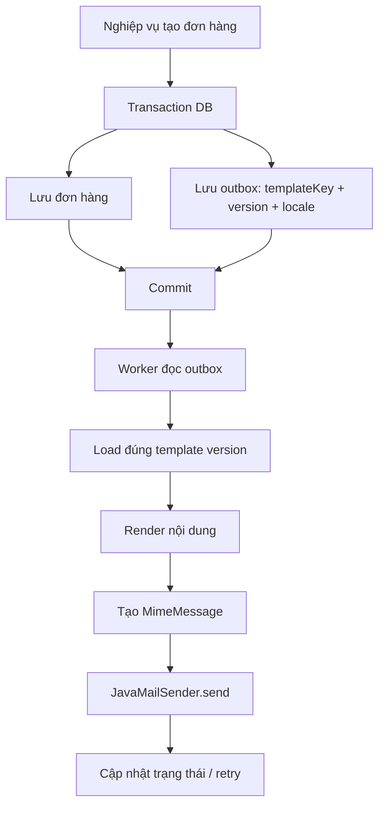
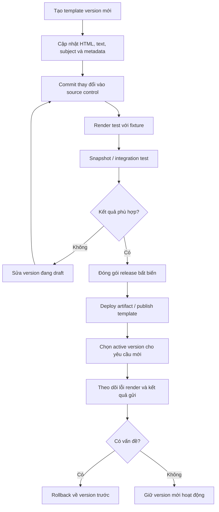

# Giữ template versioned và theo dõi thay đổi nội dung

Trong **Spring Framework Mail**, nội dung HTML của email thường thay đổi: đội sản phẩm sửa câu chữ, cập nhật logo, thay liên kết, bổ sung thông tin pháp lý hoặc điều chỉnh bố cục. Nếu HTML được ghép trực tiếp trong Java service, mỗi thay đổi có thể kéo theo sửa code, build và triển khai lại ứng dụng. Khi email gửi sai, đội vận hành cũng khó biết chính xác **phiên bản nội dung nào đã được sử dụng**.

Cách tổ chức tốt hơn là quản lý **email template theo phiên bản** (*versioned templates*) và ghi nhận phiên bản đó trong mỗi yêu cầu gửi. Template trở thành tài sản có lịch sử thay đổi, có thể kiểm thử, phát hành và quay lại bản trước. Spring Mail vẫn chịu trách nhiệm tạo và gửi thông điệp; một template engine như Thymeleaf hoặc FreeMarker đảm nhiệm việc render HTML từ mẫu và dữ liệu.

Bài học trình bày cách thiết kế vòng đời template, cấu trúc thư mục, render trong Spring, theo dõi nội dung thay đổi, lưu version trong outbox, kiểm thử và triển khai rollback. Mục tiêu là có thể trả lời: **email cụ thể được tạo từ template nào, phiên bản nào, ngôn ngữ nào và hợp đồng dữ liệu nào?**

## 1. Vì sao template cần được quản lý theo phiên bản?

Giả sử ứng dụng gửi email xác nhận đơn hàng. Phiên bản đầu hiển thị mã đơn hàng, tổng tiền và đường dẫn xem chi tiết. Sau đó đội nội dung thay đổi:

- Cập nhật câu chào và cách diễn đạt.
- Đổi logo và màu nhận diện.
- Bổ sung thông tin hỗ trợ.
- Thay URL trang theo dõi đơn hàng.
- Thêm bản tiếng Anh hoặc tiếng Nhật.
- Điều chỉnh nội dung pháp lý ở cuối email.

Nếu ứng dụng chỉ lưu một file `order-confirmation.html` rồi ghi đè mỗi lần thay đổi, một email đã gửi tuần trước khó truy lại nội dung gốc. Nếu email nằm trong queue vài giờ, worker có thể lấy file mới nhất và gửi nội dung khác với thời điểm nghiệp vụ tạo yêu cầu.

Versioning giải quyết ba nhu cầu:

1. **Tái hiện:** xác định đúng template đã dùng khi một email được tạo.
2. **Kiểm soát thay đổi:** biết nội dung nào thay đổi, vì sao và thuộc lần phát hành nào.
3. **Triển khai an toàn:** phát hành template mới, quan sát kết quả và quay về bản trước khi cần.

### Template version không phải dữ liệu cá nhân của người nhận

| Thành phần | Ví dụ | Có làm tăng template version không? |
|---|---|---|
| Nội dung và bố cục cố định | Câu chào, hướng dẫn, logo, cấu trúc HTML | Có, khi template thay đổi. |
| Dữ liệu động | Tên người nhận, mã đơn hàng, số tiền | Không; đây là dữ liệu render cho từng email. |
| Cấu hình gửi | SMTP host, sender address, timeout | Không; đây là cấu hình vận chuyển. |

Nếu tên người nhận thay đổi từ “An” thành “Bình”, đó không phải phiên bản template mới. Nếu câu chào đổi từ “Xin chào” thành “Chào mừng bạn”, nội dung template đã thay đổi và cần revision/version mới theo chính sách dự án.

## 2. Phân biệt template key, version, locale và variant

Một hệ thống có nhiều template thường cần phân biệt:

- **Template key:** tên ổn định của loại email, ví dụ `order-confirmation`.
- **Template version:** phiên bản bất biến của nội dung, ví dụ `v1` hoặc `v2`.
- **Locale:** ngôn ngữ và vùng, ví dụ `vi-VN`, `en-US`.
- **Variant:** biến thể nội dung phục vụ chiến dịch hoặc thử nghiệm, ví dụ `control` và `campaign-a`.
- **Revision:** lần sửa cụ thể trong lịch sử source control; có thể chưa được phát hành.
- **Release:** tập template đã được đưa vào một bản triển khai hoặc artifact.

Một định danh đầy đủ:

```text
templateKey = order-confirmation
version     = v3
locale      = vi-VN
variant     = default
```

Không nên dùng chuỗi mơ hồ như `latest` để ghi vào bản ghi gửi mail. `latest` chỉ là bí danh động; khi template được cập nhật, cùng một bản ghi cũ có thể không còn xác định được nội dung đã dùng. Hãy lưu **version cụ thể** như `v3`.

### Chọn cách đánh số phiên bản

| Chiến lược | Ví dụ | Khi phù hợp |
|---|---|---|
| Số nguyên tăng dần | `1`, `2`, `3` | Hệ thống đơn giản, mỗi lần phát hành tạo version mới. |
| Semantic versioning | `1.2.0`, `2.0.0` | Cần phân biệt thay đổi nội dung và thay đổi hợp đồng dữ liệu. |
| Release ID | `mail-2026-11-12.1` | Template được phát hành cùng một đợt triển khai. |
| Content hash | `sha256:...` | Cần nhận dạng chính xác byte nội dung đã phát hành. |

Đối với template email, **số version bất biến** thường dễ vận hành nhất. Có thể kết hợp Git commit hoặc SHA-256 để truy xuất chính xác nội dung. Quan trọng là quy tắc tăng version nhất quán và version đã phát hành không bị ghi đè.

## 3. Tổ chức template trong source code

Một cấu trúc thư mục dễ theo dõi:

```text
src/main/resources/
└── mail/
    ├── order-confirmation/
    │   ├── v1/
    │   │   ├── vi-VN.html
    │   │   ├── en-US.html
    │   │   └── text.txt
    │   ├── v2/
    │   │   ├── vi-VN.html
    │   │   ├── en-US.html
    │   │   └── text.txt
    │   └── metadata.yml
    └── password-reset/
        ├── v1/
        │   ├── vi-VN.html
        │   └── text.txt
        └── metadata.yml
```

Ưu điểm:

- Mỗi version có nội dung riêng, không bị thay đổi khi phát hành version sau.
- Có thể lưu nhiều locale trong cùng một version.
- Dễ review thay đổi qua Git diff.
- Dễ đóng gói template trong artifact của ứng dụng.
- Dễ kiểm thử một version cụ thể mà không phụ thuộc trạng thái `latest`.

Ví dụ `order-confirmation/v2/vi-VN.html` là đường dẫn ổn định cho nội dung tiếng Việt của version 2.

### Không ghi đè version đã phát hành

Giả sử `v2` đã được dùng để gửi email. Khi đội nội dung sửa một câu trong file `v2/vi-VN.html`, mọi lần gửi sau vẫn ghi `v2` nhưng nội dung thực tế đã khác. Khi điều tra email cũ, không còn cách nào chắc chắn biết bản nào đã được dùng.

Quy tắc nên áp dụng:

- Version đã phát hành là **immutable**.
- Mọi thay đổi nội dung sau đó tạo version mới.
- Bản chưa phát hành có thể được chỉnh sửa trong nhánh làm việc.
- Khi release, gắn version với commit/artifact cụ thể.
- Rollback là chọn lại version cũ, không sửa nội dung version cũ.

### Shared fragment và asset cũng cần được quản lý

Một template có thể dùng chung header/footer. Nếu `v2` tham chiếu fragment `shared/footer.html` rồi fragment bị sửa, nội dung hiệu lực của `v2` cũng thay đổi dù file chính không đổi.

Có hai cách:

1. **Version hóa fragment cùng template:** mỗi version tham chiếu tới fragment bất biến tương ứng.
2. **Đóng gói toàn bộ template đã resolve:** khi phát hành, lưu artifact hoặc snapshot đã bao gồm fragment và asset cần dùng.

Tránh một template version bất biến về tên nhưng phụ thuộc vào fragment mutable không được ghi nhận. Nếu cần tái hiện chính xác, phải biết toàn bộ dependency tại thời điểm phát hành.

## 4. Lưu metadata cho template

Bên cạnh file HTML, có thể lưu metadata để người phát triển và hệ thống biết hợp đồng của template.

Ví dụ `metadata.yml`:

```yaml
key: order-confirmation
versions:
  v1:
    status: retired
    locales:
      - vi-VN
      - en-US
    releasedAt: 2026-09-10
    changeSummary: Initial order confirmation email

  v2:
    status: active
    locales:
      - vi-VN
      - en-US
    releasedAt: 2026-11-12
    changeSummary: Updated support information and tracking link
    variables:
      - orderNumber
      - customerName
      - totalAmount
      - trackingUrl
```

Metadata có thể ghi template key/version, locale được hỗ trợ, ngày phát hành, trạng thái, tóm tắt thay đổi, danh sách biến, schema version, commit và content hash.

Trạng thái `active` mô tả version được dùng mặc định, nhưng **không thay thế việc lưu version cụ thể vào từng yêu cầu gửi**. Một email đã lên queue cần giữ version đã được chọn hoặc theo chính sách resolve version đã được xác định rõ.

## 5. Dùng template engine với Spring Mail

Spring Framework Mail chịu trách nhiệm tạo và gửi email; nó không bắt buộc một template engine duy nhất. Ứng dụng thường kết hợp Spring Mail với:

- **Thymeleaf:** template HTML có biểu thức, fragment và tích hợp tốt với hệ sinh thái Spring.
- **FreeMarker:** template FTL, phù hợp khi cần render nội dung từ model.
- **Mustache:** cú pháp đơn giản, hỗ trợ tách dữ liệu và trình bày.
- **Template engine nội bộ:** nếu ứng dụng có yêu cầu riêng về cache, version hoặc sandbox.

Phần dưới minh họa bằng Thymeleaf. Tên template, version và locale được chọn trước khi render; sau đó kết quả HTML được chuyển cho `MimeMessageHelper`.

### 5.1. Template Thymeleaf

File `mail/order-confirmation/v2/vi-VN.html`:

```html
<!doctype html>
<html lang="vi">
<head>
  <meta charset="UTF-8">
  <title>Xác nhận đơn hàng</title>
</head>
<body>
  <main>
    <h1>Chào <span th:text="${customerName}">bạn</span>!</h1>
    <p>
      Đơn hàng
      <strong th:text="${orderNumber}">ORD-0001</strong>
      đã được xác nhận.
    </p>
    <p>
      Tổng tiền:
      <strong th:text="${totalAmount}">0</strong>
    </p>
    <p>
      <a th:href="${trackingUrl}">Theo dõi đơn hàng</a>
    </p>
    <p>Nếu cần hỗ trợ, hãy liên hệ đội chăm sóc khách hàng.</p>
  </main>
</body>
</html>
```

Các biểu thức `th:text` đưa giá trị vào nội dung văn bản theo cơ chế escape HTML mặc định của Thymeleaf. `th:href` đặt URL vào thuộc tính liên kết; URL vẫn cần được kiểm tra theo chính sách ứng dụng trước khi render.

**Không đưa chuỗi người dùng cung cấp vào HTML bằng cách nối chuỗi trực tiếp.** Dùng cơ chế escape theo ngữ cảnh của template engine và kiểm soát URL, thuộc tính, fragment hoặc nội dung HTML giàu định dạng nếu có.

### 5.2. Cấu hình TemplateEngine

```java
import org.springframework.context.annotation.Bean;
import org.springframework.context.annotation.Configuration;
import org.thymeleaf.TemplateEngine;
import org.thymeleaf.templateresolver.ClassLoaderTemplateResolver;

@Configuration
public class MailTemplateConfiguration {

    @Bean
    public TemplateEngine mailTemplateEngine() {
        ClassLoaderTemplateResolver resolver =
                new ClassLoaderTemplateResolver();

        resolver.setPrefix("mail/");
        resolver.setSuffix(".html");
        resolver.setTemplateMode("HTML");
        resolver.setCharacterEncoding("UTF-8");
        resolver.setCacheable(true);

        TemplateEngine engine = new TemplateEngine();
        engine.setTemplateResolver(resolver);
        return engine;
    }
}
```

Resolver này tìm template trong classpath theo prefix `mail/` và suffix `.html`. Nếu gọi template key `order-confirmation/v2/vi-VN`, đường dẫn tương ứng là:

```text
mail/order-confirmation/v2/vi-VN.html
```

Trong ứng dụng đã dùng Thymeleaf Web MVC, có thể dùng `TemplateEngine` riêng cho email để tách resolver, cache và template location khỏi view website. Ví dụ trên là cấu hình tối giản; dự án thực tế có thể cần dialect, message resolver, fragment resolver và quy tắc cache phù hợp.

## 6. Render một version cụ thể rồi gửi qua JavaMailSender

Nên tách **render nội dung** khỏi **gửi SMTP**. Điều này giúp kiểm thử template độc lập với transport và ghi nhận version đã chọn.

Một model dữ liệu:

```java
public record OrderConfirmationModel(
        String customerName,
        String orderNumber,
        String totalAmount,
        String trackingUrl
) {
}
```

Renderer nhận key, version, locale và model:

```java
import java.util.Locale;
import java.util.Map;
import org.springframework.stereotype.Component;
import org.thymeleaf.TemplateEngine;
import org.thymeleaf.context.Context;

@Component
public class MailTemplateRenderer {

    private final TemplateEngine mailTemplateEngine;

    public MailTemplateRenderer(TemplateEngine mailTemplateEngine) {
        this.mailTemplateEngine = mailTemplateEngine;
    }

    public String render(
            String templateKey,
            String version,
            Locale locale,
            Map<String, Object> variables
    ) {
        String templateName = templateKey
                + "/" + version
                + "/" + locale.toLanguageTag();

        Context context = new Context(locale);
        context.setVariables(variables);

        return mailTemplateEngine.process(templateName, context);
    }
}
```

Ví dụ gọi:

```java
Map<String, Object> variables = Map.of(
        "customerName", "Nguyễn An",
        "orderNumber", "ORD-2026-001",
        "totalAmount", "1.250.000 VND",
        "trackingUrl", "https://shop.example.org/orders/ORD-2026-001"
);

String html = renderer.render(
        "order-confirmation",
        "v2",
        Locale.forLanguageTag("vi-VN"),
        variables
);
```

Ở đây version `v2` được truyền tường minh. Renderer không tự tìm file mới nhất; cùng một yêu cầu gửi có thể tái hiện được khi worker chạy sau đó.

### Gửi kết quả render bằng Spring Mail

```java
import jakarta.mail.MessagingException;
import jakarta.mail.internet.MimeMessage;
import org.springframework.mail.javamail.JavaMailSender;
import org.springframework.mail.javamail.MimeMessageHelper;
import org.springframework.stereotype.Service;

@Service
public class OrderConfirmationMailer {

    private final JavaMailSender mailSender;
    private final MailTemplateRenderer renderer;

    public OrderConfirmationMailer(
            JavaMailSender mailSender,
            MailTemplateRenderer renderer
    ) {
        this.mailSender = mailSender;
        this.renderer = renderer;
    }

    public void send(
            String recipient,
            OrderConfirmationModel model
    ) throws MessagingException {

        String html = renderer.render(
                "order-confirmation",
                "v2",
                java.util.Locale.forLanguageTag("vi-VN"),
                java.util.Map.of(
                        "customerName", model.customerName(),
                        "orderNumber", model.orderNumber(),
                        "totalAmount", model.totalAmount(),
                        "trackingUrl", model.trackingUrl()
                )
        );

        MimeMessage message = mailSender.createMimeMessage();
        MimeMessageHelper helper =
                new MimeMessageHelper(message, false, "UTF-8");

        helper.setFrom("orders@example.org", "Cửa hàng");
        helper.setTo(recipient);
        helper.setSubject("Xác nhận đơn hàng " + model.orderNumber());
        helper.setText(
                "Đơn hàng " + model.orderNumber()
                        + " đã được xác nhận. Vui lòng xem thông tin trong tài khoản.",
                html
        );

        mailSender.send(message);
    }
}
```

Ví dụ thể hiện cách kết hợp renderer và sender. Trong code sản phẩm, URL nên được tạo và kiểm tra từ thành phần nghiệp vụ riêng. Subject và bản text cũng nên được render theo cùng version hoặc quản lý cùng metadata để tránh khác biệt giữa plain và HTML.

## 7. Ghi version vào bản ghi gửi mail

Chỉ version hóa file template là chưa đủ. Khi một email được tạo, hệ thống cần ghi lại version đã chọn ở **cấp yêu cầu gửi**.

| Trường | Ví dụ | Ý nghĩa |
|---|---|---|
| `message_id` | `mail-8f31` | ID nội bộ của yêu cầu gửi. |
| `template_key` | `order-confirmation` | Loại email. |
| `template_version` | `v2` | Phiên bản nội dung được chọn. |
| `locale` | `vi-VN` | Ngôn ngữ. |
| `variant` | `default` | Biến thể được dùng. |
| `template_hash` | `sha256:...` | Hash của nội dung/artifact đã phát hành. |
| `schema_version` | `2` | Phiên bản hợp đồng dữ liệu render. |
| `status` | `PENDING` | Trạng thái xử lý yêu cầu. |
| `created_at` | Timestamp | Thời điểm tạo yêu cầu. |

Một record minh họa:

```json
{
  "messageId": "mail-8f31",
  "templateKey": "order-confirmation",
  "templateVersion": "v2",
  "locale": "vi-VN",
  "variant": "default",
  "templateHash": "sha256:abc123...",
  "schemaVersion": 2,
  "status": "PENDING"
}
```

Đây là metadata minh họa, không phải cấu trúc bắt buộc của Spring Mail. Ứng dụng có thể lưu trong bảng outbox, bảng email delivery hoặc message broker có metadata phù hợp.

**Không nên chỉ lưu `template_key` rồi để worker dùng bản active mới nhất.** Nếu yêu cầu được tạo khi `v2` đang hoạt động nhưng worker chạy sau khi `v3` được phát hành, dùng `latest` có thể làm email gửi ra nội dung khác với quyết định ban đầu.

## 8. Kết hợp template version với transactional outbox

Với email quan trọng, ứng dụng có thể ghi yêu cầu gửi vào outbox trong cùng transaction với nghiệp vụ. Bản ghi cần lưu version đã chọn.



Ví dụ record outbox:

```java
public record EmailOutboxRecord(
        String messageId,
        String recipient,
        String templateKey,
        String templateVersion,
        String localeTag,
        int schemaVersion,
        String payloadJson
) {
}
```

Worker dùng đúng version:

```java
String html = renderer.render(
        record.templateKey(),
        record.templateVersion(),
        Locale.forLanguageTag(record.localeTag()),
        payload
);
```

Nếu template `v2` đã retired nhưng còn yêu cầu pending tham chiếu tới nó, hệ thống vẫn cần giữ nội dung `v2` trong thời gian các yêu cầu đó có thể được xử lý. Không xóa template cũ chỉ vì version mới đã active.

### Nếu template cũ không còn tương thích dữ liệu?

Có thể `v2` yêu cầu `customerName`, còn `v3` đổi sang `displayName` và thêm `supportUrl`. Đây là lý do nên version hóa **schema dữ liệu render** hoặc định nghĩa contract cho từng template version.

- Giữ renderer/model tương thích với version đang được queue tham chiếu.
- Chuyển đổi payload sang schema mà template version yêu cầu.
- Khi retire version, chỉ ngừng tạo yêu cầu mới; tiếp tục hỗ trợ record pending đến khi hoàn tất.
- Nếu không thể render version cũ, đánh dấu lỗi rõ ràng; không tự âm thầm dùng version mới.

## 9. Theo dõi thay đổi nội dung bằng Git và changelog

Nếu template nằm trong repository, Git cung cấp lịch sử source:

```text
commit A: Add order-confirmation v1
commit B: Update Vietnamese wording in v2
commit C: Change tracking link and support footer
commit D: Release email-template bundle
```

Một thay đổi nội dung có thể được review qua diff:

```diff
- <p>Đơn hàng của bạn đã được ghi nhận.</p>
+ <p>Đơn hàng của bạn đã được xác nhận.</p>

- <a href="https://old.example.org/orders">Theo dõi đơn hàng</a>
+ <a href="https://shop.example.org/orders">Theo dõi đơn hàng</a>
```

Nên ghi changelog ở mức dễ hiểu:

```markdown
## order-confirmation

### v2 — 2026-11-12
- Cập nhật cách diễn đạt trạng thái đơn hàng.
- Thay liên kết theo dõi đơn hàng.
- Bổ sung thông tin liên hệ hỗ trợ.
- Giữ nguyên schema variables của v1.

### v1 — 2026-09-10
- Phát hành mẫu xác nhận đơn hàng đầu tiên.
```

Changelog nên trả lời: version nào được phát hành, nội dung nào thay đổi, locale nào bị ảnh hưởng, có thay đổi tên/kiểu biến không, có đổi URL/CTA/footer/nội dung pháp lý không và có cần cập nhật snapshot/test fixture không.

Không cần đưa từng dấu câu nhỏ vào changelog nếu lịch sử Git đã thể hiện đầy đủ; changelog nên tóm tắt thay đổi có ý nghĩa đối với người vận hành và người sở hữu nội dung.

## 10. Theo dõi thay đổi bằng content hash

Version cho biết **danh tính logic** của template. Hash cho biết **nội dung byte cụ thể** đã được nhận dạng.

Ví dụ tính SHA-256 cho file:

```java
import java.nio.charset.StandardCharsets;
import java.security.MessageDigest;
import java.security.NoSuchAlgorithmException;
import java.util.HexFormat;

public final class TemplateHash {

    private TemplateHash() {}

    public static String sha256(String content) {
        try {
            MessageDigest digest = MessageDigest.getInstance("SHA-256");
            byte[] hash = digest.digest(
                    content.getBytes(StandardCharsets.UTF_8)
            );
            return HexFormat.of().formatHex(hash);
        } catch (NoSuchAlgorithmException exception) {
            throw new IllegalStateException(
                    "SHA-256 is not available",
                    exception
            );
        }
    }
}
```

Khi release, có thể lưu:

```text
templateKey: order-confirmation
version: v2
locale: vi-VN
sha256: 6e3a...
release: mail-2026-11-12.1
```

Hash giúp phát hiện file bị thay đổi ngoài quy trình versioning. Nhưng hash **không thay thế version**: cùng một nội dung có thể được phát hành lại trong release khác; một version cũng có thể gồm nhiều file (HTML, plain text, fragment, metadata). Với template có fragment hoặc asset, nên tính hash trên **artifact đã đóng gói** hoặc tập nội dung đã resolve, thay vì chỉ hash file HTML chính.

Hash cũng không chứng minh ai đã thay đổi nội dung hoặc vì sao. Muốn audit, cần kết hợp commit, release metadata và thông tin người thực hiện thay đổi trong hệ thống quản lý source/release.

## 11. Theo dõi version, locale và variant cùng nhau

Template đa ngôn ngữ nên giữ chính sách version rõ ràng.

```text
order-confirmation/
├── v2/
│   ├── vi-VN.html
│   ├── en-US.html
│   └── text.txt
└── v3/
    ├── vi-VN.html
    ├── en-US.html
    └── text.txt
```

Có hai chiến lược:

**Version chung cho mọi locale:** `v3` là một release nội dung bao gồm cả `vi-VN` và `en-US`. Nếu chỉ một locale thay đổi, release mới vẫn tạo version chung. Cách này đơn giản khi các bản dịch luôn được phát hành cùng nhau.

**Version riêng theo locale:** mỗi ngôn ngữ có lịch sử phát hành riêng, ví dụ `vi-VN/v3` và `en-US/v2`. Cách này linh hoạt khi bản dịch được cập nhật ở thời điểm khác nhau, nhưng metadata và record gửi phải lưu version của locale tương ứng.

Với A/B testing, variant cũng phải được ghi lại:

```text
templateKey: order-confirmation
version: v3
locale: vi-VN
variant: subject-test-b
```

Nếu hệ thống chọn variant ngẫu nhiên nhưng không ghi vào record, sẽ khó phân tích kết quả hoặc tái hiện email. Không nên dùng variant để âm thầm thay đổi nội dung sau khi một yêu cầu đã được tạo.

## 12. Kiểm thử template trước khi phát hành

Template HTML là nội dung được render động. Chỉ biên dịch ứng dụng thành công không bảo đảm template có đủ biến, link hợp lệ hoặc hiển thị đúng trên mail client.

| Loại kiểm thử | Mục đích | Ví dụ |
|---|---|---|
| Render test | Xác nhận template engine render đúng version. | `order-confirmation/v2/vi-VN` với fixture hợp lệ. |
| Variable contract test | Phát hiện thiếu biến hoặc sai tên biến. | `orderNumber`, `customerName`. |
| Snapshot test | Theo dõi thay đổi HTML đầu ra. | So sánh output với snapshot đã duyệt. |
| Text fallback test | Bảo đảm plain text có nội dung tương đương. | CTA, mã đơn, URL có mặt trong bản text. |
| Link/content test | Kiểm tra đường dẫn và thông tin bắt buộc. | URL thuộc domain được phép, footer hiện diện. |
| Integration test | Kiểm tra message và SMTP test server. | Mailpit hoặc GreenMail. |
| Client rendering test | Kiểm tra cách hiển thị trên client mục tiêu. | Webmail, desktop và mobile. |

### 12.1. Render test độc lập

```java
@Test
void rendersOrderConfirmationV2() {
    Map<String, Object> variables = Map.of(
            "customerName", "Nguyễn An",
            "orderNumber", "ORD-001",
            "totalAmount", "500.000 VND",
            "trackingUrl", "https://shop.example.org/orders/ORD-001"
    );

    String html = renderer.render(
            "order-confirmation",
            "v2",
            Locale.forLanguageTag("vi-VN"),
            variables
    );

    assertThat(html).contains("Nguyễn An");
    assertThat(html).contains("ORD-001");
    assertThat(html).contains("Theo dõi đơn hàng");
}
```

Đây là ví dụ minh họa với JUnit và AssertJ. Fixture nên bao phủ Unicode, dữ liệu rỗng được cho phép, độ dài lớn và các giá trị đặc biệt cần escape.

### 12.2. Snapshot test

Snapshot lưu HTML đã render từ fixture cố định. Khi template thay đổi, diff cho biết output thay đổi ở đâu. Snapshot không tự quyết định thay đổi đó đúng hay sai; nó giúp reviewer nhìn thấy thay đổi trước khi release.

```text
snapshots/
└── order-confirmation/
    └── v2/
        └── vi-VN.html
```

Không cập nhật snapshot một cách máy móc chỉ để làm test pass. Hãy hiểu thay đổi nội dung và ghi nhận version tương ứng.

### 12.3. Kiểm thử MIME với SMTP server giả lập

Có thể dùng Mailpit hoặc GreenMail để nhận thư trong môi trường kiểm thử. Kiểm tra header `From`, `To`, `Subject`; body `text/plain` và `text/html`; charset; attachment; filename; Content-ID; template key, version và locale trong metadata.

Test SMTP server xác nhận ứng dụng đã tạo và gửi message theo cấu trúc mong đợi. Nó không mô phỏng đầy đủ mọi Gmail/Outlook/Apple Mail renderer. Kiểm tra hiển thị cuối cùng cần thực hiện trên client mà người nhận thực tế sử dụng.

## 13. Cache template và phát hành version mới

Template engine có thể cache nội dung đã parse hoặc resolve để giảm chi phí render. Cache giúp hiệu năng, nhưng cần hiểu tác động khi template thay đổi.

Với template nằm trong classpath và được đóng gói cùng ứng dụng:

- Template version đã phát hành nên immutable.
- Release mới thường đi cùng artifact mới.
- Cache có thể giữ nội dung version cũ mà không gây vấn đề, vì version đó không bị ghi đè.
- Khi rollback, chọn lại version cũ đã có sẵn trong artifact hoặc release tương ứng.

Với template lưu trong database hoặc object storage và cập nhật độc lập:

- Cache key bao gồm **template key + version + locale**.
- Khi phát hành version mới, cache entry mới có key mới.
- Không dùng cache key chỉ gồm template key, vì có thể trả nội dung sai version.
- Quy định cách invalidation, TTL và xử lý khi nội dung không còn tồn tại.
- Chỉ cho phép đọc version đã phát hành; worker không lấy bản draft đang được chỉnh sửa.

Ví dụ cache key:

```text
order-confirmation:v2:vi-VN
```

Nếu version là bất biến, cache không cần xóa chỉ vì `v3` được phát hành. Worker còn pending dùng `v2` vẫn có thể lấy đúng nội dung.

## 14. Rollback và ngừng hỗ trợ template cũ

Rollback nên là **chọn lại version đã phát hành trước đó**, không chỉnh sửa nội dung version hiện tại.

```text
v1 — retired
v2 — active
v3 — candidate

Nếu v3 có lỗi:
active version = v2
v3 = disabled/retired
```

Cần phân biệt:

- **Ngừng tạo yêu cầu mới bằng version cũ:** thay đổi cấu hình active/default sang version mới.
- **Xóa version cũ:** chỉ thực hiện khi không còn yêu cầu pending, nghĩa vụ audit hoặc nhu cầu tái hiện nào cần đến nó.

Với queue/outbox, một email được tạo theo `v2` có thể vẫn chờ xử lý. Nếu worker tự dùng version active hiện tại `v3`, nội dung gửi ra sẽ khác quyết định ban đầu. Có hai chính sách hợp lệ nhưng phải chọn rõ:

1. **Pin version khi tạo yêu cầu:** record outbox giữ `v2` và worker luôn dùng đúng `v2`.
2. **Resolve version lúc gửi:** record chỉ lưu template key, worker dùng version active ở thời điểm thực thi. Cách này phù hợp với một số thông báo cần nội dung mới nhất, nhưng không tái hiện được quyết định nội dung lúc tạo yêu cầu.

Với email giao dịch như xác nhận đơn hàng, đặt lại mật khẩu hoặc thông báo thanh toán, **pin version khi tạo yêu cầu** thường dễ kiểm soát hơn. Nếu nội dung phải tuân theo quy định thay đổi tức thời, cần có chính sách ưu tiên và xử lý các yêu cầu pending rõ ràng.

## 15. Ghi nhận lịch sử thay đổi và audit

Một lịch sử hữu ích cần trả lời:

- Ai hoặc nhóm nào đề xuất thay đổi?
- Thay đổi thuộc template key/version/locale nào?
- Nội dung thay đổi ở phần nào và vì sao?
- Version nào thay thế version nào?
- Release nào đưa version vào môi trường nào?
- Từ thời điểm nào các yêu cầu gửi mới sử dụng version mới?

Một bản ghi phát hành minh họa:

```json
{
  "templateKey": "order-confirmation",
  "version": "v3",
  "locale": "vi-VN",
  "releaseId": "mail-2026-11-12.1",
  "commit": "8f12ab...",
  "contentHash": "sha256:...",
  "releasedAt": "2026-11-12T09:00:00Z",
  "changeSummary": "Updated tracking instructions"
}
```

Trong môi trường có quy trình quản lý nội dung, có thể thêm người viết, người review và người phát hành. Đây là **metadata của quy trình quản lý template**, không phải trường bắt buộc của Spring Mail.

Khi gửi email, log vận hành có thể ghi:

```text
messageId=mail-8f31
templateKey=order-confirmation
templateVersion=v3
locale=vi-VN
releaseId=mail-2026-11-12.1
smtpResult=accepted
```

Không cần log toàn bộ HTML hoặc payload chứa dữ liệu cá nhân để biết version. ID, version, locale và hash thường đã đủ để truy ngược source. Nếu cần lưu nội dung render để kiểm toán, phải có chính sách bảo vệ dữ liệu, thời gian lưu và quyền truy cập phù hợp.

## 16. Tách nội dung template khỏi cấu hình gửi và logic nghiệp vụ

Một thiết kế dễ bảo trì:

```text
Business service
    │
    ├── Chọn template key/version/locale
    ├── Tạo dữ liệu render
    └── Lưu yêu cầu gửi / outbox
             │
             ▼
       Template renderer
             │
             ├── Load version cụ thể
             ├── Render HTML
             └── Render plain text / subject
             │
             ▼
       Message builder
             │
             ├── MimeMessage
             └── MimeMessageHelper
             │
             ▼
       JavaMailSender
             │
             ▼
          SMTP
```

Mỗi phần có trách nhiệm riêng:

- **Business service:** quyết định khi nào gửi, cho ai, loại email nào và dữ liệu nghiệp vụ nào.
- **Template catalog/selector:** xác định version, locale và variant theo chính sách.
- **Template renderer:** biến dữ liệu thành subject, plain text và HTML.
- **Message builder:** đặt header, tạo MIME parts, inline resource và attachment.
- **JavaMailSender:** giao thông điệp cho hạ tầng SMTP.
- **Delivery tracker:** lưu kết quả SMTP và sự kiện phân phát nếu có.

Không nên để template HTML tự quyết định recipient, SMTP host hoặc credential. Template chỉ nên chịu trách nhiệm trình bày dữ liệu được cung cấp.

## 17. Bảo mật khi render template HTML

Template versioning không tự động làm email an toàn. Dữ liệu động vẫn có thể đến từ người dùng, hệ thống bên ngoài hoặc database.

1. **Escape theo ngữ cảnh:** dùng `th:text` thay vì đưa input không tin cậy vào HTML thô. Với FreeMarker hoặc engine khác, chọn cơ chế auto-escaping và kiểm tra đúng HTML context.
2. **Kiểm tra URL:** chỉ cho phép scheme/domain phù hợp, tránh biến dữ liệu người dùng thành liên kết nguy hiểm hoặc link giả mạo.
3. **Không render raw HTML tùy tiện:** nếu nghiệp vụ cho phép rich text, cần sanitizer theo chính sách rõ ràng.
4. **Không đặt secret vào template:** không đưa SMTP password, token nội bộ hoặc thông tin xác thực vào source HTML.
5. **Kiểm soát nội dung nhạy cảm:** email có thể được chuyển tiếp hoặc hiển thị trên thiết bị dùng chung; chỉ đưa thông tin cần thiết.
6. **Không log payload nhạy cảm:** template version và message ID thường hữu ích hơn log toàn bộ nội dung.

Nếu template được tải động từ nguồn do người không tin cậy chỉnh sửa, template engine có thể có khả năng thực thi biểu thức hoặc truy cập object tùy cấu hình. Không cho phép người dùng tùy ý sửa template có quyền truy cập bean hoặc dữ liệu nhạy cảm. Hãy giới hạn quyền chỉnh sửa, sandbox/whitelist tính năng phù hợp và kiểm soát quá trình phát hành.

## 18. Subject, plain text và HTML phải đi cùng một version

Một email có thể có ba phần nội dung do hệ thống quản lý:

- **Subject:** tiêu đề hiển thị trong danh sách thư.
- **Plain text:** nội dung cho client không dùng HTML.
- **HTML:** nội dung trình bày giàu định dạng.

Không nên version hóa riêng HTML mà bỏ quên subject hoặc bản text. Nếu HTML nói “đơn hàng đã giao” nhưng subject vẫn là “đang xử lý”, người nhận sẽ thấy thông tin mâu thuẫn. Nếu plain text thiếu URL quan trọng có trong HTML, người dùng chỉ đọc văn bản sẽ không thao tác được.

Có thể lưu tất cả cùng một version:

```text
order-confirmation/v3/vi-VN/
├── subject.txt
├── body.txt
├── body.html
└── metadata.yml
```

Renderer trả về một object nội dung:

```java
public record RenderedMailContent(
        String subject,
        String plainText,
        String html,
        String templateKey,
        String templateVersion,
        String locale
) {
}
```

Message builder sử dụng kết quả:

```java
MimeMessage message = mailSender.createMimeMessage();
MimeMessageHelper helper =
        new MimeMessageHelper(message, false, "UTF-8");

helper.setFrom("orders@example.org");
helper.setTo(recipient);
helper.setSubject(content.subject());
helper.setText(content.plainText(), content.html());

mailSender.send(message);
```

Ví dụ giả định `content` đã được render từ một version cố định. Khi cần inline image hoặc attachment, chọn multipart mode tương ứng. Việc subject, text và HTML cùng có metadata version giúp hệ thống truy xuất toàn bộ nội dung của một lần gửi.

## 19. Chiến lược phát hành template an toàn



Các bước chính:

1. Tạo version mới từ bản đang hoạt động.
2. Sửa nội dung và metadata; không ghi đè version đã phát hành.
3. Kiểm thử render cho từng locale và dữ liệu biên.
4. Xem diff để nhận biết thay đổi thực tế.
5. Đóng gói hoặc publish version với release ID/hash.
6. Chuyển selector sang version mới cho các yêu cầu mới.
7. Quan sát lỗi render, lỗi gửi, phản hồi người nhận và các sự kiện liên quan.
8. Nếu có lỗi, chọn lại version trước theo chính sách rollback.

Khi triển khai nhiều instance, phải bảo đảm mọi instance có thể truy cập cùng version hoặc cùng artifact. Không để instance A đã có `v3` nhưng instance B chỉ có `v2` trong khi selector đã chuyển sang `v3`.

## 20. Xử lý khi template version không tồn tại

Một lỗi phổ biến là outbox tham chiếu `v2` nhưng artifact hoặc storage đã xóa version đó. Không nên âm thầm dùng version mới nhất, vì điều đó thay đổi nội dung của yêu cầu gửi mà không có dấu vết.

Có thể định nghĩa lỗi riêng:

```java
public class TemplateVersionNotFoundException
        extends RuntimeException {

    public TemplateVersionNotFoundException(
            String templateKey,
            String version,
            String locale
    ) {
        super("Template not found: "
                + templateKey + "/" + version + "/" + locale);
    }
}
```

Khi không tìm thấy template:

- Ghi nhận key/version/locale được yêu cầu.
- Giữ lại record outbox và trạng thái lỗi có thể xử lý.
- Cảnh báo vận hành nếu version đã được phát hành nhưng không thể load.
- Khôi phục artifact/version đúng hoặc thực hiện migration có kiểm soát.
- Không tự thay bằng `latest` trừ khi chính sách nghiệp vụ cho phép và có ghi nhận quyết định.

Điều này làm lỗi rõ ràng và tránh gửi nhầm ngôn ngữ, nội dung pháp lý hoặc đường dẫn.

## 21. Những lỗi thường gặp khi version hóa template

| Triệu chứng | Nguyên nhân có thể | Hướng xử lý |
|---|---|---|
| Email trong queue dùng nội dung mới dù tạo từ trước | Worker resolve `latest` thay vì version đã lưu | Pin `templateVersion` trong outbox. |
| Đã tăng version nhưng nội dung không đổi | Cache key không bao gồm version/locale | Dùng key đầy đủ và kiểm tra resolver. |
| Nội dung v2 thay đổi dù không release | Fragment hoặc asset phụ thuộc bị ghi đè | Version hóa dependency hoặc đóng gói snapshot. |
| Không render được email cũ | Đã xóa template version đang được tham chiếu | Giữ version đến khi pending record hết hạn/hoàn tất. |
| HTML đúng nhưng subject/plain text cũ | Chỉ version hóa file HTML | Quản lý subject, text và HTML trong cùng release. |
| Bản dịch khác nhau về schema | Locale được cập nhật không đồng bộ | Ghi rõ locale/version và contract variables. |
| Snapshot thay đổi liên tục | Fixture không cố định hoặc output chứa timestamp/ID động | Dùng dữ liệu fixture ổn định và tách biến động ngoài template. |
| Không truy được nguồn thay đổi | Không có commit/release ID hoặc changelog | Ghi metadata phát hành và lịch sử source control. |
| Rollback không khôi phục được email cũ | Version cũ đã bị xóa hoặc fragment dùng chung đã đổi | Giữ artifact bất biến và toàn bộ dependency. |
| Template có nội dung không an toàn | Raw HTML/URL không được kiểm soát | Escape, validate URL và giới hạn quyền chỉnh sửa. |

## 22. Ghi nhớ

- **Template key** nhận dạng loại email; **version** nhận dạng nội dung đã phát hành; **locale** nhận dạng ngôn ngữ; **variant** nhận dạng biến thể.
- Version đã phát hành nên **bất biến**. Mọi thay đổi nội dung tạo version mới và có changelog.
- Lưu template trong source control hoặc artifact có thể tái tạo; quản lý cả fragment, subject, plain text, HTML và asset phụ thuộc.
- Tách **template renderer** khỏi **JavaMailSender**. Template engine tạo nội dung; Spring Mail tạo MIME message và gửi SMTP.
- Dùng version cụ thể thay vì `latest` khi lưu yêu cầu gửi, đặc biệt với outbox hoặc queue xử lý bất đồng bộ.
- Ghi `templateKey`, `templateVersion`, `locale`, `variant`, `releaseId` và hash cần thiết vào metadata gửi để truy xuất.
- Kiểm thử render, schema biến, snapshot, plain fallback, MIME và client mục tiêu trước khi release.
- Cache key cần bao gồm version và locale; không xóa version cũ khi còn yêu cầu đang tham chiếu.
- Rollback là chuyển selector về version đã phát hành trước, không sửa lại file của version cũ.
- Escape dữ liệu động, kiểm tra URL, giới hạn quyền chỉnh sửa và tránh log nội dung nhạy cảm.

Quản lý template theo phiên bản biến nội dung email thành một phần có lịch sử và có thể truy xuất trong vòng đời gửi mail. Khi mỗi email gắn với **template key, version, locale và release cụ thể**, đội phát triển có thể tái hiện nội dung, điều tra sự cố, triển khai thay đổi có kiểm soát và quay lại bản ổn định mà không làm mất dấu những email đã được tạo trước đó.
