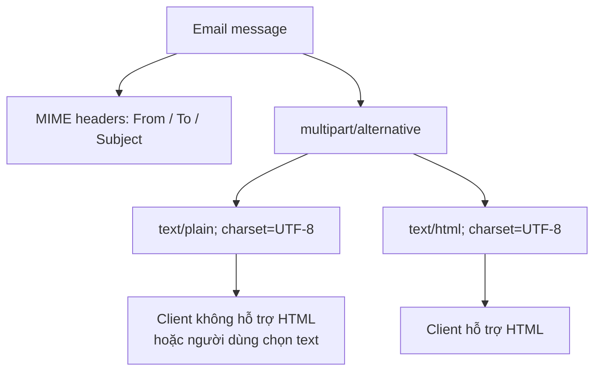
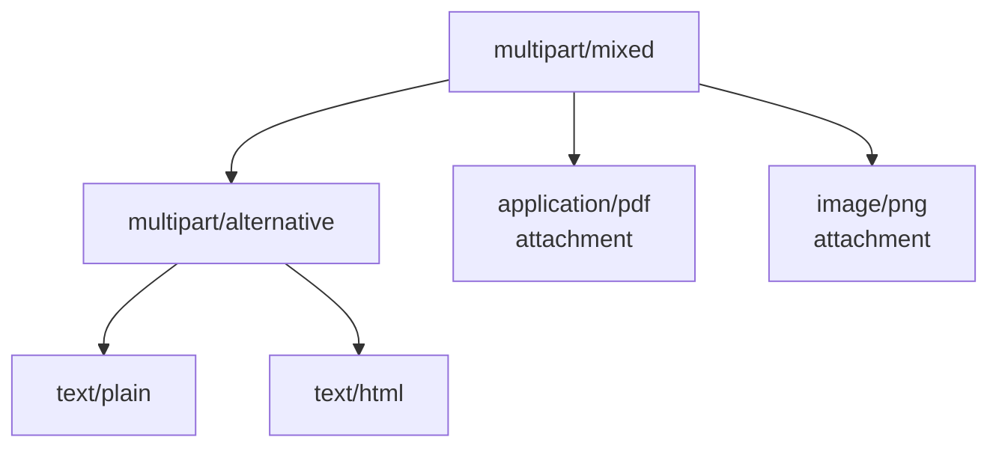
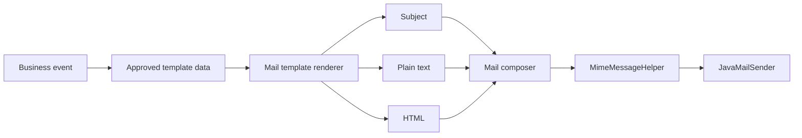

# Template cho subject, plain text và HTML

Một email có thể được đọc trên trình duyệt, điện thoại, client chỉ hỗ trợ văn bản, công cụ đọc màn hình hoặc hệ thống tự động phân tích nội dung. Vì vậy, một thông báo Spring Framework Mail thường cần **ba phần nội dung được thiết kế riêng**: tiêu đề (subject), bản văn bản thuần (plain text) và bản HTML.

Nếu chỉ tạo một chuỗi HTML rồi gửi như text, người nhận có thể nhìn thấy các thẻ HTML. Nếu chỉ có HTML, một số client có thể không hiển thị đúng hoặc người nhận dùng chế độ văn bản sẽ thiếu nội dung. Nếu subject được nối chuỗi từ dữ liệu tùy ý, tiêu đề có thể quá dài, chứa ký tự điều khiển hoặc vô tình làm lộ thông tin riêng tư. Tách ba phần thành template giúp mỗi phần có định dạng, quy tắc bảo mật, khả năng bản địa hóa và kiểm thử riêng.

Bài này xây dựng cách thiết kế template email trong Spring Framework Mail, sử dụng `JavaMailSender`, `MimeMessageHelper` và một template engine như Thymeleaf. Nội dung tập trung vào cách chuẩn bị dữ liệu, render subject/plain text/HTML, gửi hai bản nội dung dưới dạng MIME alternative, xử lý escaping và URL, bản địa hóa, kiểm thử và quản lý phiên bản template.

## 1. Một email có ba phần trình bày

Giả sử ứng dụng gửi thông báo đăng ký khóa học thành công:

| Phần | Ví dụ | Mục đích |
|---|---|---|
| **Subject** | `Bạn đã đăng ký thành công khóa học Spring` | Cho người nhận biết chủ đề trước khi mở thư |
| **Plain text** | Nội dung dạng chữ và URL đọc được | Hoạt động trên client chỉ hỗ trợ text, hỗ trợ truy cập và làm bản dự phòng |
| **HTML** | Tiêu đề, đoạn văn, liên kết, bố cục | Trình bày phong phú hơn trên client hỗ trợ HTML |

Ba phần có quan hệ về **ý nghĩa** nhưng không cần cùng một cách trình bày. Subject phải ngắn gọn và không chứa markup; plain text cần đọc tự nhiên khi không có CSS; HTML có thể dùng cấu trúc, liên kết và kiểu trình bày nhưng phải an toàn với dữ liệu đầu vào.

Một template nên giữ ba nội dung này nhất quán:

```text
Subject:
Bạn đã đăng ký thành công khóa học Spring

Plain text:
Xin chào Minh,

Bạn đã đăng ký thành công khóa học Spring Framework Mail.
Mở tài khoản để xem thông tin khóa học:
https://app.example.test/my-courses

HTML:
<h1>Đăng ký thành công</h1>
<p>Xin chào Minh,</p>
<p>Bạn đã đăng ký khóa học...</p>
<a href="https://app.example.test/my-courses">Mở tài khoản</a>
```

Đây là ba representation của cùng một sự kiện nghiệp vụ. Không nên tạo subject bằng cách lấy thẻ h1 đầu tiên của HTML hoặc sinh plain text bằng cách xóa mọi tag bằng regex. Những cách đó dễ tạo nội dung thiếu, link biến mất hoặc văn bản khó đọc.

## 2. MIME multipart/alternative biểu diễn plain text và HTML

Một email có cả bản text và HTML thường sử dụng MIME type `multipart/alternative`. Các phần biểu diễn cùng một nội dung theo những định dạng khác nhau để client chọn cách phù hợp.



Một phần MIME rút gọn có thể trông như sau:

```text
MIME-Version: 1.0
Content-Type: multipart/alternative; boundary="alt-123"

--alt-123
Content-Type: text/plain; charset=UTF-8
Content-Transfer-Encoding: quoted-printable

Xin chào Minh,

Bạn đã đăng ký khóa học Spring Framework Mail.

--alt-123
Content-Type: text/html; charset=UTF-8
Content-Transfer-Encoding: quoted-printable

<html>
  <body>
    <h1>Đăng ký thành công</h1>
    <p>Xin chào <strong>Minh</strong>,</p>
    <p>Bạn đã đăng ký khóa học Spring Framework Mail.</p>
  </body>
</html>

--alt-123--
```

Đây là ví dụ minh họa cấu trúc; boundary và encoding thực tế do Jakarta Mail tạo có thể khác. Client thường chọn representation phù hợp. Vì vậy, plain text không phải phần “thừa” chỉ để lấp MIME: nó là nội dung hoàn chỉnh cho những tình huống HTML không dùng được.

### 2.1. Khi có attachment

Nếu email vừa có plain text, HTML, vừa có file đính kèm, cấu trúc thường là `multipart/mixed` ở ngoài, chứa một `multipart/alternative` và một hoặc nhiều attachment:



`MimeMessageHelper` có thể quản lý cấu trúc này. Khi khởi tạo helper ở chế độ multipart và gọi `setText(plainText, htmlText)`, helper xây dựng nội dung alternative; các lời gọi `addAttachment(...)` bổ sung phần đính kèm. Không cần tự ghép boundary hoặc header MIME bằng tay.

## 3. Tách template khỏi logic nghiệp vụ

Một thiết kế dễ bảo trì chia việc gửi email thành các trách nhiệm:

1. **Nghiệp vụ** xác định sự kiện nào cần gửi, người nhận là ai và template nào được dùng.
2. **Data mapper** tạo tập biến đã được cho phép, không chuyển nguyên entity hoặc request.
3. **Template renderer** render subject, plain text và HTML.
4. **Mail composer** đưa kết quả vào `MimeMessageHelper`.
5. **Mail transport** gọi `JavaMailSender.send(...)`.



Ví dụ, sự kiện đăng ký khóa học có thể chứa account ID, email, payment reference, audit metadata và nhiều thuộc tính nội bộ. Template chỉ cần:

```java
public record EnrollmentMailData(
        String displayName,
        String courseTitle,
        String coursePageUrl
) {}
```

Đây là **allowlist**: chỉ ba trường được đưa vào renderer. Khi entity nghiệp vụ có thêm dữ liệu mới, template không tự nhiên có quyền truy cập vào trường đó.

Không nên truyền trực tiếp:

```java
// Tránh truyền entity đầy đủ vào template.
context.setVariable("account", accountEntity);
context.setVariable("order", orderEntity);
context.setVariable("request", httpRequest);
```

Nếu template engine cho phép truy cập property lồng nhau, việc truyền entity đầy đủ có thể vô tình làm lộ trường nhạy cảm hoặc khiến template phụ thuộc vào cấu trúc nội bộ. Tạo DTO riêng cho từng loại email làm rõ dữ liệu nào được phép hiển thị.

## 4. Tổ chức file template

Một cấu trúc thư mục rõ ràng có thể là:

```text
src/main/resources/
└── templates/
    └── mail/
        └── enrollment/
            ├── subject.txt
            ├── body-text.txt
            └── body-html.html
```

Ba file có vai trò khác nhau:

- `subject.txt`: chỉ chứa tiêu đề, không chứa HTML.
- `body-text.txt`: nội dung văn bản thuần, có dòng trống và URL dễ đọc.
- `body-html.html`: markup HTML dành cho mail client hỗ trợ HTML.

Với nhiều loại email, có thể đặt thư mục theo template ID:

```text
templates/mail/
├── enrollment/
│   ├── subject.txt
│   ├── body-text.txt
│   └── body-html.html
├── password-reset/
│   ├── subject.txt
│   ├── body-text.txt
│   └── body-html.html
└── order-confirmed/
    ├── subject.txt
    ├── body-text.txt
    └── body-html.html
```

Nếu có nhiều ngôn ngữ, thêm thư mục locale hoặc quy ước tên template rõ ràng:

```text
templates/mail/enrollment/
├── vi/
│   ├── subject.txt
│   ├── body-text.txt
│   └── body-html.html
└── en/
    ├── subject.txt
    ├── body-text.txt
    └── body-html.html
```

Chọn locale theo hồ sơ/ngữ cảnh người nhận và có fallback rõ ràng khi chưa có template tương ứng. Không tự đoán ngôn ngữ từ nội dung email hoặc dùng locale của server làm ngôn ngữ mặc định cho tất cả người nhận.

## 5. Dùng Thymeleaf làm template engine

Thymeleaf là một lựa chọn phổ biến trong ứng dụng Spring. Nó hỗ trợ template HTML, text và tích hợp với Spring. Có thể sử dụng một engine riêng cho mail hoặc cấu hình engine hiện có để nhận các resolver tương ứng.

Với Spring Boot, dependency thường dùng:

```groovy
dependencies {
    implementation 'org.springframework.boot:spring-boot-starter-mail'
    implementation 'org.springframework.boot:spring-boot-starter-thymeleaf'
}
```

Starter Thymeleaf thường cấu hình engine cho template web HTML. Nếu email cần thêm template mode TEXT và resolver riêng, phải cấu hình cho engine phù hợp; đừng mặc định rằng resolver HTML của ứng dụng tự đọc được file `.txt`.

### 5.1. Cấu hình resolver cho HTML và TEXT

Ví dụ cấu hình một engine dành riêng cho mail:

```java
package com.example.mail.config;

import java.util.LinkedHashSet;
import java.util.Set;

import org.springframework.context.annotation.Bean;
import org.springframework.context.annotation.Configuration;
import org.thymeleaf.spring6.SpringTemplateEngine;
import org.thymeleaf.templatemode.TemplateMode;
import org.thymeleaf.templateresolver.ClassLoaderTemplateResolver;
import org.thymeleaf.templateresolver.ITemplateResolver;

@Configuration(proxyBeanMethods = false)
public class MailTemplateConfiguration {

    @Bean("mailTemplateEngine")
    SpringTemplateEngine mailTemplateEngine() {
        ClassLoaderTemplateResolver htmlResolver =
                new ClassLoaderTemplateResolver();
        htmlResolver.setPrefix("templates/mail/");
        htmlResolver.setSuffix(".html");
        htmlResolver.setTemplateMode(TemplateMode.HTML);
        htmlResolver.setCharacterEncoding("UTF-8");
        htmlResolver.setCheckExistence(true);
        htmlResolver.setOrder(1);

        ClassLoaderTemplateResolver textResolver =
                new ClassLoaderTemplateResolver();
        textResolver.setPrefix("templates/mail/");
        textResolver.setSuffix(".txt");
        textResolver.setTemplateMode(TemplateMode.TEXT);
        textResolver.setCharacterEncoding("UTF-8");
        textResolver.setCheckExistence(true);
        textResolver.setOrder(2);

        Set<ITemplateResolver> resolvers = new LinkedHashSet<>();
        resolvers.add(htmlResolver);
        resolvers.add(textResolver);

        SpringTemplateEngine engine = new SpringTemplateEngine();
        engine.setTemplateResolvers(resolvers);
        return engine;
    }
}
```

Trong cấu hình này:

- Tên template `enrollment/body-html` được resolver HTML tìm ở `templates/mail/enrollment/body-html.html`.
- Tên template `enrollment/body-text` được resolver TEXT tìm ở `templates/mail/enrollment/body-text.txt`.
- Tên template `enrollment/subject` được resolver TEXT tìm ở `templates/mail/enrollment/subject.txt`.
- `setCheckExistence(true)` cho phép resolver bỏ qua template không tồn tại để resolver tiếp theo có cơ hội xử lý.

Trong một ứng dụng đã dùng Thymeleaf cho web view, hãy tránh vô tình thay thế engine/resolver dùng chung mà các trang web đang phụ thuộc. Một bean mail riêng có tên `mailTemplateEngine` giúp code gửi thư chọn đúng engine qua `@Qualifier`. Nếu cấu hình engine web dùng chung, hãy bổ sung resolver một cách có chủ đích và kiểm tra cả hai nhóm template.

### 5.2. Render từng artifact

Một renderer có thể nhận `SpringTemplateEngine` và trả về một object đã render:

```java
package com.example.mail;

public record RenderedMail(
        String subject,
        String plainText,
        String html
) {}
```

```java
package com.example.mail;

import java.util.Locale;

import org.springframework.beans.factory.annotation.Qualifier;
import org.springframework.stereotype.Component;
import org.thymeleaf.context.Context;
import org.thymeleaf.spring6.SpringTemplateEngine;

@Component
public class EnrollmentMailRenderer {

    private final SpringTemplateEngine templateEngine;

    public EnrollmentMailRenderer(
            @Qualifier("mailTemplateEngine")
            SpringTemplateEngine templateEngine) {
        this.templateEngine = templateEngine;
    }

    public RenderedMail render(
            EnrollmentMailData data, Locale locale) {
        Context context = new Context(locale);
        context.setVariable("displayName", data.displayName());
        context.setVariable("courseTitle", data.courseTitle());
        context.setVariable("coursePageUrl", data.coursePageUrl());

        String subject = templateEngine.process(
                "enrollment/subject", context);
        String plainText = templateEngine.process(
                "enrollment/body-text", context);
        String html = templateEngine.process(
                "enrollment/body-html", context);

        return new RenderedMail(
                subject.strip(),
                plainText,
                html);
    }
}
```

Trong ví dụ này, resolver ánh xạ tên template theo suffix tương ứng. Đặt tên `body-text` và `body-html` giúp người đọc code thấy rõ mục đích của từng template. `Context` nhận locale và các biến được cho phép. Không thêm toàn bộ entity hoặc object request vào context.

Với template lớn, có thể chia thành fragment/header/footer dùng chung, nhưng vẫn phải giữ quyền truy cập biến rõ ràng.

### 5.3. File subject

Nội dung file `templates/mail/enrollment/subject.txt`:

```text
Bạn đã đăng ký thành công khóa học [[§DOLLAR${courseTitle}]]
```

Subject là text, không phải HTML. Nếu template engine trả về chuỗi có khoảng trắng đầu/cuối, có thể `strip()` trước khi đặt vào message. Cần kiểm soát thêm độ dài và ký tự điều khiển trước khi gửi.

### 5.4. File plain text

Nội dung file `templates/mail/enrollment/body-text.txt`:

```text
Xin chào [[§DOLLAR${displayName}]],

Bạn đã đăng ký thành công khóa học:
[[§DOLLAR${courseTitle}]]

Bạn có thể mở tài khoản để xem thông tin khóa học:
[[§DOLLAR${coursePageUrl}]]

Nếu bạn không thực hiện thao tác này, vui lòng liên hệ bộ phận hỗ trợ qua ứng dụng chính thức.
```

Plain text cần giữ:

- Dòng trống giữa các đoạn để dễ đọc.
- URL có thể sao chép và truy cập.
- Nội dung đủ ý ngay cả khi client không hỗ trợ HTML.
- Không dựa vào màu sắc, icon hoặc nút bấm để truyền thông tin thiết yếu.

Trong TEXT template mode, hãy dùng cú pháp expression phù hợp của Thymeleaf và kiểm tra đầu ra thực tế. Plain text không phải HTML; đừng biến mọi ký tự đặc biệt thành HTML entity theo cách làm người đọc nhìn thấy `&amp;` hoặc `&lt;` ngoài ý muốn. Đồng thời, kiểm soát ký tự xuống dòng và dữ liệu không tin cậy để tránh người dùng chèn đoạn giả mạo vào thông báo.

### 5.5. File HTML

Nội dung file `templates/mail/enrollment/body-html.html`:

```html
<!doctype html>
<html lang="vi" xmlns:th="http://www.thymeleaf.org">
<head>
    <meta charset="UTF-8">
    <meta name="viewport" content="width=device-width, initial-scale=1">
    <title>Đăng ký khóa học thành công</title>
</head>
<body>
    <main>
        <h1>Đăng ký thành công</h1>
        <p th:text="|Xin chào §DOLLAR${displayName},|">Xin chào bạn,</p>
        <p>
            Bạn đã đăng ký thành công khóa học:
            <strong th:text="§DOLLAR${courseTitle}">Tên khóa học</strong>.
        </p>
        <p>
            <a th:href="§DOLLAR${coursePageUrl}">
                Mở tài khoản để xem khóa học
            </a>
        </p>
        <p>
            Nếu bạn không thực hiện thao tác này, hãy mở ứng dụng
            chính thức và liên hệ bộ phận hỗ trợ.
        </p>
    </main>
</body>
</html>
```

Trong HTML mode:

- `th:text` ghi giá trị dưới dạng text và escape các ký tự HTML đặc biệt.
- Không dùng `th:utext` với dữ liệu người dùng hoặc dữ liệu ngoài tin cậy nếu chưa có bước làm sạch phù hợp.
- Giá trị `th:href` cần được kiểm tra URL ở tầng ứng dụng. HTML escaping bảo vệ cú pháp thuộc tính nhưng không chứng minh scheme/host là an toàn.
- HTML email nên giữ cấu trúc đơn giản, tránh phụ thuộc JavaScript, form hoặc CSS phức tạp mà nhiều mail client chặn.

### 5.6. Chú ý về cú pháp TEXT và HTML

Thymeleaf có nhiều template mode. Một biểu thức trong HTML mode không nhất thiết dùng giống cách viết trong TEXT mode. Trong ví dụ:

- HTML dùng `th:text="§DOLLAR${courseTitle}"` để render text đã escape theo HTML.
- TEXT dùng `[[§DOLLAR${courseTitle}]]` để nội suy vào template văn bản.

Không copy nguyên cú pháp `th:text` vào file .txt rồi kỳ vọng nó được xử lý như HTML. Ngược lại, không dùng cú pháp output không escape trong HTML cho dữ liệu không tin cậy.

## 6. Render và gửi bằng MimeMessageHelper

Khi đã có ba chuỗi đã render, việc tạo MIME message khá ngắn:

```java
package com.example.mail;

import jakarta.mail.MessagingException;
import jakarta.mail.internet.MimeMessage;
import org.springframework.beans.factory.annotation.Value;
import org.springframework.mail.javamail.JavaMailSender;
import org.springframework.mail.javamail.MimeMessageHelper;
import org.springframework.stereotype.Service;

import java.util.Locale;

@Service
public class EnrollmentMailService {

    private final JavaMailSender mailSender;
    private final EnrollmentMailRenderer renderer;
    private final String fromAddress;

    public EnrollmentMailService(
            JavaMailSender mailSender,
            EnrollmentMailRenderer renderer,
            @Value("${app.mail.from}") String fromAddress) {
        this.mailSender = mailSender;
        this.renderer = renderer;
        this.fromAddress = fromAddress;
    }

    public void send(
            String recipient,
            EnrollmentMailData data,
            Locale locale) throws MessagingException {

        RenderedMail content = renderer.render(data, locale);
        validateSubject(content.subject());

        MimeMessage message = mailSender.createMimeMessage();
        MimeMessageHelper helper =
                new MimeMessageHelper(message, true, "UTF-8");

        helper.setFrom(fromAddress);
        helper.setTo(recipient);
        helper.setSubject(content.subject());
        helper.setText(content.plainText(), content.html());

        mailSender.send(message);
    }

    private static void validateSubject(String subject) {
        if (subject == null || subject.isBlank() || subject.length() > 160) {
            throw new IllegalArgumentException("Invalid email subject");
        }
        for (int i = 0; i < subject.length(); i++) {
            if (Character.isISOControl(subject.charAt(i))) {
                throw new IllegalArgumentException(
                        "Control character in email subject");
            }
        }
    }
}
```

Giải thích:

1. `renderer.render(...)` tạo subject, plain text và HTML trước khi gọi transport.
2. `MimeMessageHelper(message, true, "UTF-8")` tạo helper multipart với encoding UTF-8.
3. `setSubject(...)` nhận chuỗi subject đã render, không cần tự encode RFC 2047.
4. `setText(plainText, html)` đặt cả hai representation trong cấu trúc alternative.
5. `mailSender.send(message)` thực hiện thao tác gửi qua transport.

Trong ví dụ, `true` bật multipart để sau này có thể thêm attachment. Nếu thư không có attachment, vẫn có thể dùng cấu hình helper phù hợp cho plain/HTML alternative mà không cần cấu trúc multipart/mixed bên ngoài. Điều quan trọng là **hai body được đặt qua overload `setText(plainText, htmlText)`**, không phải gọi `setText(plain)` rồi gọi lại `setText(html)` khiến nội dung trước bị thay thế.

Phương thức `send(...)` ném `MessagingException` cho các lỗi thao tác MIME helper; lỗi transport có thể xuất hiện dưới các exception Spring Mail như `MailException`. Việc khai báo/chuyển exception nên phù hợp với API service và error handling của ứng dụng.

## 7. Subject: ngắn, đúng ngữ cảnh và không chứa HTML

Subject xuất hiện trong danh sách thư, thông báo đẩy và đôi khi trên màn hình khóa. Vì thế, nó cần được thiết kế riêng:

- Nêu sự kiện chính, không cố nhét toàn bộ body vào subject.
- Tránh dữ liệu nhạy cảm như mật khẩu, token, thông tin tài chính hoặc sức khỏe.
- Giữ độ dài vừa phải để tránh bị cắt trên thiết bị di động.
- Không chứa HTML tag, newline hoặc control character.
- Chọn ngôn ngữ và giọng điệu nhất quán với body.
- Không để caller truyền một subject tùy ý mà không có chính sách.

Ví dụ:

| Subject quá chi tiết | Subject gọn hơn |
|---|---|
| `Mật khẩu mới của bạn là 123456` | `Hướng dẫn truy cập tài khoản` |
| `Kết quả khám của Nguyễn Văn A...` | `Bạn có thông báo mới trong tài khoản` |
| `Đơn hàng tại 123 Nguyễn Trãi đã giao...` | `Đơn hàng của bạn đã được cập nhật` |
| `Lỗi NullPointerException ở PaymentService...` | `Yêu cầu của bạn cần được kiểm tra` |

### 7.1. Đừng để subject nhận CR/LF từ dữ liệu ngoài

Một subject được tạo bằng cách nối dữ liệu tùy ý:

```java
String subject = "Thông báo: " + userProvidedTitle;
```

có thể đưa ký tự điều khiển hoặc văn bản gây hiểu nhầm vào header. Nên dùng template cố định và validate giá trị sau render. Với tiêu đề cá nhân hóa, giới hạn độ dài, loại bỏ/reject control character và chỉ dùng dữ liệu đã được chọn cho mục đích hiển thị.

Đừng dùng một regex đơn giản để “sửa” mọi tiêu đề. Nếu input chứa CR/LF, thường tốt hơn là từ chối giá trị hoặc chuyển nó sang một trường body có định dạng phù hợp, thay vì âm thầm biến thành tiêu đề khác.

## 8. Plain text: bản dự phòng phải hoàn chỉnh

Plain text không nên là bản HTML đã bị xóa tag. Một template text tốt cần có:

1. Lời chào và bối cảnh.
2. Thông tin chính của sự kiện.
3. Các bước tiếp theo cần thực hiện.
4. URL đầy đủ nếu có liên kết.
5. Hướng liên hệ hoặc xử lý nếu người nhận không thực hiện thao tác.
6. Chân trang cần thiết như thông tin dịch vụ hoặc tùy chọn nhận thông báo.

Ví dụ:

```text
Xin chào Minh,

Bạn đã đăng ký thành công khóa học Spring Framework Mail.

Bạn có thể xem nội dung và lịch học tại:
https://app.example.test/my-courses

Nếu bạn không thực hiện đăng ký này, vui lòng mở ứng dụng chính thức
để kiểm tra tài khoản hoặc liên hệ bộ phận hỗ trợ.

Trân trọng,
Đội ngũ học tập
```

Không chỉ viết “Nhấn vào nút bên dưới” vì bản text có thể không có nút. URL nên hiển thị đủ rõ để người nhận có thể kiểm tra domain trước khi mở.

### 8.1. Plain text cũng cần kiểm soát đầu vào

Text thuần không thực thi HTML/JavaScript, nhưng vẫn có rủi ro:

- Người dùng chèn newline để tạo một đoạn giả mạo hoặc thay đổi ý nghĩa.
- Một chuỗi rất dài làm body khó đọc hoặc làm tăng chi phí lưu/truyền.
- Ký tự điều khiển hoặc Unicode bidi khiến nội dung hiển thị gây nhầm lẫn.
- URL do người dùng cung cấp trỏ tới domain giả mạo.
- Nội dung chứa token hoặc dữ liệu riêng tư không cần thiết.

Hãy normalize line ending, giới hạn chiều dài, kiểm soát các trường được phép và xác thực URL. Không cần HTML-escape mọi text theo kiểu biến dấu `&` thành `&amp;`; plain text và HTML là hai representation có quy tắc encoding riêng.

## 9. HTML email: escaping, URL và tương thích

HTML email cho phép tạo cấu trúc dễ đọc hơn nhưng cũng làm tăng yêu cầu an toàn.

### 9.1. Dùng text escaping theo ngữ cảnh

Trong Thymeleaf HTML mode:

```html
<p th:text="§DOLLAR${displayName}">Tên người nhận</p>
```

`th:text` đưa giá trị vào text node và escape các ký tự đặc biệt theo HTML. Nếu tên là:

```text
Minh <script>alert(1)</script>
```

thì nội dung được trình bày như text, không trở thành script thực thi trong markup.

Không dùng:

```html
<div th:utext="§DOLLAR${displayName}"></div>
```

cho dữ liệu không tin cậy. `th:utext` cho phép đưa markup thô vào output; nếu không có bước sanitize đáng tin cậy, nó có thể tạo HTML injection hoặc nội dung giả mạo.

### 9.2. Attribute escaping không xác thực URL

Ví dụ:

```html
<a th:href="§DOLLAR${coursePageUrl}">Mở khóa học</a>
```

Thymeleaf xử lý giá trị attribute theo cơ chế template, nhưng điều đó không có nghĩa URL là an toàn. Nếu dữ liệu là:

```text
javascript:alert(1)
https://attacker.example.test/fake-login
```

thì cần **kiểm tra scheme, host và mục đích URL** trước khi đưa vào template. HTML escaping bảo vệ cú pháp thuộc tính nhưng không chứng minh scheme/host an toàn. Nên tạo link từ base URL được cấu hình, domain allowlist và path do ứng dụng kiểm soát. Không lấy host từ request không tin cậy rồi gửi vào email.

### 9.3. Tránh HTML phức tạp không cần thiết

Nhiều email client giới hạn CSS, loại bỏ JavaScript, không tải ảnh bên ngoài mặc định hoặc xử lý layout khác trình duyệt. Email HTML nên:

- Ưu tiên markup đơn giản và cấu trúc dễ đọc.
- Dùng CSS inline hoặc cách trình bày đã kiểm thử trên client mục tiêu.
- Có text thay thế khi ảnh không tải.
- Không dựa vào JavaScript, form hoặc tương tác động trong email.
- Giữ nội dung thiết yếu ở dạng text.
- Dùng URL HTTPS rõ ràng.
- Kiểm tra hiển thị ở các mail client chính mà sản phẩm hỗ trợ.

Một nút HTML chỉ là một liên kết được trình bày nổi bật; không nên yêu cầu người dùng nhập mật khẩu hoặc dữ liệu xác thực trực tiếp vào form bên trong email.

## 10. Bản địa hóa subject, plain text và HTML

Email có thể được gửi tới người nhận dùng nhiều ngôn ngữ. Bản địa hóa cần nhất quán trên cả ba representation:

| Locale | Subject | Plain text | HTML |
|---|---|---|---|
| `vi-VN` | Tiếng Việt | Nội dung tiếng Việt | HTML tiếng Việt |
| `en-US` | English | English body | English HTML |
| `ja-JP` | 日本語 | 日本語の本文 | 日本語のHTML |

Có thể chọn locale từ hồ sơ người dùng, tùy chọn đã lưu hoặc ngữ cảnh nghiệp vụ. Đừng tự động dùng locale của máy chủ gửi thư cho mọi người nhận.

Trong Thymeleaf, có thể truyền locale vào `Context`:

```java
Locale locale = Locale.forLanguageTag("vi-VN");
Context context = new Context(locale);
```

Template engine có thể dùng locale cho message resolution khi cấu hình Spring integration phù hợp. Ngoài ra, có thể tổ chức file template theo thư mục locale và chọn template name theo locale trong renderer. Dù chọn cách nào, cần có fallback rõ ràng, ví dụ locale không có template thì dùng tiếng Anh đã được phê duyệt, không tự trộn subject tiếng Anh với body tiếng Việt.

### 10.1. Định dạng ngày giờ, số và tiền tệ

Không nên format dữ liệu theo locale của server:

```java
String formattedDate = DateTimeFormatter
        .ofPattern("dd/MM/yyyy")
        .format(occurredAt);
```

Đoạn code trên cố định một định dạng; nếu email có nhiều locale, chọn formatter theo locale và timezone phù hợp:

```java
DateTimeFormatter formatter =
        DateTimeFormatter
                .ofLocalizedDateTime(FormatStyle.MEDIUM)
                .withLocale(locale)
                .withZone(userZoneId);

String formatted = formatter.format(occurredAt);
```

`userZoneId` là biến ứng dụng cần xác định theo hồ sơ hoặc nghiệp vụ, không phải một biến có sẵn trong Java. Tương tự, tiền tệ nên dùng `NumberFormat.getCurrencyInstance(locale)` cùng currency code thực tế; không suy đoán currency chỉ từ ngôn ngữ.

## 11. Dùng MessageSource cho subject và các chuỗi giao diện

Với subject ngắn hoặc các nhãn dùng chung, Spring `MessageSource` là một lựa chọn thuận tiện:

Nội dung file `messages_vi.properties`:

```properties
mail.enrollment.subject=Bạn đã đăng ký thành công khóa học {0}
mail.common.greeting=Xin chào {0},
```

Nội dung file `messages_en.properties`:

```properties
mail.enrollment.subject=You have successfully enrolled in {0}
mail.common.greeting=Hello {0},
```

Ví dụ lấy subject:

```java
import java.util.Locale;
import org.springframework.context.MessageSource;
import org.springframework.stereotype.Component;

@Component
public class MailSubjectRenderer {

    private final MessageSource messageSource;

    public MailSubjectRenderer(MessageSource messageSource) {
        this.messageSource = messageSource;
    }

    public String enrollmentSubject(
            String courseTitle, Locale locale) {
        return messageSource.getMessage(
                "mail.enrollment.subject",
                new Object[] { courseTitle },
                locale);
    }
}
```

Body plain text và HTML có thể dùng template file để chứa đoạn văn dài; subject dùng `MessageSource` để quản lý chuỗi theo locale. Đây là một cách chia hợp lý, miễn là renderer vẫn trả ra **một object hoàn chỉnh** gồm subject, plain text và HTML.

Khi nội dung body cũng có nhiều câu/đoạn ngắn, MessageSource có thể hỗ trợ nhãn và thông điệp dùng chung. Tuy nhiên, đừng nhồi toàn bộ email HTML dài vào một property khó bảo trì; template file phù hợp hơn cho cấu trúc dài và bố cục.

## 12. Versioning và quản lý thay đổi template

Template email là một phần của sản phẩm. Một thay đổi nhỏ có thể ảnh hưởng đến ngữ nghĩa, liên kết, khả năng truy cập hoặc dữ liệu xuất hiện trong thư. Vì vậy, nên có:

- Template ID ổn định như `enrollment-confirmed`.
- Phiên bản template hoặc quy tắc phát hành rõ ràng.
- Người sở hữu nội dung/ngôn ngữ và người duyệt khi nội dung quan trọng.
- Test render cho các locale được hỗ trợ.
- Kiểm thử MIME và preview trên client mục tiêu.
- Cơ chế rollback template khi thay đổi gây lỗi.

Ví dụ một metadata intent:

```json
{
  "notificationId": "a4f20b5c-7f63-4a87-a0e2-3c1d0a10f002",
  "templateId": "enrollment-confirmed",
  "templateVersion": 3,
  "locale": "vi-VN"
}
```

Nếu một email được xếp hàng hôm nay nhưng worker gửi vào ngày mai sau khi template đã cập nhật, hệ thống cần quyết định dùng phiên bản lúc tạo intent hay phiên bản mới nhất. Với email giao dịch hoặc audit quan trọng, lưu phiên bản/biến đã duyệt có thể giúp nội dung gửi lại nhất quán. Với thư marketing, có thể chọn phiên bản mới nhất theo chính sách. Đây là quyết định nghiệp vụ, không phải hành vi tự động của Thymeleaf hay Spring Mail.

## 13. Kiểm thử template trước khi gửi

Không nên chỉ kiểm tra rằng `mailSender.send(...)` được gọi. Cần kiểm tra ba representation đã được render và chúng có ý nghĩa đúng.

### 13.1. Unit test renderer

Ví dụ test ở mức renderer:

```java
package com.example.mail;

import static org.junit.jupiter.api.Assertions.assertFalse;
import static org.junit.jupiter.api.Assertions.assertNotNull;
import static org.junit.jupiter.api.Assertions.assertTrue;

import java.util.Locale;
import org.junit.jupiter.api.Test;

class EnrollmentMailRendererTest {

    private final EnrollmentMailRenderer renderer =
            TestMailTemplateConfiguration.createRenderer();

    @Test
    void rendersSubjectTextAndHtml() {
        EnrollmentMailData data = new EnrollmentMailData(
                "Minh",
                "Spring Framework Mail",
                "https://app.example.test/my-courses");

        RenderedMail mail = renderer.render(
                data, Locale.forLanguageTag("vi-VN"));

        assertNotNull(mail.subject());
        assertNotNull(mail.plainText());
        assertNotNull(mail.html());

        assertTrue(mail.subject().contains("Spring Framework Mail"));
        assertTrue(mail.plainText().contains("Minh"));
        assertTrue(mail.html().contains("Đăng ký thành công"));
        assertFalse(mail.subject().contains("<html"));
    }
}
```

`TestMailTemplateConfiguration.createRenderer()` là factory do test tự định nghĩa để khởi tạo engine với các template test. Ví dụ tập trung vào assertion; trong dự án thực tế có thể dùng Spring test context để inject renderer đã cấu hình.

### 13.2. Kiểm thử escaping

Dùng dữ liệu có ký tự đặc biệt:

```java
EnrollmentMailData malicious = new EnrollmentMailData(
        "<script>alert(1)</script>",
        "Course ",
        "https://app.example.test/my-courses");
```

Trong HTML, assert các giá trị được đưa vào text node dưới dạng escaped text, không xuất hiện thành phần script/img thực thi. Trong plain text, assert nội dung không chứa ký tự điều khiển hoặc đoạn giả mạo ngoài ý muốn. Với URL, test scheme/host không được phép bị từ chối ở tầng validate trước khi render.

Đừng chỉ kiểm tra một snapshot chuỗi duy nhất nếu template engine/provider có thể thay đổi encoding tương đương. Có thể parse HTML trong test để kiểm tra node và attribute thực tế.

### 13.3. Kiểm thử Subject

Subject cần được kiểm tra:

- Không rỗng.
- Không có CR/LF hoặc control character.
- Không vượt giới hạn độ dài do ứng dụng đặt.
- Không chứa token hoặc trường nhạy cảm.
- Không có HTML markup không cần thiết.
- Đúng locale và đúng template ID.

Không có một giới hạn byte Subject áp dụng giống nhau cho mọi ứng dụng; nên đặt ngưỡng sản phẩm vừa phải và để Jakarta Mail xử lý encoded-word/header folding phù hợp.

### 13.4. Kiểm thử MIME bằng JavaMailSender và SMTP giả lập

Có thể dùng Mailpit hoặc SMTP test server:

```bash
docker run --rm --name mailpit -p 1025:1025 -p 8025:8025 axllent/mailpit
```

Gửi một email từ service test rồi kiểm tra:

1. Header Subject được hiển thị đúng Unicode.
2. MIME có cả `text/plain` và `text/html`.
3. Plain text có đủ thông tin chính, không chứa markup HTML.
4. HTML có cấu trúc và link đúng.
5. Không có biến chưa render như `§DOLLAR${displayName}` hoặc `[[...]]`.
6. Không có dữ liệu nhạy cảm ngoài ý muốn.

Raw MIME có thể khác boundary, line folding hoặc quoted-printable/Base64 giữa các lần gửi. Không nên so sánh nguyên file .eml theo từng byte; kiểm tra MIME structure và nội dung đã decode.

### 13.5. Preview trực quan

SMTP giả lập cho phép xem thư và kiểm tra cách mail client trình bày. Ngoài ra, có thể xuất MIME trong môi trường test rồi mở bằng công cụ preview email. Chỉ sử dụng dữ liệu giả; file .eml có thể chứa toàn bộ body, recipient và attachment nên không đưa vào nơi lưu công khai.

## 14. Kiểm thử với nhiều locale và trường hợp biên

Một bộ dữ liệu test hữu ích:

| Trường hợp | Dữ liệu | Mục tiêu |
|---|---|---|
| Tên bình thường | `Minh` | Nội dung cơ bản |
| Tên Unicode | `Nguyễn Ánh` | UTF-8 đúng |
| Ký tự HTML | `<script>alert(1)</script>` | HTML escaping |
| Tên dài | 200 ký tự | Giới hạn độ dài và bố cục |
| Course title có dấu ngoặc | `Java < nâng cao >` | Text/HTML hiển thị đúng |
| URL hợp lệ | `https://app.example.test/my-courses` | Link đúng domain |
| URL không hợp lệ | `javascript:alert(1)` | Bị từ chối |
| Locale tiếng Việt | `vi-VN` | Subject/text/html cùng tiếng Việt |
| Locale tiếng Anh | `en-US` | Fallback/translation đúng |
| Template thiếu | `enrollment/body-html` không tồn tại | Lỗi rõ ràng trước khi gửi |
| Biến thiếu | thiếu `courseTitle` | Phát hiện trong test render |
| Token giả | `test-secret-canary` | Không xuất hiện ngoài phần được phép |

Nếu renderer trả về subject hoặc body rỗng, không nên gửi một email gần như trống rồi mới phát hiện ở mailbox. Hãy validate kết quả render **trước khi** gọi `JavaMailSender.send(...)`.

## 15. Xử lý lỗi template tách biệt với lỗi SMTP

Template rendering và SMTP transport là hai bước khác nhau:

| Giai đoạn | Lỗi ví dụ | Phản ứng phù hợp |
|---|---|---|
| Chọn template | Template ID/locale không tồn tại | Dừng trước khi gửi, fallback theo chính sách hoặc báo lỗi cấu hình |
| Render subject | Biến thiếu, cú pháp template lỗi | Sửa dữ liệu/template; không retry SMTP |
| Render plain text | Nội dung rỗng hoặc placeholder còn sót | Dừng trước khi gửi |
| Render HTML | Template không hợp lệ hoặc lỗi escaping | Dừng trước khi gửi, xử lý lỗi template |
| Tạo MIME | Charset/header/part không hợp lệ | Xử lý lỗi chuẩn bị message |
| Gửi SMTP | AUTH, timeout, SMTP 4xx/5xx | Phân loại lỗi transport và retry theo chính sách |

Không nên đặt toàn bộ quá trình trong một `catch (Exception)` rồi retry. Nếu template sai, retry SMTP không sửa được cú pháp template. Nếu SMTP trả 451, render lại template nhiều lần có thể tạo thêm tải không cần thiết.

Một workflow tốt:

```text
Load intent
  -> select template/version/locale
  -> render subject, plain text, HTML
  -> validate rendered content
  -> create MimeMessage
  -> send through JavaMailSender
  -> persist transport outcome
```

Nếu cần retry, quyết định xem có cần render lại không. Với template version cố định và dữ liệu intent bất biến, có thể render lại cùng nội dung; với hệ thống cần tái lập tuyệt đối, có thể lưu dữ liệu đã render theo chính sách bảo mật phù hợp.

## 16. Không đưa dữ liệu nhạy cảm vào template ngoài ý muốn

Template chỉ nên nhận những biến được duyệt:

```java
public record PasswordResetMailData(
        String displayName,
        String resetUrl,
        String expiresInText
) {}
```

Không truyền password, password hash, access token tổng quát hoặc toàn bộ account entity. Nếu `resetUrl` chứa token dùng một lần, token phải:

- Chỉ cấp quyền thực hiện đúng một hành động.
- Có hạn dùng ngắn và bị vô hiệu hóa sau khi dùng.
- Được tạo bằng nguồn ngẫu nhiên mật mã.
- Không xuất hiện trong log, tracing, exception hay metric label.
- Dùng domain HTTPS được cấu hình và kiểm soát.

Đối với email thông báo thông thường, có thể chỉ đưa link tới trang yêu cầu đăng nhập thay vì đưa token vào URL. Subject cũng không nên chứa dữ liệu nhạy cảm vì có thể xuất hiện trong preview.

### 16.1. Không cho template engine truy cập object quá rộng

Ví dụ không nên:

```java
context.setVariable("user", fullUserEntity);
context.setVariable("request", requestDto);
context.setVariable("session", session);
```

Thay vào đó, tạo DTO chứa đúng biến template cần. Điều này cũng giúp template được tái sử dụng giữa các phiên bản domain model và giảm nguy cơ vô tình render một trường mới.

### 16.2. Quyền sửa template

Nếu template được lưu ngoài repository hoặc có giao diện cho người dùng nội bộ sửa:

- Chỉ người có quyền phù hợp mới được chỉnh template gửi ra ngoài.
- Review thay đổi liên quan đến URL, dữ liệu, ngôn ngữ và nội dung bảo mật.
- Không cho người dùng cuối nhập HTML thô rồi render như template có quyền.
- Tránh cho phép template gọi bean hoặc thực thi biểu thức có quyền truy cập hệ thống ngoài phạm vi cần thiết.
- Có version, audit và rollback.

Template engine không tự làm cho nội dung an toàn chỉ vì cú pháp được biên dịch thành công.

## 17. Template fragment và nội dung dùng chung

Các email thường chia sẻ header/footer, lời chào hoặc phần hỗ trợ. Thymeleaf hỗ trợ fragment để tránh sao chép HTML:

Nội dung file `templates/mail/fragments/footer.html`:

```html
<footer th:fragment="mailFooter">
    <p>Đây là email tự động. Vui lòng không trả lời trực tiếp.</p>
    <p>
        <a href="https://app.example.test/support">Trung tâm hỗ trợ</a>
    </p>
</footer>
```

Template HTML có thể chèn fragment:

```html
<body>
    <main>
        <h1>Đăng ký thành công</h1>
        <p th:text="|Xin chào §DOLLAR${displayName},|">Xin chào bạn,</p>
    </main>
    <div th:replace="~{fragments/footer :: mailFooter}"></div>
</body>
```

Fragment giúp giữ footer nhất quán. Tuy nhiên, plain text cũng cần phần footer tương ứng được render riêng; không lấy HTML fragment rồi xóa tag để tạo text.

Với nhiều email, có thể tạo fragment header/body/footer dùng chung nhưng tránh biến tất cả thành một layout cứng khiến template không thể điều chỉnh theo loại thông báo. Giữ nội dung thiết yếu trong từng template và chỉ chia sẻ phần thực sự chung.

## 18. Những lỗi thường gặp

**Chỉ gửi HTML và bỏ plain text.** Một số client không hỗ trợ HTML hoặc người nhận chọn chế độ text; cần có bản dự phòng đầy đủ.

**Gọi `setText(plain)` rồi gọi `setText(html)`.** Lời gọi thứ hai có thể thay nội dung thứ nhất; dùng overload `setText(plainText, htmlText)`.

**Dùng subject như một dòng HTML.** Subject là header text; render riêng và validate ký tự/độ dài.

**Render plain text bằng regex xóa tag HTML.** Link, danh sách, tiêu đề và khoảng cách dễ bị mất; duy trì template text riêng.

**Dùng `th:utext` cho tên người dùng.** Có thể đưa markup không tin cậy vào HTML; dùng `th:text` cho text node.

**Cho phép URL tùy ý vào `th:href`.** Attribute escaping không xác thực domain hoặc scheme; kiểm tra URL ở tầng ứng dụng.

**Truyền toàn bộ entity vào template context.** Template có thể lộ thêm trường mới; dùng DTO allowlist.

**Dùng locale server cho tất cả email.** Người nhận có thể nhận sai ngôn ngữ; chọn locale theo hồ sơ hoặc quy tắc nghiệp vụ.

**Không kiểm tra biến thiếu hoặc placeholder chưa render.** Email có thể gửi ra với `§DOLLAR${courseTitle}` nguyên văn; test renderer và validate output.

**Coi lỗi template là lỗi SMTP.** Phân loại lỗi theo giai đoạn, không retry transport cho lỗi render.

**So sánh raw MIME từng byte trong test.** Boundary và encoding có thể thay đổi; parse MIME và kiểm tra nội dung đã decode.

**Log toàn bộ rendered email.** Body có thể chứa dữ liệu cá nhân hoặc token; log ID template, notification ID và kết quả an toàn.

## 19. Bài thực hành tổng hợp

Xây dựng email xác nhận đăng ký khóa học bằng Spring Boot, Thymeleaf và Spring Framework Mail.

### Phần A — Tạo ba template

Tạo `subject.txt`, `body-text.txt`, `body-html.html` cho template `enrollment`. Dùng cùng một tập biến:

- `displayName`
- `courseTitle`
- `coursePageUrl`

Không truyền toàn bộ entity học viên vào template.

### Phần B — Render theo locale

Render `vi-VN` và `en-US`. Xác nhận subject, plain text và HTML đều dùng cùng ngôn ngữ. Thiết kế fallback khi locale chưa có template.

### Phần C — Tạo MIME alternative

Dùng `MimeMessageHelper.setText(plain, html)` để tạo message. Gửi qua Mailpit và xác nhận cả hai phần `text/plain` và `text/html` tồn tại.

### Phần D — Kiểm thử dữ liệu không tin cậy

Dùng tên học viên chứa `<script>`, course title có dấu ngoặc và URL sai scheme. Xác nhận HTML escape đúng, plain text vẫn đọc được, URL không hợp lệ bị từ chối và subject không chứa control character.

### Phần E — Bản địa hóa và format

Dùng ngày giờ, locale và timezone khác nhau. Đảm bảo format ngày giờ/tiền tệ không phụ thuộc timezone mặc định của server.

### Phần F — Kiểm thử lỗi template

Xóa một template, bỏ một biến hoặc làm sai cú pháp. Xác nhận lỗi được phát hiện trước khi gọi `JavaMailSender.send(...)`. Không xếp một email render lỗi vào retry SMTP.

### Phần G — Kiểm tra nội dung thực tế

Mở email trong SMTP giả lập, kiểm tra Subject, text, HTML, URL và hiển thị trên một số client mục tiêu. Không đưa dữ liệu thật hoặc token thật vào test.

## 20. Những nguyên tắc nên giữ khi triển khai

Một email template tốt bắt đầu từ **một sự kiện nghiệp vụ và một tập biến được duyệt**. Từ đó renderer tạo ba representation riêng: subject ngắn gọn, plain text hoàn chỉnh và HTML được escape đúng ngữ cảnh. `MimeMessageHelper.setText(plainText, htmlText)` đặt hai body vào MIME alternative để mail client chọn cách hiển thị phù hợp.

Hãy tách template khỏi transport, giữ locale và version rõ ràng, validate subject/URL và kiểm thử đầu ra trước khi gửi. Plain text cần dễ đọc độc lập; HTML không được dùng markup thô cho dữ liệu không tin cậy; Subject không nên chứa dữ liệu riêng tư. Khi có lỗi, phân biệt giai đoạn chọn template/render/MIME với giai đoạn SMTP để tránh retry sai.

Trong Spring Framework Mail, `JavaMailSender` và `MimeMessageHelper` lo việc tạo và gửi MIME message. **Chúng không tự thiết kế nội dung, không tự quyết định dữ liệu nào được phép lộ và không tự bảo đảm ba representation nhất quán.** Những trách nhiệm đó thuộc template renderer và hợp đồng dữ liệu của ứng dụng.
