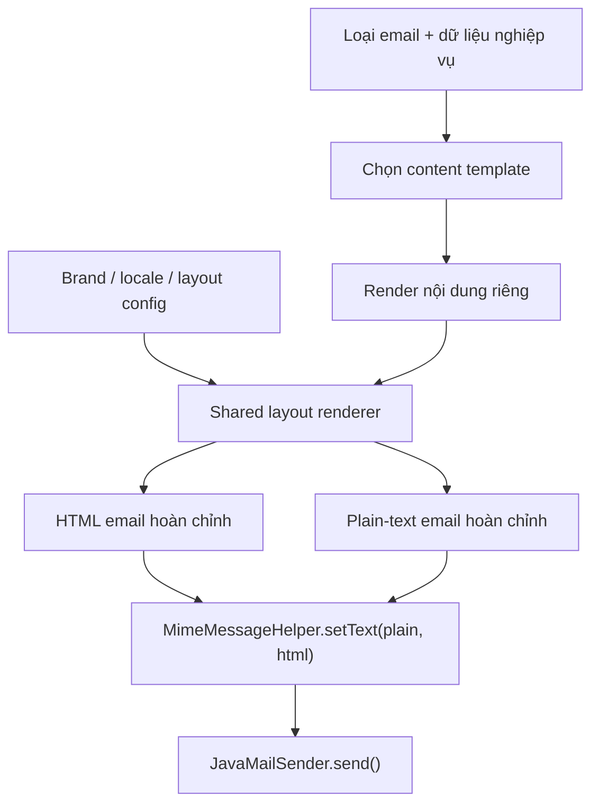

# Phân tách layout chung với nội dung từng loại thư trong Spring Framework Mail

Một ứng dụng có thể gửi nhiều loại email: chào mừng người dùng mới, xác nhận đơn hàng, hóa đơn, đặt lại mật khẩu, thông báo thanh toán hoặc nhắc lịch. Mỗi thư có nội dung và dữ liệu riêng, nhưng thường cùng chia sẻ logo, tên thương hiệu, phần đầu thư, kiểu chữ, khoảng cách, chân trang, địa chỉ hỗ trợ và liên kết chính sách.

Nếu viết toàn bộ HTML cho từng email, các phần chung sẽ bị sao chép ở nhiều nơi. Khi logo, màu thương hiệu hoặc thông tin hỗ trợ thay đổi, đội phát triển phải sửa từng template và dễ để sót. Ngược lại, nếu nhồi mọi nội dung vào một template lớn với hàng loạt điều kiện, việc đọc và bảo trì cũng trở nên khó khăn.

**Cách tổ chức phù hợp là tách layout chung khỏi nội dung theo từng loại thư.** Layout chịu trách nhiệm khung trình bày và các thành phần dùng lại; template nội dung chịu trách nhiệm thông tin nghiệp vụ của một loại email. Spring Framework Mail cung cấp API tạo và gửi MIME message, còn việc render template thường do một template engine như Thymeleaf hoặc FreeMarker đảm nhiệm.

## 1. Phân biệt layout chung và nội dung từng loại thư

Một email giao dịch có thể được chia thành ba lớp:

1. **Layout (khung trình bày):** phần đầu thư, logo, vùng nội dung, chân trang, kiểu trình bày chung và thông tin thương hiệu.
2. **Content template (nội dung theo loại thư):** tiêu đề nội dung, lời chào, thông tin đơn hàng, mã xác nhận, trạng thái thanh toán hoặc hướng dẫn riêng.
3. **Data model (dữ liệu render):** tên người nhận, mã đơn, số tiền, thời hạn, đường dẫn và các giá trị nghiệp vụ được truyền vào template.

Ví dụ:

```text
Layout chung
├── Header: logo + tên thương hiệu
├── Content slot
└── Footer: hỗ trợ + chính sách + thông tin doanh nghiệp

Nội dung riêng
├── welcome
├── order-confirmed
├── payment-receipt
├── password-reset
└── appointment-reminder
```

Khi gửi email xác nhận đơn hàng, hệ thống lấy layout chung, đưa nội dung của `order-confirmed` vào vùng content và truyền model chứa mã đơn, số tiền, URL chi tiết. Khi gửi email đặt lại mật khẩu, layout vẫn có thể giữ nguyên nhưng vùng content sử dụng template `password-reset`.



Điểm quan trọng là **layout không quyết định nghiệp vụ của từng email**. Layout không nên chứa điều kiện kiểu “nếu là hóa đơn thì hiển thị số tiền, nếu là reset password thì hiển thị OTP”. Những nội dung đó thuộc template riêng. Layout chỉ cung cấp vị trí và thành phần chung để các template sử dụng.

## 2. Vì sao cần tách layout?

### Giảm lặp lại và dễ cập nhật

Giả sử 12 loại email đều có logo và chân trang. Nếu mỗi file tự chứa cùng một đoạn HTML, khi đổi địa chỉ hỗ trợ hoặc logo, cần sửa nhiều nơi. Khi tách layout, thông tin chung được quản lý ở một vị trí và các email dùng lại.

### Giữ trải nghiệm nhất quán

Người nhận có thể nhận nhiều loại thư từ cùng một sản phẩm. Header, màu sắc, typography, khoảng cách và footer nhất quán giúp họ nhận biết nguồn gửi. Mỗi loại thư vẫn có thể có nội dung và cách trình bày riêng trong vùng chính.

### Phân chia trách nhiệm rõ ràng

| Thành phần | Trách nhiệm | Ví dụ |
|---|---|---|
| Layout | Khung HTML, header/footer, style chung | Logo, tên công ty, vùng nội dung |
| Fragment/component | Thành phần nhỏ có thể tái sử dụng | Nút CTA, dòng hỗ trợ, thông tin liên hệ |
| Content template | Cấu trúc riêng của loại thư | Xác nhận đơn hàng, reset password |
| Data model | Giá trị nghiệp vụ đưa vào template | `orderCode`, `amount`, `expiresAt` |
| Renderer | Chọn template, render layout và content | Thymeleaf engine hoặc FreeMarker |
| Mail service | Tạo MIME message và gửi | `MimeMessageHelper` + `JavaMailSender` |

### Hạn chế lỗi không đồng nhất

Khi mỗi loại thư tự định nghĩa footer, một email có thể dùng địa chỉ hỗ trợ cũ, email khác lại dùng địa chỉ mới. Tách layout giúp các thông tin chung được cập nhật đồng bộ hơn. Dù vậy, nội dung bắt buộc theo loại email (ví dụ hướng dẫn hủy đăng ký đối với một số email marketing) vẫn cần nằm trong đúng template hoặc fragment tương ứng với chính sách gửi.

## 3. Tổ chức thư mục template

Một cấu trúc tham khảo:

```text
src/main/resources/
└── templates/
    └── mail/
        ├── layout/
        │   ├── email.html
        │   └── fragments.html
        ├── html/
        │   ├── welcome.html
        │   ├── order-confirmed.html
        │   ├── payment-receipt.html
        │   └── password-reset.html
        └── text/
            ├── welcome.txt
            ├── order-confirmed.txt
            ├── payment-receipt.txt
            └── password-reset.txt
```

Vai trò:

- `layout/email.html` chứa khung HTML chung.
- `layout/fragments.html` chứa các phần nhỏ dùng lại như header, footer hoặc nút.
- `html/*.html` chứa nội dung HTML riêng cho từng loại email.
- `text/*.txt` chứa phiên bản plain text của cùng loại email.

Không nhất thiết phải tạo quá nhiều thư mục khi ứng dụng chỉ có vài template. Điều quan trọng là phân biệt rõ **layout**, **nội dung theo loại thư** và **phiên bản plain text/HTML**. Đặt tên file theo mục đích nghiệp vụ để người bảo trì dễ tìm.

## 4. Layout HTML chung bằng Thymeleaf Layout Dialect

Spring Mail không tự cung cấp template engine. Nếu dự án dùng Thymeleaf, có thể dùng **Thymeleaf Layout Dialect** để khai báo một layout và các template con điền nội dung vào những vùng được định nghĩa.

Thêm thư viện Layout Dialect tương thích với phiên bản Thymeleaf của dự án. Ví dụ Gradle:

```groovy
dependencies {
    implementation 'org.springframework.boot:spring-boot-starter-mail'
    implementation 'org.springframework.boot:spring-boot-starter-thymeleaf'
    implementation 'nz.net.ultraq.thymeleaf:thymeleaf-layout-dialect'
}
```

Trong ứng dụng không dùng Spring Boot, cần tự khai báo các dependency Spring Mail, Thymeleaf Spring integration và Layout Dialect tương ứng. Phiên bản cụ thể nên được quản lý theo Spring Boot BOM hoặc dependency management của dự án.

### 4.1. Tạo layout dùng chung

File `templates/mail/layout/email.html`:

```html
<!doctype html>
<html lang="vi"
      xmlns:th="http://www.thymeleaf.org"
      xmlns:layout="http://www.ultraq.net.nz/thymeleaf/layout">
<head>
    <meta charset="UTF-8">
    <meta name="viewport" content="width=device-width, initial-scale=1">
    <title layout:fragment="title">Thông báo từ Example</title>
</head>
<body style="margin:0;padding:0;background-color:#f4f5f7;">
    <table role="presentation" width="100%" cellpadding="0" cellspacing="0" border="0">
        <tr>
            <td align="center" style="padding:24px 12px;">
                <table role="presentation" width="600" cellpadding="0"
                       cellspacing="0" border="0"
                       style="width:100%;max-width:600px;background:#ffffff;">
                    <tr>
                        <td th:replace="~{mail/layout/fragments :: header(${brand})}">
                            Header thương hiệu
                        </td>
                    </tr>
                    <tr>
                        <td style="padding:28px 24px;">
                            <main layout:fragment="content">
                                Nội dung email mặc định
                            </main>
                        </td>
                    </tr>
                    <tr>
                        <td th:replace="~{mail/layout/fragments :: footer(${brand})}">
                            Footer thương hiệu
                        </td>
                    </tr>
                </table>
            </td>
        </tr>
    </table>
</body>
</html>
```

Trong layout:

- `layout:fragment="title"` khai báo vùng tiêu đề trang để template con thay thế.
- `layout:fragment="content"` khai báo vùng nội dung chính.
- Header và footer được đưa vào từ các fragment chung.
- Cấu trúc bảng với `role="presentation"` là cách bố cục thường dùng trong email HTML vì hỗ trợ được nhiều mail client hơn một số layout CSS hiện đại.

Đây là một khung minh họa. Khi triển khai thực tế, cần kiểm tra chiều rộng, padding, font và CSS trên các mail client mục tiêu; không giả định mọi trình duyệt CSS đều được hỗ trợ trong email.

### 4.2. Tạo các fragment dùng chung

File `templates/mail/layout/fragments.html`:

```html
<!doctype html>
<html lang="vi" xmlns:th="http://www.thymeleaf.org">
<body>
<header th:fragment="header(brand)" style="padding:24px;background:#ffffff;">
    
    <p th:unless="${brand.logoUrl != null}" th:text="${brand.name}">
        Example
    </p>
</header>
<footer th:fragment="footer(brand)"
        style="padding:24px;background:#f4f5f7;color:#555555;">
    <p>
        Cần hỗ trợ?
        <a th:href="'mailto:' + ${brand.supportEmail}"
           th:text="${brand.supportEmail}">support@example.org</a>
    </p>
    <p th:text="${brand.legalName}">Example Company</p>
    <p th:if="${brand.websiteUrl != null}">
        <a th:href="${brand.websiteUrl}" th:text="${brand.websiteUrl}">
            https://example.org
        </a>
    </p>
</footer>
</body>
</html>
```

`header(brand)` và `footer(brand)` là fragment có tham số. Giá trị `brand` được truyền từ context render; một tenant có thể có logo, tên hiển thị, email hỗ trợ và website khác nhau nếu cấu hình đã được xác minh.

Trong template, `th:text` ghi dữ liệu dưới dạng text đã được Thymeleaf escape theo HTML. Khi đặt URL trong `th:href` hoặc `th:src`, ứng dụng vẫn cần **xác thực scheme và host** theo chính sách trước khi render. Không coi việc Thymeleaf escape ký tự HTML là kiểm tra URL có đáng tin cậy.

### 4.3. Template riêng cho email xác nhận đơn hàng

File `templates/mail/html/order-confirmed.html`:

```html
<!doctype html>
<html lang="vi"
      xmlns:th="http://www.thymeleaf.org"
      xmlns:layout="http://www.ultraq.net.nz/thymeleaf/layout"
      layout:decorate="~{mail/layout/email}">
<head>
    <title layout:fragment="title"
           th:text="'Xác nhận đơn hàng ' + ${mail.orderCode}">
        Xác nhận đơn hàng
    </title>
</head>
<body>
    <main layout:fragment="content">
        <h1>Đơn hàng đã được xác nhận</h1>
        <p>Xin chào <strong th:text="${mail.customerName}">An</strong>,</p>
        <p>
            Đơn hàng <strong th:text="${mail.orderCode}">DH-2048</strong>
            của bạn đã được xác nhận.
        </p>
        <p>
            Tổng thanh toán:
            <strong th:text="${mail.totalDisplay}">450.000 ₫</strong>
        </p>
        <p>
            <a th:href="${mail.orderUrl}" th:text="#{mail.order.view}">
                Xem chi tiết đơn hàng
            </a>
        </p>
    </main>
</body>
</html>
```

Template con chỉ chứa **title và content riêng**. Nó không phải tự khai báo logo, footer hoặc toàn bộ khung trình bày. Khi render, Layout Dialect ghép phần content này vào layout chung.

Một template khác như `password-reset.html` có thể sử dụng cùng `layout/email.html` nhưng nội dung chính là thời hạn token, hướng dẫn đặt lại mật khẩu và cảnh báo nếu người nhận không yêu cầu thao tác.

## 5. Plain text cũng cần một layout chung

Layout HTML không thể được dùng nguyên xi cho email plain text vì `<table>`, ``, CSS và các thẻ HTML không có ý nghĩa trình bày trong `text/plain`. Nếu hệ thống gửi cả hai phiên bản, nên thiết kế **một bố cục text riêng**, đồng thời tái sử dụng thông tin thương hiệu và quy tắc chung.

Ví dụ cấu trúc:

```text
mail/text/
├── layout.txt
├── welcome.txt
├── order-confirmed.txt
└── password-reset.txt
```

File `layout.txt` có thể quy định:

```text
{{brandName}}
{{separator}}

{{body}}

------------------------------
Cần hỗ trợ? {{supportEmail}}
{{websiteUrl}}
{{legalName}}
```

Đây là cú pháp placeholder tự định nghĩa, không phải cú pháp mặc định của Spring Mail. Một renderer text có thể nhận phần body đã render theo loại thư rồi đưa vào layout:

```java
package com.example.mail;

public class PlainTextMailLayout {
    public String wrap(
            String body,
            String brandName,
            String supportEmail,
            String websiteUrl,
            String legalName) {

        String separator = "==============================";
        String footerSeparator = "------------------------------";

        return """
                %s
                %s

                %s

                %s
                Cần hỗ trợ? %s
                %s
                %s
                """.formatted(
                brandName, separator, body.strip(),
                footerSeparator, supportEmail, websiteUrl, legalName);
    }
}
```

Ví dụ này dùng Java text block và `String.formatted` (Java 15+). Trong ứng dụng thực tế, nên xử lý giá trị null, locale, xuống dòng và độ dài dữ liệu; có thể thay helper bằng một text template engine để hỗ trợ điều kiện và đa ngôn ngữ.

Điều quan trọng là **text layout có cùng vai trò kiến trúc với HTML layout**, nhưng sử dụng cách trình bày phù hợp với văn bản thuần. Không chèn HTML vào body text rồi hy vọng client tự chuyển đổi.

### Nội dung text riêng cho từng loại thư

File `order-confirmed.txt`:

```text
Xin chào {{customerName}},

Đơn hàng {{orderCode}} đã được xác nhận.
Tổng thanh toán: {{totalDisplay}}

Xem chi tiết:
{{orderUrl}}
```

Sau khi render, body được đưa vào layout text chung. Còn file `password-reset.txt` có thể chứa:

```text
Xin chào {{customerName}},

Bạn vừa yêu cầu đặt lại mật khẩu.

Mở liên kết sau để tiếp tục:
{{resetUrl}}

Liên kết có hiệu lực đến {{expiresAt}}.
Nếu bạn không thực hiện yêu cầu, hãy bỏ qua email này.
```

Mỗi template chịu trách nhiệm **nội dung theo loại thư**; phần brand/footer chung vẫn được ghép bởi layout text.

## 6. Dữ liệu render: tách model nghiệp vụ khỏi HTML

Không nên đưa toàn bộ logic lấy dữ liệu database, kiểm tra quyền và định dạng tiền vào file HTML. Thay vào đó, chuẩn bị một **view model** đã có dữ liệu phù hợp cho email.

Ví dụ:

```java
package com.example.mail;

public record OrderConfirmedMailView(
        String customerName,
        String orderCode,
        String totalDisplay,
        String orderUrl) {
}
```

Thông tin thương hiệu:

```java
package com.example.mail;

public record MailBrand(
        String name,
        String legalName,
        String logoUrl,
        String fromAddress,
        String replyToAddress,
        String supportEmail,
        String websiteUrl) {
}
```

Hai model này có trách nhiệm khác nhau:

- `OrderConfirmedMailView` mang dữ liệu riêng của email xác nhận đơn.
- `MailBrand` mang dữ liệu chung cho layout và danh tính gửi được cấu hình.

Một email khác có thể dùng `PasswordResetMailView` mà không phải thêm các trường như `resetUrl` vào model đơn hàng. Cách tách này giúp template chỉ nhận những dữ liệu nó cần.

### Định dạng dữ liệu trước khi render

Template nên tập trung vào trình bày. Các phép tính nghiệp vụ và chuẩn hóa quan trọng nên được xử lý trước:

| Dữ liệu | Nên chuẩn bị ở tầng nào? | Lý do |
|---|---|---|
| Tổng tiền | Service/domain formatter | Định dạng đúng tiền tệ và locale |
| Thời hạn OTP/reset | Service thời gian | Xác định đúng múi giờ và chính sách |
| Tên người nhận | Model builder | Kiểm soát giá trị null/độ dài |
| URL hành động | URL builder đáng tin cậy | Không lấy host tùy ý từ request |
| Email hỗ trợ | Brand/tenant configuration | Dùng chung trong layout |
| Logo URL | Brand configuration đã xác minh | Tránh URL tùy ý hoặc không an toàn |

Template không nên tự truy vấn repository, tự chọn tenant hoặc tự suy luận quyền gửi. Những việc đó thuộc service và tầng cấu hình.

## 7. Render template rồi gửi bằng MimeMessageHelper

Sau khi tách layout và nội dung, quy trình gửi email gồm hai phần:

1. **Render:** chọn template theo loại thư, chuẩn bị context, tạo plain text và HTML hoàn chỉnh.
2. **Send:** tạo `MimeMessage`, đặt header và body qua `MimeMessageHelper`, sau đó gọi `JavaMailSender.send(...)`.

Khai báo kết quả render:

```java
package com.example.mail;

public record RenderedMail(
        String subject,
        String plainText,
        String htmlText) {
}
```

Hợp đồng renderer:

```java
package com.example.mail;

import java.util.Locale;

public interface MailTemplateRenderer {
    RenderedMail renderOrderConfirmed(
            OrderConfirmedMailView mail,
            MailBrand brand,
            Locale locale);
}
```

Ví dụ triển khai minh họa bằng hai template engine:

```java
package com.example.mail;

import java.util.Locale;
import org.springframework.stereotype.Component;
import org.thymeleaf.context.Context;
import org.thymeleaf.spring6.SpringTemplateEngine;

@Component
public class ThymeleafMailTemplateRenderer
        implements MailTemplateRenderer {

    private final SpringTemplateEngine htmlEngine;
    private final SpringTemplateEngine textEngine;
    private final PlainTextMailLayout textLayout;

    public ThymeleafMailTemplateRenderer(
            SpringTemplateEngine htmlEngine,
            SpringTemplateEngine textEngine,
            PlainTextMailLayout textLayout) {
        this.htmlEngine = htmlEngine;
        this.textEngine = textEngine;
        this.textLayout = textLayout;
    }

    @Override
    public RenderedMail renderOrderConfirmed(
            OrderConfirmedMailView mail,
            MailBrand brand,
            Locale locale) {

        Context context = new Context(locale);
        context.setVariable("mail", mail);
        context.setVariable("brand", brand);

        String html = htmlEngine.process(
                "mail/html/order-confirmed", context);
        String bodyText = textEngine.process(
                "mail/text/order-confirmed", context);
        String plain = textLayout.wrap(
                bodyText,
                brand.name(),
                brand.supportEmail(),
                brand.websiteUrl(),
                brand.legalName());

        String subject = "Xác nhận đơn hàng " + mail.orderCode();
        return new RenderedMail(subject, plain, html);
    }
}
```

Đây là ví dụ tích hợp cần các bean `htmlEngine` và `textEngine` được cấu hình với resolver phù hợp. Cách đặt tên template là đường dẫn logic dưới prefix của resolver; không phải đường dẫn filesystem tùy ý.

### Gửi kết quả render

```java
package com.example.mail;

import jakarta.mail.MessagingException;
import jakarta.mail.internet.MimeMessage;
import java.nio.charset.StandardCharsets;
import java.util.Locale;
import org.springframework.mail.javamail.JavaMailSender;
import org.springframework.mail.javamail.MimeMessageHelper;
import org.springframework.stereotype.Service;

@Service
public class OrderMailService {
    private final JavaMailSender mailSender;
    private final MailTemplateRenderer renderer;

    public OrderMailService(
            JavaMailSender mailSender,
            MailTemplateRenderer renderer) {
        this.mailSender = mailSender;
        this.renderer = renderer;
    }

    public void sendOrderConfirmed(
            String recipient,
            OrderConfirmedMailView view,
            MailBrand brand,
            Locale locale) throws MessagingException {

        RenderedMail rendered =
                renderer.renderOrderConfirmed(view, brand, locale);
        MimeMessage message = mailSender.createMimeMessage();
        MimeMessageHelper helper = new MimeMessageHelper(
                message, true, StandardCharsets.UTF_8.name());

        helper.setFrom(brand.fromAddress());
        helper.setTo(recipient);
        helper.setSubject(rendered.subject());
        helper.setText(rendered.plainText(), rendered.htmlText());

        if (brand.replyToAddress() != null) {
            helper.setReplyTo(brand.replyToAddress());
        }
        mailSender.send(message);
    }
}
```

Ví dụ tập trung vào cách nối renderer với Spring Mail. Trong ứng dụng thật, `From` phải là địa chỉ gửi đã được xác minh và cấp quyền; địa chỉ hỗ trợ không nhất thiết là địa chỉ người gửi. Có thể dùng `setReplyTo(...)` nếu chính sách yêu cầu phản hồi đến một hộp thư khác.

`MimeMessageHelper` được khởi tạo ở multipart mode để chứa hai phiên bản `text/plain` và `text/html`. `setText(plain, html)` tạo nội dung thay thế trong cùng message; `send(...)` chỉ gửi một email, không gửi hai thư độc lập.

## 8. Cấu hình hai template engine cho HTML và plain text

Nếu sử dụng Thymeleaf, có thể tạo hai resolver riêng: một cho HTML, một cho text. HTML engine cần Layout Dialect; text engine chỉ cần xử lý nội dung văn bản.

Ví dụ cấu hình Spring Framework 6+ / Spring Boot 3+:

```java
package com.example.mail;

import nz.net.ultraq.thymeleaf.layoutdialect.LayoutDialect;
import org.springframework.context.annotation.Bean;
import org.springframework.context.annotation.Configuration;
import org.springframework.context.annotation.Qualifier;
import org.thymeleaf.spring6.SpringTemplateEngine;
import org.thymeleaf.spring6.templateresolver.SpringResourceTemplateResolver;
import org.thymeleaf.templatemode.TemplateMode;

@Configuration
public class MailTemplateConfiguration {

    @Bean("htmlMailTemplateEngine")
    SpringTemplateEngine htmlMailTemplateEngine() {
        SpringResourceTemplateResolver resolver =
                new SpringResourceTemplateResolver();
        resolver.setPrefix("classpath:/templates/");
        resolver.setSuffix(".html");
        resolver.setTemplateMode(TemplateMode.HTML);
        resolver.setCharacterEncoding("UTF-8");
        resolver.setCacheable(true);

        SpringTemplateEngine engine = new SpringTemplateEngine();
        engine.setTemplateResolver(resolver);
        engine.addDialect(new LayoutDialect());
        return engine;
    }

    @Bean("textMailTemplateEngine")
    SpringTemplateEngine textMailTemplateEngine() {
        SpringResourceTemplateResolver resolver =
                new SpringResourceTemplateResolver();
        resolver.setPrefix("classpath:/templates/");
        resolver.setSuffix(".txt");
        resolver.setTemplateMode(TemplateMode.TEXT);
        resolver.setCharacterEncoding("UTF-8");
        resolver.setCacheable(true);

        SpringTemplateEngine engine = new SpringTemplateEngine();
        engine.setTemplateResolver(resolver);
        return engine;
    }
}
```

Khi inject hai engine vào renderer, dùng `@Qualifier("htmlMailTemplateEngine")` và `@Qualifier("textMailTemplateEngine")` để Spring chọn đúng bean. Ví dụ constructor:

```java
public ThymeleafMailTemplateRenderer(
        @Qualifier("htmlMailTemplateEngine")
        SpringTemplateEngine htmlEngine,
        @Qualifier("textMailTemplateEngine")
        SpringTemplateEngine textEngine,
        PlainTextMailLayout textLayout) {
    this.htmlEngine = htmlEngine;
    this.textEngine = textEngine;
    this.textLayout = textLayout;
}
```

Ví dụ cấu hình trên minh họa hai resolver độc lập. Khi dùng Spring Boot auto-configuration, hãy kiểm tra xem dự án đã có template engine hoặc resolver mặc định hay chưa để tránh tạo bean trùng hoặc vô tình thay đổi cấu hình template cho giao diện web.

### Ví dụ template text mode

File `templates/mail/text/order-confirmed.txt`:

```text
Xin chào [[${mail.customerName}]],

Đơn hàng [[${mail.orderCode}]] đã được xác nhận.
Tổng thanh toán: [[${mail.totalDisplay}]]

Xem chi tiết:
[[${mail.orderUrl}]]
```

Trong Thymeleaf TEXT mode, cú pháp `[[...]]` là inline expression; engine render giá trị vào chuỗi text. Đây là nội dung body riêng; `PlainTextMailLayout` ghép header/footer chung ở ví dụ trước.

Không dùng template text để thay thế HTML hoặc ngược lại. Nếu sử dụng một template engine khác, hãy giữ cùng nguyên tắc: **hai định dạng có template riêng, cùng nhận một model nghiệp vụ**.

## 9. Một loại thư khác dùng lại layout

Ví dụ email đặt lại mật khẩu có thể dùng chung layout HTML nhưng nội dung khác:

File `templates/mail/html/password-reset.html`:

```html
<!doctype html>
<html lang="vi"
      xmlns:th="http://www.thymeleaf.org"
      xmlns:layout="http://www.ultraq.net.nz/thymeleaf/layout"
      layout:decorate="~{mail/layout/email}">
<head>
    <title layout:fragment="title">Yêu cầu đặt lại mật khẩu</title>
</head>
<body>
    <main layout:fragment="content">
        <h1>Đặt lại mật khẩu</h1>
        <p>Xin chào <strong th:text="${mail.customerName}">An</strong>,</p>
        <p>Chúng tôi nhận được yêu cầu đặt lại mật khẩu cho tài khoản của bạn.</p>
        <p>
            <a th:href="${mail.resetUrl}">
                Tiếp tục đặt lại mật khẩu
            </a>
        </p>
        <p>
            Liên kết có hiệu lực đến
            <strong th:text="${mail.expiresAtDisplay}">15:30</strong>.
        </p>
        <p>Nếu bạn không thực hiện yêu cầu, hãy bỏ qua email này.</p>
    </main>
</body>
</html>
```

Template này vẫn dùng logo, footer và khung chung từ `layout/email.html`. Nội dung không chứa thông tin đơn hàng; nó chỉ nhận model phù hợp với reset password.

### Không dùng một model tổng hợp cho mọi email

Một cách dễ làm nhưng khó bảo trì là tạo một class có hàng chục trường tùy chọn:

```java
// Không nên biến mọi loại email thành một model khổng lồ.
public class GenericMailModel {
    String customerName;
    String orderCode;
    String total;
    String resetUrl;
    String otp;
    String appointmentTime;
    String invoiceUrl;
}
```

Khi đó template nào cũng có thể truy cập dữ liệu không liên quan, và việc kiểm soát trường nào bắt buộc trở nên khó khăn. Nên dùng model theo loại thư (`OrderConfirmedMailView`, `PasswordResetMailView`, `InvoiceMailView`) và một model layout riêng (`MailBrand`).

## 10. Quản lý loại email và chọn template

Khi số lượng loại thư tăng, tránh viết một chuỗi dài các điều kiện trong mail service:

```java
if (type.equals("ORDER_CONFIRMED")) {
    // Render order template.
} else if (type.equals("PASSWORD_RESET")) {
    // Render reset template.
} else if (type.equals("WELCOME")) {
    // Render welcome template.
}
```

Có thể định nghĩa enum hoặc registry để ánh xạ loại thư với tên template:

```java
public enum MailType {
    WELCOME("welcome"),
    ORDER_CONFIRMED("order-confirmed"),
    PASSWORD_RESET("password-reset"),
    PAYMENT_RECEIPT("payment-receipt");

    private final String templateKey;

    MailType(String templateKey) {
        this.templateKey = templateKey;
    }

    public String templateKey() {
        return templateKey;
    }
}
```

Một registry có thể quản lý:

| Mail type | HTML template | Text template | Subject key |
|---|---|---|---|
| `WELCOME` | `mail/html/welcome` | `mail/text/welcome` | `mail.welcome.subject` |
| `ORDER_CONFIRMED` | `mail/html/order-confirmed` | `mail/text/order-confirmed` | `mail.order.subject` |
| `PASSWORD_RESET` | `mail/html/password-reset` | `mail/text/password-reset` | `mail.password-reset.subject` |
| `PAYMENT_RECEIPT` | `mail/html/payment-receipt` | `mail/text/payment-receipt` | `mail.payment.subject` |

Registry cho phép kiểm soát template nào được sử dụng và loại model nào tương ứng. Nếu template key đến từ dữ liệu bên ngoài, hãy ánh xạ qua enum/allowlist; **không ghép trực tiếp tên file từ input người dùng** rồi truyền vào template engine. Làm như vậy có thể tạo lỗ hổng đọc template ngoài phạm vi hoặc sử dụng nội dung không được phê duyệt.

### Tách subject khỏi layout

`Subject` là message header, không phải phần body của layout. Nó có thể được lấy từ message source hoặc message bundle theo locale:

```java
String subject = messageSource.getMessage(
        "mail.order-confirmed.subject",
        new Object[] { view.orderCode() },
        locale);
```

Subject có thể thay đổi theo loại thư và ngôn ngữ, nhưng không nên đặt logo/footer hoặc HTML vào subject. Khi tạo `MimeMessageHelper`, gọi `setSubject(subject)` riêng.

## 11. Đa tenant và thương hiệu khác nhau

Trong ứng dụng SaaS, mỗi tenant có thể có logo, tên doanh nghiệp, email hỗ trợ, website, địa chỉ pháp lý và một số lựa chọn trình bày riêng. Trong mô hình này, **layout có thể dùng chung về cấu trúc**, còn dữ liệu brand được truyền theo tenant:

```text
Tenant Alpha
  brand.name = Alpha
  brand.logoUrl = https://static.alpha.example/logo.png
  brand.supportEmail = support@alpha.example

Tenant Beta
  brand.name = Beta
  brand.logoUrl = https://static.beta.example/logo.png
  brand.supportEmail = help@beta.example
```

Layout đọc `brand` và render thông tin phù hợp. Content template vẫn được chọn theo loại email, ví dụ `order-confirmed`.

### Cách ly dữ liệu tenant

Không nhận một object `MailBrand` tùy ý từ request rồi dùng trực tiếp. Hãy truy vấn brand configuration theo tenant đã được xác thực, kiểm tra trạng thái và quyền sử dụng trước khi render. Tương tự, địa chỉ `From` và SMTP sender cần lấy từ cấu hình được cấp quyền, không lấy từ logo hoặc domain do client tự gửi lên.

Nếu tenant thay logo trong lúc worker đang gửi, cần xác định job dùng brand snapshot tại thời điểm tạo hay brand mới nhất tại thời điểm render. Cả hai đều có thể phù hợp; quan trọng là chính sách nhất quán, nhất là với email hóa đơn hoặc chứng từ cần truy vết.

### Giới hạn tùy biến layout

Cho tenant thay logo và màu cơ bản thường dễ kiểm soát. Cho phép tenant cung cấp toàn bộ HTML/CSS tự do có thể gây nội dung giả mạo thương hiệu, link lừa đảo, CSS không tương thích, nội dung ngoài chính sách hoặc markup nguy hiểm. Nếu có chức năng tùy biến template, nên dùng một tập thành phần và biến được cho phép, kiểm duyệt template trước khi kích hoạt và lưu version.

## 12. Đa ngôn ngữ: layout chung, nội dung theo locale

Email đa ngôn ngữ nên chọn layout và content template theo cùng `Locale`. Ví dụ:

```text
mail/
├── vi/
│   ├── html/order-confirmed.html
│   └── text/order-confirmed.txt
└── en/
    ├── html/order-confirmed.html
    └── text/order-confirmed.txt
```

Hoặc dùng một bộ template có message bundle và biến dịch. Dù chọn cách nào, cần bảo đảm:

1. Subject và body dùng cùng locale.
2. Plain text và HTML cùng ngôn ngữ.
3. Ngày, giờ, tiền tệ và số được định dạng theo locale/timezone dự kiến.
4. Footer, chính sách và địa chỉ hỗ trợ cũng được dịch hoặc cung cấp theo cấu hình.
5. Template fallback được xác định rõ nếu locale người nhận chưa hỗ trợ.

Ví dụ truyền locale vào Thymeleaf:

```java
Locale locale = Locale.forLanguageTag("vi-VN");
Context context = new Context(locale);
context.setVariable("mail", view);
context.setVariable("brand", brand);
String html = htmlEngine.process(
        "mail/html/order-confirmed", context);
```

Locale truyền vào context giúp message expression và các thành phần phụ thuộc locale hoạt động theo lựa chọn đó. Việc định dạng tiền và ngày vẫn nên được chuẩn bị hoặc cấu hình có chủ đích.

## 13. Bảo mật khi dùng template

Tách layout khỏi nội dung giúp dễ bảo trì nhưng không tự động bảo vệ email. Template engine, dữ liệu render và URL cần được quản lý an toàn.

### Escape dữ liệu HTML

Với Thymeleaf, `th:text` escape dữ liệu khi xuất ra HTML. Ví dụ:

```html
<p th:text="${mail.customerName}">Tên khách hàng</p>
```

Nếu `customerName` chứa `<script>alert(1)</script>`, nội dung sẽ được biểu diễn như text thay vì thực thi thành markup.

Tránh dùng `th:utext` với dữ liệu không đáng tin cậy:

```html
<!-- Chỉ dùng khi nội dung đã được kiểm soát/sanitize phù hợp -->
<div th:utext="${mail.richContent}"></div>
```

`th:utext` đưa nội dung không escape vào HTML; nếu nguồn chứa markup độc hại, template có thể tạo nội dung nguy hiểm hoặc link lừa đảo.

### URL trong `href` và `src`

HTML escaping không thay thế việc xác thực URL. Đặc biệt với link reset password, xác nhận đơn hàng và ảnh:

- Sinh hostname từ cấu hình ứng dụng đáng tin cậy, không lấy trực tiếp từ header request.
- Chỉ cho phép scheme mong muốn, thường là `https`.
- Không để tenant tự đặt link trỏ đến domain khác nếu chưa qua chính sách.
- Dùng token có thời hạn, phạm vi và khả năng sử dụng được kiểm soát.
- Không đưa password hoặc secret dài hạn vào query string.
- Đảm bảo URL trong plain text và HTML trỏ đến cùng hành động an toàn.

### Không dùng đường dẫn template do người dùng chỉ định

Đường dẫn như `mail/html/order-confirmed` nên đến từ enum/registry của ứng dụng. Nếu API nhận chuỗi `templateName` tùy ý rồi truyền vào engine, người dùng có thể yêu cầu template không được phép hoặc gây truy cập tài nguyên ngoài ý muốn tùy resolver.

### Bảo vệ dữ liệu trong log

Không ghi toàn bộ HTML, plain text hoặc token reset password vào log sản xuất chỉ để debug. Có thể log `jobId`, `tenantId`, `mailType`, template version, kết quả render và trạng thái SMTP; các trường nhạy cảm cần được loại bỏ hoặc che.

## 14. Inline image và attachment khi layout được tái sử dụng

Layout chung có thể chứa logo dưới dạng remote URL hoặc CID. Nếu dùng CID, cần thêm tài nguyên vào MIME message sau khi đã đặt body HTML:

```java
MimeMessage message = mailSender.createMimeMessage();
MimeMessageHelper helper = new MimeMessageHelper(
        message,
        MimeMessageHelper.MULTIPART_MODE_MIXED_RELATED,
        "UTF-8");

helper.setText(plainText, htmlText);
helper.addInline(
        "brand-logo",
        new ClassPathResource("mail/logo.png"),
        "image/png");
```

Layout HTML tham chiếu:

```html

```

Nếu logo khác nhau theo tenant, renderer hoặc mail service phải chọn đúng resource từ cấu hình brand được xác minh. Với logo remote, chỉ cần đưa URL HTTPS vào layout; không cần gọi `addInline`.

Attachment của từng loại thư có thể khác nhau: hóa đơn PDF, bảng kê CSV hoặc tài liệu hợp đồng. Đừng đặt attachment logic vào layout chung vì không phải email nào cũng có file. Content template hoặc mail type handler quyết định attachment nào cần gửi, còn service MIME chịu trách nhiệm thêm chúng vào message.

### Một message có nhiều loại part

Email có text/plain, HTML, logo CID và PDF có thể có cây MIME:

```text
MimeMessage
└── multipart/mixed
    ├── multipart/related
    │   ├── multipart/alternative
    │   │   ├── text/plain
    │   │   └── text/html
    │   └── image/png (Content-ID: <brand-logo>)
    └── application/pdf (attachment)
```

Đây là cấu trúc minh họa; cách lồng cụ thể phụ thuộc multipart mode và thư viện. Layout template chỉ render HTML; nó không tự tạo MIME part cho ảnh hoặc PDF.

## 15. Versioning và vòng đời template

Template email là một phần của trải nghiệm sản phẩm và có thể ảnh hưởng nội dung giao dịch. Khi cập nhật layout hoặc template, nên quản lý phiên bản và quy trình phát hành:

| Thành phần | Cách quản lý gợi ý |
|---|---|
| Shared layout | Version hóa thay đổi brand, header, footer và cấu trúc chung |
| Content template | Version theo loại thư và locale |
| Translation/message bundle | Cập nhật cùng đợt với template tương ứng |
| Brand configuration | Có version hoặc thời điểm hiệu lực nếu cần truy vết |
| Rendered message | Có thể lưu metadata/template version để hỗ trợ điều tra |

Nếu email hóa đơn phải có nội dung có thể tái dựng, lưu lại **template version và dữ liệu snapshot phù hợp** tại thời điểm tạo chứng từ. Không nhất thiết lưu toàn bộ email chứa dữ liệu cá nhân trong mọi hệ thống; hãy xác định nhu cầu audit, retention và quyền truy cập.

### Cache template

Template engine thường có thể cache template đã phân tích để giảm chi phí render. Trong môi trường production, cache giúp hiệu năng ổn định; khi phát triển, có thể tắt cache hoặc cấu hình thời gian refresh theo nhu cầu.

Khi triển khai template mới, xác định cách cache được làm mới (restart, redeploy hoặc refresh), đồng bộ các instance và dùng version/invalidation nếu template được lưu ở nguồn động. Không để một worker đang gửi dùng layout mới nhưng content cũ ngoài ý muốn nếu nội dung phải nhất quán theo phiên bản.

### Template lỗi phải được phát hiện trước khi gửi thật

Một file HTML có thể render thất bại vì thiếu biến, sai fragment hoặc lỗi cú pháp. Nên có bước kiểm tra render template trong môi trường phát triển/staging với dữ liệu mẫu. Không nên để lần gửi email cho khách hàng đầu tiên mới phát hiện layout bị lỗi.

## 16. Kiểm thử layout và nội dung theo loại thư

Vì layout được dùng bởi nhiều email, một thay đổi nhỏ ở layout có thể ảnh hưởng nhiều loại thư. Có thể tổ chức kiểm thử theo hai cấp:

1. **Render test:** cung cấp model mẫu và xác nhận renderer tạo được plain text/HTML, chứa các giá trị cần thiết và không còn placeholder.
2. **Integration test gửi thư:** dùng SMTP sink như Mailpit để nhận MIME message và xem cấu trúc, ảnh CID, attachment và header.

Ví dụ kiểm tra renderer ở mức đơn vị:

```java
@Test
void rendersOrderMailWithSharedLayout() {
    OrderConfirmedMailView view = new OrderConfirmedMailView(
            "An",
            "DH-2048",
            "450.000 ₫",
            "https://shop.example.org/orders/DH-2048");

    MailBrand brand = new MailBrand(
            "Example",
            "Example Company",
            "https://static.example.org/logo.png",
            "notifications@example.org",
            "support@example.org",
            "support@example.org",
            "https://example.org");

    RenderedMail rendered = renderer.renderOrderConfirmed(
            view, brand, Locale.forLanguageTag("vi-VN"));

    assertTrue(rendered.plainText().contains("DH-2048"));
    assertTrue(rendered.htmlText().contains("DH-2048"));
    assertTrue(rendered.htmlText().contains("Example"));
    assertTrue(rendered.plainText().contains("support@example.org"));
}
```

Đây là ví dụ kiểm tra minh họa, giả định có test framework và bean `renderer` được cấu hình. Có thể kiểm tra thêm subject, locale, URL, header/footer, và đảm bảo HTML không còn chuỗi placeholder.

### Kiểm tra nhiều loại thư cùng layout

| Loại thư | Kiểm tra nội dung riêng | Kiểm tra phần dùng chung |
|---|---|---|
| Welcome | Tên người dùng, link bắt đầu | Logo, footer, hỗ trợ |
| Order confirmed | Mã đơn, số tiền, URL đơn | Logo, footer, thương hiệu |
| Password reset | Link token, thời hạn, cảnh báo | Logo, footer, hỗ trợ |
| Payment receipt | Số tiền, mã giao dịch, thời điểm | Logo, thông tin doanh nghiệp |

Khi thay đổi layout, nên render ít nhất các template đại diện hoặc toàn bộ loại thư đang sử dụng layout đó. Nếu một template không cung cấp fragment title/content đúng tên, lỗi có thể xuất hiện chỉ với loại thư đó.

### Xem MIME source trong SMTP sink

SMTP sink local giúp xác nhận ứng dụng đã gửi một message có cả `text/plain` và `text/html`, header/footer đã được render, CID image có `Content-ID` trùng với `cid:...` trong HTML, attachment chỉ xuất hiện ở mail type cần nó và charset hỗ trợ tiếng Việt.

Khi thử nghiệm local, có thể dùng cấu hình SMTP sink riêng (ví dụ localhost port 1025) và không bật AUTH/TLS nếu môi trường test được cô lập. Không dùng cấu hình đó trong production.

## 17. Các lỗi thường gặp khi tách layout và content

| Hiện tượng | Nguyên nhân có thể | Cách xử lý |
|---|---|---|
| Header/footer không xuất hiện | Sai tên fragment hoặc đường dẫn template | Kiểm tra namespace, fragment name và resolver prefix |
| Template con không dùng layout | Thiếu/sai `layout:decorate` hoặc dialect chưa được đăng ký | Cấu hình Layout Dialect và đường dẫn layout đúng |
| Vùng nội dung bị lặp hai lần | Layout và template con đều giữ nội dung mặc định không được thay thế | Xác định đúng fragment slot, không render cả body hai lần |
| Thiếu title hoặc title dùng giá trị mặc định | Template con không khai báo fragment title đúng tên | Khai báo `layout:fragment="title"` |
| Logo tenant sai | Brand model lấy sai tenant hoặc cache config cũ | Xác định tenant context và version brand |
| Footer không theo locale | Dùng chuỗi cố định trong fragment | Dùng message bundle hoặc brand localization |
| HTML hiển thị nguyên biểu thức Thymeleaf | Template chưa được render qua engine | Gọi engine trước khi gán vào MIME message |
| Plain text chứa thẻ HTML | Dùng chung HTML body cho text part | Render text template riêng |
| Hai phiên bản nội dung không đồng nhất | Render từ dữ liệu hoặc thời điểm khác nhau | Dùng chung view model và snapshot |
| Dữ liệu người dùng tạo markup | Dùng unescaped output như `th:utext` | Escape/sanitize theo ngữ cảnh |
| URL trong nút dẫn đến domain lạ | URL lấy trực tiếp từ request hoặc model không kiểm tra | Sinh URL từ cấu hình đáng tin cậy, allowlist scheme/host |
| Template path có thể bị điều khiển | Lấy tên template tùy ý từ input | Dùng enum/registry allowlist |
| Thay layout nhưng một số email vẫn cũ | Cache hoặc nhiều instance chưa đồng bộ | Làm mới cache và version hóa release |
| Attachment xuất hiện ở mọi email | Đặt logic attachment trong shared layout/service chung | Gắn attachment theo mail type |
| Email render được nhưng gửi thất bại | Lỗi SMTP/AUTH/TLS/quota | Tách lỗi render khỏi lỗi submission |
| Email submission thành công nhưng không đến inbox | Delivery bị delay/bounce/lọc spam | Tra provider event và trạng thái phía nhận |

Một nguyên tắc hữu ích là phân biệt **lỗi render** (template/model/layout), **lỗi tạo MIME** (multipart/attachment/charset) và **lỗi gửi SMTP** (network/TLS/AUTH/policy). Chúng xảy ra ở các giai đoạn khác nhau và cần thông tin log khác nhau.

## 18. Khi nào không cần layout engine phức tạp?

Nếu ứng dụng chỉ có một hoặc hai email rất ngắn, việc đưa thêm template dialect và nhiều tầng abstraction có thể không cần thiết. Có thể bắt đầu bằng một class tạo nội dung và một helper dựng header/footer dùng chung.

| Quy mô | Cách làm phù hợp |
|---|---|
| Một email thông báo ngắn | `SimpleMailMessage` hoặc `MimeMessageHelper` với chuỗi trực tiếp |
| Vài email có chung logo/footer | Helper/fragment đơn giản hoặc template engine |
| Nhiều loại email, có HTML và plain text | Tách template theo mail type, layout dùng chung |
| Nhiều locale và tenant branding | Renderer + layout + content templates + brand model |
| Người quản trị được tùy biến template | Template registry, versioning, validation và policy kiểm duyệt |

Đừng xây dựng một framework template riêng khi nhu cầu chưa yêu cầu. Tuy nhiên, khi bắt đầu có lặp lại layout hoặc nhiều người cùng sửa nội dung, tách các phần dùng chung sẽ giúp thay đổi dễ kiểm soát hơn.

## 19. Câu hỏi thường gặp

**Spring Framework Mail có sẵn chức năng layout template không?** Không. Spring Mail cung cấp API tạo và gửi email. Layout/content rendering thường được thực hiện bởi Thymeleaf, FreeMarker, Mustache hoặc một renderer do ứng dụng xây dựng.

**Layout và content template khác nhau ở điểm nào?** Layout chứa khung dùng chung như header, footer và vùng nội dung. Content template chứa nội dung nghiệp vụ của một loại email, ví dụ xác nhận đơn hàng hoặc đặt lại mật khẩu.

**Có thể dùng cùng một layout cho plain text và HTML không?** Có thể dùng cùng nguyên tắc bố cục và cùng dữ liệu thương hiệu, nhưng cần template/layout riêng theo định dạng. HTML markup không có ý nghĩa trong text/plain.

**Một layout có thể được dùng bởi nhiều tenant không?** Có. Truyền brand model theo tenant đã xác thực vào layout; không để request tùy ý chọn logo, địa chỉ gửi hoặc miền của tenant khác.

**Template có thể tự truy vấn database không?** Nên tránh. Service chuẩn bị view model đã có dữ liệu cần thiết, template chỉ tập trung trình bày. Cách này giúp render dễ kiểm tra và không trộn logic nghiệp vụ với HTML.

**Có thể để mỗi loại thư có footer riêng không?** Có. Có thể dùng footer chung làm mặc định rồi thêm fragment hoặc vùng mở rộng riêng cho loại thư cần nội dung bổ sung. Tuy nhiên, thông tin pháp lý hoặc unsubscribe bắt buộc vẫn phải xuất hiện theo chính sách tương ứng.

**Nếu chỉ muốn đổi logo thì có cần sửa mọi template không?** Không, nếu logo nằm trong shared layout/fragment và được truyền qua brand model. Chỉ cần cập nhật cấu hình hoặc tài nguyên dùng chung theo cách triển khai.

**Có thể dùng chung một file HTML cho mọi loại email bằng nhiều điều kiện không?** Có thể, nhưng khi số loại thư tăng, nhiều nhánh điều kiện làm template khó đọc và dễ lộ nội dung không liên quan. Tách file theo mail type thường rõ ràng hơn.

**Tại sao cần cả plain text và HTML?** Để người nhận có lựa chọn hiển thị phù hợp. HTML cung cấp bố cục, còn text/plain giữ nội dung có thể đọc trong client không hiển thị HTML. Hai bản cần truyền tải thông tin nghiệp vụ tương đương.

**Layout có nên chứa subject không?** Không nên. Subject là message header và thay đổi theo mail type/locale. Layout là phần body presentation; subject được render riêng rồi đặt bằng `MimeMessageHelper.setSubject(...)`.

**Có nên lưu HTML đã render vào database không?** Tùy nhu cầu audit và khả năng tái dựng. Nếu cần truy vết nội dung chính xác đã gửi, có thể lưu snapshot hoặc template version cùng metadata, nhưng phải cân nhắc dữ liệu cá nhân, retention và quyền truy cập.

**Có thể thay template ngay khi ứng dụng đang chạy không?** Có thể nếu resolver/cache hỗ trợ reload hoặc template được lưu ở nguồn động, nhưng cần versioning và invalidation đồng bộ. Với template đóng gói trong ứng dụng, thông thường phát hành phiên bản ứng dụng mới.

**Dùng Layout Dialect có bắt buộc không?** Không. Có thể dùng fragment của Thymeleaf, macro của FreeMarker hoặc renderer riêng. Layout Dialect chỉ là một lựa chọn để biểu diễn layout và vùng content rõ ràng.

**Nếu email có CID image thì layout phải biết file ảnh ở đâu không?** Layout chỉ cần biết Content-ID được dùng trong HTML. Mail service/renderer chịu trách nhiệm thêm MIME resource tương ứng bằng `addInline(...)` sau khi thiết lập body.

## 20. Tài liệu kỹ thuật liên quan

- **Spring Framework Mail — `JavaMailSender`, `MimeMessageHelper`:** tạo MIME message, đặt header/body, gửi plain text, HTML và tài nguyên inline.
- **Thymeleaf — Template Layout:** cơ chế `layout:decorate`, `layout:fragment` và Layout Dialect.
- **Thymeleaf — Fragments:** tái sử dụng header, footer và thành phần template.
- **Spring Boot Mail:** cấu hình SMTP và `spring.mail.*`.
- **RFC 2045–2049 — MIME:** kiểu nội dung `text/plain`, `text/html` và cấu trúc multipart.
- **RFC 5322 — Internet Message Format:** cấu trúc header và body của email.

---

**Ghi nhớ:** layout chung quản lý **khung trình bày và thành phần thương hiệu**; content template quản lý **thông tin riêng của từng loại thư**; view model cung cấp **dữ liệu đã chuẩn bị**. Renderer ghép layout với nội dung, tạo cả plain text và HTML, rồi `MimeMessageHelper.setText(plainText, htmlText)` đưa hai phiên bản vào một MIME message để `JavaMailSender` gửi. Cách phân tách này giúp nhiều loại email dùng chung trải nghiệm, cập nhật tập trung và vẫn giữ nội dung nghiệp vụ độc lập.
