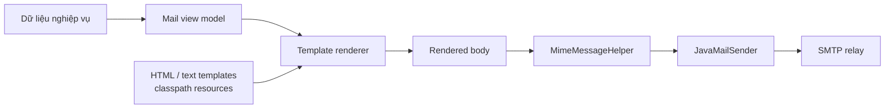

# Thư mục template và cách nạp resource trong Spring Framework Mail

Khi ứng dụng Spring gửi email HTML hoặc email có nhiều mẫu nội dung, việc viết toàn bộ câu chữ trong Java service sẽ nhanh chóng trở nên khó bảo trì. Một cách tổ chức phổ biến là **đặt template email và các tài nguyên đi kèm trong thư mục resource**, sau đó dùng Spring để nạp chúng khi tạo thông điệp. Template có thể là HTML, plain text, ảnh logo, hoặc các tệp dữ liệu tĩnh khác.

Trong một dự án Spring Boot, cấu trúc thường bắt đầu từ:

```text
src/main/resources/
├── templates/
│   └── mail/
│       ├── order-ready.html
│       ├── order-ready.txt
│       ├── payment-received.html
│       └── password-reset.html
├── mail/
│   └── images/
│       └── brand-logo.png
└── application.yml
```

Các tệp trong `src/main/resources` được đưa vào **classpath** khi build. Vì vậy, ứng dụng có thể nạp `templates/mail/order-ready.html` bằng Spring Resource API hoặc thông qua một template engine như Thymeleaf. Khi chạy từ executable JAR, template vẫn nằm trong artifact ứng dụng và có thể được đọc bằng stream.

Điểm quan trọng là phân biệt hai việc:

- **Nạp resource:** tìm và mở một tệp từ classpath, filesystem, URL hoặc một nguồn được Spring hỗ trợ.
- **Render template:** thay dữ liệu nghiệp vụ vào placeholder, áp dụng cú pháp và quy tắc escape của template engine để tạo ra chuỗi email hoàn chỉnh.

Spring Resource API giải quyết phần thứ nhất. Template engine giải quyết phần thứ hai. Hai phần có thể kết hợp, nhưng không nên nhầm `Resource` với một đối tượng đã render nội dung.

## 1. Vì sao nên tách template khỏi Java code?

Giả sử một ứng dụng gửi thông báo đơn hàng. Nếu service vừa truy vấn dữ liệu, vừa nối chuỗi HTML, vừa gửi SMTP, code có thể trở thành:

```java
String html = "<html><body>"
        + "<h1>Đơn hàng " + order.getId() + "</h1>"
        + "<p>Xin chào " + order.getCustomer().getName() + "</p>"
        + "</body></html>";
```

Cách này có thể hoạt động với ví dụ nhỏ, nhưng khó mở rộng khi nội dung cần nhiều đoạn, bảng, liên kết, logo, cấu trúc HTML phức tạp, hai phiên bản `text/plain` và `text/html`, nhiều ngôn ngữ hoặc nhiều mẫu theo loại sự kiện.

Tách template tạo ra ranh giới rõ:



Lớp nghiệp vụ quyết định **email nào cần được gửi và dữ liệu nào được phép đưa vào**. Lớp render quyết định **cách trình bày dữ liệu**. Lớp sender giao thông điệp cho SMTP. Khi thay đổi vị trí template hoặc chuyển template engine, logic nghiệp vụ ít bị ảnh hưởng hơn.

## 2. Quy ước thư mục template trong dự án

Một cấu trúc dễ tìm và mở rộng:

```text
my-application/
├── src/
│   ├── main/
│   │   ├── java/
│   │   │   └── com/example/mail/
│   │   │       ├── MailSenderConfiguration.java
│   │   │       ├── MailTemplateRenderer.java
│   │   │       └── OrderNotificationService.java
│   │   └── resources/
│   │       ├── templates/
│   │       │   └── mail/
│   │       │       ├── order-ready.html
│   │       │       ├── order-ready.txt
│   │       │       ├── order-cancelled.html
│   │       │       └── order-cancelled.txt
│   │       ├── mail/
│   │       │   └── images/
│   │       │       └── brand-logo.png
│   │       └── application.yml
│   └── test/
│       ├── java/
│       └── resources/
│           └── templates/
│               └── mail/
└── build.gradle
```

| Đường dẫn | Nội dung | Lý do |
| --- | --- | --- |
| `src/main/resources/templates/mail/` | Template email HTML và text | Phân biệt mẫu email với template của trang web hoặc giao diện khác |
| `src/main/resources/mail/images/` | Ảnh được đóng gói cùng ứng dụng | Có thể nạp bằng classpath và thêm vào MIME như inline resource |
| `src/main/resources/application.yml` | Cấu hình SMTP và vị trí template | Tách cấu hình vận hành khỏi nội dung thư |
| `src/main/java/.../mail/` | Renderer, service, cấu hình sender | Giữ Java code cho logic, không chứa nguyên văn template dài |
| `src/test/resources/` | Resource chỉ dùng trong kiểm thử | Cung cấp fixture hoặc mẫu thử riêng cho test |

Tên thư mục `templates/mail` là một **quy ước dễ hiểu**, không phải tên bắt buộc của Spring Framework Mail. Nếu ứng dụng có nhiều nhóm template, có thể chia sâu hơn:

```text
templates/mail/
├── account/
│   ├── welcome.html
│   └── password-reset.html
├── order/
│   ├── ready.html
│   └── cancelled.html
└── billing/
    ├── invoice.html
    └── payment-received.html
```

Tên thư mục và tên file nên phản ánh **loại thông báo**, không phụ thuộc vào tên class Java hoặc một địa chỉ email cụ thể. Nếu có cả HTML và text, nên giữ cặp file cùng tên: `order-ready.html` và `order-ready.txt`.

### Không nhầm template email với web static resource

Các thư mục như `static/`, `public/` thường dùng cho tài nguyên có thể được web server phục vụ trực tiếp. Template email thường **không cần công khai thành URL**; ứng dụng đọc nó từ classpath hoặc vị trí đã cấu hình rồi render trước khi gửi.

Đặt template trong `templates/mail` giúp tách biệt nội dung riêng cho email khỏi ảnh, CSS và file công khai của ứng dụng web. Ảnh logo nếu được tham chiếu bằng URL công khai có thể nằm ở hệ thống static/CDN; nếu nhúng bằng CID thì ứng dụng nạp file ảnh từ resource và đưa nó vào MIME message.

## 3. `src/main/resources` được đưa vào classpath như thế nào?

Khi build ứng dụng Java, nội dung trong `src/main/resources` thường được copy vào output resources của dự án. Khi chạy ứng dụng từ thư mục classes, các tệp nằm trên classpath. Khi đóng gói Spring Boot executable JAR, chúng thường được đặt trong khu vực classpath của JAR, chẳng hạn `BOOT-INF/classes/`.

```text
src/main/resources/templates/mail/order-ready.html
                |
                | build
                v
classpath resource:
templates/mail/order-ready.html
                |
                | package Spring Boot
                v
application.jar
└── BOOT-INF/classes/
    └── templates/mail/order-ready.html
```

Classpath là tập các thư mục và archive mà class loader sử dụng để tìm class và resource. Vì vậy, đường dẫn resource nên được hiểu là **đường dẫn bên trong classpath**, không phải đường dẫn tuyệt đối trên ổ đĩa máy phát triển.

Ví dụ tệp:

```text
src/main/resources/templates/mail/order-ready.html
```

Đường dẫn classpath thường dùng:

```text
templates/mail/order-ready.html
classpath:/templates/mail/order-ready.html
```

Đường dẫn thứ nhất có thể được dùng trực tiếp với `ClassPathResource`; đường dẫn thứ hai là một location rõ ràng cho `ResourceLoader`.

Không nên viết đường dẫn máy phát triển như:

```text
C:\Users\developer\project\src\main\resources\templates\mail\order-ready.html
```

Đây là đường dẫn source tree. Nó không còn đúng khi ứng dụng chạy trong container, trên Linux, từ executable JAR hoặc trên máy chủ khác.

| Vị trí | Ý nghĩa |
| --- | --- |
| `src/main/resources/templates/mail/order-ready.html` | Đường dẫn file trong repository lúc phát triển |
| `templates/mail/order-ready.html` | Đường dẫn tương đối trong classpath |
| `classpath:/templates/mail/order-ready.html` | Resource location được chỉ định bằng prefix classpath |
| `file:/etc/myapp/mail/order-ready.html` | Resource trên filesystem của máy chạy |
| `https://assets.example/logo.png` | Tài nguyên URL từ xa, nếu ứng dụng chủ động hỗ trợ |

## 4. Spring Resource abstraction

Spring Core cung cấp interface `org.springframework.core.io.Resource` để đại diện cho một tài nguyên. Tài nguyên có thể đến từ classpath, filesystem, URL, servlet context hoặc một nguồn stream do ứng dụng cung cấp.

Một số implementation thường gặp:

| Implementation | Nguồn dữ liệu | Ví dụ |
| --- | --- | --- |
| `ClassPathResource` | Classpath | `new ClassPathResource("templates/mail/order-ready.html")` |
| `FileSystemResource` | Filesystem | `new FileSystemResource("/etc/myapp/mail/order-ready.html")` |
| `UrlResource` | URL | `new UrlResource(URI.create("https://assets.example/logo.png"))` |
| `ByteArrayResource` | Mảng byte trong bộ nhớ | Template hoặc ảnh đã được đọc vào byte array |
| `InputStreamResource` | InputStream đã có | Stream được cung cấp từ một nguồn khác, thường không phù hợp để mở lại nhiều lần |

`Resource` là một **mô tả nguồn dữ liệu**, không nhất thiết là một file thực trên đĩa. Các phương thức quan trọng:

| Phương thức | Ý nghĩa |
| --- | --- |
| `exists()` | Resource có tồn tại theo cách implementation xác định không |
| `isReadable()` | Resource có thể đọc không |
| `getInputStream()` | Mở stream để đọc nội dung |
| `getURL()` | Lấy URL nếu resource có thể biểu diễn dưới dạng URL |
| `getFile()` | Lấy đối tượng File nếu resource có file vật lý tương ứng |
| `getFilename()` | Tên tệp nếu có |
| `contentLength()` | Kích thước nội dung theo khả năng implementation |

Không phải mọi resource đều hỗ trợ mọi thao tác. Đặc biệt, **không phải resource nào cũng có thể chuyển thành `java.io.File`**.

### Vì sao `getInputStream()` quan trọng?

Khi template nằm trong executable JAR, nó có thể được đọc trực tiếp từ một entry của archive. Không có một file độc lập ở đường dẫn mà `File` có thể đại diện. `Resource.getInputStream()` cho phép đọc nội dung mà không cần biết resource nằm ở thư mục hay trong JAR.

```text
ClassPathResource
       |
       v
Resource.getInputStream()
       |
       v
InputStream
       |
       v
UTF-8 decoder
       |
       v
String template
```

Với template text/HTML, đây là cách nạp nội dung phù hợp với cả chạy từ IDE và chạy từ JAR.

## 5. Nạp một template bằng `ClassPathResource`

Nếu biết chính xác tệp template, có thể tạo resource trực tiếp:

```java
import java.io.IOException;
import java.io.InputStream;
import java.nio.charset.StandardCharsets;

import org.springframework.core.io.ClassPathResource;
import org.springframework.core.io.Resource;
import org.springframework.util.StreamUtils;

public class MailTemplateReader {

    public String readOrderReadyHtml() {
        Resource resource = new ClassPathResource(
                "templates/mail/order-ready.html");

        if (!resource.exists() || !resource.isReadable()) {
            throw new IllegalStateException(
                    "Mail template is missing or unreadable");
        }

        try (InputStream input = resource.getInputStream()) {
            return StreamUtils.copyToString(
                    input, StandardCharsets.UTF_8);
        } catch (IOException exception) {
            throw new IllegalStateException(
                    "Cannot read mail template", exception);
        }
    }
}
```

Giải thích:

1. `ClassPathResource` tìm resource theo đường dẫn classpath.
2. `exists()` và `isReadable()` giúp phát hiện cấu hình hoặc gói ứng dụng thiếu file.
3. `getInputStream()` mở nội dung resource.
4. `StreamUtils.copyToString(..., UTF_8)` đọc stream thành chuỗi với charset rõ ràng.
5. `try-with-resources` đóng stream sau khi đọc, tránh rò rỉ tài nguyên.

Đây là ví dụ đọc **nội dung thô**. Nó chưa thay placeholder và chưa gửi email. Khi dùng template engine, thường nên đưa tên template cho engine để engine tự giải quyết resource và render thay vì tự đọc rồi nối chuỗi.

### Có cần dấu `/` ở đầu đường dẫn không?

Với `ClassPathResource`, thường dùng đường dẫn classpath như:

```java
new ClassPathResource("templates/mail/order-ready.html");
```

Đường dẫn không có prefix `classpath:` vì chính constructor đã xác định loại resource. Với `ResourceLoader`, dùng location có prefix rõ:

```java
resourceLoader.getResource(
        "classpath:/templates/mail/order-ready.html");
```

Không trộn lẫn cú pháp location của `ResourceLoader` với tham số constructor của mọi implementation. Nếu dùng thư viện hoặc template engine khác, hãy kiểm tra quy tắc path của resolver đó.

## 6. Nạp resource thông qua `ResourceLoader`

`ResourceLoader` là interface Spring dùng để lấy `Resource` từ một location string. Nó hữu ích khi vị trí template được cấu hình theo môi trường:

```java
import org.springframework.core.io.Resource;
import org.springframework.core.io.ResourceLoader;
import org.springframework.stereotype.Component;
import org.springframework.util.StreamUtils;

import java.io.IOException;
import java.io.InputStream;
import java.nio.charset.StandardCharsets;

@Component
public class ConfigurableMailTemplateReader {

    private final ResourceLoader resourceLoader;

    public ConfigurableMailTemplateReader(ResourceLoader resourceLoader) {
        this.resourceLoader = resourceLoader;
    }

    public String read(String location) {
        Resource resource = resourceLoader.getResource(location);

        if (!resource.exists() || !resource.isReadable()) {
            throw new IllegalStateException(
                    "Mail template cannot be read: " + location);
        }

        try (InputStream input = resource.getInputStream()) {
            return StreamUtils.copyToString(
                    input, StandardCharsets.UTF_8);
        } catch (IOException exception) {
            throw new IllegalStateException(
                    "Failed to load mail template", exception);
        }
    }
}
```

Ví dụ cấu hình:

```yaml
app:
  mail:
    templates:
      order-ready-html: classpath:/templates/mail/order-ready.html
      order-ready-text: classpath:/templates/mail/order-ready.txt
```

Service có thể nhận location từ cấu hình:

```java
@Value("${app.mail.templates.order-ready-html}")
private String orderReadyHtmlLocation;
```

Đây là cách đọc property minh họa; trong ứng dụng lớn, có thể gom các thuộc tính vào một lớp `@ConfigurationProperties` để có kiểu dữ liệu và validation rõ ràng.

### Các prefix thường gặp

| Location | Cách hiểu |
| --- | --- |
| `classpath:/templates/mail/order-ready.html` | Tìm trong classpath |
| `file:/etc/myapp/mail/order-ready.html` | Đọc file ngoài ứng dụng |
| `https://assets.example/mail/logo.png` | Nguồn URL từ xa nếu loader/implementation hỗ trợ |

Prefix rõ ràng giúp tránh việc một đường dẫn tương đối vô tình được diễn giải theo thư mục làm việc của process. Với template email, classpath là lựa chọn thuận tiện khi nội dung được đóng gói cùng phiên bản ứng dụng.

### Không lấy đường dẫn tùy ý từ request

Không nên cho người dùng truyền:

```text
../../application.yml
file:/etc/passwd
https://internal-service.example/private-template
```

rồi đưa trực tiếp vào `ResourceLoader.getResource(...)`. Nếu location chịu ảnh hưởng từ dữ liệu không tin cậy, ứng dụng có thể đọc file ngoài dự kiến hoặc truy cập dịch vụ nội bộ. Hãy dùng **template key nằm trong allowlist**, ánh xạ key sang resource location do ứng dụng kiểm soát.

Ví dụ:

```java
private static final Map<String, String> TEMPLATE_LOCATIONS = Map.of(
        "ORDER_READY", "classpath:/templates/mail/order-ready.html",
        "PAYMENT_RECEIVED", "classpath:/templates/mail/payment-received.html"
);
```

Đoạn map minh họa cách cho phép chọn template theo mã loại đã định nghĩa; không nhận đường dẫn filesystem/URL trực tiếp từ client.

## 7. Nạp nhiều resource bằng `ResourcePatternResolver`

Nếu cần tìm nhiều template hoặc ảnh theo một pattern, Spring cung cấp `ResourcePatternResolver`. Interface này mở rộng khả năng lấy resource bằng pattern như `classpath*:`:

```java
import org.springframework.core.io.Resource;
import org.springframework.core.io.support.ResourcePatternResolver;
import org.springframework.stereotype.Component;

import java.io.IOException;

@Component
public class MailTemplateCatalog {

    private final ResourcePatternResolver resolver;

    public MailTemplateCatalog(ResourcePatternResolver resolver) {
        this.resolver = resolver;
    }

    public Resource[] findHtmlTemplates() throws IOException {
        return resolver.getResources(
                "classpath*:templates/mail/**/*.html");
    }
}
```

Pattern trên yêu cầu tìm các file HTML dưới cây `templates/mail` trên classpath. Nó hữu ích khi ứng dụng có nhiều module cùng cung cấp template, muốn xây catalog template từ các resource được đóng gói, hoặc cần liệt kê ảnh/file theo nhóm.

### `classpath:` khác `classpath*:` thế nào?

| Prefix | Mục đích |
| --- | --- |
| `classpath:` | Lấy resource từ classpath theo một location |
| `classpath*:` | Tìm resource trên toàn bộ classpath theo cơ chế pattern resolver |

Với **một template đã biết tên**, `classpath:` hoặc `ClassPathResource` thường đơn giản hơn. Với **một tập resource theo pattern**, `classpath*:` qua `ResourcePatternResolver` phù hợp hơn.

Không nên quét lại toàn bộ classpath mỗi lần gửi email nếu danh sách template không thay đổi. Có thể khám phá resource lúc khởi động, lưu catalog đã xác minh và sử dụng theo key.

## 8. Nạp template từ file bên ngoài ứng dụng

Có những hệ thống cần cho phép nhóm vận hành thay đổi nội dung email mà không phải build lại executable JAR. Khi đó có thể đặt template trên filesystem và cấu hình location:

```yaml
app:
  mail:
    templates:
      location: file:/etc/myapp/mail/
```

Ví dụ đọc:

```java
Resource resource = resourceLoader.getResource(
        "file:/etc/myapp/mail/order-ready.html");
```

Ưu điểm là có thể cập nhật template độc lập với artifact, mount nội dung từ volume hoặc dùng cùng một artifact cho nhiều môi trường. Tuy nhiên, cần quản lý:

- **Quyền filesystem:** process chỉ nên đọc thư mục template cần thiết.
- **Tính toàn vẹn:** file ngoài JAR cần được quản lý phiên bản, review và triển khai có kiểm soát.
- **Tính sẵn sàng:** nếu volume chưa mount hoặc file bị xóa, email render sẽ thất bại.
- **Cache:** template engine có thể giữ template đã parse; thay file ngoài filesystem không nhất thiết được phản ánh ngay.
- **Rollback:** cần khả năng quay về phiên bản template trước khi có lỗi nội dung.

| Nhu cầu | Lựa chọn thường phù hợp |
| --- | --- |
| Template thay đổi cùng phiên bản phần mềm | `classpath:` |
| Nội dung được review và đóng gói trong artifact | `classpath:` |
| Nhóm vận hành cần triển khai nội dung riêng theo môi trường | `file:` với thư mục được quản lý |
| Template cần cập nhật độc lập, có quy trình version/rollback | Filesystem hoặc hệ thống quản lý template chuyên biệt |

Không có lựa chọn nào tự động an toàn hơn. **Classpath giảm phụ thuộc vào file runtime bên ngoài**, còn file ngoài ứng dụng tăng khả năng thay đổi độc lập nhưng cần quản lý quyền và vòng đời rõ ràng.

## 9. Vì sao không nên dùng `getFile()` cho mọi resource?

Một lỗi phổ biến:

```java
Resource resource = new ClassPathResource(
        "templates/mail/order-ready.html");

File file = resource.getFile();
```

Lệnh `getFile()` có thể chạy được khi resource nằm trong thư mục classes trên máy phát triển. Nhưng khi ứng dụng được đóng gói trong JAR, resource có thể nằm bên trong archive và **không tồn tại dưới dạng file độc lập trên filesystem**. Khi đó, `getFile()` có thể ném lỗi.

Đối với nội dung template, hãy đọc qua stream:

```java
try (InputStream input = resource.getInputStream()) {
    String template = StreamUtils.copyToString(
            input, StandardCharsets.UTF_8);
}
```

| API | Có nên dùng để đọc template classpath trong JAR? | Lý do |
| --- | --- | --- |
| `Resource.getInputStream()` | **Có** | Đọc được resource theo abstraction |
| `Resource.getFile()` | Không nên phụ thuộc | Yêu cầu file vật lý trên filesystem |
| `new File("src/main/resources/...")` | Không | Đây là đường dẫn source tree, không phải runtime resource |
| `Paths.get(resource.getURI())` | Không nên giả định | URI có thể là `jar:` chứ không phải file URI |
| `ResourceLoader.getResource("classpath:...")` | **Có** | Dùng location abstraction |

Đối với resource dạng stream, luôn đóng stream sau khi đọc. Không lưu một `InputStream` duy nhất rồi dùng lại cho nhiều lần render; nhiều stream chỉ đọc được một lần. Nếu cần dữ liệu có thể đọc lại, giữ `Resource` có thể mở stream mới hoặc lưu byte array phù hợp.

### `InputStreamResource` và khả năng đọc lại

`InputStreamResource` thường đại diện cho một stream đã được mở. Nó không phải lựa chọn tốt để cache một template rồi mở nhiều lần, vì stream có thể đã bị tiêu thụ. Với dữ liệu trong bộ nhớ, `ByteArrayResource` có thể phù hợp hơn; với file/classpath, giữ `Resource` có thể mở stream mới mỗi lần.

## 10. Nạp và render template bằng Thymeleaf

Spring Resource API giúp tìm file, nhưng **không thay placeholder** như `[[${customerName}]]` hoặc `th:text`. Để render template, ứng dụng có thể dùng Thymeleaf, FreeMarker hoặc một engine khác.

Với Spring Boot, có thể thêm:

```groovy
dependencies {
    implementation 'org.springframework.boot:spring-boot-starter-thymeleaf'
}
```

Dependency và phiên bản cần tương thích với Spring Boot/Spring Framework của dự án. Nếu ứng dụng chỉ dùng engine cho email, có thể khai báo dependency Thymeleaf Spring tương ứng thay vì đưa web stack không cần thiết.

### Bố trí template Thymeleaf

```text
src/main/resources/templates/mail/
├── order-ready.html
└── order-ready.txt
```

HTML template:

```html
<!doctype html>
<html lang="vi" xmlns:th="http://www.thymeleaf.org">
  <body>
    <h1>Đơn hàng đã sẵn sàng</h1>
    <p>Xin chào <strong th:text="${customerName}">Tên khách hàng</strong>,</p>
    <p>
      Mã đơn hàng:
      <strong th:text="${orderId}">ORD-000</strong>
    </p>
    <p>
      <a th:href="${orderUrl}">Xem chi tiết đơn hàng</a>
    </p>
  </body>
</html>
```

Text template:

```text
ĐƠN HÀNG ĐÃ SẴN SÀNG

Xin chào [[${customerName}]],

Mã đơn hàng: [[${orderId}]]
Xem chi tiết:
[[${orderUrl}]]
```

Trong Thymeleaf, cú pháp text inlining `[[...]]` đưa giá trị vào template text. Các placeholder trên lấy dữ liệu từ context; template không nên tự truy vấn database hoặc quyết định quyền của người nhận.

### Cấu hình resolver riêng cho email

Một ứng dụng web có thể đã có template resolver cho giao diện. Để tránh nhầm template web với email, có thể cấu hình resolver riêng:

```java
package com.example.mail;

import org.springframework.context.annotation.Bean;
import org.springframework.context.annotation.Configuration;
import org.thymeleaf.spring6.SpringTemplateEngine;
import org.thymeleaf.templatemode.TemplateMode;
import org.thymeleaf.templateresolver.ClassLoaderTemplateResolver;

@Configuration
public class MailTemplateConfiguration {

    @Bean
    public SpringTemplateEngine mailHtmlTemplateEngine() {
        ClassLoaderTemplateResolver resolver =
                new ClassLoaderTemplateResolver();
        resolver.setPrefix("templates/mail/");
        resolver.setSuffix(".html");
        resolver.setTemplateMode(TemplateMode.HTML);
        resolver.setCharacterEncoding("UTF-8");
        resolver.setCacheable(true);

        SpringTemplateEngine engine = new SpringTemplateEngine();
        engine.setTemplateResolver(resolver);
        return engine;
    }

    @Bean
    public SpringTemplateEngine mailTextTemplateEngine() {
        ClassLoaderTemplateResolver resolver =
                new ClassLoaderTemplateResolver();
        resolver.setPrefix("templates/mail/");
        resolver.setSuffix(".txt");
        resolver.setTemplateMode(TemplateMode.TEXT);
        resolver.setCharacterEncoding("UTF-8");
        resolver.setCacheable(true);

        SpringTemplateEngine engine = new SpringTemplateEngine();
        engine.setTemplateResolver(resolver);
        return engine;
    }
}
```

Ở đây có hai engine/resolver riêng:

- Engine HTML tìm `templates/mail/<tên>.html` và xử lý theo `TemplateMode.HTML`.
- Engine text tìm `templates/mail/<tên>.txt` và xử lý theo `TemplateMode.TEXT`.
- Cả hai đọc từ classloader và dùng UTF-8.
- `cacheable=true` phù hợp với template đóng gói ổn định trong production; khi phát triển có thể chọn cấu hình cache phù hợp để thay đổi được phản ánh.

Ví dụ dùng package `org.thymeleaf.spring6` cho tích hợp Spring 6. Với dự án dùng phiên bản Spring/Thymeleaf khác, package và dependency cần khớp phiên bản đang sử dụng.

### Render hai phiên bản

```java
import java.util.Locale;
import java.util.Map;

import org.springframework.stereotype.Component;
import org.thymeleaf.context.Context;
import org.thymeleaf.spring6.SpringTemplateEngine;

@Component
public class OrderReadyTemplateRenderer {

    private final SpringTemplateEngine htmlEngine;
    private final SpringTemplateEngine textEngine;

    public OrderReadyTemplateRenderer(
            @Qualifier("mailHtmlTemplateEngine")
            SpringTemplateEngine htmlEngine,
            @Qualifier("mailTextTemplateEngine")
            SpringTemplateEngine textEngine) {
        this.htmlEngine = htmlEngine;
        this.textEngine = textEngine;
    }

    public RenderedMailBody render(
            String customerName,
            String orderId,
            String orderUrl,
            Locale locale) {

        Context context = new Context(locale);
        context.setVariables(Map.of(
                "customerName", customerName,
                "orderId", orderId,
                "orderUrl", orderUrl));

        String html = htmlEngine.process("order-ready", context);
        String text = textEngine.process("order-ready", context);

        return new RenderedMailBody(text, html);
    }
}

public record RenderedMailBody(String plainText, String htmlText) {
}
```

Ví dụ giả định các bean được cấu hình như trên và có import `org.springframework.beans.factory.annotation.Qualifier`. Một view model riêng thường tốt hơn việc truyền nhiều tham số rời rạc khi template có nhiều trường.

Khi đã có `RenderedMailBody`, gửi bằng Spring Mail:

```java
MimeMessage message = mailSender.createMimeMessage();
MimeMessageHelper helper = new MimeMessageHelper(
        message,
        MimeMessageHelper.MULTIPART_MODE_MIXED_RELATED,
        "UTF-8");

helper.setFrom("notifications@shop.example");
helper.setTo(recipientEmail);
helper.setSubject("Đơn hàng " + orderId + " đã sẵn sàng");
helper.setText(body.plainText(), body.htmlText());

mailSender.send(message);
```

### Escape dữ liệu trong template

Trong HTML, dùng `th:text` cho nội dung text và `th:href` cho URL đã được ứng dụng kiểm soát. `th:text` escape nội dung hiển thị theo quy tắc của Thymeleaf; tránh dùng `th:utext` cho chuỗi do người dùng cung cấp nếu không có quy trình sanitize phù hợp.

Template text không cần HTML escaping theo cùng cách, nhưng vẫn cần kiểm soát ký tự điều khiển trong trường một dòng, độ dài dữ liệu, dữ liệu nhạy cảm và URL. Template engine không thay thế validation nghiệp vụ hoặc phân quyền recipient.

## 11. Nạp resource cho ảnh inline và attachment

Ngoài template, email có thể cần ảnh logo, mã QR hoặc tài liệu. Các tệp đóng gói trong classpath cũng có thể được nạp thành Spring `Resource`:

```java
Resource logo = new ClassPathResource(
        "mail/images/brand-logo.png");
```

Sau đó thêm ảnh inline:

```java
helper.setText(plainText, htmlText);
helper.addInline(
        "brand-logo@shop.example",
        logo,
        "image/png");
```

HTML cần tham chiếu cùng Content-ID:

```html

```

Với `MimeMessageHelper`, nên gọi `setText(...)` trước rồi mới gọi `addInline(...)`. `Resource` cung cấp dữ liệu ảnh; `addInline` đưa nó vào MIME part có Content-ID. **Đường dẫn classpath của ảnh không phải giá trị `cid:`**: HTML tham chiếu Content-ID, không tham chiếu tên file.

### Attachment

Một PDF đính kèm có thể được nạp tương tự:

```java
Resource invoice = new ClassPathResource(
        "mail/documents/sample-invoice.pdf");

helper.addAttachment("invoice.pdf", invoice);
```

Trong production, hóa đơn thường là tài liệu phát sinh theo từng giao dịch, nên resource có thể đến từ byte array, file lưu trữ được kiểm soát hoặc object storage. Không đặt dữ liệu hóa đơn khách hàng riêng vào một resource tĩnh trong classpath của ứng dụng.

Với dữ liệu trong bộ nhớ:

```java
Resource invoiceResource = new ByteArrayResource(pdfBytes);
helper.addAttachment("invoice.pdf", invoiceResource);
```

`pdfBytes` là mảng byte được tạo trong luồng nghiệp vụ. Nếu file được lưu ở storage ngoài, cần kiểm tra quyền truy cập và kích thước trước khi tải về để đính kèm.

## 12. Template theo locale và cấu trúc đa ngôn ngữ

Nếu email gửi đến người nhận ở nhiều ngôn ngữ, có thể bố trí:

```text
templates/mail/
├── vi/
│   ├── order-ready.html
│   └── order-ready.txt
├── en/
│   ├── order-ready.html
│   └── order-ready.txt
└── default/
    ├── order-ready.html
    └── order-ready.txt
```

Ứng dụng xác định locale của người nhận, sau đó chọn **một template key đã được định nghĩa**. Ví dụ:

```java
String templateBase = switch (locale.getLanguage()) {
    case "vi" -> "vi/order-ready";
    case "en" -> "en/order-ready";
    default -> "default/order-ready";
};
```

Đây là ví dụ chọn template name; khi dùng resolver có prefix/suffix, engine sẽ tìm file tương ứng. Không nối trực tiếp giá trị locale do request gửi lên vào filesystem path mà không giới hạn danh sách locale.

Nếu có template HTML tiếng Việt nhưng thiếu template text tiếng Việt, ứng dụng có thể gửi một email không có fallback. Vì vậy, việc triển khai template cần xem **cặp HTML/text là một đơn vị**:

```text
vi/order-ready.html  <-->  vi/order-ready.txt
en/order-ready.html  <-->  en/order-ready.txt
```

Nếu không có locale cụ thể, có thể dùng cặp template mặc định đã được định nghĩa. Không nên fallback HTML sang tiếng Anh nhưng text sang tiếng Việt mà không có chủ ý rõ ràng.

## 13. Caching và vòng đời template

Đọc file từ classpath hoặc filesystem ở mỗi lần gửi có thể tạo I/O lặp lại. Template engine thường có cơ chế cache template đã parse để giảm chi phí.

| Cách triển khai | Đặc điểm |
| --- | --- |
| Classpath template + cache bật | Phù hợp template đóng gói cùng artifact, thay đổi qua build/deploy |
| Classpath template + cache tắt | Hữu ích khi phát triển/debug, nhưng không làm resource trong JAR tự thay đổi |
| File ngoài + cache bật | Có thể cần chính sách invalidate/reload khi file được cập nhật |
| File ngoài + cache tắt | Có thể đọc nội dung mới thường xuyên, đổi lại tăng I/O và phụ thuộc filesystem |

Trong production, nếu template đóng gói trong JAR, thường nên cache và phát hành artifact mới khi thay đổi nội dung. Nếu template nằm ngoài artifact, cần định nghĩa rõ cách cập nhật, kiểm tra, cache eviction và rollback.

Cache không phải cơ chế versioning. Nếu một worker đang render bằng template phiên bản A và tiến trình khác vừa cập nhật sang phiên bản B, email được gửi trong giai đoạn chuyển đổi có thể dùng các phiên bản khác nhau tùy cache và thời điểm. Với email nghiệp vụ quan trọng, nên gắn version template/release ID vào metadata thông báo và có thể giữ template version cũ khi cần retry một notification đã tạo.

## 14. Kiểm thử việc nạp resource và render template

Nên kiểm tra riêng:

1. Resource tồn tại trong classpath.
2. Resource đọc được bằng UTF-8.
3. Template engine tìm được tên template và render không lỗi.
4. Dữ liệu động được thay thế đúng và được escape theo context.
5. Hai phiên bản text/HTML chứa thông tin nghiệp vụ tương đương.
6. Tài nguyên inline/attachment có thể mở được khi tạo MIME.
7. Resource vẫn đọc được khi ứng dụng đóng gói trong JAR.

### Test đọc resource

```java
import static org.junit.jupiter.api.Assertions.assertTrue;

import java.io.IOException;

import org.junit.jupiter.api.Test;
import org.springframework.core.io.ClassPathResource;
import org.springframework.core.io.Resource;

class MailTemplateResourceTest {

    @Test
    void orderReadyHtmlTemplateExists() throws IOException {
        Resource template = new ClassPathResource(
                "templates/mail/order-ready.html");

        assertTrue(template.exists());
        assertTrue(template.isReadable());
    }
}
```

Test này xác nhận resource có mặt trên test classpath. Nó không tự bảo đảm template được đóng gói đúng trong artifact production; kiểm tra artifact/JAR vẫn hữu ích khi triển khai.

### Test render template

Với Thymeleaf, có thể gọi engine trực tiếp:

```java
Context context = new Context(Locale.forLanguageTag("vi-VN"));
context.setVariable("customerName", "An");
context.setVariable("orderId", "ORD-184");
context.setVariable(
        "orderUrl",
        "https://shop.example/orders/ORD-184");

String html = mailHtmlTemplateEngine.process(
        "order-ready", context);

assertTrue(html.contains("ORD-184"));
```

Đoạn code giả định engine đã được cấu hình và template tồn tại. Nên kiểm tra thêm rằng dữ liệu chứa ký tự đặc biệt không thể tạo markup ngoài ý muốn, và link được render theo đúng URL đã kiểm soát.

### Test khi chạy từ executable JAR

Một lỗi thường chỉ xuất hiện sau khi đóng gói là code đọc resource bằng `File` thành công trong IDE nhưng thất bại trong JAR. Kiểm tra tích hợp nên chạy ứng dụng hoặc một test artifact với đúng cách đóng gói dự kiến, và xác nhận tên resource có mặt trong JAR, resolver dùng đúng prefix/suffix, charset vẫn là UTF-8, ảnh inline được mở qua stream và không có đoạn code phụ thuộc `src/main/resources` ở runtime.

## 15. Lỗi thường gặp khi nạp template/resource

| Hiện tượng | Nguyên nhân có thể | Cách xử lý |
| --- | --- | --- |
| `FileNotFoundException` khi chạy JAR | Dùng `getFile()` với resource nằm trong archive | Đọc bằng `getInputStream()` hoặc dùng template resolver |
| Template tồn tại ở IDE nhưng không có khi deploy | Resource chưa nằm trong output/artifact hoặc sai path/case | Kiểm tra vị trí trong JAR và tên file chính xác |
| `Resource` không tồn tại | Sai prefix, đường dẫn, tên hoặc thư mục | Dùng `classpath:`/`file:` tường minh, kiểm tra path |
| Đọc tiếng Việt bị lỗi | Dùng charset mặc định khác UTF-8 | Chỉ định UTF-8 khi đọc và cấu hình template engine |
| Nội dung vẫn còn placeholder | Chỉ đọc raw resource, chưa chạy template engine | Render bằng engine hoặc bộ xử lý placeholder được thiết kế rõ |
| Dữ liệu HTML bị chèn markup | Dùng nội suy không escape hoặc template raw HTML | Dùng cơ chế escape phù hợp, không dùng raw output cho input không tin cậy |
| Sửa file ngoài nhưng email vẫn nội dung cũ | Template engine đang cache | Xem chính sách cache/invalidation |
| Không nạp được resource pattern | Dùng `ResourceLoader` thay vì `ResourcePatternResolver` hoặc pattern sai | Dùng resolver hỗ trợ pattern và cú pháp `classpath*:` |
| Chạy Windows tốt, Linux lỗi | Khác biệt chữ hoa/thường của filesystem | Giữ tên file và path khớp chính xác |
| `InputStream` đã đóng khi render | Tái sử dụng stream một lần | Lưu `Resource` có thể mở lại hoặc dữ liệu byte |
| Template ngoài ứng dụng bị thiếu | Volume/path chưa mount hoặc quyền đọc không đủ | Kiểm tra cấu hình deployment và quyền process |
| Người dùng có thể chọn đường dẫn bất kỳ | Template key lấy trực tiếp từ request | Dùng allowlist và ánh xạ sang resource cố định |

### Sai lầm: dùng `new File(...)` với resource classpath

```java
File template = new File(
        "src/main/resources/templates/mail/order-ready.html");
```

Đường dẫn này chỉ phản ánh cấu trúc source code. Sau khi build, ứng dụng không nhất thiết có thư mục `src/main/resources`. Dùng `ClassPathResource` hoặc `ResourceLoader` để truy cập runtime resource.

### Sai lầm: đọc resource nhưng quên render

```java
String html = reader.read(
        "classpath:/templates/mail/order-ready.html");
```

Nếu template chứa placeholder, biến `html` vẫn là chuỗi thô. Cần chuyển chuỗi vào template engine phù hợp hoặc để engine tự tìm resource và render theo tên template.

### Sai lầm: đọc stream không đóng

```java
InputStream input = resource.getInputStream();
String html = StreamUtils.copyToString(input, StandardCharsets.UTF_8);
// Stream chưa được đóng.
```

Dùng try-with-resources để bảo đảm đóng stream kể cả khi xảy ra exception:

```java
try (InputStream input = resource.getInputStream()) {
    String html = StreamUtils.copyToString(
            input, StandardCharsets.UTF_8);
}
```

### Sai lầm: dùng template path từ dữ liệu không tin cậy

Không nối trực tiếp `templateName` từ request thành đường dẫn classpath hoặc filesystem. Nếu dữ liệu không được giới hạn, người dùng có thể chọn resource ngoài dự kiến. Dùng enum hoặc allowlist các template ID đã biết.

## 16. Tích hợp resource và template vào luồng gửi Spring Mail

Một service hoàn chỉnh thường có các bước:

1. Nhận sự kiện nghiệp vụ đã được xác nhận.
2. Tạo view model chỉ chứa dữ liệu được phép gửi.
3. Xác định template key và locale theo quy tắc ứng dụng.
4. Render bản HTML và bản text từ resource.
5. Tạo `MimeMessage` và `MimeMessageHelper`.
6. Đặt sender, recipient, subject và hai phiên bản nội dung.
7. Thêm inline image hoặc attachment nếu cần.
8. Gọi `JavaMailSender.send(...)`.

Ví dụ:

```java
public void sendOrderReady(
        OrderReadyData data,
        Locale locale) throws MessagingException {

    RenderedMailBody body = templateRenderer.render(data, locale);

    MimeMessage message = mailSender.createMimeMessage();
    MimeMessageHelper helper = new MimeMessageHelper(
            message,
            MimeMessageHelper.MULTIPART_MODE_MIXED_RELATED,
            "UTF-8");

    helper.setFrom(fromAddress);
    helper.setTo(data.recipientEmail());
    helper.setSubject("Đơn hàng " + data.orderId() + " đã sẵn sàng");
    helper.setText(body.plainText(), body.htmlText());

    helper.addInline(
            "brand-logo@shop.example",
            new ClassPathResource("mail/images/brand-logo.png"),
            "image/png");

    mailSender.send(message);
}
```

Đoạn code là phần kết nối các thành phần đã được mô tả; các trường `templateRenderer`, `fromAddress`, `mailSender` được inject/configure trong ứng dụng. HTML template cần chứa `src="cid:brand-logo@shop.example"` và ảnh cần được kiểm tra đúng định dạng.

| Thành phần | Trách nhiệm |
| --- | --- |
| `OrderReadyData` | Dữ liệu nghiệp vụ đã được chọn lọc |
| `ResourceLoader`/`ClassPathResource` | Tìm và mở template/tệp ảnh |
| Thymeleaf/engine khác | Thay dữ liệu vào template và áp dụng cú pháp render |
| `RenderedMailBody` | Chứa plain text và HTML đã render |
| `MimeMessageHelper` | Xây dựng MIME message, nội dung, inline parts và attachments |
| `JavaMailSender` | Submit message qua SMTP |

Tách như vậy giúp thay vị trí resource hoặc template engine mà không cần sửa logic SMTP; thay SMTP provider cũng không buộc phải viết lại template.

## 17. Lưu ý khi triển khai và vận hành

### Classpath resource là bất biến theo artifact

Nếu template được đóng gói trong JAR, muốn thay nội dung thường cần phát hành artifact mới. Không nên chỉnh trực tiếp file bên trong JAR đang chạy. Cách này giúp template và code được version cùng nhau, nhưng cần quy trình release cho thay đổi nội dung email.

### File resource ngoài ứng dụng cần version

Nếu dùng `file:`, nên quản lý template như một cấu hình triển khai có phiên bản:

```text
/etc/myapp/mail/
├── release-2026-11/
│   ├── order-ready.html
│   └── order-ready.txt
└── current -> release-2026-11
```

Đây là ví dụ tổ chức filesystem; cách tạo symlink hoặc triển khai file tùy môi trường. Mục tiêu là có thể biết instance đang dùng bộ template nào và có thể rollback về bản đã biết.

### Không để template chứa bí mật

Template có thể chứa tên thương hiệu, nội dung hướng dẫn và placeholder, nhưng không chứa SMTP password, OAuth token, khóa API, signing secret, dữ liệu cá nhân cố định của khách hàng hoặc URL nội bộ nhạy cảm.

Credential SMTP nằm trong secret/configuration riêng. Template chỉ nhận dữ liệu hiển thị cần thiết từ view model.

### Kiểm soát URL và tài nguyên từ xa

Không nên tải template từ URL tùy ý ở mỗi lần gửi. Nếu dùng URL resource, ứng dụng phải kiểm soát host, TLS, timeout, kích thước, cache và nguồn tin cậy; nếu không, nó có thể phụ thuộc mạng ngoài hoặc tạo nguy cơ SSRF khi URL bị kiểm soát bởi người dùng.

Với ảnh email, cần quyết định rõ nhúng qua CID từ classpath/byte array, dùng URL công khai từ CDN, hoặc không dùng ảnh nếu nó không cần thiết. Không đưa URL private của hệ thống nội bộ vào HTML email cho người nhận bên ngoài.

### Theo dõi lỗi theo loại resource

Khi gửi lỗi, nên phân biệt:

- Không tìm thấy template.
- Template engine không parse được cú pháp.
- Dữ liệu render thiếu hoặc sai kiểu.
- Không đọc được ảnh/attachment.
- MIME message không tạo được.
- SMTP submission thất bại.

Các lỗi này nằm ở các bước khác nhau. Log nên chứa template key/version và notification ID phù hợp, nhưng tránh ghi toàn bộ body hoặc dữ liệu nhạy cảm của người nhận.

## 18. Câu hỏi tự kiểm tra

**1. Vì sao nên đặt template trong `src/main/resources`?**

Vì nội dung được đưa vào classpath và đóng gói cùng ứng dụng; code có thể nạp bằng Spring Resource API mà không phụ thuộc đường dẫn source trên máy phát triển.

**2. `Resource` có luôn đại diện cho một file trên ổ đĩa không?**

Không. Nó có thể đại diện classpath entry trong JAR, URL, stream hoặc nguồn khác. Vì vậy không giả định `getFile()` luôn hoạt động.

**3. Khi chạy từ executable JAR, cách đọc nào phù hợp?**

Dùng `Resource.getInputStream()` hoặc template resolver hỗ trợ classpath resource; tránh `new File("src/main/resources/...")`.

**4. `ResourceLoader` khác `ResourcePatternResolver` thế nào?**

`ResourceLoader` lấy một resource theo location; `ResourcePatternResolver` hỗ trợ tìm nhiều resource theo pattern như `classpath*:`.

**5. Đọc HTML từ `Resource` có tự thay `th:text` không?**

Không. Resource API chỉ nạp nội dung; template engine như Thymeleaf mới render biểu thức và placeholder.

**6. Có nên lấy template path trực tiếp từ request không?**

Không. Chọn template bằng key/enum trong allowlist rồi ánh xạ sang resource location do ứng dụng quản lý.

**7. Khi nào nên dùng `file:` thay vì `classpath:`?**

Khi template cần được triển khai/cập nhật ngoài artifact và có quy trình quản lý quyền, version, cache và rollback rõ ràng.

**8. Tại sao cần UTF-8 khi đọc template?**

Để nội dung tiếng Việt và Unicode được giải mã nhất quán; charset khi đọc resource cần phù hợp với charset lúc render MIME.

**9. Có thể dùng cùng một template HTML cho bản text không?**

Không nên. Hai phiên bản có cấu trúc và cách đọc khác nhau; tạo cặp template riêng hoặc một renderer có quy tắc chuyển đổi ngữ nghĩa rõ ràng.

**10. Khi template có ảnh CID, resource ảnh nằm ở đâu?**

Ảnh có thể nằm trong classpath, filesystem hoặc byte array. Ứng dụng nạp resource rồi gọi `MimeMessageHelper.addInline(...)`; HTML tham chiếu Content-ID, không dùng đường dẫn resource.

**11. Template engine cache có tự nhận thay đổi file ngoài không?**

Không thể giả định như vậy. Cần cấu hình cache/invalidation/reload phù hợp với engine và môi trường.

**12. Vì sao nên kiểm tra artifact/JAR sau khi build?**

Để xác nhận resource thật sự được đóng gói và resolver có thể đọc nó trong môi trường chạy, đặc biệt khi code trước đó chỉ được thử trong IDE.

## Kết luận

**Thư mục template và cách nạp resource quyết định ứng dụng Spring tìm được nội dung email ở đâu và dùng nó như thế nào.** Đặt mẫu HTML/text trong `src/main/resources/templates/mail` giúp chúng được đóng gói trên classpath; dùng `ClassPathResource`, `ResourceLoader` hoặc `ResourcePatternResolver` để nạp, ưu tiên `getInputStream()` thay vì phụ thuộc `getFile()` khi chạy từ executable JAR. Resource API chỉ mở nội dung; template engine như Thymeleaf mới render dữ liệu vào placeholder. Khi tích hợp Spring Mail, render hai phiên bản từ cùng view model, rồi đặt chúng vào `MimeMessageHelper` và gửi bằng `JavaMailSender`. Nếu dùng file ngoài ứng dụng, cần quản lý quyền, version, cache và rollback. **Một cách tổ chức resource rõ ràng giúp template dễ tìm, dễ kiểm thử, đóng gói ổn định và không phụ thuộc máy phát triển.**
