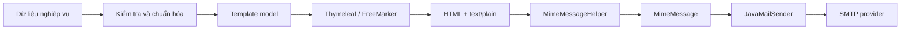

# Thymeleaf, FreeMarker hoặc engine khác trong luồng gửi mail

Một ứng dụng Spring Boot cần gửi email xác nhận tài khoản. Nội dung gồm tên người nhận, mã yêu cầu, thời hạn xác minh và một liên kết HTTPS. Nếu viết toàn bộ HTML bằng cách nối chuỗi trong Java, service gửi mail sẽ nhanh chóng trở nên khó đọc: phần trình bày lẫn với dữ liệu nghiệp vụ, dấu nháy dễ sai, nội dung tiếng Việt khó quản lý và dữ liệu người dùng có thể vô tình trở thành HTML.

**Template engine** giải quyết bài toán tách phần trình bày khỏi dữ liệu. Trong hệ sinh thái Spring, những lựa chọn phổ biến gồm **Thymeleaf** và **FreeMarker**. Engine nhận một template được quản lý cùng model dữ liệu, sau đó render thành chuỗi HTML hoặc văn bản. Spring Mail tiếp nhận kết quả đã render qua `MimeMessageHelper` và `JavaMailSender` để tạo MIME message rồi gửi qua SMTP.

Luồng cơ bản:



Template engine **không gửi email**, không thay thế SMTP transport và cũng không tự quyết định ai được phép nhận thư. Nó chỉ render nội dung. Ứng dụng vẫn phải kiểm soát người nhận, dữ liệu động, URL, quyền gửi, bảo mật và kết quả chuyển phát.

## 1. Phân biệt template engine, MIME composer và mail sender

Ba phần này có trách nhiệm riêng:

| Thành phần | Ví dụ | Trách nhiệm |
|---|---|---|
| **Template engine** | Thymeleaf, FreeMarker | Render template thành chuỗi HTML hoặc text từ dữ liệu đầu vào. |
| **MIME composer** | `MimeMessage`, `MimeMessageHelper` | Tạo header, text/plain, text/html, inline resources và attachment. |
| **Mail sender** | `JavaMailSender` | Chuyển thông điệp tới SMTP transport đã cấu hình. |

Một template HTML có thể tạo ra:

```html
<h1>Xác nhận tài khoản</h1>
<p>Xin chào Nguyễn Văn An,</p>
<p>Vui lòng xác minh tài khoản bằng liên kết bên dưới.</p>
```

Template engine tạo chuỗi trên. Sau đó `MimeMessageHelper` có thể đặt chuỗi đó vào MIME part `text/html`, đồng thời thêm một phiên bản `text/plain`. Cuối cùng `JavaMailSender` bàn giao message tới máy chủ SMTP.

Không nên đưa logic gửi SMTP vào template engine, cũng không nên để service gửi mail tự render HTML bằng các phép nối chuỗi nếu template có nhiều biến thể, ngôn ngữ hoặc bố cục.

### 1.1. Khi nào cần template engine?

Template engine hữu ích khi email:

- Có nhiều trường dữ liệu động như tên, mã đơn hàng, ngày giao hàng và số tiền.
- Có bố cục HTML lặp lại giữa nhiều loại thông báo.
- Cần nhiều ngôn ngữ hoặc biến thể nội dung.
- Cần tách công việc của người thiết kế nội dung khỏi service Java.
- Cần kiểm thử riêng việc render và việc gửi SMTP.
- Có các template text và HTML tương ứng.

Với một email văn bản chỉ gồm một câu cố định, `SimpleMailMessage` có thể đủ. Không cần thêm template engine chỉ để thay một chuỗi đơn giản.

## 2. Cấu trúc thư mục template cho email

Một cấu trúc dễ quản lý trong dự án Spring Boot:

```text
src/
└── main/
    └── resources/
        ├── application.yml
        ├── templates/
        │   └── mail/
        │       ├── vi/
        │       │   ├── verification.html
        │       │   ├── order-confirmation.html
        │       │   └── password-reset.html
        │       └── en/
        │           ├── verification.html
        │           └── order-confirmation.html
        └── mail/
            └── images/
                └── company-logo.png
```

Với dự án lớn, có thể tách text template riêng:

```text
templates/mail/vi/verification.html
templates/mail/vi/verification.txt
templates/mail/en/verification.html
templates/mail/en/verification.txt
```

Một template nên có **mục đích nghiệp vụ rõ ràng**, ví dụ `verification`, `order-confirmation` hoặc `invoice-ready`. Không nên đặt tên theo người nhận hoặc mã đơn hàng vì dữ liệu từng email là biến trong model, không phải tên file template.

Template nên được đóng gói cùng ứng dụng hoặc nạp từ kho nội dung có kiểm soát. Nếu cho phép sửa template ngoài runtime, cần có phân quyền, lịch sử phiên bản, quy trình phát hành và kiểm tra nội dung trước khi sử dụng.

## 3. Dependency và cấu hình chung trong Spring Boot

### 3.1. Dependency

Ví dụ dùng Gradle khi chọn Thymeleaf:

```groovy
dependencies {
    implementation 'org.springframework.boot:spring-boot-starter-mail'
    implementation 'org.springframework.boot:spring-boot-starter-thymeleaf'
}
```

Nếu chọn FreeMarker:

```groovy
dependencies {
    implementation 'org.springframework.boot:spring-boot-starter-mail'
    implementation 'org.springframework.boot:spring-boot-starter-freemarker'
}
```

Các starter được quản lý phiên bản qua Spring Boot dependency management. Không nên tự chọn một phiên bản Thymeleaf, FreeMarker hoặc Jakarta Mail không tương thích với phiên bản Spring Boot đang dùng.

Thường chỉ cần chọn engine mà dự án sử dụng. Có thể dùng nhiều engine trong cùng một ứng dụng, nhưng phải có lý do và cấu hình template path/resolver rõ ràng để tránh nhầm lẫn.

### 3.2. Cấu hình SMTP độc lập với template engine

Ví dụ `application.yml` cho SMTP submission cổng 587 với STARTTLS:

```yaml
spring:
  mail:
    host: ${MAIL_HOST}
    port: 587
    protocol: smtp
    username: ${MAIL_USERNAME}
    password: ${MAIL_PASSWORD}
    default-encoding: UTF-8
    properties:
      "[mail.smtp.auth]": true
      "[mail.smtp.starttls.enable]": true
      "[mail.smtp.starttls.required]": true
      "[mail.smtp.ssl.checkserveridentity]": true
      "[mail.smtp.connectiontimeout]": 5000
      "[mail.smtp.timeout]": 10000
      "[mail.smtp.writetimeout]": 10000

app:
  mail:
    from: ${MAIL_FROM:notifications@example.com}
    base-url: ${APP_BASE_URL:https://accounts.example.com}
```

Đây là cấu hình minh họa cho provider hỗ trợ **587 + STARTTLS**. Nếu provider yêu cầu implicit TLS trên cổng 465, phải cấu hình transport theo hướng dẫn của họ. Username/password được cấp từ môi trường triển khai hoặc secret manager; không ghi secret thật vào Git.

`spring.mail.*` điều khiển sender/SMTP. `spring.thymeleaf.*` hoặc `spring.freemarker.*` điều khiển template engine. Hai nhóm cấu hình phục vụ hai công đoạn khác nhau.

## 4. Dùng Thymeleaf để render email HTML

Thymeleaf tích hợp tốt với Spring. Spring Boot auto-configure template engine khi có starter tương ứng, và template mặc định thường được nạp từ `classpath:/templates/`.

### 4.1. Template HTML

Tạo file `src/main/resources/templates/mail/vi/verification.html`:

```html
<!doctype html>
<html lang="vi" xmlns:th="http://www.thymeleaf.org">
<head>
  <meta charset="UTF-8">
  <title>Xác minh tài khoản</title>
</head>
<body>
  <table role="presentation" cellpadding="0" cellspacing="0"
         style="width:100%; max-width:600px; font-family:Arial,sans-serif;">
    <tr>
      <td>
        <h1>Xác minh tài khoản</h1>
        <p>
          Xin chào <span th:text="${displayName}">bạn</span>,
        </p>
        <p>
          Chúng tôi đã nhận được yêu cầu xác minh tài khoản.
        </p>
        <p>
          <a th:href="${verificationUrl}"
             href="https://accounts.example.com/"
             style="display:inline-block; padding:12px 18px;
                    background-color:#154f8d; color:#ffffff;
                    text-decoration:none;">
            Xác minh tài khoản
          </a>
        </p>
        <p>
          Liên kết có hiệu lực đến
          <strong th:text="${expiresAtText}">thời hạn hiển thị</strong>.
        </p>
        <p>Nếu bạn không yêu cầu thao tác này, hãy bỏ qua email.</p>
      </td>
    </tr>
  </table>
</body>
</html>
```

Những biểu thức quan trọng:

- `th:text="${displayName}"` chèn tên dưới dạng **text đã HTML-escape**.
- `th:href="${verificationUrl}"` tạo thuộc tính liên kết; giá trị URL vẫn phải được ứng dụng kiểm tra riêng.
- `th:text="${expiresAtText}"` chèn thời hạn như văn bản.
- HTML và CSS là nội dung tĩnh do dự án kiểm soát.

Nếu tên khách hàng có giá trị `<strong>Quản trị viên</strong>`, `th:text` khiến email hiển thị các ký tự đó như văn bản. Nó không biến giá trị người dùng thành thẻ HTML thật.

**Không thay `th:text` bằng `th:utext` cho dữ liệu không tin cậy.** `th:utext` chèn HTML không escape, chỉ nên dùng cho một luồng rich HTML đã được kiểm soát và làm sạch theo allowlist.

### 4.2. Render template bằng SpringTemplateEngine

Spring Boot cung cấp `SpringTemplateEngine` để render template:

```java
import java.util.Locale;

import org.springframework.stereotype.Component;
import org.thymeleaf.context.Context;
import org.thymeleaf.spring6.SpringTemplateEngine;

@Component
public class ThymeleafMailRenderer {

    private final SpringTemplateEngine templateEngine;

    public ThymeleafMailRenderer(SpringTemplateEngine templateEngine) {
        this.templateEngine = templateEngine;
    }

    public String renderVerification(
            String displayName,
            String verificationUrl,
            String expiresAtText,
            Locale locale) {

        Context context = new Context(locale);
        context.setVariable("displayName", displayName);
        context.setVariable("verificationUrl", verificationUrl);
        context.setVariable("expiresAtText", expiresAtText);

        return templateEngine.process(
                "mail/vi/verification", context);
    }
}
```

Giải thích:

1. `Context` giữ biến sẽ được dùng trong template.
2. `new Context(locale)` cho phép template sử dụng locale tương ứng khi cần xử lý thông điệp quốc tế hóa.
3. `setVariable` truyền các giá trị logic, không truyền một chuỗi HTML đã nối sẵn.
4. `process(templateName, context)` render template thành một `String` HTML.
5. Tên template thường được chỉ định **không kèm extension** nếu resolver của ứng dụng tự thêm suffix `.html`.

Ví dụ trên đặt tên thư mục `vi` cố định để dễ đọc. Với ứng dụng đa ngôn ngữ, có thể chọn đường dẫn template theo locale đã được kiểm tra, chẳng hạn `mail/vi/verification` hoặc `mail/en/verification`. Không ghép một đường dẫn template tùy ý từ request người dùng.

### 4.3. Cấu hình template resolver khi cần

Với cấu hình Spring Boot mặc định, thường không cần tự tạo resolver. Khi cần quy định riêng đường dẫn, suffix, mode hoặc cache, có thể cấu hình qua các thuộc tính `spring.thymeleaf.*` phù hợp với phiên bản Boot.

Ví dụ:

```yaml
spring:
  thymeleaf:
    prefix: classpath:/templates/
    suffix: .html
    mode: HTML
    encoding: UTF-8
    cache: true
```

`cache: true` phù hợp với runtime production khi template được đóng gói và ít thay đổi. Trong môi trường phát triển, có thể tắt cache để thấy thay đổi template nhanh hơn. Nếu ứng dụng dùng Thymeleaf cho cả web view và email, hãy cân nhắc việc dùng chung resolver hay tạo resolver riêng theo mode để không vô tình áp cấu hình email lên các trang web.

## 5. Dùng FreeMarker để render email

FreeMarker là template engine khác thường dùng trong ứng dụng Java. Nó sử dụng cú pháp directive và interpolation riêng, ví dụ `${displayName}` và `<#if ...>`.

### 5.1. Cấu hình FreeMarker trong Spring Boot

Khi thêm `spring-boot-starter-freemarker`, Spring Boot có thể auto-configure `FreeMarkerConfigurer` và template loader theo cấu hình. Ví dụ:

```yaml
spring:
  freemarker:
    template-loader-path: classpath:/templates/
    charset: UTF-8
    prefer-file-system-access: false
```

Đường dẫn ví dụ:

```text
src/main/resources/templates/mail/vi/verification.ftlh
src/main/resources/templates/mail/vi/verification.ftl
```

Ở đây:

- `.ftlh` là convention phổ biến cho template HTML có output format HTML và auto-escaping khi cấu hình FreeMarker nhận diện extension chuẩn.
- `.ftl` thường dùng cho template không phải HTML, chẳng hạn văn bản thuần.
- Để không phụ thuộc ngầm vào default của dự án, template HTML bên dưới khai báo output format và auto-escaping tường minh.

### 5.2. Template HTML với auto-escaping

File `src/main/resources/templates/mail/vi/verification.ftlh`:

```ftl
<#ftl output_format="HTML" auto_esc=true>
<!doctype html>
<html lang="vi">
<head>
  <meta charset="UTF-8">
  <title>Xác minh tài khoản</title>
</head>
<body>
  <h1>Xác minh tài khoản</h1>
  <p>Xin chào <strong>${displayName}</strong>,</p>
  <p>Chúng tôi đã nhận được yêu cầu xác minh tài khoản.</p>
  <p>
    <a href="${verificationUrl}">Xác minh tài khoản</a>
  </p>
  <p>Liên kết có hiệu lực đến <strong>${expiresAtText}</strong>.</p>
  <p>Nếu bạn không yêu cầu thao tác này, hãy bỏ qua email.</p>
</body>
</html>
```

Với output format HTML và auto-escaping được bật, các giá trị interpolation thông thường như `${displayName}` được escape cho HTML. Nếu tên là `<b>An</b>`, người nhận thấy chuỗi đó như văn bản.

FreeMarker cũng có các toán tử/biểu thức cho phép **tắt escaping** hoặc đánh dấu giá trị là nội dung đã an toàn, chẳng hạn `?no_esc`. Không sử dụng chúng cho dữ liệu do người dùng hoặc hệ thống ngoài cung cấp nếu chưa có quy trình sanitizer được kiểm soát.

URL trong `href` vẫn cần kiểm tra scheme, host và route ở tầng ứng dụng. Auto-escaping chỉ bảo vệ cú pháp HTML, không quyết định một URL có đáng tin hay không.

### 5.3. Render bằng FreeMarkerConfig

Spring cung cấp `FreeMarkerConfig` để lấy đối tượng `freemarker.template.Configuration`:

```java
import freemarker.template.Template;
import org.springframework.stereotype.Component;
import org.springframework.ui.freemarker.FreeMarkerConfig;
import org.springframework.ui.freemarker.FreeMarkerTemplateUtils;

import java.util.HashMap;
import java.util.Locale;
import java.util.Map;

@Component
public class FreeMarkerMailRenderer {

    private final FreeMarkerConfig freeMarkerConfig;

    public FreeMarkerMailRenderer(FreeMarkerConfig freeMarkerConfig) {
        this.freeMarkerConfig = freeMarkerConfig;
    }

    public String renderVerification(
            String displayName,
            String verificationUrl,
            String expiresAtText,
            Locale locale) throws Exception {

        Map<String, Object> model = new HashMap<>();
        model.put("displayName", displayName);
        model.put("verificationUrl", verificationUrl);
        model.put("expiresAtText", expiresAtText);

        Template template = freeMarkerConfig.getConfiguration()
                .getTemplate("mail/vi/verification.ftlh", locale);

        return FreeMarkerTemplateUtils.processTemplateIntoString(
                template, model);
    }
}
```

Ở ví dụ:

1. `FreeMarkerConfig` được Spring cấu hình thông qua auto-configuration khi starter FreeMarker có mặt.
2. `getTemplate(...)` nạp template theo tên trong classpath/template loader.
3. `locale` được truyền vào để FreeMarker xử lý locale-aware formatting nếu template sử dụng các tính năng đó.
4. `FreeMarkerTemplateUtils.processTemplateIntoString(...)` render template với model thành chuỗi.

Phương thức khai báo `throws Exception` để giữ ví dụ ngắn; trong code production, nên bắt/đóng gói ngoại lệ render ở lớp phù hợp và phân biệt lỗi template với lỗi SMTP. Không nên nuốt lỗi render rồi gửi email rỗng.

### 5.4. FreeMarker text template

Nếu cần một bản plain text, có thể tạo `verification.ftl` riêng:

```ftl
Xin chào ${displayName},

Chúng tôi đã nhận được yêu cầu xác minh tài khoản.
Mở liên kết sau để tiếp tục:
${verificationUrl}

Liên kết có hiệu lực đến ${expiresAtText}.
Nếu bạn không yêu cầu thao tác này, hãy bỏ qua email.
```

Template text không phải HTML nên không dùng HTML escaping. Dữ liệu vẫn cần được chuẩn hóa để tránh ký tự điều khiển hoặc nội dung làm email khó đọc. Khi ứng dụng hỗ trợ cả text và HTML, nên giữ **nội dung và hành động tương đương** giữa hai bản.

## 6. So sánh Thymeleaf và FreeMarker

| Tiêu chí | Thymeleaf | FreeMarker |
|---|---|---|
| Cách viết template | HTML tự nhiên với thuộc tính `th:*` | Directive và interpolation `${...}` |
| Tích hợp Spring | Có starter và SpringTemplateEngine | Có starter, FreeMarkerConfigurer/FreeMarkerConfig |
| Escaping HTML | `th:text` escape text; `th:utext` không escape | Cần output format HTML và auto-escaping; tránh `?no_esc` |
| HTML email | Dễ nhìn gần giống HTML cuối cùng | Dùng `.ftlh`/HTML output format |
| Text email | Có thể cấu hình resolver TemplateMode.TEXT riêng | Có thể dùng template text riêng |
| Locale | `Context(locale)` và Spring message integration | Locale khi nạp template/format dữ liệu |
| Điều kiện/lặp | Attribute như `th:if`, `th:each` | Directive như `<#if>`, `<#list>` |
| Phù hợp | Dự án Spring muốn template gần với HTML | Dự án đã dùng FreeMarker hoặc cần cú pháp template linh hoạt |

Không có engine nào tự động làm cho nội dung an toàn trong mọi tình huống. **Cấu hình escaping, nguồn dữ liệu và cách sử dụng template** mới quyết định khả năng chống HTML injection.

### 6.1. Engine khác có thể dùng được không?

Có. Spring Mail chỉ cần nhận chuỗi đã render. Một số lựa chọn khác:

- **Mustache:** cú pháp đơn giản, thích hợp template ít logic; phải dùng đúng chế độ escaping.
- **Pebble:** hỗ trợ template và tích hợp Spring qua thư viện tương ứng.
- **Handlebars:** phù hợp khi hệ thống đã sử dụng template Handlebars; cần cấu hình escaping đúng.
- **StringTemplate hoặc renderer riêng:** có thể dùng cho email rất đơn giản, nhưng tránh tự xây một hệ thống thay thế template engine nếu không cần.

Khi chọn engine, cân nhắc **tích hợp Spring, auto-escaping, hỗ trợ locale, cache, cách nạp template, khả năng kiểm thử và mức độ quen thuộc của nhóm**. Không chọn engine chỉ vì cú pháp ngắn hơn.

## 7. Render cả text/plain và text/html

Email giao dịch nên có **hai biểu diễn nội dung** khi phù hợp:

- `text/plain`: dùng được trong client không hiển thị HTML, công cụ đọc màn hình hoặc môi trường hạn chế.
- `text/html`: trình bày bố cục, tiêu đề, bảng và nút liên kết.

Hai phần này thuộc MIME `multipart/alternative`. Email client lựa chọn phần nó có thể hiển thị; chúng là hai cách biểu diễn **cùng một thông điệp**, không phải hai email riêng.

### 7.1. Một kiểu dữ liệu chứa kết quả render

Có thể chuẩn hóa kết quả của các engine thành một object:

```java
public record RenderedMail(
        String subject,
        String plainText,
        String html) {
}
```

Renderer trả về `RenderedMail` bất kể phía sau dùng Thymeleaf hay FreeMarker. Điều này giúp service gửi mail không phụ thuộc cú pháp template engine.

### 7.2. Tạo plain text tương ứng

Ví dụ một hàm tạo text:

```java
public String renderVerificationText(
        String displayName,
        String verificationUrl,
        String expiresAtText) {

    return """
            Xin chào %s,

            Chúng tôi đã nhận được yêu cầu xác minh tài khoản.
            Mở liên kết sau để tiếp tục:
            %s

            Liên kết có hiệu lực đến %s.
            Nếu bạn không yêu cầu thao tác này, hãy bỏ qua email.
            """.formatted(
                    displayName,
                    verificationUrl,
                    expiresAtText);
}
```

Đây là cách đơn giản khi bản text ít logic. Nếu nội dung nhiều biến thể, có thể dùng một template text riêng của engine. Dù dùng cách nào, cần kiểm soát xuống dòng trong tên/dữ liệu động và bảo đảm plain text không bị biến thành header hay nội dung gây hiểu lầm.

### 7.3. Đóng gói bằng MimeMessageHelper

Sau khi render:

```java
MimeMessage message = mailSender.createMimeMessage();
MimeMessageHelper helper =
        new MimeMessageHelper(message, true, "UTF-8");

helper.setFrom("notifications@example.com");
helper.setTo("an@example.net");
helper.setSubject(rendered.subject());
helper.setText(rendered.plainText(), rendered.html());

mailSender.send(message);
```

`new MimeMessageHelper(message, true, "UTF-8")` bật multipart để tạo cả hai phần text và HTML. `setText(plain, html)` xây dựng alternative body. Template engine không cần biết SMTP; `MimeMessageHelper` cũng không cần biết template đã được render bởi engine nào.

Nếu chỉ gửi HTML, có thể dùng `helper.setText(html, true)`. Tuy nhiên, với thông báo quan trọng, nên cân nhắc plain text để tăng khả năng tiếp cận và tương thích.

## 8. Xây dựng URL động an toàn trước khi render

Template thường chứa các liên kết như:

- Xác minh địa chỉ email.
- Đặt lại mật khẩu.
- Xem đơn hàng.
- Tải hóa đơn.
- Quản lý đăng ký nhận thông báo.

Không nên lấy URL tùy ý từ request rồi đưa trực tiếp vào `href`. **HTML escaping và URL validation là hai việc khác nhau.**

### 8.1. Tạo URL từ base URL tin cậy

Ví dụ ứng dụng có base URL trong cấu hình:

```yaml
app:
  mail:
    base-url: https://accounts.example.com
```

Có thể xây liên kết từ base URL đã được quản trị:

```java
import org.springframework.web.util.UriComponentsBuilder;

public String buildVerificationUrl(String baseUrl, String token) {
    return UriComponentsBuilder.fromUriString(baseUrl)
            .path("/verify")
            .queryParam("token", token)
            .build()
            .encode()
            .toUriString();
}
```

Trong ứng dụng thật, `baseUrl` phải là cấu hình tin cậy được kiểm tra lúc khởi động, không phải giá trị redirect do người dùng gửi. Token cần được tạo bằng nguồn ngẫu nhiên mật mã, có thời hạn và ràng buộc với đúng tài khoản/mục đích.

### 8.2. Kiểm tra URL và escaping trong template

Trước khi đưa URL vào model:

1. Xác định scheme là `https`.
2. Kiểm tra hostname thuộc domain ứng dụng được phép.
3. Kiểm soát port, path và query theo nghiệp vụ.
4. Không cho phép userinfo hoặc redirect tùy ý.
5. Escape giá trị khi render vào thuộc tính HTML.

Với Thymeleaf, `th:href` tạo thuộc tính HTML theo cơ chế escaping của engine. Với FreeMarker HTML output format và auto-escaping, `${verificationUrl}` được escape cho HTML. **Cả hai engine không tự chứng minh URL trỏ đến domain đúng.**

### 8.3. Token trong URL cần có vòng đời

Email có thể bị chuyển tiếp, lưu trong hộp thư, được quét bởi gateway hoặc xuất hiện trong log. Vì vậy token trong link nên:

- Chỉ cấp quyền tối thiểu cho đúng hành động.
- Có thời hạn ngắn phù hợp nghiệp vụ.
- Có thể thu hồi hoặc vô hiệu hóa sau khi dùng.
- Không được ghi nguyên vào log.
- Không được tái sử dụng làm access token dài hạn.

Đối với thao tác nhạy cảm, link nên mở một trang xác nhận; không thực hiện hành động phá hủy chỉ vì một hệ thống quét email đã truy cập URL.

## 9. Dữ liệu động và chống HTML injection

### 9.1. Xem dữ liệu model là dữ liệu, không phải template code

Ví dụ:

```java
context.setVariable("displayName", customer.getDisplayName());
```

`displayName` là **giá trị văn bản**. Nếu nó chứa:

```text
<b>Khách hàng VIP</b>
```

thì email cần hiển thị nguyên văn những ký tự này nếu đây là tên do người dùng nhập. Không được biến chúng thành thẻ `b`.

Trong Thymeleaf:

```html
<span th:text="${displayName}">Tên</span>
```

Trong FreeMarker với HTML output format và auto-escaping:

```ftl
<#ftl output_format="HTML" auto_esc=true>
<span>${displayName}</span>
```

Không sử dụng `th:utext` hoặc `?no_esc` với dữ liệu tự do. Nếu sản phẩm cần hiển thị rich text do người dùng biên tập, phải có sanitizer allowlist chuyên dụng và chính sách riêng.

### 9.2. Escape theo ngữ cảnh

Một chuỗi có thể xuất hiện ở các vị trí khác nhau:

| Vị trí | Kiểm soát cần có |
|---|---|
| Text node | HTML escaping. |
| Thuộc tính HTML như `alt`/`title` | Attribute escaping qua template engine. |
| Thuộc tính URL như `href` | Kiểm tra URL theo chính sách **và** attribute escaping. |
| CSS | Không chèn CSS tự do từ người dùng; dùng giá trị đã định nghĩa. |
| JavaScript | Không đưa script vào email; không tạo ngữ cảnh JS trong template. |
| HTML rich text | Sanitizer allowlist và quyền biên tập rõ ràng. |

Một template engine chỉ có thể giúp escape đúng khi được sử dụng trong **output format và cú pháp phù hợp**. Không tự tắt escaping để “sửa lỗi dấu ngoặc nhọn”.

### 9.3. Không cho phép người dùng chọn tên template

Không viết:

```java
// Không an toàn: tên template lấy trực tiếp từ request.
String html = templateEngine.process(request.getTemplateName(), context);
```

Nếu tên template không được kiểm soát, ứng dụng có thể render nhầm template nội bộ hoặc tạo lỗ hổng truy cập nội dung không mong muốn, tùy resolver và nguồn template.

Hãy dùng **mã template nằm trong enum/allowlist**:

```java
public enum MailTemplate {
    ACCOUNT_VERIFICATION,
    ORDER_CONFIRMATION,
    PASSWORD_RESET
}
```

Rồi ánh xạ từng loại nghiệp vụ sang tên template cố định ở service. Người dùng chỉ cung cấp dữ liệu nghiệp vụ được phép, không điều khiển đường dẫn template hoặc cú pháp template.

## 10. Quốc tế hóa: locale, ngày giờ và tiền tệ

Template engine giúp một nội dung có nhiều ngôn ngữ, nhưng **locale phải được chọn rõ ràng**.

Ví dụ:

```java
Locale locale = Locale.forLanguageTag("vi-VN");
Context context = new Context(locale);
context.setVariable("displayName", displayName);
context.setVariable("orderCode", orderCode);
```

Với FreeMarker, truyền locale khi lấy template hoặc thiết lập locale cho cấu hình/template processing theo cách dự án đang dùng.

### 10.1. Không lấy timezone mặc định của server làm timezone người nhận

Một đơn hàng có thời điểm lưu dưới dạng UTC:

```java
Instant paidAt = order.paidAt();
ZoneId recipientZone = ZoneId.of("Asia/Ho_Chi_Minh");

DateTimeFormatter formatter = DateTimeFormatter
        .ofPattern("HH:mm dd/MM/uuuu", Locale.forLanguageTag("vi-VN"))
        .withZone(recipientZone);

String paidAtText = formatter.format(paidAt);
```

Đây là ví dụ định dạng ngày giờ trước khi đưa vào template. Với người nhận ở múi giờ khác, dùng timezone từ hồ sơ hoặc quy tắc nghiệp vụ đã xác định; không mặc định mọi người nhận đều ở cùng timezone với máy chủ.

### 10.2. Định dạng tiền tệ theo locale

```java
import java.text.NumberFormat;
import java.util.Currency;
import java.util.Locale;

Locale locale = Locale.forLanguageTag("vi-VN");
NumberFormat money = NumberFormat.getCurrencyInstance(locale);
money.setCurrency(Currency.getInstance("VND"));

String totalText = money.format(order.total());
```

Đưa `totalText` đã định dạng vào model. Cần bảo đảm đơn vị tiền tệ lấy từ đơn hàng, không tự giả định mọi giá trị đều là VND. Không nên để template tự suy đoán tỷ giá hoặc quy đổi tiền.

### 10.3. Dịch subject và nội dung

Subject email là header, không phải HTML. Có thể dùng `MessageSource` hoặc một lớp localization để lấy subject theo locale, rồi truyền chuỗi đã kiểm soát vào `MimeMessageHelper.setSubject`. Nội dung template cũng nên có bản dịch tương ứng.

Không dùng dữ liệu tự do từ người dùng làm subject. Đặt giới hạn và kiểm soát ký tự điều khiển, đặc biệt CR/LF, để tránh header injection.

## 11. Kết hợp template engine với attachment và inline image

Template engine chỉ tạo nội dung HTML/text. Việc thêm file hoặc hình ảnh inline vẫn thuộc về `MimeMessageHelper`.

### 11.1. HTML tham chiếu hình bằng CID

Trong template HTML:

```html
<p>Thông báo từ hệ thống</p>

```

Sau khi render, thêm resource:

```java
helper.setText(plainText, html);
helper.addInline(
        "company-logo",
        new ClassPathResource("mail/images/company-logo.png"),
        "image/png");
```

Nên gọi `setText` trước `addInline` để helper xây dựng cấu trúc MIME phù hợp. Chế độ `MULTIPART_MODE_MIXED_RELATED` thường thích hợp khi cùng email có nội dung related và attachment.

### 11.2. Đính kèm file

```java
helper.addAttachment(
        "invoice-DH1024.pdf",
        new FileSystemResource(invoicePath),
        "application/pdf");
```

Tên hiển thị, content type và nguồn dữ liệu phải được kiểm soát riêng. Không lấy đường dẫn tùy ý từ request rồi đưa thẳng vào `FileSystemResource`. Kiểm tra quyền truy cập file, loại nội dung, kích thước và vòng đời nguồn dữ liệu.

## 12. Một luồng hoàn chỉnh dùng Thymeleaf

Ví dụ này kết hợp render HTML, tạo plain text và gửi bằng Spring Mail. Các lớp dữ liệu nghiệp vụ được giả định đã có trong ứng dụng.

### 12.1. Kiểu kết quả render

```java
public record RenderedMail(
        String subject,
        String plainText,
        String html) {
}
```

### 12.2. Renderer

```java
import java.util.Locale;

import org.springframework.stereotype.Component;
import org.thymeleaf.context.Context;
import org.thymeleaf.spring6.SpringTemplateEngine;

@Component
public class VerificationTemplateRenderer {

    private final SpringTemplateEngine engine;

    public VerificationTemplateRenderer(SpringTemplateEngine engine) {
        this.engine = engine;
    }

    public RenderedMail render(VerificationMailModel model) {
        Context context = new Context(model.locale());
        context.setVariable("displayName", model.displayName());
        context.setVariable("verificationUrl", model.verificationUrl());
        context.setVariable("expiresAtText", model.expiresAtText());

        String html = engine.process(
                "mail/vi/verification", context);

        String plain = """
                Xin chào %s,

                Chúng tôi đã nhận được yêu cầu xác minh tài khoản.
                Mở liên kết sau để tiếp tục:
                %s

                Liên kết có hiệu lực đến %s.
                Nếu bạn không yêu cầu thao tác này, hãy bỏ qua email.
                """.formatted(
                        model.displayName(),
                        model.verificationUrl(),
                        model.expiresAtText());

        return new RenderedMail(
                "Xác minh tài khoản", plain, html);
    }
}
```

`VerificationMailModel` là record do ứng dụng định nghĩa:

```java
import java.util.Locale;

public record VerificationMailModel(
        String displayName,
        String verificationUrl,
        String expiresAtText,
        Locale locale) {
}
```

Trong code thực tế, model nên được tạo từ dữ liệu đã kiểm tra: tên có giới hạn độ dài, URL từ trusted URL builder, thời hạn đã định dạng theo timezone/locale và locale nằm trong tập được hỗ trợ.

### 12.3. Mail service

```java
import jakarta.mail.MessagingException;
import jakarta.mail.internet.MimeMessage;

import org.springframework.beans.factory.annotation.Value;
import org.springframework.mail.javamail.JavaMailSender;
import org.springframework.mail.javamail.MimeMessageHelper;
import org.springframework.stereotype.Service;

@Service
public class VerificationMailService {

    private final JavaMailSender mailSender;
    private final VerificationTemplateRenderer renderer;
    private final String fromAddress;

    public VerificationMailService(
            JavaMailSender mailSender,
            VerificationTemplateRenderer renderer,
            @Value("${app.mail.from}") String fromAddress) {
        this.mailSender = mailSender;
        this.renderer = renderer;
        this.fromAddress = fromAddress;
    }

    public void send(
            String recipient,
            VerificationMailModel model) throws MessagingException {

        RenderedMail rendered = renderer.render(model);

        MimeMessage message = mailSender.createMimeMessage();
        MimeMessageHelper helper =
                new MimeMessageHelper(message, true, "UTF-8");

        helper.setFrom(fromAddress);
        helper.setTo(recipient);
        helper.setSubject(rendered.subject());
        helper.setText(rendered.plainText(), rendered.html());

        mailSender.send(message);
    }
}
```

Đoạn service này minh họa ranh giới:

- `VerificationTemplateRenderer` chịu trách nhiệm render.
- `RenderedMail` chứa subject và hai biểu diễn nội dung.
- `MimeMessageHelper` đóng gói MIME.
- `JavaMailSender` thực hiện gửi.

Trong production, cần kiểm tra recipient, quyền gửi, trạng thái xác minh, chống gửi lặp và chính sách suppression trước khi gọi service. Nếu gửi bất đồng bộ, lưu yêu cầu vào outbox và worker mới thực hiện render/gửi.

## 13. Tổ chức FreeMarker theo cùng một hợp đồng

Nếu dùng FreeMarker, có thể giữ nguyên kiểu `RenderedMail` và chỉ thay renderer:

```java
import freemarker.template.Template;
import org.springframework.stereotype.Component;
import org.springframework.ui.freemarker.FreeMarkerConfig;
import org.springframework.ui.freemarker.FreeMarkerTemplateUtils;

import java.util.HashMap;
import java.util.Map;

@Component
public class FreeMarkerVerificationRenderer {

    private final FreeMarkerConfig freeMarkerConfig;

    public FreeMarkerVerificationRenderer(FreeMarkerConfig freeMarkerConfig) {
        this.freeMarkerConfig = freeMarkerConfig;
    }

    public RenderedMail render(VerificationMailModel model) throws Exception {
        Map<String, Object> data = new HashMap<>();
        data.put("displayName", model.displayName());
        data.put("verificationUrl", model.verificationUrl());
        data.put("expiresAtText", model.expiresAtText());

        var configuration = freeMarkerConfig.getConfiguration();
        Template htmlTemplate = configuration.getTemplate(
                "mail/vi/verification.ftlh", model.locale());
        Template textTemplate = configuration.getTemplate(
                "mail/vi/verification.ftl", model.locale());

        String html = FreeMarkerTemplateUtils.processTemplateIntoString(
                htmlTemplate, data);
        String plain = FreeMarkerTemplateUtils.processTemplateIntoString(
                textTemplate, data);

        return new RenderedMail("Xác minh tài khoản", plain, html);
    }
}
```

Trong ví dụ, template `.ftlh` khai báo `<#ftl output_format="HTML" auto_esc=true>` ở đầu; template `.ftl` là text thuần và không áp dụng HTML escaping. Nếu dự án đặt default output format hoặc auto-escaping toàn cục, cần cấu hình rõ template text để không bị biến đổi ngoài ý muốn.

Mail service có thể dùng renderer FreeMarker theo cùng hợp đồng. Không cần viết lại logic `MimeMessageHelper` hoặc SMTP chỉ vì engine thay đổi.

## 14. Kiểm thử template trước khi gửi

Nên kiểm tra **rendering** độc lập với **SMTP**.

### 14.1. Kiểm thử dữ liệu động được escape

Với Thymeleaf, có thể gọi renderer bằng một tên chứa ký tự đặc biệt:

```java
@Test
void shouldRenderDisplayNameAsText() {
    VerificationMailModel model = new VerificationMailModel(
            "<strong>Admin</strong>",
            "https://accounts.example.com/verify?token=abc",
            "10:00 15/11/2026",
            Locale.forLanguageTag("vi-VN"));

    RenderedMail rendered = renderer.render(model);

    assertThat(rendered.html())
            .contains("&lt;strong&gt;Admin&lt;/strong&gt;");
    assertThat(rendered.html())
            .doesNotContain("<strong>Admin</strong>");
}
```

Đây là ví dụ kiểm thử hành vi escaping, cần import thư viện test tương ứng như JUnit và AssertJ nếu dự án sử dụng chúng. Test tương tự nên được viết cho FreeMarker với HTML auto-escaping đã bật.

### 14.2. Kiểm tra URL

Đưa các giá trị như `javascript:alert(1)`, hostname ngoài allowlist, port bất thường hoặc URL có userinfo vào trusted URL validator và xác nhận chúng bị từ chối. Kiểm tra thêm link hợp lệ có query token chứa ký tự cần URL-encode.

Không chỉ assert HTML chứa chuỗi URL. Cần kiểm tra **URL logic trước khi render** và HTML output sau khi escape.

### 14.3. Kiểm tra nội dung MIME

Có thể mock `JavaMailSender` để xác nhận service gọi `send` với message đã tạo; hoặc dùng SMTP test server/catcher như GreenMail, Mailpit hay MailHog trong integration test.

Những nội dung cần kiểm tra:

- Header `From`, `To` và `Subject`.
- Có cả `text/plain` và `text/html` khi thiết kế yêu cầu.
- Charset UTF-8 và tiếng Việt hiển thị đúng.
- Inline image có Content-ID khớp `cid:`.
- Attachment có tên và content type đúng.
- Không có script, event handler hoặc URL không được phép.

SMTP catcher giúp quan sát message được bàn giao. Nó **không chứng minh** mọi email client ngoài đời sẽ render giống nhau hoặc provider sẽ phát thư tới Inbox.

## 15. Cache, phiên bản template và vận hành

### 15.1. Cache template

Render email có thể xảy ra thường xuyên. Template engine thường hỗ trợ cache để tránh đọc/phân tích template liên tục.

- **Development:** có thể tắt cache để sửa template và thấy kết quả ngay.
- **Production:** thường bật cache khi template được đóng gói bất biến cùng artifact.
- **Template bên ngoài ứng dụng:** cần quy định cache invalidation, version, quyền cập nhật và kiểm soát nội dung trước khi phát hành.

Không để một người dùng bình thường thay đổi file template trên filesystem của server.

### 15.2. Phiên bản template

Đối với email giao dịch hoặc email liên quan kiểm toán, có thể lưu:

- Mã template: `ACCOUNT_VERIFICATION`, `ORDER_CONFIRMATION`.
- Phiên bản template đã render.
- Locale.
- Notification ID và thời điểm tạo.
- Kết quả submission và provider message ID nếu có.

Không nhất thiết lưu nguyên toàn bộ HTML hoặc token nhạy cảm. Nếu cần bằng chứng nội dung, áp dụng quyền truy cập, masking và thời gian lưu phù hợp.

### 15.3. Lỗi render khác lỗi SMTP

| Giai đoạn | Ví dụ lỗi | Cách xử lý |
|---|---|---|
| Nạp template | Không tìm thấy template, sai tên file | Kiểm tra resource, locale và template mapping. |
| Render | Biến bắt buộc thiếu, lỗi cú pháp, lỗi format | Ghi nhận template ID/version, sửa model hoặc template. |
| Kiểm tra nội dung | URL ngoài allowlist, dữ liệu quá dài | Từ chối hoặc xử lý theo chính sách nghiệp vụ. |
| Tạo MIME | Lỗi địa chỉ, charset, attachment | Kiểm tra `MimeMessageHelper` và nguồn tài nguyên. |
| SMTP submission | AUTH, TLS, timeout, SMTP error | Phân loại lỗi transport, retry có kiểm soát. |
| Delivery bất đồng bộ | Bounce, deferred, complaint | Nhận DSN/webhook và cập nhật trạng thái riêng. |

Không bắt mọi exception rồi gửi một email rỗng hoặc nội dung mặc định mà không ghi nhận lỗi. Template không render được là lỗi ứng dụng cần quan sát rõ.

## 16. Gửi email bất đồng bộ và thời điểm render template

Template engine không tự làm việc gửi email trở nên bất đồng bộ. Nếu gọi `templateEngine.process(...)` rồi `mailSender.send(...)` trong controller, cả hai công đoạn vẫn có thể chạy đồng bộ trên request thread.

Một luồng có độ tin cậy cao có thể:

1. Giao dịch nghiệp vụ lưu yêu cầu gửi vào **outbox**.
2. Worker đọc yêu cầu và nạp dữ liệu cần thiết.
3. Renderer tạo plain text và HTML theo template/version phù hợp.
4. Mail composer tạo `MimeMessage`.
5. `JavaMailSender` gửi qua SMTP.
6. Worker ghi trạng thái submission; delivery event được xử lý riêng nếu cần.

### 16.1. Render lúc tạo yêu cầu hay lúc worker gửi?

Có hai cách:

| Cách | Ưu điểm | Điều cần cân nhắc |
|---|---|---|
| Render ngay khi tạo yêu cầu | Nội dung phản ánh dữ liệu tại thời điểm phát sinh nghiệp vụ; có thể lưu bản render nếu cần kiểm toán. | Giao dịch request phải làm thêm công việc; template/render lỗi có thể ảnh hưởng luồng nghiệp vụ. |
| Render trong worker | Request nhẹ hơn; worker có thể lấy dữ liệu mới nhất và retry theo chính sách. | Nội dung có thể thay đổi nếu dữ liệu/template thay đổi trước khi gửi; cần lưu snapshot hoặc template version khi yêu cầu. |

Chọn theo ý nghĩa nghiệp vụ. Email hóa đơn có thể cần snapshot dữ liệu chính xác tại thời điểm phát hành; email nhắc lịch có thể cần thông tin cập nhật tại thời điểm worker thực hiện.

### 16.2. Retry không nên render dữ liệu thay đổi ngoài ý muốn

Nếu một lần gửi thất bại và worker retry sau vài phút, hệ thống cần biết có nên render lại từ dữ liệu hiện tại hay dùng cùng snapshot. Ví dụ số tiền hóa đơn, địa chỉ nhận, ngôn ngữ hoặc trạng thái đơn hàng có thể đã thay đổi.

Lưu các giá trị cần thiết trong notification/outbox và chọn rõ **snapshot policy**. Không nên mặc định mỗi lần retry đều render nội dung khác mà không có chủ đích.

## 17. Các lỗi thường gặp khi dùng template engine cho email

### 17.1. Dùng `th:utext` hoặc `?no_esc` cho dữ liệu người dùng

Hai cơ chế này có thể chèn HTML không escape. Chỉ dùng khi dữ liệu đã qua sanitizer allowlist và luồng đó được kiểm soát. Với tên, mô tả hoặc comment thông thường, dùng `th:text` hoặc auto-escaping.

### 17.2. Nghĩ rằng auto-escaping sẽ kiểm tra URL

Không. URL phải được tạo/kiểm tra từ nguồn tin cậy, sau đó mới render vào `href`. Escaping chỉ bảo vệ cú pháp HTML.

### 17.3. Dùng một template HTML cho plain text

Không nên gửi HTML source như bản plain text. Tạo text template riêng hoặc renderer text riêng để người dùng client không hỗ trợ HTML vẫn nhận được nội dung rõ ràng.

### 17.4. Template không có biến dự phòng

Nếu template yêu cầu `displayName` nhưng model thiếu, có engine sẽ render giá trị rỗng hoặc báo lỗi tùy cấu hình. Xác định trường nào bắt buộc, trường nào có default và validate model trước khi render.

### 17.5. Dùng locale hoặc timezone mặc định của server

Người nhận có thể ở quốc gia khác. Hãy lấy locale/timezone từ hồ sơ hoặc quy tắc sản phẩm và định dạng ngày/giờ/tiền trước khi đưa vào template.

### 17.6. Cho phép request điều khiển tên template

Chỉ ánh xạ template từ loại thông báo được phép. Không lấy path hoặc tên template tùy ý từ request.

### 17.7. Nhầm lỗi template với lỗi SMTP

Template không tìm thấy xảy ra trước khi gửi. SMTP timeout xảy ra ở tầng transport. Phân loại riêng để tránh retry một lỗi cú pháp template vô ích.

### 17.8. Quên bản plain text

Email HTML có thể bị chặn hoặc không được client hiển thị. Bản plain text cần truyền đạt đủ thông tin và đường dẫn để người nhận vẫn hoàn tất công việc.

### 17.9. Đưa script vào template vì nghĩ email client sẽ chạy

Email không phải môi trường JavaScript. Dùng nội dung tĩnh và liên kết tới website/app nếu cần tương tác.

### 17.10. Dùng dữ liệu người dùng để tạo HTML bằng nối chuỗi

Không nối trực tiếp tên, địa chỉ, mô tả hoặc nội dung ticket vào HTML. Truyền model cho template engine và dùng cơ chế escaping theo ngữ cảnh.

## 18. Bài tập thực hành

### Bài 1 — Tách renderer và sender

Một service hiện vừa tạo HTML bằng nối chuỗi, vừa cấu hình SMTP, vừa gọi `JavaMailSender`. Hãy tách thành:

- `VerificationTemplateRenderer` trả về HTML/text.
- `RenderedMail` giữ subject, plain text và HTML.
- `VerificationMailService` tạo `MimeMessageHelper` và gửi.

Giải thích vì sao thiết kế này giúp test dễ hơn.

### Bài 2 — Thymeleaf

Viết template `verification.html` có tên người nhận, mã yêu cầu, thời hạn và link HTTPS. Dùng `th:text` cho mọi dữ liệu dạng text và `th:href` cho link đã được validator kiểm tra. Hãy thử tên chứa `<script>alert(1)</script>` và xác nhận nó hiển thị như văn bản.

### Bài 3 — FreeMarker

Tạo template `verification.ftlh` với `<#ftl output_format="HTML" auto_esc=true>`. Render bằng `FreeMarkerConfig`. Giải thích tác dụng của auto-escaping và vì sao không dùng `?no_esc` cho dữ liệu người dùng.

### Bài 4 — Plain text và HTML

Tạo hai phiên bản cùng nội dung cho email xác nhận. Nêu thông tin nào phải xuất hiện trong cả hai và vì sao `MimeMessageHelper` cần chế độ multipart khi gọi `setText(plain, html)`.

### Bài 5 — URL an toàn

Một API request chứa `redirectUrl`. Hãy thay bằng cách tạo URL từ `app.mail.base-url` được quản trị, kiểm tra HTTPS/host/path và encode token. Giải thích vì sao HTML escaping không thay thế URL validation.

### Bài 6 — Quốc tế hóa

Một email nhắc lịch gửi cho người nhận tại Việt Nam và Nhật Bản. Hãy thiết kế lựa chọn locale/timezone, định dạng thời gian và subject. Vì sao không dùng timezone mặc định của máy chủ?

### Bài 7 — Kiểm thử rendering

Viết test cho tên chứa ký tự `<`, `>`, `&` và URL ngoài domain cho phép. Kiểm tra HTML output được escape và URL không hợp lệ bị từ chối trước khi render.

### Bài 8 — Render trong worker

Email hóa đơn phải phản ánh đúng dữ liệu tại thời điểm phát hành. Hãy quyết định lưu snapshot model/template version trong outbox hay render từ database lúc worker chạy. Phân tích tác động khi retry sau khi đơn hàng thay đổi.

## 19. Ghi nhớ và tài liệu tham khảo

Khi sử dụng **Thymeleaf, FreeMarker hoặc engine khác trong luồng gửi mail**, hãy giữ rõ các ranh giới:

1. **Nghiệp vụ tạo model**: xác định người nhận, dữ liệu và quyền gửi.
2. **Template engine render**: tạo chuỗi text/HTML từ template được quản lý.
3. **Escaping và URL validation**: dữ liệu động phải được escape theo ngữ cảnh; URL phải được kiểm tra độc lập.
4. **MIME composer**: `MimeMessageHelper` đóng gói text/plain, text/html, inline resource và attachment.
5. **SMTP sender**: `JavaMailSender` gửi message qua transport được cấu hình.
6. **Workflow**: quản lý outbox, retry, snapshot dữ liệu, trạng thái submission và delivery event.

**Thymeleaf** phù hợp khi nhóm muốn template gần HTML với thuộc tính `th:*` và tích hợp Spring. **FreeMarker** phù hợp khi dự án đã dùng cú pháp directive/interpolation hoặc muốn mô hình template riêng. Engine khác cũng có thể dùng nếu đáp ứng escaping, locale, cache, kiểm thử và khả năng vận hành.

Tài liệu nên đọc:

- **Spring Boot Reference — Thymeleaf:** auto-configuration và các thuộc tính `spring.thymeleaf.*`.
- **Thymeleaf Documentation:** `SpringTemplateEngine`, `Context`, `th:text`, `th:href`, `th:utext` và template modes.
- **Spring Boot Reference — FreeMarker:** auto-configuration, template loader và các thuộc tính `spring.freemarker.*`.
- **FreeMarker Manual:** output formats, auto-escaping, `.ftlh`, interpolation và xử lý template.
- **Spring Framework Reference — Email:** `JavaMailSender`, `MimeMessageHelper`, multipart và inline resources.
- **Jakarta Mail API:** `MimeMessage`, `InternetAddress` và các thành phần MIME.
- **OWASP Cross Site Scripting Prevention Cheat Sheet:** escaping theo ngữ cảnh và cách xử lý HTML không tin cậy.

Một luồng gửi mail dễ bảo trì bắt đầu từ việc **render nội dung bằng template có kiểm soát**, sau đó mới đóng gói MIME và gửi. Template engine giúp trình bày email linh hoạt; bảo mật và độ tin cậy vẫn phụ thuộc vào dữ liệu đầu vào, escaping, URL, chính sách người nhận và cách ứng dụng theo dõi kết quả gửi.
