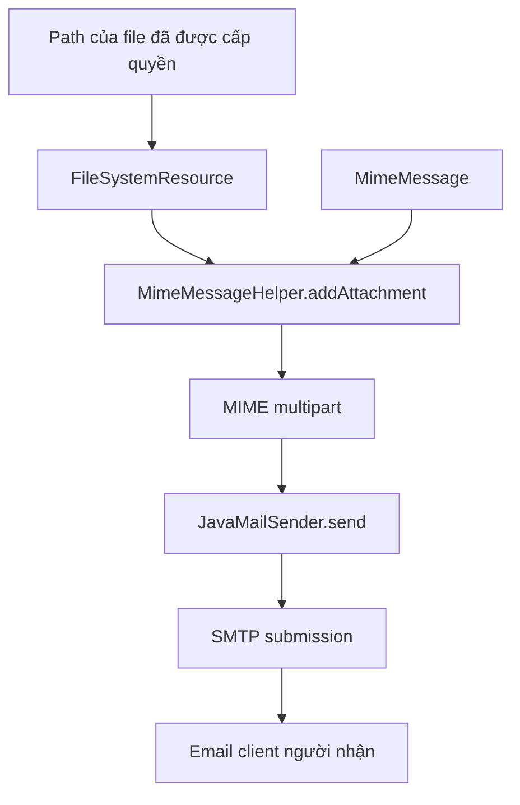
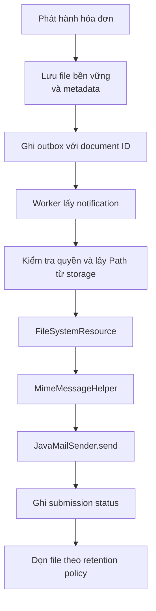

# Đính kèm tệp từ FileSystemResource

Một ứng dụng Spring Boot cần gửi hóa đơn PDF cho khách hàng. File đã được lưu trên máy chủ tại đường dẫn do hệ thống quản lý, ví dụ `/srv/app/storage/invoices/2026/DH1024.pdf`. Người nhận cần thấy tên `hoa-don-DH1024.pdf` trong email và có thể tải file xuống. Để thực hiện việc này, ứng dụng cần tạo email MIME có phần attachment, cung cấp byte của file cho Jakarta Mail và gửi message qua SMTP.

Trong **Spring Framework Mail**, cách thường dùng là tạo `MimeMessage`, khởi tạo `MimeMessageHelper` ở chế độ multipart, rồi gọi `addAttachment(...)` với một **`FileSystemResource`**. Resource này đại diện cho file trên hệ thống tệp và cung cấp luồng đọc dữ liệu khi thư viện cần tuần tự hóa nội dung email.

Ví dụ cốt lõi:

```java
MimeMessage message = mailSender.createMimeMessage();
MimeMessageHelper helper =
        new MimeMessageHelper(message, true, "UTF-8");

helper.setTo("customer@example.net");
helper.setSubject("Hóa đơn đơn hàng DH1024");
helper.setText("Vui lòng xem hóa đơn PDF đính kèm.", false);

FileSystemResource invoice =
        new FileSystemResource(Path.of("/srv/app/storage/invoices/2026/DH1024.pdf"));

helper.addAttachment(
        "hoa-don-DH1024.pdf",
        invoice,
        "application/pdf");

mailSender.send(message);
```

Điểm cần hiểu: **`FileSystemResource` là nguồn dữ liệu của attachment**, còn tên hiển thị và MIME type là các thông tin riêng. Resource không tự gửi email, không tự kiểm tra quyền truy cập nghiệp vụ và không chứng minh byte của file là PDF an toàn.

## 1. FileSystemResource là gì?

`FileSystemResource` là một implementation của Spring `Resource` đại diện cho tài nguyên trên hệ thống tệp. Nó có thể được tạo từ `File`, `Path` hoặc chuỗi đường dẫn tùy constructor và phiên bản Spring.

Ví dụ:

```java
import org.springframework.core.io.FileSystemResource;

import java.io.File;
import java.nio.file.Path;

FileSystemResource fromFile =
        new FileSystemResource(new File("/srv/app/report.pdf"));

FileSystemResource fromPath =
        new FileSystemResource(Path.of("/srv/app/report.pdf"));

FileSystemResource fromString =
        new FileSystemResource("/srv/app/report.pdf");
```

Trong ứng dụng mới, `Path` thường thuận tiện vì Java NIO cung cấp các API kiểm tra, chuẩn hóa và thao tác file. Khi dùng constructor nhận `Path`, cần phiên bản Spring Framework có hỗ trợ constructor đó; các phiên bản Spring hiện đại hỗ trợ `Path`.

### 1.1. FileSystemResource thực hiện điều gì?

Resource cung cấp các khả năng truy cập file:

| API | Ý nghĩa |
|---|---|
| `getInputStream()` | Mở luồng đọc byte từ file. |
| `getFile()` | Trả về `File` khi tài nguyên có thể biểu diễn bằng file. |
| `getPath()` | Trả về đường dẫn được resource quản lý. |
| `getFilename()` | Lấy tên file cuối cùng trong đường dẫn. |
| `exists()` | Kiểm tra tài nguyên có tồn tại. |
| `isReadable()` | Kiểm tra tài nguyên có thể đọc theo khả năng của resource. |
| `contentLength()` | Lấy kích thước tài nguyên khi có thể xác định. |

`FileSystemResource` triển khai `InputStreamSource`. Khi `getInputStream()` được gọi, resource mở một stream đọc file. Với file thông thường, mỗi lần gọi sẽ mở một luồng mới; đây là đặc điểm hữu ích khi thư viện mail cần đọc nguồn dữ liệu trong quá trình tạo MIME.

**Resource là một đối tượng mô tả nguồn dữ liệu**, không phải bản sao nội dung file. Khi tạo `new FileSystemResource(path)`, ứng dụng chưa nhất thiết đọc toàn bộ file vào bộ nhớ.

### 1.2. FileSystemResource khác ClassPathResource

Hai loại resource thường gặp:

| Resource | Dùng cho | Ví dụ |
|---|---|---|
| `FileSystemResource` | File nằm trên filesystem mà tiến trình có quyền truy cập | Hóa đơn được tạo và lưu trong thư mục dữ liệu. |
| `ClassPathResource` | Tài nguyên được đóng gói trong classpath của ứng dụng | Logo công ty nằm trong `src/main/resources/mail/logo.png`. |

Nếu logo được đóng gói cùng ứng dụng:

```java
ClassPathResource logo =
        new ClassPathResource("mail/logo.png");
```

Nếu hóa đơn được tạo trong thư mục lưu trữ bên ngoài:

```java
FileSystemResource invoice =
        new FileSystemResource(invoicePath);
```

Không nên dùng `FileSystemResource("src/main/resources/mail/logo.png")` như cách truy cập tài nguyên classpath trong production. Khi ứng dụng được đóng gói thành JAR, file có thể không tồn tại ở đường dẫn tương đối đó. Hãy dùng `ClassPathResource` cho tài nguyên đi cùng artifact và `FileSystemResource` cho file hệ thống thực tế.

### 1.3. Đường dẫn tương đối và tuyệt đối

Đường dẫn tương đối phụ thuộc **working directory của tiến trình**:

```java
new FileSystemResource("storage/invoices/DH1024.pdf");
```

Khi chạy từ IDE, shell, container hoặc service manager, working directory có thể khác nhau. Vì vậy, file tương đối có thể được tìm ở vị trí không như mong đợi.

Một cấu hình rõ ràng hơn:

```yaml
app:
  storage:
    invoice-directory: /srv/app/storage/invoices
```

Sau đó service lưu trữ tạo `Path` từ thư mục gốc đã cấu hình và mã tài liệu:

```java
Path invoicePath = invoiceDirectory.resolve("DH1024.pdf");
```

Trong thực tế, **không ghép trực tiếp tên file tùy ý từ request** vào thư mục này. Hãy dùng định danh tài liệu đã được kiểm tra và ánh xạ qua storage service.

## 2. Vì sao cần MimeMessageHelper để đính kèm file?

`SimpleMailMessage` phù hợp với email văn bản đơn giản, gồm người gửi, người nhận, subject, text, CC và BCC. Nó không biểu diễn MIME multipart và không có API attachment.

Muốn gửi file, cần dùng `MimeMessage` và `MimeMessageHelper`:

| Thành phần | Vai trò |
|---|---|
| `JavaMailSender` | Tạo và gửi `MimeMessage`. |
| `MimeMessage` | Biểu diễn email MIME gồm header và các phần nội dung. |
| `MimeMessageHelper` | Hỗ trợ tạo multipart, text/HTML, inline resource và attachment. |
| `FileSystemResource` | Cung cấp byte từ file trên filesystem. |

Sơ đồ:



### 2.1. Bật multipart ngay khi tạo helper

Ví dụ:

```java
MimeMessage message = mailSender.createMimeMessage();
MimeMessageHelper helper =
        new MimeMessageHelper(message, true, "UTF-8");
```

Tham số `true` bật multipart. Một lựa chọn rõ ràng hơn là chỉ định chế độ:

```java
MimeMessageHelper helper = new MimeMessageHelper(
        message,
        MimeMessageHelper.MULTIPART_MODE_MIXED_RELATED,
        "UTF-8");
```

Với email chỉ có text và attachment, cấu trúc `multipart/mixed` đơn giản có thể đủ. Nếu email còn có HTML và hình ảnh inline, `MULTIPART_MODE_MIXED_RELATED` là lựa chọn thực dụng để kết hợp vùng nội dung liên quan và các attachment.

Nếu khởi tạo helper với `multipart=false` rồi gọi `addAttachment`, helper không có cấu trúc multipart cần thiết và sẽ báo lỗi. Vì vậy hãy quyết định cấu trúc message từ đầu.

### 2.2. Cấu trúc MIME minh họa

Một email text thuần kèm PDF có thể có dạng:

```text
MimeMessage
├── From: billing@example.com
├── To: customer@example.net
├── Subject: Hóa đơn đơn hàng DH1024
└── multipart/mixed
    ├── text/plain; charset=UTF-8
    │   └── Vui lòng xem hóa đơn PDF đính kèm.
    └── application/pdf
        ├── Content-Disposition: attachment
        ├── filename: hoa-don-DH1024.pdf
        ├── Content-Transfer-Encoding: base64
        └── [byte PDF được biểu diễn trong MIME]
```

Đây là sơ đồ khái niệm. Jakarta Mail tạo các header, boundary và transfer encoding thực tế.

## 3. Dùng FileSystemResource với addAttachment

Phương thức thường dùng trong `MimeMessageHelper`:

```java
helper.addAttachment(
        String attachmentFilename,
        InputStreamSource inputStreamSource,
        String contentType);
```

`FileSystemResource` là một `InputStreamSource`, nên có thể truyền trực tiếp:

```java
Path path = Path.of("/srv/app/storage/invoices/DH1024.pdf");
FileSystemResource resource = new FileSystemResource(path);

helper.addAttachment(
        "hoa-don-DH1024.pdf",
        resource,
        "application/pdf");
```

Ba thành phần có ý nghĩa khác nhau:

1. `attachmentFilename`: tên hiển thị cho người nhận.
2. `inputStreamSource`: nguồn byte của file.
3. `contentType`: MIME type mô tả nội dung.

Ví dụ, file vật lý có thể là `/srv/app/storage/2026/11/4f5d9a.pdf` nhưng tên hiển thị là `hoa-don-DH1024.pdf`. Không cần đưa đường dẫn nội bộ lên header.

### 3.1. Các overload khác

`MimeMessageHelper` có những overload tiện dụng cho các nguồn khác nhau:

```java
// Truyền java.io.File
helper.addAttachment("invoice.pdf", invoiceFile);

// Truyền InputStreamSource
helper.addAttachment("invoice.pdf", invoiceResource);

// Truyền InputStreamSource và MIME type rõ ràng
helper.addAttachment("invoice.pdf", invoiceResource, "application/pdf");

// Truyền Jakarta Activation DataSource
helper.addAttachment("invoice.pdf", invoiceDataSource);
```

`FileSystemResource` thường được truyền qua overload nhận `InputStreamSource`. Khi muốn kiểm soát content type tường minh, dùng overload ba tham số.

### 3.2. Không nhầm tên attachment với getFilename()

`FileSystemResource.getFilename()` trả về tên file từ đường dẫn nguồn. Nhưng tham số `attachmentFilename` trong `addAttachment` có thể khác.

Ví dụ:

```java
FileSystemResource resource =
        new FileSystemResource(Path.of(
                "/srv/app/storage/4f5d9a7c-uuid.pdf"));

String storageFilename = resource.getFilename();
// storageFilename: 4f5d9a7c-uuid.pdf

helper.addAttachment(
        "hoa-don-DH1024.pdf",
        resource,
        "application/pdf");
```

Người nhận sẽ được cung cấp tên hiển thị do ứng dụng chọn. Điều này giúp:

- Không tiết lộ UUID hoặc quy ước lưu trữ nội bộ.
- Dùng tên thân thiện với nghiệp vụ.
- Tránh lộ thư mục hoặc tên khách hàng trong filesystem.
- Duy trì tên ổn định dù file vật lý được di chuyển/đổi tên.

Tên hiển thị vẫn phải được kiểm soát: không chứa CR/LF, ký tự điều khiển hoặc separator đường dẫn; có độ dài hợp lý và extension phù hợp với nội dung thật.

## 4. Chuẩn bị file trước khi đính kèm

Không nên tạo resource rồi gửi ngay mà không xác định file có tồn tại và ứng dụng có quyền đọc hay không. Trước khi thêm attachment, cần kiểm tra theo chính sách lưu trữ.

### 4.1. Kiểm tra file cơ bản bằng Java NIO

```java
import java.nio.file.Files;
import java.nio.file.Path;

public void requireReadableRegularFile(Path path) throws IOException {
    if (path == null) {
        throw new IllegalArgumentException("File path is required");
    }

    if (!Files.isRegularFile(path) || !Files.isReadable(path)) {
        throw new IllegalArgumentException(
                "Attachment is not a readable regular file");
    }
}
```

`Files.isRegularFile` kiểm tra đường dẫn trỏ tới file thường; `Files.isReadable` kiểm tra khả năng đọc theo quyền và trạng thái filesystem mà JVM quan sát được. Những phép kiểm tra này hữu ích nhưng không bảo đảm file sẽ còn tồn tại hoặc đọc được vào thời điểm sau đó.

Nếu cần tránh theo symbolic link, có thể dùng overload với `LinkOption.NOFOLLOW_LINKS`:

```java
boolean regularFile = Files.isRegularFile(
        path, LinkOption.NOFOLLOW_LINKS);
```

Chính sách có cho phép symlink hay không phụ thuộc thiết kế storage. Không phải ứng dụng nào cũng cần cấm symlink; nhưng nếu thư mục có thể bị người dùng khác sửa đổi, cần cân nhắc khả năng một đường dẫn hợp lệ bị chuyển hướng sang file ngoài phạm vi.

### 4.2. Kiểm tra kích thước

```java
long size = Files.size(path);
if (size <= 0) {
    throw new IllegalArgumentException("Attachment is empty");
}

long maxPdfBytes = 12L * 1024 * 1024;
if (size > maxPdfBytes) {
    throw new IllegalArgumentException("Attachment exceeds size limit");
}
```

`12L * 1024 * 1024` là giới hạn **12 MiB** trong ví dụ, do chính sách ứng dụng chọn. Kích thước cho phép cần dựa vào giới hạn của SMTP provider, loại file, số attachment và trải nghiệm người nhận.

**Kích thước file gốc không bằng kích thước toàn bộ email MIME.** File nhị phân thường được mã hóa base64; cứ 3 byte gốc tạo thành 4 ký tự base64, cộng thêm ký tự xuống dòng và header. Phần base64 của file lớn có thể xấp xỉ 1,37 lần dung lượng ban đầu. Cần tính thêm body, header, boundary và các attachment khác.

### 4.3. Kiểm tra định dạng thực tế

Nếu ứng dụng tạo PDF từ thư viện nội bộ, có thể dựa vào hợp đồng của bước sinh tài liệu và kiểm tra kết quả theo yêu cầu hệ thống. Nếu file do người dùng tải lên, không được kết luận đó là PDF chỉ vì:

- Tên kết thúc bằng `.pdf`.
- HTTP request khai báo `Content-Type: application/pdf`.
- Ứng dụng gọi `addAttachment(..., "application/pdf")`.

Những giá trị đó là metadata do nguồn cung cấp hoặc do ứng dụng gắn nhãn. File cần được xác minh bằng parser/validator phù hợp, kiểm soát loại nội dung, quét bảo mật khi chính sách yêu cầu và giới hạn kích thước.

Một kiểm tra magic bytes như prefix `%PDF-` có thể là tín hiệu ban đầu, nhưng không chứng minh toàn bộ file hợp lệ hoặc không chứa nội dung nguy hiểm.

## 5. Ví dụ hoàn chỉnh: gửi hóa đơn từ filesystem

Giả sử ứng dụng có một storage service trả về đường dẫn file hóa đơn sau khi đã xác nhận người gọi có quyền truy cập tài liệu đó. Mail service nhận đường dẫn này, kiểm tra file và đính kèm bằng `FileSystemResource`.

### 5.1. Cấu hình Spring Boot

Dependency Gradle:

```groovy
dependencies {
    implementation 'org.springframework.boot:spring-boot-starter-mail'
}
```

Ví dụ `application.yml` cho SMTP submission cổng 587 + STARTTLS:

```yaml
spring:
  mail:
    host: ${MAIL_HOST}
    port: 587
    protocol: smtp
    username: ${MAIL_USERNAME}
    password: ${MAIL_PASSWORD}
    default-encoding: UTF-8
    properties:
      "[mail.smtp.auth]": true
      "[mail.smtp.starttls.enable]": true
      "[mail.smtp.starttls.required]": true
      "[mail.smtp.ssl.checkserveridentity]": true
      "[mail.smtp.connectiontimeout]": 5000
      "[mail.smtp.timeout]": 10000
      "[mail.smtp.writetimeout]": 10000

app:
  mail:
    from: ${MAIL_FROM:billing@example.com}
  storage:
    invoice-directory: /srv/app/storage/invoices
```

Đây là cấu hình minh họa cho nhà cung cấp hỗ trợ STARTTLS trên cổng 587. Với implicit TLS cổng 465, cần cấu hình kiểu kết nối tương ứng. Credential được cấp từ môi trường triển khai hoặc secret manager, không hardcode vào repository.

### 5.2. Service đính kèm file

```java
package com.example.mail;

import jakarta.mail.MessagingException;
import jakarta.mail.internet.MimeMessage;

import org.springframework.beans.factory.annotation.Value;
import org.springframework.core.io.FileSystemResource;
import org.springframework.mail.javamail.JavaMailSender;
import org.springframework.mail.javamail.MimeMessageHelper;
import org.springframework.stereotype.Service;

import java.io.IOException;
import java.nio.file.Files;
import java.nio.file.Path;
import java.nio.charset.StandardCharsets;

@Service
public class InvoiceMailService {

    private static final long MAX_PDF_BYTES = 12L * 1024 * 1024;

    private final JavaMailSender mailSender;
    private final Path invoiceDirectory;
    private final String fromAddress;

    public InvoiceMailService(
            JavaMailSender mailSender,
            @Value("${app.storage.invoice-directory}") String invoiceDirectory,
            @Value("${app.mail.from}") String fromAddress) {
        this.mailSender = mailSender;
        this.invoiceDirectory = Path.of(invoiceDirectory)
                .toAbsolutePath()
                .normalize();
        this.fromAddress = fromAddress;
    }

    public void sendInvoice(
            String recipient,
            String orderCode) throws IOException, MessagingException {

        // orderCode đã được xác thực ở tầng nghiệp vụ.
        if (orderCode == null || !orderCode.matches("[A-Za-z0-9-]{1,40}")) {
            throw new IllegalArgumentException("Invalid order code");
        }

        // Chỉ tạo path từ storage root và định danh đã kiểm soát.
        Path invoicePath = invoiceDirectory
                .resolve(orderCode + ".pdf")
                .normalize();

        // Bảo đảm path vẫn nằm trong storage root theo kiểm tra lexical.
        if (!invoicePath.startsWith(invoiceDirectory)) {
            throw new IllegalArgumentException("Invalid invoice path");
        }

        if (!Files.isRegularFile(invoicePath) || !Files.isReadable(invoicePath)) {
            throw new IllegalArgumentException(
                    "Invoice file is not readable");
        }

        long fileSize = Files.size(invoicePath);
        if (fileSize <= 0 || fileSize > MAX_PDF_BYTES) {
            throw new IllegalArgumentException(
                    "Invoice file size is outside the allowed range");
        }

        MimeMessage message = mailSender.createMimeMessage();
        MimeMessageHelper helper = new MimeMessageHelper(
                message,
                MimeMessageHelper.MULTIPART_MODE_MIXED,
                StandardCharsets.UTF_8.name());

        helper.setFrom(fromAddress);
        helper.setTo(recipient);
        helper.setSubject("Hóa đơn đơn hàng " + orderCode);
        helper.setText(
                "Vui lòng xem hóa đơn PDF đính kèm cho đơn hàng "
                        + orderCode + ".", false);

        FileSystemResource invoiceResource =
                new FileSystemResource(invoicePath);

        helper.addAttachment(
                "hoa-don-" + orderCode + ".pdf",
                invoiceResource,
                "application/pdf");

        mailSender.send(message);
    }
}
```

Các thành phần `recipient`, `orderCode` và đường dẫn file phải được xác thực/ủy quyền bởi các lớp phù hợp trước khi gọi mail service. Ví dụ trên giả định hóa đơn do ứng dụng tạo và tên file nội bộ được suy ra từ mã đơn hàng đã kiểm soát.

Lưu ý quan trọng về path:

- `normalize()` loại bỏ các thành phần đường dẫn dư thừa về mặt cú pháp.
- `startsWith(invoiceDirectory)` kiểm tra đường dẫn đã chuẩn hóa nằm dưới storage root theo cấu trúc path của Java.
- Kiểm tra lexical này **không tự giải quyết mọi rủi ro symbolic link hoặc race condition** nếu thư mục có thể bị tác nhân khác sửa đổi.
- Trong hệ thống có dữ liệu không tin cậy, storage service nên quản lý file bằng ID bất biến và bảo đảm thư mục lưu trữ không cho người dùng tùy ý thay thế file/symlink.

### 5.3. Vì sao không nhận Path từ request?

Không nên tạo endpoint:

```java
public void send(@RequestParam String path) {
    FileSystemResource resource = new FileSystemResource(path);
    // ...
}
```

Người dùng có thể thử cung cấp đường dẫn ngoài vùng lưu trữ như:

```text
../../../../etc/passwd
C:\Windows\win.ini
```

Nếu service có quyền đọc các file này, ứng dụng có thể vô tình gửi dữ liệu hệ thống hoặc dữ liệu của người dùng khác. Đây là nguy cơ **path traversal và truy cập file trái phép**.

Thay vào đó, API nhận một **document ID hoặc order ID**. Service kiểm tra người gọi có quyền xem tài liệu, sau đó storage layer ánh xạ ID sang đường dẫn do server quản lý.

## 6. FileSystemResource cung cấp stream như thế nào?

`FileSystemResource` không nhất thiết đọc toàn bộ file ngay lúc được tạo. Khi thư viện cần byte, nó gọi `getInputStream()` để mở file.

Mô hình:

```text
FileSystemResource(path)
        |
        | getInputStream()
        v
InputStream đọc file
        |
        v
Jakarta Mail tạo MIME body part
        |
        v
Transfer encoding (ví dụ base64)
        |
        v
SMTP transport ghi dữ liệu
```

### 6.1. Khả năng mở lại stream

`InputStreamSource` được thiết kế để cung cấp `InputStream`. Khi sử dụng cho attachment, nguồn nên có thể cung cấp dữ liệu hợp lệ khi thư viện yêu cầu đọc. `FileSystemResource` phù hợp vì mỗi lần `getInputStream()` mở một stream mới từ file.

Điều này khác với một `InputStreamResource` bọc một stream đã mở sẵn:

```java
InputStream input = Files.newInputStream(path);
InputStreamResource oneShot = new InputStreamResource(input);
```

Nguồn `oneShot` có thể chỉ đọc được một lần. Nếu thư viện yêu cầu đọc lại khi tạo/tuần tự hóa message, stream đã tiêu thụ sẽ không tự quay về đầu. Có thể dẫn tới lỗi hoặc attachment không đầy đủ.

**Quy tắc thực tế:** dùng `FileSystemResource` cho file có thể mở lại; dùng `ByteArrayResource` cho dữ liệu nhỏ đã nằm trong bộ nhớ; chỉ dùng nguồn một lần khi API và toàn bộ quá trình xử lý đảm bảo đúng contract đọc.

### 6.2. File phải còn tồn tại tới khi gửi hoàn tất

`MimeMessageHelper` giữ tham chiếu đến nguồn dữ liệu. Trong quá trình tạo MIME và gửi, Jakarta Mail có thể đọc file. Do đó file phải:

- Còn tồn tại.
- Có thể đọc bởi tiến trình.
- Không bị xóa trước khi transport đọc xong.
- Không bị thay thế hoặc chỉnh sửa làm thay đổi nội dung giữa các lần đọc.

Với `JavaMailSender.send(message)` đồng bộ, khi phương thức gửi trả về, thao tác gửi đã hoàn tất ở góc nhìn của sender. Ứng dụng có thể dọn file tạm sau đó nếu không còn mục đích sử dụng khác. Tuy nhiên, nếu mail được đưa vào queue để worker gửi sau, **không được xóa file ngay sau khi enqueue**.

### 6.3. Tránh thay đổi file trong lúc gửi

Một rủi ro khó thấy là file bị cập nhật giữa lúc kiểm tra kích thước và lúc Jakarta Mail mở stream:

1. Ứng dụng gọi `Files.size(path)`.
2. Một tiến trình khác thay nội dung file.
3. `FileSystemResource` mở file mới.
4. Nội dung gửi có thể khác file đã kiểm tra.

Đây là dạng **time-of-check to time-of-use (TOCTOU)**. Với hóa đơn và tài liệu giao dịch, nên lưu file dưới tên bất biến sau khi phát hành, dùng quyền filesystem phù hợp và không cho phép sửa file trong suốt vòng đời gửi.

Nếu cần bảo đảm mạnh hơn, có thể tạo snapshot bất biến hoặc copy sang vùng staging có quyền hạn riêng trước khi gửi. Không cần copy mọi file trong mọi ứng dụng; quyết định dựa vào yêu cầu nhất quán và độ tin cậy của storage.

## 7. File lớn: FileSystemResource không đồng nghĩa không dùng bộ nhớ

Một lợi ích của `FileSystemResource` là không buộc ứng dụng tự đọc file thành `byte[]` trước khi gọi `addAttachment`.

So sánh:

```java
// Cách dùng FileSystemResource
helper.addAttachment(
        "invoice.pdf",
        new FileSystemResource(invoicePath),
        "application/pdf");

// Cách đọc toàn bộ file vào heap trước
byte[] bytes = Files.readAllBytes(invoicePath);
helper.addAttachment(
        "invoice.pdf",
        new ByteArrayResource(bytes),
        "application/pdf");
```

Với file lớn, cách đầu thường tránh được việc ứng dụng chủ động giữ toàn bộ nội dung trong một mảng byte. Cách thứ hai có thể tiện cho file nhỏ, nhưng cần tính đến heap và số email gửi đồng thời.

Tuy nhiên, **không nên hứa rằng toàn bộ pipeline Jakarta Mail/SMTP luôn streaming với bộ nhớ O(1)**. Việc tuần tự hóa MIME, provider, TLS và transport có thể sử dụng buffer. `FileSystemResource` chỉ cung cấp một nguồn file có thể mở stream; nó không bảo đảm mọi lớp bên dưới không buffer dữ liệu.

### 7.1. Ước lượng kích thước sau base64

Với dữ liệu nhị phân, base64 tăng kích thước khoảng 4/3 trước khi tính line wrapping. Khi thêm dòng và header MIME, có thể ước lượng khoảng 1,37 lần cho phần dữ liệu lớn.

| File gốc | Phần base64 ước tính |
|---:|---:|
| 1 MiB | Khoảng 1,37 MiB |
| 5 MiB | Khoảng 6,84 MiB |
| 10 MiB | Khoảng 13,68 MiB |
| 20 MiB | Khoảng 27,37 MiB |

Đây là ước lượng, không phải phép tính chính xác cho toàn bộ email. Cần cộng thêm phần text/HTML, header, boundary và những attachment khác.

### 7.2. Không tự mã hóa base64 trước

Không làm:

```java
byte[] encoded = Base64.getEncoder().encode(Files.readAllBytes(path));
helper.addAttachment(
        "invoice.pdf",
        new ByteArrayResource(encoded),
        "application/pdf");
```

Nếu truyền byte base64 đã mã hóa như nội dung file PDF, người nhận có thể tải về **chuỗi base64** thay vì PDF gốc; thư viện cũng có thể tiếp tục mã hóa MIME lần nữa.

Hãy truyền byte gốc qua `FileSystemResource`. Jakarta Mail xử lý `Content-Transfer-Encoding` phù hợp khi tạo MIME part.

### 7.3. Khi nên gửi liên kết tải thay vì attachment?

Với file quá lớn, tài liệu thay đổi thường xuyên hoặc cần quyền tải có thể thu hồi, gửi liên kết tải có kiểm soát có thể phù hợp hơn:

- URL HTTPS trên domain do ứng dụng quản lý.
- Xác thực/ủy quyền hoặc signed URL thời hạn ngắn.
- Giới hạn số lần tải hoặc phạm vi tài liệu nếu nghiệp vụ cần.
- Không để URL công khai vô thời hạn cho tài liệu riêng tư.
- Không ghi token trong URL vào log.

Email khi đó chứa thông tin hướng dẫn và link; backend vẫn kiểm tra quyền truy cập tại thời điểm tải. Không coi việc gửi link là lý do bỏ qua kiểm soát quyền.

## 8. MIME type và tên attachment

Khi gọi:

```java
helper.addAttachment(
        "hoa-don-DH1024.pdf",
        resource,
        "application/pdf");
```

ứng dụng truyền:

- Filename: `hoa-don-DH1024.pdf`.
- Content type: `application/pdf`.
- Nguồn byte: `resource`.

### 8.1. Nên chỉ định content type khi biết rõ

Một số loại MIME thường gặp:

| Định dạng | MIME type |
|---|---|
| PDF | `application/pdf` |
| CSV | `text/csv; charset=UTF-8` |
| JSON | `application/json` |
| PNG | `image/png` |
| JPEG | `image/jpeg` |
| ZIP | `application/zip` |
| Word DOCX | `application/vnd.openxmlformats-officedocument.wordprocessingml.document` |
| Excel XLSX | `application/vnd.openxmlformats-officedocument.spreadsheetml.sheet` |
| Binary chưa xác định | `application/octet-stream` |

Nếu bỏ tham số content type, helper/provider có thể suy ra qua `FileTypeMap` dựa trên tên file hoặc mapping đã cấu hình. Cách này tiện nhưng không phải xác minh byte. Với file do ứng dụng tạo và biết chính xác định dạng, truyền content type tường minh thường dễ hiểu hơn.

### 8.2. Tên Unicode

Tên file tiếng Việt như `Hóa đơn tháng 11.pdf` cần được biểu diễn đúng trong tham số MIME. `MimeMessageHelper` và Jakarta Mail xử lý header/parameter encoding theo phiên bản và cấu hình của thư viện. Không tự nối một header `Content-Disposition` raw hoặc URL-encode filename tùy tiện.

Một số client cũ có thể hiển thị filename Unicode khác nhau. Nếu cần tương thích rộng, kiểm thử trên các client mục tiêu; tên ASCII dễ đọc như `hoa-don-thang-11.pdf` là phương án dự phòng hữu ích.

Tùy phiên bản Spring Framework, `MimeMessageHelper` có tùy chọn `setEncodeFilenames(boolean)` để điều chỉnh cách mã hóa tên file cho nhu cầu tương thích. Không bật hoặc tắt chỉ theo phỏng đoán; cần kiểm tra header MIME được tạo và kết quả trên email client mà sản phẩm hỗ trợ.

### 8.3. Filename không phải đường dẫn

Không truyền:

```text
/srv/app/storage/invoices/2026/DH1024.pdf
```

làm tên hiển thị. Chỉ truyền:

```text
hoa-don-DH1024.pdf
```

Tên tệp hiển thị không được chứa separator đường dẫn hoặc ký tự điều khiển. Nếu tên được tạo từ dữ liệu người dùng, cần làm sạch/giới hạn độ dài và kiểm tra extension phù hợp với nội dung thực.

## 9. Bảo mật đường dẫn và quyền truy cập file

Đính kèm từ filesystem đồng nghĩa ứng dụng đang dùng quyền đọc của tiến trình để lấy dữ liệu. Nếu đường dẫn được kiểm soát sai, tính năng gửi mail có thể trở thành một cách **đọc và gửi file trái phép**.

### 9.1. Không tin đường dẫn từ client

Không nhận trực tiếp `Path`, tên file tuyệt đối hoặc URL file từ request để tạo `FileSystemResource`. Hãy nhận document ID, sau đó:

1. Xác thực người dùng.
2. Kiểm tra người dùng có quyền xem tài liệu.
3. Tải metadata tài liệu từ storage repository.
4. Lấy đường dẫn do server quản lý.
5. Kiểm tra file nằm trong vùng lưu trữ được phép.
6. Tạo resource và gửi.

### 9.2. Path traversal

Nếu storage root là:

```text
/srv/app/storage/invoices
```

thì tên file đầu vào như:

```text
../../secrets/application.yml
```

có thể cố thoát khỏi thư mục dự kiến. `Path.normalize()` và kiểm tra `startsWith(root)` giúp phát hiện nhiều trường hợp traversal dạng lexical, nhưng không đủ nếu có symbolic link hoặc thay đổi filesystem đồng thời.

Một kiểm tra bổ sung khi phù hợp:

```java
Path rootReal = storageRoot.toRealPath();
Path candidateReal = candidate.toRealPath();

if (!candidateReal.startsWith(rootReal)) {
    throw new SecurityException("File is outside the allowed storage root");
}
```

`toRealPath()` yêu cầu file tồn tại và giải quyết symbolic link theo mặc định. Cần xử lý lỗi IO, quyền truy cập và race condition giữa lúc resolve với lúc mở file. Nếu môi trường có tác nhân không tin cậy được phép sửa thư mục, chỉ kiểm tra path trước rồi mở lại vẫn có thể chưa đủ; cần thiết kế storage với quyền hệ thống phù hợp.

### 9.3. Quyền filesystem

Tiến trình gửi mail chỉ nên có quyền đọc những thư mục cần thiết. Không chạy ứng dụng với quyền quản trị chỉ để có thể đọc mọi file. Thư mục lưu hóa đơn nên có:

- Chủ sở hữu và quyền truy cập hạn chế.
- Quy tắc tên file do server tạo.
- Không cho người dùng ghi tùy ý vào các file đã phát hành.
- Chính sách retention và xóa file rõ ràng.
- Theo dõi quyền đọc và truy cập tài liệu nhạy cảm khi nghiệp vụ yêu cầu.

### 9.4. Tránh lộ dữ liệu trong log và lỗi

Không log toàn bộ đường dẫn, byte file, nội dung hóa đơn hoặc token chỉ để debug. Dùng document ID/notification ID và mã lỗi. Nếu log đường dẫn cần cho vận hành, phải cân nhắc nó có tiết lộ tên khách hàng hoặc cấu trúc storage hay không.

## 10. Vòng đời file khi gửi đồng bộ và bất đồng bộ

`FileSystemResource` mở file khi được đọc. Do đó vòng đời file phải phù hợp với thời điểm gửi.

### 10.1. Gửi đồng bộ

Ví dụ:

```java
MimeMessage message = mailSender.createMimeMessage();
MimeMessageHelper helper = new MimeMessageHelper(message, true, "UTF-8");
helper.addAttachment("invoice.pdf", new FileSystemResource(invoicePath));
mailSender.send(message);

// Sau khi send trả về, có thể dọn file tạm nếu không còn ai dùng.
```

`mailSender.send` thực hiện thao tác gửi trong lời gọi hiện tại. Khi nó trả về thành công, transport đã hoàn thành việc submission theo quan sát của ứng dụng. Nếu file là file tạm chỉ dùng cho email này, ứng dụng có thể dọn sau khi không còn consumer nào khác.

Nếu `send` ném exception, cần xem luồng gửi có chắc chắn đã dừng đọc file hay chưa trước khi xóa; trong code đồng bộ thông thường, exception trả về sau khi attempt kết thúc, nhưng ứng dụng vẫn phải quản lý các tác vụ khác có thể đang dùng cùng file.

### 10.2. Gửi qua outbox/worker

Không làm:

```java
Path tempInvoice = createTemporaryInvoice();
outbox.save(notification);
Files.delete(tempInvoice); // Worker chưa gửi mà file đã mất.
```

Outbox chỉ lưu yêu cầu gửi, còn worker có thể chạy sau. Nếu file tạm bị xóa trước khi worker đọc, attachment sẽ không tồn tại.

Thiết kế phù hợp hơn:



File phải tồn tại tới khi worker hoàn thành việc gửi và không còn lần retry hợp lệ nào cần nó. Với retry, cần lưu tài liệu bền vững hoặc tạo snapshot bất biến. Không nên phụ thuộc một file tạm thuộc vòng đời của HTTP request.

### 10.3. Giữ cùng một nội dung qua retry

Giả sử worker thử gửi hóa đơn, SMTP timeout, sau đó retry. Nếu file tại đường dẫn bị thay thế bằng phiên bản mới, lần retry có thể gửi hóa đơn khác với lần đầu. Với tài liệu tài chính, đây là rủi ro nghiệp vụ.

Các cách giảm rủi ro:

- File phát hành là bất biến; cập nhật hóa đơn tạo phiên bản mới.
- Lưu document ID và version/hash cùng notification.
- Worker xác nhận version dự kiến trước khi mở file.
- Nếu cần, snapshot file vào storage riêng cho lần phát hành.

Hash có thể giúp phát hiện file thay đổi, nhưng hash phải được tính/lưu trong quy trình phát hành đáng tin cậy. Không tính lại sau khi file đã bị thay đổi rồi coi đó là giá trị gốc.

## 11. FileSystemResource so với các nguồn dữ liệu khác

| Nguồn | Khi phù hợp | Ưu điểm | Điểm cần lưu ý |
|---|---|---|---|
| `FileSystemResource` | File đã lưu trên filesystem | Mở stream từ file, có thể đọc lại | File phải tồn tại và không bị thay đổi trong lúc gửi. |
| `ClassPathResource` | Logo, tài nguyên đóng gói trong ứng dụng | Truy cập resource từ classpath/JAR | Không giả định luôn có `File` vật lý. |
| `ByteArrayResource` | Nội dung nhỏ đã có trong `byte[]` | Có thể mở stream mới từ byte array | Giữ toàn bộ dữ liệu trong heap. |
| `InputStreamResource` | Một stream có sẵn trong một số luồng đặc biệt | Bao bọc stream đã mở | Thường không phù hợp nếu cần đọc lại. |
| `DataSource` | Cần kiểm soát tên, content type và nguồn dữ liệu | Abstraction của Jakarta Activation | Phải bảo đảm stream và metadata chính xác. |

### 11.1. Khi nào dùng ByteArrayResource?

Một CSV nhỏ vừa được sinh trong bộ nhớ:

```java
byte[] csvBytes = csvText.getBytes(StandardCharsets.UTF_8);
helper.addAttachment(
        "orders.csv",
        new ByteArrayResource(csvBytes),
        "text/csv; charset=UTF-8");
```

`ByteArrayResource` thích hợp khi dữ liệu nhỏ và đã có sẵn. Với file lớn, tránh `Files.readAllBytes` rồi giữ mảng byte chỉ để đính kèm; dùng `FileSystemResource` thường hợp lý hơn.

### 11.2. Khi nào dùng ClassPathResource?

Logo được đóng gói trong ứng dụng:

```java
helper.addInline(
        "company-logo",
        new ClassPathResource("mail/images/logo.png"),
        "image/png");
```

Đây là resource classpath, không phải file hóa đơn do người dùng tạo. Nó thường dùng cho tài nguyên cố định như logo hoặc hình ảnh template.

### 11.3. Khi nào dùng DataSource?

Nếu ứng dụng đã có `DataSource` của Jakarta Activation:

```java
helper.addAttachment("report.pdf", reportDataSource);
```

DataSource có thể cung cấp content type, tên và stream. Hãy kiểm tra `getInputStream()` có thể cung cấp dữ liệu hợp lệ mỗi lần thư viện cần đọc; không gắn một stream đã tiêu thụ vào nguồn tưởng như có thể đọc lại.

## 12. Xử lý lỗi khi đính kèm từ filesystem

Lỗi có thể xảy ra ở nhiều thời điểm:

| Giai đoạn | Dấu hiệu | Nguyên nhân thường gặp |
|---|---|---|
| Tạo Path | `InvalidPathException` hoặc lỗi cấu hình | Đường dẫn không hợp lệ, storage root sai. |
| Kiểm tra file | `NoSuchFileException`, không readable | File bị xóa, quyền filesystem hoặc mount lỗi. |
| Mở stream | `IOException` | Lỗi đĩa, quyền bị thay đổi, file không còn truy cập được. |
| Dựng MIME | `MessagingException` | Lỗi khi tạo part, đọc resource hoặc cấu trúc message. |
| Gửi SMTP | `MailException` | Lỗi kết nối, TLS, AUTH, quota hoặc SMTP từ chối. |
| Sau submission | Bounce/DSN/provider event | Hệ thống nhận từ chối hoặc không phát được thư. |

### 12.1. Phân biệt lỗi file và lỗi SMTP

Nếu file không tồn tại, retry SMTP không giải quyết được vấn đề. Cần kiểm tra storage hoặc trạng thái tài liệu. Nếu SMTP timeout sau khi file đã được đọc và gửi, nguyên nhân có thể nằm ở mạng hoặc provider.

Không bắt mọi exception rồi báo “file không hợp lệ”. Tương tự, không bắt mọi exception rồi retry vô hạn. Hãy phân loại:

- **Lỗi dữ liệu/file vĩnh viễn:** document ID sai, file bị xóa, người dùng không có quyền.
- **Lỗi filesystem tạm thời:** storage mount gián đoạn hoặc I/O tạm thời.
- **Lỗi SMTP tạm thời:** timeout, provider unavailable, phản hồi 4xx.
- **Lỗi cấu hình/lâu dài:** SMTP AUTH sai, TLS hostname mismatch, recipient bị từ chối vĩnh viễn.
- **Kết quả submission không rõ:** lỗi đọc phản hồi sau khi server có thể đã nhận message; retry cần chính sách chống gửi trùng.

### 12.2. Ví dụ xử lý ranh giới lỗi

```java
try {
    invoiceMailService.sendInvoice(recipient, orderCode);
    notificationRepository.markSubmitted(notificationId);
} catch (IOException ex) {
    notificationRepository.markFileAccessFailed(notificationId);
    throw ex;
} catch (MessagingException ex) {
    notificationRepository.markMessageBuildFailed(notificationId);
    throw ex;
} catch (MailException ex) {
    notificationRepository.markSubmissionUncertain(notificationId);
    throw ex;
}
```

`notificationRepository` trong ví dụ là abstraction do ứng dụng định nghĩa. Không phải mọi `MailException` đều có kết quả không rõ; cần xem nguyên nhân gốc và giai đoạn lỗi để phân loại chính xác. Ví dụ trên minh họa việc **tách nhóm lỗi**, không phải bộ phân loại hoàn chỉnh cho production.

Đặc biệt, SMTP server có thể đã nhận email nhưng client bị timeout trước khi đọc phản hồi cuối. Vì thế một số lỗi cần trạng thái `UNKNOWN` hoặc `SUBMISSION_UNCERTAIN` thay vì khẳng định chắc chắn “chưa gửi”.

## 13. Kiểm thử attachment từ FileSystemResource

Nên kiểm tra cả nội dung MIME được tạo lẫn đường đi của file.

### 13.1. Unit test với file tạm

Trong test, tạo file tạm có nội dung nhỏ:

```java
Path tempFile = Files.createTempFile("invoice-test-", ".pdf");
Files.write(tempFile, "%PDF-1.7 test".getBytes(StandardCharsets.US_ASCII));

FileSystemResource resource = new FileSystemResource(tempFile);
assertThat(resource.exists()).isTrue();
assertThat(resource.isReadable()).isTrue();

try (InputStream first = resource.getInputStream();
     InputStream second = resource.getInputStream()) {
    assertThat(first.readAllBytes()).isEqualTo(
            "%PDF-1.7 test".getBytes(StandardCharsets.US_ASCII));
    assertThat(second.readAllBytes()).isEqualTo(
            "%PDF-1.7 test".getBytes(StandardCharsets.US_ASCII));
}
```

Ví dụ chứng minh `FileSystemResource` có thể mở nhiều stream mới từ cùng file. Test cần dọn file tạm sau khi hoàn tất, ví dụ trong `@AfterEach` hoặc `try/finally`.

### 13.2. Kiểm tra MimeMessage

Có thể tạo `MimeMessage` với Jakarta Mail Session test, gọi `MimeMessageHelper.addAttachment` rồi kiểm tra `message.getContent()` là `Multipart`. Duyệt các `BodyPart` để xác nhận:

- Có part nội dung text.
- Có part attachment.
- `Content-Disposition` có `attachment`.
- Filename hiển thị đúng.
- `Content-Type` đúng với loại file.
- Byte sau khi đọc part tương ứng với file nguồn.

Ví dụ khái niệm:

```java
Object content = message.getContent();
assertThat(content).isInstanceOf(Multipart.class);

Multipart multipart = (Multipart) content;
assertThat(multipart.getCount()).isGreaterThanOrEqualTo(2);
```

Test thực tế cần xét cấu trúc multipart có thể lồng nhau, nhất là khi dùng `MULTIPART_MODE_MIXED_RELATED` hoặc có text/plain + HTML + inline resource. Không giả định attachment luôn ở index cố định nếu message có nhiều tầng.

### 13.3. Integration test với SMTP catcher

SMTP catcher như GreenMail, Mailpit hoặc MailHog có thể giúp kiểm tra message được gửi tới một server test mà không chuyển thư ra người nhận thật.

Nên kiểm tra:

- Email có đúng recipient và subject.
- Attachment có tên và content type mong muốn.
- Byte file nhận được giống byte file nguồn.
- Nội dung plain text/HTML đọc được.
- File nguồn không bị xóa trước khi worker gửi.

SMTP catcher không chứng minh email client production hiển thị giống nhau hoặc provider chấp nhận file với giới hạn thực tế. Đó là các kiểm tra thuộc môi trường và giai đoạn khác.

## 14. Các lỗi thường gặp khi dùng FileSystemResource

### 14.1. Dùng SimpleMailMessage để thêm file

`SimpleMailMessage` không có API attachment. Hãy tạo `MimeMessage` và dùng `MimeMessageHelper`.

### 14.2. Quên bật multipart

Khởi tạo helper với `multipart=false` rồi gọi `addAttachment` sẽ không tạo được cấu trúc cần thiết. Chọn multipart ngay từ đầu.

### 14.3. File nằm trong classpath nhưng dùng FileSystemResource

Đường dẫn `src/main/resources` có thể không tồn tại ở runtime khi chạy JAR. Dùng `ClassPathResource` cho tài nguyên đóng gói.

### 14.4. Dùng path tương đối

Working directory của IDE/container/service có thể khác nhau. Dùng storage root cấu hình rõ ràng hoặc path do storage service trả về.

### 14.5. Truyền đường dẫn từ người dùng

Có thể gây path traversal và lộ file hệ thống. Nhận document ID, kiểm tra quyền, rồi ánh xạ sang path nội bộ.

### 14.6. Xóa file tạm trước khi worker gửi

Resource chỉ trỏ tới file. Nếu worker chạy sau khi file bị xóa, attachment sẽ lỗi. Giữ file bền vững tới khi mọi lần gửi/retry cần thiết kết thúc.

### 14.7. Sửa file trong lúc gửi

Nếu file thay đổi sau khi kiểm tra nhưng trước lúc stream đọc, message có thể chứa nội dung khác. Dùng file bất biến hoặc snapshot.

### 14.8. Nhầm filename với tên vật lý

Tên file trên đĩa có thể là UUID; tên hiển thị nên được tạo theo nghiệp vụ và không tiết lộ đường dẫn nội bộ.

### 14.9. Đặt content type chỉ theo extension không tin cậy

Đổi tên file thành `.pdf` không biến dữ liệu thành PDF. Kiểm tra nội dung và chỉ định MIME type theo định dạng thực tế đã xác định.

### 14.10. Đọc file lớn vào byte array

`Files.readAllBytes` có thể làm tăng heap đáng kể. Với file lớn, truyền `FileSystemResource` và đặt giới hạn dung lượng hợp lý.

### 14.11. Tự base64 trước khi addAttachment

Truyền byte gốc; Jakarta Mail thực hiện transfer encoding. Base64 thủ công có thể khiến người nhận nhận chuỗi encoded thay vì file gốc.

### 14.12. Nghĩ rằng FileSystemResource tự bảo đảm streaming

Resource mở stream từ file, nhưng không bảo đảm toàn bộ pipeline mail không buffer. Cần quan sát bộ nhớ và tải thực tế.

## 15. Một số quyết định thiết kế cho production

### 15.1. Ai chịu trách nhiệm tìm file?

Mail service nên nhận một tham chiếu tài liệu hoặc một đối tượng nghiệp vụ đã được kiểm tra. Một storage service chịu trách nhiệm:

- Ánh xạ document ID sang vị trí lưu.
- Kiểm tra quyền truy cập.
- Xác nhận file có sẵn và đúng phiên bản.
- Cung cấp path hoặc resource.
- Quản lý retention và lifecycle.

Mail service chịu trách nhiệm dựng message và gọi sender. Tách hai phần giúp không để logic filesystem và SMTP trộn vào nhau.

### 15.2. Truyền Path hay Resource vào mail service?

Hai cách đều có thể dùng:

```java
void sendInvoice(String recipient, Path invoicePath)
```

hoặc:

```java
void sendInvoice(String recipient, Resource invoiceResource)
```

**Nhận `Path`** nếu mail service cần kiểm tra file hệ thống, kích thước, quyền và tạo resource tại chỗ. **Nhận `Resource`** nếu tầng storage đã chịu trách nhiệm chọn nguồn và mail service chỉ cần một abstraction đọc dữ liệu.

Với API nhận `Resource` tổng quát, không phải mọi resource đều có thể mở lại hoặc cung cấp tên file. Hãy quy định contract rõ: stream có thể đọc lại, nguồn tồn tại trong suốt lần gửi, content type và filename được truyền riêng.

### 15.3. Có nên giữ file sau khi gửi?

Phụ thuộc mục đích lưu trữ:

- Hóa đơn phát hành có thể cần lưu theo chính sách kế toán/kiểm toán.
- File tạm được sinh riêng cho email có thể xóa sau khi gửi và hết thời gian retry.
- File upload có thể thuộc kho tài liệu của người dùng, không nên xóa chỉ vì một email đã được gửi.

Không để mail service tự xóa mọi file nguồn. Quyền sở hữu và retention thuộc storage/domain layer.

### 15.4. Giới hạn số attachment và tổng dung lượng

Đặt chính sách:

- Kích thước tối đa cho mỗi file.
- Tổng dung lượng attachment trên một message.
- Số lượng file trên một message.
- Loại file được phép.
- Giới hạn recipient và tần suất gửi.
- Cách xử lý khi provider từ chối do vượt giới hạn.

Với tài liệu lớn, link tải có kiểm soát có thể phù hợp hơn. Không tăng timeout vô hạn để cố gửi file vượt giới hạn server.

### 15.5. Theo dõi submission và delivery

Khi `mailSender.send(message)` hoàn thành, ứng dụng biết transport đã không báo lỗi tại thời điểm submission. Điều đó không đảm bảo thư đã vào Inbox. Với email quan trọng, theo dõi provider message ID, bounce/DSN hoặc webhook riêng.

Không dùng sự kiện “đã gửi SMTP” làm trạng thái “người nhận đã tải hóa đơn”. Việc tải file qua link (nếu dùng link) là một sự kiện riêng và cũng cần diễn giải theo chính sách riêng tư.

## 16. Bài tập thực hành

### Bài 1 — Tạo resource từ Path

Cho file hóa đơn:

```text
/srv/app/storage/invoices/2026/DH1024.pdf
```

Hãy tạo `FileSystemResource` từ `Path`, kiểm tra file tồn tại/đọc được, rồi gọi `addAttachment` với filename `hoa-don-DH1024.pdf` và content type `application/pdf`.

### Bài 2 — Multipart

Một lập trình viên tạo `MimeMessageHelper(message, false, "UTF-8")` rồi gọi `addAttachment`. Giải thích tại sao cách này không phù hợp và sửa constructor.

### Bài 3 — Tên file khác tên lưu trữ

File vật lý có tên UUID. Người nhận cần thấy tên hóa đơn theo mã đơn hàng. Hãy giải thích vì sao tham số đầu của `addAttachment` có thể khác `FileSystemResource.getFilename()`.

### Bài 4 — File upload

REST API nhận `originalFilename` và `contentType` từ HTTP upload. Hãy thiết kế quy trình lưu file an toàn, xác minh định dạng và tạo tên hiển thị trước khi đính kèm. Vì sao không tin hai trường metadata do client gửi?

### Bài 5 — Stream có thể đọc lại

So sánh `FileSystemResource` và `InputStreamResource` bọc stream đã mở. Giải thích vì sao nguồn đọc một lần có thể gây lỗi khi thư viện cần đọc lại attachment.

### Bài 6 — File tạm và worker

Ứng dụng tạo PDF trong thư mục tạm, lưu notification vào outbox rồi xóa file ngay. Worker chạy sau và không tìm thấy file. Hãy đề xuất lifecycle file phù hợp với retry.

### Bài 7 — Kích thước email

SMTP provider giới hạn message 25 MiB. Ứng dụng muốn đính kèm PDF 20 MiB. Ước lượng phần base64 và giải thích vì sao file gốc 20 MiB có thể vượt giới hạn message.

### Bài 8 — Path traversal

Một endpoint nhận chuỗi path từ request rồi tạo `FileSystemResource`. Hãy chỉ ra nguy cơ và thay bằng luồng document ID → authorization → storage lookup → resource.

### Bài 9 — Kiểm thử MIME

Thiết kế integration test dùng SMTP catcher để xác nhận tên attachment, MIME type và byte nhận được khớp file nguồn. Nêu vì sao cần duyệt multipart đệ quy khi email có cả HTML, inline image và PDF.

## 17. Ghi nhớ và tài liệu tham khảo

Khi **đính kèm tệp từ FileSystemResource** trong Spring Framework Mail:

1. Tạo `MimeMessage` và `MimeMessageHelper` ở chế độ multipart.
2. Dùng `FileSystemResource` để cung cấp byte từ file trên filesystem.
3. Gọi `addAttachment(filename, resource, contentType)` để tách tên hiển thị, nguồn dữ liệu và kiểu MIME.
4. Kiểm tra quyền truy cập, tồn tại, khả năng đọc, kích thước và định dạng theo chính sách ứng dụng.
5. Giữ file tồn tại và bất biến cho tới khi transport/worker hoàn tất việc đọc; đặc biệt chú ý outbox và retry.
6. Không nhận path tùy ý từ client, không lộ đường dẫn nội bộ và không tin extension/content type do người dùng khai báo.
7. Ước lượng kích thước MIME sau base64, giới hạn số lượng file và cân nhắc link tải khi file lớn.
8. Kiểm thử message MIME và theo dõi lỗi filesystem riêng với lỗi SMTP.

Tài liệu kỹ thuật nên tham khảo:

- **Spring Framework API — `FileSystemResource`:** cách đại diện file hệ thống, mở stream và truy cập metadata.
- **Spring Framework API — `Resource` / `InputStreamSource`:** contract của resource và nguồn dữ liệu có thể mở stream.
- **Spring Framework API — `MimeMessageHelper`:** constructor multipart, `addAttachment` và các overload.
- **Spring Framework Reference — Email:** `JavaMailSender`, MIME message, attachment và inline resource.
- **Jakarta Mail API — `MimeMessage`, `MimeMultipart`, `MimeBodyPart`:** cấu trúc email và MIME part.
- **Jakarta Activation API — `DataSource`:** cung cấp content type và stream dữ liệu.
- **Java NIO Files API:** kiểm tra file, đọc metadata, path normalization và thao tác filesystem.

`FileSystemResource` giúp Spring Mail kết nối một file trên filesystem với MIME attachment một cách gọn gàng. Để triển khai đáng tin cậy, ứng dụng còn phải quản lý **đường dẫn, quyền truy cập, nội dung file, tên hiển thị, vòng đời resource và giới hạn dung lượng**. Khi các trách nhiệm đó được tách rõ, việc gửi hóa đơn, báo cáo và tài liệu qua email sẽ dễ kiểm soát và vận hành hơn.
