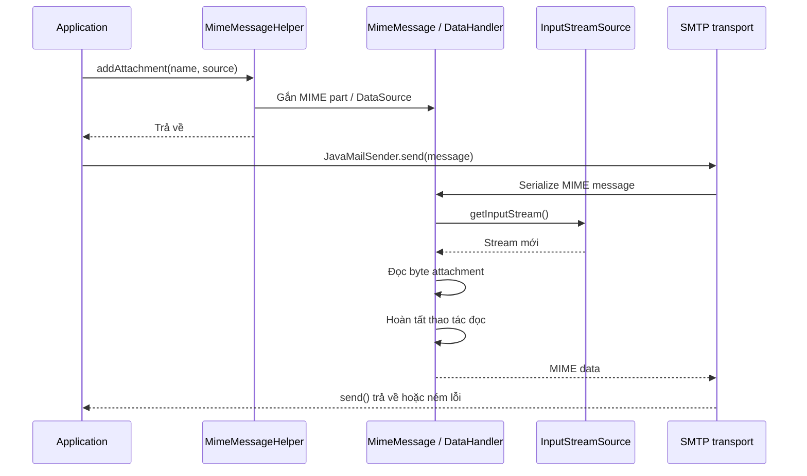
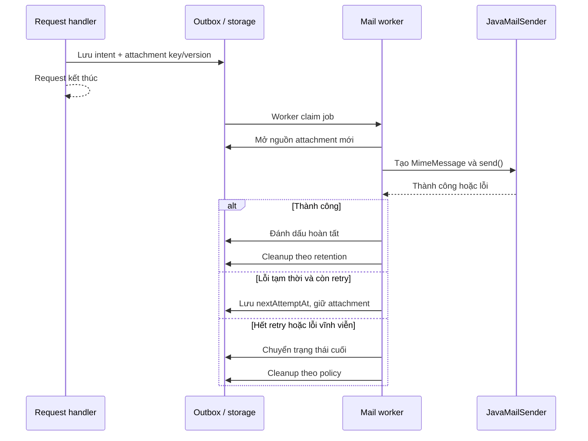

# Không giữ InputStream quá thời gian gửi

Khi gửi email có tệp đính kèm bằng Spring Framework Mail, việc tạo một `MimeMessage` và gọi `MimeMessageHelper.addAttachment(...)` chưa có nghĩa nội dung tệp đã được đọc hết. Helper thường gắn một nguồn dữ liệu vào MIME part; Jakarta Mail/Activation có thể đọc nguồn đó khi message được serialize trong quá trình gửi. Vì vậy, một `InputStream` được mở quá sớm, đóng quá sớm hoặc giữ lại quá lâu đều có thể làm lần gửi thất bại.

Quy tắc quan trọng là **không giữ một stream đã mở vượt quá công việc cần đọc nó**. Hãy mở stream gần thời điểm tiêu thụ, đóng stream do ứng dụng tự đọc bằng `try-with-resources`, và khi đưa attachment vào `MimeMessageHelper` hãy cung cấp một nguồn có thể mở stream mới thay vì giữ một stream duy nhất trong field, queue hoặc message dùng lại lâu dài.

Bài này giải thích vòng đời của `InputStream` trong luồng gửi email, thời điểm `JavaMailSender.send(...)` thực sự đọc attachment, cách phân biệt gửi đồng bộ với gửi bất đồng bộ, các mẫu code cho file, byte array và nguồn từ xa, cũng như cách quản lý file tạm và retry. Ví dụ dùng Spring Framework 6.x, Spring Boot 3.x, Java 21 và Jakarta Mail.

## 1. Vì sao không được giữ InputStream quá lâu?

`InputStream` là một đối tượng có trạng thái. Nó có vị trí đọc hiện tại, có thể bị đóng và thường không thể quay lại đầu nguồn. Khi ứng dụng mở một stream, nó có thể đồng thời giữ một tài nguyên hệ điều hành hoặc tài nguyên từ xa:

- File stream giữ file handle.
- HTTP response stream có thể giữ socket, connection pool lease và response body.
- Object storage stream có thể giữ kết nối tới dịch vụ lưu trữ.
- Database BLOB stream có thể giữ cursor, connection hoặc transaction.
- Stream giải mã có thể giữ buffer và tài nguyên của codec.

Nếu giữ stream trong một service singleton, danh sách công việc hoặc một đối tượng email lâu hơn cần thiết, hệ thống có thể gặp:

1. **Rò rỉ tài nguyên:** file descriptor, socket hoặc connection không được giải phóng.
2. **Stream đã đóng:** worker đọc sau khi request hoặc phương thức tạo stream kết thúc.
3. **Stream đã đọc hết:** lần serialize thứ hai không còn byte nào để đọc.
4. **Dữ liệu không nhất quán:** nguồn thay đổi giữa các lần đọc hoặc giữa các lần retry.
5. **Race condition:** nhiều thread cùng đọc một stream có trạng thái.
6. **Lỗi bất đồng bộ:** caller đóng stream hoặc xóa file trong khi worker chưa bắt đầu gửi.

Một stream không phải là một tham chiếu bền vững tới dữ liệu. Nó là **một phiên đọc cụ thể**. Khi công việc đọc kết thúc, phiên đó cần được đóng; nếu cần đọc lại, hãy tạo một phiên mới từ nguồn dữ liệu còn tồn tại.

## 2. Xác định chính xác thời điểm attachment được đọc

Với `MimeMessageHelper`, lời gọi:

```java
helper.addAttachment("report.pdf", resource, "application/pdf");
```

thường thiết lập một MIME body part và liên kết nó với nguồn dữ liệu. Nó không đảm bảo toàn bộ nội dung file đã được copy vào message tại thời điểm đó.

Luồng gửi thông thường:



Sơ đồ mô tả thời điểm khái niệm. Số lần `getInputStream()` được gọi phụ thuộc implementation và đường xử lý MIME. Có thể có lần serialize khác trong test, lưu bản MIME hoặc xử lý nội bộ. Vì vậy, nguồn attachment cần có khả năng mở lại từ đầu.

### 2.1. addAttachment không phải là điểm kết thúc vòng đời stream

Mẫu sai:

```java
InputStream input = Files.newInputStream(path);
try {
    helper.addAttachment(
            "report.pdf",
            new InputStreamResource(input),
            "application/pdf");
} finally {
    input.close();
}

mailSender.send(message);
```

Helper có thể chỉ giữ nguồn dữ liệu. Khi transport bắt đầu serialize message, stream đã bị đóng. Ngoài ra, `InputStreamResource` đại diện cho stream đã mở và không đáp ứng tốt yêu cầu đọc lại của attachment.

Đừng suy luận rằng stream có thể đóng ngay sau `addAttachment()`. Điểm an toàn để kết thúc vòng đời dữ liệu phụ thuộc **lúc message đã được serialize và công việc gửi đồng bộ hoàn tất**, hoặc lúc worker bất đồng bộ thực sự hoàn tất việc gửi.

### 2.2. send() của JavaMailSenderImpl là đồng bộ

Implementation Spring phổ biến `JavaMailSenderImpl` thực hiện thao tác gửi trong lời gọi `send(...)`. Khi lời gọi trả về bình thường, quá trình transport của lần gọi đó đã hoàn tất theo hợp đồng của implementation. Nếu transport thất bại, phương thức thường ném `MailException`.

Điều này **không chứng minh email đã vào inbox hoặc được đọc**. Nó chỉ cho biết thao tác gửi ở tầng sender/transport đã hoàn tất mà không báo lỗi. SMTP relay có thể chấp nhận thư rồi xử lý định tuyến tiếp theo; bounce hoặc lỗi giao thư sau đó là một vấn đề khác.

Khi dùng sender đồng bộ, ứng dụng có thể giữ nguồn dữ liệu tới khi `send(message)` kết thúc. Sau đó, nếu không còn retry hoặc consumer nào cần nguồn, ứng dụng có thể giải phóng file tạm hay tài nguyên nền theo chính sách của mình.

### 2.3. @Async không tự làm cho send() bên trong trở thành non-blocking

Ví dụ:

```java
@Async
public void sendReport(Path reportPath, String recipient) {
    // Phương thức này chạy trên thread executor.
    // Lời gọi JavaMailSender.send bên trong vẫn đồng bộ
    // nếu sender là JavaMailSenderImpl thông thường.
    sendSynchronously(reportPath, recipient);
}
```

Caller của phương thức `@Async` có thể nhận quyền điều khiển trước khi worker kết thúc, nhưng **worker vẫn chờ** lời gọi `send(...)` trong thread của nó. Vì vậy:

- Mở nguồn file trong worker, không mở stream ở request thread rồi đóng trước khi worker chạy.
- Giữ file/object storage key tới khi worker hoàn tất.
- Nếu có retry, giữ nguồn tới khi job hoàn tất hoặc hết chính sách retry.

Ranh giới bất đồng bộ là nơi công việc được đưa sang executor/queue, không phải một thuộc tính tự động của mọi thao tác bên trong phương thức.

## 3. Phân biệt InputStream với InputStreamSource

Spring cung cấp `org.springframework.core.io.InputStreamSource`:

```java
public interface InputStreamSource {
    InputStream getInputStream() throws IOException;
}
```

Một `InputStream` là một phiên đọc. `InputStreamSource` là một **cách lấy phiên đọc**. Với attachment, implementation nên trả về stream mới, bắt đầu từ đầu dữ liệu, mỗi khi `getInputStream()` được gọi.

Ví dụ tư duy:

```text
InputStreamSource.getInputStream() lần 1 -> Stream A, vị trí 0
InputStreamSource.getInputStream() lần 2 -> Stream B, vị trí 0
InputStreamSource.getInputStream() lần 3 -> Stream C, vị trí 0

Đóng A không làm B hoặc C mất khả năng đọc.
```

Đừng tạo một lambda chỉ có vẻ như factory nhưng luôn trả cùng một stream:

```java
// Sai: mọi lần gọi đều trả cùng một đối tượng có trạng thái.
InputStream shared = Files.newInputStream(path);
InputStreamSource source = () -> shared;
```

Sau lần đọc đầu, vị trí stream đã thay đổi; nếu stream bị đóng, những lần đọc sau không thể dùng. Một nguồn hợp lệ phải mở phiên đọc độc lập.

### 3.1. Resource phù hợp cho attachment

| Nguồn | Cách mở dữ liệu | Phù hợp cho attachment? |
|---|---|---|
| `ByteArrayResource` | Tạo stream mới trên byte array | Có, khi dữ liệu nhỏ và có giới hạn |
| `FileSystemResource` | Mở stream file mới mỗi lần | Có, khi file còn tồn tại và bất biến trong lúc gửi |
| `ClassPathResource` | Mở lại resource trên classpath | Có, với file tĩnh phù hợp |
| Lambda `InputStreamSource` | Mở nguồn mới mỗi lần gọi | Có, nếu implementation đúng hợp đồng |
| `InputStreamResource` | Bọc một stream đã mở | Thường không phù hợp với attachment cần đọc lại |

Không nên giữ một `InputStreamResource` trong một đối tượng sống lâu rồi dùng lại cho nhiều message. Khi dữ liệu chỉ có thể đọc một lần, hãy copy nó sang byte array có giới hạn hoặc file/object storage có thể mở lại.

## 4. Mở stream gần thời điểm sử dụng

Nguyên tắc giúp giảm thời gian giữ tài nguyên là **mở muộn, đọc, rồi đóng**. Nếu code của bạn cần đọc dữ liệu trước khi tạo attachment, dùng try-with-resources ngay tại nơi đọc:

```java
byte[] content;
try (InputStream input = Files.newInputStream(path)) {
    content = input.readAllBytes();
}

// Stream file gốc đã được đóng.
// Attachment dùng byte[] có thể mở stream mới.
helper.addAttachment(
        "report.pdf",
        new ByteArrayResource(content),
        "application/pdf");

mailSender.send(message);
```

Ví dụ này phù hợp khi file có kích thước được giới hạn. `ByteArrayResource` tạo stream mới từ mảng byte; không cần giữ stream file gốc trong suốt thời gian SMTP gửi.

Với file lớn, không nên đọc toàn bộ vào heap chỉ để tránh giữ stream. Hãy dùng một nguồn có thể mở lại như `FileSystemResource` và bảo đảm file tồn tại cho tới khi send hoàn tất.

## 5. Mẫu an toàn với FileSystemResource

Nếu attachment đã nằm trên disk, hãy truyền resource trỏ tới file:

```java
import java.nio.file.Path;

import jakarta.mail.MessagingException;
import jakarta.mail.internet.MimeMessage;
import org.springframework.core.io.FileSystemResource;
import org.springframework.mail.javamail.JavaMailSender;
import org.springframework.mail.javamail.MimeMessageHelper;

public class ReportMailService {

    private final JavaMailSender mailSender;

    public ReportMailService(JavaMailSender mailSender) {
        this.mailSender = mailSender;
    }

    public void send(Path reportPath, String recipient)
            throws MessagingException {

        MimeMessage message = mailSender.createMimeMessage();
        MimeMessageHelper helper =
                new MimeMessageHelper(message, true, "UTF-8");

        helper.setFrom("reports@example.test");
        helper.setTo(recipient);
        helper.setSubject("Báo cáo đã sẵn sàng");
        helper.setText("Báo cáo được gửi kèm email này.");

        FileSystemResource resource =
                new FileSystemResource(reportPath);
        helper.addAttachment("bao-cao.pdf", resource, "application/pdf");

        // JavaMailSenderImpl thông thường serialize message trong send().
        // Giữ reportPath tồn tại cho đến khi lời gọi này kết thúc.
        mailSender.send(message);
    }
}
```

Ở đây service không tự mở `InputStream`. `FileSystemResource` cung cấp khả năng mở stream khi MIME layer cần đọc. Service vẫn chịu trách nhiệm bảo đảm:

- File tồn tại trong suốt quá trình gửi.
- Worker có quyền đọc file.
- File không bị ghi đè hoặc xóa giữa các lần đọc.
- File không vượt giới hạn attachment của ứng dụng và SMTP provider.
- File được cleanup theo ownership và retention policy.

### 5.1. Không xóa file trước khi send kết thúc

Mẫu sai:

```java
Path temp = createReportFile();
MimeMessage message = createMessageWithAttachment(temp);

Files.deleteIfExists(temp);  // Quá sớm
mailSender.send(message);
```

Lúc `send(message)` serialize MIME, file có thể không còn tồn tại. Với sender đồng bộ, nếu service sở hữu file tạm và không có retry, có thể xóa sau khi lời gọi gửi kết thúc:

```java
Path temp = createReportFile();
try {
    MimeMessage message = createMessageWithAttachment(temp);
    mailSender.send(message);
} finally {
    Files.deleteIfExists(temp);
}
```

Mẫu này chỉ đúng khi `mailSender.send(...)` hoàn tất đồng bộ và không có thành phần nào giữ message/resource để dùng tiếp. Trong code production, hãy xử lý lỗi cleanup riêng để không che mất exception gốc từ thao tác gửi; cũng cần một job dọn file quá hạn để xử lý trường hợp process bị kill trước khi chạy `finally`.

## 6. Mẫu an toàn với ByteArrayResource

Với nội dung nhỏ, có thể tạo byte array rồi đóng stream nguồn ngay:

```java
byte[] attachmentBytes;
try (InputStream input = remoteReport.openStream()) {
    attachmentBytes = input.readAllBytes();
}

if (attachmentBytes.length > 5 * 1024 * 1024) {
    throw new IllegalArgumentException("Attachment is too large");
}

helper.addAttachment(
        "report.csv",
        new ByteArrayResource(attachmentBytes),
        "text/csv; charset=UTF-8");

mailSender.send(message);
```

Đoạn code minh họa `remoteReport.openStream()` là API của ứng dụng. Trong hệ thống thực tế, giới hạn kích thước nên được kiểm tra **trong lúc đọc**, không chỉ sau `readAllBytes()`, để tránh cấp phát một mảng quá lớn trước khi phát hiện vượt ngưỡng.

Ưu điểm:

- Stream gốc được đóng ngay sau bước copy.
- Byte array có thể được đọc lại nhiều lần.
- Không giữ file handle hoặc HTTP response mở trong lúc SMTP gửi.

Hạn chế:

- Byte array chiếm heap trong suốt thời gian message còn tham chiếu.
- Nhiều email đồng thời có thể tạo áp lực bộ nhớ.
- MIME encoding có thể tạo thêm bộ nhớ trung gian.

Với attachment lớn hoặc số lượng gửi đồng thời cao, ưu tiên nguồn file/storage có thể mở lại.

## 7. Không giữ InputStream trong field hoặc đối tượng dùng chung

Một Spring service thường là singleton. Nếu lưu stream trong field:

```java
@Service
public class UnsafeMailService {

    private InputStream attachmentStream;

    public void prepare(Path path) throws IOException {
        this.attachmentStream = Files.newInputStream(path);
    }
}
```

thì nhiều request có thể ghi đè field, dùng chung stream hoặc đọc sau khi stream đã đóng. Đối tượng singleton không phải nơi lưu một phiên đọc riêng cho từng email.

Tránh đặt `InputStream` trong:

- Field của Spring singleton hoặc static field.
- DTO sự kiện được publish lên application event bus.
- Payload queue/message broker.
- Cache dùng chung nhiều request.
- Đối tượng `MimeMessage` được giữ để retry dài hạn.
- Closure/lambda chạy sau khi scope đã đóng tài nguyên.

Thay vào đó, lưu một **định danh nguồn dữ liệu**: Path ổn định, object storage key/version, attachment ID hoặc byte array nhỏ đã được kiểm soát. Worker mở stream mới khi bắt đầu mỗi attempt.

### 7.1. Dùng factory thay cho stream được giữ sẵn

Ví dụ:

```java
Path reportPath = Path.of("/srv/app/reports/report-42.pdf");

InputStreamSource attachmentSource =
        () -> Files.newInputStream(reportPath);

helper.addAttachment(
        "report.pdf",
        attachmentSource,
        "application/pdf");
mailSender.send(message);
```

Lambda này không mở file ngay khi được tạo. Mỗi lần `getInputStream()` được gọi, nó mở một stream mới từ đầu. Điều kiện là file vẫn còn tồn tại và nội dung không bị thay đổi trong suốt quá trình sử dụng.

Nếu bạn tự mở stream ở một nhánh code khác, hãy đóng stream đó bằng `try-with-resources`. Đừng tự đóng một stream trước khi MIME layer đọc nó; cũng đừng giữ stream đã mở trong field chỉ để helper có thể lấy lại.

## 8. Nguồn từ HTTP hoặc object storage

Nguồn từ xa thường gắn stream với một response hoặc connection. Một `InputStreamSource` cho loại dữ liệu này cần tạo một request/response mới mỗi lần mở, và khi stream được đóng phải giải phóng cả response/resource nền theo hợp đồng của client.

Ví dụ minh họa với abstraction do ứng dụng định nghĩa:

```java
public interface RemoteObjectClient {
    RemoteResponse open(String objectKey) throws IOException;
}

public interface RemoteResponse extends AutoCloseable {
    InputStream body() throws IOException;
    @Override
    void close() throws IOException;
}
```

Có thể tạo nguồn như sau:

```java
InputStreamSource source = () -> {
    RemoteResponse response = remoteObjectClient.open(objectKey);
    try {
        InputStream body = response.body();
        if (body == null) {
            response.close();
            throw new IOException("Remote object has no body");
        }
        return new FilterInputStream(body) {
            @Override
            public void close() throws IOException {
                try {
                    super.close();
                } finally {
                    response.close();
                }
            }
        };
    } catch (IOException | RuntimeException ex) {
        try {
            response.close();
        } catch (IOException closeError) {
            ex.addSuppressed(closeError);
        }
        throw ex;
    }
};
```

Các interface `RemoteObjectClient` và `RemoteResponse` là ví dụ do ứng dụng tự thiết kế, không phải API Spring. Điểm quan trọng là mỗi lần source được gọi sẽ tạo response mới; đóng stream trả về cũng đóng response, nhả connection. Trong code thực tế, dùng đúng API close của SDK đang dùng và tránh đóng response hai lần nếu SDK không cho phép.

Không nên:

```java
InputStream remoteStream = openRemoteResponse();
InputStreamSource source = () -> remoteStream;
```

vì đây vẫn là một stream được chia sẻ, có trạng thái và có thể đã bị đóng. Nếu nguồn từ xa chỉ đọc được một lần hoặc không hỗ trợ mở lại, hãy materialize vào byte array có giới hạn hoặc storage bền vững trước khi tạo MIME message.

## 9. MultipartFile và vòng đời HTTP request

`MultipartFile` thường đại diện nội dung upload được Spring lưu trong bộ nhớ hoặc file tạm. File tạm có thể được dọn khi request kết thúc. Vì vậy, không nên đưa một stream mở từ upload vào job chạy sau request rồi mong dữ liệu còn tồn tại.

### 9.1. Gửi đồng bộ trong request với file nhỏ

Nếu kích thước file nằm trong giới hạn, có thể copy sang byte array:

```java
if (uploadedFile.getSize() > MAX_ATTACHMENT_BYTES) {
    throw new IllegalArgumentException("Upload is too large");
}

byte[] bytes = uploadedFile.getBytes();
if (bytes.length > MAX_ATTACHMENT_BYTES) {
    throw new IllegalArgumentException("Upload is too large");
}

helper.addAttachment(
        safeFilename,
        new ByteArrayResource(bytes),
        trustedContentType);
mailSender.send(message);
```

`MAX_ATTACHMENT_BYTES`, `safeFilename`, `trustedContentType` và `message` phải được ứng dụng định nghĩa/kiểm tra. Ví dụ này tránh giữ stream upload sau khi request kết thúc, nhưng vẫn cần giới hạn dung lượng thực tế và kiểm tra loại file.

### 9.2. Gửi bất đồng bộ sau khi request kết thúc

Không xếp hàng nguyên `MultipartFile` hoặc stream đã mở:

```java
// Không nên: worker có thể chạy sau khi request và file tạm kết thúc.
mailExecutor.execute(() -> send(uploadedFile.getInputStream()));
```

Thay vào đó:

1. Kiểm tra quyền upload, dung lượng, loại file và nội dung.
2. Lưu file vào object storage hoặc vùng lưu bền vững do ứng dụng quản lý.
3. Ghi attachment key/version cùng ý định gửi vào outbox.
4. Worker lấy key, mở nguồn mới và gửi.
5. Xóa object/file sau khi job hoàn tất hoặc hết thời hạn retry theo retention policy.

Worker không nên phụ thuộc vào request object, stream hay file tạm do web framework sở hữu.

## 10. Gửi bất đồng bộ và retry

Khi một email được gửi qua queue hoặc worker, vòng đời nguồn đính kèm dài hơn một lần gọi phương thức. Không giữ stream mở trong queue. Hãy giữ **tham chiếu bền vững tới dữ liệu**, rồi mở stream mới cho từng lần gửi.



### 10.1. Mỗi lần retry mở nguồn mới

Không làm:

```java
InputStream shared = Files.newInputStream(path);
MimeMessage message = buildMessage(shared);

try {
    mailSender.send(message);
} catch (MailException ex) {
    mailSender.send(message); // Không an toàn để dùng lại stream/message.
}
```

Sau lần serialize đầu tiên, stream có thể đã đọc hết hoặc bị đóng. Message cũng có thể đã được Jakarta Mail cập nhật trạng thái/header khi lưu hoặc serialize.

Thay vào đó, mỗi attempt tạo một message mới và gắn một nguồn mới:

```java
public void sendAttempt(Path immutableAttachment, String recipient)
        throws MessagingException {

    MimeMessage message = mailSender.createMimeMessage();
    MimeMessageHelper helper =
            new MimeMessageHelper(message, true, "UTF-8");

    helper.setFrom("reports@example.test");
    helper.setTo(recipient);
    helper.setSubject("Báo cáo");
    helper.setText("Báo cáo được đính kèm.");

    InputStreamSource source =
            () -> Files.newInputStream(immutableAttachment);
    helper.addAttachment(
            "report.pdf", source, "application/pdf");

    mailSender.send(message);
}
```

Hàm này giả định `immutableAttachment` tồn tại và không đổi trong suốt thời gian retry. Nó tạo message mới và source có khả năng mở stream mới. Chính sách quyết định có retry hay không phải dựa vào loại lỗi SMTP, trạng thái recipient và khả năng đã được relay chấp nhận, không retry vô hạn chỉ vì có `MailException`.

### 10.2. Nguồn phải còn tồn tại qua toàn bộ retry window

Ví dụ:

```text
09:00  Tạo report-version-7.pdf và lưu attachment key
09:01  Attempt 1 -> SMTP 451, lên lịch retry
09:05  Attempt 2 -> timeout, kết quả cần phân loại
09:15  Attempt 3 -> relay chấp nhận
09:16  Job hoàn tất, bắt đầu cleanup theo retention
```

Nếu file bị xóa lúc 09:01 ngay sau attempt đầu tiên, các lần retry sẽ không còn dữ liệu. Ngược lại, nếu giữ file vô thời hạn sau khi job kết thúc, storage sẽ tăng và dữ liệu nhạy cảm tồn tại lâu hơn cần thiết.

Hãy gắn cleanup với **trạng thái cuối của job** và thời hạn lưu đã được chọn. Nếu có thao tác điều tra thủ công hoặc retry ngoài lịch, retention cần tính đến các luồng đó.

### 10.3. Nội dung phải bất biến

Mở stream mới chưa đủ nếu các stream đọc ra những byte khác nhau. Nếu file tại một path bị ghi đè giữa các attempts, cùng một notification có thể gửi các phiên bản attachment khác nhau.

Nên dùng:

- Path/key duy nhất theo từng phiên bản nội dung.
- Object storage version ID hoặc content hash.
- Quy trình ghi file hoàn tất trước khi công bố key cho worker.
- Quyền chỉ đọc trong thời gian gửi.
- Không ghi đè file đang được worker sử dụng.

Đối với retry, mục tiêu là mỗi attempt đọc lại **cùng một nội dung đã được phê duyệt**.

## 11. Ai đóng stream và ai xóa dữ liệu nền?

Đóng một `InputStream` và xóa file là hai hành động khác nhau:

| Tình huống | Ai mở stream? | Ai đóng stream? | Ai quản lý nguồn gốc? |
|---|---|---|---|
| Ứng dụng tự đọc file để tạo byte array | Ứng dụng | Ứng dụng, bằng `try-with-resources` | Ứng dụng quản lý file |
| `FileSystemResource` được MIME layer đọc | MIME/Activation mở từ resource | Tầng tiêu thụ stream theo hợp đồng của thư viện | Ứng dụng giữ/xóa file đúng thời điểm |
| `ByteArrayResource` được MIME layer đọc | Resource cấp stream mới | Tầng tiêu thụ; stream bộ nhớ không giữ file handle | Ứng dụng quản lý byte array |
| Source mở HTTP/object-store response | Source mở response/stream | Đường tiêu thụ đóng stream; wrapper cần nhả response | Ứng dụng/SDK quản lý response và object |
| Ứng dụng mở stream trước rồi bọc `InputStreamResource` | Ứng dụng | Ứng dụng phải đóng stream đã mở; cách này không phù hợp cho attachment cần replay | Ứng dụng |

Khi bạn giao `InputStreamSource` cho `MimeMessageHelper`, đừng tự đóng stream trước lúc MIME layer đọc. Đối với stream do MIME/Activation mở, hãy tuân theo contract của API tiêu thụ và bảo đảm implementation source giải phóng tài nguyên nền khi stream được đóng. Nếu code tự mở stream để đọc hoặc copy dữ liệu, chính code đó phải đóng bằng try-with-resources.

Không giả định đóng stream sẽ tự xóa file, kết thúc object-store lifecycle hoặc đóng mọi client/connection mà source đã tạo. Nếu source mở response từ SDK, nên trả một stream có hành vi `close()` giải phóng cả response tương ứng.

## 12. Xử lý file tạm đúng với gửi đồng bộ và bất đồng bộ

### 12.1. Gửi đồng bộ, không retry

Nếu service tạo file tạm, gửi bằng `JavaMailSenderImpl` đồng bộ và không có consumer khác, có thể giữ file tới khi lời gọi send kết thúc:

```java
Path tempFile = Files.createTempFile("mail-report-", ".pdf");
try {
    reportGenerator.writePdf(tempFile);
    MimeMessage message = createMessage(tempFile, recipient);
    mailSender.send(message);
} finally {
    try {
        Files.deleteIfExists(tempFile);
    } catch (IOException cleanupFailure) {
        // Ghi nhận lỗi cleanup đã được redaction.
        // Không log nội dung email hoặc secret.
    }
}
```

Đây là khung minh họa. `reportGenerator` và `createMessage(...)` là thành phần do ứng dụng cung cấp. Trong hệ thống cần bảo đảm không mất lỗi gửi gốc, hãy ghi nhận cleanup failure như một lỗi vận hành riêng; không im lặng bỏ qua.

### 12.2. Gửi bất đồng bộ có retry

Không đặt cleanup file ở `finally` của từng attempt nếu job còn retry:

```java
// Không dùng cấu trúc này cho job còn retry.
try {
    sendAttempt(file, recipient);
} finally {
    Files.deleteIfExists(file);
}
```

Sau attempt đầu tiên thất bại tạm thời, file đã bị xóa nên attempt sau không thể đọc. Với worker bền vững, việc cleanup nên được quản lý ở tầng job:

```text
claim job
  -> open immutable attachment reference
  -> build fresh MimeMessage
  -> send synchronously inside worker
  -> classify result
       -> RETRY: giữ attachment, đặt nextAttemptAt
       -> FINAL: cleanup theo retention policy
```

Nếu process crash, `finally` có thể không chạy. Một cleanup job nên quét file/object quá hạn, nhưng phải kiểm tra job state/lease để không xóa tài nguyên đang được worker khác dùng.

## 13. Không đưa stream vào queue hoặc lưu trạng thái gửi

Queue và outbox cần giữ dữ liệu có thể phục hồi sau khi process restart. Một `InputStream` đang mở không phải dữ liệu bền vững:

```java
// Không nên lưu stream vào payload job.
record MailJob(
        String recipient,
        InputStream attachmentStream
) {}
```

Sau khi serialize job, stream thường không thể được phục hồi; ngay cả trong cùng process, stream có thể đã bị đóng hoặc đọc dở. Hãy lưu metadata:

```java
record MailJob(
        String notificationId,
        String recipientReference,
        String templateId,
        String attachmentObjectKey,
        String attachmentVersion
) {}
```

Worker lấy key/version từ storage, mở một stream mới và gửi. Payload không cần chứa path nội bộ không kiểm soát, credential truy cập storage hoặc nội dung bí mật ngoài chính sách.

## 14. Những rủi ro khi giữ stream trong singleton hoặc dùng chung

Giả sử service singleton có field:

```java
@Service
public class MailService {
    private InputStream currentAttachment;
}
```

Hai request đồng thời có thể ghi đè `currentAttachment`. Request A mở stream A, request B thay field bằng stream B, rồi A gửi message nhưng đọc nhầm stream B. Nếu một request đóng field, request kia có thể bị lỗi `Stream closed`.

Không dùng một stream chung cho:

- Nhiều người nhận.
- Nhiều MIME part.
- Nhiều lần gọi send.
- Nhiều worker/thread.
- Lần gửi đầu và retry.

Mỗi message/attempt cần một nguồn dữ liệu có thể đọc lại, và mỗi lần nguồn được yêu cầu cần cấp một stream riêng. Nếu nhiều người nhận phải nhận cùng attachment, dùng một resource bất biến có khả năng mở nhiều stream độc lập, không dùng một stream duy nhất chia sẻ giữa họ.

## 15. Giới hạn tài nguyên và backpressure

Không giữ stream lâu không có nghĩa mở vô hạn stream đồng thời. Một worker pool gửi hàng trăm email với attachment lớn vẫn có thể làm cạn file handle, socket hoặc storage bandwidth.

Hãy kiểm soát:

- Số job gửi đồng thời.
- Kích thước tối đa mỗi attachment.
- Tổng dung lượng attachment đang được xử lý.
- Timeout mở và đọc nguồn từ xa.
- Thời gian tối đa một lần gửi.
- Số lần retry và thời hạn của notification.
- Dung lượng thư mục temp/object storage.
- Số file/response đang mở trong một worker.

Ví dụ cấu hình ý niệm:

```yaml
app:
  mail:
    worker:
      concurrency: 4
      max-attachment-bytes: 10485760
      max-attempts: 5
      attachment-retention-hours: 48
```

Đây là thuộc tính do ứng dụng tự định nghĩa, không phải thuộc tính chuẩn của Spring Boot Mail. Các giá trị cần điều chỉnh theo năng lực SMTP provider, CPU, heap, storage và SLA. Dùng backpressure để hàng đợi không mở nhiều file/response hơn khả năng giải phóng của hệ thống.

## 16. Chẩn đoán lỗi vòng đời InputStream

| Dấu hiệu | Nguyên nhân có thể | Hướng xử lý |
|---|---|---|
| `Stream closed` | Stream bị đóng trước khi MIME serialize | Không đóng sau `addAttachment()`; cấp source mở mới |
| Attachment rỗng | Stream đã đọc hết hoặc vị trí đang ở cuối | Tạo stream mới từ đầu mỗi lần |
| `FileNotFoundException` | File bị xóa trước lúc send hoặc worker không thấy path | Giữ file tới khi send/retry hoàn tất; dùng storage chung |
| `Too many open files` | Nhiều stream/file handle không được giải phóng | Kiểm tra ownership, đóng stream tự mở, giới hạn concurrency |
| Connection pool cạn | Remote response stream không được đóng | Đảm bảo close stream giải phóng response/connection |
| Lần đầu gửi được, retry thất bại | Dùng lại stream hoặc message cũ | Tạo message mới và source mới cho mỗi attempt |
| Worker không đọc được MultipartFile | Request đã kết thúc và file tạm bị dọn | Lưu upload bền vững trước khi enqueue |
| Attachment thay đổi giữa attempts | Path/object key trỏ nội dung bị ghi đè | Dùng version hoặc key bất biến |
| File tạm tăng mãi | Cleanup chỉ chạy trên đường thành công | Cleanup theo trạng thái job và có sweeper cho crash |

### 16.1. Phân biệt lỗi stream với lỗi SMTP

Một lỗi đọc attachment có thể xuất hiện trong chuỗi exception của thao tác gửi, nhưng nguyên nhân không phải lúc nào cũng là SMTP server. Nếu file không tồn tại hoặc source ném `IOException`, retry kết nối SMTP không sửa được nguồn dữ liệu.

Nên phân loại tối thiểu:

```text
ATTACHMENT_SOURCE_MISSING
ATTACHMENT_SOURCE_UNREADABLE
ATTACHMENT_SOURCE_EXPIRED
ATTACHMENT_SIZE_LIMIT
SMTP_TEMPORARY_FAILURE
SMTP_PERMANENT_FAILURE
SMTP_OUTCOME_UNKNOWN
```

Chỉ retry khi có lý do và nguồn dữ liệu vẫn có thể đọc lại. Nếu nguồn hết hạn, cần tái tạo hoặc phục hồi attachment trước khi gửi lại. Nếu SMTP có thể đã nhận DATA nhưng phản hồi bị mất, trạng thái kết quả có thể chưa chắc chắn; retry mù có nguy cơ gửi email trùng.

## 17. Kiểm thử nguồn mở lại được

Test quan trọng là xác nhận mỗi lần gọi `getInputStream()` trả về một stream độc lập, đọc cùng dữ liệu từ byte đầu.

```java
package com.example.mail;

import static org.junit.jupiter.api.Assertions.assertArrayEquals;
import static org.junit.jupiter.api.Assertions.assertNotSame;

import java.io.InputStream;
import java.nio.file.Files;
import java.nio.file.Path;

import org.junit.jupiter.api.Test;
import org.junit.jupiter.api.io.TempDir;
import org.springframework.core.io.InputStreamSource;

class RepeatableAttachmentSourceTest {

    @TempDir
    Path tempDir;

    @Test
    void opensIndependentStreamsFromBeginning() throws Exception {
        Path file = tempDir.resolve("report.bin");
        byte[] expected = new byte[] {10, 20, 30, 40, 50};
        Files.write(file, expected);

        InputStreamSource source =
                () -> Files.newInputStream(file);

        try (InputStream first = source.getInputStream();
             InputStream second = source.getInputStream()) {
            assertNotSame(first, second);
            assertArrayEquals(expected, first.readAllBytes());
            assertArrayEquals(expected, second.readAllBytes());
        }

        // Đóng các stream không làm mất file nguồn.
        try (InputStream third = source.getInputStream()) {
            assertArrayEquals(expected, third.readAllBytes());
        }
    }
}
```

Test này kiểm tra contract của source, không gửi email. Nó không ràng buộc Jakarta Mail phải gọi source một số lần cụ thể.

### 17.1. Kiểm tra stream đã đóng sau khi tự đọc

Khi ứng dụng copy nguồn một lần sang byte array, test nên xác nhận:

1. Stream gốc được đóng sau bước copy.
2. `ByteArrayResource` vẫn cấp stream mới.
3. Hai lần đọc resource trả cùng nội dung.
4. Không còn stream file/remote gốc bị giữ trong field hoặc closure.

Với source remote, fake response có thể ghi nhận phương thức `close()` đã được gọi khi consumer đóng stream. Điều này xác nhận wrapper giải phóng connection theo contract của abstraction.

### 17.2. Integration test qua SMTP giả lập

Có thể dùng Mailpit hoặc một SMTP test server để kiểm tra MIME:

```bash
docker run --rm --name mailpit -p 1025:1025 -p 8025:8025 axllent/mailpit
```

Gửi email với attachment test và xác nhận:

- Message có attachment đúng tên và MIME type.
- Byte đã decode khớp nội dung nguồn.
- File nguồn vẫn tồn tại trong thời gian sender serialize.
- Cleanup chỉ diễn ra sau khi lời gọi đồng bộ hoàn tất hoặc job đạt trạng thái cuối.
- Lỗi SMTP tạm thời không làm nguồn bị xóa trước lần retry.

Dùng file giả, không dùng dữ liệu khách hàng hoặc tệp bí mật trong môi trường thử nghiệm. Test cần quan sát trạng thái và nội dung đã decode, không so sánh raw MIME theo từng byte.

## 18. Ví dụ hoàn chỉnh: gửi báo cáo và dọn file đúng lúc

Ví dụ sau dành cho **gửi đồng bộ, không retry trong phương thức**. Service tạo file tạm, gắn `FileSystemResource`, gọi sender đồng bộ, rồi dọn file:

```java
package com.example.mail;

import java.io.IOException;
import java.nio.file.Files;
import java.nio.file.Path;

import jakarta.mail.MessagingException;
import jakarta.mail.internet.MimeMessage;
import org.springframework.core.io.FileSystemResource;
import org.springframework.mail.MailException;
import org.springframework.mail.javamail.JavaMailSender;
import org.springframework.mail.javamail.MimeMessageHelper;
import org.springframework.stereotype.Service;

@Service
public class TemporaryReportMailService {

    private final JavaMailSender mailSender;
    private final ReportGenerator reportGenerator;
    private final CleanupFailureRecorder cleanupFailureRecorder;

    public TemporaryReportMailService(
            JavaMailSender mailSender,
            ReportGenerator reportGenerator,
            CleanupFailureRecorder cleanupFailureRecorder) {
        this.mailSender = mailSender;
        this.reportGenerator = reportGenerator;
        this.cleanupFailureRecorder = cleanupFailureRecorder;
    }

    public void send(String recipient, String reportId)
            throws IOException, MessagingException, MailException {

        Path tempFile = Files.createTempFile("report-", ".pdf");
        try {
            reportGenerator.writePdf(reportId, tempFile);

            MimeMessage message = mailSender.createMimeMessage();
            MimeMessageHelper helper =
                    new MimeMessageHelper(message, true, "UTF-8");

            helper.setFrom("reports@example.test");
            helper.setTo(recipient);
            helper.setSubject("Báo cáo của bạn");
            helper.setText("Báo cáo PDF được đính kèm.");
            helper.addAttachment(
                    "bao-cao.pdf",
                    new FileSystemResource(tempFile),
                    "application/pdf");

            // JavaMailSenderImpl đồng bộ đọc/serialize message trong send().
            mailSender.send(message);
        } finally {
            try {
                Files.deleteIfExists(tempFile);
            } catch (IOException cleanupFailure) {
                cleanupFailureRecorder.record(
                        tempFile.getFileName().toString(),
                        cleanupFailure.getClass().getSimpleName());
            }
        }
    }
}
```

`ReportGenerator` và `CleanupFailureRecorder` là interface do ứng dụng định nghĩa. Ví dụ minh họa rằng cleanup failure được ghi nhận riêng; không ghi nội dung email hoặc secret vào log.

Mẫu này không dành cho worker retry. Nếu gửi thất bại và ứng dụng muốn thử lại sau, file phải được giữ ở storage bền vững và job phải quản lý thời điểm xóa. Một file tạm local được tạo trong request cũng không phù hợp nếu worker retry có thể chạy trên host khác.

## 19. Checklist thiết kế vòng đời stream

Khi thêm attachment vào Spring Mail, hãy tự xác định:

- Stream được mở ở đâu?
- Ai sở hữu stream đã mở?
- Ai đóng stream khi đọc xong?
- Nguồn có thể cấp stream mới từ byte đầu không?
- File/object có bất biến trong toàn bộ lần gửi không?
- Khi nào lời gọi send thực sự kết thúc?
- Có async executor hoặc queue nào làm thay đổi ranh giới thời gian không?
- Nếu retry, nguồn dữ liệu được giữ bao lâu?
- Nếu process crash, cơ chế nào dọn file/object quá hạn?
- Nếu nguồn remote, close stream có giải phóng response/connection không?
- Có giới hạn kích thước và concurrency không?

Nếu chưa trả lời được các câu hỏi này, chưa nên giữ một stream mở rồi truyền nó qua nhiều tầng. Hãy truyền một resource/key có thể mở lại và để từng lần xử lý sở hữu stream riêng.

## 20. Bài thực hành

### Phần A — Tái hiện lỗi đóng sớm

Tạo file test, mở `InputStream`, bọc bằng `InputStreamResource`, gọi `addAttachment()` rồi đóng stream trước `send()`. Quan sát lỗi ở bước serialize/gửi. Giải thích vì sao lời gọi helper không đồng nghĩa attachment đã được đọc hết.

### Phần B — Chuyển sang nguồn mở lại được

Thay stream đã mở bằng `FileSystemResource` hoặc lambda `() -> Files.newInputStream(path)`. Serialize MIME hai lần trong test và xác nhận nội dung attachment vẫn giống nhau.

### Phần C — Giới hạn dữ liệu trong bộ nhớ

Với nguồn chỉ đọc một lần, copy sang byte array có giới hạn rồi tạo `ByteArrayResource`. Thử file vượt giới hạn và xác nhận ứng dụng từ chối trước khi tạo message gửi.

### Phần D — Gửi bất đồng bộ

Cho controller nhận `MultipartFile` và đưa công việc sang worker. Thử truyền nguyên upload để quan sát lỗi khi request kết thúc, sau đó sửa thành lưu object/file bền vững và enqueue attachment key/version.

### Phần E — Retry và cleanup

Giả lập SMTP trả lỗi tạm thời ở attempt đầu. Đảm bảo file vẫn còn cho attempt tiếp theo, mỗi attempt tạo `MimeMessage` mới và mở source mới. Khi job hoàn tất, cleanup đúng một lần theo retention policy.

### Phần F — Nguồn remote

Tạo fake HTTP/object-store response. Mỗi lần source mở phải tạo response mới; khi stream được đóng, response cũng được giải phóng. Kiểm tra không có connection bị giữ sau nhiều lần serialize.

### Phần G — Quan sát tài nguyên

Gửi nhiều attachment đồng thời, đo số stream/file handle, heap, dung lượng temp và số job đang chạy. Áp dụng giới hạn concurrency và cảnh báo khi tài nguyên không được giải phóng.

## 21. Kết luận

Trong Spring Framework Mail, attachment có thể chỉ được đọc khi Jakarta Mail serialize `MimeMessage` trong quá trình `send()`. Vì vậy, **đừng mở một stream quá sớm rồi giữ nó qua request, queue hoặc nhiều lần retry**. Đừng đóng stream trước khi MIME layer đọc xong, và đừng tái sử dụng một stream đã đọc hoặc đã đóng.

Hãy truyền một nguồn có thể mở lại như `FileSystemResource`, `ByteArrayResource` hoặc `InputStreamSource` tạo stream mới. Nếu ứng dụng tự đọc stream, đóng nó bằng `try-with-resources` ngay khi bước copy kết thúc. Với sender đồng bộ, giữ nguồn tới khi `send()` trả về; với async/outbox/retry, giữ dữ liệu nền tới khi toàn bộ job không còn cần nó và cleanup theo trạng thái cuối.

**Đóng stream, xóa file và hoàn tất email là ba mốc khác nhau.** Quản lý riêng từng mốc giúp tránh lỗi `Stream closed`, rò rỉ file handle, mất attachment khi retry và giữ dữ liệu lâu hơn cần thiết.
