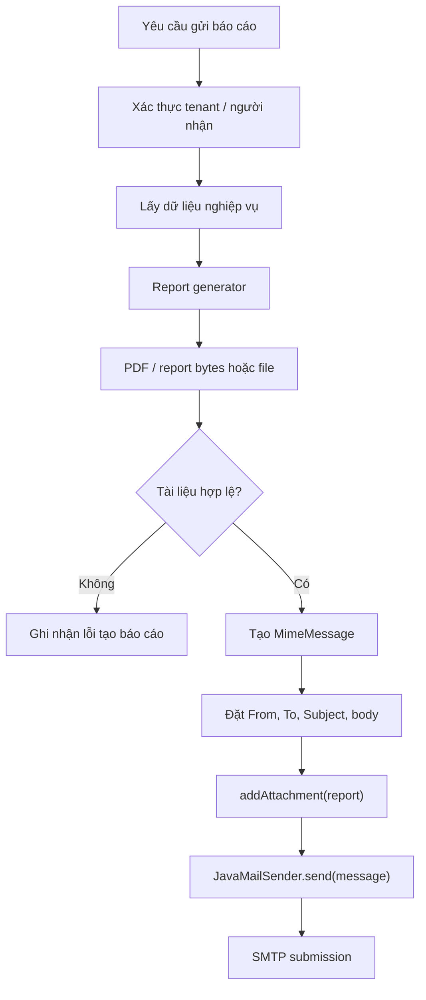
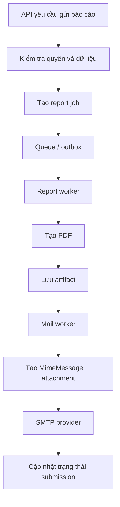

# Tạo PDF hoặc báo cáo trước khi tạo message trong Spring Framework Mail

Nhiều email nghiệp vụ cần gửi kèm một tài liệu được tạo từ dữ liệu của ứng dụng: hóa đơn PDF, báo cáo doanh thu, bảng kê giao dịch, biên nhận hoặc bản tổng hợp hoạt động. Trong Spring Framework Mail, cách tổ chức dễ kiểm soát là **hoàn tất việc tạo tài liệu trước, sau đó mới tạo email message và đính kèm tài liệu đã có**.

Luồng xử lý có thể mô tả như sau:

1. Lấy dữ liệu nghiệp vụ đã được xác thực và kiểm tra quyền truy cập.
2. Tạo báo cáo hoặc PDF từ dữ liệu đó.
3. Kiểm tra kết quả tạo tài liệu: dữ liệu không rỗng, định dạng hợp lệ và tên file phù hợp.
4. Tạo `MimeMessage`, thiết lập người gửi, người nhận, subject và nội dung.
5. Đính kèm PDF/báo cáo bằng `MimeMessageHelper.addAttachment(...)`.
6. Gửi message bằng `JavaMailSender.send(...)`.

Việc tách hai giai đoạn giúp lỗi tạo báo cáo được phát hiện trước khi ứng dụng bắt đầu dựng email. Nó cũng cho phép kiểm thử bộ tạo PDF độc lập với SMTP, tái sử dụng tài liệu ở nhiều kênh và lựa chọn cách lưu trữ phù hợp với kích thước báo cáo.

## 1. Phân biệt tạo báo cáo và tạo email message

Trong một ứng dụng Spring, hai công việc này có mục tiêu khác nhau:

| Công việc | Đầu vào | Đầu ra | Thành phần thường dùng |
|---|---|---|---|
| Tạo báo cáo/PDF | Dữ liệu nghiệp vụ, template báo cáo, font, locale | File PDF hoặc byte array | PDFBox, JasperReports, thư viện xuất báo cáo |
| Tạo email message | Người gửi, người nhận, subject, body, tài liệu đã tạo | `MimeMessage` | `JavaMailSender`, `MimeMessageHelper` |
| Gửi email | `MimeMessage` đã hoàn chỉnh | Kết quả submission hoặc lỗi | `JavaMailSender.send(...)`, SMTP provider |

`MimeMessage` là cấu trúc thông điệp email theo MIME. Nó không phải nơi tính doanh thu, truy vấn hóa đơn hay tạo nội dung PDF. `MimeMessageHelper` hỗ trợ đặt header, nội dung và attachment; thư viện tạo báo cáo chịu trách nhiệm tạo dữ liệu file trước khi attachment được thêm vào.



Nếu tạo message trước rồi mới bắt đầu tạo báo cáo, code thường phải giữ một message đang dở dang trong khi tài liệu có thể thất bại vì dữ liệu, font, dung lượng hoặc lỗi thư viện. Tạo báo cáo trước giúp ranh giới giữa **lỗi tạo tài liệu** và **lỗi tạo/gửi email** rõ ràng hơn.

### Vì sao không đưa logic tạo PDF vào mail service?

Một mail service nên tập trung vào việc tạo và gửi thông điệp. Nếu nó đồng thời truy vấn nhiều bảng, tính số liệu, vẽ PDF, định dạng trang và giao tiếp SMTP, lớp đó sẽ khó kiểm thử và khó tái sử dụng.

Có thể tách trách nhiệm:

- `ReportDataService` lấy và chuẩn bị dữ liệu báo cáo.
- `PdfReportGenerator` chuyển dữ liệu thành PDF.
- `MailTemplateRenderer` tạo subject và body.
- `ReportEmailService` kết hợp kết quả, tạo MIME message và gửi.

Với báo cáo có nhiều quy tắc nghiệp vụ, hãy tính toán và kiểm tra dữ liệu ở service/domain layer trước khi chuyển model đã chuẩn bị cho thư viện PDF. Không nên để code vẽ PDF tự quyết định tenant nào được xem báo cáo hoặc tự truy vấn dữ liệu không có kiểm soát.

## 2. Chọn cách tạo PDF hoặc báo cáo

Không có một thư viện duy nhất phù hợp với mọi báo cáo. Chọn công cụ theo mức độ phức tạp và dạng đầu ra:

| Nhu cầu | Lựa chọn có thể dùng | Đặc điểm |
|---|---|---|
| PDF đơn giản, nội dung văn bản, bảng và hình | Apache PDFBox | API mức thấp, kiểm soát trang và nội dung |
| Báo cáo có template, band, group, tổng hợp | JasperReports | Có mô hình report template và engine xuất báo cáo |
| Báo cáo PDF từ HTML | HTML-to-PDF engine phù hợp | Tận dụng template HTML, cần kiểm tra CSS và font |
| Bảng dữ liệu để người dùng xử lý tiếp | CSV hoặc XLSX | Có thể đính kèm thay cho PDF |
| Tài liệu có quy trình tạo sẵn từ hệ thống khác | File/resource đã được tạo trước | Mail service chỉ đọc và đính kèm |

Trong bài này dùng **Apache PDFBox** để minh họa vì có thể tạo PDF trực tiếp từ Java và nhúng font Unicode. Với báo cáo tài chính hoặc biểu mẫu phức tạp, JasperReports hoặc một report engine chuyên dụng có thể phù hợp hơn.

Khi chọn thư viện, cần xem xét giấy phép sử dụng, phiên bản tương thích Java, khả năng nhúng font, hỗ trợ tiếng Việt, bộ nhớ, giới hạn kích thước và yêu cầu bảo trì. Không chọn thư viện chỉ vì một ví dụ ngắn có thể tạo được một trang PDF.

## 3. Chuẩn bị dependency và font Unicode

Với Gradle, ví dụ sử dụng PDFBox 2.x:

```groovy
dependencies {
    implementation 'org.springframework.boot:spring-boot-starter-mail'
    implementation 'org.apache.pdfbox:pdfbox:2.0.32'
}
```

Chọn phiên bản PDFBox đã được dự án phê duyệt và cập nhật theo chính sách quản lý dependency của ứng dụng. Nếu dùng Spring Boot, giữ dependency version nhất quán với BOM hoặc dependency management đang áp dụng.

### Vì sao PDF tiếng Việt cần font phù hợp?

Các font PDF chuẩn có sẵn như Helvetica thường chỉ hỗ trợ một tập ký tự giới hạn. Nếu tạo PDF tiếng Việt bằng font không có glyph cần thiết, một số chữ có dấu có thể bị mất, thành ô vuông hoặc lỗi hiển thị.

Để hỗ trợ Unicode, hãy **nhúng một font TrueType/OpenType có đủ glyph** vào PDF. Ví dụ có thể dùng Noto Sans:

```text
src/main/resources/
└── fonts/
    └── NotoSans-Regular.ttf
```

Chỉ dùng font mà ứng dụng có quyền phân phối và nhúng vào tài liệu. Đặt font trong classpath giúp ứng dụng đóng gói tài nguyên cùng artifact và không phụ thuộc đường dẫn font trên máy chủ triển khai.

Trong PDFBox 2.x, có thể nạp font bằng `PDType0Font.load(document, inputStream)`. Font Unicode được nhúng giúp nội dung tiếng Việt hiển thị đúng trên các trình đọc PDF khác nhau, miễn là font có glyph tương ứng.

## 4. Tạo dữ liệu báo cáo trước khi dựng PDF

Trước khi vẽ nội dung, nên chuẩn bị một model báo cáo có dữ liệu đã được kiểm tra. Ví dụ báo cáo tổng hợp đơn hàng:

```java
package com.example.report;

import java.util.List;

public record OrderReportData(
        String reportCode,
        String title,
        String customerName,
        String periodDisplay,
        String generatedAtDisplay,
        String totalDisplay,
        List<String> detailLines) {
}
```

Ví dụ dữ liệu đã chuẩn bị:

```java
OrderReportData report = new OrderReportData(
        "ORD-RPT-2026-0042",
        "Báo cáo tổng hợp đơn hàng",
        "Nguyễn An",
        "01/10/2026 - 31/10/2026",
        "12/11/2026 16:30 (UTC+07:00)",
        "125.500.000 ₫",
        List.of(
                "Đơn hàng đã thanh toán: 120",
                "Đơn hàng đang xử lý: 8",
                "Đơn hàng đã hủy: 3"));
```

Đây là dữ liệu minh họa. Trong hệ thống thực, các số liệu phải được tính từ nguồn dữ liệu có quyền truy cập, lọc đúng tenant và kỳ báo cáo, sau đó định dạng theo locale/múi giờ đã chọn.

### Không để report generator tự quyết định quyền xem dữ liệu

Trước khi tạo báo cáo, tầng nghiệp vụ cần xác nhận:

- Người yêu cầu được phép xem báo cáo đó.
- Tenant hoặc tổ chức sở hữu dữ liệu được xác định từ ngữ cảnh đã xác thực.
- Kỳ báo cáo và phạm vi dữ liệu hợp lệ.
- Người nhận email có quyền nhận tài liệu.
- Các trường nhạy cảm được loại bỏ hoặc che theo chính sách.

Không lấy `tenantId`, mã khách hàng hoặc phạm vi dữ liệu từ request rồi tin tưởng ngay. Báo cáo đính kèm là một bản sao dữ liệu có thể được lưu hoặc chuyển tiếp; quyền của người nhận cần được kiểm tra trước khi tạo và gửi.

## 5. Tạo PDF thành byte array bằng PDFBox

Với tài liệu vừa phải, cách đơn giản là tạo PDF trong bộ nhớ bằng `ByteArrayOutputStream` rồi trả về `byte[]`. Sau đó mail service dùng chính byte array đó để tạo attachment.

### 5.1. Cài đặt PdfReportGenerator

```java
package com.example.report;

import java.io.ByteArrayOutputStream;
import java.io.IOException;
import java.io.InputStream;
import java.util.ArrayList;
import java.util.List;

import org.apache.pdfbox.pdmodel.PDDocument;
import org.apache.pdfbox.pdmodel.PDPage;
import org.apache.pdfbox.pdmodel.PDPageContentStream;
import org.apache.pdfbox.pdmodel.common.PDRectangle;
import org.apache.pdfbox.pdmodel.font.PDType0Font;
import org.springframework.core.io.ClassPathResource;
import org.springframework.stereotype.Component;

@Component
public class PdfReportGenerator {

    public byte[] generate(OrderReportData report) throws IOException {
        try (PDDocument document = new PDDocument();
             ByteArrayOutputStream output = new ByteArrayOutputStream();
             InputStream fontInput = new ClassPathResource(
                     "fonts/NotoSans-Regular.ttf").getInputStream()) {

            PDType0Font font = PDType0Font.load(document, fontInput);
            document.getDocumentInformation().setTitle(report.title());

            try (PageWriter pageWriter = new PageWriter(document, font)) {
                pageWriter.writeParagraph(report.title(), 18);
                pageWriter.writeParagraph(
                        "Mã báo cáo: " + report.reportCode(), 10);
                pageWriter.writeParagraph(
                        "Khách hàng: " + report.customerName(), 11);
                pageWriter.writeParagraph(
                        "Kỳ báo cáo: " + report.periodDisplay(), 11);
                pageWriter.writeParagraph(
                        "Thời điểm tạo: " + report.generatedAtDisplay(), 10);
                pageWriter.writeParagraph(
                        "Tổng giá trị: " + report.totalDisplay(), 13);

                pageWriter.writeParagraph("Chi tiết", 14);
                for (String detail : report.detailLines()) {
                    pageWriter.writeParagraph("- " + detail, 11);
                }
            }

            document.save(output);
            return output.toByteArray();
        }
    }

    private static final class PageWriter implements AutoCloseable {
        private static final float MARGIN = 48;
        private static final float MAX_WIDTH = PDRectangle.A4.getWidth()
                - (2 * MARGIN);

        private final PDDocument document;
        private final PDType0Font font;
        private PDPage page;
        private PDPageContentStream stream;
        private float y;

        PageWriter(PDDocument document, PDType0Font font) throws IOException {
            this.document = document;
            this.font = font;
            startPage();
        }

        void writeParagraph(String text, float fontSize) throws IOException {
            for (String line : wrap(text, fontSize)) {
                writeLine(line, fontSize);
            }
            y -= 6;
        }

        private List<String> wrap(String text, float fontSize)
                throws IOException {
            List<String> lines = new ArrayList<>();
            StringBuilder current = new StringBuilder();

            for (String word : text.strip().split("\\s+")) {
                String candidate = current.length() == 0
                        ? word
                        : current + " " + word;
                float width = font.getStringWidth(candidate)
                        / 1000f * fontSize;

                if (width > MAX_WIDTH && current.length() > 0) {
                    lines.add(current.toString());
                    current.setLength(0);
                }

                if (current.length() > 0) {
                    current.append(' ');
                }
                current.append(word);
            }

            if (current.length() > 0) {
                lines.add(current.toString());
            }
            return lines;
        }

        private void writeLine(String text, float fontSize)
                throws IOException {
            float lineHeight = fontSize * 1.5f;
            if (y < MARGIN + lineHeight) {
                startPage();
            }

            stream.beginText();
            stream.setFont(font, fontSize);
            stream.newLineAtOffset(MARGIN, y);
            stream.showText(text);
            stream.endText();

            y -= lineHeight;
        }

        private void startPage() throws IOException {
            if (stream != null) {
                stream.close();
            }

            page = new PDPage(PDRectangle.A4);
            document.addPage(page);
            stream = new PDPageContentStream(document, page);
            y = page.getMediaBox().getHeight() - MARGIN;
        }

        @Override
        public void close() throws IOException {
            if (stream != null) {
                stream.close();
            }
        }
    }
}
```

Ví dụ này minh họa cách tạo tài liệu nhiều trang ở mức cơ bản:

- `PDDocument` quản lý tài liệu PDF.
- `PDPage` đại diện cho từng trang A4.
- `PDPageContentStream` ghi nội dung lên trang.
- `PDType0Font` cung cấp font Unicode được nhúng.
- `ByteArrayOutputStream` giữ kết quả PDF để trả về `byte[]`.
- `PageWriter` tự chuyển sang trang mới khi gần hết vùng nội dung.

Hàm `wrap(...)` tính độ rộng chữ theo font để ngắt dòng theo chiều ngang trang. Đây là cách ngắt dòng đơn giản theo khoảng trắng; báo cáo có bảng phức tạp, cột, header/footer lặp lại, hình ảnh hoặc phân trang theo nhóm nên dùng một lớp layout/report engine chuyên biệt. Ví dụ cũng giả định nội dung không có chuỗi đơn lẻ dài hơn chiều rộng trang và font hỗ trợ mọi ký tự được đưa vào.

### 5.2. Vì sao trả về byte array?

Khi report generator trả `byte[]`, nó tạo ra một kết quả độc lập với SMTP:

```text
OrderReportData
      |
      v
PdfReportGenerator.generate(...)
      |
      v
byte[] pdfBytes
      |
      +------> Lưu trữ
      |
      +------> Xem trước / tải xuống
      |
      +------> Đính kèm email
```

Một PDF đã tạo có thể được dùng để tải xuống trong giao diện web, lưu vào object storage hoặc đính kèm vào nhiều thông điệp theo chính sách. Không cần tạo lại PDF ở từng nơi nếu dữ liệu và phiên bản tài liệu cần giữ nhất quán.

### 5.3. Kiểm tra kết quả trước khi tạo message

Mail service có thể kiểm tra tối thiểu:

```java
byte[] pdfBytes = pdfReportGenerator.generate(report);

if (pdfBytes == null || pdfBytes.length == 0) {
    throw new IllegalStateException("PDF report is empty");
}
```

Kiểm tra byte đầu tiên của PDF thường bắt đầu bằng chữ ký `%PDF-` có thể hữu ích như một kiểm tra định dạng sơ bộ, nhưng không chứng minh toàn bộ tài liệu hợp lệ. Nếu cần xác nhận cấu trúc PDF, có thể mở lại bằng PDFBox hoặc kiểm tra qua một bước validate riêng.

Quan trọng là **nếu tạo báo cáo thất bại, chưa tạo MimeMessage và chưa gọi SMTP**. Lỗi có thể được ghi nhận là lỗi tạo report, retry theo chính sách của report generator hoặc trả về cho tầng gọi.

## 6. Đính kèm PDF bằng MimeMessageHelper

Khi đã có `byte[]`, có thể dùng `ByteArrayResource` làm nguồn dữ liệu cho `addAttachment(...)`.

```java
import org.springframework.core.io.ByteArrayResource;
import org.springframework.mail.javamail.MimeMessageHelper;

helper.addAttachment(
        "order-report.pdf",
        new ByteArrayResource(pdfBytes),
        "application/pdf");
```

Ý nghĩa:

- `order-report.pdf` là tên file mà người nhận nhìn thấy.
- `ByteArrayResource(pdfBytes)` cung cấp nội dung file cho MIME attachment.
- `application/pdf` là MIME type của PDF.

`ByteArrayResource` phù hợp với byte array vì nó có thể mở một `InputStream` mới từ cùng dữ liệu mỗi khi được yêu cầu. Điều này quan trọng vì mail library có thể đọc nguồn attachment trong quá trình dựng hoặc gửi MIME message.

### 6.1. Ví dụ service gửi email có PDF đính kèm

```java
package com.example.mail;

import com.example.report.OrderReportData;
import com.example.report.PdfReportGenerator;
import jakarta.mail.MessagingException;
import jakarta.mail.internet.MimeMessage;
import java.io.IOException;
import java.nio.charset.StandardCharsets;

import org.springframework.beans.factory.annotation.Value;
import org.springframework.core.io.ByteArrayResource;
import org.springframework.mail.javamail.JavaMailSender;
import org.springframework.mail.javamail.MimeMessageHelper;
import org.springframework.stereotype.Service;

@Service
public class ReportEmailService {

    private final JavaMailSender mailSender;
    private final PdfReportGenerator pdfReportGenerator;
    private final String fromAddress;

    public ReportEmailService(
            JavaMailSender mailSender,
            PdfReportGenerator pdfReportGenerator,
            @Value("@@{app.mail.from}") String fromAddress) {
        this.mailSender = mailSender;
        this.pdfReportGenerator = pdfReportGenerator;
        this.fromAddress = fromAddress;
    }

    public void sendOrderReport(
            String recipient,
            OrderReportData report)
            throws IOException, MessagingException {

        // Bước 1: tạo và kiểm tra tài liệu trước khi tạo MimeMessage.
        byte[] pdfBytes = pdfReportGenerator.generate(report);
        if (pdfBytes.length == 0) {
            throw new IllegalStateException("Generated PDF is empty");
        }

        // Bước 2: tạo một message sau khi tài liệu đã sẵn sàng.
        MimeMessage message = mailSender.createMimeMessage();
        MimeMessageHelper helper = new MimeMessageHelper(
                message, true, StandardCharsets.UTF_8.name());

        helper.setFrom(fromAddress);
        helper.setTo(recipient);
        helper.setSubject(
                "Báo cáo đơn hàng " + report.reportCode());

        String plainText = """
                Xin chào,

                Báo cáo đơn hàng của bạn đã được tạo.
                Mã báo cáo: %s
                Kỳ báo cáo: %s

                Vui lòng mở file PDF đính kèm để xem chi tiết.

                Trân trọng,
                Đội ngũ Example
                """.formatted(report.reportCode(), report.periodDisplay());

        String htmlText = """
                <!doctype html>
                <html lang="vi">
                  <body>
                    <h2>Báo cáo đơn hàng đã sẵn sàng</h2>
                    <p>Mã báo cáo: <strong>%s</strong></p>
                    <p>Kỳ báo cáo: %s</p>
                    <p>Vui lòng mở file PDF đính kèm để xem chi tiết.</p>
                  </body>
                </html>
                """.formatted(report.reportCode(), report.periodDisplay());

        helper.setText(plainText, htmlText);
        helper.addAttachment(
                "order-report-" + report.reportCode() + ".pdf",
                new ByteArrayResource(pdfBytes),
                "application/pdf");

        // Bước 3: chỉ gửi khi report và MIME message đã hoàn chỉnh.
        mailSender.send(message);
    }
}
```

Trong ví dụ này:

1. `pdfReportGenerator.generate(report)` hoàn thành trước khi gọi `createMimeMessage()`.
2. `MimeMessageHelper(message, true, "UTF-8")` bật multipart để message có thể chứa body và attachment.
3. `setText(plainText, htmlText)` đặt hai phiên bản nội dung thay thế trong cùng email.
4. `addAttachment(...)` thêm PDF như một MIME part độc lập.
5. `mailSender.send(message)` nộp một message chứa body và file PDF đến SMTP server.

Khi chỉ có plain text hoặc HTML, có thể dùng overload `setText` phù hợp. Nếu cần cả hai phiên bản và attachment, helper phải được tạo ở multipart mode. Không dùng `SimpleMailMessage` cho trường hợp này vì nó không hỗ trợ attachment.

### 6.2. Tên file đính kèm

Tên file nên được tạo từ dữ liệu đã kiểm soát, ví dụ:

```java
String attachmentName =
        "order-report-" + report.reportCode() + ".pdf";
```

Nếu mã báo cáo hoặc tên do người dùng cung cấp, cần loại bỏ ký tự điều khiển, dấu phân cách đường dẫn và ký tự không phù hợp. Một lựa chọn an toàn là dùng ID nội bộ chỉ gồm chữ, số, dấu gạch ngang và dấu gạch dưới:

```java
String safeId = report.reportCode()
        .replaceAll("[^A-Za-z0-9_-]", "_");
String attachmentName = "report-" + safeId + ".pdf";
```

Không dùng trực tiếp đường dẫn filesystem làm tên attachment, chẳng hạn `C:\\reports\\customer.pdf`. Người nhận chỉ cần một tên file hợp lệ như `report-ORD-0042.pdf`.

Tên file hiển thị và đường dẫn lưu trên server là hai khái niệm khác nhau. Đừng đưa đường dẫn nội bộ, tên bucket hoặc thông tin cấu trúc máy chủ vào header attachment.

## 7. Tạo báo cáo trước, rồi mới tạo message: xử lý lỗi theo từng giai đoạn

Tách giai đoạn giúp ứng dụng phân loại lỗi rõ ràng:

| Giai đoạn | Lỗi ví dụ | Hành vi phù hợp |
|---|---|---|
| Lấy dữ liệu | Database timeout, không tìm thấy báo cáo | Ghi nhận lỗi dữ liệu, không tạo PDF |
| Tạo PDF | Thiếu font, lỗi ghi file, dữ liệu không hợp lệ | Ghi nhận lỗi report, không tạo message |
| Kiểm tra artifact | PDF rỗng hoặc vượt giới hạn | Từ chối gửi và xử lý theo chính sách |
| Tạo MIME | Sai địa chỉ, lỗi cấu trúc MIME, lỗi resource | Không gọi SMTP |
| SMTP submission | DNS, TLS, AUTH, quota hoặc server từ chối | Xử lý lỗi gửi và retry phù hợp |
| Delivery sau submission | Bounce, delay hoặc bị lọc | Theo dõi qua provider/hệ thống vận chuyển |

Ví dụ nếu font PDF không tồn tại trong classpath, `ClassPathResource.getInputStream()` sẽ thất bại khi tạo báo cáo. Vì message chưa được tạo, mail service không phải xử lý một thông điệp đã gắn dở attachment.

Ngược lại, nếu PDF tạo thành công nhưng SMTP server từ chối, artifact vẫn có thể được lưu để retry gửi sau mà không phải tạo lại từ đầu, nếu chính sách dữ liệu và thời hạn báo cáo cho phép.

### Không đánh đồng submission với delivery

Khi `mailSender.send(message)` trả về bình thường, thường có nghĩa SMTP submission server đã chấp nhận message để xử lý tiếp. Điều đó **không chứng minh người nhận đã tải PDF, mở file hoặc nhận email trong inbox**.

Nếu nghiệp vụ cần theo dõi delivery, hãy dùng event/bounce của nhà cung cấp và lưu provider message ID hoặc queue ID khi có. Trạng thái nội bộ nên phân biệt `REPORT_CREATED`, `EMAIL_SUBMITTED` và trạng thái delivery có bằng chứng tương ứng.

## 8. Dùng FileSystemResource khi báo cáo lớn

`byte[]` rất thuận tiện với file nhỏ và vừa, nhưng toàn bộ PDF nằm trong heap. Nếu báo cáo lớn hoặc nhiều email được tạo đồng thời, bộ nhớ có thể tăng đáng kể.

Một cách khác là ghi PDF ra file tạm hoặc vùng lưu trữ được quản lý, rồi dùng `FileSystemResource` làm nguồn attachment:

```java
import java.nio.file.Files;
import java.nio.file.Path;

import org.springframework.core.io.FileSystemResource;

Path pdfPath = Files.createTempFile("order-report-", ".pdf");
try {
    // Report generator có thể cung cấp overload ghi thẳng ra Path.
    pdfReportGenerator.generateToFile(report, pdfPath);

    MimeMessage message = mailSender.createMimeMessage();
    MimeMessageHelper helper =
            new MimeMessageHelper(message, true, "UTF-8");

    helper.setFrom(fromAddress);
    helper.setTo(recipient);
    helper.setSubject("Báo cáo " + report.reportCode());
    helper.setText(
            "Báo cáo được đính kèm.",
            "<p>Báo cáo được đính kèm.</p>");
    helper.addAttachment(
            "report.pdf",
            new FileSystemResource(pdfPath),
            "application/pdf");

    mailSender.send(message);
} finally {
    Files.deleteIfExists(pdfPath);
}
```

`generateToFile(...)` ở đây là một overload do ứng dụng tự triển khai; PDFBox có thể lưu trực tiếp tài liệu bằng `document.save(path.toFile())`. Đoạn code minh họa vòng đời file tạm trong một luồng gửi đồng bộ.

`FileSystemResource` có thể mở file lại khi thư viện cần đọc attachment. Khi `send(...)` hoàn tất đồng bộ, ứng dụng có thể xóa file tạm trong `finally`. Nếu việc gửi chạy bất đồng bộ, **không được xóa file ngay sau khi tạo job**; file phải tồn tại cho đến khi worker đọc và gửi xong, hoặc worker cần tạo lại/lấy tài liệu từ kho lưu trữ bền vững.

### So sánh nguồn attachment

| Resource | Phù hợp | Lưu ý |
|---|---|---|
| `ByteArrayResource` | PDF nhỏ/vừa đã có trong RAM | Dữ liệu chiếm heap; có thể mở stream mới |
| `FileSystemResource` | File lớn hoặc đã được lưu trên filesystem | Quản lý quyền file, vòng đời và cleanup |
| `ClassPathResource` | Tài liệu tĩnh đóng gói cùng ứng dụng | Không phù hợp báo cáo động theo từng khách hàng |
| `InputStreamResource` | Một số luồng dữ liệu đặc thù | Stream có thể chỉ đọc được một lần; cần bảo đảm nguồn đáp ứng yêu cầu đọc của mail library |

Với `InputStreamSource` truyền vào `addAttachment(...)`, nên dùng một nguồn có thể cung cấp `InputStream` mới mỗi lần được gọi. `ByteArrayResource` và `FileSystemResource` thường đáp ứng tốt hơn một stream đã mở và đã tiêu thụ.

## 9. Khi nào nên lưu PDF trước khi gửi?

Không phải mọi báo cáo đều cần được lưu vĩnh viễn. Có ba mô hình thường gặp:

### Mô hình A: tạo trong bộ nhớ và gửi ngay

```text
Data -> PDF bytes -> MimeMessage -> SMTP
```

Phù hợp khi:

- PDF nhỏ hoặc vừa.
- Không cần giữ bản báo cáo sau khi gửi.
- Tác vụ gửi đồng bộ hoặc có thể tạo lại dễ dàng.
- Số lượng tác vụ đồng thời được giới hạn hợp lý.

### Mô hình B: tạo file tạm và gửi

```text
Data -> temporary PDF file -> MimeMessage -> SMTP -> delete temp file
```

Phù hợp khi PDF lớn hơn khả năng xử lý thoải mái bằng byte array nhưng vẫn có thể hoàn tất trong một worker. Cần quản lý file tạm, quyền đọc, dung lượng đĩa, timeout và cleanup khi tiến trình bị dừng đột ngột.

### Mô hình C: tạo và lưu artifact bền vững

```text
Data -> PDF -> object storage / document store
                    |
                    v
              Email job / queue
                    |
                    v
             Worker reads PDF
                    |
                    v
              MimeMessage -> SMTP
```

Phù hợp khi:

- Người dùng cần tải lại báo cáo.
- Cần retry gửi mà không tính toán lại báo cáo.
- Cần audit hoặc truy vết phiên bản tài liệu.
- Gửi email bất đồng bộ, có thể chờ trong queue lâu.

Trong mô hình này, job chỉ nên chứa **artifact ID hoặc storage key được cấp quyền**, không chứa đường dẫn filesystem tùy tiện hoặc dữ liệu credential. Worker phải xác thực tenant/quyền truy cập trước khi đọc artifact và gửi.

### Chốt dữ liệu và phiên bản báo cáo

Nếu báo cáo được tạo từ dữ liệu có thể thay đổi, cần quyết định:

- Báo cáo phản ánh dữ liệu tại thời điểm yêu cầu hay thời điểm worker gửi?
- Retry có tạo lại báo cáo mới hay gửi lại đúng file đã tạo?
- File có thời hạn lưu bao lâu?
- Ai được phép tải lại hoặc yêu cầu gửi lại?
- Có cần ghi lại phiên bản template, thời gian tạo và phạm vi dữ liệu không?

Đối với hóa đơn hoặc chứng từ, việc gửi lại **đúng artifact đã phát hành** thường quan trọng hơn việc tạo một file mới từ dữ liệu hiện tại. Đối với báo cáo dashboard tạm thời, có thể chấp nhận tạo lại theo dữ liệu mới nếu nghiệp vụ quy định rõ.

## 10. Báo cáo CSV hoặc XLSX thay cho PDF

“Báo cáo” không nhất thiết phải là PDF. Nếu người nhận cần lọc, sắp xếp hoặc xử lý số liệu, CSV/XLSX có thể phù hợp hơn.

| Định dạng | MIME type thường dùng | Tên file ví dụ |
|---|---|---|
| PDF | `application/pdf` | `order-report.pdf` |
| CSV | `text/csv; charset=UTF-8` | `orders.csv` |
| XLSX | `application/vnd.openxmlformats-officedocument.spreadsheetml.sheet` | `orders.xlsx` |
| JSON | `application/json` | `report.json` |

Ví dụ đính kèm CSV đã tạo thành byte array:

```java
byte[] csvBytes = csvReportGenerator.generate(report);

helper.addAttachment(
        "orders.csv",
        new ByteArrayResource(csvBytes),
        "text/csv; charset=UTF-8");
```

Với CSV có tiếng Việt, cần chọn encoding phù hợp và cân nhắc khả năng nhận diện UTF-8 của ứng dụng bảng tính. Nếu file sẽ được mở bằng Excel, có thể cần quy ước BOM hoặc định dạng CSV phù hợp với người dùng mục tiêu; kiểm tra trên ứng dụng thực tế.

Với XLSX, có thể tạo workbook bằng Apache POI hoặc thư viện tương ứng, lưu ra `ByteArrayOutputStream` rồi đính kèm với MIME type XLSX. Không đặt MIME type `application/pdf` cho một file XLSX chỉ vì cả hai đều là báo cáo.

### Kiểm soát nội dung spreadsheet

Nếu CSV/XLSX chứa dữ liệu bắt đầu bằng các ký tự như `=`, `+`, `-` hoặc `@`, một số ứng dụng bảng tính có thể diễn giải nội dung như công thức. Khi dữ liệu đến từ người dùng hoặc nguồn không tin cậy, cần chính sách chống CSV/formula injection phù hợp với định dạng và ứng dụng mở file.

## 11. Tạo PDF từ JasperReports hoặc HTML template

PDFBox phù hợp khi cần kiểm soát trực tiếp nội dung trang. Với báo cáo có nhiều bảng, nhóm, tổng phụ, biểu đồ và mẫu in phức tạp, có thể dùng report engine chuyên biệt.

### JasperReports

Một luồng khái quát:

```java
JasperPrint filledReport = reportService.fillReport(reportData);
byte[] pdfBytes = JasperExportManager.exportReportToPdf(filledReport);

if (pdfBytes.length == 0) {
    throw new IllegalStateException("Report export produced no data");
}

// Sau bước này mới tạo MimeMessage và addAttachment(...).
```

`reportService.fillReport(...)` là logic của ứng dụng để nạp template, parameters và data source; `JasperExportManager` là API xuất JasperPrint thành PDF. Cần cấu hình font extension phù hợp nếu báo cáo có tiếng Việt và quản lý template/report resource đúng phiên bản.

### HTML-to-PDF

Nếu nội dung báo cáo đã có HTML template, có thể dùng một công cụ HTML-to-PDF tương thích để render HTML thành PDF. Cần kiểm tra:

- CSS được hỗ trợ đến mức nào.
- Font tiếng Việt được nạp và nhúng ra sao.
- Hình ảnh và stylesheet được phép tải từ đâu.
- Có hỗ trợ page break, header/footer lặp lại và bảng nhiều trang không.
- Công cụ có thực hiện truy cập URL ngoài khi render hay không.

Nếu HTML chứa URL do người dùng kiểm soát, renderer có thể truy cập tài nguyên không mong muốn. Hãy giới hạn nguồn ảnh/CSS, kiểm soát redirect và mạng egress khi chuyển HTML thành PDF.

Dù chọn PDFBox, JasperReports hay HTML-to-PDF, **kết quả cuối vẫn nên được tạo và kiểm tra trước khi dựng email message**. Mail service không cần biết chi tiết thư viện đã tạo file.

## 12. Bảo mật tài liệu đính kèm

PDF báo cáo có thể chứa dữ liệu cá nhân, giao dịch, doanh thu hoặc thông tin nội bộ. Đính kèm email khiến tài liệu có thể được lưu xuống thiết bị, chuyển tiếp và tồn tại ngoài hệ thống ứng dụng.

### Kiểm tra người nhận và phạm vi dữ liệu

Trước khi tạo PDF:

1. Xác định tenant/chủ sở hữu dữ liệu từ ngữ cảnh đã xác thực.
2. Kiểm tra người yêu cầu có quyền tạo và gửi loại báo cáo đó.
3. Kiểm tra người nhận có quyền nhận toàn bộ dữ liệu trong báo cáo.
4. Chỉ lấy các trường cần thiết cho mục đích báo cáo.
5. Che hoặc loại bỏ thông tin nhạy cảm theo chính sách.

Không gửi cùng một file báo cáo chứa dữ liệu nhiều khách hàng cho một người nhận chỉ vì họ yêu cầu một email tổng hợp. Phạm vi truy cập phải được xác định ở tầng dữ liệu và nghiệp vụ trước khi tạo artifact.

### Tên file và nội dung PDF

- Không dùng tên file từ input chưa lọc.
- Không nhúng mật khẩu, token hoặc secret dài hạn vào nội dung báo cáo.
- Không đưa thông tin nội bộ như đường dẫn server, tên bucket hoặc stack trace vào PDF.
- Nếu PDF cần bảo vệ bằng mật khẩu hoặc quyền truy cập, áp dụng cơ chế phù hợp với yêu cầu nghiệp vụ; đừng coi việc gửi qua SMTP là bảo vệ tài liệu.
- Nếu cần chia sẻ tài liệu nhạy cảm, cân nhắc gửi liên kết tải có xác thực và thời hạn thay vì đính kèm file trực tiếp.

### Không ghi file tạm ở vị trí công khai

Nếu dùng file tạm:

- Tạo trong thư mục tạm được hệ điều hành quản lý, với quyền truy cập tối thiểu.
- Dùng tên ngẫu nhiên hoặc do hệ thống sinh.
- Không lưu vào web root hoặc thư mục static public.
- Xóa file sau khi worker hoàn tất hoặc có job cleanup khi tiến trình bị dừng.
- Giới hạn dung lượng đĩa và số file tạm đồng thời.

### PDF từ dữ liệu không tin cậy

Nếu báo cáo chứa text do người dùng nhập, kiểm soát độ dài, ký tự điều khiển và nội dung hiển thị. Với thư viện PDF, cần theo dõi bản vá bảo mật và giới hạn kích thước/độ phức tạp của input. Nếu hệ thống nhận PDF có sẵn từ người dùng rồi đính kèm, không mặc định file đó an toàn; có thể cần kiểm tra loại file, quét malware và chính sách lưu trữ trước khi gửi tiếp.

### Bảo mật SMTP

Kết nối SMTP cần TLS/AUTH theo cấu hình provider. TLS bảo vệ chặng truyền đến SMTP submission server theo chính sách, nhưng không thay thế việc kiểm soát người nhận hoặc bảo vệ file sau khi nó được phát đến mailbox. Email có thể được chuyển tiếp hoặc lưu trên thiết bị ngoài quyền kiểm soát của ứng dụng.

## 13. Quản lý dung lượng và giới hạn attachment

SMTP provider và mailbox thường giới hạn kích thước message. Giới hạn áp dụng cho **toàn bộ email đã mã hóa MIME**, không chỉ kích thước PDF gốc.

Khi attachment được mã hóa base64, kích thước phần biểu diễn thường tăng khoảng một phần ba, cộng thêm MIME boundary và headers. Một PDF 15 MB có thể làm message vượt giới hạn 20 MB tùy cách tính của provider và phần body/attachment khác.

Nên:

- Kiểm tra kích thước artifact trước khi tạo message.
- Đặt giới hạn theo provider và sản phẩm.
- Tính đến base64 overhead cùng body và các attachment khác.
- Tránh đính kèm nhiều bản báo cáo trùng lặp.
- Nén hoặc giảm độ phân giải hình ảnh nếu phù hợp.
- Dùng link tải có xác thực cho file quá lớn.
- Theo dõi tỷ lệ lỗi do message size để điều chỉnh thiết kế.

Ví dụ kiểm tra kích thước:

```java
private static final int MAX_PDF_BYTES = 10 * 1024 * 1024;

byte[] pdfBytes = pdfReportGenerator.generate(report);
if (pdfBytes.length > MAX_PDF_BYTES) {
    throw new IllegalArgumentException(
            "Report is too large to attach to email");
}
```

Con số 10 MB chỉ là ngưỡng minh họa của ứng dụng, không phải giới hạn SMTP chung. Hãy đặt giới hạn dựa trên provider, mail gateway và yêu cầu sản phẩm.

## 14. Gửi báo cáo bất đồng bộ bằng queue/outbox

Với báo cáo nặng, không nên bắt HTTP request của người dùng chờ toàn bộ quá trình tạo PDF và gửi SMTP. Có thể lưu yêu cầu vào queue hoặc transactional outbox để worker thực hiện:



Có thể dùng một worker tạo PDF và gửi email trong cùng job, hoặc tách hai worker để tái sử dụng artifact. Nếu tách:

- Report job tạo artifact và lưu metadata.
- Mail job tham chiếu artifact ID.
- Mail worker kiểm tra quyền truy cập artifact trước khi đọc.
- Artifact có trạng thái/version và thời hạn lưu.
- Retry email không nhất thiết phải chạy lại report generator.

### Payload job nên chứa gì?

Ví dụ một job:

```json
{
  "jobId": "mail-job-0042",
  "tenantId": "tenant-alpha",
  "reportId": "ORD-RPT-2026-0042",
  "artifactId": "artifact-8f31",
  "recipientId": "user-1024",
  "templateKey": "order-report-ready",
  "status": "REPORT_CREATED"
}
```

Đây là JSON minh họa cho schema do ứng dụng tự định nghĩa. Job nên tham chiếu recipient/tenant/artifact theo ID được kiểm soát; không đưa mật khẩu SMTP, access token hoặc file PDF base64 lớn vào queue payload nếu không có lý do rõ ràng.

### Chọn thời điểm tạo báo cáo

Có hai chính sách thường gặp:

| Chính sách | Cách hoạt động | Phù hợp |
|---|---|---|
| Tạo ngay khi yêu cầu | API/service tạo artifact trước, rồi queue email | Báo cáo cần snapshot tại thời điểm yêu cầu |
| Tạo trong worker | Queue yêu cầu và worker lấy dữ liệu rồi tạo artifact | Báo cáo lớn, cần xử lý nền và giới hạn tải |

Với cả hai, cần xác định dữ liệu được snapshot khi nào. Nếu worker chạy sau vài phút, số liệu trong database có thể đã thay đổi. Một báo cáo có tính chất chứng từ nên lưu mốc thời gian và phiên bản dữ liệu phù hợp.

### Retry và gửi trùng

Nếu PDF đã tạo và lưu bền vững, retry gửi có thể tái sử dụng artifact đó. Tuy nhiên, nếu SMTP server đã nhận email nhưng worker mất kết nối trước khi nhận phản hồi, retry có thể gửi trùng. SMTP không tự cung cấp bảo đảm exactly-once.

Quản lý trạng thái theo `jobId` và provider message ID nếu có. Chỉ retry các lỗi tạm thời theo backoff và giới hạn số lần; lỗi dữ liệu, quyền truy cập hoặc report generation thường cần xử lý nguyên nhân. Không tạo nhiều bản PDF mới ở mỗi lần retry nếu nghiệp vụ yêu cầu giữ nguyên snapshot đã phát hành.

## 15. Kiểm thử report generator và email service riêng biệt

Vì hai phần có trách nhiệm riêng, có thể kiểm tra chúng độc lập.

### Kiểm tra PDF generator

Các tình huống cần xác nhận:

- Kết quả không rỗng và có chữ ký PDF.
- Có đủ trang khi dữ liệu vượt một trang.
- Nội dung tiếng Việt hiển thị đúng với font được nhúng.
- Tên, mã báo cáo, kỳ báo cáo và số liệu đúng.
- Nội dung dài không bị cắt khỏi trang.
- PDF mở được bằng trình đọc PDF phổ biến.
- Dữ liệu thuộc đúng tenant và phạm vi được yêu cầu.

Ví dụ kiểm tra chữ ký file ở mức cơ bản:

```java
byte[] pdf = generator.generate(report);

assertTrue(pdf.length > 0);
assertEquals('%', (char) pdf[0]);
assertEquals('P', (char) pdf[1]);
assertEquals('D', (char) pdf[2]);
assertEquals('F', (char) pdf[3]);
```

Đây chỉ là kiểm tra sơ bộ header `%PDF`, không thay thế việc mở và kiểm tra cấu trúc tài liệu bằng PDFBox.

### Kiểm tra email service bằng mock

Có thể mock `JavaMailSender` và xác nhận:

- Report generator được gọi trước khi `createMimeMessage()`.
- Khi generator ném lỗi, không tạo message và không gọi `send(...)`.
- Khi generator trả PDF, helper được tạo ở multipart mode.
- Email có subject, recipient và body mong muốn.
- Attachment có tên file, MIME type và byte content phù hợp.
- SMTP lỗi được truyền hoặc xử lý theo chính sách của service.

Khi kiểm tra lời gọi helper, có thể dùng một SMTP sink local để xác nhận MIME source thật sự có `application/pdf`, filename và byte PDF mong muốn. Không cần gửi email ra địa chỉ thật trong test.

### Tách kiểm thử render PDF khỏi kiểm thử SMTP

Nếu một test đồng thời gọi database, tạo PDF, kết nối SMTP thật và chờ delivery, nó sẽ khó ổn định và khó chỉ ra nguyên nhân lỗi. Nên kiểm tra:

1. Report data service với dữ liệu mẫu hoặc database test.
2. PDF generator với artifact thực được mở kiểm tra.
3. Email service với mock sender hoặc SMTP sink.
4. Luồng tích hợp đầy đủ trong môi trường staging khi cần xác nhận cấu hình provider.

## 16. Các lỗi thường gặp và cách xử lý

| Triệu chứng | Nguyên nhân có thể | Cách xử lý |
|---|---|---|
| PDF rỗng | Report data không có nội dung, lỗi export hoặc chưa save | Kiểm tra dữ liệu, hoàn tất export và xác nhận byte length |
| PDF tiếng Việt thành ô vuông | Font không có glyph hoặc không được nhúng | Dùng font Unicode phù hợp và nhúng vào PDF |
| PDF mở lỗi | Tài liệu chưa được save/close đúng thứ tự hoặc byte bị cắt | Hoàn tất save trước khi tạo resource attachment |
| Bảng báo cáo bị cắt | Không xử lý wrap/page break | Dùng layout engine hoặc logic phân trang phù hợp |
| `FileNotFoundException` với font | Font không nằm trong classpath hoặc sai tên resource | Kiểm tra resource path và cách đóng gói |
| Email không có attachment | Helper không bật multipart hoặc không gọi addAttachment | Dùng `new MimeMessageHelper(message, true, "UTF-8")` |
| Attachment rỗng | Nguồn byte/resource không còn dữ liệu khi mail library đọc | Dùng nguồn có thể mở stream mới, ví dụ ByteArrayResource |
| PDF bị gửi với tên file sai | Filename lấy từ dữ liệu không kiểm soát hoặc chứa ký tự lạ | Sinh tên file an toàn, chỉ dùng basename |
| Client không mở được file | MIME type/đuôi file không khớp nội dung | Đặt `application/pdf` và tạo PDF hợp lệ |
| SMTP từ chối message size | PDF lớn, base64 overhead hoặc nhiều attachment | Giảm dung lượng hoặc gửi link tải |
| API chờ quá lâu | Tạo báo cáo lớn và gửi SMTP đồng bộ | Đưa việc tạo/gửi vào worker hoặc queue |
| Retry tạo nhiều bản report khác nhau | Tạo lại từ dữ liệu đã thay đổi | Lưu artifact snapshot hoặc chốt mốc dữ liệu |
| File tạm bị xóa trước khi gửi | Worker bất đồng bộ tham chiếu file đã cleanup | Quản lý lifecycle hoặc lưu artifact bền vững |
| Email submission thành công nhưng người nhận chưa thấy | Delivery bị delay/bounce/spam | Tra provider events; không kết luận từ send() |
| Dữ liệu báo cáo lộ sang tenant khác | Phạm vi dữ liệu/recipient không được xác thực | Kiểm tra tenant và quyền trước khi tạo artifact |

### Phân biệt lỗi tạo PDF và lỗi đính kèm

Nếu `PdfReportGenerator.generate(...)` ném `IOException`, lỗi xảy ra trước khi tạo MIME message. Nếu PDF có byte hợp lệ nhưng `addAttachment(...)` thất bại, kiểm tra resource, tên file, multipart mode và loại MIME. Nếu message được dựng nhưng `send(...)` thất bại, kiểm tra SMTP/network/TLS/AUTH và giới hạn provider.

Phân loại như vậy giúp log có ngữ cảnh rõ ràng thay vì ghi chung một thông báo “gửi email thất bại” cho mọi nguyên nhân.

## 17. Một số lựa chọn thiết kế quan trọng

### Có nên tạo PDF trước khi kiểm tra SMTP?

Nếu PDF tốn nhiều thời gian hoặc dữ liệu có thể thay đổi, cần xác định chính sách. Với quy trình “tạo báo cáo rồi gửi”, tạo PDF trước giúp có artifact độc lập. Nhưng nếu SMTP endpoint đang ngừng hoạt động và báo cáo rất tốn tài nguyên, hệ thống có thể kiểm tra cấu hình hoặc trạng thái provider trước khi bắt đầu công việc nặng. Dù có kiểm tra trước, vẫn cần xử lý khả năng SMTP lỗi sau khi PDF đã tạo.

### Có nên lưu PDF sau khi gửi?

Chỉ lưu khi có yêu cầu nghiệp vụ như tải lại, audit, đối chiếu hoặc retry. Nếu không cần, có thể giữ byte array/file tạm trong thời gian gửi rồi giải phóng. Lưu lâu dài cần chính sách retention, mã hóa, quyền truy cập và xóa dữ liệu.

### Có nên tạo một PDF cho nhiều người nhận?

Chỉ khi tất cả người nhận được phép xem **cùng một tập dữ liệu**. Nếu báo cáo chứa thông tin riêng của từng người, hãy tạo artifact riêng hoặc tạo nội dung đã được phân quyền. Không gửi chung một attachment qua `To`/`Cc` chỉ để tiết kiệm công tạo file.

### Có nên gửi link thay cho attachment?

Với file lớn hoặc nhạy cảm, link tải có xác thực thường phù hợp hơn. Link nên có thời hạn và quyền truy cập đúng người nhận; tránh URL công khai không kiểm soát. Email chỉ thông báo báo cáo đã sẵn sàng và cung cấp đường dẫn được tạo từ domain đáng tin cậy.

## 18. Ví dụ luồng hoàn chỉnh có kiểm tra quyền và lưu artifact

Một hệ thống báo cáo lớn có thể tổ chức theo các interface:

```java
public interface ReportDataService {
    OrderReportData loadAuthorizedReport(
            String authorizedTenantId,
            String reportCode);
}

public interface ReportArtifactStore {
    String save(String tenantId, byte[] content, String contentType);
    byte[] readAuthorized(String tenantId, String artifactId);
}

public interface ReportEmailQueue {
    void enqueue(ReportEmailJob job);
}

public record ReportEmailJob(
        String jobId,
        String tenantId,
        String recipient,
        String reportCode,
        String artifactId) {
}
```

Các interface trên là hợp đồng do ứng dụng định nghĩa, không phải API dựng sẵn của Spring Mail. Một service điều phối có thể:

```java
public void requestReportEmail(
        String authorizedTenantId,
        String reportCode,
        String recipient) throws IOException {

    OrderReportData report = reportDataService.loadAuthorizedReport(
            authorizedTenantId, reportCode);

    byte[] pdf = pdfReportGenerator.generate(report);
    if (pdf.length == 0) {
        throw new IllegalStateException("Report is empty");
    }

    String artifactId = artifactStore.save(
            authorizedTenantId, pdf, "application/pdf");

    ReportEmailJob job = new ReportEmailJob(
            createJobId(),
            authorizedTenantId,
            recipient,
            reportCode,
            artifactId);

    reportEmailQueue.enqueue(job);
}
```

Worker xử lý job:

```java
public void handle(ReportEmailJob job)
        throws MessagingException {

    byte[] pdf = artifactStore.readAuthorized(
            job.tenantId(), job.artifactId());

    if (pdf.length == 0) {
        throw new IllegalStateException("Stored report is empty");
    }

    MimeMessage message = mailSender.createMimeMessage();
    MimeMessageHelper helper =
            new MimeMessageHelper(message, true, "UTF-8");

    helper.setFrom(fromAddress);
    helper.setTo(job.recipient());
    helper.setSubject("Báo cáo " + job.reportCode());
    helper.setText(
            "Báo cáo của bạn được đính kèm.",
            "<p>Báo cáo của bạn được đính kèm.</p>");
    helper.addAttachment(
            "report-" + safeId(job.reportCode()) + ".pdf",
            new ByteArrayResource(pdf),
            "application/pdf");

    mailSender.send(message);
}
```

Đây là phác thảo kiến trúc. Trong ứng dụng thật, worker cần xác minh recipient và tenant context một cách tin cậy, kiểm tra trạng thái artifact, xử lý quyền truy cập, idempotency/retry và cập nhật trạng thái job. `artifactStore.readAuthorized(...)` phải thực thi kiểm soát tenant ở phía server; không chỉ tin ID mà queue cung cấp.

Luồng này thể hiện rõ báo cáo được tạo và lưu **trước khi worker tạo MimeMessage**. Nếu SMTP lỗi tạm thời, worker có thể retry với artifact đã lưu, miễn là chính sách cho phép.

## 19. Câu hỏi thường gặp

**Vì sao phải tạo PDF trước khi tạo MimeMessage?** Để hoàn tất và kiểm tra tài liệu độc lập với email. Nếu PDF lỗi, ứng dụng dừng ở bước tạo report và không dựng một message dang dở; nếu PDF thành công, nó có thể được lưu, xem trước hoặc tái sử dụng.

**Có thể tạo PDF sau khi đã tạo MimeMessage không?** Về mặt kỹ thuật có thể, nhưng không đem lại lợi ích rõ ràng và làm hai giai đoạn phụ thuộc lẫn nhau hơn. Nên tạo artifact trước rồi mới dựng message, trừ khi có một thiết kế đặc biệt cần làm khác.

**Dùng `SimpleMailMessage` để gửi PDF được không?** Không. `SimpleMailMessage` chỉ dành cho nội dung mail đơn giản và không có API attachment. Dùng `MimeMessage` cùng `MimeMessageHelper`.

**Tại sao constructor `MimeMessageHelper` cần tham số multipart là true?** Vì email phải chứa nhiều MIME part: body và file đính kèm. Với email có plain text và HTML, hai body cũng được tổ chức theo multipart/alternative.

**`ByteArrayResource` có phù hợp với PDF lớn không?** Với file nhỏ/vừa, cách này đơn giản. File lớn hoặc nhiều job đồng thời có thể gây áp lực heap; cân nhắc `FileSystemResource` hoặc object storage và đọc theo luồng phù hợp.

**Có thể dùng `InputStreamResource` cho attachment không?** Có thể trong một số trường hợp, nhưng cần bảo đảm nguồn cung cấp stream mới khi được yêu cầu. Một stream đã mở và đã đọc hết có thể không đọc lại được; ưu tiên resource có vòng đời và khả năng mở lại rõ ràng.

**PDFBox có tự hiển thị tiếng Việt không?** Không tự động với mọi font. Cần nạp và nhúng font Unicode có glyph tiếng Việt, ví dụ Noto Sans, và dùng font đó khi ghi nội dung.

**PDF được tạo trong RAM có cần lưu ra file không?** Không bắt buộc. Có thể trả `byte[]` rồi đính kèm trực tiếp. Chỉ lưu file hoặc artifact bền vững khi cần xử lý file lớn, tải lại, audit hoặc retry.

**Có thể đính kèm cùng lúc PDF và CSV không?** Có. Gọi `addAttachment(...)` cho từng resource với tên file và MIME type tương ứng.

**Tên file attachment có thể chứa tiếng Việt không?** MIME và mail client có cơ chế mã hóa tên file, nhưng khả năng tương thích khác nhau. Để ổn định, có thể dùng tên ASCII an toàn, dễ đọc và không chứa đường dẫn.

**Gửi email thành công có nghĩa PDF đã đến người nhận không?** Không. `send(...)` thành công thường chỉ cho biết SMTP submission server đã chấp nhận message. Delivery, bounce và inbox placement là các bước sau đó.

**Nếu SMTP lỗi, có cần tạo lại PDF không?** Không nhất thiết. Nếu artifact đã lưu và còn hợp lệ, có thể retry gửi bằng cùng file. Nếu chỉ giữ byte array trong request đã kết thúc, cần tạo lại hoặc lấy artifact từ nơi lưu trữ.

**Có nên gửi báo cáo nhạy cảm dưới dạng attachment?** Chỉ khi chính sách cho phép và người nhận được xác thực đúng quyền. Với tài liệu nhạy cảm hoặc lớn, link tải có xác thực và thời hạn có thể phù hợp hơn.

**Báo cáo có thể chứa dữ liệu của nhiều tenant không?** Chỉ khi người nhận có quyền xem toàn bộ phạm vi đó theo chính sách. Phải kiểm tra quyền trước khi truy vấn, tạo PDF và gửi; không dựa vào địa chỉ email đơn thuần để suy ra quyền.

## 20. Tài liệu kỹ thuật liên quan

- **Spring Framework Mail — `JavaMailSender`:** tạo và gửi `MimeMessage`.
- **Spring Framework Mail — `MimeMessageHelper`:** `addAttachment(...)`, `setText(...)` và cấu hình multipart.
- **Spring Core Resources:** `ByteArrayResource`, `FileSystemResource` và `ClassPathResource` làm nguồn dữ liệu cho attachment.
- **Apache PDFBox:** `PDDocument`, `PDPage`, `PDPageContentStream` và `PDType0Font` để tạo PDF.
- **Jakarta Mail:** cấu trúc MIME, Content-Type, Content-Disposition và dữ liệu attachment.
- **Spring Boot Mail:** cấu hình SMTP qua `spring.mail.*`.

---

**Ghi nhớ:** hãy **tạo và kiểm tra PDF/báo cáo trước khi gọi `JavaMailSender.createMimeMessage()`**. Với file nhỏ/vừa, trả `byte[]` từ report generator và đính kèm bằng `ByteArrayResource`; với file lớn, cân nhắc file tạm hoặc artifact store cùng vòng đời rõ ràng. Sau đó tạo `MimeMessage` ở multipart mode, đặt body và header, gọi `MimeMessageHelper.addAttachment(...)` với tên file và MIME type chính xác, rồi mới gửi qua SMTP. Cách phân tách này giúp report generation, MIME assembly và SMTP submission có thể xử lý, kiểm thử và retry độc lập.
