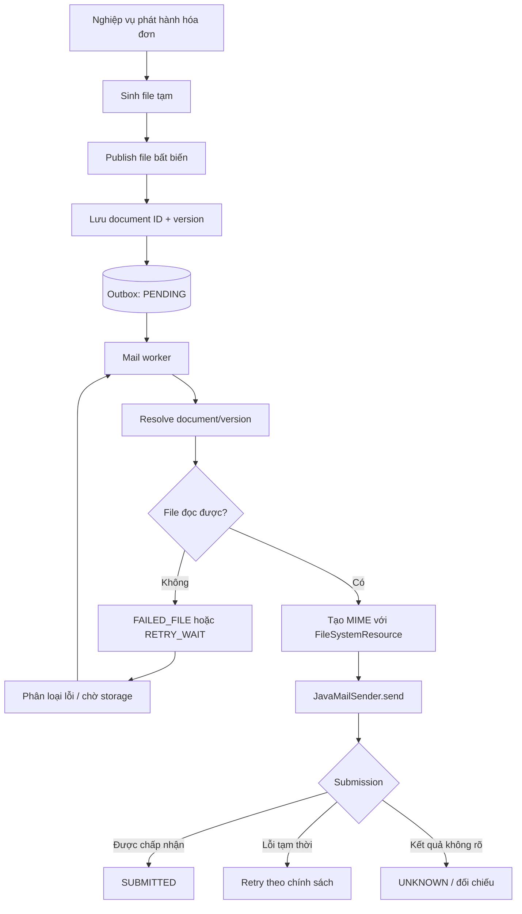

# Xử lý tệp không tồn tại hoặc không đọc được

Một ứng dụng Spring Boot tạo hóa đơn PDF, lưu vào filesystem rồi gửi email cho khách hàng bằng `JavaMailSender`. Đến lúc gửi, file có thể đã bị xóa, đường dẫn bị cấu hình sai, tiến trình không có quyền đọc, ổ đĩa hoặc network mount tạm thời mất kết nối. Nếu ứng dụng chỉ gọi `new FileSystemResource(path)` rồi `addAttachment(...)` và cho rằng mọi việc đã ổn, lỗi có thể xuất hiện muộn trong lúc Jakarta Mail tuần tự hóa MIME message.

Trong **Spring Framework Mail**, `FileSystemResource` đại diện cho một file trên hệ thống tệp và cung cấp stream khi thư viện cần đọc nội dung. Resource không giữ sẵn một bản sao byte của file, cũng không bảo đảm file luôn tồn tại sau khi được tạo. Vì vậy, ứng dụng cần có cách **phát hiện lỗi truy cập file, phân loại nguyên nhân, quyết định có retry hay không và giữ đúng trạng thái nghiệp vụ**.

Bài học này tập trung vào trường hợp file đính kèm không tồn tại hoặc không đọc được: từ kiểm tra trước khi dựng message, xử lý ngoại lệ filesystem, thời điểm đọc resource, race condition, cho tới cách vận hành với worker/outbox.

## 1. Những tình huống khiến attachment không đọc được

Giả sử ứng dụng định đính kèm:

```text
/srv/app/storage/invoices/2026/DH1024.pdf
```

Những lỗi thường gặp không chỉ là file bị xóa:

| Tình huống | Dấu hiệu có thể gặp | Nguyên nhân cần kiểm tra |
|---|---|---|
| File không tồn tại | `NoSuchFileException` hoặc `FileNotFoundException` | Sai tên, sai thư mục, file chưa được tạo, bị xóa hoặc cleanup quá sớm. |
| Đường dẫn trỏ tới thư mục | Không thể đọc như một file thông thường | Định danh tài liệu hoặc mapping path sai. |
| Không có quyền đọc file | `AccessDeniedException` hoặc lỗi I/O | Quyền POSIX, Windows ACL, user chạy service hoặc policy của container. |
| Không thể đi qua thư mục cha | Có thể nhận lỗi truy cập dù file có tồn tại | Thiếu quyền traverse/execute trên một thư mục trong đường dẫn. |
| File bị khóa hoặc thay đổi | Lỗi phụ thuộc hệ điều hành và cách file được sử dụng | Tiến trình khác đang ghi, thay thế hoặc giữ file. |
| Storage mount bị mất | `IOException`, lỗi thiết bị hoặc thao tác bị treo | Volume, network filesystem, ổ đĩa hoặc dịch vụ lưu trữ gặp sự cố. |
| File chưa được sinh xong | File tồn tại nhưng rỗng hoặc thiếu byte | Gửi mail chạy trước khi bước tạo tài liệu hoàn tất. |
| File bị xóa sau bước kiểm tra | Lỗi xảy ra lúc mở stream hoặc gửi | Race condition giữa kiểm tra và sử dụng. |
| File thay đổi trong lúc gửi | Nội dung nhận được khác nội dung đã kiểm tra | Nguồn dữ liệu không bất biến hoặc bị ghi đè. |

Không nên gộp tất cả trường hợp trên thành một thông báo “File không hợp lệ”. **File không tồn tại, không có quyền đọc và storage tạm thời mất kết nối có hướng xử lý khác nhau.**

## 2. Tạo FileSystemResource không có nghĩa file đã được đọc

Ví dụ:

```java
Path path = Path.of("/srv/app/storage/invoices/DH1024.pdf");
FileSystemResource resource = new FileSystemResource(path);
```

Hai dòng này chủ yếu tạo một đối tượng mô tả vị trí file. Ứng dụng chưa nhất thiết đã đọc byte của file.

Khi dùng:

```java
helper.addAttachment(
        "hoa-don-DH1024.pdf",
        resource,
        "application/pdf");
```

`MimeMessageHelper` tạo MIME body part và gắn nguồn dữ liệu cho part. Với luồng Jakarta Mail thông dụng, việc mở stream và đọc nội dung có thể diễn ra **muộn hơn**, khi message được lưu/tuần tự hóa trong quá trình gửi.

Do đó, có thể xảy ra trình tự:

```text
1. new FileSystemResource(path)       -> thành công
2. helper.addAttachment(...)          -> có thể thành công
3. mailSender.send(message)           -> bắt đầu tuần tự hóa MIME
4. resource.getInputStream()          -> mở file
5. Filesystem báo file không tồn tại  -> gửi thất bại
```

**Không coi việc `addAttachment` trả về bình thường là bằng chứng file đã được đọc thành công.** Lỗi truy cập file có thể được phát hiện trong lúc `mailSender.send(...)` đang tạo dữ liệu gửi.

### 2.1. FileSystemResource cung cấp stream khi được yêu cầu

`FileSystemResource` triển khai abstraction `InputStreamSource`. Khi `getInputStream()` được gọi, resource mở stream từ đường dẫn file. Với file filesystem thông thường, mỗi lần gọi có thể mở một stream mới.

Ví dụ:

```java
FileSystemResource resource = new FileSystemResource(path);

try (InputStream input = resource.getInputStream()) {
    byte[] prefix = input.readNBytes(5);
    System.out.println(new String(prefix, StandardCharsets.US_ASCII));
}
```

Lệnh `getInputStream()` có thể ném `IOException`, trong đó có các loại cụ thể như `FileNotFoundException`, `NoSuchFileException` hoặc `AccessDeniedException` tùy thao tác và hệ điều hành.

Đọc thử stream rồi đóng nó có thể giúp phát hiện lỗi **tại thời điểm kiểm tra**, nhưng không bảo đảm lần đọc sau khi gửi cũng thành công. Đây là một giới hạn quan trọng của kiểm tra trước.

### 2.2. Vì sao lỗi có thể xuất hiện bên trong MailSendException?

Khi `JavaMailSenderImpl` gửi `MimeMessage`, lỗi đọc nguồn attachment trong quá trình tuần tự hóa có thể được bọc trong ngoại lệ mail của Spring, thường là `MailSendException` hoặc một ngoại lệ liên quan tùy giai đoạn và phiên bản thư viện.

Vì vậy, cần xem **cause chain** để biết lỗi gốc:

```text
MailSendException
  caused by MessagingException / IOException
    caused by NoSuchFileException
```

Đây là dạng minh họa; chuỗi ngoại lệ thực tế thay đổi theo provider và thời điểm lỗi. Không nên chỉ kiểm tra tên lớp ngoại lệ ngoài cùng rồi kết luận đây chắc chắn là lỗi SMTP.

## 3. Kiểm tra file trước khi tạo message

Một quy trình hữu ích là xác minh file đã sẵn sàng trước khi tạo `MimeMessage`:

1. Lấy đường dẫn từ storage service đáng tin cậy.
2. Kiểm tra file tồn tại và là file thường theo chính sách.
3. Kiểm tra khả năng đọc.
4. Kiểm tra kích thước và trạng thái tài liệu.
5. Thử mở stream nếu cần xác nhận khả năng truy cập ngay lúc đó.
6. Chỉ sau đó mới tạo helper và thêm attachment.

### 3.1. Kiểm tra cơ bản bằng Java NIO

```java
import java.io.IOException;
import java.nio.file.Files;
import java.nio.file.Path;

public void validateAttachment(Path path) throws IOException {
    if (path == null) {
        throw new IllegalArgumentException("Attachment path is required");
    }

    if (!Files.exists(path)) {
        throw new IllegalArgumentException("Attachment does not exist");
    }

    if (!Files.isRegularFile(path)) {
        throw new IllegalArgumentException(
                "Attachment path is not a regular file");
    }

    if (!Files.isReadable(path)) {
        throw new IllegalArgumentException(
                "Attachment is not readable");
    }

    if (Files.size(path) <= 0) {
        throw new IllegalArgumentException("Attachment is empty");
    }
}
```

Các phép kiểm tra này giúp phát hiện những trường hợp phổ biến:

- `Files.exists(path)` kiểm tra đường dẫn có tồn tại theo khả năng quan sát của filesystem.
- `Files.isRegularFile(path)` xác định đường dẫn có trỏ tới file thường hay không; mặc định thao tác này theo symbolic link.
- `Files.isReadable(path)` kiểm tra khả năng đọc mà JVM quan sát được.
- `Files.size(path)` lấy kích thước file và có thể ném `IOException`.

**Các phương thức kiểm tra boolean không cung cấp chẩn đoán đầy đủ.** Ví dụ `Files.exists(path)` có thể trả về `false` khi JVM không xác định được trạng thái do lỗi truy cập; kết quả đó không nhất thiết chứng minh file chắc chắn không tồn tại. `Files.isReadable(path)` cũng có thể trả về `false` mà không cho biết quyền nào đang thiếu.

Khi cần phân loại chính xác, hãy thực hiện thao tác I/O thực tế và xử lý ngoại lệ được ném ra.

### 3.2. Thử mở stream trước khi gửi

Một bước preflight thực tế:

```java
public void verifyCanOpen(Path path) throws IOException {
    try (InputStream ignored = Files.newInputStream(path)) {
        // Mở thành công xác nhận file có thể được mở tại thời điểm này.
    }
}
```

Thao tác này kiểm tra khả năng mở file và đóng stream ngay sau đó. Nó hữu ích khi ứng dụng muốn phát hiện lỗi sớm trước khi tạo MIME message.

Tuy nhiên, sau khi đóng stream, `FileSystemResource` sẽ mở file một lần nữa khi gửi. File có thể bị xóa, thay đổi hoặc mất quyền truy cập giữa hai thời điểm. Vì vậy:

> **Preflight giúp phát hiện sớm, nhưng không loại bỏ race condition.**

Nếu yêu cầu nghiệp vụ cần gửi đúng một phiên bản file đã kiểm tra, hãy bảo đảm nguồn bất biến hoặc tạo snapshot ổn định trước khi gửi.

### 3.3. Kiểm tra kích thước và giới hạn ứng dụng

Ví dụ:

```java
private static final long MAX_ATTACHMENT_BYTES = 12L * 1024 * 1024;

public void validateSize(Path path) throws IOException {
    long size = Files.size(path);

    if (size == 0) {
        throw new IllegalArgumentException("Attachment is empty");
    }
    if (size > MAX_ATTACHMENT_BYTES) {
        throw new IllegalArgumentException("Attachment is too large");
    }
}
```

`12L * 1024 * 1024` là 12 MiB theo chính sách minh họa. Kích thước cho phép phải dựa trên giới hạn SMTP provider, loại tài liệu, số lượng attachment và tổng MIME message.

File nhị phân thường được mã hóa base64 trong MIME. Phần dữ liệu base64 có thể lớn hơn file gốc khoảng 4/3, chưa tính header, boundary và nội dung email. Vì vậy giới hạn file gốc cần có khoảng đệm so với giới hạn message của provider.

## 4. Xử lý đường dẫn và quyền truy cập an toàn

Một ứng dụng gửi hóa đơn không nên nhận trực tiếp path tùy ý từ request. Nếu endpoint cho phép client truyền `/etc/passwd` hoặc `../../private/secret.pdf`, ứng dụng có thể dùng quyền filesystem của chính server để đọc dữ liệu ngoài phạm vi.

### 4.1. Dùng document ID thay cho path do người dùng cung cấp

Luồng nên có:

```text
Request: documentId
       |
       v
Xác thực người dùng
       |
       v
Kiểm tra quyền xem tài liệu
       |
       v
Storage service tra cứu documentId
       |
       v
Lấy path do server quản lý
       |
       v
Kiểm tra file và tạo FileSystemResource
       |
       v
Tạo MIME attachment và gửi
```

Tầng nghiệp vụ quyết định người gọi có quyền gửi tài liệu đó hay không. Tầng storage ánh xạ document ID sang file. Mail service nhận nguồn đã được xác định hợp lệ và chịu trách nhiệm tạo message.

### 4.2. Kiểm tra path nằm trong storage root

Giả sử storage root:

```text
/srv/app/storage/invoices
```

Một cách kiểm tra path sau khi chuẩn hóa:

```java
Path root = storageRoot.toAbsolutePath().normalize();
Path candidate = root.resolve(storageName).normalize();

if (!candidate.startsWith(root)) {
    throw new SecurityException("Attachment path is outside storage root");
}
```

Đây là kiểm tra **lexical path**. Nó giúp phát hiện nhiều trường hợp traversal như `../`, nhưng không giải quyết mọi vấn đề symbolic link.

### 4.3. Kiểm tra đường dẫn thực và symbolic link

Nếu chính sách yêu cầu file phải nằm thực sự dưới storage root, có thể resolve đường dẫn thực:

```java
Path realRoot = storageRoot.toRealPath();
Path realFile = candidate.toRealPath();

if (!realFile.startsWith(realRoot)) {
    throw new SecurityException("Resolved file is outside storage root");
}

if (!Files.isRegularFile(realFile)) {
    throw new IllegalArgumentException("Attachment is not a regular file");
}
```

`toRealPath()` yêu cầu đường dẫn có thể được resolve và mặc định xử lý symbolic link. Nó giúp phát hiện một symlink trong storage trỏ ra ngoài root. Tuy nhiên, vẫn tồn tại khả năng file hoặc symlink bị thay đổi sau bước kiểm tra. Cách bảo vệ quan trọng hơn là **storage directory không cho tác nhân không tin cậy thay thế file hoặc tạo symlink tùy ý**.

### 4.4. Quyền đọc của tiến trình

Một file có thể đọc được trong IDE nhưng không đọc được khi ứng dụng chạy bằng service account hoặc container user khác.

Những điều cần kiểm tra:

- User/group chạy JVM.
- Quyền đọc file.
- Quyền traverse/execute trên từng thư mục cha.
- Windows ACL nếu chạy trên Windows.
- Volume mount có read-only hay không.
- UID/GID mapping trong Docker/Kubernetes.
- Network filesystem credential và trạng thái mount.
- Quyền truy cập thay đổi sau khi deploy hoặc rotate volume.

Không nên giải quyết lỗi bằng cách cấp quyền đọc toàn bộ filesystem cho tiến trình gửi mail. Chỉ cấp quyền tối thiểu trên vùng lưu trữ mà service cần sử dụng.

## 5. Phân loại lỗi để chọn cách xử lý

Không phải lỗi đọc file nào cũng nên retry. Có thể chia thành ba nhóm:

| Nhóm | Ví dụ | Chính sách thường phù hợp |
|---|---|---|
| **Lỗi dữ liệu hoặc quyền vĩnh viễn** | Document ID không tồn tại, file bị xóa, không có quyền truy cập | Dừng attempt, ghi nhận lỗi nghiệp vụ, yêu cầu tạo lại hoặc cấp quyền đúng. |
| **Lỗi hạ tầng tạm thời** | Network storage mất kết nối, volume tạm thời không sẵn sàng, lỗi I/O thoáng qua | Retry có giới hạn và backoff sau khi xác định nguyên nhân có khả năng phục hồi. |
| **Lỗi trạng thái tài liệu** | File chưa sinh xong, file rỗng, version chưa publish | Chờ bước tạo tài liệu hoàn tất hoặc chuyển trạng thái sang chờ xử lý. |

### 5.1. NoSuchFileException

`NoSuchFileException` thường xuất hiện khi đường dẫn hoặc một thành phần của đường dẫn không tồn tại tại thời điểm thao tác.

Nguyên nhân có thể:

- Tên file được ghép sai.
- File chưa được tạo hoặc chưa được publish.
- Một job cleanup đã xóa file.
- Worker đang đọc một document ID đã hết retention.
- Path được tạo từ working directory khác với dự kiến.

Nếu file đáng lẽ phải được phát hành trước khi gửi, đây thường là lỗi cần sửa ở **workflow tạo tài liệu hoặc mapping storage**. Retry liên tục cùng một path sẽ không làm file xuất hiện.

### 5.2. AccessDeniedException

`AccessDeniedException` thường chỉ ra thao tác filesystem bị từ chối. Hãy kiểm tra quyền file, quyền thư mục cha, service account, ACL, mount options và chính sách container.

Không nên đổi quyền rộng hoặc chạy ứng dụng bằng tài khoản quản trị chỉ để “thử cho chạy”. Ghi nhận đường dẫn logic/document ID, loại thao tác và tài khoản service trong log có kiểm soát; tránh log nội dung file hoặc dữ liệu khách hàng.

### 5.3. IOException chung

`IOException` có thể biểu thị nhiều vấn đề: lỗi thiết bị, network filesystem, stream bị đóng, lỗi đọc trong quá trình truyền hoặc trạng thái file không ổn định. Cần xem cause chain và thông tin từ storage layer.

Không thể phân loại mọi `IOException` là tạm thời. Một lỗi I/O do ổ đĩa hỏng hoặc file hỏng có thể cần can thiệp; một lỗi mạng ngắn hạn có thể retry được.

### 5.4. FileNotFoundException không luôn chỉ có nghĩa “không có file”

Tên `FileNotFoundException` thường được dùng khi mở file thất bại, nhưng trên một số nền tảng nó cũng có thể xuất hiện trong tình huống không có quyền truy cập. Vì vậy không nên chỉ nhìn tên exception rồi kết luận chắc chắn file chưa tồn tại.

Kết hợp:

- Path logic và document ID.
- Loại thao tác đã thất bại.
- Cause chain.
- Trạng thái storage.
- Quyền của tiến trình.

để xác định hướng khắc phục.

## 6. Thiết kế exception riêng cho attachment

Một mail service có thể biểu diễn lỗi file bằng exception nghiệp vụ để controller/worker xử lý thống nhất.

### 6.1. Exception tùy chỉnh

```java
public class AttachmentUnavailableException extends RuntimeException {

    public AttachmentUnavailableException(String message) {
        super(message);
    }

    public AttachmentUnavailableException(String message, Throwable cause) {
        super(message, cause);
    }
}
```

Exception này do ứng dụng định nghĩa, không phải lớp có sẵn trong Spring Mail.

### 6.2. Service kiểm tra nguồn file

```java
import org.springframework.core.io.FileSystemResource;

import java.io.IOException;
import java.io.InputStream;
import java.nio.file.Files;
import java.nio.file.Path;

public class AttachmentFileService {

    public FileSystemResource requireReadable(Path path) {
        if (path == null) {
            throw new AttachmentUnavailableException(
                    "Attachment path is missing");
        }

        try {
            if (!Files.isRegularFile(path)) {
                throw new AttachmentUnavailableException(
                        "Attachment is missing or is not a regular file");
            }

            if (!Files.isReadable(path)) {
                throw new AttachmentUnavailableException(
                        "Attachment is not readable");
            }

            try (InputStream ignored = Files.newInputStream(path)) {
                // Xác nhận có thể mở file ngay tại thời điểm kiểm tra.
            }

            return new FileSystemResource(path);
        } catch (IOException ex) {
            throw new AttachmentUnavailableException(
                    "Cannot access attachment file", ex);
        }
    }
}
```

Trong ví dụ, lỗi từ bước kiểm tra được chuyển thành exception nghiệp vụ có nguyên nhân gốc. Lỗi vẫn có thể xảy ra khi Jakarta Mail đọc resource lần nữa trong lúc gửi. **Preflight không thay thế việc xử lý lỗi ở ranh giới send.**

Một implementation production nên nhận path từ storage layer đã kiểm tra quyền và root, đồng thời có mã lỗi hoặc loại lỗi cụ thể hơn để phân biệt không tồn tại, bị từ chối và storage unavailable. Đừng đưa nguyên đường dẫn nhạy cảm vào thông báo trả cho người dùng cuối.

## 7. Gửi email chỉ sau khi attachment sẵn sàng

Ví dụ service:

```java
import jakarta.mail.MessagingException;
import jakarta.mail.internet.MimeMessage;

import org.springframework.core.io.FileSystemResource;
import org.springframework.mail.MailException;
import org.springframework.mail.javamail.JavaMailSender;
import org.springframework.mail.javamail.MimeMessageHelper;
import org.springframework.stereotype.Service;

import java.io.IOException;
import java.nio.charset.StandardCharsets;
import java.nio.file.Path;

@Service
public class InvoiceMailService {

    private final JavaMailSender mailSender;
    private final AttachmentFileService attachmentFileService;

    public InvoiceMailService(
            JavaMailSender mailSender,
            AttachmentFileService attachmentFileService) {
        this.mailSender = mailSender;
        this.attachmentFileService = attachmentFileService;
    }

    public void sendInvoice(
            String recipient,
            Path invoicePath,
            String orderCode) throws MessagingException {

        // 1. Xác nhận nguồn file có thể mở trước khi dựng message.
        FileSystemResource invoice =
                attachmentFileService.requireReadable(invoicePath);

        // 2. Tạo message chỉ sau khi preflight thành công.
        MimeMessage message = mailSender.createMimeMessage();
        MimeMessageHelper helper = new MimeMessageHelper(
                message,
                MimeMessageHelper.MULTIPART_MODE_MIXED,
                StandardCharsets.UTF_8.name());

        helper.setFrom("billing@example.com");
        helper.setTo(recipient);
        helper.setSubject("Hóa đơn đơn hàng " + orderCode);
        helper.setText(
                "Vui lòng xem hóa đơn PDF đính kèm cho đơn hàng "
                        + orderCode + ".", false);
        helper.addAttachment(
                "hoa-don-" + orderCode + ".pdf",
                invoice,
                "application/pdf");

        // 3. Lỗi đọc file vẫn có thể xuất hiện trong send().
        try {
            mailSender.send(message);
        } catch (MailException ex) {
            // Phân loại nguyên nhân gốc và trạng thái submission
            // trước khi quyết định retry.
            throw ex;
        }
    }
}
```

Ví dụ này giả định `recipient` và `orderCode` đã được xác thực, quyền truy cập hóa đơn đã được kiểm tra và file thực sự là PDF do hệ thống tạo. Trong code production, nên tạo filename từ dữ liệu nghiệp vụ đã giới hạn ký tự, không lấy từ request tùy ý.

Điểm quan trọng của thứ tự:

1. Nếu file đã không đọc được ở preflight, service dừng trước khi tạo message.
2. Nếu file biến mất sau preflight, lỗi có thể xuất hiện trong `send`.
3. Lỗi ở bước gửi được phân loại riêng với lỗi kiểm tra file.
4. Ứng dụng không tự bỏ attachment rồi gửi email như thể hóa đơn đã được đính kèm.

## 8. Nếu attachment là tùy chọn thì xử lý thế nào?

Không phải email nào cũng yêu cầu file đính kèm. Ví dụ email thông báo trạng thái đơn hàng có thể chỉ cần thông tin và liên kết xem chi tiết. Khi attachment là tùy chọn, ứng dụng có thể có chính sách bỏ qua file và gửi phần nội dung còn lại.

Điều kiện: **tính tùy chọn phải được xác định từ nghiệp vụ**, không suy ra chỉ vì file đang gặp lỗi.

Ví dụ:

```java
MimeMessage message = mailSender.createMimeMessage();
MimeMessageHelper helper = new MimeMessageHelper(message, true, "UTF-8");

helper.setFrom("notifications@example.com");
helper.setTo(recipient);
helper.setSubject("Cập nhật đơn hàng");

if (optionalDocument != null && Files.isReadable(optionalDocument)) {
    helper.setText(
            "Thông tin đơn hàng và tài liệu đính kèm.",
            "<p>Thông tin đơn hàng và tài liệu đính kèm.</p>");
    helper.addAttachment(
            "tai-lieu.pdf",
            new FileSystemResource(optionalDocument),
            "application/pdf");
} else {
    helper.setText(
            "Đơn hàng đã được cập nhật. "
                    + "Bạn có thể xem tài liệu trong trang tài khoản.",
            "<p>Đơn hàng đã được cập nhật.</p>"
                    + "<p><a href=\"https://accounts.example.com/orders\">"
                    + "Mở trang tài khoản</a></p>");
}

mailSender.send(message);
```

Đây chỉ là ví dụ minh họa cho **attachment thực sự không bắt buộc**. Trong production, không nên dùng mỗi `Files.isReadable` để quyết định file có thể gửi; vẫn cần preflight và xử lý lỗi đọc muộn. Nếu tài liệu là hóa đơn bắt buộc theo yêu cầu nghiệp vụ, phải dừng và báo lỗi khi file không sẵn sàng.

### 8.1. Không gửi email gây hiểu nhầm

Nếu nội dung ghi “Hóa đơn được đính kèm” nhưng file đã bị bỏ qua, email không còn đúng sự thật. Khi attachment tùy chọn bị thiếu:

- Thay nội dung bằng câu giải thích phù hợp.
- Có thể cung cấp liên kết tài liệu nếu đã kiểm tra quyền truy cập.
- Ghi nhận trạng thái tài liệu bị bỏ qua.
- Không ghi trạng thái hoàn thành của một nghiệp vụ bắt buộc nếu tài liệu chưa được gửi.

## 9. Xử lý file chưa được tạo hoặc đang được ghi

Một lỗi thường gặp trong hệ thống bất đồng bộ:

```text
Job A: bắt đầu tạo invoice.pdf
Job B: thấy record invoice đã có và gửi email
Job A: vẫn đang ghi nội dung PDF
Job B: mở file khi chưa hoàn tất
```

File có thể tồn tại nhưng kích thước bằng 0, chưa hoàn chỉnh hoặc bị khóa theo cách hệ điều hành xử lý. Kiểm tra `Files.exists` đơn thuần không chứng minh file đã sẵn sàng.

### 9.1. Publish file sau khi tạo xong

Một mẫu thường dùng:

1. Sinh tài liệu vào file tạm trong cùng storage filesystem.
2. Đóng stream và hoàn tất bước ghi.
3. Kiểm tra file và metadata cần thiết.
4. Đổi tên/di chuyển sang tên bất biến trong vùng đã publish, thường dùng thao tác atomic khi filesystem hỗ trợ.
5. Chỉ sau đó đánh dấu tài liệu `READY` hoặc ghi outbox gửi email.

Ví dụ khái niệm:

```java
Path temp = storageRoot.resolve("DH1024.pdf.part");
Path published = storageRoot.resolve("DH1024.pdf");

generatePdf(temp);

try {
    Files.move(
            temp,
            published,
            StandardCopyOption.ATOMIC_MOVE);
} catch (AtomicMoveNotSupportedException ex) {
    // Chọn cơ chế publish phù hợp với filesystem và chính sách của ứng dụng.
    throw new IllegalStateException(
            "Atomic publish is not supported by this storage", ex);
}

// Chỉ sau khi publish thành công mới tạo notification gửi mail.
```

Ví dụ giả định file tạm và file đích nằm trên filesystem hỗ trợ thao tác move atomic. `ATOMIC_MOVE` có thể không được hỗ trợ trên mọi filesystem; không nên âm thầm giả định thao tác luôn atomic. Với object storage hoặc distributed storage, cần dùng cơ chế version/finalize riêng của dịch vụ.

### 9.2. Trạng thái tài liệu

Một mô hình đơn giản:

```text
GENERATING
    |
    | tạo và publish thành công
    v
READY
    |
    | mail worker lấy tài liệu
    v
ATTACHING / SUBMITTING
    |
    +--> SUBMITTED
    |
    +--> FAILED_FILE
    |
    +--> RETRY_WAIT
```

Chỉ gửi khi tài liệu ở trạng thái `READY` và đúng phiên bản. Nếu tài liệu đang `GENERATING`, worker có thể chờ event hoàn tất hoặc để job gửi được enqueue sau khi publish thành công.

Không dùng một khoảng `sleep` cố định như giải pháp chính để đợi file xuất hiện. Nó dễ thất bại khi thời gian sinh file thay đổi và làm lãng phí worker.

## 10. Race condition giữa kiểm tra và gửi

Giả sử:

```text
T1: Files.isReadable(path) -> true
T2: một tiến trình khác xóa file
T3: FileSystemResource.getInputStream() -> lỗi
```

Đây là **time-of-check to time-of-use (TOCTOU)**: trạng thái thay đổi giữa lúc kiểm tra và lúc sử dụng.

### 10.1. Các biện pháp giảm rủi ro

- Dùng file bất biến sau khi publish.
- Không cho tác nhân khác xóa/ghi file trong vòng đời gửi.
- Dùng storage service quản lý document ID và version.
- Giữ file cho tới khi attempt/retry hoàn tất.
- Với tài liệu quan trọng, tạo snapshot riêng cho notification.
- Nếu cần đảm bảo byte chính xác, lưu hash/version và kiểm tra theo quy trình phát hành.

### 10.2. Tạo snapshot khi cần ổn định nội dung

Với file nguồn có thể bị thay đổi, ứng dụng có thể copy sang một file snapshot do service quản lý rồi dùng snapshot cho lần gửi:

```java
Path snapshot = Files.createTempFile(
        mailStagingDirectory, "invoice-", ".pdf");

try {
    Files.copy(
            sourcePath,
            snapshot,
            StandardCopyOption.REPLACE_EXISTING);

    // Kiểm tra snapshot và sử dụng snapshot trong lần gửi.
    sendUsingFileSystemResource(snapshot);
} finally {
    // Chỉ dọn khi việc gửi đồng bộ đã kết thúc và không còn consumer khác.
    Files.deleteIfExists(snapshot);
}
```

Đây là ví dụ gửi đồng bộ. Nếu gửi qua worker, không xóa snapshot trong cùng request; cần quản lý retention tới khi worker và retry không còn cần file. Việc copy cũng cần kiểm tra dung lượng, quyền truy cập và tính nhất quán nguồn. Nếu file có thể bị sửa ngay trong lúc copy, nên lấy version bất biến từ storage thay vì chỉ dựa vào thao tác copy.

### 10.3. Khi nào nên đọc vào byte array?

Với file nhỏ, có thể đọc toàn bộ nội dung sau preflight:

```java
byte[] bytes = Files.readAllBytes(path);
ByteArrayResource snapshot = new ByteArrayResource(bytes);

helper.addAttachment(
        "hoa-don.pdf",
        snapshot,
        "application/pdf");
```

Lúc này `ByteArrayResource` giữ một snapshot byte trong bộ nhớ; việc file nguồn bị xóa sau đó không làm thay đổi mảng byte đã đọc. Tuy nhiên, cần đặt giới hạn kích thước và tính đến heap khi nhiều email gửi đồng thời.

Với file lớn, snapshot file riêng hoặc storage version bất biến thường hợp lý hơn đọc toàn bộ vào heap.

## 11. Xử lý retry khi lỗi đọc file

Retry chỉ hữu ích khi nguyên nhân có khả năng phục hồi. Một chính sách đơn giản:

| Lỗi | Retry? | Lý do |
|---|---|---|
| Document ID sai hoặc không tồn tại vĩnh viễn | Thường không | Cần sửa dữ liệu hoặc tạo tài liệu. |
| File chưa được publish | Chờ trạng thái READY/event | Retry ngay có thể liên tục gặp cùng lỗi. |
| Quyền đọc sai | Không retry tự động vô hạn | Cần sửa cấu hình/ACL. |
| Network storage tạm mất kết nối | Có thể retry có giới hạn | Hạ tầng có thể phục hồi. |
| File bị xóa sau khi phát hành | Không tự động tạo lại nếu chưa có quy tắc | Có thể là lỗi retention hoặc dữ liệu. |
| SMTP tạm thời từ chối sau khi file đã đọc | Có thể retry theo mã lỗi | Phân loại SMTP và khả năng gửi trùng. |
| Timeout sau khi server có thể đã nhận DATA | Kết quả không rõ | Cần đối chiếu provider hoặc áp dụng chính sách duplicate-aware. |

### 11.1. Backoff có giới hạn

Ví dụ lịch retry:

```text
Attempt 1: ngay khi notification sẵn sàng
Attempt 2: sau 30 giây
Attempt 3: sau 2 phút
Attempt 4: sau 10 phút
Sau đó: chuyển trạng thái cần can thiệp / dead letter
```

Đây là lịch minh họa. Trong thực tế, dùng exponential backoff có jitter, giới hạn tổng thời gian và số lần thử. Không retry liên tục khi file không tồn tại vì lỗi đó thường không tự biến mất nếu không có bước tạo/publish tài liệu.

### 11.2. Phân biệt retry file với retry SMTP

Hai công đoạn:

```text
Resolve document + read attachment
            |
            v
Build MIME message
            |
            v
SMTP submission
```

Nếu file không đọc được trước khi gửi, retry cần quay lại **storage/file stage**. Nếu file đã đọc và lỗi xảy ra khi kết nối SMTP, retry thuộc **submission stage**. Hai loại lỗi có thể có số lần thử, thời gian chờ và cảnh báo khác nhau.

Không nên dùng một bộ retry duy nhất cho mọi exception.

### 11.3. Không gửi thư thiếu attachment bắt buộc

Nếu hóa đơn là một phần bắt buộc của email, không được bắt lỗi file rồi tiếp tục gửi body với câu “vui lòng xem hóa đơn đính kèm”. Hãy đánh dấu attempt thất bại do file, lưu lỗi và chờ tài liệu được phục hồi hoặc tạo lại.

Nếu file là tùy chọn, chính sách bỏ qua phải được định nghĩa trước và nội dung email phải phản ánh chính xác việc không có file.

## 12. Tích hợp outbox và worker

Trong ứng dụng production, request HTTP không nên giữ trách nhiệm quản lý toàn bộ vòng đời file và gửi mail nếu thao tác có thể kéo dài.

Một luồng có thể là:



Outbox nên lưu thông tin đủ để worker tìm lại **đúng tài liệu**:

- Notification ID.
- Document ID.
- Document version hoặc storage key bất biến.
- Recipient đã được kiểm tra.
- Template/version và dữ liệu snapshot cần thiết.
- Trạng thái, số lần thử, thời điểm retry kế tiếp.
- Mã lỗi đã được phân loại, không chứa nội dung bí mật.

Không nhất thiết lưu đường dẫn filesystem tuyệt đối trong outbox nếu storage service có thể ánh xạ document ID/version. Điều này giúp thay đổi vị trí lưu trữ mà không làm hỏng dữ liệu job.

### 12.1. Vòng đời file và cleanup

File không được cleanup khi vẫn còn notification pending hoặc retry có thể cần nó. Có thể xác định điều kiện xóa:

- Tài liệu đã hết retention nghiệp vụ.
- Không còn notification nào tham chiếu tới version đó.
- Các attempt gửi đã kết thúc hoặc hết thời gian retry.
- Không còn tác vụ khác sử dụng file.

Cleanup job nên xóa theo trạng thái và metadata storage, không quét rồi xóa file chỉ vì “đã cũ vài phút”.

### 12.2. Worker không nên giữ một Path stale quá lâu

Nếu outbox được xử lý sau nhiều giờ, không nên giữ một đường dẫn tương đối hoặc một path từ working directory của tiến trình lúc enqueue. Worker nên resolve lại tài liệu từ storage service bằng document ID/version ở thời điểm xử lý.

Nếu storage trả về đường dẫn tạm thời, cần biết thời hạn hiệu lực và bảo đảm worker sử dụng trong thời gian đó. Với object storage, có thể cần tải file về staging hoặc dùng DataSource tương ứng.

## 13. Ví dụ xử lý lỗi trong worker

Đoạn sau minh họa phân tách lỗi file và lỗi gửi. Các repository/state transition là abstraction do ứng dụng định nghĩa.

```java
import org.springframework.core.io.FileSystemResource;
import org.springframework.mail.MailException;

import java.io.IOException;
import java.nio.file.NoSuchFileException;
import java.nio.file.AccessDeniedException;
import java.nio.file.Path;

public void processInvoiceNotification(InvoiceNotification notification) {
    try {
        // Storage service xác thực quyền và resolve đúng version tài liệu.
        Path path = invoiceStorage.resolveReadablePath(
                notification.documentId(),
                notification.documentVersion());

        FileSystemResource resource =
                attachmentFileService.requireReadable(path);

        invoiceMailService.send(
                notification.recipient(),
                notification.orderCode(),
                resource);

        notificationRepository.markSubmitted(notification.id());

    } catch (NoSuchFileException ex) {
        notificationRepository.markFailedFile(
                notification.id(), "DOCUMENT_MISSING");

    } catch (AccessDeniedException ex) {
        notificationRepository.markFailedFile(
                notification.id(), "DOCUMENT_ACCESS_DENIED");

    } catch (IOException ex) {
        notificationRepository.scheduleStorageRetry(
                notification.id(), classifyStorageFailure(ex));

    } catch (MailException ex) {
        notificationRepository.recordMailFailure(
                notification.id(), classifyMailFailure(ex));
    }
}
```

Ví dụ này thể hiện ý tưởng phân loại, không phải bộ phân loại hoàn chỉnh:

- `invoiceStorage.resolveReadablePath`, `attachmentFileService.requireReadable`, `invoiceMailService.send` và `notificationRepository` là API giả định của ứng dụng.
- Lỗi đọc file phát sinh muộn có thể bị bọc bên trong `MailException`; cần duyệt cause chain để nhận diện lỗi nguồn dữ liệu nếu muốn phân loại chính xác.
- Một `MailException` không mặc nhiên là lỗi SMTP thuần; nguyên nhân gốc có thể là lỗi đọc attachment hoặc tạo MIME.
- Không nên đánh dấu `SUBMITTED` chỉ vì worker đã bắt đầu gọi `send`; chỉ cập nhật theo kết quả thực tế và chính sách trạng thái.
- Nếu lỗi xảy ra sau khi SMTP server có thể đã nhận message, cần trạng thái `UNKNOWN` hoặc quy trình đối chiếu để tránh gửi trùng.

## 14. Duyệt cause chain để tìm lỗi filesystem

Spring có thể bọc lỗi gốc qua nhiều lớp. Một helper đơn giản để tìm nguyên nhân trong chuỗi:

```java
import java.io.IOException;
import java.nio.file.AccessDeniedException;
import java.nio.file.NoSuchFileException;
import java.util.Collections;
import java.util.IdentityHashMap;
import java.util.Set;

public final class ExceptionCauses {

    private ExceptionCauses() {}

    public static boolean hasCause(
            Throwable error,
            Class<? extends Throwable> expectedType) {

        Set<Throwable> visited =
                Collections.newSetFromMap(new IdentityHashMap<>());

        Throwable current = error;
        while (current != null && visited.add(current)) {
            if (expectedType.isInstance(current)) {
                return true;
            }
            current = current.getCause();
        }
        return false;
    }
}
```

Sử dụng:

```java
try {
    mailSender.send(message);
} catch (MailException ex) {
    if (ExceptionCauses.hasCause(ex, NoSuchFileException.class)
            || ExceptionCauses.hasCause(ex, FileNotFoundException.class)) {
        // Ghi nhận lỗi file không còn tồn tại hoặc không mở được.
    } else if (ExceptionCauses.hasCause(ex, AccessDeniedException.class)) {
        // Ghi nhận lỗi quyền truy cập filesystem.
    } else if (ExceptionCauses.hasCause(ex, IOException.class)) {
        // Điều tra lỗi I/O khác.
    } else {
        // Phân loại lỗi mail theo cause chain và phản hồi SMTP.
    }
}
```

Cần import `org.springframework.mail.MailException` và `java.io.FileNotFoundException` trong ví dụ sử dụng. Hàm trên chỉ duyệt `Throwable.getCause()`; một số cấu trúc exception có thể chứa lỗi theo danh sách lỗi riêng hoặc trường khác. Không dùng việc tìm cause làm bằng chứng duy nhất cho trạng thái SMTP submission.

## 15. Kiểm thử lỗi file không tồn tại và không đọc được

Kiểm thử nên tách **validator/storage** khỏi **mail transport** để xác nhận đúng tầng phát hiện lỗi.

### 15.1. Test file không tồn tại

```java
@Test
void shouldRejectMissingAttachment() {
    Path missing = tempDirectory.resolve("missing-invoice.pdf");

    assertThatThrownBy(() -> attachmentFileService.requireReadable(missing))
            .isInstanceOf(AttachmentUnavailableException.class);
}
```

Đây là ví dụ với JUnit/AssertJ. `tempDirectory` có thể được cung cấp bởi JUnit `@TempDir`.

### 15.2. Test file là thư mục

```java
@Test
void shouldRejectDirectoryAsAttachment() throws IOException {
    Path directory = Files.createDirectory(
            tempDirectory.resolve("not-a-file"));

    assertThatThrownBy(() -> attachmentFileService.requireReadable(directory))
            .isInstanceOf(AttachmentUnavailableException.class);
}
```

### 15.3. Test file không có quyền đọc

Một test dựa vào permission:

```java
@Test
void shouldRejectUnreadableFile() throws IOException {
    Path file = Files.createFile(tempDirectory.resolve("private.pdf"));

    try {
        Files.setPosixFilePermissions(file, Set.of(
                PosixFilePermission.OWNER_WRITE));

        assertThatThrownBy(() -> attachmentFileService.requireReadable(file))
                .isInstanceOf(AttachmentUnavailableException.class);
    } finally {
        // Khôi phục quyền để test runner có thể dọn file.
        Files.setPosixFilePermissions(file, PosixFilePermissions.fromString("rw-------"));
    }
}
```

Test này chỉ áp dụng trên filesystem hỗ trợ POSIX permissions. Windows hoặc filesystem khác có thể không hỗ trợ `setPosixFilePermissions`; cần dùng test theo nền tảng hoặc abstraction filesystem riêng. Ngoài ra, khi test chạy bằng user có quyền cao, việc bỏ quyền có thể không khiến thao tác đọc thất bại như mong đợi. Không nên giả định một test permission portable trên mọi máy.

### 15.4. Test lỗi đọc muộn trong lúc gửi

Để xác nhận service xử lý lỗi ở ranh giới gửi:

- Dùng mock `JavaMailSender` ném `MailSendException` có cause là `IOException`.
- Kiểm tra notification được đánh dấu lỗi phù hợp.
- Xác nhận không đánh dấu thành công.
- Kiểm tra không có fallback gửi message thiếu attachment nếu file bắt buộc.

Với integration test, có thể dùng một `InputStreamSource` test cố ý ném `IOException` khi `getInputStream()` được gọi để mô phỏng lỗi đọc muộn. Cần dựng MIME và thực hiện serialize/send trong test; chỉ gọi `addAttachment` có thể chưa kích hoạt đọc stream.

### 15.5. Test vòng đời outbox

Một test worker có thể:

1. Tạo file và ghi document ID/version vào outbox.
2. Xác nhận worker gửi được khi file còn tồn tại.
3. Xóa file trước lần xử lý tiếp theo và xác nhận worker ghi `FAILED_FILE` hoặc trạng thái retry đúng chính sách.
4. Khôi phục file/version rồi kiểm tra worker có thể tiếp tục nếu chính sách cho phép.
5. Xác nhận cleanup không xóa file khi vẫn còn notification pending.

Test này kiểm tra **quy trình nghiệp vụ và vòng đời storage**, không chỉ kiểm tra một setter của Spring Mail.

## 16. Logging và quan sát lỗi

Khi attachment không đọc được, log cần đủ thông tin để điều tra mà không tiết lộ nội dung tài liệu.

Thông tin hữu ích:

| Trường | Mục đích |
|---|---|
| `notificationId` | Đối chiếu lần gửi. |
| `documentId` và version | Xác định tài liệu được yêu cầu. |
| Loại thao tác | Resolve path, kiểm tra, mở stream hay gửi MIME. |
| Mã lỗi phân loại | `DOCUMENT_MISSING`, `ACCESS_DENIED`, `STORAGE_UNAVAILABLE`. |
| Tên lớp exception và cause | Hỗ trợ phân tích lỗi gốc. |
| Kích thước dự kiến | Phân biệt lỗi file rỗng/quá lớn. |
| Số lần retry và thời điểm tiếp theo | Theo dõi worker. |
| Template/message ID | Đối chiếu nội dung email nếu cần. |

Không ghi:

- Toàn bộ byte hoặc nội dung file.
- Hóa đơn, hồ sơ, dữ liệu cá nhân nhạy cảm.
- Token trong link hoặc thông tin xác thực.
- Đường dẫn nội bộ đầy đủ nếu nó tiết lộ cấu trúc nhạy cảm và không cần cho vận hành.

Có thể theo dõi các metric:

- Số attachment missing.
- Số attachment access denied.
- Tỷ lệ lỗi I/O storage.
- Số lần retry và dead-letter.
- Thời gian resolve/open/read file.
- Tỷ lệ email thất bại do lỗi file so với lỗi SMTP.
- Số notification đang chờ file được publish.

Không dùng địa chỉ email, document ID hoặc exception message có cardinality cao làm label metric. Dùng mã loại lỗi và nhóm storage/provider.

## 17. Các lỗi thường gặp khi xử lý attachment

### 17.1. Chỉ gọi exists() rồi tin file sẽ còn

`Files.exists(path)` chỉ cho biết trạng thái quan sát tại thời điểm kiểm tra. File vẫn có thể bị xóa trước lúc mở stream. Cần quản lý lifecycle và xử lý lỗi khi đọc thực tế.

### 17.2. Chỉ gọi isReadable() rồi không bắt lỗi send()

Quyền hoặc trạng thái file có thể thay đổi. `mailSender.send` vẫn có thể gặp lỗi đọc attachment. Luôn có xử lý lỗi tại ranh giới gửi.

### 17.3. Tạo resource trước khi file được publish

`new FileSystemResource(path)` không đợi file được sinh xong. Hãy chỉ tạo notification gửi sau khi tài liệu đã ở trạng thái READY.

### 17.4. Catch mọi IOException và retry vô hạn

File bị xóa vĩnh viễn hoặc quyền sai không tự phục hồi nhờ retry. Phân loại nguyên nhân, giới hạn lần thử và đưa lỗi cần sửa vào trạng thái rõ ràng.

### 17.5. Bỏ attachment rồi vẫn gửi nội dung nói có file

Điều này gây hiểu nhầm cho người nhận. Chỉ bỏ file khi attachment được định nghĩa là tùy chọn và nội dung email phản ánh đúng.

### 17.6. Xóa file ngay sau khi ghi outbox

Worker chạy sau không còn nguồn để đính kèm. Lưu file bền vững hoặc snapshot tới khi hết vòng đời gửi/retry.

### 17.7. Đọc thử rồi nghĩ đã loại bỏ TOCTOU

Đóng stream preflight rồi mở lại khi gửi vẫn tạo một khoảng thời gian giữa hai lần truy cập. File có thể thay đổi. Dùng nguồn bất biến hoặc snapshot khi cần.

### 17.8. Dùng đường dẫn client cung cấp

Có thể tạo path traversal và lộ dữ liệu hệ thống. Nhận document ID, kiểm tra quyền, rồi resolve qua storage service.

### 17.9. Cho rằng MailSendException luôn là lỗi SMTP

Lỗi đọc attachment có thể xuất hiện trong lúc gửi và được bọc trong exception mail. Xem cause chain và giai đoạn lỗi.

### 17.10. Cấp quyền quá rộng để sửa AccessDenied

Chỉ cấp quyền tối thiểu cho service account trên vùng storage cần thiết; kiểm tra ACL và mount trước khi thay đổi quyền.

### 17.11. Nhầm file gốc với MIME message

File nhỏ vẫn có thể làm email vượt giới hạn do base64 và các MIME part khác. Giới hạn dung lượng theo toàn bộ message.

### 17.12. Coi send() thành công là người nhận đã có file

Submission được chấp nhận không chứng minh thư đã vào Inbox hoặc người nhận đã tải attachment. Theo dõi bounce/DSN/provider event nếu nghiệp vụ cần.

## 18. Bài tập thực hành

### Bài 1 — File không tồn tại

Một service tạo `FileSystemResource` từ `/srv/app/invoices/DH1024.pdf` rồi gọi `addAttachment`. File đã bị cleanup trước đó. Hãy giải thích vì sao `addAttachment` có thể chưa báo lỗi và tại sao lỗi xuất hiện khi gọi `mailSender.send`.

### Bài 2 — Phân loại ngoại lệ

Giải thích sự khác nhau giữa `NoSuchFileException`, `AccessDeniedException` và `IOException` chung. Với từng trường hợp, xác định khi nào nên retry, khi nào cần sửa dữ liệu/quyền.

### Bài 3 — Kiểm tra trước khi tạo message

Viết một hàm dùng `Files.isRegularFile`, `Files.isReadable`, `Files.size` và `Files.newInputStream` để xác nhận file sẵn sàng. Nêu giới hạn của việc mở stream rồi đóng trước khi gửi.

### Bài 4 — Path traversal

Một endpoint nhận `filePath` từ request. Hãy thay bằng luồng document ID → authorization → storage lookup → path thực. Giải thích vai trò của `normalize()`, `toRealPath()` và symbolic link.

### Bài 5 — File chưa tạo xong

Job tạo PDF mất 10 giây, nhưng mail worker bắt đầu sau 2 giây. Hãy thiết kế trạng thái `GENERATING`/`READY` và cơ chế publish file trước khi tạo notification.

### Bài 6 — Race condition

`Files.isReadable(path)` trả về true, nhưng file bị xóa ngay sau đó. Vì sao preflight không giải quyết được TOCTOU? Đề xuất cách dùng file bất biến hoặc snapshot.

### Bài 7 — Attachment bắt buộc và tùy chọn

Hóa đơn là attachment bắt buộc; brochure là attachment tùy chọn. Hãy mô tả cách xử lý lỗi của mỗi loại và cách cập nhật nội dung email khi brochure không có.

### Bài 8 — Outbox và cleanup

Notification được enqueue lúc 10:00, worker chỉ gửi lúc 10:05 và retry tới 11:00. File được cleanup lúc 10:02. Hãy chỉ ra lỗi vòng đời và đề xuất điều kiện xóa file.

### Bài 9 — Lỗi đọc bị bọc

`mailSender.send` ném `MailSendException` có cause là `NoSuchFileException`. Hãy giải thích vì sao cần duyệt cause chain và vì sao không thể xem mọi `MailSendException` là lỗi SMTP.

### Bài 10 — Kết quả submission không rõ

SMTP server có thể đã nhận DATA nhưng client gặp lỗi I/O trước phản hồi cuối. Hãy thiết kế trạng thái `UNKNOWN`, đối chiếu provider và chính sách retry để hạn chế gửi trùng.

## 19. Ghi nhớ và tài liệu tham khảo

Khi xử lý **tệp không tồn tại hoặc không đọc được** trong Spring Framework Mail:

1. `FileSystemResource` mô tả nguồn file; tạo resource không có nghĩa byte đã được đọc.
2. `MimeMessageHelper.addAttachment` có thể gắn nguồn trước khi Jakarta Mail thực sự mở stream. Lỗi đọc có thể xuất hiện trong `mailSender.send`.
3. Kiểm tra file thường, quyền đọc, kích thước và khả năng mở stream trước khi tạo message để phát hiện lỗi sớm.
4. Preflight không loại bỏ race condition; dùng file bất biến hoặc snapshot khi cần giữ đúng phiên bản.
5. Phân biệt file thiếu, quyền bị từ chối, storage unavailable và tài liệu chưa publish; chỉ retry lỗi có khả năng phục hồi.
6. Không nhận path tùy ý từ client; resolve qua document ID và storage service có kiểm tra quyền.
7. Attachment bắt buộc phải làm gửi thất bại nếu không có file; attachment tùy chọn chỉ được bỏ qua khi chính sách và nội dung email cho phép.
8. Với outbox/worker, giữ file tới khi mọi attempt/retry cần thiết kết thúc.
9. Duyệt cause chain khi lỗi xuất hiện trong Spring Mail; không mặc định mọi `MailSendException` là lỗi SMTP.
10. Theo dõi submission và delivery như các trạng thái riêng.

Tài liệu kỹ thuật nên tham khảo:

- **Spring Framework API — `FileSystemResource`:** cách mở stream và truy cập file trên filesystem.
- **Spring Framework API — `Resource` và `InputStreamSource`:** contract nguồn dữ liệu và khả năng mở stream.
- **Spring Framework API — `MimeMessageHelper`:** `addAttachment`, multipart và cách cung cấp nguồn dữ liệu.
- **Spring Framework Reference — Email:** `JavaMailSender`, `JavaMailSenderImpl` và MIME message.
- **Java NIO Files API:** `exists`, `isRegularFile`, `isReadable`, `size`, `newInputStream`, `toRealPath` và các ngoại lệ filesystem.
- **Jakarta Mail API:** `MimeMessage`, `MimeMultipart`, `MimeBodyPart` và quá trình tuần tự hóa MIME.
- **Java SE IOException hierarchy:** phân biệt lỗi truy cập file và lỗi I/O.

**Xử lý attachment đáng tin cậy bắt đầu từ việc quản lý đúng vòng đời tài liệu.** Spring Mail giúp gắn nguồn file vào MIME message; ứng dụng phải xác nhận quyền truy cập, bảo đảm file sẵn sàng và bất biến trong lúc gửi, phân loại lỗi đúng tầng, rồi mới quyết định retry hay báo thất bại. Nhờ vậy, hệ thống tránh gửi email thiếu tài liệu bắt buộc và có thể điều tra rõ khi filesystem hoặc SMTP gặp sự cố.
