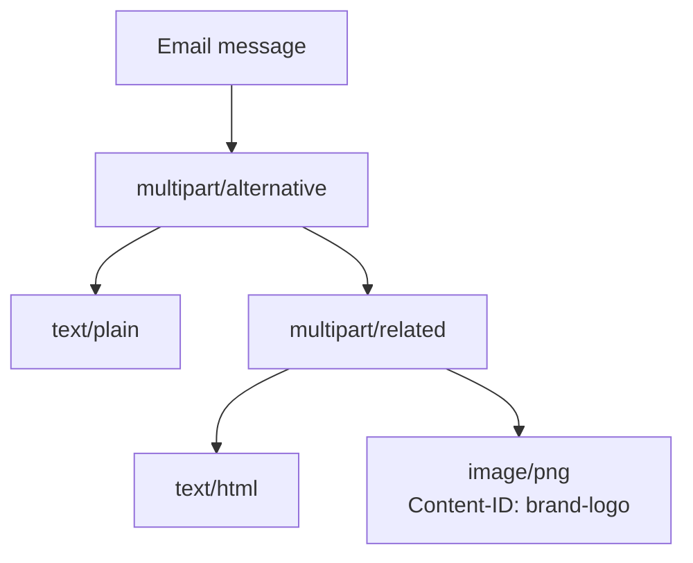
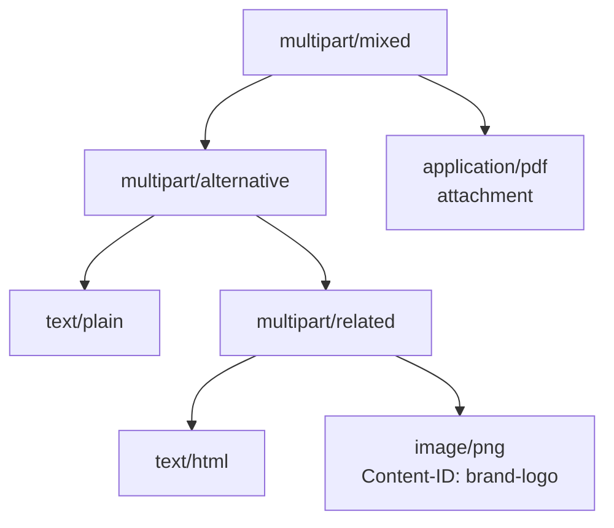
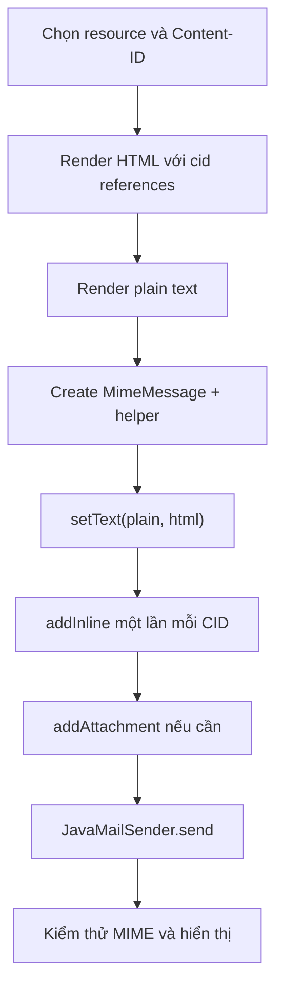

# Một resource dùng cho nhiều vị trí trong HTML

Email HTML thường dùng cùng một hình ảnh ở nhiều vị trí: logo trong phần đầu thư, logo nhỏ ở chân trang, biểu tượng cạnh một lời nhắc hoặc ảnh thương hiệu xuất hiện ở cả phần giới thiệu và phần chữ ký. Nếu ảnh được nhúng trực tiếp vào email bằng Spring Framework Mail, ta có thể **đính kèm một inline resource duy nhất và tham chiếu nó nhiều lần trong HTML thông qua cùng một Content-ID**.

Điểm quan trọng là phải phân biệt **một MIME resource** với **nhiều chỗ hiển thị trong HTML**. Một MIME body part có Content-ID có thể được nhiều thẻ HTML tham chiếu bằng URI dạng `cid:...`. Không cần tạo một bản MIME attachment riêng cho từng thẻ `img`. Việc gọi `MimeMessageHelper.addInline(...)` nhiều lần với cùng Content-ID lại có thể tạo các part trùng định danh, khiến email client chọn nhầm hoặc hiển thị không ổn định.

Bài học giải thích cơ chế inline resource, Content-ID, cách tham chiếu cùng một ảnh ở nhiều vị trí, thứ tự tạo MIME message, lựa chọn `Resource` có thể đọc lại, cấu trúc HTML email, xử lý nhiều ảnh, kiểm thử và các lỗi thường gặp. Ví dụ sử dụng Spring Framework Mail 6.x, Spring Boot 3.x, Java 21 và Jakarta Mail.

## 1. Inline resource là gì?

Một inline resource là nội dung được gửi kèm trong MIME message và được liên kết với phần HTML qua một định danh Content-ID. Với hình ảnh, HTML thường tham chiếu resource bằng URI:

```html

```

Trong MIME message có một body part chứa dữ liệu ảnh và header tương tự:

```text
Content-Type: image/png
Content-Transfer-Encoding: base64
Content-ID: <brand-logo>
Content-Disposition: inline

...encoded image bytes...
```

Content-ID kết nối hai phần:

- MIME part có dữ liệu ảnh và header `Content-ID`.
- HTML body có một hoặc nhiều URI `cid:brand-logo`.

Mail client đọc MIME message, tìm part có Content-ID tương ứng và hiển thị nội dung ảnh ở vị trí HTML yêu cầu. Ảnh được gửi cùng email, nên client không cần tải file từ một URL web bên ngoài để lấy nội dung đó.

### 1.1. Một MIME part có thể được tham chiếu nhiều lần

Ví dụ HTML:

```html
<header>
    
</header>

<main>
    <h1>Thông báo từ dịch vụ</h1>
    <p>Nội dung chính của email.</p>
    <p>
        Bạn có thể nhận diện thông báo này qua
        
        của chúng tôi.
    </p>
</main>

<footer>
    
</footer>
```

Ba thẻ `img` cùng tham chiếu `cid:brand-logo`. Chúng đều sử dụng **cùng một MIME part**, vì vậy chỉ cần đăng ký resource một lần:

```java
helper.addInline(
        "brand-logo",
        new ClassPathResource("mail/images/brand-logo.png"),
        "image/png");
```

Đây là điểm cốt lõi của bài: **số lần xuất hiện của URI CID trong HTML không quyết định số lần gọi `addInline()`**. Một Content-ID xác định một part; nhiều phần tử HTML có thể cùng trỏ tới part đó.

### 1.2. Inline resource khác attachment tải xuống

| Đặc điểm | Inline resource | Attachment thông thường |
|---|---|---|
| Mục đích | Hiển thị bên trong nội dung HTML | Cho người nhận mở hoặc tải tệp |
| Liên kết | HTML tham chiếu bằng `cid:` | Thường xuất hiện trong danh sách tệp đính kèm |
| API helper | `addInline(contentId, resource, contentType)` | `addAttachment(filename, resource, contentType)` |
| MIME disposition | Thường là `inline` | Thường là `attachment` |
| Ví dụ | Logo, icon, ảnh minh họa | PDF, CSV, tài liệu |

Không phải cứ gọi `addInline()` là mail client chắc chắn hiển thị ảnh. Client có thể chặn hình ảnh theo chính sách riêng hoặc không hỗ trợ một số định dạng. Hãy có nội dung thay thế phù hợp qua thuộc tính `alt` và giữ thông tin thiết yếu trong text.

## 2. Content-ID và URI cid:

Content-ID là định danh của một MIME body part. Trong header MIME, giá trị thường được đặt trong dấu ngoặc nhọn:

```text
Content-ID: <brand-logo>
```

Trong HTML, URI dùng tiền tố `cid:` và phần định danh:

```html

```

Với API của Spring `MimeMessageHelper`, truyền Content-ID dạng định danh:

```java
helper.addInline("brand-logo", resource, "image/png");
```

Không truyền cả tiền tố `cid:` vào đối số đầu tiên, vì `cid:` thuộc URI trong HTML. Cũng không tự thêm dấu ngoặc nhọn vào chuỗi truyền cho helper; helper chịu trách nhiệm đặt Content-ID header theo định dạng MIME.

### 2.1. Content-ID phải duy nhất trong một message

Mỗi MIME body part inline cần một Content-ID riêng. Ví dụ:

| Resource | Content-ID | HTML reference |
|---|---|---|
| Logo thương hiệu | `brand-logo` | `cid:brand-logo` |
| Icon lịch | `calendar-icon` | `cid:calendar-icon` |
| Ảnh sản phẩm | `product-image-42` | `cid:product-image-42` |

Không dùng cùng một Content-ID cho hai ảnh khác nhau trong cùng message. Nếu có hai part trùng định danh, client có thể chọn part đầu, part cuối hoặc xử lý theo cách riêng; kết quả không còn rõ ràng.

Nếu cùng một ảnh xuất hiện ở nhiều vị trí, hãy dùng **một Content-ID và một part**. Nếu hai ảnh khác nhau, cấp hai Content-ID khác nhau.

### 2.2. Phạm vi của Content-ID

Content-ID được dùng để liên kết part trong một message. Hai email độc lập có thể cùng sử dụng `brand-logo`; định danh đó không cần duy nhất trên toàn hệ thống mail. Tuy nhiên, trong từng message, các part nên có Content-ID không trùng nhau.

Có thể dùng ID dễ đọc, chẳng hạn `brand-logo`, hoặc tạo ID có namespace để tránh xung đột khi template có nhiều component:

```text
mail-header-logo
mail-footer-logo
invoice-company-mark
notification-calendar-icon
```

Đừng tạo Content-ID từ input người dùng tùy ý. Dùng hằng số hoặc giá trị được ứng dụng kiểm soát để tránh ký tự không hợp lệ, va chạm và khó theo dõi.

## 3. Dùng MimeMessageHelper để đăng ký resource một lần

Ví dụ gửi một email HTML có logo ở đầu và cuối thư:

```java
package com.example.mail;

import jakarta.mail.MessagingException;
import jakarta.mail.internet.MimeMessage;

import org.springframework.core.io.ClassPathResource;
import org.springframework.mail.javamail.JavaMailSender;
import org.springframework.mail.javamail.MimeMessageHelper;
import org.springframework.stereotype.Service;

@Service
public class BrandedMailService {

    private static final String LOGO_CID = "brand-logo";

    private final JavaMailSender mailSender;

    public BrandedMailService(JavaMailSender mailSender) {
        this.mailSender = mailSender;
    }

    public void sendWelcome(String recipient)
            throws MessagingException {

        MimeMessage message = mailSender.createMimeMessage();
        MimeMessageHelper helper =
                new MimeMessageHelper(message, true, "UTF-8");

        helper.setFrom("hello@example.test");
        helper.setTo(recipient);
        helper.setSubject("Chào mừng bạn");

        String plainText = """
                Chào mừng bạn đến với dịch vụ của chúng tôi.

                Bạn có thể mở tài khoản để xem thông tin chi tiết.
                """;

        String html = """
                <!doctype html>
                <html lang="vi">
                <body>
                  <header>
                    
                  </header>
                  <main>
                    <h1>Chào mừng bạn</h1>
                    <p>Cảm ơn bạn đã sử dụng dịch vụ.</p>
                  </main>
                  <footer>
                    <p>Trân trọng, đội ngũ hỗ trợ</p>
                    
                  </footer>
                </body>
                </html>
                """;

        // Thiết lập body trước khi thêm inline resource.
        helper.setText(plainText, html);

        // Một MIME part được tạo cho cả hai vị trí trong HTML.
        helper.addInline(
                LOGO_CID,
                new ClassPathResource("mail/images/brand-logo.png"),
                "image/png");

        mailSender.send(message);
    }
}
```

Đặt file ảnh ở:

```text
src/main/resources/
└── mail/
    └── images/
        └── brand-logo.png
```

Trong code:

1. `MimeMessageHelper(message, true, "UTF-8")` tạo helper multipart.
2. `setText(plainText, html)` thiết lập nội dung text và HTML.
3. HTML tham chiếu `cid:brand-logo` ở hai vị trí.
4. `addInline("brand-logo", ...)` đăng ký một inline part duy nhất.
5. `mailSender.send(message)` chuyển message tới transport.

**Thứ tự gọi rất quan trọng:** hãy gọi `setText(...)` trước các lời gọi `addInline(...)`. Tài liệu của Spring `MimeMessageHelper` yêu cầu thêm inline element sau khi đặt text, vì việc thiết lập text có thể tạo hoặc thay đổi cấu trúc multipart mà helper quản lý. Nếu thêm inline trước rồi gọi `setText(...)`, phần liên kết có thể bị mất hoặc cấu trúc MIME không như mong muốn.

## 4. Vì sao không gọi addInline nhiều lần với cùng Content-ID?

Mẫu không nên dùng:

```java
// Không nên đăng ký cùng một ID nhiều lần trong cùng message.
helper.setText(plainText, html);

helper.addInline(
        "brand-logo",
        new ClassPathResource("mail/images/brand-logo.png"),
        "image/png");

helper.addInline(
        "brand-logo",
        new ClassPathResource("mail/images/brand-logo.png"),
        "image/png");
```

HTML có thể chỉ cần một MIME part `brand-logo`; gọi hai lần có nguy cơ tạo hai part mang cùng Content-ID. Khi message có các định danh trùng, việc resolve `cid:brand-logo` không còn duy nhất và có thể phụ thuộc cách mail client xử lý.

Thay vào đó:

```java
helper.setText(plainText, html);

helper.addInline(
        "brand-logo",
        new ClassPathResource("mail/images/brand-logo.png"),
        "image/png");
```

Trong HTML, tham chiếu bao nhiêu lần tùy bố cục:

```html

...

...

```

Nếu thật sự muốn hai ảnh khác nhau, hãy đăng ký hai part và dùng hai ID:

```java
helper.addInline(
        "header-logo",
        new ClassPathResource("mail/images/header-logo.png"),
        "image/png");

helper.addInline(
        "footer-mark",
        new ClassPathResource("mail/images/footer-mark.png"),
        "image/png");
```

HTML:

```html

...

```

Quy tắc là **một ID cho một MIME part**, còn một MIME part có thể được tham chiếu nhiều lần.

## 5. Cấu trúc MIME của inline resource

Khi một message có HTML và ảnh inline, ảnh có quan hệ với HTML body. MIME thường biểu diễn mối quan hệ này bằng `multipart/related`. Nếu message còn có bản plain text, cấu trúc alternative có thể bao bọc các representation tương ứng. Nếu có attachment thông thường, có thể có lớp `multipart/mixed` bên ngoài.

Mô hình khái niệm:



Nếu có file PDF:



Đây là sơ đồ giải thích quan hệ MIME, không phải cam kết từng implementation sẽ tạo đúng cùng một cây part hoặc thứ tự header. Spring `MimeMessageHelper` quản lý cấu trúc MIME cho các thao tác đã gọi. Không cần tự ghép boundary hoặc tự viết header Content-ID.

### 5.1. Inline part và attachment part có vai trò khác nhau

Một ảnh được đăng ký bằng `addInline(...)` là resource phục vụ HTML. Một PDF được đăng ký bằng `addAttachment(...)` là tệp người nhận có thể tải xuống. Đừng dùng cùng một Content-ID để đại diện cả hai, và đừng nhầm tên file đính kèm với Content-ID.

Ví dụ:

```java
helper.setText(plainText, html);

helper.addInline(
        "brand-logo",
        new ClassPathResource("mail/images/brand-logo.png"),
        "image/png");

helper.addAttachment(
        "huong-dan.pdf",
        new ClassPathResource("mail/files/huong-dan.pdf"),
        "application/pdf");
```

HTML tham chiếu logo bằng `cid:brand-logo`. PDF không cần URI CID nếu mục đích chỉ là tệp đính kèm để tải xuống.

## 6. Dùng cùng một resource trong template Thymeleaf

Với template HTML, nên giữ Content-ID trong một hằng số và đưa giá trị đó vào template context để tránh chuỗi CID trong Java và HTML bị lệch.

### 6.1. Template HTML

File `templates/mail/welcome.html`:

```html
<!doctype html>
<html lang="vi" xmlns:th="http://www.thymeleaf.org">
<body>
    <header>
        
    </header>

    <main>
        <h1 th:text="|Xin chào ${displayName}|">Xin chào bạn</h1>
        <p>Cảm ơn bạn đã đăng ký.</p>
        <p>
            
            Đây là thông báo từ dịch vụ của chúng tôi.
        </p>
    </main>

    <footer>
        
    </footer>
</body>
</html>
```

Ba thẻ ảnh dùng cùng biến `logoCid`. Thymeleaf render thành `cid:brand-logo` ở cả ba vị trí.

### 6.2. Renderer và composer

```java
private static final String LOGO_CID = "brand-logo";

public void sendWelcome(String recipient, String displayName)
        throws MessagingException {

    Context context = new Context(Locale.forLanguageTag("vi-VN"));
    context.setVariable("displayName", displayName);
    context.setVariable("logoCid", LOGO_CID);

    String html = templateEngine.process("mail/welcome", context);
    String plainText = "Cảm ơn bạn đã đăng ký.";

    MimeMessage message = mailSender.createMimeMessage();
    MimeMessageHelper helper =
            new MimeMessageHelper(message, true, "UTF-8");

    helper.setFrom("hello@example.test");
    helper.setTo(recipient);
    helper.setSubject("Chào mừng bạn");
    helper.setText(plainText, html);

    // Đăng ký một lần dù template tham chiếu logo nhiều lần.
    helper.addInline(
            LOGO_CID,
            new ClassPathResource("mail/images/brand-logo.png"),
            "image/png");

    mailSender.send(message);
}
```

`templateEngine` là một template engine đã được cấu hình trong ứng dụng, chẳng hạn Thymeleaf. `Context` chỉ nhận những biến template cần. Không truyền toàn bộ entity người dùng vào template chỉ để lấy tên hiển thị.

Lợi ích của việc dùng chung hằng số:

- Java đăng ký đúng Content-ID mà HTML tham chiếu.
- Khi đổi ID, chỉ cần cập nhật một hằng số và biến được đưa vào context.
- Test có thể kiểm tra ID đã render và ID được đăng ký là giống nhau.
- Template không phải tự ghép một ID tùy ý từ dữ liệu người nhận.

## 7. Chọn Resource cho ảnh inline

Inline resource phải còn đọc được khi Jakarta Mail serialize message. Hãy chọn một loại Resource phù hợp với nguồn dữ liệu và khả năng đọc lại.

| Resource | Phù hợp khi | Lưu ý |
|---|---|---|
| `ClassPathResource` | Logo/icon tĩnh đóng gói cùng ứng dụng | Dễ dùng, không phụ thuộc request |
| `ByteArrayResource` | Ảnh nhỏ được tạo hoặc tải vào bộ nhớ | Giới hạn kích thước và concurrency |
| `FileSystemResource` | Ảnh nằm trên disk | File phải tồn tại và không đổi trong lúc gửi |
| `InputStreamSource` tự viết | Ảnh lấy từ storage/service | Mỗi lần gọi phải mở stream mới |
| `InputStreamResource` | Nguồn một lần đọc | Thường không phù hợp vì stream có thể đã mở/đọc và không replay được |

### 7.1. ClassPathResource cho logo dùng chung

```java
Resource logo = new ClassPathResource("mail/images/brand-logo.png");

helper.addInline("brand-logo", logo, "image/png");
```

Resource nằm trong classpath và có thể được mở lại khi cần. Đây là lựa chọn thuận tiện cho logo, icon và ảnh thương hiệu cố định của ứng dụng.

Đường dẫn trong `ClassPathResource` thường tương đối với classpath root. Với cấu trúc:

```text
src/main/resources/mail/images/brand-logo.png
```

thì tên resource là:

```text
mail/images/brand-logo.png
```

Không truyền đường dẫn tuyệt đối của máy phát triển; khi đóng gói JAR, đường dẫn đó không tồn tại trên server.

### 7.2. ByteArrayResource cho ảnh được tạo động

```java
byte[] pngBytes = chartRenderer.renderPng(chartId);

if (pngBytes.length > MAX_INLINE_IMAGE_BYTES) {
    throw new IllegalArgumentException("Inline image is too large");
}

helper.addInline(
        "chart-preview",
        new ByteArrayResource(pngBytes),
        "image/png");
```

`chartRenderer` và `MAX_INLINE_IMAGE_BYTES` là thành phần/cấu hình do ứng dụng định nghĩa. `ByteArrayResource` có thể cấp stream mới từ mảng byte, phù hợp khi cùng ảnh được đọc trong quá trình serialize MIME. Tuy nhiên, mảng byte vẫn chiếm heap trong suốt thời gian message còn tham chiếu.

### 7.3. FileSystemResource cho ảnh lưu trên disk

```java
Path imagePath = imageStorage.pathFor(imageId);
Resource logo = new FileSystemResource(imagePath);

helper.addInline("product-preview", logo, "image/png");
```

File phải còn tồn tại tới khi lần gửi hoàn tất. Nếu gửi qua worker hoặc có retry, file cần được giữ tới khi toàn bộ job không còn cần nó. Không xóa file ngay sau `addInline()` vì nội dung có thể chỉ được đọc khi `send()` serialize message.

### 7.4. Nguồn tự viết phải mở stream mới

Nếu ảnh đến từ object storage, có thể dùng:

```java
InputStreamSource source =
        () -> objectStore.openReadStream(objectKey);

helper.addInline("brand-logo", source, "image/png");
```

`objectStore.openReadStream(objectKey)` là API giả định của ứng dụng. Mỗi lần gọi phải trả về một stream mới từ đầu, và đóng stream phải giải phóng response/connection tương ứng. Không trả lại cùng một stream đã mở sẵn.

## 8. Dùng cùng một ảnh cho nhiều email

Một resource có thể được sử dụng trong nhiều message, nhưng mỗi message cần có MIME part riêng của chính nó.

Ví dụ:

```java
private final Resource brandLogo =
        new ClassPathResource("mail/images/brand-logo.png");

public MimeMessage createMessage(String recipient)
        throws MessagingException {

    MimeMessage message = mailSender.createMimeMessage();
    MimeMessageHelper helper =
            new MimeMessageHelper(message, true, "UTF-8");

    helper.setTo(recipient);
    helper.setSubject("Thông báo");
    helper.setText("Nội dung text.", """
            <html><body>
              
            </body></html>
            """);
    helper.addInline("brand-logo", brandLogo, "image/png");
    return message;
}
```

Ở đây cùng một `ClassPathResource` object có thể được dùng để tạo inline part cho nhiều message vì nó đại diện một nguồn có thể mở lại. Mỗi message vẫn gọi `addInline(...)` một lần để có MIME part riêng.

**Không chia sẻ một `InputStream` duy nhất giữa nhiều message.** Nếu resource được xây từ một stream đã mở sẵn, message đầu tiên có thể tiêu thụ/đóng stream khiến message sau thất bại. Hãy chia sẻ Resource có khả năng mở stream độc lập, không chia sẻ phiên đọc.

### 8.1. Khác biệt giữa reuse Resource và reuse MIME part

| Cách reuse | Có nên? | Vì sao |
|---|---|---|
| Một `ClassPathResource` được dùng để tạo part trong nhiều email | Có | Mỗi message có part riêng, resource có thể mở lại |
| Một `ByteArrayResource` được dùng cho nhiều message | Có, nếu kích thước phù hợp | Mỗi lần đọc tạo stream mới từ byte array |
| Một `InputStream` được dùng chung cho nhiều message | Không | Stream có trạng thái, có thể bị đọc hết/đóng |
| Một Content-ID được đăng ký hai lần trong cùng message | Tránh | Có nhiều part cạnh tranh cùng định danh |
| Một Content-ID được dùng trong hai message độc lập | Có | ID được hiểu trong phạm vi từng message |
| Một CID được tham chiếu bởi nhiều thẻ `img` trong cùng HTML | Có | Nhiều vị trí cùng trỏ tới một MIME part |

## 9. Nhiều vị trí và nhiều resource trong một template

Một template có thể chứa nhiều ảnh khác nhau và lặp lại từng ảnh:

```html
<header>
    
</header>

<section>
    
    <p>Lịch học mới đã được cập nhật.</p>

    
    <h2>Spring Framework Mail</h2>
</section>

<footer>
    
    
</footer>
```

Chỉ có ba MIME part:

```java
helper.addInline(
        "company-logo",
        new ClassPathResource("mail/images/company-logo.png"),
        "image/png");

helper.addInline(
        "calendar-icon",
        new ClassPathResource("mail/images/calendar.png"),
        "image/png");

helper.addInline(
        "course-thumbnail",
        new ClassPathResource("mail/images/course.png"),
        "image/png");
```

Logo và icon lịch được tham chiếu hai lần nhưng chỉ đăng ký một lần mỗi resource. Thumbnail chỉ xuất hiện một lần và cũng chỉ có một part.

Nên quản lý các ID trong một nhóm hằng số hoặc metadata của template để không phải dò tìm chuỗi CID rải rác:

```java
public final class MailContentIds {
    public static final String COMPANY_LOGO = "company-logo";
    public static final String CALENDAR_ICON = "calendar-icon";
    public static final String COURSE_THUMBNAIL = "course-thumbnail";

    private MailContentIds() {}
}
```

Hằng số giúp giảm lỗi đánh máy. Khi template thay đổi, test có thể kiểm tra mọi CID được tham chiếu đều có part tương ứng.

## 10. Thứ tự setText và addInline

Một lỗi thường gặp là thêm inline resource trước khi đặt HTML:

```java
// Không nên dùng thứ tự này.
helper.addInline("brand-logo", logo, "image/png");
helper.setText(plainText, html);
```

Theo hướng dẫn của Spring `MimeMessageHelper`, inline elements cần được thêm **sau khi đặt text**. Việc `setText(...)` có thể tạo cấu trúc MIME body; nếu gọi inline trước, quá trình thiết lập body có thể thay thế phần multipart liên quan.

Thứ tự nên dùng:

```java
helper.setText(plainText, html);
helper.addInline("brand-logo", logo, "image/png");
helper.addInline("calendar-icon", calendarIcon, "image/png");
mailSender.send(message);
```

Thứ tự này áp dụng cho cả message có một inline resource và message có nhiều inline resource. Sau khi đặt text, đăng ký mỗi Content-ID một lần rồi gửi.

## 11. HTML email cần tham chiếu CID đúng cách

### 11.1. Dùng URI cid trong thuộc tính src

Ví dụ:

```html

```

Không viết:

```html

```

hoặc:

```html
" alt="Logo thương hiệu">
```

Trong HTML, dùng `cid:` và định danh không kèm dấu ngoặc nhọn. Dấu ngoặc nhọn thuộc cách biểu diễn header Content-ID trong MIME, không phải một phần của URI trên ví dụ.

### 11.2. Luôn có alt text

Một số mail client có thể không hiển thị ảnh inline do cài đặt riêng tư, chế độ text hoặc giới hạn định dạng. Mỗi ảnh nên có `alt` mô tả mục đích:

```html

```

Nếu ảnh chỉ mang tính trang trí, có thể dùng `alt=""` để công cụ đọc màn hình bỏ qua. Không đặt thông tin quan trọng chỉ trong hình; nội dung chính cần có text tương ứng.

### 11.3. Kích thước và bố cục

Nếu cùng một ảnh được hiển thị ở nhiều kích thước, có thể dùng cùng CID nhưng đặt thuộc tính kích thước riêng cho từng thẻ:

```html


```

Mail client có thể xử lý CSS và thuộc tính kích thước khác nhau. Nên chuẩn bị ảnh có kích thước phù hợp, tránh nhúng ảnh quá lớn rồi yêu cầu client thu nhỏ đáng kể. Nếu cần chất lượng hoặc tỷ lệ khác nhau, có thể chọn hai resource riêng với Content-ID khác nhau.

### 11.4. Tránh phụ thuộc background image cho nội dung chính

Một số email client hỗ trợ `background-image` hoặc CSS background không nhất quán. Nếu ảnh quan trọng, dùng thẻ `img` với CID và alt text. Background chỉ nên phục vụ trang trí và phải có màu/nội dung dự phòng.

## 12. Kết hợp inline resource với plain text và attachment

Một email có thể có:

- Subject.
- Plain text body.
- HTML body có logo/ảnh inline.
- PDF attachment.

Ví dụ:

```java
MimeMessage message = mailSender.createMimeMessage();
MimeMessageHelper helper =
        new MimeMessageHelper(message, true, "UTF-8");

helper.setFrom("notifications@example.test");
helper.setTo(recipient);
helper.setSubject("Hóa đơn đã sẵn sàng");

String plainText = """
        Hóa đơn của bạn đã sẵn sàng.
        Tệp PDF được đính kèm email này.
        """;

String html = """
        <html><body>
          
          <h1>Hóa đơn đã sẵn sàng</h1>
          <p>Tệp PDF được đính kèm email này.</p>
          
        </body></html>
        """;

helper.setText(plainText, html);

helper.addInline(
        "company-logo",
        new ClassPathResource("mail/images/company-logo.png"),
        "image/png");

helper.addAttachment(
        "hoa-don.pdf",
        new ClassPathResource("mail/files/invoice-sample.pdf"),
        "application/pdf");

mailSender.send(message);
```

Logo được đăng ký một lần và được HTML tham chiếu hai lần. PDF là attachment riêng. Không cần tạo hai inline part chỉ vì logo xuất hiện ở đầu và cuối body.

## 13. Kích thước, hiệu năng và số lượng resource

Một ảnh inline có thể được tham chiếu nhiều lần mà không cần nhân bản MIME part, nhưng điều đó không làm cho dữ liệu ảnh miễn phí:

- Byte ảnh vẫn được truyền cùng email.
- Nội dung có thể được mã hóa Base64, làm tăng kích thước MIME.
- Mail server và mailbox có giới hạn kích thước message.
- Nhiều email đồng thời có thể làm tăng bộ nhớ và I/O.
- Ảnh rất lớn khiến người nhận tải thư chậm và khó đọc trên thiết bị di động.

Nếu cùng một logo xuất hiện ba vị trí, một part giảm phần dữ liệu trùng lặp so với việc đăng ký ba part riêng. Nhưng khi mỗi email đều nhúng logo, mỗi message vẫn mang dữ liệu logo của nó. Không nên kỳ vọng các message độc lập chia sẻ một MIME part ở tầng mailbox.

Nên:

1. Nén ảnh và chọn định dạng phù hợp.
2. Giới hạn kích thước file trước khi gửi.
3. Dùng ảnh kích thước hiển thị thực tế.
4. Tái sử dụng một part khi cùng một ảnh xuất hiện nhiều vị trí trong cùng message.
5. Chỉ nhúng ảnh cần thiết; cân nhắc URL HTTPS được kiểm soát cho nội dung không quan trọng nếu sản phẩm chấp nhận hành vi tải ảnh từ xa.
6. Kiểm tra tổng kích thước MIME, không chỉ kích thước file gốc.

## 14. Bảo mật và quyền truy cập resource

Inline resource cũng là dữ liệu gửi ra ngoài. Trước khi nhúng, cần xác định người nhận có được phép xem ảnh đó không.

- Không lấy file path tùy ý từ request rồi đưa thẳng vào `FileSystemResource`.
- Dùng resource từ thư mục hoặc storage đã được kiểm soát.
- Kiểm tra loại nội dung thực tế; không tin hoàn toàn extension do người dùng cung cấp.
- Giới hạn kích thước và số lượng ảnh inline.
- Không nhúng screenshot chứa dữ liệu cá nhân nếu không có mục đích rõ ràng.
- Không ghi toàn bộ byte, Base64 hoặc raw MIME vào log.
- Với object storage, chỉ cấp quyền đọc cần thiết và bảo đảm URL/key không bị lộ ra HTML nếu không cần.
- Không dùng CID như cơ chế phân quyền; Content-ID chỉ là định danh liên kết trong MIME message.

Nếu ảnh có dữ liệu nhạy cảm, hãy áp dụng chính sách tương tự attachment: xác minh recipient, tối thiểu hóa dữ liệu, giới hạn lưu trữ và tránh đưa bản sao vào log/debug dump.

## 15. Kiểm thử một resource được tham chiếu nhiều lần

Test nên xác nhận hai điều độc lập:

1. HTML có nhiều lần xuất hiện URI CID cần thiết.
2. MIME message chỉ có **một part** với Content-ID tương ứng.

Không nên chỉ đếm số thẻ `img` rồi kết luận resource đã được đăng ký đúng. Ngược lại, cũng không nên chỉ thấy một MIME part mà không kiểm tra HTML có tham chiếu đúng ID hay không.

### 15.1. Kiểm tra HTML sau render

Nếu template dùng Thymeleaf, test renderer có thể kiểm tra:

```java
assertEquals(3, countOccurrences(html, "cid:brand-logo"));
```

`countOccurrences(...)` là helper do test định nghĩa. Assertion này chỉ kiểm tra HTML; nó không chứng minh MIME part đã được gắn.

### 15.2. Kiểm tra Content-ID trong MIME

Có thể serialize message ra bộ nhớ trong test:

```java
ByteArrayOutputStream output = new ByteArrayOutputStream();
message.saveChanges();
message.writeTo(output);

String rawMime = output.toString(StandardCharsets.UTF_8);
```

Raw MIME hữu ích để điều tra, nhưng không nên viết test phụ thuộc cứng vào boundary, line folding hoặc thứ tự part. Cách chắc chắn hơn là parse cây MIME, thu thập các header Content-ID và đếm định danh cần kiểm tra.

Ví dụ hàm duyệt các part:

```java
static void collectContentIds(
        Part part, List<String> contentIds) throws Exception {

    String[] values = part.getHeader("Content-ID");
    if (values != null) {
        contentIds.addAll(Arrays.asList(values));
    }

    Object content = part.getContent();
    if (content instanceof Multipart multipart) {
        for (int i = 0; i < multipart.getCount(); i++) {
            collectContentIds(multipart.getBodyPart(i), contentIds);
        }
    }
}
```

Các import cần thiết gồm `jakarta.mail.Part`, `jakarta.mail.Multipart` và các lớp collection của Java. Hàm duyệt đệ quy vì part inline có thể nằm trong multipart lồng nhau. Trong test, chuẩn hóa dấu ngoặc nhọn nếu cần rồi xác nhận chỉ có một Content-ID `brand-logo`.

### 15.3. Kiểm tra dữ liệu HTML và MIME part

Một test tổng hợp nên:

- Render HTML với ba thẻ tham chiếu `cid:brand-logo`.
- Tạo message bằng `MimeMessageHelper`.
- Gọi `setText(plainText, html)` trước `addInline(...)`.
- Chỉ gọi `addInline("brand-logo", ...)` một lần.
- Parse message và xác nhận đúng một part có Content-ID tương ứng.
- Xác nhận part có MIME type `image/png`.
- Đọc dữ liệu part và so sánh với byte ảnh test.

Không so sánh toàn bộ raw MIME byte-for-byte vì Jakarta Mail có thể chọn boundary và Content-Transfer-Encoding khác nhau.

### 15.4. Kiểm thử qua SMTP giả lập

Có thể dùng Mailpit hoặc một SMTP test server:

```bash
docker run --rm --name mailpit -p 1025:1025 -p 8025:8025 axllent/mailpit
```

Gửi email thử và mở thư trong giao diện Mailpit. Kiểm tra:

1. Logo xuất hiện ở mọi vị trí tham chiếu.
2. Không có icon hoặc ảnh bị mất.
3. Plain text vẫn có nội dung khi không dùng HTML.
4. PDF attachment vẫn xuất hiện riêng nếu message có tệp.
5. Không có CID chưa được đăng ký.

SMTP giả lập xác nhận quá trình tạo và truyền message trong môi trường test; nó không bảo đảm mọi mail client production render giống nhau. Với template quan trọng, cần preview ở các client mục tiêu.

## 16. Những lỗi thường gặp

**Gọi `addInline()` nhiều lần với cùng Content-ID.** Có thể tạo nhiều part trùng định danh. Đăng ký một lần và tham chiếu CID nhiều lần trong HTML.

**Dùng CID khác nhau trong HTML và Java.** HTML trỏ tới một part không tồn tại. Dùng hằng số và đưa ID vào template context.

**Đặt tiền tố `cid:` vào đối số Content-ID.** API nhận định danh, còn `cid:` thuộc URI trong HTML.

**Đặt dấu ngoặc nhọn trong HTML.** MIME header có thể có `<...>`, nhưng URI HTML thường dùng `cid:identifier`.

**Gọi addInline trước setText.** Cấu trúc body có thể bị thay đổi khi helper thiết lập text. Đặt text trước, inline sau.

**Dùng một InputStream đã mở.** Nguồn có thể bị đọc hết hoặc đóng khi MIME serialize. Dùng Resource/source có thể mở stream mới.

**Xóa file ngay sau addInline.** Nội dung có thể chưa được đọc. Giữ nguồn tới khi send đồng bộ hoàn tất hoặc job async/retry kết thúc.

**Dùng sai MIME type.** Khai báo `image/png` cho nội dung JPEG hoặc ngược lại có thể làm client xử lý sai. Khai báo content type khớp dữ liệu thật.

**Không có alt text.** Người nhận dùng chế độ text hoặc client chặn ảnh sẽ thiếu mô tả. Thêm alt text phù hợp và giữ nội dung chính ở dạng văn bản.

**Nhúng ảnh quá lớn.** Message nặng, chậm và có thể vượt giới hạn provider. Resize/nén và đặt giới hạn.

**Dùng ảnh remote path hoặc URL không kiểm soát.** Có thể lộ thông tin hoặc gửi dữ liệu không được phép. Dùng resource đã được ứng dụng kiểm tra.

## 17. Quy trình thiết kế template có inline resource

Khi xây dựng một email dùng logo ở nhiều vị trí, có thể theo trình tự:

1. Xác định những hình ảnh thật sự cần nhúng.
2. Gán một Content-ID ổn định cho mỗi resource khác nhau.
3. Đặt các URI `cid:` ở những vị trí cần hiển thị trong HTML.
4. Render HTML và plain text từ dữ liệu được cho phép.
5. Tạo `MimeMessageHelper` với multipart và charset phù hợp.
6. Gọi `setText(plainText, htmlText)`.
7. Gọi `addInline(...)` đúng một lần cho mỗi Content-ID.
8. Gọi `addAttachment(...)` riêng cho file tải xuống nếu cần.
9. Gọi `JavaMailSender.send(...)`.
10. Kiểm thử cả HTML reference lẫn MIME Content-ID, sau đó preview trên client mục tiêu.

Sơ đồ:



## 18. Bài thực hành

### Phần A — Dùng một logo ba vị trí

Tạo email chào mừng với logo ở header, trong nội dung và footer. Cả ba thẻ ảnh dùng `cid:brand-logo`. Gọi `addInline("brand-logo", ...)` đúng một lần. Kiểm tra message chỉ có một MIME part tương ứng.

### Phần B — Thêm ảnh thứ hai

Thêm biểu tượng lịch ở hai vị trí. Đăng ký `calendar-icon` một lần và tham chiếu nó hai lần. Đảm bảo `brand-logo` và `calendar-icon` có Content-ID khác nhau.

### Phần C — Tách HTML và plain text

Dùng `MimeMessageHelper.setText(plainText, htmlText)`. Xác nhận plain text đầy đủ ngay cả khi không hiển thị ảnh. Không dùng HTML đã xóa tag để thay cho template text.

### Phần D — Kiểm tra thứ tự helper

Thử gọi `addInline()` trước `setText()` trong một test riêng để quan sát cấu trúc message, sau đó chuyển sang thứ tự được khuyến nghị. Giữ test kiểm tra MIME part và CID thay vì phụ thuộc raw boundary.

### Phần E — Đổi Resource

Thử `ClassPathResource`, `ByteArrayResource` và `FileSystemResource`. Kiểm tra resource vẫn đọc được lúc serialize, MIME type đúng và file không bị xóa trước khi gửi.

### Phần F — Thêm attachment tải xuống

Thêm một PDF qua `addAttachment(...)`. Xác nhận logo inline được hiển thị trong HTML, PDF xuất hiện như attachment riêng và CID không bị trùng.

### Phần G — Kiểm thử nội dung

Dùng ảnh test nhỏ, xác nhận HTML có nhiều reference, MIME có đúng một part cho mỗi Content-ID, alt text phù hợp và không có dữ liệu nhạy cảm trong tên file hoặc log.

## 19. Các nguyên tắc nên nhớ

Một inline resource được nhận diện bằng Content-ID trong MIME. HTML tham chiếu nó qua URI `cid:`. **Một MIME part có thể phục vụ nhiều vị trí trong cùng HTML body**, vì vậy nếu logo xuất hiện ở đầu, giữa và cuối email, chỉ cần một lời gọi `addInline(...)` cho logo đó.

Trong một message, mỗi resource khác nhau cần Content-ID riêng và mỗi Content-ID chỉ nên gắn với một MIME part. Dùng Resource có thể mở stream mới, gọi `setText(plainText, htmlText)` trước `addInline(...)`, giữ nguồn còn đọc được tới lúc send hoàn tất và kiểm tra cả MIME lẫn HTML.

Spring `MimeMessageHelper` quản lý việc tạo MIME part và liên kết inline resource. Nó không tự phát hiện các URI CID trong HTML để tạo part, không tự hợp nhất các lần đăng ký trùng ID và không xác minh nội dung ảnh có phù hợp người nhận hay không. Ứng dụng phải giữ Content-ID nhất quán, đăng ký mỗi resource đúng một lần và kiểm soát dữ liệu trước khi gửi.
