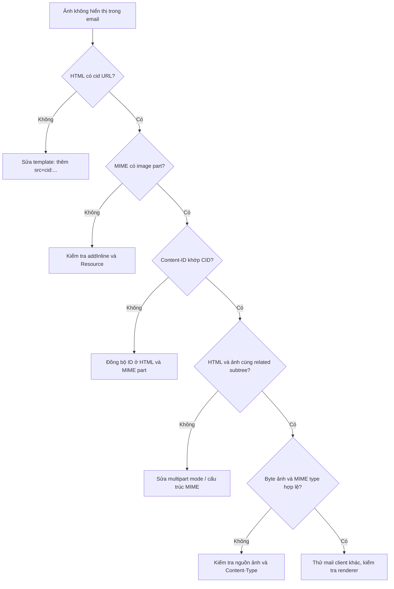

# Kiểm tra multipart/related và liên kết cid

Khi một email HTML cần hiển thị logo, ảnh sản phẩm hoặc hình minh họa ngay trong nội dung, ứng dụng Spring Framework Mail có thể đính kèm ảnh như một **inline MIME part** rồi tham chiếu tới part đó bằng URL dạng `cid:...` trong HTML. Cách làm này chỉ hoạt động đúng khi cấu trúc MIME thể hiện mối quan hệ giữa phần HTML và tài nguyên ảnh. Vì vậy, kiểm tra email có ảnh inline không chỉ là nhìn xem có file ảnh trong message hay không; cần xác nhận **`multipart/related` được tạo đúng, `Content-ID` khớp với `cid:`, và hai phần nằm trong cùng một nhánh related**.

`MimeMessageHelper` hỗ trợ việc này thông qua `addInline(...)`. Tuy nhiên, mail client có thể hiển thị khác nhau, nguồn ảnh có thể không đọc được khi serialize, hoặc HTML có thể tham chiếu sai ID. Bài học này hướng dẫn cách hiểu cây MIME, tạo liên kết CID, kiểm tra raw message, kiểm thử tự động và xử lý các lỗi thường gặp.

## 1. Ảnh inline trong email khác gì ảnh đính kèm?

Có ba cách phổ biến để đưa hình ảnh vào email HTML:

| Cách | HTML tham chiếu | Ảnh được lưu ở đâu? | Đặc điểm |
|---|---|---|---|
| Ảnh inline qua CID | `` | Một MIME part trong cùng email | Không cần tải ảnh từ website; cần Content-ID khớp. |
| Ảnh từ URL bên ngoài | `` | Máy chủ web/CDN | Client có thể chặn tải ảnh từ xa hoặc yêu cầu người dùng cho phép. |
| Data URI/base64 trong HTML | `` | Dữ liệu nhúng trực tiếp trong HTML | Khả năng hỗ trợ giữa mail client không đồng nhất. |

**Inline CID** phù hợp khi ảnh phải đi cùng email và được HTML tham chiếu trực tiếp. Ảnh không cần được công khai trên web server, nhưng kích thước message sẽ tăng do có thêm dữ liệu ảnh và MIME encoding.

Một attachment thông thường có mục đích khác: người nhận tải hoặc mở file riêng. Nếu thêm ảnh bằng `addAttachment(...)`, mail client thường trình bày nó như tệp đính kèm; HTML không tự động có quan hệ để hiển thị ảnh đó trong body.

Ví dụ:

```html
<!-- Tham chiếu một MIME part inline -->


<!-- Tham chiếu ảnh từ máy chủ web -->


<!-- Đây là URL ảnh ngoài, không phải CID -->

```

Đường dẫn tương đối như `logo.png` không tự trỏ tới file nằm trong classpath của ứng dụng. Mail client của người nhận không có quyền truy cập filesystem của máy chủ gửi email.

## 2. multipart/related biểu diễn quan hệ nào?

`multipart/related` là kiểu multipart dùng để nhóm một phần nội dung gốc với những tài nguyên liên quan cần thiết để hiển thị phần đó. Trường hợp thường gặp là HTML và một hoặc nhiều ảnh được HTML tham chiếu bằng CID.

Cấu trúc khái niệm:

```text
MimeMessage
└── multipart/related
    ├── text/html
    │   └── 
    └── image/png
        ├── Content-ID: <brand-logo>
        └── Content-Disposition: inline
```

HTML chứa URL `cid:brand-logo`. MIME part ảnh mang header `Content-ID: <brand-logo>`. Mối quan hệ giữa hai phần được thể hiện qua việc chúng cùng nằm trong `multipart/related`.

Nếu message còn có attachment PDF, cấu trúc có thể là:

```text
MimeMessage
└── multipart/mixed
    ├── multipart/related
    │   ├── text/html
    │   └── image/png; Content-ID: <brand-logo>
    └── application/pdf; attachment
```

Ở đây, `multipart/related` nhóm HTML và ảnh inline; `multipart/mixed` ở ngoài cùng nhóm phần nội dung với file PDF độc lập. PDF không cần được tham chiếu từ HTML bằng CID.

Đó là lý do Spring có mode `MULTIPART_MODE_RELATED` và `MULTIPART_MODE_MIXED_RELATED`. Mode thứ hai hữu ích khi email có cả inline resource và attachment độc lập.

### Phần gốc của multipart/related

Theo quy tắc MIME, phần gốc (*root body part*) của `multipart/related` thường là part đầu tiên nếu không chỉ định tham số `start`. Với email HTML, part đầu tiên thường là `text/html`. Những part sau cung cấp tài nguyên như ảnh.

Ví dụ:

```text
Content-Type: multipart/related; boundary="rel-123"

--rel-123
Content-Type: text/html; charset=UTF-8

<p>Xin chào</p>


--rel-123
Content-Type: image/png
Content-ID: <brand-logo>
Content-Disposition: inline

[image bytes]
--rel-123--
```

Khi kiểm tra raw MIME, hãy xem HTML có nằm trong nhánh related và part ảnh có nằm cùng nhánh đó hay không. Chỉ thấy hai phần cùng xuất hiện trong message chưa đủ để xác nhận cấu trúc quan hệ đúng.

## 3. Content-ID và cid URL phải khớp nhau

`Content-ID` là header định danh một MIME part. Trong message source, nó thường có dạng:

```text
Content-ID: <brand-logo>
```

HTML tham chiếu part bằng URL:

```html

```

Hai biểu diễn có khác biệt cú pháp:

- Header MIME thường đặt giá trị trong dấu ngoặc nhọn: `<brand-logo>`.
- URL trong HTML bắt đầu bằng `cid:` và dùng ID không có dấu ngoặc nhọn: `cid:brand-logo`.

Không viết:

```html
" alt="Logo">
```

Dấu ngoặc nhọn là cú pháp của header Content-ID, không thuộc phần định danh trong CID URL.

### Chọn Content-ID ổn định và duy nhất

Một ID nên không có khoảng trắng, dùng ký tự đơn giản dễ đưa vào URL, không trùng với ID của inline part khác trong cùng message, và được tạo một lần rồi dùng cả khi render HTML lẫn gọi `addInline(...)`.

Có thể tạo ID cho mỗi message bằng UUID:

```java
String logoContentId = "logo-" + UUID.randomUUID();
```

Sau đó dùng đúng biến đó ở cả HTML và MIME part. Tránh viết hai chuỗi literal riêng biệt ở hai vị trí, vì một bên có thể được cập nhật mà bên kia bị quên.

Với ID có ký tự đặc biệt, cú pháp CID URL có quy tắc percent-encoding. Để giảm lỗi và tăng khả năng tương thích, nên dùng token đơn giản gồm chữ ASCII, chữ số và dấu gạch ngang, ví dụ `logo-7f3a92`.

### Không dùng một ID cho nhiều ảnh khác nhau

Nếu email có logo và ảnh banner, tạo hai ID:

```java
String logoCid = "logo-" + UUID.randomUUID();
String bannerCid = "banner-" + UUID.randomUUID();
```

HTML:

```html


```

Mỗi part có một Content-ID tương ứng. Nếu hai part cùng dùng một ID, mail client có thể tham chiếu nhầm hoặc hành vi phụ thuộc cách nó xử lý ID trùng.

## 4. Tạo inline resource bằng MimeMessageHelper

Với Spring, API thường dùng là `MimeMessageHelper.addInline(...)`. Ví dụ tối thiểu:

```java
import jakarta.mail.internet.MimeMessage;
import java.util.UUID;
import org.springframework.core.io.ClassPathResource;
import org.springframework.mail.javamail.MimeMessageHelper;

MimeMessage message = mailSender.createMimeMessage();

MimeMessageHelper helper = new MimeMessageHelper(
        message,
        MimeMessageHelper.MULTIPART_MODE_RELATED,
        "UTF-8"
);

String logoCid = "logo-" + UUID.randomUUID();

helper.setFrom("news@example.org");
helper.setTo("user@example.net");
helper.setSubject("Thông báo mới");

String html = """
        <html>
          <body>
            <h1>Xin chào!</h1>
            <p>Đây là email có logo inline.</p>
            
          </body>
        </html>
        """.formatted(logoCid);

helper.setText(html, true);

helper.addInline(
        logoCid,
        new ClassPathResource("mail/brand-logo.png"),
        "image/png"
);

mailSender.send(message);
```

Điểm cần chú ý:

1. Tạo `MimeMessage` mới cho mỗi email.
2. Chọn multipart mode phù hợp.
3. Sinh một Content-ID và đưa vào HTML dưới dạng `cid:...`.
4. Gọi `setText(...)` để tạo body HTML.
5. Gọi `addInline(...)` với cùng ID và nguồn ảnh.
6. Gửi bằng `JavaMailSender`.

### Vì sao nên gọi setText trước addInline?

Khi dùng `MimeMessageHelper`, nên gọi `setText(...)` trước `addInline(...)`. Tài liệu Spring cảnh báo một số mail client có thể không nhận dạng đúng inline resource nếu ảnh được thêm trước khi body text/HTML được thiết lập.

Thứ tự nên áp dụng:

```java
helper.setText(html, true);
helper.addInline(logoCid, logoResource, "image/png");
```

Không nên đảo thứ tự hai lời gọi này. Khi gặp lỗi ảnh không hiện, hãy kiểm tra thứ tự API cùng với cây MIME và CID.

### Dùng nhiều inline resource

`MimeMessageHelper` có thể thêm nhiều tài nguyên:

```java
helper.setText(html, true);

helper.addInline(
        logoCid,
        new ClassPathResource("mail/logo.png"),
        "image/png"
);

helper.addInline(
        bannerCid,
        new ClassPathResource("mail/banner.jpg"),
        "image/jpeg"
);
```

Mỗi lời gọi cần một Content-ID khác nhau và HTML phải tham chiếu đúng ID. MIME type nên phù hợp với byte thực tế của file; không khai báo PNG cho nội dung JPEG hoặc ngược lại.

## 5. Chọn multipart mode đúng

`MimeMessageHelper` cung cấp các mode:

| Mode | Cấu trúc ở cấp helper | Khi dùng |
|---|---|---|
| `MULTIPART_MODE_NO` | Không multipart | Email chỉ có một body, không có inline resource/attachment qua helper. |
| `MULTIPART_MODE_MIXED` | `multipart/mixed` | Body và attachment; inline resource có thể không được nhóm related riêng. |
| `MULTIPART_MODE_RELATED` | `multipart/related` | Body và ảnh inline/tài nguyên liên quan, không cần attachment độc lập. |
| `MULTIPART_MODE_MIXED_RELATED` | `multipart/mixed` ngoài, `multipart/related` trong | Có cả inline resource và attachment độc lập. |

### Chỉ có HTML và logo inline

Có thể chọn:

```java
new MimeMessageHelper(
        message,
        MimeMessageHelper.MULTIPART_MODE_RELATED,
        "UTF-8"
);
```

Cấu trúc mong đợi:

```text
multipart/related
├── text/html
└── image/png; Content-ID: <logo-id>
```

### Có HTML, logo inline và PDF attachment

Dùng:

```java
new MimeMessageHelper(
        message,
        MimeMessageHelper.MULTIPART_MODE_MIXED_RELATED,
        "UTF-8"
);
```

Cấu trúc khái niệm:

```text
multipart/mixed
├── multipart/related
│   ├── text/html
│   └── image/png; Content-ID: <logo-id>
└── application/pdf; attachment
```

Đừng chỉ dựa vào constructor boolean nếu yêu cầu cấu trúc cụ thể cần được review. Dùng constant có tên rõ ràng giúp người đọc code hiểu mục đích. Khi có attachment, kiểm tra raw MIME để xác nhận attachment nằm ngoài nhánh related.

## 6. Nguồn ảnh phải đọc được khi message được serialize

`addInline(...)` nhận một `Resource` hoặc `InputStreamSource` tùy overload. Helper thiết lập part, nhưng dữ liệu nguồn có thể chỉ được đọc khi MIME message được serialize hoặc gửi.

Nguồn phổ biến:

```java
new ClassPathResource("mail/logo.png")
new FileSystemResource("/opt/app/mail/logo.png")
new ByteArrayResource(imageBytes)
```

Một số nguyên tắc:

- File classpath phải thực sự được đóng gói trong artifact.
- File ngoài filesystem phải tồn tại và có quyền đọc trong môi trường chạy.
- Byte array phải chứa đúng dữ liệu ảnh.
- Nguồn stream tùy chỉnh nên cung cấp stream mới cho mỗi lần đọc nếu thư viện cần đọc lại.
- Không đóng một stream trước khi thư viện hoàn tất quá trình đọc.
- Kiểm tra kích thước ảnh và tổng kích thước message.

Ví dụ dùng `ClassPathResource`:

```java
Resource logo = new ClassPathResource("mail/brand-logo.png");

if (!logo.exists()) {
    throw new IllegalStateException("Missing mail logo resource");
}

helper.addInline(logoCid, logo, "image/png");
```

Kiểm tra `exists()` hữu ích để phát hiện file thiếu sớm. Nó không xác nhận file thực sự là PNG hợp lệ; cần kiểm soát tài sản nguồn và MIME type.

### ByteArrayResource cho ảnh được tạo động

Nếu ảnh được tạo từ dữ liệu hoặc dịch vụ đồ họa:

```java
byte[] pngBytes = chartRenderer.renderPng(chartData);

helper.addInline(
        chartCid,
        new ByteArrayResource(pngBytes),
        "image/png"
);
```

`ByteArrayResource` thích hợp khi dữ liệu đã có trong bộ nhớ và có thể đọc lại. Với ảnh lớn, tránh giữ quá nhiều byte array đồng thời; cân nhắc giới hạn kích thước hoặc nguồn dữ liệu phù hợp hơn.

## 7. Kiểm tra message source sau khi tạo

Một cách kiểm tra trực tiếp là serialize `MimeMessage` ra byte array rồi xem raw MIME:

```java
ByteArrayOutputStream output = new ByteArrayOutputStream();
message.writeTo(output);

String rawMessage = output.toString(StandardCharsets.UTF_8);
System.out.println(rawMessage);
```

Raw source giúp kiểm tra header `MIME-Version`, `Content-Type` ở root, các boundary, vị trí của `text/html`, header `Content-ID` của ảnh, `Content-Disposition` và `Content-Type` của ảnh, CID trong HTML, và vị trí của attachment độc lập.

Không nên log toàn bộ raw email trong production. Nội dung có thể chứa địa chỉ người nhận, token, thông tin cá nhân và file đính kèm. Chỉ dùng raw source trong môi trường kiểm thử hoặc log có kiểm soát và đã loại bỏ dữ liệu nhạy cảm.

### Ví dụ raw MIME hợp lệ

```text
MIME-Version: 1.0
Content-Type: multipart/related; boundary="rel-123"

--rel-123
Content-Type: text/html; charset=UTF-8
Content-Transfer-Encoding: quoted-printable

<html>
  <body>
    <p>Xin chào!</p>
    
  </body>
</html>

--rel-123
Content-Type: image/png
Content-Transfer-Encoding: base64
Content-ID: <logo-7f3a92>
Content-Disposition: inline

iVBORw0KGgoAAAANSUhEUg...
--rel-123--
```

Đây là ví dụ rút gọn. Message thực tế có thể có header bổ sung, encoding khác và boundary do thư viện sinh. Cần tập trung vào quan hệ giữa HTML part và image part.

## 8. Kiểm tra cây MIME bằng Jakarta Mail

Thay vì chỉ tìm chuỗi trong raw source, có thể duyệt nội dung message sau khi đã tạo hoặc parse.

Ví dụ tiện ích chẩn đoán:

```java
import jakarta.mail.BodyPart;
import jakarta.mail.MessagingException;
import jakarta.mail.Multipart;
import jakarta.mail.Part;
import java.io.IOException;
import java.util.Arrays;

public final class MimeTreePrinter {

    private MimeTreePrinter() {}

    public static void print(Part part, String indent)
            throws MessagingException, IOException {

        System.out.println(
                indent + "Content-Type: " + part.getContentType()
        );
        System.out.println(
                indent + "Disposition: " + part.getDisposition()
        );
        System.out.println(
                indent + "Filename: " + part.getFileName()
        );
        System.out.println(
                indent + "Content-ID: "
                        + Arrays.toString(part.getHeader("Content-ID"))
        );

        Object content = part.getContent();

        if (content instanceof Multipart multipart) {
            for (int index = 0; index < multipart.getCount(); index++) {
                BodyPart child = multipart.getBodyPart(index);
                print(child, indent + "  ");
            }
        }
    }
}
```

Gọi:

```java
MimeTreePrinter.print(message, "");
```

Kết quả có thể tương tự:

```text
Content-Type: multipart/related; boundary="..."
Disposition: null
Filename: null
Content-ID: null
  Content-Type: text/html; charset=UTF-8
  Disposition: null
  Filename: null
  Content-ID: null
  Content-Type: image/png
  Disposition: inline
  Filename: null
  Content-ID: [<logo-7f3a92>]
```

Nếu dùng mode `MIXED_RELATED` và có PDF, cấp ngoài cùng có thể là `multipart/mixed`; trong đó có một child `multipart/related`. Tiện ích trên duyệt đệ quy nên vẫn có thể thấy image part ở nhánh con.

Lưu ý: `getContent()` có thể đọc dữ liệu part và ném `IOException` hoặc `MessagingException`. Đây là công cụ kiểm tra trong môi trường phát triển/test; tránh gọi nó để đọc toàn bộ attachment trong luồng gửi production nếu không cần.

## 9. Kiểm tra Content-ID có khớp HTML không

Một kiểm tra hữu ích gồm ba bước:

1. Lấy các CID URL được tham chiếu trong HTML.
2. Lấy các header `Content-ID` của image part.
3. So sánh ID sau khi chuẩn hóa cú pháp header.

Ví dụ HTML:

```html


```

Các header:

```text
Content-ID: <logo-7f3a92>
Content-ID: <banner-4b19c0>
```

Hai tập ID phải tương ứng. Nếu HTML tham chiếu `cid:logo` nhưng part lại mang `Content-ID: <brand-logo>`, client không có lý do để tự đoán rằng chúng là cùng một ảnh.

Với CID chứa ký tự đặc biệt, cần xử lý percent-encoding theo quy tắc URL. Trong ứng dụng thông thường, ID đơn giản gồm chữ, số và dấu gạch ngang giúp phép đối chiếu dễ hơn.

### Không chỉ kiểm tra CID toàn cục

Nếu message có nhiều nhánh related, CID được tham chiếu phải thuộc đúng nhóm related chứa HTML cần hiển thị. Chỉ tìm thấy một part có cùng ID ở một nhánh khác của cây chưa đủ để bảo đảm client có thể phân giải tham chiếu đó.

Ví dụ cấu trúc không phù hợp với quan hệ mong muốn:

```text
multipart/mixed
├── text/html; body references cid:logo
└── image/png; Content-ID: <logo>
```

Hai phần cùng nằm trong mixed, nhưng chúng không được nhóm trong `multipart/related`. Một số client có thể vẫn hiển thị theo cách riêng, nhưng cây MIME không biểu diễn rõ quan hệ tài nguyên liên quan.

Cấu trúc nên có:

```text
multipart/mixed
└── multipart/related
    ├── text/html; body references cid:logo
    └── image/png; Content-ID: <logo>
```

## 10. Kiểm thử integration bằng SMTP server giả lập

Kiểm tra message trước khi gửi là hữu ích, nhưng integration test có thể xác nhận sender đã chuyển message tới SMTP test server. Có thể dùng Mailpit hoặc GreenMail trong môi trường kiểm thử.

Quy trình:

1. Khởi động SMTP test server.
2. Cấu hình `JavaMailSender` trỏ tới host/port test.
3. Gọi service gửi email có inline resource.
4. Lấy message mà server thử nghiệm nhận được.
5. Parse message và duyệt MIME tree.
6. Xác nhận HTML part có `cid:...` và image part có Content-ID tương ứng.
7. Kiểm tra disposition, content type và số lượng inline resource.
8. Nếu có attachment, xác nhận attachment ở nhánh mixed bên ngoài.

Ví dụ kiểm tra raw source với JUnit/AssertJ:

```java
@Test
void messageContainsRelatedImageWithMatchingContentId()
        throws Exception {

    MimeMessage message = mailSender.createMimeMessage();
    String cid = "logo-test-123";

    MimeMessageHelper helper = new MimeMessageHelper(
            message,
            MimeMessageHelper.MULTIPART_MODE_RELATED,
            "UTF-8"
    );

    helper.setFrom("test@example.org");
    helper.setTo("recipient@example.net");
    helper.setSubject("CID test");
    helper.setText(
            "<html><body>"
                    + ""
                    + "</body></html>",
            true
    );
    helper.addInline(
            cid,
            new ClassPathResource("mail/brand-logo.png"),
            "image/png"
    );

    ByteArrayOutputStream output = new ByteArrayOutputStream();
    message.writeTo(output);

    String raw = output.toString(StandardCharsets.UTF_8);

    assertThat(raw).contains("multipart/related");
    assertThat(raw).contains("cid:" + cid);
    assertThat(raw).contains("Content-ID: <" + cid + ">");
    assertThat(raw).contains("Content-Disposition: inline");
}
```

Đây là ví dụ kiểm tra cấu trúc được tạo ra. Khi test email có mode mixed-related, hãy điều chỉnh assertion theo cây MIME thực tế: root có thể là `multipart/mixed` và `multipart/related` nằm ở child. Với header dài, thư viện có thể gấp dòng; test nên parse header nếu cần thay vì phụ thuộc vào một chuỗi raw duy nhất.

### Kiểm tra sau khi nhận từ SMTP test server

Một integration test đầy đủ nên parse message nhận được từ server thử nghiệm, không chỉ serialize object ban đầu. Việc này xác nhận dữ liệu đã đi qua transport và có thể được đọc lại như MIME message. Tùy API của Mailpit/GreenMail, test có thể lấy message qua mailbox hoặc IMAP test endpoint.

Khi parse lại, kiểm tra:

- `multipart/related` có mặt ở đúng cấp.
- HTML part là root của related hoặc được chỉ định đúng theo tham số `start`.
- Image part có Content-ID đúng.
- Nội dung ảnh có byte và Content-Type phù hợp.
- Attachment độc lập không bị đặt nhầm trong related.
- Subject/body có charset đúng.

SMTP test server xác nhận quá trình nhận message trong môi trường kiểm thử; nó không mô phỏng hoàn toàn cách mọi Gmail, Outlook, Apple Mail hay ứng dụng di động render ảnh.

## 11. Các lỗi thường gặp với inline CID

| Triệu chứng | Nguyên nhân có thể | Cách kiểm tra và xử lý |
|---|---|---|
| Ảnh không hiển thị, biểu tượng ảnh lỗi | CID trong HTML không khớp Content-ID | Đối chiếu `cid:` và header sau khi bỏ dấu ngoặc nhọn. |
| Ảnh xuất hiện như attachment | Dùng `addAttachment`, hoặc part không nằm trong related phù hợp | Dùng `addInline` và kiểm tra cây MIME. |
| Message có ảnh nhưng HTML không thấy | Image part tồn tại nhưng HTML không tham chiếu nó | Kiểm tra `src="cid:..."` trong HTML đã render. |
| CID đúng nhưng ảnh vẫn không hiện | Resource rỗng/sai định dạng, MIME type sai hoặc client xử lý khác | Kiểm tra byte ảnh, Content-Type, raw MIME và mail client. |
| Một số email có ảnh, một số không | ID bị tái sử dụng, dữ liệu nguồn không ổn định hoặc race do dùng chung message | Tạo message mới và CID riêng cho từng lần gửi. |
| Có nhiều logo nhưng tất cả hiện cùng một ảnh | Các part dùng CID trùng nhau hoặc HTML tham chiếu cùng ID | Dùng ID riêng cho từng ảnh. |
| Email không gửi được khi thêm ảnh | Resource không đọc được, stream một lần hoặc lỗi serialize | Kiểm tra nguồn Resource/InputStreamSource và exception cause. |
| Ảnh chỉ hiện ở một số client | Khác biệt hỗ trợ MIME/HTML của client | Kiểm tra raw MIME và test trên client mục tiêu. |
| Ảnh URL ngoài không hiện | Client chặn tải ảnh từ xa hoặc URL không truy cập được | Dùng CID khi cần gửi kèm ảnh hoặc kiểm tra URL/CDN. |
| PDF bị xem như tài nguyên inline | Attachment nằm trong related thay vì mixed ngoài cùng | Chọn `MIXED_RELATED` và kiểm tra cây. |
| Ảnh quá lớn, email bị từ chối | Kích thước MIME vượt giới hạn provider | Tối ưu ảnh, giới hạn số lượng và kiểm tra quota/kích thước. |
| Logo bị méo hoặc không đúng tỷ lệ | Kích thước HTML/CSS hoặc nguồn ảnh không phù hợp | Kiểm tra thuộc tính width/height và file ảnh gốc. |

### Trường hợp: CID đúng nhưng ảnh vẫn không hiện

Đừng vội đổi ID hoặc multipart mode liên tục. Hãy xác minh theo thứ tự:

1. Raw HTML thực sự chứa `src="cid:..."` sau khi template engine render.
2. Raw MIME có image part với `Content-ID` tương ứng.
3. Image part nằm trong cùng nhánh `multipart/related` với HTML.
4. Byte ảnh đọc được và Content-Type đúng.
5. Mail client có hỗ trợ cách nhúng đó và không chặn nội dung theo chính sách riêng.

Nếu cả bốn điều đầu đúng mà một client vẫn không hiển thị, có thể đó là khác biệt của renderer hoặc chính sách tải ảnh. Hãy thử trên client khác để phân biệt lỗi message với lỗi hiển thị.

## 12. Phân biệt inline image với remote image và data URI

### Ảnh inline CID

Ưu điểm: ảnh đi cùng email, không phụ thuộc endpoint web bên ngoài, không cần client tải ảnh qua Internet và có thể hiển thị ngay trong nội dung nếu client hỗ trợ MIME related.

Giới hạn: tăng dung lượng email, cần tạo và kiểm tra Content-ID, mail client có thể vẫn hiển thị ảnh inline ở khu vực attachment, và ảnh phải được đóng gói/encode đúng.

### Ảnh từ URL ngoài

Ưu điểm: email nhỏ hơn, có thể cập nhật ảnh trên CDN mà không thay đổi template email và tái sử dụng ảnh giữa nhiều email.

Giới hạn: client có thể chặn ảnh từ xa, URL cần truy cập được từ thiết bị người nhận, proxy/cache có thể làm sai lệch việc theo dõi tải ảnh, và URL chứa token hoặc dữ liệu riêng tư cần được bảo vệ.

### Data URI

Data URI nhúng byte base64 trực tiếp trong HTML. Dù trình duyệt web hỗ trợ rộng, các mail client có chính sách hạn chế và khác nhau. Không nên chọn data URI chỉ để tránh tạo MIME part nếu cần tương thích email thực tế. Với ảnh quan trọng trong nội dung, CID là cách tích hợp MIME có ý nghĩa rõ ràng hơn.

## 13. Accessibility và fallback khi ảnh bị chặn

Ngay cả khi CID được cấu hình đúng, người nhận có thể tắt ảnh, dùng trình đọc màn hình hoặc dùng client không render inline resource như mong muốn.

Hãy luôn cung cấp alt text:

```html

```

Một số nguyên tắc:

- Không đặt thông tin duy nhất trong ảnh.
- Nội dung quan trọng như mã đơn hàng, trạng thái và CTA cần có text.
- Dùng kích thước ảnh hợp lý để tránh layout nhảy.
- Kiểm tra tương phản nếu ảnh chứa chữ.
- Dùng alt text mô tả mục đích, không lặp lại tên file.
- Nếu logo chỉ mang tính trang trí, cân nhắc alt rỗng theo yêu cầu accessibility của email.

Ảnh inline giúp trải nghiệm trực quan hơn, nhưng không nên trở thành điều kiện để hiểu nội dung email.

## 14. Kiểm soát bảo mật và quyền riêng tư

Inline resource là dữ liệu được gửi tới người nhận, vì vậy cần kiểm soát nguồn và nội dung:

- Chỉ nhúng ảnh mà ứng dụng có quyền sử dụng và chia sẻ.
- Không dùng ảnh chứa dữ liệu của người nhận khác.
- Không nhúng token, session ID hoặc thông tin bí mật trong CID.
- Tránh dùng CID có dữ liệu cá nhân; ID ngẫu nhiên là đủ.
- Kiểm tra loại file thực tế, không tin hoàn toàn vào tên extension.
- Giới hạn kích thước ảnh và tổng dung lượng message.
- Không ghi raw MIME hoặc byte ảnh nhạy cảm vào log production.
- Nếu ảnh được tạo từ input người dùng, kiểm tra loại dữ liệu và xử lý theo chính sách upload.

CID thường chỉ là định danh trong phạm vi message, không phải cơ chế xác thực hay mã hóa. Người nhận có thể lưu ảnh cùng email. Không đưa thông tin bí mật vào ảnh với giả định rằng inline resource được bảo vệ đặc biệt.

## 15. Quy trình chẩn đoán có hệ thống

Khi người dùng báo “logo trong email không hiện”, có thể đi theo luồng:



Thứ tự này giúp phân loại lỗi ở đúng tầng:

- **Template:** thiếu hoặc sai CID URL.
- **Message builder:** chưa gọi `addInline`, gọi sai thứ tự hoặc dùng sai mode.
- **Resource:** file thiếu, stream lỗi, byte không phải ảnh.
- **MIME:** Content-ID, Content-Type, disposition hoặc cây related sai.
- **Mail client:** cách render khác nhau hoặc chính sách hiển thị ảnh.

Đừng kết luận SMTP bị lỗi chỉ vì ảnh không hiện. Máy chủ SMTP có thể đã nhận email hoàn toàn bình thường trong khi mail client không phân giải CID.

## 16. Ghi nhớ

- **`multipart/related`** nhóm body chính với tài nguyên cần thiết để hiển thị nó, thường là HTML và ảnh inline.
- HTML tham chiếu ảnh bằng `cid:logo-id`; MIME part mang `Content-ID: <logo-id>`. URL không chứa dấu ngoặc nhọn.
- Dùng `MimeMessageHelper.addInline(...)` để thêm inline resource; gọi `setText(...)` trước `addInline(...)`.
- Chọn `RELATED` khi chỉ cần body và inline resource; chọn `MIXED_RELATED` khi còn có attachment độc lập.
- CID phải duy nhất trong message, được dùng nhất quán và nằm trong cùng nhánh related với HTML tham chiếu nó.
- Nguồn ảnh phải đọc được khi message serialize; MIME type phải khớp byte thực tế.
- Kiểm tra raw MIME hoặc duyệt cây Jakarta Mail để xác nhận Content-Type, boundary, Content-ID, disposition và vị trí part.
- Dùng SMTP test server để kiểm tra message sau transport; thử trên mail client mục tiêu để xác nhận cách hiển thị.
- Cung cấp alt text và giữ thông tin quan trọng trong text vì người nhận có thể chặn ảnh.
- CID không thay thế kiểm soát bảo mật; không nhúng secret hoặc dữ liệu riêng tư vào ID/ảnh.

Khi kiểm tra inline image, hãy xác nhận **ba điều cốt lõi**: HTML có CID URL, MIME có part mang Content-ID tương ứng, và cả hai được nhóm trong cùng `multipart/related`. Sau đó kiểm tra nguồn ảnh, MIME type và mail client. Cách tiếp cận này giúp phân biệt lỗi template, lỗi dựng MIME, lỗi resource và khác biệt hiển thị mà không phải thay đổi cấu hình gửi một cách mò mẫm.
