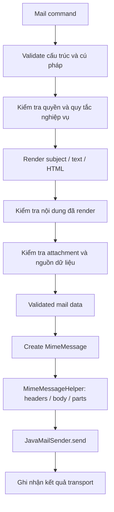
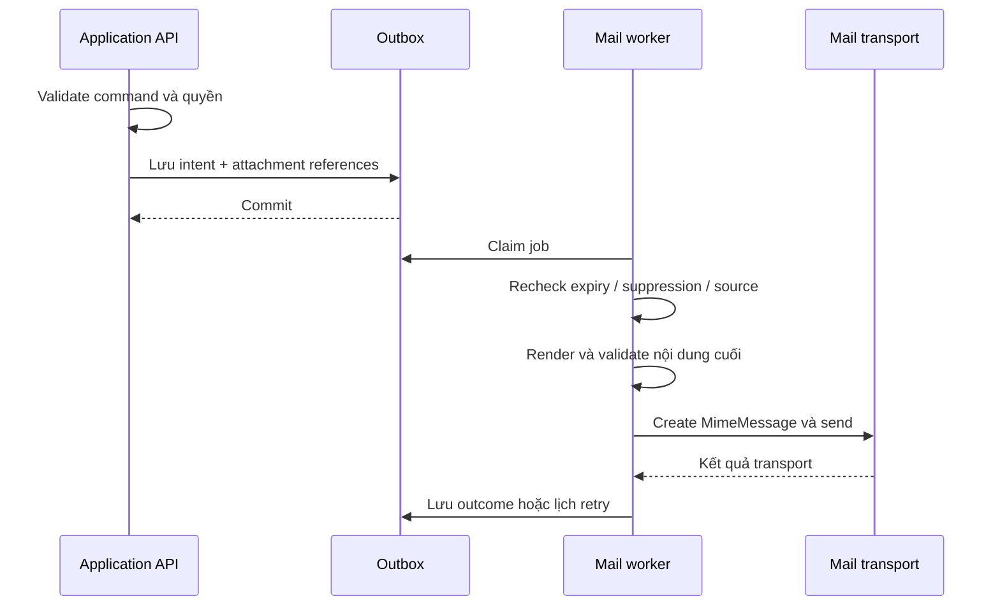

# Kiểm tra dữ liệu trước khi tạo message

Trong ứng dụng Spring Framework Mail, việc tạo `MimeMessage` là bước bắt đầu dựng email để gửi. Trước khi gọi `JavaMailSender.createMimeMessage()`, ứng dụng cần xác nhận dữ liệu đầu vào hợp lệ, người nhận được phép nhận thư, nội dung đã render đầy đủ và các tệp đính kèm có thể sử dụng an toàn.

Nếu tạo message trước rồi mới kiểm tra, code phải xử lý một đối tượng MIME đang được dựng dở. Một nhánh lỗi có thể để sót recipient, subject, body hoặc attachment chưa hoàn chỉnh; những lần sửa sau dễ bỏ quên một kiểm tra. Một số lỗi chỉ được phát hiện khi helper thiết lập header hoặc khi transport serialize message. Khi đó, hệ thống đã tiêu tốn công tạo MIME message và khó phân biệt lỗi dữ liệu với lỗi SMTP.

Nguyên tắc của bài học là **kiểm tra và chuẩn bị mọi dữ liệu có thể xác minh trước khi tạo message**. Hãy nhận một command có cấu trúc, kiểm tra cú pháp và quy tắc nghiệp vụ, xác thực quyền gửi, render template, kiểm tra nội dung cuối cùng và xác nhận nguồn attachment. Chỉ khi có một kết quả đã được xác nhận, service mới tạo `MimeMessage`, dùng `MimeMessageHelper` để ghép nội dung rồi gọi `JavaMailSender.send(...)`.

Bài này trình bày quy trình preflight validation cho Spring Framework Mail: người gửi/người nhận, subject và header, plain text/HTML, template và locale, attachment, giới hạn tài nguyên, dữ liệu đa tenant, phân loại lỗi, ví dụ Jakarta Bean Validation, service code và cách kiểm thử. Ví dụ dùng Spring Framework 6.x, Spring Boot 3.x, Java 21 và Jakarta Mail.

## 1. Quy trình gửi mail có bước preflight

Một phương thức gửi email thường nhận dữ liệu từ controller, event handler, scheduler hoặc worker. Dữ liệu này có thể đến từ người dùng, hệ thống nội bộ, template hoặc storage. Không nên coi dữ liệu đó hợp lệ chỉ vì nó đã được deserialize thành Java object.



Các bước validate từ B đến F diễn ra trước khi tạo MIME message. Nếu một bước thất bại, ứng dụng trả lỗi validation hoặc nghiệp vụ rõ ràng và không gọi transport.

Validation trả lời: địa chỉ có cú pháp được chấp nhận không; người gọi có quyền gửi tới địa chỉ đó không; subject có rỗng, quá dài hoặc chứa ký tự điều khiển không; body có tồn tại và có kích thước hợp lý không; URL có thuộc domain được phép không; attachment có tồn tại, đúng loại và còn đọc được không; các nhóm To/Cc/Bcc có trùng hoặc vượt giới hạn không.

Transport trả lời các câu hỏi khác: SMTP server có kết nối được không, xác thực có thành công không, relay có chấp nhận message không và có timeout/lỗi giao thức trong lúc gửi không. Địa chỉ email có cú pháp hợp lệ không đồng nghĩa mailbox tồn tại. Attachment tồn tại trong storage không đồng nghĩa SMTP sẽ chấp nhận kích thước message. Preflight loại bỏ lỗi có thể phát hiện trước; nó không bảo đảm mạng hoặc mail relay sẽ hoạt động.

## 2. Dùng command riêng cho yêu cầu gửi mail

Đừng nhận một đối tượng tùy ý chứa cả entity nghiệp vụ, HTTP request, stream và các trường MIME. Hãy tạo DTO biểu diễn đúng dữ liệu mà use case gửi mail cần.

```java
package com.example.mail;

import java.util.List;

public record SendMailCommand(
        String recipient,
        String replyTo,
        String templateId,
        String localeTag,
        String subject,
        String plainText,
        String html,
        List<AttachmentCommand> attachments
) {}

public record AttachmentCommand(
        String storageKey,
        String filename,
        String declaredContentType,
        long declaredSize
) {}
```

Command này không chứa `MimeMessage`, `MimeMessageHelper` hoặc `InputStream`. Các trường attachment là metadata và storage key; service sẽ kiểm tra nguồn dữ liệu trước khi tạo message.

Tách command khỏi MIME object giúp kiểm tra command bằng unit test mà không cần mail server, trả lỗi validation trước khi khởi tạo Jakarta Mail, lưu intent vào outbox mà không lưu stream đang mở, áp dụng quyền theo tenant/loại notification và thay template engine hoặc mail provider mà không đổi API nghiệp vụ.

Với email giao dịch, sender thường lấy từ cấu hình ứng dụng thay vì nhận từ request. Command chỉ cần chứa recipient và dữ liệu nghiệp vụ; địa chỉ `From` lấy từ cấu hình đã duyệt. Điều này tránh caller giả mạo địa chỉ gửi hoặc sử dụng domain không được phép.

## 3. Kiểm tra cấu trúc bằng Jakarta Bean Validation

Spring Boot có thể tích hợp Jakarta Bean Validation thông qua starter validation:

```groovy
dependencies {
    implementation 'org.springframework.boot:spring-boot-starter-mail'
    implementation 'org.springframework.boot:spring-boot-starter-validation'
}
```

Ví dụ DTO:

```java
package com.example.mail;

import jakarta.validation.Valid;
import jakarta.validation.constraints.Email;
import jakarta.validation.constraints.NotBlank;
import jakarta.validation.constraints.PositiveOrZero;
import jakarta.validation.constraints.Size;

import java.util.List;

public record SendMailCommand(
        @NotBlank @Email @Size(max = 254)
        String recipient,
        @Email @Size(max = 254)
        String replyTo,
        @NotBlank @Size(max = 80)
        String templateId,
        @NotBlank @Size(max = 35)
        String localeTag,
        @NotBlank @Size(max = 160)
        String subject,
        @Size(max = 100_000)
        String plainText,
        @Size(max = 200_000)
        String html,
        @Size(max = 5)
        List<@Valid AttachmentCommand> attachments
) {}

public record AttachmentCommand(
        @NotBlank @Size(max = 500)
        String storageKey,
        @NotBlank @Size(max = 180)
        String filename,
        @NotBlank @Size(max = 100)
        String declaredContentType,
        @PositiveOrZero
        long declaredSize
) {}
```

`@Email` kiểm tra hình thức địa chỉ theo validator đang dùng; nó không xác minh mailbox tồn tại hoặc người nhận có quyền nhận email. `@NotBlank` cần đi cùng `@Email` vì nhiều constraint như `@Email` chấp nhận giá trị null. Các giới hạn `@Size` là ví dụ chính sách ứng dụng, cần điều chỉnh theo loại thư và giới hạn provider. `@Valid` yêu cầu validator kiểm tra từng attachment lồng nhau.

Annotation giúp kiểm tra hình thức và giới hạn khai báo. Service vẫn phải kiểm tra quyền truy cập storage, kích thước thực tế và loại nội dung thật.

## 4. Quy tắc nghiệp vụ không chỉ là annotation

Nhiều quy tắc phụ thuộc vào nhiều trường hoặc ngữ cảnh: phải có ít nhất một body; To/Cc/Bcc không trùng nhau; template ID nằm trong danh sách được phép; locale được hỗ trợ cho template; người dùng chỉ gửi tới địa chỉ trong tenant; attachment thuộc đúng hồ sơ hoặc notification.

Các điều kiện này nên nằm trong lớp preflight validator/service có tên rõ ràng, ví dụ `MailPreflightValidator`. Tránh rải kiểm tra trong controller và trong lúc gọi `MimeMessageHelper.setTo(...)`, `setSubject(...)` hoặc `addAttachment(...)`.

### 4.1. Kiểm tra ít nhất một body

Hệ thống có thể cho phép HTML-only hoặc text-only, nhưng không nên gửi cả hai rỗng:

```java
private static void validateBodyPresence(
        String plainText, String html) {
    boolean hasText = plainText != null && !plainText.isBlank();
    boolean hasHtml = html != null && !html.isBlank();

    if (!hasText && !hasHtml) {
        throw new MailValidationException(
                "Email phải có plain text hoặc HTML body");
    }
}
```

Nếu sản phẩm yêu cầu cả hai bản, hãy kiểm tra cả hai cùng tồn tại. Nếu chỉ có một bản, chọn overload `setText(...)` phù hợp và ghi rõ hành vi.

### 4.2. Kiểm tra template ID và locale

Không nhận tên file template tùy ý từ người dùng rồi truyền thẳng vào template engine. Dùng danh mục được đăng ký:

```java
public enum MailTemplateId {
    ENROLLMENT_CONFIRMED,
    PASSWORD_RESET,
    INVOICE_READY
}
```

API có thể nhận chuỗi ID, nhưng phải chuyển thành giá trị trong allowlist. Locale cũng cần nằm trong tập được hỗ trợ:

```java
private static final Set<String> SUPPORTED_LOCALES =
        Set.of("vi-VN", "en-US");

private static Locale parseLocale(String localeTag) {
    Locale locale = Locale.forLanguageTag(localeTag);
    if (locale.getLanguage().isBlank()
            || !SUPPORTED_LOCALES.contains(locale.toLanguageTag())) {
        throw new MailValidationException("Locale không được hỗ trợ");
    }
    return locale;
}
```

Trong ứng dụng thực tế, tập locale có thể khác nhau theo từng template. Fallback cần được quyết định tường minh, ví dụ dùng locale mặc định đã được duyệt khi template không có bản dịch. Không để resolver âm thầm chọn một template cùng tên nhưng sai ngôn ngữ.

## 5. Kiểm tra địa chỉ người gửi và người nhận

Địa chỉ email là dữ liệu đưa vào header và quyết định thư sẽ đi đâu. Cần kiểm tra cả cú pháp lẫn quyền gửi.

### 5.1. Cú pháp không chứng minh mailbox tồn tại

`@Email` hoặc parser địa chỉ có thể phát hiện một số giá trị sai định dạng. Nó không chứng minh domain có MX record phù hợp, mailbox tồn tại, người nhận đồng ý nhận thông báo, caller có quyền gửi tới người nhận hoặc SMTP relay sẽ chấp nhận địa chỉ.

Không gửi một email thử chỉ để xác minh mailbox trong mọi request; việc đó có thể tạo spam, tiết lộ trạng thái tài khoản hoặc kích hoạt hệ thống chống lạm dụng.

Nếu cần parse địa chỉ bằng Jakarta Mail, có thể dùng:

```java
import jakarta.mail.internet.AddressException;
import jakarta.mail.internet.InternetAddress;

static void validateAddressSyntax(String value) {
    try {
        InternetAddress address = new InternetAddress(value, true);
        address.validate();
    } catch (AddressException ex) {
        throw new MailValidationException(
                "Địa chỉ email không hợp lệ");
    }
}
```

Đây là kiểm tra cú pháp bổ sung. Chính sách ứng dụng quyết định có chấp nhận display name, địa chỉ quốc tế hóa hoặc alias đặc biệt hay không. Với API nhận một địa chỉ đơn, hãy yêu cầu một mailbox thay vì chuỗi chứa nhiều địa chỉ phân tách bằng dấu phẩy.

### 5.2. Sender lấy từ cấu hình tin cậy

Ví dụ:

```yaml
app:
  mail:
    from: notifications@example.test
    reply-to: support@example.test
```

Ứng dụng nên kiểm tra các địa chỉ này lúc khởi động hoặc lúc dựng cấu hình. Đừng lấy `From` từ query parameter hoặc trường tùy ý của request. Nếu có nhiều sender theo tenant, ánh xạ tenant sang sender đã được đăng ký và cho phép.

### 5.3. Kiểm tra quyền nhận mail

Một địa chỉ có cú pháp hợp lệ vẫn có thể không được phép nhận loại thông báo đó:

- Người dùng A không được yêu cầu gửi hóa đơn của người dùng B.
- Một tenant không được dùng địa chỉ của tenant khác.
- Email marketing phải tuân thủ trạng thái opt-in/opt-out.
- Email reset mật khẩu phải gửi tới địa chỉ xác thực của tài khoản.
- Email giao dịch chỉ được gửi tới contact đã được nghiệp vụ phê duyệt.

Kiểm tra quyền dựa trên ID nghiệp vụ và danh tính đã xác thực, không chỉ dựa vào chuỗi email caller gửi lên.

### 5.4. Kiểm tra To, Cc và Bcc

Nếu command hỗ trợ nhiều người nhận, hãy giới hạn tổng số recipient, kiểm tra địa chỉ rỗng, loại duplicate giữa To/Cc/Bcc, tránh để lộ danh sách recipient bằng cách đưa tất cả vào To, và chỉ dùng Bcc theo mục đích phù hợp. Với email cá nhân hóa, thường tạo một message cho từng người nhận để tránh rò rỉ dữ liệu và giúp tracking/idempotency chính xác hơn.

Không tự lowercase toàn bộ email rồi coi đó là chuẩn hóa phổ quát. Domain không phân biệt hoa thường, nhưng phần local theo chuẩn có thể có tính phân biệt; nếu hệ thống chọn quy tắc case-insensitive cho tài khoản của mình, hãy áp dụng nhất quán ở lớp identity/domain.

## 6. Kiểm tra Subject và header trước khi tạo message

Subject xuất hiện trong danh sách thư, thông báo đẩy và đôi khi trên màn hình khóa. Nó cần có nội dung rõ ràng, giới hạn độ dài và không chứa ký tự điều khiển.

```java
private static void validateSubject(String subject) {
    if (subject == null || subject.isBlank()) {
        throw new MailValidationException("Subject không được để trống");
    }
    if (subject.length() > 160) {
        throw new MailValidationException("Subject quá dài");
    }

    for (int i = 0; i < subject.length(); i++) {
        if (Character.isISOControl(subject.charAt(i))) {
            throw new MailValidationException(
                    "Subject chứa ký tự điều khiển");
        }
    }
}
```

Giới hạn 160 ký tự là ví dụ chính sách sản phẩm, không phải giới hạn phổ quát của mọi SMTP server. Dùng giới hạn cấu hình phù hợp với ngôn ngữ, template và nhu cầu hiển thị.

### 6.1. Ngăn header injection

Không nối dữ liệu không tin cậy vào Subject, Reply-To, From hoặc các header khác mà không kiểm tra. Ký tự CR/LF có thể làm thay đổi cách header được diễn giải. Dùng template subject được kiểm soát và từ chối control character:

```java
// Tránh tạo header từ input không kiểm soát.
String subject = "Thông báo: " + userSuppliedText;
```

Nếu cần cá nhân hóa subject, dùng các trường đã được chuẩn hóa, có giới hạn chiều dài và được render trước. Không âm thầm xóa mọi ký tự điều khiển rồi tiếp tục nếu điều đó có thể thay đổi ý nghĩa dữ liệu; từ chối input sai thường rõ ràng hơn.

### 6.2. MIME encoding không thay thế validation

`MimeMessageHelper.setSubject(...)` và Jakarta Mail xử lý việc mã hóa header theo chuẩn MIME, bao gồm nội dung Unicode. Encoding giải quyết cách biểu diễn header, không quyết định subject có phù hợp, an toàn hoặc được phép chứa dữ liệu đó hay không.

## 7. Kiểm tra plain text và HTML body

Body có thể được render từ template hoặc tạo từ dữ liệu nghiệp vụ. Cần kiểm tra nội dung **sau khi render**, vì template hợp lệ vẫn có thể nhận biến thiếu, URL không hợp lệ hoặc chuỗi quá dài.

### 7.1. Giới hạn kích thước

```java
private static void validateBodies(String plainText, String html) {
    boolean hasText = plainText != null && !plainText.isBlank();
    boolean hasHtml = html != null && !html.isBlank();

    if (!hasText && !hasHtml) {
        throw new MailValidationException("Email body rỗng");
    }
    if (plainText != null && plainText.length() > 100_000) {
        throw new MailValidationException("Plain text body quá dài");
    }
    if (html != null && html.length() > 200_000) {
        throw new MailValidationException("HTML body quá dài");
    }
}
```

Độ dài ký tự và kích thước byte UTF-8 không giống nhau. Nếu hệ thống giới hạn message theo byte, hãy tính kích thước byte sau khi render và cân nhắc overhead MIME/encoding. Giới hạn trên là chính sách ứng dụng, không phải ngưỡng SMTP chung.

### 7.2. HTML escaping theo ngữ cảnh

Nếu dùng Thymeleaf, dùng `th:text` cho text node:

```html
<p th:text="${displayName}">Tên người nhận</p>
```

Không đưa dữ liệu không tin cậy vào `th:utext` nếu chưa có quy trình sanitize HTML đáng tin cậy. Escaping giúp tránh markup của người dùng bị diễn giải thành HTML; nó không xác minh link có an toàn hay domain có được phép.

### 7.3. Kiểm tra URL trong body

Email có link đăng nhập, xác nhận hoặc xem hóa đơn cần tạo URL từ base URL được cấu hình và domain allowlist. Không lấy host từ header Host hoặc dữ liệu người dùng rồi gửi thẳng vào template.

Với URL nhạy cảm, chỉ dùng HTTPS, kiểm tra host, không đưa access token dài hạn hoặc credential vào query string, giới hạn quyền và thời hạn của token dùng một lần, và không log URL có token.

### 7.4. Render không đồng nghĩa được phép công bố

Template engine giúp thay biến, không tự xác định quyền công bố dữ liệu. Chỉ đưa những trường được phép vào context. Tránh truyền toàn bộ entity, request hoặc session. Kiểm tra dữ liệu nhạy cảm theo loại template và mục đích gửi.

## 8. Kiểm tra attachment trước khi tạo MIME part

Attachment thường là nguồn gây lỗi muộn vì dữ liệu có thể được đọc khi Jakarta Mail serialize message. Trước khi tạo MIME message, nên kiểm tra metadata và nguồn dữ liệu:

1. Số lượng attachment không vượt giới hạn.
2. Tổng kích thước thực tế không vượt giới hạn ứng dụng.
3. Storage key thuộc phạm vi truy cập của nghiệp vụ hiện tại.
4. File tồn tại và có thể đọc.
5. MIME type khớp nội dung thực tế.
6. Tên file không chứa path traversal hoặc ký tự điều khiển.
7. File đã qua bước scan/kiểm tra theo chính sách.
8. Nguồn có thể mở stream mới khi MIME layer cần đọc.

### 8.1. Không tin declared size hoặc content type

Client có thể khai báo `application/pdf` cho một file không phải PDF. Metadata kích thước cũng có thể sai hoặc đã cũ. Hãy dùng metadata storage đáng tin cậy và nếu cần, kiểm tra signature/magic bytes hoặc scanner phù hợp.

Không cần tải toàn bộ file lớn vào heap chỉ để kiểm tra. Có thể đọc một phần đầu file để nhận dạng định dạng, sau đó dùng scanner/streaming pipeline có giới hạn. Stream được dùng để kiểm tra phải được đóng; nguồn attachment sau đó cần mở một stream mới.

### 8.2. Kiểm tra tên file

Tên file hiển thị cho người nhận không nên là path. Chỉ giữ phần tên cơ sở, giới hạn độ dài và từ chối:

- Dấu phân cách thư mục như / và \.
- Ký tự điều khiển và CR/LF.
- Tên rỗng hoặc chỉ có dấu chấm.
- Phần mở rộng không được phép theo nghiệp vụ.
- Tên có thể gây hiểu nhầm hoặc chứa dữ liệu cá nhân không cần thiết.

Ví dụ:

```java
private static String validateFilename(String filename) {
    if (filename == null || filename.isBlank()
            || filename.length() > 180) {
        throw new MailValidationException("Tên file không hợp lệ");
    }

    if (filename.contains("/") || filename.contains("\\\\")) {
        throw new MailValidationException(
                "Tên file không được chứa đường dẫn");
    }

    for (int i = 0; i < filename.length(); i++) {
        if (Character.isISOControl(filename.charAt(i))) {
            throw new MailValidationException(
                    "Tên file chứa ký tự điều khiển");
        }
    }
    return filename;
}
```

Đây là kiểm tra cơ bản cho tên hiển thị. Nó không thay thế việc kiểm tra quyền truy cập storage key hoặc kiểm tra nội dung file.

### 8.3. Kiểm tra MIME type theo allowlist

Ví dụ use case hóa đơn chỉ chấp nhận PDF:

```java
private static void validateInvoiceContentType(String contentType) {
    if (!"application/pdf".equalsIgnoreCase(contentType)) {
        throw new MailValidationException(
                "Hóa đơn chỉ chấp nhận định dạng PDF");
    }
}
```

Với nhiều loại file, dùng allowlist theo use case. Đừng cho phép mọi MIME type chỉ vì `MimeMessageHelper.addAttachment(...)` nhận một chuỗi content type. Cũng đừng suy ra MIME type chỉ từ phần mở rộng do client cung cấp.

### 8.4. Kiểm tra kích thước tổng

```java
static long totalSize(List<ValidatedAttachment> attachments) {
    long total = 0;
    for (ValidatedAttachment attachment : attachments) {
        total = Math.addExact(total, attachment.sizeBytes());
    }
    return total;
}
```

`Math.addExact(...)` giúp phát hiện overflow số nguyên. Sau khi cộng, so sánh với giới hạn cấu hình. Tổng kích thước MIME cuối cùng có thể lớn hơn tổng byte gốc do header, boundary và Content-Transfer-Encoding, nên chừa khoảng an toàn theo giới hạn mail provider.

## 9. Kiểm tra nguồn attachment có thể đọc được

Một resource có thể hợp lệ về metadata nhưng không còn đọc được khi gửi. Ví dụ file đã bị xóa, object storage key hết hạn hoặc worker không có quyền đọc.

Đối với nguồn lưu trữ, preflight nên kiểm tra key thuộc đúng tenant/notification, xác nhận object/version tồn tại, kiểm tra kích thước và content type từ metadata đáng tin cậy, xác nhận worker có quyền đọc, và nếu cần scan thì mở stream mới rồi đóng ngay sau scan. Kết quả nên là một tham chiếu bất biến để khi tạo MIME resource có thể mở stream khác.

Không giữ `InputStream` trong command hoặc kết quả validation. Kết quả nên giữ storage key/version hoặc một Resource có thể mở lại.

```java
public record ValidatedAttachment(
        String storageKey,
        String objectVersion,
        String filename,
        String contentType,
        long sizeBytes
) {}

InputStreamSource source =
        () -> objectStore.openReadStream(
                attachment.storageKey(),
                attachment.objectVersion());

helper.addAttachment(
        attachment.filename(),
        source,
        attachment.contentType());
```

`objectStore.openReadStream(...)` là API do ứng dụng định nghĩa. Mỗi lần gọi cần trả về một stream mới từ đầu; đóng stream cần giải phóng response/connection. Dùng version để bảo đảm dữ liệu không đổi giữa preflight và lúc MIME serialize.

## 10. Xây dựng lớp MailPreflightValidator

Một validator riêng giúp tập trung kiểm tra trước khi tạo message:

```java
package com.example.mail;

import jakarta.validation.ConstraintViolation;
import jakarta.validation.Validator;
import org.springframework.stereotype.Component;

import java.util.Set;

@Component
public class MailPreflightValidator {

    private final Validator beanValidator;
    private final RecipientPolicy recipientPolicy;
    private final AttachmentInspector attachmentInspector;

    public MailPreflightValidator(
            Validator beanValidator,
            RecipientPolicy recipientPolicy,
            AttachmentInspector attachmentInspector) {
        this.beanValidator = beanValidator;
        this.recipientPolicy = recipientPolicy;
        this.attachmentInspector = attachmentInspector;
    }

    public ValidatedMailRequest validate(
            SendMailCommand command,
            String authenticatedUserId) {

        Set<ConstraintViolation<SendMailCommand>> violations =
                beanValidator.validate(command);
        if (!violations.isEmpty()) {
            throw MailValidationException.from(violations);
        }

        validateSubject(command.subject());
        validateBodyPresence(command.plainText(), command.html());
        if (!recipientPolicy.maySendTo(
                authenticatedUserId, command.recipient())) {
            throw new MailValidationException(
                    "Không có quyền gửi tới người nhận này");
        }

        var attachments = command.attachments() == null
                ? java.util.List.<ValidatedAttachment>of()
                : command.attachments().stream()
                        .map(attachmentInspector::inspect)
                        .toList();

        validateTotalAttachmentSize(attachments);

        return new ValidatedMailRequest(
                command.recipient().trim(),
                command.replyTo(),
                command.subject(),
                command.plainText(),
                command.html(),
                attachments);
    }

    private static void validateSubject(String subject) {
        if (subject == null || subject.isBlank()
                || subject.length() > 160) {
            throw new MailValidationException("Subject không hợp lệ");
        }
        for (int i = 0; i < subject.length(); i++) {
            if (Character.isISOControl(subject.charAt(i))) {
                throw new MailValidationException(
                        "Subject chứa ký tự điều khiển");
            }
        }
    }

    private static void validateBodyPresence(
            String plainText, String html) {
        boolean hasText = plainText != null && !plainText.isBlank();
        boolean hasHtml = html != null && !html.isBlank();
        if (!hasText && !hasHtml) {
            throw new MailValidationException("Email body rỗng");
        }
    }

    private static void validateTotalAttachmentSize(
            java.util.List<ValidatedAttachment> attachments) {
        long total = 0;
        for (ValidatedAttachment attachment : attachments) {
            total = Math.addExact(total, attachment.sizeBytes());
        }
        if (total > 15L * 1024 * 1024) {
            throw new MailValidationException(
                    "Tổng dung lượng attachment vượt giới hạn");
        }
    }
}
```

`RecipientPolicy`, `AttachmentInspector`, `ValidatedMailRequest` và `MailValidationException` là abstraction của ứng dụng. Ví dụ cho thấy thứ tự: Bean Validation, quy tắc header/body, quyền recipient, kiểm tra attachment và cuối cùng tạo object đã xác thực.

Trong code production, cần bổ sung kiểm tra template ID/locale, Reply-To, tổng số recipient, giới hạn body, allowlist content type và lỗi overflow theo policy. Không trả storage path hoặc lý do quyền truy cập chi tiết cho caller không đáng tin cậy.

## 11. Render template trước khi tạo MimeMessage

Nếu subject, plain text và HTML đến từ template engine, hãy render và validate kết quả trước khi gọi `createMimeMessage()`:

```java
public RenderedMail renderAndValidate(
        MailTemplateId templateId,
        Locale locale,
        EnrollmentMailData data) {

    RenderedMail rendered = templateRenderer.render(
            templateId, locale, data);

    validateSubject(rendered.subject());
    validateBodyPresence(
            rendered.plainText(), rendered.html());
    validateRenderedSize(rendered);

    return rendered;
}
```

Template có thể hợp lệ về cú pháp nhưng dữ liệu render vẫn sai: tên rỗng, subject chứa giá trị chưa thay thế, URL không thuộc domain được phép, body quá dài, locale không có bản dịch hoặc dữ liệu nghiệp vụ không được phép xuất hiện trong thư.

Hãy kiểm tra kết quả sau render và trước khi tạo message. Với HTML, dùng escaping theo ngữ cảnh; với plain text, không áp dụng HTML escaping; với URL, xác minh scheme và host riêng.

Nếu template engine có thể để lại placeholder khi biến thiếu, hãy cấu hình chế độ strict hoặc kiểm tra biến bắt buộc. Đừng chỉ tìm một cú pháp placeholder cụ thể nếu engine có nhiều kiểu expression. Tốt hơn là để engine báo lỗi khi template tham chiếu biến không tồn tại theo cấu hình của dự án.

Log nên chứa notification ID, template ID, locale, trường bị lỗi và mã lỗi đã redaction. Tránh ghi toàn bộ subject/body, recipient, URL token hoặc attachment bytes.

## 12. Chỉ tạo MimeMessage sau khi có ValidatedMailRequest

Khi preflight đã thành công, service có thể tạo MIME message:

```java
package com.example.mail;

import jakarta.mail.MessagingException;
import jakarta.mail.internet.MimeMessage;

import org.springframework.core.io.InputStreamSource;
import org.springframework.mail.javamail.JavaMailSender;
import org.springframework.mail.javamail.MimeMessageHelper;
import org.springframework.stereotype.Service;

@Service
public class ApplicationMailService {

    private final JavaMailSender mailSender;
    private final MailPreflightValidator preflightValidator;
    private final ObjectStore objectStore;

    public ApplicationMailService(
            JavaMailSender mailSender,
            MailPreflightValidator preflightValidator,
            ObjectStore objectStore) {
        this.mailSender = mailSender;
        this.preflightValidator = preflightValidator;
        this.objectStore = objectStore;
    }

    public void send(
            SendMailCommand command,
            String authenticatedUserId)
            throws MessagingException {

        ValidatedMailRequest mail =
                preflightValidator.validate(
                        command, authenticatedUserId);

        MimeMessage message = mailSender.createMimeMessage();
        MimeMessageHelper helper =
                new MimeMessageHelper(message, true, "UTF-8");

        helper.setFrom("notifications@example.test");
        helper.setTo(mail.recipient());
        if (mail.replyTo() != null && !mail.replyTo().isBlank()) {
            helper.setReplyTo(mail.replyTo());
        }
        helper.setSubject(mail.subject());

        if (mail.html() != null && !mail.html().isBlank()) {
            String plain = mail.plainText() == null
                    ? "" : mail.plainText();
            helper.setText(plain, mail.html());
        } else {
            helper.setText(mail.plainText());
        }

        for (ValidatedAttachment attachment : mail.attachments()) {
            InputStreamSource source = () ->
                    objectStore.openReadStream(
                            attachment.storageKey(),
                            attachment.objectVersion());
            helper.addAttachment(
                    attachment.filename(),
                    source,
                    attachment.contentType());
        }

        mailSender.send(message);
    }
}
```

Ví dụ dùng sender từ cấu hình cố định; nếu sender phụ thuộc tenant, hãy lấy nó từ policy đã xác thực trong preflight. `ObjectStore` là interface do ứng dụng định nghĩa. Source mở stream mới khi MIME layer cần đọc. Tất cả attachment đã được kiểm tra trước khi message được tạo.

Nếu email có inline resource, hãy gọi `helper.setText(...)` trước `helper.addInline(...)`. Nếu email có attachment, thêm chúng sau khi body đã được thiết lập. Không thêm một stream đã mở sẵn vào helper.

### 12.1. Không tạo message trước rồi mới validate

Tránh cấu trúc:

```java
MimeMessage message = mailSender.createMimeMessage();
MimeMessageHelper helper =
        new MimeMessageHelper(message, true, "UTF-8");

helper.setTo(command.recipient());
helper.setSubject(command.subject());

// Mới phát hiện dữ liệu sai sau khi message đã dựng dở.
validateEverything(command);
```

Validation có thể thất bại sau khi một phần MIME message đã được tạo và thay đổi. Giữ ranh giới rõ ràng: **preflight trả về dữ liệu đã xác nhận; composer chỉ nhận dữ liệu đã xác nhận**.

## 13. Địa chỉ và header nhiều người nhận

Nếu use case gửi nhiều recipient, command nên biểu diễn các nhóm riêng:

```java
public record MultiRecipientMailCommand(
        List<String> to,
        List<String> cc,
        List<String> bcc,
        String subject,
        String plainText,
        String html
) {}
```

Trước khi tạo message, giới hạn số phần tử, kiểm tra từng địa chỉ, loại duplicate giữa To/Cc/Bcc, xác minh quyền gửi tới từng recipient và áp dụng policy Bcc. Không đưa danh sách recipient vào log; địa chỉ email là dữ liệu cá nhân.

Khi dùng `MimeMessageHelper`:

```java
helper.setTo(toAddresses);
helper.setCc(ccAddresses);
helper.setBcc(bccAddresses);
```

Các lời gọi này chỉ nên xảy ra sau khi preflight đã kiểm tra toàn bộ danh sách. Không tự lowercase toàn bộ email như quy tắc chuẩn hóa phổ quát: domain không phân biệt hoa thường, nhưng phần local theo chuẩn có thể có tính phân biệt. Nếu hệ thống chọn quy tắc case-insensitive cho tài khoản của mình, hãy áp dụng nhất quán ở lớp identity/domain.

## 14. Kiểm tra dữ liệu theo loại email

Không phải mọi email có cùng bộ quy tắc. Nên có policy theo template/use case:

| Loại email | Dữ liệu cần kiểm tra đặc biệt |
|---|---|
| Welcome / enrollment | Recipient thuộc tài khoản, locale được hỗ trợ, course ID hợp lệ |
| Password reset | Recipient đã xác thực, token một lần, hạn dùng, domain link cố định |
| Invoice | Recipient được phép xem hóa đơn, attachment đúng hóa đơn, PDF hợp lệ |
| Notification | Template ID được phép, nội dung không lộ dữ liệu nhạy cảm |
| Marketing | Opt-in, opt-out, danh sách suppression, giới hạn gửi |
| System alert | Recipient thuộc nhóm vận hành được phép, nội dung không chứa secret/log thô |

Validator tổng quát xử lý cú pháp và giới hạn chung; policy theo use case xử lý quyền và nội dung. Trong ứng dụng multi-tenant, preflight cần xác minh notification, recipient, attachment, template và sender đều thuộc tenant hiện tại. Không tin tenant ID do request tự gửi nếu security context đã xác định tenant.

## 15. Kiểm tra dữ liệu trước khi xếp hàng gửi

Nếu ứng dụng dùng outbox hoặc message queue, cần phân biệt **kiểm tra lúc nhận yêu cầu** với **kiểm tra ngay trước lúc gửi**.

Khi nhận yêu cầu, có thể kiểm tra cú pháp command, quyền người gọi, template ID/locale, quy tắc nghiệp vụ và metadata attachment. Khi worker xử lý, cần kiểm tra lại những điều có thể thay đổi: attachment key/version còn tồn tại, worker có quyền đọc, template version vẫn được phép dùng, recipient chưa bị suppression/opt-out và message chưa hết hạn hoặc bị hủy.

Không giữ `InputStream` trong outbox. Lưu intent và storage key/version. Worker mở stream mới khi tạo MIME message. Nếu dữ liệu phải giữ nguyên giữa lần enqueue và lần gửi, dùng version bất biến và lưu phiên bản template hoặc dữ liệu render theo policy.



Đối với notification có thể bị hủy hoặc recipient có thể opt-out, kiểm tra lúc worker gửi giúp tránh gửi dựa trên trạng thái cũ. Với email giao dịch, chính sách gửi sau khi trạng thái nghiệp vụ thay đổi cần được xác định rõ.

## 16. Giới hạn tài nguyên và chống lạm dụng

Dữ liệu hợp lệ về cú pháp vẫn có thể gây quá tải. Một body dài hàng chục MB hoặc hàng nghìn recipient có thể làm tăng bộ nhớ, CPU và chi phí SMTP.

Nên có giới hạn theo use case: số recipient, số attachment, kích thước từng attachment và tổng attachment, độ dài subject/body, số email mỗi user/tenant, concurrency worker, timeout mở attachment/SMTP, số lần retry và tuổi thọ job.

Ví dụ cấu hình:

```yaml
app:
  mail:
    limits:
      max-recipients: 10
      max-attachments: 5
      max-attachment-bytes: 10485760
      max-total-attachment-bytes: 15728640
      max-subject-characters: 160
      max-html-characters: 200000
      max-text-characters: 100000
```

Đây là các property do ứng dụng tự định nghĩa, không phải cấu hình chuẩn của Spring Boot Mail. Hãy điều chỉnh theo giới hạn relay, loại thư, heap, storage và SLA. Đừng đặt giới hạn chỉ ở giao diện; service cần áp dụng lại để các caller khác cũng được bảo vệ.

## 17. Phân loại lỗi validation và lỗi gửi

Một lỗi dữ liệu trước khi tạo message khác với lỗi khi gửi qua SMTP. Hãy giữ hai loại lỗi riêng để logging, response API, retry và metrics chính xác.

| Giai đoạn | Ví dụ lỗi | Xử lý |
|---|---|---|
| Command validation | Recipient sai cú pháp, subject rỗng | Trả lỗi validation; không tạo message |
| Authorization | Không có quyền gửi tới recipient | Từ chối; ghi nhận security event phù hợp |
| Template selection | Template ID hoặc locale không được hỗ trợ | Lỗi cấu hình/nghiệp vụ; không retry SMTP |
| Template rendering | Biến bắt buộc thiếu, cú pháp template sai | Dừng trước khi tạo message |
| Attachment preflight | File không tồn tại, sai loại hoặc vượt kích thước | Từ chối hoặc phục hồi nguồn trước khi gửi |
| MIME composition | Header hoặc cấu trúc MIME không hợp lệ | Ghi nhận lỗi tạo message; kiểm tra dữ liệu/cấu hình |
| SMTP transport | AUTH, timeout, SMTP 4xx/5xx | Phân loại lỗi transport và retry theo policy |
| Kết quả không chắc chắn | Timeout sau khi relay có thể đã nhận DATA | Xử lý idempotency và trạng thái không chắc chắn |

Không bắt mọi exception rồi retry. Nếu subject chứa CR/LF, retry SMTP không sửa được dữ liệu. Nếu file không tồn tại, retry kết nối SMTP cũng không giúp. Lỗi SMTP tạm thời có thể retry khi nguồn attachment còn và message được dựng lại từ dữ liệu bền vững.

Thông báo API không nên trả storage path, SMTP hostname/credential, full recipient list, token, attachment content hoặc stack trace. Log nội bộ cần redaction và correlation ID; không log toàn bộ message để tìm lỗi.

## 18. Kiểm thử preflight trước khi tạo message

Test quan trọng không chỉ xác nhận validator trả lỗi; nó còn cần xác nhận lỗi validation **không gọi** `JavaMailSender.createMimeMessage()` hoặc `send(...)`.

### 18.1. Unit test validator

Ví dụ với JUnit 5:

```java
import static org.junit.jupiter.api.Assertions.assertThrows;

import org.junit.jupiter.api.Test;
import org.springframework.validation.beanvalidation.LocalValidatorFactoryBean;

class MailPreflightValidatorTest {

    @Test
    void rejectsSubjectContainingLineBreak() {
        try (var validator = new LocalValidatorFactoryBean()) {
            validator.afterPropertiesSet();

            MailPreflightValidator preflight =
                    TestMailPreflightFactory.create(validator);

            SendMailCommand command = new SendMailCommand(
                    "person@example.test",
                    null,
                    "enrollment-confirmed",
                    "vi-VN",
                    "Thông báo\r\nBcc: attacker@example.test",
                    "Nội dung",
                    null,
                    java.util.List.of());

            assertThrows(
                    MailValidationException.class,
                    () -> preflight.validate(command, "user-42"));
        }
    }
}
```

`TestMailPreflightFactory` là factory do test định nghĩa để cung cấp policy và inspector giả. Test tập trung vào hành vi từ chối dữ liệu header injection.

### 18.2. Kiểm tra không tạo message khi validation thất bại

Ví dụ dùng Mockito:

```java
import static org.junit.jupiter.api.Assertions.assertThrows;
import static org.mockito.Mockito.never;
import static org.mockito.Mockito.verify;
import static org.mockito.Mockito.when;

import org.junit.jupiter.api.Test;
import org.springframework.mail.javamail.JavaMailSender;

class ApplicationMailServiceTest {

    @Test
    void doesNotCreateMessageForInvalidCommand() {
        JavaMailSender sender = mock(JavaMailSender.class);
        MailPreflightValidator preflight = mock(
                MailPreflightValidator.class);

        ApplicationMailService service =
                new ApplicationMailService(
                        sender, preflight, mock(ObjectStore.class));

        SendMailCommand invalid = invalidCommand();
        when(preflight.validate(invalid, "user-42"))
                .thenThrow(new MailValidationException("Invalid"));

        assertThrows(
                MailValidationException.class,
                () -> service.send(invalid, "user-42"));

        verify(sender, never()).createMimeMessage();
        verify(sender, never()).send(
                org.mockito.ArgumentMatchers.any(
                        jakarta.mail.internet.MimeMessage.class));
    }
}
```

Các helper `mock(...)` và `invalidCommand()` là fixture test cần định nghĩa hoặc import từ Mockito/test fixture. Assertion quan trọng là sender không được gọi khi preflight thất bại.

### 18.3. Kiểm tra dữ liệu hợp lệ mới đi tới composer

Với command hợp lệ, stub preflight trả về `ValidatedMailRequest`, stub `createMimeMessage()` trả về message test, gọi service và xác nhận `send(...)` được gọi đúng một lần. Parse message để kiểm tra Subject, recipient, MIME body và attachment metadata. Đừng chỉ kiểm tra send được gọi; hãy xác nhận message chứa đúng nội dung đã được xác thực.

### 18.4. Kiểm thử attachment

Kiểm tra storage key không tồn tại, key thuộc tenant khác, declared size nhỏ nhưng kích thước thật vượt giới hạn, content type không khớp, filename chứa path separator/CRLF, tổng kích thước vượt giới hạn, source không mở được stream và source cấp stream mới sau bước scan.

Nếu source cần được scan, test nên xác nhận stream của bước scan được đóng và resource dùng lúc serialize được mở lại. Không dùng cùng một stream cho cả scan và gửi.

## 19. Ví dụ composer chỉ nhận dữ liệu đã xác thực

Model đã xác thực:

```java
public record ValidatedMailRequest(
        String recipient,
        String replyTo,
        String subject,
        String plainText,
        String html,
        java.util.List<ValidatedAttachment> attachments
) {}
```

Composer chỉ nhận model này:

```java
public class MailComposer {

    private final JavaMailSender mailSender;
    private final ObjectStore objectStore;

    public MailComposer(
            JavaMailSender mailSender,
            ObjectStore objectStore) {
        this.mailSender = mailSender;
        this.objectStore = objectStore;
    }

    public MimeMessage compose(ValidatedMailRequest mail)
            throws MessagingException {

        MimeMessage message = mailSender.createMimeMessage();
        MimeMessageHelper helper =
                new MimeMessageHelper(message, true, "UTF-8");

        helper.setFrom("notifications@example.test");
        helper.setTo(mail.recipient());
        if (mail.replyTo() != null) {
            helper.setReplyTo(mail.replyTo());
        }
        helper.setSubject(mail.subject());

        if (mail.html() != null && !mail.html().isBlank()) {
            helper.setText(
                    mail.plainText() == null ? "" : mail.plainText(),
                    mail.html());
        } else {
            helper.setText(mail.plainText());
        }

        for (ValidatedAttachment attachment : mail.attachments()) {
            helper.addAttachment(
                    attachment.filename(),
                    (InputStreamSource) () ->
                            objectStore.openReadStream(
                                    attachment.storageKey(),
                                    attachment.objectVersion()),
                    attachment.contentType());
        }
        return message;
    }
}
```

Orchestrator:

```java
public class MailApplicationService {

    private final MailPreflightValidator preflight;
    private final MailContentRenderer renderer;
    private final MailComposer composer;
    private final JavaMailSender mailSender;

    public void send(
            SendMailCommand command,
            String authenticatedUserId) throws MessagingException {

        ValidatedMailRequest validated =
                preflight.validate(command, authenticatedUserId);

        RenderedMail rendered = renderer.renderAndValidate(validated);
        ValidatedMailRequest ready =
                validated.withRenderedContent(rendered);

        // Message chỉ được tạo sau khi preflight và render thành công.
        MimeMessage message = composer.compose(ready);
        mailSender.send(message);
    }
}
```

`withRenderedContent(...)` là phương thức factory/copy do ứng dụng triển khai trên model bất biến; ví dụ rút gọn để thể hiện ranh giới trách nhiệm. Có thể dùng một record khác như `ReadyToSendMail` thay vì thay đổi record đã xác thực.

Trong thiết kế thực tế, không cần tạo nhiều abstraction nếu use case đơn giản. Điều cần giữ là thứ tự và ranh giới: **mọi kiểm tra có thể làm trước đều hoàn tất trước `createMimeMessage()`**.

## 20. Những lỗi thường gặp

**Tạo MimeMessage trước khi validate.** Message có thể được dựng dở rồi mới phát hiện input sai. Chuyển preflight lên trước composer.

**Chỉ dùng `@Email` để xác thực recipient.** Annotation kiểm tra hình thức, không chứng minh mailbox tồn tại hoặc caller có quyền gửi.

**Nhận From từ request.** Caller có thể giả mạo sender hoặc domain. Lấy sender từ cấu hình/policy đã xác thực.

**Không kiểm tra CR/LF trong Subject và header.** Có nguy cơ header injection. Từ chối control character và giới hạn độ dài.

**Chỉ validate template trước khi render.** Biến có thể thiếu, body quá dài hoặc URL không hợp lệ. Validate output cuối cùng.

**Tin declared content type và size của attachment.** Metadata từ client có thể giả hoặc cũ. Kiểm tra nguồn thực tế và allowlist theo use case.

**Lưu InputStream trong command hoặc outbox.** Stream không bền vững và có trạng thái. Lưu storage key/version, mở stream mới khi cần.

**Chỉ kiểm tra từng attachment.** Tổng kích thước vẫn có thể vượt giới hạn. Kiểm tra tổng byte và overhead MIME.

**Bỏ qua quyền recipient/tenant.** Địa chỉ hợp lệ vẫn có thể thuộc tenant khác hoặc không được phép nhận loại thư đó.

**Retry mọi exception.** Lỗi validation, template hoặc attachment không được sửa bằng retry SMTP. Phân loại lỗi theo giai đoạn.

**Log nguyên command hoặc rendered body.** Có thể lộ email, token, dữ liệu cá nhân và attachment metadata. Log mã lỗi và correlation ID đã redaction.

## 21. Bài thực hành

### Phần A — Tạo command và Bean Validation

Tạo `SendMailCommand` và `AttachmentCommand` với constraint cơ bản. Kiểm tra recipient rỗng, email sai cú pháp, subject quá dài, body rỗng và số attachment vượt giới hạn.

### Phần B — Chặn header injection

Thử subject chứa CR/LF và chuỗi giả mạo header. Xác nhận preflight từ chối trước khi gọi `JavaMailSender.createMimeMessage()`.

### Phần C — Kiểm tra quyền recipient

Tạo hai tenant test. Người dùng tenant A thử gửi notification hoặc attachment thuộc tenant B. Xác nhận lỗi quyền xảy ra trước composer.

### Phần D — Kiểm tra template output

Render subject, plain text và HTML cho locale hợp lệ. Thử thiếu biến, URL sai host, body quá dài và placeholder còn sót. Không tạo MIME message khi output không đạt policy.

### Phần E — Kiểm tra attachment

Dùng file giả có MIME type khai báo sai, file vượt giới hạn, storage key không tồn tại và filename chứa đường dẫn. Xác nhận inspector từ chối từng trường hợp.

### Phần F — Xác nhận thứ tự tạo message

Dùng Mockito để xác nhận `createMimeMessage()` và `send()` không được gọi khi preflight thất bại. Với command hợp lệ, xác nhận composer tạo message và sender gửi đúng một lần.

### Phần G — Kiểm tra lỗi transport

Giả lập SMTP timeout hoặc lỗi tạm thời sau khi preflight thành công. Xác nhận lỗi được phân loại là transport failure, không bị báo nhầm thành lỗi validation. Kiểm tra retry sử dụng dữ liệu attachment còn tồn tại và tạo message mới.

### Phần H — Kiểm tra log

Gửi command chứa token giả và dữ liệu nhạy cảm. Xác nhận log chỉ chứa notification ID, template ID, mã lỗi và correlation ID cần thiết; không chứa token, body hoặc attachment bytes.

## 22. Nguyên tắc triển khai

Một luồng gửi mail đáng tin cậy cần tách rõ **dữ liệu yêu cầu**, **dữ liệu đã được xác thực**, **MIME message** và **kết quả transport**. Command mô tả người nhận, template, nội dung và tham chiếu attachment. Preflight kiểm tra cú pháp, quyền, giới hạn và nguồn dữ liệu; renderer tạo subject/plain text/HTML rồi kiểm tra kết quả cuối. Composer chỉ nhận dữ liệu đã được xác nhận để tạo `MimeMessage`.

Hãy kiểm tra sender và recipient theo policy, chặn CR/LF trong header, giới hạn body và attachment, xác minh URL, kiểm tra quyền tenant và không lưu stream trong command hoặc queue. Khi một bước validation thất bại, dừng trước khi tạo message. Khi message đã được tạo và gửi, phân loại lỗi MIME/transport riêng để retry đúng cách.

Spring `JavaMailSender` và `MimeMessageHelper` hỗ trợ tạo và gửi MIME message. **Chúng không thay thế việc kiểm tra quyền, tính hợp lệ của dữ liệu, giới hạn tài nguyên hoặc chính sách bảo mật của ứng dụng.** Đặt preflight trước `createMimeMessage()` giúp lỗi được phát hiện sớm, message chỉ được tạo từ dữ liệu đã sẵn sàng và quy trình gửi dễ kiểm thử, theo dõi hơn.
