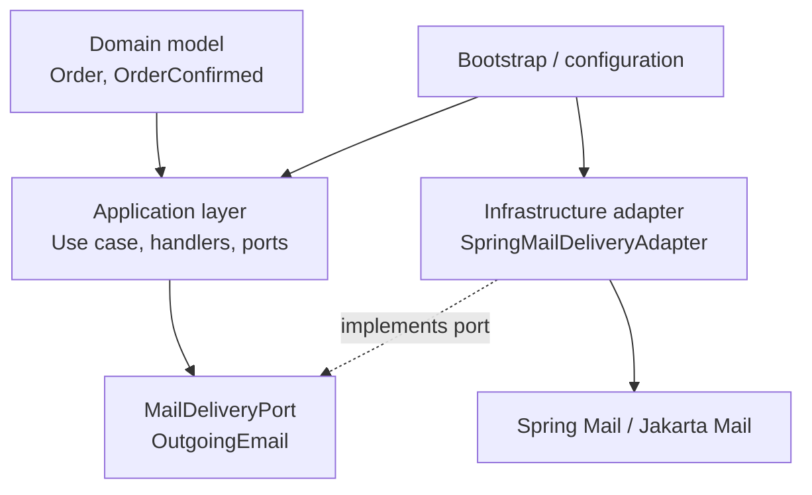
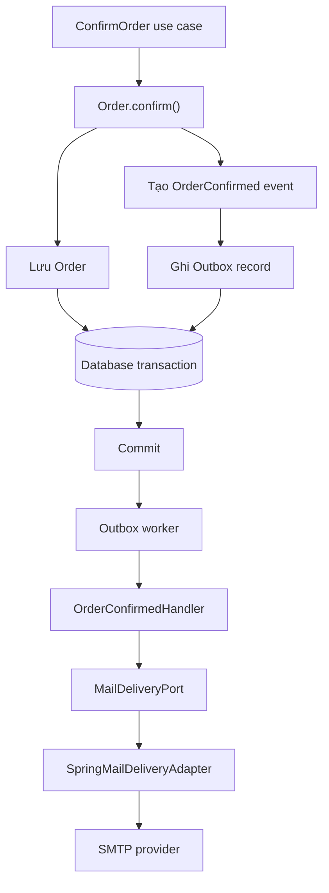

# Không để domain model phụ thuộc MimeMessage

Một ứng dụng quản lý đơn hàng dùng Spring Boot. Khi đơn hàng được xác nhận, hệ thống cần gửi email cho khách hàng với subject, nội dung HTML, bản văn bản thuần và có thể kèm hóa đơn PDF. Một cách làm nhanh là gọi `JavaMailSender` ngay trong entity `Order`, tạo `MimeMessage` và dùng `MimeMessageHelper` để gửi. Cách này có thể chạy trong ví dụ nhỏ, nhưng khiến mô hình nghiệp vụ phụ thuộc vào thư viện gửi mail, SMTP và cấu trúc MIME.

Nếu sau này hệ thống thay SMTP provider, chuyển sang dịch vụ email HTTP, thay template engine hoặc cần chạy kiểm thử domain mà không có mail server, thay đổi hạ tầng sẽ lan vào lớp nghiệp vụ. **Domain model nên mô tả quy tắc và trạng thái nghiệp vụ; nó không nên biết `MimeMessage` là gì hoặc email được gửi bằng giao thức nào.**

Trong kiến trúc phân lớp hoặc Hexagonal Architecture (Ports and Adapters), application định nghĩa một **port** mô tả nhu cầu gửi thông báo. Adapter ở infrastructure triển khai port bằng Spring Mail. Domain phát ra sự kiện nghiệp vụ thuần Java; application layer điều phối việc tạo nội dung và gọi port. Nhờ vậy, domain không phụ thuộc `jakarta.mail`, `org.springframework.mail` hoặc SMTP.

## 1. Vì sao domain model không nên phụ thuộc MimeMessage?

`MimeMessage` thuộc Jakarta Mail và biểu diễn một thông điệp email ở tầng giao thức. Nó chứa các khái niệm như:

- Header `From`, `To`, `Cc`, `Bcc` và `Subject`.
- MIME body part, multipart, boundary và Content-Type.
- Content-Disposition, Content-ID và transfer encoding.
- Attachment, inline resource và dữ liệu được tuần tự hóa.

Đây là chi tiết của cách truyền tải email. Chúng không phải quy tắc nghiệp vụ của đơn hàng, tài khoản hay hóa đơn.

Ví dụ một entity không nên làm:

```java
// Thiết kế không nên dùng: domain phụ thuộc Spring Mail/Jakarta Mail.
public class Order {

    private String id;
    private String customerEmail;

    public void confirm(JavaMailSender mailSender)
            throws MessagingException {

        this.status = OrderStatus.CONFIRMED;

        MimeMessage message = mailSender.createMimeMessage();
        MimeMessageHelper helper = new MimeMessageHelper(message, true);
        helper.setTo(customerEmail);
        helper.setSubject("Đơn hàng đã được xác nhận");
        helper.setText("Đơn hàng của bạn đã được xác nhận.");

        mailSender.send(message);
    }
}
```

Entity trên có nhiều trách nhiệm không thuộc domain:

1. Thay đổi trạng thái đơn hàng.
2. Quyết định nội dung email.
3. Tạo MIME message.
4. Gọi mail transport.
5. Xử lý lỗi từ Spring/Jakarta Mail.

Hệ quả:

| Vấn đề | Tác động |
|---|---|
| Domain import framework | Domain cần dependency Spring Mail/Jakarta Mail dù chỉ để kiểm tra quy tắc đơn hàng. |
| Khó kiểm thử | Unit test entity phải tạo mail sender hoặc mock framework. |
| Khó thay transport | Chuyển sang REST email provider buộc sửa entity. |
| Giao dịch bị trộn với I/O | Gửi SMTP có thể kéo dài transaction hoặc thất bại sau khi trạng thái đã thay đổi. |
| Khó tái sử dụng | Domain không thể dùng độc lập trong batch, CLI hoặc dịch vụ khác nếu phải mang theo mail stack. |
| Khó xử lý retry | Entity không nên quản lý hàng đợi, retry, bounce hay provider message ID. |

**Domain model không cần biết email được biểu diễn bằng MIME ra sao.** Domain chỉ cần biết một sự kiện nghiệp vụ đã xảy ra, chẳng hạn đơn hàng được xác nhận.

## 2. Phân chia trách nhiệm giữa các lớp

Một cách tổ chức thường gặp:

```text
domain/
  order/
    Order.java
    OrderStatus.java
  event/
    OrderConfirmed.java

application/
  port/
    out/
      MailDeliveryPort.java
      CustomerContactQuery.java
      OrderRepository.java
      OutboxRepository.java
  notification/
    OutgoingEmail.java
    OrderConfirmedHandler.java

infrastructure/
  mail/
    SpringMailDeliveryAdapter.java
  template/
    ThymeleafOrderConfirmationRenderer.java
  persistence/
    JpaOrderRepository.java
    JpaOutboxRepository.java

bootstrap/
  ApplicationConfiguration.java
```

Tên package có thể khác nhau theo dự án; điều quan trọng là **hướng phụ thuộc**:



Application layer định nghĩa interface mà use case cần. Infrastructure phụ thuộc vào interface đó và cung cấp implementation. Domain không phụ thuộc Spring Mail, SMTP hoặc MIME.

### 2.1. Domain layer

Domain chịu trách nhiệm:

- Trạng thái và hành vi của entity/aggregate.
- Value object và invariant nghiệp vụ.
- Domain service khi quy tắc không thuộc một entity cụ thể.
- Domain event mô tả sự kiện nghiệp vụ đã xảy ra.

Domain không nên:

- Tạo `MimeMessage` hoặc `MimeMessageHelper`.
- Gọi `JavaMailSender`.
- Chọn SMTP host, username, password hoặc TLS.
- Tạo HTML, CSS hoặc MIME boundary.
- Quản lý retry SMTP hay provider response.

### 2.2. Application layer

Application điều phối use case:

- Gọi repository để tải và lưu aggregate.
- Yêu cầu domain thực hiện hành vi.
- Ghi nhận domain event hoặc outbox message.
- Lấy thông tin người nhận theo nhu cầu use case.
- Tạo model/nội dung thông báo.
- Gọi port gửi mail.
- Quyết định transaction boundary và workflow.

Application layer có thể định nghĩa `MailDeliveryPort` và kiểu dữ liệu `OutgoingEmail`. Đây là abstraction phục vụ use case, không phải API của nhà cung cấp email.

### 2.3. Infrastructure layer

Infrastructure triển khai các chi tiết kỹ thuật:

- `JavaMailSender` và `MimeMessageHelper`.
- `MimeMessage`, `MimeBodyPart` và multipart.
- SMTP configuration, TLS và authentication.
- Template engine như Thymeleaf hoặc FreeMarker.
- Attachment resource và cách đọc file.
- Logging, metrics và provider-specific error mapping.

Infrastructure có thể thay đổi mà không cần thay domain model, miễn là adapter tiếp tục đáp ứng contract của application port.

## 3. Domain mô tả sự kiện nghiệp vụ, không mô tả email

Khi đơn hàng được xác nhận, domain cần thể hiện sự kiện đó. Nó không cần biết subject email hoặc tên template.

Ví dụ domain event:

```java
package com.example.domain.event;

import java.time.Instant;
import java.util.UUID;

public record OrderConfirmed(
        UUID orderId,
        UUID customerId,
        Instant occurredAt) {
}
```

Event chỉ mang dữ kiện nghiệp vụ:

- Đơn hàng nào được xác nhận.
- Khách hàng nào liên quan.
- Thời điểm sự kiện xảy ra.

Không cần đưa vào event:

- `MimeMessage`.
- `JavaMailSender`.
- HTML body hoặc MIME type.
- SMTP message ID.
- Đường dẫn file hoặc `FileSystemResource`.
- Template path do presentation layer quản lý.

Một domain event nên diễn tả **điều đã xảy ra trong domain**. Việc gửi email là một phản ứng có thể có của application layer; nó không phải bản chất của sự kiện.

### 3.1. Entity thay đổi trạng thái thuần Java

```java
package com.example.domain.order;

import com.example.domain.event.OrderConfirmed;

import java.time.Instant;
import java.util.UUID;

public class Order {

    private final UUID id;
    private final UUID customerId;
    private OrderStatus status;

    public Order(UUID id, UUID customerId, OrderStatus status) {
        this.id = id;
        this.customerId = customerId;
        this.status = status;
    }

    public OrderConfirmed confirm(Instant now) {
        if (status != OrderStatus.PAID) {
            throw new IllegalStateException(
                    "Only paid orders can be confirmed");
        }

        status = OrderStatus.CONFIRMED;
        return new OrderConfirmed(id, customerId, now);
    }

    public UUID id() {
        return id;
    }

    public OrderStatus status() {
        return status;
    }
}
```

Enum:

```java
package com.example.domain.order;

public enum OrderStatus {
    CREATED,
    PAID,
    CONFIRMED,
    CANCELLED
}
```

Entity không import Spring, Jakarta Mail hoặc bất kỳ lớp email nào. Nó kiểm tra invariant, thay đổi trạng thái và trả về event thuần Java.

Trong hệ thống DDD lớn, aggregate có thể giữ danh sách domain event nội bộ và application layer lấy chúng sau khi gọi hành vi. Ví dụ trên trả event trực tiếp để tập trung vào ý tưởng; cách thu thập event nên nhất quán với cơ chế domain event của dự án.

### 3.2. Domain event không phải application event

Hai khái niệm có thể được triển khai gần nhau nhưng có mục đích khác:

| Khái niệm | Mục đích |
|---|---|
| Domain event | Ghi nhận một sự kiện có ý nghĩa trong mô hình nghiệp vụ, ví dụ `OrderConfirmed`. |
| Application event | Thông báo giữa các thành phần application trong cùng tiến trình hoặc framework. |
| Integration event | Thông điệp công bố qua ranh giới hệ thống/service để bên ngoài tiêu thụ. |
| Email notification | Một cách trình bày/gửi thông tin tới người nhận; thường là phản ứng ở application/infrastructure. |

Không cần để entity gọi `ApplicationEventPublisher` hoặc tạo Spring `ApplicationEvent`. Domain event có thể chỉ là record Java; application layer quyết định publish, lưu outbox hoặc xử lý đồng bộ.

## 4. Application định nghĩa port gửi mail

Application layer cần một contract mô tả hành động mà use case muốn thực hiện. Interface này được gọi là **outbound port** vì application sử dụng nó để gọi ra ngoài.

Ví dụ:

```java
package com.example.application.port.out;

import com.example.application.notification.OutgoingEmail;

public interface MailDeliveryPort {
    void send(OutgoingEmail email);
}
```

Kiểu dữ liệu application-owned:

```java
package com.example.application.notification;

public record OutgoingEmail(
        String recipient,
        String subject,
        String plainText,
        String html) {
}
```

Contract này thể hiện điều application cần:

- Một người nhận.
- Một subject.
- Nội dung plain text.
- Nội dung HTML.

Nó không tiết lộ cách message được gửi. Implementation có thể dùng SMTP, HTTP API, một mail relay nội bộ hoặc fake adapter trong test.

### 4.1. Vì sao port nằm ở application?

Hướng phụ thuộc của Hexagonal Architecture là **policy ở bên trong định nghĩa contract; chi tiết ở bên ngoài triển khai contract**.

Application nói: “Tôi cần gửi một email với những dữ liệu này.” Infrastructure nói: “Tôi có thể đáp ứng bằng Spring Mail.”

Không nên để interface ở infrastructure rồi bắt application import ngược vào đó, vì như vậy application sẽ phụ thuộc chi tiết kỹ thuật mà nó muốn che giấu.

### 4.2. Contract nên chứa dữ liệu ở mức nào?

Port cần đủ dữ liệu để adapter thực hiện hành động nhưng không nên mang các lớp framework ra ngoài:

| Không nên đặt trong application port | Thay bằng |
|---|---|
| `MimeMessage` | `OutgoingEmail` do application định nghĩa. |
| `MimeMessageHelper` | Contract `MailDeliveryPort`. |
| `InputStreamSource` của Spring | Java I/O abstraction do application sở hữu hoặc document reference. |
| `FileSystemResource` | Attachment reference/stream contract phù hợp. |
| `JavaMailSender` | Interface gửi mail của application. |
| `MailException` | Exception trung lập như `MailDeliveryException`. |

Application có thể dùng kiểu Java chuẩn như `String`, `UUID`, `Instant`, `InputStream` hoặc một abstraction do chính nó định nghĩa. Điều cần tránh là để application contract bị khóa vào một thư viện hạ tầng cụ thể.

## 5. Application handler biến domain event thành thông báo

Domain event chỉ nói đơn hàng đã được xác nhận. Application handler tìm thông tin liên hệ, chuẩn bị nội dung và gọi port.

Ví dụ kiểu thông tin liên hệ ở application:

```java
package com.example.application.customer;

import java.util.UUID;

public record CustomerContact(
        UUID customerId,
        String emailAddress,
        String displayName) {
}
```

Một query port để lấy contact:

```java
package com.example.application.port.out;

import com.example.application.customer.CustomerContact;

import java.util.Optional;
import java.util.UUID;

public interface CustomerContactQuery {
    Optional<CustomerContact> findContact(UUID customerId);
}
```

Handler:

```java
package com.example.application.notification;

import com.example.application.customer.CustomerContact;
import com.example.application.port.out.CustomerContactQuery;
import com.example.application.port.out.MailDeliveryPort;
import com.example.domain.event.OrderConfirmed;

public class OrderConfirmedHandler {

    private final CustomerContactQuery customerContactQuery;
    private final MailDeliveryPort mailDeliveryPort;

    public OrderConfirmedHandler(
            CustomerContactQuery customerContactQuery,
            MailDeliveryPort mailDeliveryPort) {
        this.customerContactQuery = customerContactQuery;
        this.mailDeliveryPort = mailDeliveryPort;
    }

    public void handle(OrderConfirmed event) {
        CustomerContact customer = customerContactQuery
                .findContact(event.customerId())
                .orElseThrow(() -> new IllegalStateException(
                        "Customer contact was not found"));

        // Ví dụ ngắn dùng text; HTML thật nên render bằng template
        // engine có auto-escaping thay vì nối dữ liệu người dùng.
        String plain = """
                Xin chào %s,

                Đơn hàng %s đã được xác nhận.
                Cảm ơn bạn đã mua hàng.
                """.formatted(
                        customer.displayName(),
                        event.orderId());

        String html = """
                <html>
                  <body>
                    <p>Xin chào <strong>%s</strong>,</p>
                    <p>Đơn hàng <strong>%s</strong> đã được xác nhận.</p>
                    <p>Cảm ơn bạn đã mua hàng.</p>
                  </body>
                </html>
                """.formatted(
                        escapeHtml(customer.displayName()),
                        event.orderId());

        mailDeliveryPort.send(new OutgoingEmail(
                customer.emailAddress(),
                "Đơn hàng đã được xác nhận",
                plain,
                html));
    }

    private static String escapeHtml(String value) {
        return value.replace("&", "&amp;")
                .replace("<", "&lt;")
                .replace(">", "&gt;")
                .replace("\"", "&quot;")
                .replace("'", "&#39;");
    }
}
```

Hàm escaping ở đây chỉ minh họa vì sao HTML cần xử lý theo ngữ cảnh. Trong ứng dụng thực tế, nên dùng template engine có auto-escaping như Thymeleaf `th:text` hoặc FreeMarker HTML auto-escaping, thay vì tự duy trì hàm escape trong handler. Không đưa dữ liệu người dùng vào HTML bằng nối chuỗi tùy tiện.

Điểm kiến trúc:

- Handler thuộc application layer.
- Nó phụ thuộc port `MailDeliveryPort`.
- Nó không tạo `MimeMessage`.
- Nó không biết SMTP host, TLS hay credential.
- Domain event không chứa subject/body HTML.

### 5.1. Có nên để domain event chứa email người nhận?

Tùy mô hình nghiệp vụ. Nếu địa chỉ email là một phần của dữ kiện cần giữ tại thời điểm sự kiện, event có thể mang một value object/địa chỉ đã được domain xác định. Nhưng thường event chỉ nên mang ID khách hàng; application query contact theo chính sách phù hợp.

Hai cách có ngữ nghĩa khác nhau:

| Cách | Hành vi |
|---|---|
| Event chỉ có customer ID | Handler lấy địa chỉ liên hệ hiện tại lúc xử lý. |
| Event có snapshot recipient | Thông báo gửi tới địa chỉ tại thời điểm sự kiện phát sinh. |

Với email hóa đơn hoặc thông báo pháp lý, snapshot có thể quan trọng. Với thông báo thông thường, địa chỉ hiện tại có thể phù hợp hơn. Đây là quyết định nghiệp vụ, không phải lý do để đưa `MimeMessage` vào domain.

### 5.2. Email content factory và template renderer

Nếu nội dung phức tạp, không nên để handler chứa HTML. Có thể tách:

- `OrderConfirmationContentFactory`: chuyển dữ kiện event và contact thành model nội dung.
- `MailTemplateRenderer`: render model thành plain text và HTML.
- `MailDeliveryPort`: chuyển nội dung đã render tới hạ tầng gửi.

Một port render có thể được định nghĩa ở application nếu use case cần phụ thuộc vào khả năng đó:

```java
public interface OrderConfirmationRenderer {
    OutgoingEmail render(
            OrderConfirmed event,
            CustomerContact customer);
}
```

Adapter triển khai bằng Thymeleaf/FreeMarker. Như vậy application không phải import template engine nếu muốn giữ ranh giới nghiêm ngặt. Với ứng dụng nhỏ, có thể dùng một factory thuần Java; không cần tạo abstraction cho mọi thao tác đơn giản.

## 6. Infrastructure triển khai port bằng Spring Mail

Adapter là nơi duy nhất trong luồng này cần biết `JavaMailSender`, `MimeMessage` và `MimeMessageHelper`.

### 6.1. Adapter implementation

```java
package com.example.infrastructure.mail;

import jakarta.mail.MessagingException;
import jakarta.mail.internet.MimeMessage;

import com.example.application.notification.OutgoingEmail;
import com.example.application.port.out.MailDeliveryPort;
import com.example.application.port.out.MailDeliveryException;

import org.springframework.beans.factory.annotation.Value;
import org.springframework.mail.MailException;
import org.springframework.mail.javamail.JavaMailSender;
import org.springframework.mail.javamail.MimeMessageHelper;
import org.springframework.stereotype.Component;

import java.nio.charset.StandardCharsets;

@Component
public class SpringMailDeliveryAdapter implements MailDeliveryPort {

    private final JavaMailSender javaMailSender;
    private final String fromAddress;

    public SpringMailDeliveryAdapter(
            JavaMailSender javaMailSender,
            @Value("${app.mail.from}") String fromAddress) {
        this.javaMailSender = javaMailSender;
        this.fromAddress = fromAddress;
    }

    @Override
    public void send(OutgoingEmail email) {
        try {
            MimeMessage message = javaMailSender.createMimeMessage();
            MimeMessageHelper helper = new MimeMessageHelper(
                    message,
                    true,
                    StandardCharsets.UTF_8.name());

            helper.setFrom(fromAddress);
            helper.setTo(email.recipient());
            helper.setSubject(email.subject());
            helper.setText(email.plainText(), email.html());

            javaMailSender.send(message);
        } catch (MessagingException | MailException ex) {
            throw new MailDeliveryException(
                    "Unable to submit email message", ex);
        }
    }
}
```

Exception trung lập thuộc application contract:

```java
package com.example.application.port.out;

public class MailDeliveryException extends RuntimeException {

    public MailDeliveryException(String message, Throwable cause) {
        super(message, cause);
    }
}
```

Adapter chuyển lỗi của Spring/Jakarta Mail thành exception mà application hiểu. Application không cần bắt `MailException` hoặc `MessagingException`.

`MimeMessageHelper(message, true, "UTF-8")` bật multipart để `setText(plain, html)` tạo các alternative body. Nếu message chỉ có một body đơn giản, adapter có thể dùng cấu hình khác; contract application không cần thay đổi.

### 6.2. Vì sao adapter có thể phụ thuộc application?

Adapter import `MailDeliveryPort` và `OutgoingEmail` để triển khai contract. Đây là hướng phụ thuộc đúng: infrastructure biết application cần gì.

Nếu sau này thay Spring Mail bằng provider HTTP, có thể viết:

```java
@Component
public class HttpMailDeliveryAdapter implements MailDeliveryPort {

    private final ProviderMailClient providerClient;

    public HttpMailDeliveryAdapter(ProviderMailClient providerClient) {
        this.providerClient = providerClient;
    }

    @Override
    public void send(OutgoingEmail email) {
        providerClient.send(
                email.recipient(),
                email.subject(),
                email.plainText(),
                email.html());
    }
}
```

Đây là minh họa cho provider-specific client do infrastructure sở hữu. Application handler và domain model vẫn giữ nguyên vì chúng chỉ phụ thuộc port.

### 6.3. Cấu hình SMTP ở infrastructure

Ví dụ `application.yml`:

```yaml
spring:
  mail:
    host: ${MAIL_HOST}
    port: 587
    protocol: smtp
    username: ${MAIL_USERNAME}
    password: ${MAIL_PASSWORD}
    default-encoding: UTF-8
    properties:
      "[mail.smtp.auth]": true
      "[mail.smtp.starttls.enable]": true
      "[mail.smtp.starttls.required]": true
      "[mail.smtp.ssl.checkserveridentity]": true
      "[mail.smtp.connectiontimeout]": 5000
      "[mail.smtp.timeout]": 10000
      "[mail.smtp.writetimeout]": 10000

app:
  mail:
    from: ${MAIL_FROM:notifications@example.com}
```

Đây là ví dụ cho SMTP submission cổng 587 với STARTTLS. Provider dùng implicit TLS trên cổng 465 cần cấu hình tương ứng. Credential được cấp qua môi trường hoặc secret manager; không đặt password thật trong source control.

Domain không đọc cấu hình này. Application không cần biết port SMTP. Chỉ adapter/bootstrap cần những thông tin triển khai đó.

## 7. Giao dịch nghiệp vụ và thời điểm gửi email

Một vấn đề quan trọng khác khi entity không còn gửi mail trực tiếp là **khi nào application gọi port?**

Giả sử use case làm:

```java
@Transactional
public void confirmOrder(UUID orderId) {
    Order order = orderRepository.getById(orderId);
    OrderConfirmed event = order.confirm(clock.instant());
    orderRepository.save(order);

    mailDeliveryPort.send(buildEmail(event));
}
```

Đoạn này đã đưa việc gửi ra khỏi entity, nhưng vẫn gọi SMTP trong transaction DB. Điều đó có thể gây:

- Transaction mở trong lúc chờ network.
- Lock database bị giữ lâu.
- SMTP gửi thành công nhưng transaction rollback.
- Transaction commit nhưng SMTP thất bại.
- Request timeout và kết quả gửi không rõ.

**Tách MIME khỏi domain là bước đầu; cần tiếp tục tách side effect gửi mail khỏi transaction nghiệp vụ khi yêu cầu độ tin cậy cao.**

### 7.1. Gửi sau commit bằng transaction event

Một giải pháp đơn giản là xử lý sau khi transaction commit:

```java
@Component
public class OrderConfirmedMailListener {

    private final OrderConfirmedHandler handler;

    public OrderConfirmedMailListener(OrderConfirmedHandler handler) {
        this.handler = handler;
    }

    @TransactionalEventListener(phase = TransactionPhase.AFTER_COMMIT)
    public void on(OrderConfirmed event) {
        handler.handle(event);
    }
}
```

Application use case publish event trong transaction, listener chỉ xử lý sau commit. Cách này tránh gửi trước khi transaction thành công.

Tuy nhiên, listener trong bộ nhớ **không phải cơ chế lưu bền vững**. Nếu process dừng sau khi DB commit nhưng trước khi listener chạy, thông báo có thể bị mất. Nếu email quan trọng và cần retry/đối soát, nên dùng outbox.

### 7.2. Transactional outbox

Outbox ghi yêu cầu phát thông báo trong cùng transaction với thay đổi nghiệp vụ:



Use case minh họa:

```java
@Service
public class ConfirmOrderUseCase {

    private final OrderRepository orderRepository;
    private final OutboxRepository outboxRepository;
    private final Clock clock;

    public ConfirmOrderUseCase(
            OrderRepository orderRepository,
            OutboxRepository outboxRepository,
            Clock clock) {
        this.orderRepository = orderRepository;
        this.outboxRepository = outboxRepository;
        this.clock = clock;
    }

    @Transactional
    public void execute(UUID orderId) {
        Order order = orderRepository.getById(orderId);
        OrderConfirmed event = order.confirm(clock.instant());

        orderRepository.save(order);
        outboxRepository.append(
                OutboxMessage.from(event));
    }
}
```

`OrderRepository` và `OutboxRepository` là các port application; implementation persistence thuộc infrastructure. Việc lưu aggregate và outbox phải tham gia **cùng transaction database** để tránh trạng thái đơn hàng đã xác nhận nhưng không có bản ghi cần gửi thông báo.

Worker đọc outbox, chuyển event thành email và gọi `MailDeliveryPort`. Worker cập nhật trạng thái theo kết quả submission.

### 7.3. Outbox không bảo đảm exactly-once SMTP

Giả sử:

1. Worker gửi email thành công.
2. SMTP server đã nhận message.
3. Process chết trước khi đánh dấu outbox là sent.
4. Worker chạy lại và gửi lần nữa.

Vì vậy outbox thường cung cấp **at-least-once processing**, không tự bảo đảm exactly-once delivery. Cần:

- Notification ID ổn định.
- Trạng thái và số lần thử.
- Retry có backoff.
- Idempotency key nếu provider hỗ trợ.
- Nội dung/luồng xử lý chịu được thông báo trùng khi không thể loại bỏ hoàn toàn.
- Đối chiếu provider event/bounce nếu nghiệp vụ yêu cầu.

Không đánh dấu “đã tới Inbox” chỉ vì `JavaMailSender.send` không ném lỗi. Đó thường chỉ là kết quả submission tới SMTP transport.

## 8. Domain model có thể phát domain event mà không cần Spring

Một số dự án dùng `ApplicationEventPublisher` ngay trong entity hoặc domain service. Điều đó làm domain phụ thuộc Spring Context. Một cách tách tốt hơn là để domain tạo event thuần Java, rồi application layer quyết định cách chuyển event.

### 8.1. Trả event từ hành vi

```java
OrderConfirmed event = order.confirm(clock.instant());
```

Application nhận event và ghi outbox:

```java
outboxRepository.append(OutboxMessage.from(event));
```

### 8.2. Aggregate giữ danh sách event

Một cách khác:

```java
public class Order {

    private final List<Object> domainEvents = new ArrayList<>();

    public void confirm(Instant now) {
        // Kiểm tra invariant và cập nhật status.
        this.status = OrderStatus.CONFIRMED;
        domainEvents.add(new OrderConfirmed(id, customerId, now));
    }

    public List<Object> domainEvents() {
        return List.copyOf(domainEvents);
    }

    public void clearDomainEvents() {
        domainEvents.clear();
    }
}
```

Repository hoặc application layer lấy event sau khi xử lý aggregate. Cách thu thập/clear event cần được thiết kế cẩn thận để không mất event khi transaction rollback hoặc khi entity được lưu nhiều lần. Không sao chép cơ chế này máy móc nếu dự án đã có event dispatcher hoặc outbox framework riêng.

### 8.3. Domain không cần biết ai sẽ tiêu thụ event

Một `OrderConfirmed` event có thể kích hoạt:

- Gửi email xác nhận.
- Gửi push notification.
- Cập nhật analytics.
- Tạo tác vụ giao hàng.
- Phát integration event cho service khác.

Domain chỉ ghi nhận sự kiện nghiệp vụ. Application quyết định subscriber nào cần chạy. Nhờ đó, thêm một kênh thông báo không buộc sửa entity `Order`.

## 9. Kiểm thử domain mà không cần mail server

Khi domain không import `MimeMessage`, test domain tập trung vào quy tắc nghiệp vụ.

Ví dụ:

```java
@Test
void confirmingPaidOrderChangesStatusAndReturnsEvent() {
    UUID orderId = UUID.randomUUID();
    UUID customerId = UUID.randomUUID();
    Instant now = Instant.parse("2026-11-12T08:00:00Z");

    Order order = new Order(
            orderId,
            customerId,
            OrderStatus.PAID);

    OrderConfirmed event = order.confirm(now);

    assertThat(order.status()).isEqualTo(OrderStatus.CONFIRMED);
    assertThat(event.orderId()).isEqualTo(orderId);
    assertThat(event.customerId()).isEqualTo(customerId);
    assertThat(event.occurredAt()).isEqualTo(now);
}
```

Test này không cần:

- Spring Boot context.
- Jakarta Mail Session.
- SMTP server.
- JavaMailSender mock.
- MimeMessageHelper.

Nó xác minh domain invariant và dữ kiện event.

### 9.1. Kiểm thử invariant khi không hợp lệ

```java
@Test
void cannotConfirmUnpaidOrder() {
    Order order = new Order(
            UUID.randomUUID(),
            UUID.randomUUID(),
            OrderStatus.CREATED);

    assertThatThrownBy(() -> order.confirm(Instant.now()))
            .isInstanceOf(IllegalStateException.class);

    assertThat(order.status()).isEqualTo(OrderStatus.CREATED);
}
```

Việc gửi mail không liên quan tới test này. Nếu domain test phải dựng mail server chỉ để xác nhận không thể confirm đơn hàng chưa thanh toán, ranh giới kiến trúc đang bị trộn.

## 10. Kiểm thử application bằng fake port

Application handler phụ thuộc `MailDeliveryPort`. Test có thể cung cấp một fake implementation để ghi lại email được yêu cầu gửi.

### 10.1. Fake adapter trong test

```java
class RecordingMailDeliveryPort implements MailDeliveryPort {

    private final List<OutgoingEmail> sent = new ArrayList<>();

    @Override
    public void send(OutgoingEmail email) {
        sent.add(email);
    }

    List<OutgoingEmail> sentEmails() {
        return List.copyOf(sent);
    }
}
```

Test handler:

```java
@Test
void orderConfirmedHandlerRequestsConfirmationEmail() {
    CustomerContactQuery contacts = customerId ->
            Optional.of(new CustomerContact(
                    customerId,
                    "customer@example.net",
                    "Nguyễn Văn An"));

    RecordingMailDeliveryPort mail = new RecordingMailDeliveryPort();
    OrderConfirmedHandler handler =
            new OrderConfirmedHandler(contacts, mail);

    UUID customerId = UUID.randomUUID();
    OrderConfirmed event = new OrderConfirmed(
            UUID.randomUUID(),
            customerId,
            Instant.parse("2026-11-12T08:00:00Z"));

    handler.handle(event);

    assertThat(mail.sentEmails()).hasSize(1);
    OutgoingEmail email = mail.sentEmails().get(0);
    assertThat(email.recipient()).isEqualTo("customer@example.net");
    assertThat(email.subject()).contains("xác nhận");
    assertThat(email.plainText()).contains(event.orderId().toString());
}
```

Test minh họa việc kiểm tra application orchestration mà không khởi động Spring Mail.

### 10.2. Kiểm thử lỗi của port

Fake port có thể ném `MailDeliveryException` để kiểm tra application xử lý lỗi:

```java
class FailingMailDeliveryPort implements MailDeliveryPort {
    @Override
    public void send(OutgoingEmail email) {
        throw new MailDeliveryException(
                "Provider unavailable",
                new RuntimeException("Connection timeout"));
    }
}
```

Với outbox worker, test nên xác nhận lỗi này khiến notification được lên lịch retry hoặc chuyển trạng thái phù hợp. Domain entity không cần biết exception này tồn tại.

## 11. Kiểm thử adapter Spring Mail riêng

Adapter là nơi phụ thuộc Spring/Jakarta Mail, nên test của nó có thể sử dụng các công cụ tương ứng.

Các kiểm tra phù hợp:

- Adapter nhận `OutgoingEmail` và tạo đúng `From`, `To`, `Subject`.
- Message có text/plain và text/html như contract.
- Charset UTF-8 được đặt đúng.
- Attachment/inline resource được ánh xạ đúng nếu contract hỗ trợ.
- `MessagingException` hoặc `MailException` được chuyển thành `MailDeliveryException`.
- SMTP catcher nhận được MIME message dự kiến.

SMTP catcher như GreenMail, Mailpit hoặc MailHog có thể dùng cho integration test. Đây là test **infrastructure adapter**, không phải test domain.

### 11.1. Test adapter bằng mock JavaMailSender

Có thể mock `JavaMailSender` để xác nhận adapter gọi `send(MimeMessage)`:

```java
@Test
void adapterBuildsMimeMessageAndSubmitsIt() throws Exception {
    JavaMailSender sender = mock(JavaMailSender.class);
    MimeMessage mimeMessage = new MimeMessage(
            Session.getInstance(new Properties()));

    when(sender.createMimeMessage()).thenReturn(mimeMessage);

    SpringMailDeliveryAdapter adapter =
            new SpringMailDeliveryAdapter(sender, "notifications@example.com");

    adapter.send(new OutgoingEmail(
            "customer@example.net",
            "Order confirmed",
            "Order DH1024 confirmed.",
            "<p>Order <strong>DH1024</strong> confirmed.</p>"));

    verify(sender).send(mimeMessage);
}
```

Đây là ví dụ khái niệm; constructor và package phải khớp với adapter trong dự án. Có thể đọc lại `mimeMessage` để xác nhận header/body, hoặc dùng SMTP catcher cho kiểm thử end-to-end của adapter.

### 11.2. Kiểm tra lỗi được chuyển đổi

```java
when(sender.createMimeMessage())
        .thenThrow(new MailException("SMTP unavailable") {});

assertThatThrownBy(() -> adapter.send(email))
        .isInstanceOf(MailDeliveryException.class);
```

Application chỉ nhìn thấy `MailDeliveryException`. Không cần biết lỗi ban đầu là `MailException`, `MessagingException` hay provider-specific exception.

## 12. Chọn contract port cho email và attachment

Một port tối thiểu có thể chỉ nhận text và HTML. Nếu use case cần attachment, có nhiều cách mở rộng. Cần chọn abstraction theo yêu cầu về kích thước và vòng đời dữ liệu.

### 12.1. Dữ liệu attachment nhỏ: byte array

Một kiểu application-owned:

```java
public record MailAttachment(
        String filename,
        String contentType,
        byte[] content) {
}
```

Ưu điểm:

- Không phụ thuộc `FileSystemResource`.
- Dữ liệu có snapshot rõ ràng.
- Dễ test byte attachment.

Nhược điểm:

- Giữ toàn bộ file trong heap.
- Không phù hợp với file lớn hoặc nhiều attachment đồng thời.
- Cần kiểm soát kích thước và sao chép dữ liệu nếu muốn bất biến thực sự.

### 12.2. Tài liệu lớn: dùng document reference

Nếu application đã có storage port, có thể gửi một reference:

```java
public record MailAttachmentReference(
        UUID documentId,
        String filename,
        String contentType) {
}
```

Mail adapter hoặc một attachment resolver thuộc infrastructure lấy file từ storage theo document ID. Phải xác định rõ lớp nào kiểm tra quyền truy cập và bảo đảm file tồn tại tới khi adapter đọc xong.

Không đưa `FileSystemResource` vào application record. Nếu adapter dùng filesystem, nó tự chuyển document reference thành resource.

### 12.3. Java I/O abstraction trung lập

Nếu application thực sự cần truyền nguồn stream, có thể định nghĩa interface riêng:

```java
public interface AttachmentContent {
    InputStream openStream() throws IOException;
    long size();
}
```

Interface này dùng Java SE thay vì Spring Resource. Tuy nhiên, cần quy định contract:

- `openStream()` có thể được gọi một lần hay nhiều lần?
- Ai đóng stream?
- Nguồn có tồn tại trong suốt quá trình gửi không?
- Kích thước có biết trước không?
- Nội dung có bất biến giữa các lần đọc không?

Nếu không cần abstraction stream, đừng thêm nó chỉ để tránh import. Với nhiều ứng dụng, document ID hoặc byte array là đủ.

### 12.4. Không đưa InputStream đã mở vào entity

Không làm:

```java
public class Invoice {
    private InputStream pdfStream;
    private MimeMessage message;
}
```

Entity không nên giữ stream hoặc MIME object:

- Stream có trạng thái tiêu thụ và vòng đời tài nguyên.
- Entity có thể được persist/serialize; stream không phải dữ liệu domain phù hợp.
- MIME object phụ thuộc provider và transport.
- Khó kiểm thử và quản lý việc đóng stream.

Entity nên giữ dữ liệu nghiệp vụ như invoice ID, trạng thái, số tiền và thời điểm phát hành. Application/infrastructure tìm byte file khi cần gửi.

## 13. Xử lý exception và kết quả gửi ở đúng tầng

Mỗi tầng nên hiểu loại lỗi thuộc trách nhiệm của nó:

| Tầng | Lỗi có thể xử lý |
|---|---|
| Domain | Vi phạm invariant, trạng thái nghiệp vụ không hợp lệ. |
| Application | Không tìm thấy recipient, notification policy từ chối, outbox retry/dead-letter. |
| Infrastructure mail adapter | SMTP unavailable, TLS/AUTH, MIME construction, provider response. |
| Storage adapter | File thiếu, quyền đọc, storage timeout hoặc document version không có. |

Adapter có thể chuyển lỗi kỹ thuật thành exception trung lập:

```java
try {
    javaMailSender.send(message);
} catch (MailException ex) {
    throw new MailDeliveryException(
            "Mail submission failed", ex);
}
```

Application worker bắt `MailDeliveryException` và quyết định retry theo chính sách. Domain không cần catch lỗi SMTP.

### 13.1. Không để exception gửi mail làm sai trạng thái domain

Ví dụ đơn hàng đã được xác nhận trong database. Nếu SMTP thất bại, điều đó không nhất thiết có nghĩa đơn hàng phải trở lại trạng thái chưa xác nhận. Hai sự kiện có ý nghĩa khác nhau:

- Đơn hàng đã xác nhận.
- Email xác nhận chưa được submission thành công.

Nên theo dõi trạng thái notification riêng, ví dụ `PENDING`, `SUBMITTED`, `RETRY_WAIT`, `FAILED_PERMANENT` hoặc `UNKNOWN`. Không đảo ngược trạng thái đơn hàng chỉ vì mail provider tạm thời không sẵn sàng.

### 13.2. Submission không đồng nghĩa delivery

`JavaMailSender.send` hoàn thành thường chỉ xác nhận transport không báo lỗi khi bàn giao message. Nó không bảo đảm:

- Email vào Inbox.
- Email không bị spam filter.
- Recipient còn tồn tại.
- Người nhận đã mở hoặc đọc email.

Nếu cần theo dõi delivery, application/infrastructure cần xử lý bounce, DSN hoặc webhook từ provider. Những trạng thái này không thuộc entity `Order`.

## 14. Dependency management và module boundary

Trong dự án multi-module, có thể tách dependency như sau:

```text
:domain
  - Java standard library
  - Không cần Spring Mail/Jakarta Mail

:application
  - :domain
  - Application ports và use cases
  - Không cần Spring Mail

:infrastructure-mail
  - :application
  - spring-boot-starter-mail
  - Jakarta Mail implementation qua dependency management

:infrastructure-persistence
  - :application
  - JPA/database libraries

:bootstrap
  - :application
  - :infrastructure-mail
  - :infrastructure-persistence
  - Wiring/configuration
```

Ví dụ Gradle khái niệm:

```groovy
// domain/build.gradle
dependencies {
    // Không thêm spring-boot-starter-mail vào domain.
}
```

```groovy
// application/build.gradle
dependencies {
    implementation project(':domain')
}
```

```groovy
// infrastructure-mail/build.gradle
dependencies {
    implementation project(':application')
    implementation 'org.springframework.boot:spring-boot-starter-mail'
}
```

```groovy
// bootstrap/build.gradle
dependencies {
    implementation project(':application')
    implementation project(':infrastructure-mail')
    implementation project(':infrastructure-persistence')
}
```

Đây là sơ đồ dependency minh họa; tên module và cấu hình plugin/version phụ thuộc repository. Điểm cần giữ là **domain không khai báo dependency mail** và application không bị buộc phải import Spring Mail.

Nếu dự án là một module duy nhất, vẫn có thể giữ package boundary và interface port. Multi-module giúp compiler kiểm soát ranh giới mạnh hơn, nhưng không bắt buộc để áp dụng nguyên tắc này.

## 15. Kiểm tra kiến trúc để ngăn phụ thuộc quay ngược

Sau khi tách port/adapter, cần tránh một thay đổi tương lai đưa `MimeMessage` trở lại domain.

### 15.1. Quy tắc package

Một quy ước:

- `domain..` không import `org.springframework.mail..`.
- `domain..` không import `jakarta.mail..`.
- `domain..` không import `org.springframework.core.io..`.
- `application..` không import `MimeMessage` hoặc `JavaMailSender`.
- `infrastructure..` được phép import domain/application và thư viện kỹ thuật.

### 15.2. Ví dụ kiểm tra với ArchUnit

Nếu dự án sử dụng ArchUnit, có thể viết:

```java
@AnalyzeClasses(packages = "com.example")
class ArchitectureRulesTest {

    @ArchTest
    static final ArchRule domainMustNotDependOnMailFramework =
            noClasses()
                    .that().resideInAPackage("..domain..")
                    .should().dependOnClassesThat()
                    .resideInAnyPackage(
                            "jakarta.mail..",
                            "org.springframework.mail..",
                            "org.springframework.core.io..");

    @ArchTest
    static final ArchRule applicationMustNotDependOnMimeMessage =
            noClasses()
                    .that().resideInAPackage("..application..")
                    .should().dependOnClassesThat()
                    .resideInAnyPackage(
                            "jakarta.mail..",
                            "org.springframework.mail..");
}
```

Đây là ví dụ nếu dự án đã có dependency ArchUnit và package root là `com.example`. Quy tắc có thể cần điều chỉnh cho package convention thực tế. Nó giúp ngăn phụ thuộc framework xuất hiện trở lại sau khi nhiều người cùng phát triển.

### 15.3. Kiểm tra dependency graph

Ngoài ArchUnit, có thể xem dependency tree của module domain và application để xác nhận không kéo mail stack vào ngoài ý muốn. Không chỉ tìm import trong source; một dependency gián tiếp cũng có thể làm module bị gắn chặt với framework.

## 16. Khi nào domain được phép chứa EmailAddress?

Không nên hiểu nguyên tắc “domain không phụ thuộc MimeMessage” thành “domain không được biết email”.

Một địa chỉ email có thể là **dữ liệu nghiệp vụ** của khách hàng hoặc tài khoản. Domain có thể có value object:

```java
package com.example.domain.customer;

public record EmailAddress(String value) {
    public EmailAddress {
        if (value == null || value.isBlank()) {
            throw new IllegalArgumentException(
                    "Email address is required");
        }
    }
}
```

Đây là value object thuần Java. Nó không phụ thuộc mail transport. Tuy nhiên, mức validation phải phù hợp domain; kiểm tra chuỗi không thể chứng minh mailbox tồn tại hoặc người dùng sở hữu địa chỉ đó.

Phân biệt:

| Khái niệm | Có thể thuộc domain? | Lý do |
|---|---|---|
| `EmailAddress` | Có, nếu là thuộc tính nghiệp vụ | Đại diện địa chỉ liên hệ của khách hàng. |
| `NotificationPreference` | Có, nếu sản phẩm có quy tắc người dùng chọn kênh nhận | Là chính sách nghiệp vụ. |
| `MimeMessage` | Không | Chi tiết biểu diễn giao thức email. |
| `MimeBodyPart` | Không | Chi tiết MIME. |
| `JavaMailSender` | Không | Hạ tầng gửi mail của Spring. |
| SMTP host/password | Không | Cấu hình triển khai và bí mật hạ tầng. |
| Template HTML | Thường không | Nội dung trình bày, thuộc application/presentation. |

Domain có thể quyết định khách hàng có bật email notification hay không nếu đó là quy tắc sản phẩm. Nhưng domain không cần quyết định email được mã hóa MIME thế nào.

## 17. Các cách làm thường gặp cần tránh

### 17.1. Inject JavaMailSender vào entity

Entity là đối tượng nghiệp vụ, không phải Spring bean. Inject service vào entity khiến vòng đời domain phụ thuộc container và làm persistence/hydration phức tạp.

### 17.2. Đưa MimeMessage vào constructor domain service

Domain service nhận `MimeMessage` vẫn bị phụ thuộc giao thức. Nếu cần yêu cầu gửi, dùng domain event hoặc application port.

### 17.3. Đưa Spring Mail exception vào domain

Không khai báo domain method `throws MailException` hoặc catch `MessagingException` trong entity. Chuyển lỗi tại adapter thành exception trung lập ở application boundary.

### 17.4. Để repository tự gửi email khi save

Repository có trách nhiệm lưu và tải aggregate. Việc gửi mail như side effect ẩn trong `save()` khiến caller khó biết thao tác nào đang gây network call, khó retry và khó kiểm thử.

### 17.5. Dùng static MailUtil trong entity

Một utility static vẫn tạo coupling nếu nó import Spring/Jakarta Mail. Ẩn dependency sau static method không làm kiến trúc tách rời hơn.

### 17.6. Domain event chứa HTML body

Event như `OrderConfirmed` nên mô tả sự kiện nghiệp vụ. HTML có thể thay đổi theo thương hiệu, locale hoặc template version; không nên đóng cứng nó vào event domain.

### 17.7. Application port dùng Spring Resource

Nếu interface application nhận `FileSystemResource` hoặc `InputStreamSource`, application vẫn phụ thuộc Spring Core. Hãy dùng byte array, document ID hoặc abstraction do application sở hữu.

### 17.8. Gửi mail trong transaction rồi hy vọng rollback

SMTP không tham gia transaction database. DB rollback không thể thu hồi email đã được SMTP server chấp nhận. Dùng after-commit/outbox và trạng thái notification riêng.

### 17.9. Dùng domain event như một lệnh gửi mail

`SendOrderConfirmationEmail` là tên command/application action, không nhất thiết là domain event. Domain event nên diễn đạt sự kiện đã xảy ra như `OrderConfirmed`; application quyết định có gửi mail hay không.

### 17.10. Đưa provider response vào entity

Provider message ID, bounce code và SMTP response là dữ liệu vận hành của notification. Nếu cần lưu, đặt trong notification record/application persistence, không đưa vào aggregate đơn hàng trừ khi có ý nghĩa nghiệp vụ rõ ràng.

## 18. Khi nào nên dùng domain event, khi nào gọi port trực tiếp?

Không phải mọi email đều cần event bus hoặc outbox. Chọn cách đơn giản nhất đáp ứng độ tin cậy.

| Tình huống | Cách phù hợp |
|---|---|
| Use case đơn giản, email không quan trọng và gửi đồng bộ được chấp nhận | Application service gọi port sau khi domain hoàn tất. |
| Muốn gửi sau khi transaction commit nhưng chấp nhận rủi ro process crash | Transactional event listener `AFTER_COMMIT`. |
| Email quan trọng, cần retry và không mất yêu cầu khi process dừng | Transactional outbox + worker. |
| Một sự kiện kích hoạt nhiều phản ứng | Domain event + application handlers/subscribers. |
| Gửi mail là hành động do người dùng chủ động yêu cầu | Application use case gọi port; không cần tạo domain event giả nếu không có sự kiện domain. |

### 18.1. Gọi port trực tiếp trong application service

Có thể phù hợp cho luồng ít quan trọng:

```java
public void resendReceipt(UUID orderId) {
    Order order = orderRepository.getById(orderId);
    OutgoingEmail email = receiptFactory.create(order);
    mailDeliveryPort.send(email);
}
```

Đây vẫn là application gọi port; domain không biết mail. Nhưng nếu việc gửi thất bại, application cần quyết định trả lỗi, ghi trạng thái hoặc retry.

### 18.2. Domain event phù hợp khi có sự kiện nghiệp vụ

```java
OrderConfirmed event = order.confirm(clock.instant());
orderRepository.save(order);
eventPublisher.publish(event);
```

`eventPublisher` ở đây là abstraction/application mechanism, không phải một dependency bắt buộc của entity. Nếu sự kiện cần bền vững cùng transaction, thay publish in-memory bằng ghi outbox.

## 19. Bài tập thực hành

### Bài 1 — Nhận diện coupling

Một entity `Invoice` có method `send(JavaMailSender sender)`, tạo `MimeMessage` và đính kèm PDF bằng `FileSystemResource`.

Hãy liệt kê những trách nhiệm đang bị trộn và giải thích vì sao chúng không thuộc domain model.

### Bài 2 — Tách domain event

Thiết kế record `InvoiceIssued` hoặc `OrderConfirmed` chỉ chứa dữ kiện nghiệp vụ cần thiết. Viết entity method thay đổi trạng thái và trả về event mà không import Spring/Jakarta Mail.

### Bài 3 — Định nghĩa port

Tạo `MailDeliveryPort` trong application layer và kiểu `OutgoingEmail` do application sở hữu. Contract phải hỗ trợ recipient, subject, plain text và HTML. Giải thích vì sao không dùng `MimeMessage` làm tham số.

### Bài 4 — Viết adapter

Tạo `SpringMailDeliveryAdapter` triển khai port bằng `JavaMailSender` và `MimeMessageHelper`. Chuyển `MessagingException`/`MailException` thành exception trung lập. Chỉ adapter được phép import Spring Mail/Jakarta Mail.

### Bài 5 — Kiểm thử độc lập

Viết:

- Unit test domain xác nhận order và event.
- Application test với fake `MailDeliveryPort` để kiểm tra email được yêu cầu gửi.
- Adapter test dùng mock JavaMailSender hoặc SMTP catcher để xác minh MIME.

Giải thích vì sao ba nhóm test có phạm vi khác nhau.

### Bài 6 — Giao dịch và outbox

Một đơn hàng đã commit nhưng process dừng trước khi gửi email. Hãy thiết kế transactional outbox để yêu cầu gửi không bị mất. Mô tả trạng thái pending, retry và submitted.

### Bài 7 — Attachment contract

Port cần hỗ trợ hóa đơn PDF 30 MiB. So sánh byte array, Spring Resource, document ID và application-owned stream abstraction. Chọn cách phù hợp mà không để domain/application phụ thuộc Spring Core.

### Bài 8 — Thay SMTP bằng HTTP provider

Viết adapter thứ hai dùng HTTP API. Chỉ ra những class nào cần thay và những class nào nên giữ nguyên. Giải thích vai trò của port trong việc bảo vệ application khỏi thay đổi provider.

### Bài 9 — Kiểm tra dependency

Viết quy tắc ArchUnit ngăn package domain import `jakarta.mail`, `org.springframework.mail` và `org.springframework.core.io`. Vì sao kiểm tra kiến trúc có giá trị khi dự án phát triển lâu dài?

### Bài 10 — Phân biệt event và command

So sánh `OrderConfirmed` với `SendOrderConfirmationEmail`. Cái nào mô tả điều đã xảy ra trong domain? Cái nào có thể là yêu cầu application? Vì sao đặt tên event như một lệnh gửi mail làm giảm khả năng tái sử dụng?

## 20. Ghi nhớ và tài liệu tham khảo

Khi thiết kế **không để domain model phụ thuộc `MimeMessage`** trong Spring Framework Mail:

1. **Domain sở hữu quy tắc nghiệp vụ**, trạng thái aggregate và domain event thuần Java.
2. **Application điều phối use case** và định nghĩa outbound port như `MailDeliveryPort`.
3. **Application-owned DTO** như `OutgoingEmail` mô tả dữ liệu cần gửi, không phơi bày MIME hoặc Spring Resource.
4. **Infrastructure adapter** triển khai port bằng `JavaMailSender`, `MimeMessage` và `MimeMessageHelper`.
5. **Template rendering** thuộc application/presentation/infrastructure theo ranh giới đã chọn; không đưa HTML vào entity.
6. **Exception kỹ thuật được chuyển đổi ở adapter** thành lỗi trung lập để application xử lý.
7. **Domain event mô tả sự kiện đã xảy ra**, không phải lệnh SMTP hay nội dung email.
8. **Gửi sau commit hoặc dùng outbox** khi cần tránh giữ transaction trong lúc gọi network và cần retry bền vững.
9. **Test domain, application và adapter riêng**; domain test không cần mail server.
10. **Giữ dependency hướng vào trong** và có thể dùng ArchUnit/module boundary để ngăn framework coupling quay trở lại.

Tài liệu nên đọc:

- **Spring Framework Reference — Email:** `JavaMailSender`, `MimeMessageHelper` và MIME message.
- **Spring Framework API — `JavaMailSender` / `MimeMessageHelper`:** contract gửi và hỗ trợ multipart.
- **Jakarta Mail API — `MimeMessage`:** mô hình message ở tầng giao thức.
- **Hexagonal Architecture / Ports and Adapters:** port do application định nghĩa, adapter ở infrastructure triển khai.
- **Domain-Driven Design:** aggregate, domain event và ranh giới domain/application.
- **Transactional Outbox pattern:** lưu sự kiện/thông báo cùng transaction nghiệp vụ và xử lý bằng worker.
- **ArchUnit documentation:** kiểm tra quy tắc phụ thuộc package/module trong Java.

**Domain model nên diễn đạt điều doanh nghiệp quan tâm, không diễn đạt cách hệ thống truyền tải thông tin.** Đơn hàng được xác nhận là một sự kiện domain; email là một phản ứng do application điều phối; `MimeMessage` là chi tiết MIME do infrastructure tạo ra. Giữ ba khái niệm này ở đúng ranh giới giúp hệ thống dễ kiểm thử, dễ thay provider và ít bị ảnh hưởng khi công nghệ gửi mail thay đổi.
