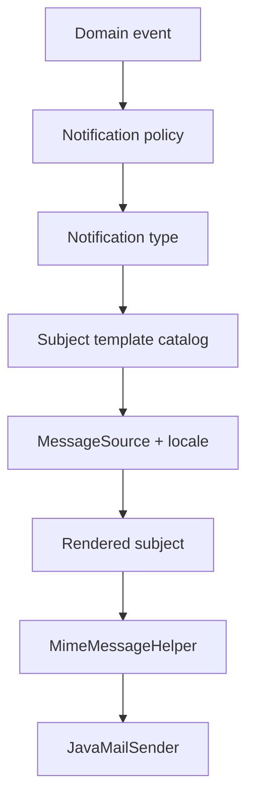

# Template subject theo mã sự kiện hoặc loại thông báo

Trong một ứng dụng Spring Framework Mail, subject thường phụ thuộc vào **loại thông báo** mà ứng dụng gửi: xác nhận đơn hàng, thanh toán thất bại, đặt lại mật khẩu, giao hàng thành công hoặc nhắc lịch hẹn. Nếu viết subject trực tiếp trong từng service bằng cách nối chuỗi, nội dung sẽ khó bản địa hóa, khó kiểm thử và dễ không nhất quán giữa những nơi cùng gửi một loại thông báo.

Một cách tổ chức dễ quản lý hơn là tạo **catalog subject template** theo mã thông báo (*notification type*) hoặc mã sự kiện nghiệp vụ (*event code*). Mỗi loại thông báo được ánh xạ tới một message code ổn định. **MessageSource** của Spring tra cứu mẫu theo locale và điền dữ liệu động như mã đơn hàng, tên sản phẩm hoặc ngày hẹn. Sau khi render, subject được đặt vào **MimeMessage** bằng **MimeMessageHelper** hoặc Jakarta Mail.

Bài học này trình bày cách phân biệt event code với notification type, tổ chức catalog và resource bundle, thiết kế placeholder, tích hợp với Spring Mail, xử lý locale/fallback, kiểm soát dữ liệu đưa vào header và kiểm thử subject theo từng loại thông báo.

## 1. Vì sao cần template subject theo loại thông báo?

Giả sử ứng dụng có các luồng gửi email sau:

- Đơn hàng vừa được xác nhận.
- Thanh toán cho đơn hàng thất bại.
- Yêu cầu đặt lại mật khẩu được tạo.
- Gói hàng đã được bàn giao cho đơn vị vận chuyển.
- Lịch hẹn sắp diễn ra.
- Người dùng được mời tham gia một workspace.

Nếu mỗi service tự tạo subject:

```java
String subject = "Order " + orderNumber + " confirmed";
```

hoặc:

```java
String subject = "Payment failed for order " + orderNumber;
```

thì câu chữ sẽ phân tán trong code. Khi đội nội dung muốn đổi cách diễn đạt, thêm ngôn ngữ hoặc thống nhất cách viết mã đơn hàng, phải tìm và sửa nhiều nơi. Các service cũng có thể dùng cách viết khác nhau cho cùng một loại email.

Template subject tập trung giải quyết các vấn đề đó:

1. **Nhất quán:** cùng một loại thông báo dùng cùng một message code và quy tắc diễn đạt.
2. **Bản địa hóa:** một template key có các giá trị tương ứng cho `vi-VN`, `en-US`, `ja-JP`...
3. **Tách nội dung khỏi nghiệp vụ:** service quyết định gửi thông báo gì; catalog quyết định câu subject hiển thị.
4. **Dễ kiểm thử:** có thể kiểm tra subject mà không cần kết nối SMTP.
5. **Dễ theo dõi thay đổi:** nội dung được quản lý trong resource bundle hoặc template catalog có lịch sử.
6. **Dễ mở rộng:** thêm loại thông báo mới bằng cách đăng ký một key và các bản dịch tương ứng.

Ví dụ cùng loại thông báo xác nhận đơn hàng:

| Locale | Subject |
|---|---|
| `vi-VN` | Xác nhận đơn hàng ORD-2026-001 |
| `en-US` | Order ORD-2026-001 is confirmed |
| `ja-JP` | 注文 ORD-2026-001 が確定しました |

Dữ liệu động `ORD-2026-001` được đưa vào mẫu; phần câu chữ thay đổi theo locale.

## 2. Phân biệt event code và notification type

Hai khái niệm này liên quan nhưng không nhất thiết giống nhau.

**Event code** nhận dạng một sự kiện nghiệp vụ đã xảy ra, ví dụ:

- `ORDER_CONFIRMED`
- `PAYMENT_DECLINED`
- `PASSWORD_RESET_REQUESTED`
- `SHIPMENT_DISPATCHED`
- `APPOINTMENT_REMINDER_DUE`

**Notification type** nhận dạng loại thông báo mà ứng dụng quyết định gửi tới một nhóm người nhận, ví dụ:

- `ORDER_CONFIRMATION`
- `PAYMENT_FAILURE_NOTICE`
- `PASSWORD_RESET_EMAIL`
- `SHIPMENT_UPDATE`
- `APPOINTMENT_REMINDER`

Một event có thể dẫn tới nhiều notification type. Khi đơn hàng được xác nhận, ứng dụng có thể gửi email cho khách hàng, thông báo cho người bán và cập nhật cho đội vận hành. Ba thông báo này có thể có subject khác nhau dù cùng xuất phát từ event `ORDER_CONFIRMED`.

```text
Domain event: ORDER_CONFIRMED
        |
        +--> Notification type: CUSTOMER_ORDER_CONFIRMATION
        |
        +--> Notification type: SELLER_NEW_ORDER
        |
        +--> Notification type: OPERATIONS_ORDER_UPDATE
```

Vì vậy, **không nên mặc định lấy tên class event làm subject message key**. Hãy có một bước ánh xạ nghiệp vụ từ event sang notification type, có xét người nhận và mục đích thông báo.

### Chọn notification type làm khóa subject

Trong nhiều ứng dụng, notification type là khóa ổn định và phù hợp hơn event code vì nó mô tả nội dung mà người nhận sẽ thấy.

Ví dụ:

```java
public enum NotificationType {
    CUSTOMER_ORDER_CONFIRMATION,
    SELLER_NEW_ORDER,
    PAYMENT_FAILURE_NOTICE,
    PASSWORD_RESET_EMAIL,
    SHIPMENT_UPDATE,
    APPOINTMENT_REMINDER
}
```

Mỗi enum có thể được ánh xạ tới message code:

```java
public enum NotificationType {
    CUSTOMER_ORDER_CONFIRMATION("mail.subject.order-confirmation"),
    SELLER_NEW_ORDER("mail.subject.seller-new-order"),
    PAYMENT_FAILURE_NOTICE("mail.subject.payment-failed"),
    PASSWORD_RESET_EMAIL("mail.subject.password-reset"),
    SHIPMENT_UPDATE("mail.subject.shipment-update"),
    APPOINTMENT_REMINDER("mail.subject.appointment-reminder");

    private final String subjectCode;

    NotificationType(String subjectCode) {
        this.subjectCode = subjectCode;
    }

    public String subjectCode() {
        return subjectCode;
    }
}
```

Message code là định danh trong ứng dụng, không phải nội dung hiển thị cho người nhận. Nó có thể giữ nguyên giữa các ngôn ngữ.

## 3. Thiết kế catalog subject template

Một catalog subject nên thể hiện được tối thiểu:

- Notification type.
- Message code.
- Locale được hỗ trợ.
- Các tham số động mà template yêu cầu.
- Phiên bản hoặc release của nội dung nếu cần tái hiện lịch sử.
- Quy tắc fallback khi thiếu bản dịch.

Ví dụ catalog logic:

| Notification type | Message code | Tham số |
|---|---|---|
| `CUSTOMER_ORDER_CONFIRMATION` | `mail.subject.order-confirmation` | `orderNumber` |
| `SELLER_NEW_ORDER` | `mail.subject.seller-new-order` | `orderNumber`, `itemCount` |
| `PAYMENT_FAILURE_NOTICE` | `mail.subject.payment-failed` | `orderNumber` |
| `PASSWORD_RESET_EMAIL` | `mail.subject.password-reset` | Không có hoặc thời điểm yêu cầu |
| `SHIPMENT_UPDATE` | `mail.subject.shipment-update` | `orderNumber`, `trackingCode` |
| `APPOINTMENT_REMINDER` | `mail.subject.appointment-reminder` | `appointmentDate` |

Không cần lưu toàn bộ catalog trong database nếu nội dung thay đổi cùng release ứng dụng. Với dự án đơn giản, enum và resource bundle có thể đủ. Nếu đội nội dung cần quản lý template ngoài vòng đời deploy, có thể dùng database hoặc một hệ thống template service, nhưng cần versioning, kiểm soát quyền và audit.

### Đặt tên message code

Nên dùng quy ước nhất quán:

```text
mail.subject.order-confirmation
mail.subject.payment-failed
mail.subject.password-reset
mail.subject.shipment-update
mail.subject.appointment-reminder
```

Tên key nên mô tả mục đích, không phụ thuộc câu chữ hiện tại. Nếu subject đổi từ “Order confirmed” sang “Your order is confirmed”, không cần đổi key vì ý nghĩa thông báo vẫn là xác nhận đơn hàng.

Tránh những key quá chung như `mail.subject.default`, `mail.title.1` hoặc `mail.subject.new`. Chúng khiến người duy trì khó xác định loại email đang sử dụng.

## 4. Lưu subject trong ResourceBundle và MessageSource

Spring cung cấp **MessageSource** để tra cứu message theo code, tham số và locale. Đây là lựa chọn phù hợp cho subject có câu chữ ngắn và placeholder đơn giản.

Cấu trúc file:

```text
src/main/resources/
└── mail/
    ├── subjects.properties
    ├── subjects_vi.properties
    ├── subjects_vi_VN.properties
    ├── subjects_en.properties
    ├── subjects_en_US.properties
    └── subjects_ja_JP.properties
```

Ví dụ file tiếng Việt `subjects_vi_VN.properties`:

```properties
mail.subject.order-confirmation=Xác nhận đơn hàng {0}
mail.subject.seller-new-order=Bạn có đơn hàng mới {0}
mail.subject.payment-failed=Thanh toán cho đơn hàng {0} chưa thành công
mail.subject.password-reset=Yêu cầu đặt lại mật khẩu
mail.subject.shipment-update=Cập nhật vận chuyển đơn hàng {0}
mail.subject.appointment-reminder=Nhắc lịch hẹn lúc {0}
```

Ví dụ file tiếng Anh `subjects_en_US.properties`:

```properties
mail.subject.order-confirmation=Order {0} is confirmed
mail.subject.seller-new-order=You received a new order {0}
mail.subject.payment-failed=Payment failed for order {0}
mail.subject.password-reset=Password reset request
mail.subject.shipment-update=Shipping update for order {0}
mail.subject.appointment-reminder=Reminder: your appointment is at {0}
```

Ví dụ file tiếng Nhật `subjects_ja_JP.properties`:

```properties
mail.subject.order-confirmation=注文 {0} が確定しました
mail.subject.seller-new-order=新しい注文 {0} が届きました
mail.subject.payment-failed=注文 {0} の決済に失敗しました
mail.subject.password-reset=パスワード再設定のリクエスト
mail.subject.shipment-update=注文 {0} の配送状況が更新されました
mail.subject.appointment-reminder=予約時刻 {0} のお知らせ
```

Các file này có cùng message code nhưng câu chữ phù hợp với từng ngôn ngữ. Khi thêm locale mới, cần cung cấp các key bắt buộc hoặc có chính sách fallback được sản phẩm chấp thuận.

### Cấu hình MessageSource

Có thể khai báo một `ResourceBundleMessageSource` riêng cho email:

```java
import org.springframework.context.MessageSource;
import org.springframework.context.annotation.Bean;
import org.springframework.context.annotation.Configuration;
import org.springframework.context.support.ResourceBundleMessageSource;

@Configuration
public class MailSubjectConfiguration {

    @Bean("mailSubjectMessageSource")
    public MessageSource mailSubjectMessageSource() {
        ResourceBundleMessageSource source =
                new ResourceBundleMessageSource();

        source.setBasenames("mail/subjects");
        source.setDefaultEncoding("UTF-8");
        source.setFallbackToSystemLocale(false);

        return source;
    }
}
```

`setBasenames("mail/subjects")` trỏ tới resource bundle trong classpath. Không cần ghi phần mở rộng `.properties`. UTF-8 giúp lưu nội dung tiếng Việt, Nhật và các ký tự Unicode. `setFallbackToSystemLocale(false)` tránh để locale mặc định của máy chủ vô tình quyết định kết quả tra cứu.

Nếu dùng Spring Boot auto-configuration cho message source, có thể cấu hình basename và encoding trong `application.yml`. Khi khai báo bean riêng, hãy dùng `@Qualifier` để tránh nhầm với message source dành cho giao diện web hoặc module khác.

### Tra cứu một subject

```java
String subject = messageSource.getMessage(
        "mail.subject.order-confirmation",
        new Object[] { orderNumber },
        locale
);
```

Spring sẽ chọn bundle theo locale, rồi áp dụng tham số theo quy tắc `MessageFormat`. Nếu key không tồn tại và không có default message, `NoSuchMessageException` có thể được ném ra. Với email giao dịch, lỗi rõ ràng thường tốt hơn gửi một subject thiếu hoặc sai ngôn ngữ.

## 5. Dùng notification type để chọn template

Không nên để service tự ghép message code từ dữ liệu bên ngoài:

```java
// Không nên lấy message key từ input tùy ý.
String code = "mail.subject." + request.getType();
```

Nếu giá trị `type` đến từ request hoặc message queue, nó có thể không hợp lệ hoặc trỏ tới key không được phép. Dùng enum hoặc catalog đã đăng ký để giới hạn tập loại thông báo.

Một resolver đơn giản:

```java
import java.util.Locale;
import org.springframework.beans.factory.annotation.Qualifier;
import org.springframework.context.MessageSource;
import org.springframework.stereotype.Component;

@Component
public class NotificationSubjectResolver {

    private final MessageSource messageSource;

    public NotificationSubjectResolver(
            @Qualifier("mailSubjectMessageSource")
            MessageSource messageSource
    ) {
        this.messageSource = messageSource;
    }

    public String resolve(
            NotificationType type,
            Locale locale,
            Object... arguments
    ) {
        return messageSource.getMessage(
                type.subjectCode(),
                arguments,
                locale
        );
    }
}
```

Cách sử dụng:

```java
String subject = subjectResolver.resolve(
        NotificationType.CUSTOMER_ORDER_CONFIRMATION,
        Locale.forLanguageTag("vi-VN"),
        orderNumber
);
```

Resolver chỉ chấp nhận một `NotificationType` đã biết. `subjectCode()` được định nghĩa trong enum nên message key không bị điều khiển tùy ý từ bên ngoài.

### Vì sao vẫn cần kiểm soát arguments?

Enum giới hạn message code, nhưng `Object... arguments` vẫn có thể truyền sai số lượng hoặc sai thứ tự tham số. Ví dụ template xác nhận đơn hàng yêu cầu một tham số `orderNumber`, trong khi caller truyền cả tên khách hàng và số tiền. `MessageFormat` có thể bỏ qua tham số dư hoặc để placeholder chưa được thay nếu thiếu tham số tương ứng.

Với hệ thống lớn, hãy xây dựng mapper có kiểu dữ liệu rõ ràng cho từng notification type. Ví dụ `OrderConfirmationData` chứa order number; `PaymentFailureData` chứa order number và reason; mapper chịu trách nhiệm tạo đúng tham số. Có thể viết các phương thức chuyên biệt thay vì cho mọi caller truyền `Object...`.

## 6. Tách event mapping, dữ liệu subject và bước gửi email

Một luồng dễ bảo trì:



Các lớp có trách nhiệm riêng:

- **Domain event:** ghi nhận sự kiện nghiệp vụ như đơn hàng được xác nhận.
- **Notification policy:** quyết định có gửi email không, gửi cho ai và dùng loại thông báo nào.
- **Notification type:** định danh mục đích thông báo.
- **Subject catalog:** ánh xạ loại thông báo tới message code và quy tắc arguments.
- **Locale policy:** chọn locale người nhận hoặc locale của giao dịch.
- **Subject resolver:** render câu subject.
- **Mail sender:** đặt subject và body vào `MimeMessage`, sau đó gửi SMTP.

Việc tách này giúp cùng một event có thể tạo nhiều thông báo, và cùng một notification type có thể được phát sinh từ nhiều event khác nhau.

### Ví dụ event handler

```java
public void onOrderConfirmed(OrderConfirmed event) {
    Customer customer = customerRepository.findById(
            event.customerId()
    ).orElseThrow();

    String subject = subjectResolver.resolve(
            NotificationType.CUSTOMER_ORDER_CONFIRMATION,
            customer.mailLocale(),
            event.orderNumber()
    );

    mailService.sendOrderConfirmation(
            customer.email(),
            subject,
            event
    );
}
```

Ví dụ cho thấy event handler chọn notification type và locale. Trong ứng dụng thực tế, việc truy xuất khách hàng, kiểm tra preference và tạo outbox nên tuân theo transaction/consistency model của hệ thống.

## 7. Thiết kế placeholder trong subject

Subject thường ngắn, vì vậy placeholder cần có ý nghĩa rõ ràng và không làm câu trở nên khó dịch.

Ví dụ:

```properties
mail.subject.order-confirmation=Order {0} is confirmed
mail.subject.payment-failed=Payment for order {0} failed
mail.subject.shipment-update=Shipment {0} is on its way
```

Ở đây `{0}` là mã đơn hàng hoặc mã vận chuyển. Cần định nghĩa hợp đồng tham số cho từng message code:

| Message code | Placeholder | Kiểu dữ liệu | Quy tắc |
|---|---|---|---|
| `mail.subject.order-confirmation` | `{0}` | String | Mã đơn hàng đã được kiểm tra. |
| `mail.subject.payment-failed` | `{0}` | String | Mã đơn hàng, không chứa CR/LF. |
| `mail.subject.appointment-reminder` | `{0}` | String đã format | Ngày giờ theo locale và time zone người nhận. |
| `mail.subject.seller-new-order` | `{0}` | String | Mã đơn hàng; không đưa thông tin riêng tư vào subject. |

### Đặt cả câu trong bundle, không nối các mảnh câu

Tránh:

```java
String subject = prefix + orderNumber + suffix;
```

Cách này giả định thứ tự từ giống nhau giữa các ngôn ngữ. Trong một số ngôn ngữ, mã đơn hàng có thể đứng trước hoặc sau cụm danh từ, dấu câu cũng có thể khác. Để người dịch kiểm soát toàn câu, hãy đặt câu hoàn chỉnh trong bundle và dùng placeholder.

### Đừng đưa quá nhiều dữ liệu vào subject

Subject nên giúp người nhận nhận biết email, không phải chứa toàn bộ nội dung thông báo. Tránh đưa địa chỉ, thông tin thanh toán đầy đủ, token, mã xác thực hoặc dữ liệu nhạy cảm vào subject. Những dữ liệu này có thể xuất hiện trên màn hình khóa, notification preview hoặc danh sách thư.

Nếu subject cần một biến động, ưu tiên một định danh ngắn như mã đơn hàng thay vì toàn bộ tên sản phẩm, địa chỉ hoặc nội dung giao dịch.

## 8. Format tham số theo locale trước khi render

`MessageSource` dùng `MessageFormat` để xử lý tham số. Có thể dùng các pattern định dạng số/ngày đơn giản, nhưng cần hiểu locale và nguồn dữ liệu.

Ví dụ:

```properties
mail.subject.invoice-ready=Invoice {0} is ready
mail.subject.item-count=You have {0,number,integer} items to review
```

Với subject có ngày giờ, thường nên format trước bằng `DateTimeFormatter` cùng locale và time zone cụ thể, rồi truyền chuỗi đã format:

```java
Instant appointmentTime = event.appointmentTime();
Locale locale = customer.mailLocale();
ZoneId zoneId = customer.timeZone();

String formattedTime = DateTimeFormatter
        .ofLocalizedDateTime(FormatStyle.SHORT)
        .withLocale(locale)
        .withZone(zoneId)
        .format(appointmentTime);

String subject = subjectResolver.resolve(
        NotificationType.APPOINTMENT_REMINDER,
        locale,
        formattedTime
);
```

Không nên để `MessageFormat` tự dùng timezone mặc định của JVM cho ngày giờ quan trọng. Locale, time zone và currency là các thông tin riêng; lấy time zone từ hồ sơ/lịch hẹn, currency từ giao dịch.

Với tiền tệ, format bằng `NumberFormat` hoặc thư viện tiền tệ phù hợp, dựa trên currency code thực tế của giao dịch. Sau đó truyền chuỗi đã format vào subject. Không suy ra tiền tệ chỉ từ locale.

## 9. Xử lý số nhiều và subject phức tạp

Subject thường ngắn nhưng một số loại thông báo cần biểu diễn số lượng:

- “Bạn có 1 đơn hàng mới”.
- “Bạn có 3 đơn hàng mới”.
- “Có 1 tệp mới được chia sẻ”.
- “Có 5 tệp mới được chia sẻ”.

Không nên nối hậu tố số nhiều trong Java vì quy tắc giữa các ngôn ngữ không giống nhau. `MessageFormat` cơ bản không cung cấp đầy đủ quy tắc plural theo CLDR cho mọi ngôn ngữ.

Với nội dung số nhiều phức tạp, cân nhắc ICU MessageFormat. Một pattern minh họa:

```text
{count, plural,
    one {You have one new order}
    other {You have # new orders}
}
```

Đây là cú pháp ICU, không phải cú pháp `java.text.MessageFormat` mặc định. Cần thêm thư viện và tích hợp phù hợp. Với một số ngôn ngữ, các category số nhiều có thể gồm `zero`, `one`, `two`, `few`, `many` và `other`.

Nếu subject không cần số nhiều phức tạp, có thể giữ nó ngắn và dùng một câu trung tính như “Có cập nhật mới về đơn hàng của bạn”. Chọn cách diễn đạt theo yêu cầu nội dung và ngôn ngữ, không ép mọi ngôn ngữ theo quy tắc tiếng Anh.

## 10. Locale fallback khi thiếu subject template

Không phải loại thông báo nào cũng được dịch sang tất cả locale. Cần quy định rõ:

1. Tìm bundle đúng locale, ví dụ `ja-JP`.
2. Nếu không có bundle vùng, có thể fallback về ngôn ngữ `ja`.
3. Nếu không có bản dịch ngôn ngữ, fallback về locale mặc định được sản phẩm công bố, ví dụ `en-US`.
4. Nếu vẫn thiếu key, báo lỗi render và xử lý theo chính sách.

Ví dụ:

```text
requestedLocale = ja-JP
        |
        v
subjects_ja_JP.properties
        | key không có
        v
subjects_ja.properties
        | bundle/key không có
        v
subjects_en_US.properties
        |
        v
resolvedLocale = en-US
```

`ResourceBundleMessageSource` hỗ trợ tra cứu bundle theo quy tắc locale. Tuy nhiên, fallback cho một message code bị thiếu trong bundle cụ thể cần được kiểm tra theo cấu hình và cách tổ chức bundle. Không nên mặc định rằng mọi thiếu sót đều tự động fallback đúng theo ý muốn sản phẩm.

### Không fallback âm thầm

Nếu người dùng chọn `ja-JP` nhưng subject cuối cùng bằng tiếng Anh, hãy ghi nhận:

```text
notificationType = ORDER_CONFIRMATION
requestedLocale  = ja-JP
resolvedLocale   = en-US
fallbackReason   = SUBJECT_TRANSLATION_MISSING
```

Với email pháp lý, bảo mật hoặc nội dung bắt buộc theo thị trường, fallback sang ngôn ngữ khác có thể không được phép. Trong trường hợp đó, hãy chặn việc tạo yêu cầu gửi cho đến khi có bản dịch đã duyệt.

### Thiếu key nên là lỗi có thể quan sát

Nếu gọi:

```java
messageSource.getMessage(code, args, locale);
```

mà key không tồn tại, Spring có thể ném `NoSuchMessageException`. Đừng bắt exception rồi trả về chuỗi rỗng hoặc tên key để email tiếp tục được gửi. Hãy log loại thông báo, code, locale và release; tránh log toàn bộ dữ liệu nhạy cảm.

## 11. Tích hợp subject template với MimeMessageHelper

Sau khi resolver tạo subject, dùng nó khi xây `MimeMessage`.

```java
import jakarta.mail.MessagingException;
import jakarta.mail.internet.MimeMessage;
import java.nio.charset.StandardCharsets;
import java.util.Locale;
import org.springframework.mail.javamail.JavaMailSender;
import org.springframework.mail.javamail.MimeMessageHelper;
import org.springframework.stereotype.Service;

@Service
public class NotificationMailService {

    private final JavaMailSender mailSender;
    private final NotificationSubjectResolver subjectResolver;

    public NotificationMailService(
            JavaMailSender mailSender,
            NotificationSubjectResolver subjectResolver
    ) {
        this.mailSender = mailSender;
        this.subjectResolver = subjectResolver;
    }

    public void sendOrderConfirmation(
            String recipient,
            String orderNumber,
            Locale locale,
            String plainText,
            String html
    ) throws MessagingException {

        String subject = subjectResolver.resolve(
                NotificationType.CUSTOMER_ORDER_CONFIRMATION,
                locale,
                orderNumber
        );

        MimeMessage message = mailSender.createMimeMessage();

        MimeMessageHelper helper = new MimeMessageHelper(
                message,
                false,
                StandardCharsets.UTF_8.name()
        );

        helper.setFrom("orders@example.org", "Example Store");
        helper.setTo(recipient);
        helper.setSubject(subject);
        helper.setText(plainText, html);

        mailSender.send(message);
    }
}
```

`MimeMessageHelper` nhận encoding trong constructor và dùng encoding đó khi thiết lập subject/body. Subject Unicode như tiếng Việt hoặc tiếng Nhật được Jakarta Mail xử lý theo cơ chế header encoding; không tự chuyển subject sang Base64 hoặc tự ghép raw `Subject:` header.

Nếu email có ảnh inline hoặc attachment, chọn multipart mode tương ứng và tạo body như các bài về MIME multipart. Cơ chế chọn subject theo notification type vẫn giữ nguyên, không phụ thuộc cách dựng body.

### Tách subject resolver khỏi mail transport

`NotificationSubjectResolver` không cần biết SMTP host, password, recipient hoặc attachment. Nó chỉ nhận loại thông báo, locale và dữ liệu subject rồi trả về chuỗi. Nhờ đó có thể kiểm thử resolver độc lập với `JavaMailSender`.

## 12. Kiểm soát an toàn dữ liệu động trong Subject

Subject là một email header, không phải HTML body. Dữ liệu động đưa vào subject cần được kiểm tra để tránh lỗi header hoặc nội dung gây hiểu nhầm.

### Chặn CR và LF trong tham số

Các ký tự xuống dòng `\r` và `\n` có thể làm header không hợp lệ hoặc tạo nguy cơ header injection nếu dữ liệu được ghép/đặt không an toàn. Hãy validate các biến có nguồn bên ngoài trước khi render.

Ví dụ:

```java
public final class SubjectValueValidator {

    private SubjectValueValidator() {}

    public static String requireSingleLine(
            String value,
            String fieldName
    ) {
        if (value == null) {
            throw new IllegalArgumentException(
                    fieldName + " must not be null"
            );
        }

        for (int offset = 0; offset < value.length();) {
            int codePoint = value.codePointAt(offset);

            if (Character.isISOControl(codePoint)) {
                throw new IllegalArgumentException(
                        fieldName + " contains a control character"
                );
            }

            offset += Character.charCount(codePoint);
        }

        return value;
    }
}
```

Ví dụ này từ chối mọi ký tự điều khiển, bao gồm CR/LF. Với trường hợp nghiệp vụ cần tab hoặc một loại ký tự đặc biệt, hãy định nghĩa allowlist cụ thể; không nên chấp nhận newline trong subject.

### Kiểm tra dữ liệu theo ngữ nghĩa

Ngoài CR/LF, hãy validate theo loại dữ liệu:

- Mã đơn hàng theo format hợp lệ của domain.
- Tên sản phẩm có giới hạn độ dài và được xử lý Unicode đúng.
- Mã tracking không chứa control character.
- Giá trị hiển thị đã được format theo locale.
- Không đưa token, password hoặc thông tin cá nhân nhạy cảm vào subject.

Không dựa vào HTML escaping để bảo vệ subject. HTML escaping dành cho HTML context; subject cần validation cho header và dữ liệu hiển thị.

### Giới hạn độ dài subject

RFC 5322 khuyến nghị giới hạn dòng header ở 78 ký tự và quy định giới hạn cứng 998 ký tự cho một dòng header, không tính CRLF. Mail library có thể tự fold header khi serialize. Dịch vụ email và client cũng có thể cắt subject trong giao diện.

Ứng dụng nên đặt một giới hạn sản phẩm hợp lý, ví dụ 120–180 Unicode code point tùy nội dung và client mục tiêu. Đây là chính sách ứng dụng, không phải một giới hạn bắt buộc chung của Spring. Nếu cần rút gọn, thực hiện theo code point thay vì cắt giữa surrogate pair; tránh cắt mã định danh quan trọng.

### Không tự tạo raw header

Dùng:

```java
helper.setSubject(subject);
```

hoặc:

```java
message.setSubject(subject, "UTF-8");
```

Không tự gọi `setHeader("Subject", ...)` với chuỗi đã encode thủ công nếu không có yêu cầu giao thức đặc biệt. Jakarta Mail chịu trách nhiệm encoding và folding header.

## 13. Quản lý version của subject template

Nội dung subject có thể thay đổi theo chiến dịch, sản phẩm hoặc quy định. Nếu chỉ ghi đè giá trị trong bundle, email trong queue có thể được render bằng nội dung mới dù yêu cầu gửi được tạo từ trước.

Có một số chiến lược:

### Template phát hành cùng ứng dụng

Subject bundle được đóng gói trong artifact. Mỗi release có commit/tag cụ thể. Email được tạo và gửi trong cùng một phiên bản ứng dụng sẽ dùng bộ nội dung của release đó.

Cách này đơn giản, phù hợp khi nội dung thay đổi cùng nhịp triển khai phần mềm.

### Pin release hoặc version trong outbox

Nếu email được gửi bất đồng bộ, lưu version/release của subject catalog cùng yêu cầu gửi:

```json
{
  "messageId": "mail-91af",
  "notificationType": "CUSTOMER_ORDER_CONFIRMATION",
  "subjectCatalogVersion": "mail-content-v3",
  "requestedLocale": "vi-VN",
  "resolvedLocale": "vi-VN",
  "payload": {
    "orderNumber": "ORD-2026-001"
  }
}
```

Worker dùng đúng release đã được ghi. Điều này cần catalog lưu được nhiều phiên bản hoặc artifact version tương ứng vẫn truy cập được.

### Version riêng cho từng notification type

Một số thông báo có thể thay đổi độc lập. Khi đó, metadata có thể gắn version riêng theo notification type/locale. Cách này linh hoạt hơn nhưng tăng độ phức tạp catalog và quy trình phát hành.

Dù chọn cách nào, cần xác định rõ liệu worker dùng subject tại **thời điểm tạo yêu cầu** hay **thời điểm gửi**. Không để lựa chọn đó phụ thuộc vào việc worker tình cờ load bundle mới nhất.

## 14. Theo dõi và ghi log việc render subject

Khi điều tra email gửi sai subject, cần biết:

- Notification type nào đã được chọn.
- Event code nào phát sinh yêu cầu.
- Message code nào đã được dùng.
- Requested locale và resolved locale.
- Catalog/release version.
- Kết quả render thành công hay lỗi.
- Message ID nội bộ để liên kết với log gửi SMTP.

Ví dụ log cấu trúc:

```text
messageId=mail-91af
eventCode=ORDER_CONFIRMED
notificationType=CUSTOMER_ORDER_CONFIRMATION
messageCode=mail.subject.order-confirmation
requestedLocale=vi-VN
resolvedLocale=vi-VN
catalogVersion=mail-content-v3
subjectRendered=true
smtpStatus=ACCEPTED
```

Không cần ghi toàn bộ subject nếu nó có thể chứa dữ liệu cá nhân hoặc mã nhạy cảm. Nếu cần kiểm tra nội dung chính xác, có thể lưu hash hoặc bản render trong kho audit được kiểm soát quyền truy cập và retention.

Khi subject resolver thất bại, log message code và locale để biết thiếu bundle/key. Không log payload đầy đủ nếu payload chứa thông tin cá nhân, token hoặc dữ liệu giao dịch nhạy cảm.

## 15. Kiểm thử catalog subject theo notification type

Subject template nên được kiểm thử độc lập. Một bộ test cơ bản xác nhận:

- Notification type được ánh xạ tới đúng message code.
- Mỗi locale được hỗ trợ có message code bắt buộc.
- Placeholder được thay thế đúng.
- Subject không chứa placeholder còn sót như `{0}`.
- Subject không chứa CR/LF/control character từ dữ liệu động.
- Unicode được giữ nguyên.
- Fallback hoạt động đúng chính sách.
- Subject không vượt giới hạn sản phẩm.
- Event mapping chọn đúng notification type cho người nhận.

### Unit test cho resolver

```java
@Test
void rendersOrderConfirmationSubjectInVietnamese() {
    String subject = subjectResolver.resolve(
            NotificationType.CUSTOMER_ORDER_CONFIRMATION,
            Locale.forLanguageTag("vi-VN"),
            "ORD-001"
    );

    assertThat(subject).isEqualTo("Xác nhận đơn hàng ORD-001");
}
```

Test tiếng Anh:

```java
@Test
void rendersOrderConfirmationSubjectInEnglish() {
    String subject = subjectResolver.resolve(
            NotificationType.CUSTOMER_ORDER_CONFIRMATION,
            Locale.forLanguageTag("en-US"),
            "ORD-001"
    );

    assertThat(subject).isEqualTo("Order ORD-001 is confirmed");
}
```

Các giá trị mong đợi phải khớp chính xác với resource bundle của dự án.

### Test thiếu message code

Nếu một notification type bắt buộc có subject cho locale, hãy xác nhận resolver báo lỗi khi key không tồn tại. Đừng chấp nhận chuỗi rỗng hoặc tên key bị hiển thị như subject.

### Test tham số và header safety

```java
@Test
void rejectsLineBreakInDynamicSubjectArgument() {
    assertThatThrownBy(() ->
            SubjectValueValidator.requireSingleLine(
                    "ORD-001\r\nBcc: attacker@example.net",
                    "orderNumber"
            )
    ).isInstanceOf(IllegalArgumentException.class);
}
```

Test này kiểm tra validator của ứng dụng. Vẫn nên dùng API chuẩn `MimeMessageHelper`/Jakarta Mail để thiết lập header.

### Ma trận kiểm thử

| Notification type | `vi-VN` | `en-US` | `ja-JP` | Tham số |
|---|---|---|---|---|
| Order confirmation | Có | Có | Có | Order number |
| Payment failure | Có | Có | Có | Order number |
| Password reset | Có | Có | Có | Có thể không cần |
| Shipment update | Có | Có | Có | Tracking/order code |
| Appointment reminder | Có | Có | Có | Localized date/time |

Trong CI, có thể duyệt toàn bộ enum notification type và locale được hỗ trợ để phát hiện key còn thiếu trước khi release. Nếu có ngoại lệ fallback được chấp nhận, khai báo rõ trong catalog thay vì bỏ qua test.

## 16. Những lỗi thường gặp

| Triệu chứng | Nguyên nhân có thể | Hướng xử lý |
|---|---|---|
| Subject vẫn là tiếng Anh dù body tiếng Việt | Subject dùng locale mặc định hoặc message code khác | Truyền cùng resolved locale cho subject và body. |
| Subject hiện nguyên `{0}` | Thiếu argument hoặc message pattern sai | Kiểm tra mapper và số lượng placeholder. |
| Subject rỗng | Key thiếu và lỗi bị bắt rồi trả chuỗi rỗng | Để lỗi render hiển thị và xử lý fallback có chủ đích. |
| Nhiều email cùng loại có câu chữ khác nhau | Subject được nối trực tiếp trong nhiều service | Dùng một notification type và catalog chung. |
| Event đúng nhưng subject sai mục đích | Ánh xạ event sang notification type chưa đúng | Kiểm tra notification policy và recipient. |
| Subject bị cắt giữa mã đơn hàng | Chuỗi quá dài hoặc client giới hạn preview | Giữ subject ngắn và đặt mã quan trọng ở đầu câu nếu phù hợp. |
| Subject có ký tự lỗi | Encoding bundle/header không nhất quán | Dùng UTF-8 và Jakarta Mail header encoding. |
| Subject bị thay đổi sau khi email vào queue | Worker load bundle active mới nhất | Pin catalog version/release theo chính sách. |
| Có thể tạo subject với CR/LF | Tham số không được validate | Từ chối control character trước khi render. |
| Thêm locale mới làm thiếu subject một số loại | Bundle không có đủ message code | Kiểm tra catalog theo notification type × locale. |
| Câu dịch không tự nhiên | Ghép các mảnh câu hoặc placeholder đặt sai | Dịch toàn câu và review theo ngữ cảnh. |
| Subject chứa dữ liệu nhạy cảm | Dùng quá nhiều dữ liệu động trong header | Chỉ đưa định danh tối thiểu cần thiết vào subject. |

## 17. Kiến trúc tham khảo

Một cấu trúc package có thể như sau:

```text
mail/
├── notification/
│   ├── NotificationType.java
│   ├── NotificationPolicy.java
│   └── NotificationEventHandler.java
├── subject/
│   ├── NotificationSubjectResolver.java
│   ├── SubjectArgumentsMapper.java
│   └── SubjectValueValidator.java
├── content/
│   ├── MailTemplateRenderer.java
│   └── MailMessageBuilder.java
├── sending/
│   ├── MailSenderService.java
│   └── MailDeliveryTracker.java
└── resources/
    └── mail/
        ├── subjects.properties
        ├── subjects_vi_VN.properties
        └── subjects_en_US.properties
```

Luồng hoạt động:

1. Domain event được xử lý.
2. Notification policy chọn người nhận và notification type.
3. Mapper tạo arguments theo hợp đồng của loại thông báo.
4. Subject resolver tra message code theo locale.
5. Body renderer tạo plain text/HTML.
6. Message builder tạo `MimeMessage`.
7. `JavaMailSender` gửi message.
8. Delivery tracker ghi nhận kết quả.

Không nhất thiết phải tạo tất cả lớp trên cho ứng dụng nhỏ. Điều quan trọng là **message code, dữ liệu động và locale được quản lý ở một nơi có thể kiểm soát**, thay vì mỗi service tự ghép subject.

## 18. Ghi nhớ

- **Event code** mô tả sự kiện nghiệp vụ; **notification type** mô tả thông báo gửi cho người nhận. Một event có thể tạo nhiều notification type.
- Dùng enum/catalog để ánh xạ notification type tới message code ổn định.
- Dùng `MessageSource` và resource bundle để quản lý subject theo locale.
- Đặt toàn bộ câu trong bundle, dùng placeholder cho dữ liệu động; tránh nối các mảnh câu trong Java.
- Tạo mapper cho arguments theo từng notification type để tránh thiếu hoặc sai thứ tự tham số.
- Format ngày giờ, số và tiền tệ theo locale, time zone và currency của dữ liệu nghiệp vụ trước khi render nếu cần.
- Chọn locale một lần cho subject và body; ghi requested/resolved locale khi cần audit.
- Dùng `MimeMessageHelper.setSubject(...)` hoặc `MimeMessage.setSubject(...)`; để Jakarta Mail xử lý encoding và folding header.
- Validate dữ liệu động trong subject, đặc biệt CR/LF, control character và độ dài; không đưa secret hoặc thông tin nhạy cảm vào header.
- Với queue/outbox, quyết định rõ catalog version được pin lúc tạo yêu cầu hay resolve lúc gửi.
- Kiểm thử notification type × locale, placeholder, fallback, Unicode và header safety trước khi release.

Template subject theo mã sự kiện hoặc loại thông báo giúp nội dung email nhất quán và dễ mở rộng. Khi **event được ánh xạ rõ sang notification type**, notification type được ánh xạ tới message code và message code được render theo locale, ứng dụng có thể tạo subject đúng ngữ cảnh mà vẫn giữ phần gửi email trong Spring Mail đơn giản và dễ kiểm soát.
