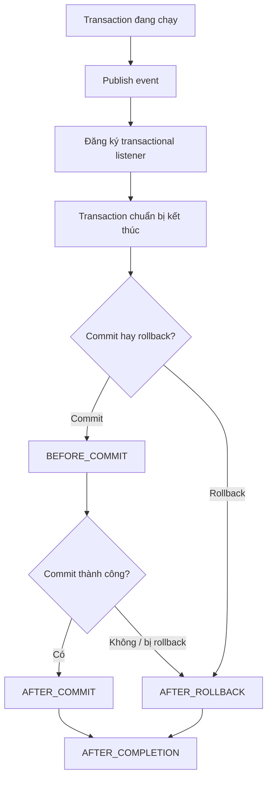

# Transactional event listener và các phase xử lý trong Spring Framework

Trong một ứng dụng Spring, một nghiệp vụ thường thực hiện nhiều thay đổi trong cùng transaction: tạo đơn hàng, cập nhật tồn kho, ghi nhận thanh toán hoặc lưu trạng thái tài khoản. Sau khi dữ liệu được commit, ứng dụng có thể cần thực hiện thêm hành động như gửi email xác nhận, phát thông báo, cập nhật chỉ mục tìm kiếm hoặc gọi một dịch vụ bên ngoài.

Nếu thực hiện những hành động đó ngay giữa transaction, chúng có thể xảy ra trước khi dữ liệu được commit. Ví dụ, email xác nhận đơn hàng được gửi đi nhưng transaction sau đó rollback; người nhận nhận được thông báo về một đơn hàng không tồn tại. Nếu chờ đến sau commit, hệ thống bảo đảm email chỉ được gửi sau khi giao dịch database đã thành công, dù vẫn cần cơ chế xử lý khi SMTP hoặc dịch vụ ngoài gặp lỗi.

Spring cung cấp `@TransactionalEventListener` để gắn một event listener với vòng đời của transaction. Thay vì chạy ngay khi event được publish như listener thông thường, listener transactional có thể được gọi ở một phase cụ thể: trước commit, sau commit, sau rollback hoặc sau khi transaction hoàn tất.

**Trong các nghiệp vụ cần gửi email xác nhận sau khi dữ liệu đã được lưu, phase thường dùng là `AFTER_COMMIT`.** Bài viết này giải thích các phase, cách publish event, cách kết hợp với Spring Mail, hành vi khi không có transaction, xử lý đồng bộ/bất đồng bộ và giới hạn về độ tin cậy của event trong bộ nhớ.

## 1. Event thông thường và transactional event listener

Spring application event là cơ chế để một thành phần phát thông báo về một sự kiện, còn thành phần khác đăng ký lắng nghe. Publisher không cần gọi trực tiếp từng listener.

Một listener thông thường dùng `@EventListener`:

```java
@Component
public class OrderEventListener {

    @EventListener
    public void onOrderPlaced(OrderPlacedEvent event) {
        // Listener được gọi khi event được publish.
    }
}
```

Khi publisher gọi `ApplicationEventPublisher.publishEvent(...)`, Spring dispatch event đến listener phù hợp. Với listener đồng bộ mặc định, phương thức listener chạy trong luồng đang publish event.

Nếu event được publish bên trong một method có `@Transactional`, listener thông thường vẫn được gọi ngay lúc publish. Transaction database có thể chưa commit:

```java
@Transactional
public void placeOrder(PlaceOrderCommand command) {
    Order order = orderRepository.save(createOrder(command));
    eventPublisher.publishEvent(new OrderPlacedEvent(order.getId()));
    // @EventListener có thể đã chạy trước khi method kết thúc.
}
```

Đây là điểm khác biệt quan trọng:

| Listener | Thời điểm gọi | Có gắn với phase transaction? |
|---|---|---|
| `@EventListener` | Khi event được dispatch | Không |
| `@TransactionalEventListener` | Phase được cấu hình của transaction chứa event | Có |

Với listener transactional:

```java
@Component
public class OrderMailListener {

    @TransactionalEventListener(
            phase = TransactionPhase.AFTER_COMMIT)
    public void onOrderPlaced(OrderPlacedEvent event) {
        // Chỉ chạy sau khi transaction commit thành công.
    }
}
```

Spring đăng ký listener với transaction synchronization hiện tại. Khi transaction đi đến phase đã chọn, Spring mới gọi listener. Nếu không có transaction đang hoạt động, listener mặc định không chạy.

## 2. Các phase của TransactionalEventListener

`@TransactionalEventListener` có thuộc tính `phase` nhận giá trị từ `TransactionPhase`. Bốn phase chính:

| Phase | Thời điểm | Trường hợp sử dụng |
|---|---|---|
| `BEFORE_COMMIT` | Ngay trước khi transaction commit | Kiểm tra hoặc chuẩn bị công việc cần hoàn tất trước commit |
| `AFTER_COMMIT` | Sau khi transaction commit thành công | Gửi email xác nhận, phát thông báo sau khi dữ liệu đã được lưu |
| `AFTER_ROLLBACK` | Sau khi transaction rollback | Bù trừ hoặc giải phóng tài nguyên bên ngoài |
| `AFTER_COMPLETION` | Sau khi transaction hoàn tất, dù commit hay rollback | Dọn dẹp tài nguyên không phụ thuộc kết quả |

Nếu không chỉ định `phase`, giá trị mặc định là `AFTER_COMMIT`.

### Thứ tự khái quát



Sơ đồ mô tả luồng khái quát. `BEFORE_COMMIT` chỉ chạy trong nhánh chuẩn bị commit; nếu listener phase này ném lỗi runtime khiến commit thất bại, transaction có thể rollback và listener `AFTER_ROLLBACK`/`AFTER_COMPLETION` phù hợp sẽ được xử lý theo trạng thái cuối cùng.

### 2.1. BEFORE_COMMIT

`BEFORE_COMMIT` được gọi trước khi transaction commit. Những thay đổi database thuộc transaction hiện tại vẫn có thể được commit cùng transaction. Nếu listener ném exception làm quá trình commit thất bại, transaction có thể bị rollback.

Ví dụ:

```java
@Component
public class OrderCommitListener {

    @TransactionalEventListener(
            phase = TransactionPhase.BEFORE_COMMIT)
    public void validateOrder(OrderPlacedEvent event) {
        if (event.totalAmount().signum() < 0) {
            throw new IllegalStateException(
                    "Order total must not be negative");
        }
    }
}
```

Ví dụ minh họa việc kiểm tra một bất biến trước commit. Trong thiết kế thực tế, các quy tắc cốt lõi của domain nên được kiểm tra trực tiếp trong domain/service layer để người đọc thấy rõ điều kiện tạo đơn hàng. Listener phase này phù hợp khi một thành phần cần tham gia giai đoạn chuẩn bị commit thông qua event.

**Không nên gửi email xác nhận ở `BEFORE_COMMIT`.** Nếu email được gửi thành công rồi transaction rollback, hệ thống đã phát ra thông tin không đúng với trạng thái dữ liệu cuối cùng. Tương tự, không nên gọi một API bên ngoài không thể rollback ở phase này nếu hành động đó có thể tạo hậu quả trước khi transaction commit.

### 2.2. AFTER_COMMIT

`AFTER_COMMIT` chạy khi transaction đã commit thành công. Đây là phase thường dùng cho các side effect cần phụ thuộc vào dữ liệu đã được ghi nhận.

Ví dụ: gửi email xác nhận đăng ký hoặc đơn hàng, phát notification, xóa cache, cập nhật read model hoặc kích hoạt một quy trình tiếp theo sau khi trạng thái nghiệp vụ đã được commit.

```java
@Component
public class OrderConfirmationListener {

    private final OrderMailService orderMailService;

    public OrderConfirmationListener(OrderMailService orderMailService) {
        this.orderMailService = orderMailService;
    }

    @TransactionalEventListener(
            phase = TransactionPhase.AFTER_COMMIT)
    public void sendConfirmation(OrderPlacedEvent event) {
        orderMailService.sendConfirmation(event);
    }
}
```

Nếu transaction rollback, phương thức trên không được gọi. Nếu commit thành công, Spring gọi listener ở phase sau commit.

Điều này giải quyết một lỗi nghiệp vụ thường gặp: email không được gửi khi transaction tạo đơn hàng thất bại. Tuy nhiên, commit database và gửi SMTP là hai hệ thống độc lập. Nếu SMTP lỗi sau khi database đã commit, đơn hàng vẫn tồn tại nhưng email có thể chưa được gửi. Phần sau sẽ trình bày cách xử lý giới hạn này.

### 2.3. AFTER_ROLLBACK

`AFTER_ROLLBACK` chỉ chạy khi transaction rollback. Nó hữu ích khi trước đó ứng dụng đã tạo một tác động bên ngoài cần bù trừ hoặc giải phóng.

Ví dụ, hệ thống đã giữ chỗ tài nguyên ở một dịch vụ ngoài trong khi xử lý nghiệp vụ; nếu transaction database rollback, listener có thể yêu cầu dịch vụ đó giải phóng reservation:

```java
@Component
public class ReservationRollbackListener {

    private final ReservationClient reservationClient;

    public ReservationRollbackListener(ReservationClient reservationClient) {
        this.reservationClient = reservationClient;
    }

    @TransactionalEventListener(
            phase = TransactionPhase.AFTER_ROLLBACK)
    public void releaseReservation(OrderPlacedEvent event) {
        reservationClient.release(event.orderId());
    }
}
```

Đây là ví dụ bù trừ. API release nên có tính idempotent: gọi lặp lại cho cùng reservation không gây hỏng trạng thái. Hệ thống cũng cần ghi nhận lỗi và retry nếu dịch vụ ngoài không phản hồi.

Nếu tất cả công việc chỉ là thay đổi trong cùng database transaction, rollback đã tự hoàn tác chúng; không cần thêm một listener để đảo ngược lần nữa. `AFTER_ROLLBACK` chủ yếu có ý nghĩa với tài nguyên hoặc side effect nằm ngoài transaction đã rollback.

### 2.4. AFTER_COMPLETION

`AFTER_COMPLETION` chạy sau khi transaction hoàn tất, bất kể commit hay rollback. Phase này phù hợp với cleanup không phụ thuộc kết quả:

- Giải phóng một tài nguyên tạm.
- Đóng hoặc xóa một artifact tạm được quản lý ngoài transaction.
- Ghi nhận metric hoặc thông tin hoàn tất không cần phân biệt kết quả.

Ví dụ:

```java
@Component
public class TemporaryResourceListener {

    private final TemporaryResourceService resourceService;

    public TemporaryResourceListener(TemporaryResourceService resourceService) {
        this.resourceService = resourceService;
    }

    @TransactionalEventListener(
            phase = TransactionPhase.AFTER_COMPLETION)
    public void cleanup(OrderProcessingEvent event) {
        resourceService.cleanupTemporaryFiles(event.processingId());
    }
}
```

Phương thức listener không tự nhận một tham số trạng thái commit/rollback. Nếu logic cleanup cần biết transaction kết thúc theo cách nào, hãy dùng các listener riêng cho `AFTER_COMMIT` và `AFTER_ROLLBACK`, hoặc đăng ký transaction synchronization ở mức thấp hơn để nhận completion status.

## 3. Mặc định AFTER_COMMIT và fallbackExecution

Hai thuộc tính thường cần hiểu rõ:

- `phase`: chọn phase xử lý; mặc định `AFTER_COMMIT`.
- `fallbackExecution`: quyết định listener có chạy khi event được publish mà không có transaction hay không; mặc định `false`.

Ví dụ:

```java
@TransactionalEventListener
public void onEvent(OrderPlacedEvent event) {
    // Mặc định chạy ở AFTER_COMMIT.
}
```

Với cấu hình mặc định, nếu event được publish khi không có transaction đang hoạt động, listener transactional sẽ không được gọi.

### Khi nào dùng fallbackExecution?

Nếu muốn listener vẫn chạy khi không có transaction:

```java
@TransactionalEventListener(
        phase = TransactionPhase.AFTER_COMMIT,
        fallbackExecution = true)
public void handle(OrderPlacedEvent event) {
    // Có transaction: chạy ở phase AFTER_COMMIT.
    // Không có transaction: thực thi ngay theo fallback.
}
```

Khi không có transaction, không tồn tại phase commit để chờ. Với `fallbackExecution = true`, listener chạy theo cơ chế fallback ngay khi event được dispatch. Vì vậy, listener không còn được bảo vệ bởi điều kiện “chỉ sau commit” trong trường hợp đó.

Chỉ bật fallback khi nghiệp vụ chấp nhận event được xử lý cả ngoài transaction. Với email xác nhận đơn hàng, thường nên giữ mặc định `false` và bảo đảm publisher phát event trong transaction thật sự.

| Có transaction khi publish? | fallbackExecution | Listener transactional |
|---|---:|---|
| Có | false | Đăng ký và chạy ở phase đã chọn |
| Có | true | Đăng ký và chạy ở phase đã chọn |
| Không | false | Không được gọi |
| Không | true | Chạy ngay theo fallback |

## 4. Publish event bên trong transaction

Để listener gắn với transaction, event phải được publish khi transaction đang hoạt động. Ví dụ một service tạo đơn hàng:

### 4.1. Định nghĩa event bất biến

```java
package com.example.order;

import java.math.BigDecimal;
import java.util.UUID;

public record OrderPlacedEvent(
        UUID orderId,
        String orderNumber,
        String recipientEmail,
        String customerName,
        BigDecimal totalAmount) {
}
```

Event record chứa dữ liệu cần cho bước tiếp theo. Có thể bổ sung các trường cần thiết như locale, tenant ID hoặc mốc thời gian, nhưng chỉ đưa dữ liệu mà consumer được phép nhận.

### 4.2. Publish event trong service có transaction

```java
package com.example.order;

import org.springframework.context.ApplicationEventPublisher;
import org.springframework.stereotype.Service;
import org.springframework.transaction.annotation.Transactional;

@Service
public class OrderService {

    private final OrderRepository orderRepository;
    private final ApplicationEventPublisher eventPublisher;

    public OrderService(
            OrderRepository orderRepository,
            ApplicationEventPublisher eventPublisher) {
        this.orderRepository = orderRepository;
        this.eventPublisher = eventPublisher;
    }

    @Transactional
    public Order placeOrder(PlaceOrderCommand command) {
        Order order = Order.create(command);
        Order savedOrder = orderRepository.save(order);

        eventPublisher.publishEvent(new OrderPlacedEvent(
                savedOrder.getId(),
                savedOrder.getOrderNumber(),
                command.recipientEmail(),
                command.customerName(),
                savedOrder.getTotalAmount()));

        return savedOrder;
    }
}
```

Event được publish sau khi gọi repository save, nhưng transaction chưa chắc đã commit ngay tại dòng đó. Spring đăng ký listener và đợi transaction phase. Khi method kết thúc bình thường và transaction commit thành công, listener `AFTER_COMMIT` mới chạy.

Nếu có exception làm transaction rollback, listener `AFTER_COMMIT` không chạy. Nếu transaction bị đánh dấu rollback-only, việc method trả về bình thường cũng không có nghĩa commit đã thành công; listener vẫn không chạy ở phase commit.

### 4.3. Đảm bảo transaction thực sự hoạt động

`@Transactional` thường được thực thi qua Spring proxy. Một số tình huống làm annotation không tạo transaction như mong đợi:

- Gọi method transactional từ method khác trong cùng instance (self-invocation), khiến lời gọi không đi qua proxy.
- Bean không được Spring quản lý.
- Transaction manager chưa được cấu hình hoặc không áp dụng cho resource đang thao tác.
- Method được gọi ngoài luồng quản lý transaction.
- Event được publish trước khi transaction bắt đầu hoặc sau khi transaction đã hoàn tất.

Nếu listener không chạy, hãy kiểm tra transaction có thật sự active tại thời điểm `publishEvent` hay không. Có thể dùng `TransactionSynchronizationManager.isActualTransactionActive()` trong lúc chẩn đoán; không nên dùng kiểm tra này thay cho thiết kế transaction rõ ràng trong production.

## 5. Kết hợp AFTER_COMMIT với Spring Framework Mail

Một trường hợp thực tế là gửi email xác nhận sau khi tạo đơn hàng. Ta tách thành ba thành phần:

1. `OrderService` ghi dữ liệu và publish event trong transaction.
2. `OrderConfirmationListener` lắng nghe ở `AFTER_COMMIT`.
3. `OrderMailService` dựng và gửi MIME message qua `JavaMailSender`.

### 5.1. Listener gửi mail sau commit

```java
package com.example.mail;

import com.example.order.OrderPlacedEvent;
import org.springframework.stereotype.Component;
import org.springframework.transaction.event.TransactionPhase;
import org.springframework.transaction.event.TransactionalEventListener;

@Component
public class OrderConfirmationListener {

    private final OrderMailService mailService;

    public OrderConfirmationListener(OrderMailService mailService) {
        this.mailService = mailService;
    }

    @TransactionalEventListener(phase = TransactionPhase.AFTER_COMMIT)
    public void onOrderPlaced(OrderPlacedEvent event) {
        mailService.sendConfirmation(event);
    }
}
```

### 5.2. Tạo email bằng JavaMailSender

```java
package com.example.mail;

import com.example.order.OrderPlacedEvent;
import jakarta.mail.MessagingException;
import jakarta.mail.internet.MimeMessage;
import java.nio.charset.StandardCharsets;
import org.springframework.mail.javamail.JavaMailSender;
import org.springframework.mail.javamail.MimeMessageHelper;
import org.springframework.stereotype.Service;

@Service
public class OrderMailService {

    private final JavaMailSender mailSender;

    public OrderMailService(JavaMailSender mailSender) {
        this.mailSender = mailSender;
    }

    public void sendConfirmation(OrderPlacedEvent event) {
        try {
            MimeMessage message = mailSender.createMimeMessage();
            MimeMessageHelper helper = new MimeMessageHelper(
                    message, true, StandardCharsets.UTF_8.name());

            helper.setFrom("notifications@example.org");
            helper.setTo(event.recipientEmail());
            helper.setSubject(
                    "Xác nhận đơn hàng " + event.orderNumber());

            String plainText = """
                    Xin chào %s,

                    Đơn hàng %s của bạn đã được ghi nhận.
                    Tổng giá trị: %s

                    Cảm ơn bạn đã mua sắm.
                    """.formatted(
                    event.customerName(),
                    event.orderNumber(),
                    event.totalAmount());

            String htmlText = """
                    <!doctype html>
                    <html lang="vi">
                      <body>
                        <h2>Đơn hàng đã được ghi nhận</h2>
                        <p>Xin chào <strong>%s</strong>,</p>
                        <p>Mã đơn hàng: <strong>%s</strong></p>
                        <p>Tổng giá trị: <strong>%s</strong></p>
                      </body>
                    </html>
                    """.formatted(
                    escapeHtml(event.customerName()),
                    escapeHtml(event.orderNumber()),
                    escapeHtml(event.totalAmount().toPlainString()));

            helper.setText(plainText, htmlText);
            mailSender.send(message);
        } catch (MessagingException ex) {
            throw new IllegalStateException(
                    "Cannot build order confirmation email", ex);
        }
    }

    private String escapeHtml(String value) {
        return value
                .replace("&", "&amp;")
                .replace("<", "&lt;")
                .replace(">", "&gt;")
                .replace("\"", "&quot;")
                .replace("'", "&#39;");
    }
}
```

Đây là ví dụ minh họa cách nối event với Spring Mail. Trong ứng dụng thực tế, nên dùng template engine có cơ chế escape HTML phù hợp, format tiền theo currency/locale và lấy địa chỉ gửi từ cấu hình đã xác minh. Ví dụ bắt `MessagingException` để phân biệt lỗi dựng message; `JavaMailSender.send(...)` có thể ném exception runtime thuộc hệ thống mail.

### Điều gì xảy ra khi gửi mail lỗi?

Tại thời điểm listener `AFTER_COMMIT` chạy, transaction database đã commit. Nếu SMTP server từ chối hoặc kết nối timeout, việc gửi mail thất bại **không thể làm transaction đơn hàng quay lại trạng thái rollback**.

Điều này là đúng về mặt ranh giới transaction: database transaction không bao trùm SMTP server. Listener sau commit chỉ bảo đảm thứ tự “commit trước, gửi sau”, không bảo đảm “database commit và email cùng thành công hoặc cùng thất bại”.

Với email ít quan trọng, ứng dụng có thể ghi log và cho phép người dùng yêu cầu gửi lại. Với email giao dịch quan trọng, cần cơ chế retry bền vững hoặc transactional outbox.

## 6. AFTER_COMMIT và thao tác database tiếp theo

Một điểm dễ gây nhầm là sau khi transaction commit, transaction resource có thể vẫn còn được gắn với thread trong quá trình callback hoàn tất. Tuy nhiên, commit đã xảy ra; các thao tác ghi database thực hiện trong callback không tự động được commit như một phần tiếp theo của transaction cũ.

Tài liệu transaction synchronization của Spring lưu ý rằng các resource có thể vẫn truy cập được sau commit, nhưng thao tác data access tại thời điểm này vẫn có thể tham gia resource đã hoàn tất và không có commit tiếp theo. Nếu cần một thao tác ghi database mới thực sự được commit, hãy chạy nó trong transaction mới.

Ví dụ:

```java
@Service
public class MailAuditService {

    @Transactional(propagation = Propagation.REQUIRES_NEW)
    public void recordMailAttempt(UUID orderId, String status) {
        mailAuditRepository.save(new MailAudit(orderId, status));
    }
}
```

Listener có thể gọi service này:

```java
@TransactionalEventListener(phase = TransactionPhase.AFTER_COMMIT)
public void onOrderPlaced(OrderPlacedEvent event) {
    try {
        mailService.sendConfirmation(event);
        auditService.recordMailAttempt(event.orderId(), "SUBMITTED");
    } catch (RuntimeException ex) {
        auditService.recordMailAttempt(event.orderId(), "FAILED");
        throw ex;
    }
}
```

Ví dụ trên minh họa việc ghi audit bằng transaction mới. Trong code thật, cần thiết kế xử lý exception sao cho lỗi ghi audit không che mất lỗi SMTP ban đầu; cũng cần tránh ghi trạng thái “đã gửi” khi provider mới chỉ nhận submission. Có thể dùng các trạng thái cụ thể hơn như `ATTEMPTED`, `SUBMITTED` và `FAILED`.

Một phương án rõ ràng hơn là để một service riêng quản lý việc gửi, ghi kết quả và retry, với mỗi lần ghi trạng thái chạy trong transaction độc lập.

| Công việc trong AFTER_COMMIT | Cách xử lý |
|---|---|
| Gửi SMTP | Gọi mail sender; đây là side effect ngoài database |
| Đọc dữ liệu đã commit | Có thể đọc theo service/repository; nếu cần ranh giới rõ ràng, dùng transaction read-only mới |
| Ghi audit phải được commit | Dùng transaction mới, thường là `REQUIRES_NEW` |
| Cập nhật trạng thái retry/job | Dùng transaction mới |
| Chỉ tính toán từ event snapshot | Không cần transaction database |

Tránh đặt `@Transactional(REQUIRES_NEW)` lên toàn bộ listener chỉ theo thói quen. Chọn transaction boundary cho thao tác database thực sự cần transaction mới.

## 7. AFTER_ROLLBACK và bù trừ side effect

Database transaction có thể rollback các thay đổi thuộc chính nó, nhưng không thể tự rollback một HTTP request đã gửi sang dịch vụ khác, một khoản giữ chỗ đã tạo ở hệ thống bên ngoài hoặc một email đã gửi.

Nếu một quy trình buộc phải tạo side effect trước commit, cần có chiến lược bù trừ khi transaction rollback. Event phase `AFTER_ROLLBACK` có thể kích hoạt hành động bù trừ:

```java
@TransactionalEventListener(phase = TransactionPhase.AFTER_ROLLBACK)
public void onOrderRollback(OrderReservationEvent event) {
    reservationService.release(event.reservationId());
}
```

### Compensation không phải rollback nguyên tử

Giải phóng reservation là một request mới đến dịch vụ khác. Nó có thể thất bại, timeout hoặc chỉ thành công một phần. Vì vậy:

- Hành động bù trừ nên idempotent.
- Cần lưu trạng thái cần bù trừ nếu yêu cầu độ tin cậy cao.
- Cần retry và quan sát kết quả.
- Không giả định phase listener luôn hoàn tất nếu tiến trình bị dừng đột ngột.

Nếu có thể, hãy thiết kế thứ tự nghiệp vụ để không cần side effect không thể đảo ngược trước commit. Ví dụ, chỉ gửi email xác nhận sau commit thay vì gửi trong transaction rồi cố gửi email đính chính khi rollback.

## 8. AFTER_COMPLETION cho cleanup

`AFTER_COMPLETION` hữu ích khi một tài nguyên cần được giải phóng dù transaction thành công hay thất bại:

```java
@Component
public class ProcessingCleanupListener {

    private final TemporaryFileService temporaryFileService;

    public ProcessingCleanupListener(TemporaryFileService temporaryFileService) {
        this.temporaryFileService = temporaryFileService;
    }

    @TransactionalEventListener(
            phase = TransactionPhase.AFTER_COMPLETION)
    public void cleanup(ReportProcessingEvent event) {
        temporaryFileService.deleteIfExists(event.tempResourceId());
    }
}
```

Thao tác cleanup nên an toàn khi gọi nhiều lần. Nếu cần phân biệt commit và rollback, dùng hai listener riêng thay vì cố suy luận kết quả transaction từ dữ liệu không được cung cấp trong event.

Không dùng `AFTER_COMPLETION` để gửi email xác nhận một nghiệp vụ chỉ hợp lệ khi commit, bởi phase này cũng chạy sau rollback. Với hành động phụ thuộc vào commit, chọn `AFTER_COMMIT`.

## 9. Listener có thứ tự và nhiều listener cùng phase

Một event có thể có nhiều transactional listener. Có thể dùng `@Order` để quy định thứ tự tương đối giữa các listener cùng được xử lý:

```java
@Component
public class OrderAuditListener {

    @Order(1)
    @TransactionalEventListener(phase = TransactionPhase.AFTER_COMMIT)
    public void recordAudit(OrderPlacedEvent event) {
        // Ghi nhận sự kiện nghiệp vụ.
    }
}

@Component
public class OrderNotificationListener {

    @Order(2)
    @TransactionalEventListener(phase = TransactionPhase.AFTER_COMMIT)
    public void notifyCustomer(OrderPlacedEvent event) {
        // Gửi email hoặc notification.
    }
}
```

Thứ tự này chỉ điều phối thứ tự gọi listener theo order trong cùng phase. Nó không tạo transaction chung giữa các listener và không bảo đảm rằng side effect đầu tiên có thể rollback nếu listener sau thất bại.

Nếu các bước phụ thuộc chặt chẽ vào nhau, hãy điều phối trong một application service hoặc workflow rõ ràng. Không nên dùng nhiều listener và thứ tự annotation để tạo một quy trình nghiệp vụ phức tạp mà không có cơ chế trạng thái.

## 10. Kết hợp @Async với TransactionalEventListener

Mặc định, transactional listener chạy đồng bộ trong luồng xử lý transaction callback. Điều này có nghĩa method nghiệp vụ có thể phải chờ listener gửi email xong trước khi lời gọi transaction hoàn tất.

Nếu gửi email có thể mất thời gian, có thể kết hợp `@Async`:

```java
@Configuration
@EnableAsync
public class AsyncMailConfiguration {
}
```

Listener:

```java
@Component
public class AsyncOrderMailListener {

    private final OrderMailService mailService;

    public AsyncOrderMailListener(OrderMailService mailService) {
        this.mailService = mailService;
    }

    @Async
    @TransactionalEventListener(
            phase = TransactionPhase.AFTER_COMMIT)
    public void sendConfirmation(OrderPlacedEvent event) {
        mailService.sendConfirmation(event);
    }
}
```

Với cấu hình này, ở phase `AFTER_COMMIT`, Spring gọi listener và executor nhận công việc bất đồng bộ. Luồng xử lý transaction không phải chờ toàn bộ thao tác gửi mail hoàn tất.

### Những điều cần hiểu khi dùng async

**Transaction context không tự chuyển sang thread khác.** Transaction imperative của Spring thường gắn với thread hiện tại. Worker async chạy ở thread riêng và không kế thừa transaction đã commit. Nếu worker cần truy cập database, hãy gọi một service có transaction riêng.

**Exception không quay về transaction đã commit.** Lỗi xảy ra trong async worker không thể làm transaction gốc rollback và thường không được ném ngược về publisher. Cần cấu hình logging, error handling, retry và giám sát executor.

**Async không phải hàng đợi bền vững.** Nếu process dừng sau commit nhưng trước khi executor thực hiện công việc, event trong bộ nhớ có thể mất. Nếu cần gửi lại sau restart, cần lưu job/outbox bền vững.

**Executor cần được giới hạn.** Không nên để lượng email tăng đột biến tạo ra quá nhiều thread hoặc giữ quá nhiều message trong heap. Dùng executor có queue capacity, thread pool và rejection policy phù hợp; theo dõi queue depth và thời gian xử lý.

### Ví dụ khai báo executor

```java
@Configuration
@EnableAsync
public class MailAsyncConfiguration {

    @Bean("mailExecutor")
    public Executor mailExecutor() {
        ThreadPoolTaskExecutor executor = new ThreadPoolTaskExecutor();
        executor.setCorePoolSize(4);
        executor.setMaxPoolSize(8);
        executor.setQueueCapacity(200);
        executor.setThreadNamePrefix("mail-worker-");
        executor.initialize();
        return executor;
    }
}
```

Listener chỉ định executor:

```java
@Async("mailExecutor")
@TransactionalEventListener(phase = TransactionPhase.AFTER_COMMIT)
public void sendConfirmation(OrderPlacedEvent event) {
    mailService.sendConfirmation(event);
}
```

Các con số thread/queue là ví dụ. Cần chọn theo năng lực SMTP provider, CPU, bộ nhớ và số lượng message thực tế.

### Tránh tự gọi listener trong cùng class

`@Async` dựa trên Spring proxy. Gọi method async từ một method khác trong cùng instance thường bỏ qua proxy, khiến lời gọi không được chuyển sang executor. Hãy để listener là bean Spring và gọi service riêng, hoặc bảo đảm lời gọi đi qua proxy.

## 11. Transactional event listener không bảo đảm gửi email đúng một lần

`@TransactionalEventListener(phase = AFTER_COMMIT)` giải quyết vấn đề thời điểm: listener chỉ được gọi sau khi transaction commit. Nó không cung cấp hàng đợi bền vững, retry tự động hoặc exactly-once delivery.

Ví dụ tình huống:

1. Database commit đơn hàng thành công.
2. Spring gọi listener AFTER_COMMIT.
3. SMTP server nhận email.
4. Ứng dụng mất kết nối trước khi ghi nhận kết quả gửi.
5. Worker hoặc người vận hành retry.

Email có thể được gửi hai lần vì ứng dụng không biết chắc SMTP server đã chấp nhận message hay chưa. Tương tự, process có thể dừng sau commit nhưng trước khi listener chạy, khiến email không được gửi.

### Phân biệt các bảo đảm

| Cơ chế | Điều được bảo đảm | Điều không được bảo đảm |
|---|---|---|
| `AFTER_COMMIT` | Không gọi listener khi transaction rollback | Không bảo đảm listener luôn chạy sau crash |
| `@Async` | Chuyển công việc sang executor | Không bền vững qua restart |
| Retry trong memory | Thử lại trong thời gian process còn chạy | Không bảo đảm khi process dừng |
| Transactional outbox | Ghi ý định gửi cùng transaction nghiệp vụ | Consumer vẫn có thể xử lý lặp |
| Idempotency | Giảm tác động khi cùng job được xử lý nhiều lần | Không tự đảm bảo email đến inbox đúng một lần |

## 12. Transactional outbox cho email quan trọng

Nếu email giao dịch cần được gửi lại đáng tin cậy sau lỗi hoặc restart, hãy cân nhắc transactional outbox.

Thay vì chỉ publish một event trong bộ nhớ, transaction nghiệp vụ ghi thêm một bản ghi outbox vào cùng database transaction:

```text
Transaction
├── INSERT order
├── UPDATE inventory
└── INSERT outbox_event (ORDER_PLACED)
       |
       v
     COMMIT

Outbox worker
├── Đọc event chưa xử lý
├── Tạo/gửi email
├── Ghi trạng thái hoặc attempt
└── Đánh dấu đã xử lý
```

Nếu transaction rollback, cả order và outbox event đều rollback. Nếu commit thành công, outbox record tồn tại bền vững và worker có thể tiếp tục xử lý sau khi ứng dụng khởi động lại.

### Ví dụ entity outbox

```java
@Entity
@Table(name = "outbox_event")
public class OutboxEvent {

    @Id
    private UUID id;

    private String eventType;
    private String aggregateId;

    @Column(columnDefinition = "text")
    private String payload;

    private Instant createdAt;
    private Instant processedAt;
    private int attempts;
    private String status;
}
```

Schema thực tế cần index cho truy vấn event pending, khóa/claim để nhiều worker không gửi cùng một job đồng thời, thời điểm retry tiếp theo, error code và chính sách lưu trữ. Payload phải được version hóa và không chứa secret không cần thiết.

### Ghi outbox trong cùng transaction

```java
@Transactional
public Order placeOrder(PlaceOrderCommand command) {
    Order order = orderRepository.save(Order.create(command));

    OutboxEvent event = OutboxEventFactory.orderPlaced(
            order.getId(),
            order.getOrderNumber(),
            command.recipientEmail());
    outboxRepository.save(event);

    return order;
}
```

Order và outbox record được commit hoặc rollback cùng nhau. Một worker đọc record pending và gửi mail sau đó. Có thể dùng `@Scheduled`, message broker hoặc CDC để đánh thức worker; lựa chọn phụ thuộc tải và kiến trúc.

### TransactionalEventListener vẫn có ích với outbox

Có thể kết hợp hai cơ chế: publish event trong transaction, listener `AFTER_COMMIT` đánh thức worker hoặc gửi tín hiệu rằng có outbox record mới. Outbox record vẫn là nguồn dữ liệu bền vững; nếu tín hiệu bị mất, worker polling vẫn tìm thấy record.

Đừng coi event in-memory là bản ghi outbox. Event chỉ là thông báo trong process; outbox là dữ liệu được commit vào storage bền vững.

### At-least-once và idempotency

Worker có thể gửi email xong nhưng crash trước khi đánh dấu outbox record đã xử lý. Lần chạy sau có thể gửi lại. Vì vậy, outbox thường cung cấp mô hình xử lý ít nhất một lần (at-least-once), không tự tạo exactly-once delivery.

Để giảm gửi trùng:

- Dùng outbox ID làm idempotency key trong hệ thống downstream nếu provider hỗ trợ.
- Lưu trạng thái attempt và provider message ID.
- Thiết kế nghiệp vụ chấp nhận hoặc phát hiện email lặp.
- Dùng unique constraint/claim lock để tránh nhiều worker cùng xử lý một record.
- Không đánh dấu hoàn tất trước khi có kết quả submission phù hợp.

SMTP thuần không cung cấp một cơ chế idempotency phổ quát để bảo đảm người nhận chỉ nhận đúng một email. Hãy mô tả rõ trạng thái nội bộ là “đã submit” thay vì “đã đọc/đã nhận” nếu không có bằng chứng delivery.

## 13. Payload event: nên truyền dữ liệu gì?

Một event được xử lý sau commit có thể chạy ở thời điểm khác với lúc publish, đặc biệt khi dùng async hoặc queue. Vì vậy, cần chọn payload phù hợp.

### Dùng immutable snapshot khi đủ dữ liệu

Ví dụ:

```java
public record OrderPlacedEvent(
        UUID orderId,
        String orderNumber,
        String recipientEmail,
        String customerName,
        String totalDisplay,
        String localeTag) {
}
```

Listener có thể gửi mail từ snapshot mà không cần đọc lại entity. Điều này giúp tránh lazy-loading sau transaction và giữ nội dung theo thời điểm tạo event.

### Chỉ truyền ID khi cần dữ liệu mới nhất

Một event có thể chỉ chứa `orderId`:

```java
public record OrderPlacedEvent(UUID orderId) {
}
```

Listener sau commit gọi service để lấy dữ liệu:

```java
@Component
public class OrderMailListener {

    private final OrderQueryService queryService;
    private final OrderMailService mailService;

    @TransactionalEventListener(phase = TransactionPhase.AFTER_COMMIT)
    public void onOrderPlaced(OrderPlacedEvent event) {
        OrderMailData data = queryService.loadForMail(event.orderId());
        mailService.sendConfirmation(data);
    }
}

@Service
public class OrderQueryService {

    @Transactional(
            propagation = Propagation.REQUIRES_NEW,
            readOnly = true)
    public OrderMailData loadForMail(UUID orderId) {
        return orderRepository.findMailDataById(orderId)
                .orElseThrow();
    }
}
```

Transaction read-only mới tạo ranh giới đọc rõ ràng sau commit. Chọn snapshot hay ID dựa trên yêu cầu: snapshot giữ dữ liệu tại thời điểm event; truy vấn lại lấy trạng thái hiện tại nhưng có thể khác nếu dữ liệu thay đổi sau đó.

### Tránh đưa JPA entity vào event như payload mặc định

Entity có thể chứa proxy lazy, collection chưa tải hoặc trạng thái thay đổi sau khi publish. Khi listener chạy sau commit hoặc ở thread khác, truy cập field lazy có thể gây lỗi hoặc query ngoài dự kiến.

Ưu tiên record/DTO bất biến với dữ liệu cần thiết. Nếu chỉ truyền ID, để service có transaction mới tải dữ liệu theo quyền và phạm vi tenant.

### Bảo vệ dữ liệu cá nhân trong event

Event có thể đi qua log, queue hoặc outbox. Chỉ đưa email, số điện thoại, địa chỉ và dữ liệu cá nhân khi thật sự cần. Nếu event được lưu bền vững, xác định retention, mã hóa và quyền truy cập payload.

## 14. Nhiều listener và ranh giới trách nhiệm

Một event có thể kích hoạt nhiều hành động:

```text
OrderPlacedEvent
    |
    +--> AFTER_COMMIT: gửi email xác nhận
    |
    +--> AFTER_COMMIT: phát notification
    |
    +--> AFTER_COMMIT: cập nhật search index
    |
    +--> AFTER_COMPLETION: cleanup tài nguyên tạm
```

Nên giữ mỗi listener tập trung vào một trách nhiệm và chuyển logic thực tế sang service tương ứng. Listener là adapter nối application event với hành động; không nên biến listener thành nơi chứa toàn bộ logic đơn hàng, truy vấn dữ liệu, tạo PDF và xử lý retry.

Nếu nhiều side effect cần chạy theo một thứ tự bắt buộc hoặc phải có trạng thái chung, cân nhắc một workflow/orchestrator hoặc outbox consumer thay vì nhiều listener độc lập.

## 15. Reactive transaction và lưu ý về phiên bản Spring

Các ví dụ ở trên dùng transaction imperative thông thường, thường được quản lý bởi `PlatformTransactionManager` và gắn với thread hiện tại.

Reactive transaction hoạt động khác: transaction context được lưu trong Reactor Context, không dựa vào ThreadLocal như mô hình imperative. Vì vậy, không nên giả định một event được publish ở bất kỳ callback hoặc thread nào cũng tự mang theo reactive transaction context.

Từ Spring Framework 6.1, transactional event listener hỗ trợ cả reactive transaction manager. Khi publish event trong reactive transaction, cần dùng cơ chế `TransactionalEventPublisher` để đưa transaction context vào event theo hướng dẫn của phiên bản Spring đang dùng.

Một số lưu ý:

- Dùng đúng transaction manager cho ứng dụng imperative hoặc reactive.
- Không trộn blocking mail send trực tiếp vào reactive pipeline nếu không quản lý scheduler phù hợp.
- Nếu gửi mail qua worker riêng, coi đó là side effect bất đồng bộ và xử lý lỗi/retry ở worker.
- Với reactive flow, kiểm tra context được truyền cùng event; không dựa vào thread-local transaction state.

Nếu dự án dùng Spring Framework phiên bản cũ hơn 6.1, kiểm tra API và khả năng hỗ trợ reactive transactional event listener của phiên bản đó trước khi áp dụng ví dụ reactive.

## 16. Kiểm thử transactional event listener

Kiểm thử cần xác nhận listener chạy đúng phase, không chạy khi rollback và xử lý trường hợp không có transaction.

### Kiểm tra AFTER_COMMIT

Có thể dùng test transaction để điều khiển thời điểm commit:

```java
@SpringBootTest
class OrderEventListenerTest {

    @Autowired
    private OrderService orderService;

    @Autowired
    private MailGateway mailGateway;

    @Test
    void sendsMailAfterCommit() {
        TestTransaction.start();

        orderService.placeOrder(testCommand());

        // Trước commit, listener AFTER_COMMIT chưa chạy.
        verify(mailGateway, never()).send(any());

        TestTransaction.flagForCommit();
        TestTransaction.end();

        // Sau khi transaction test kết thúc bằng commit.
        verify(mailGateway).send(any());
    }
}
```

Đây là ví dụ khung dùng Spring TestContext và Mockito; cần cấu hình test transaction cùng mock gateway theo dự án. Nếu method service tự mở transaction độc lập hoặc test không tham gia transaction mong muốn, hãy điều chỉnh cách điều khiển transaction để test đúng boundary.

### Kiểm tra rollback

```java
@Test
void doesNotSendMailWhenTransactionRollsBack() {
    TestTransaction.start();

    orderService.placeOrder(testCommand());

    TestTransaction.flagForRollback();
    TestTransaction.end();

    verify(mailGateway, never()).send(any());
}
```

Listener `AFTER_COMMIT` không được gọi khi transaction rollback.

### Kiểm tra fallbackExecution

Publish event ngoài transaction:

```java
eventPublisher.publishEvent(new OrderPlacedEvent(...));
```

Với `fallbackExecution = false`, xác nhận listener không được gọi. Với một listener khác được cấu hình `fallbackExecution = true`, xác nhận listener chạy ngay khi event được dispatch.

### Kiểm tra BEFORE_COMMIT và AFTER_ROLLBACK

Với `BEFORE_COMMIT`, xác nhận listener chạy khi transaction đi đến commit và exception từ listener có thể khiến transaction rollback. Với `AFTER_ROLLBACK`, xác nhận listener chỉ chạy trong nhánh rollback. Với `AFTER_COMPLETION`, xác nhận cleanup chạy trong cả hai kết quả.

### Tránh dùng SMTP thật trong unit test

Mock một interface như `MailGateway` hoặc `OrderMailService` để xác nhận listener gọi đúng hành động. Dùng SMTP sink trong integration test khi cần xác minh MIME message. Không gửi email thật đến khách hàng trong test tự động.

## 17. Những lỗi thường gặp

| Triệu chứng | Nguyên nhân có thể | Cách xử lý |
|---|---|---|
| Listener transactional không chạy | Event được publish ngoài transaction và fallback mặc định false | Publish trong method transactional hoặc cân nhắc fallback |
| Listener chạy ngay khi publish | Dùng `@EventListener` thay cho `@TransactionalEventListener` | Chọn transactional listener và phase phù hợp |
| Email được gửi dù transaction rollback | Gửi qua listener thông thường hoặc gọi SMTP trực tiếp trước commit | Dùng `AFTER_COMMIT` |
| Email không gửi sau commit | Listener ném lỗi, SMTP lỗi hoặc event trong bộ nhớ bị mất khi process dừng | Log, retry bền vững hoặc outbox |
| Ghi audit sau commit không được lưu | Thao tác ghi tham gia resource đã hoàn tất, không có commit tiếp theo | Gọi service với transaction mới |
| Async listener vẫn chạy trên thread request | `@EnableAsync` thiếu hoặc self-invocation bỏ qua proxy | Bật async và gọi qua Spring proxy |
| Async listener không có transaction | Transaction context không truyền sang worker thread | Mở transaction riêng trong service worker |
| Listener đọc entity bị LazyInitializationException | Payload giữ JPA proxy/lazy relation | Truyền DTO snapshot hoặc truy vấn lại trong transaction mới |
| Gửi email trùng khi retry | SMTP có thể đã nhận message nhưng worker không ghi nhận kết quả | Idempotency, provider ID và trạng thái job |
| Cleanup chạy sau rollback lẫn commit | Chọn `AFTER_COMPLETION` | Dùng phase riêng nếu cần phân biệt |
| Bù trừ thất bại | Dịch vụ ngoài không phản hồi hoặc request bị lặp | Idempotent compensation, retry và lưu trạng thái |
| Listener không chạy trong test | Test transaction chưa commit hoặc bị rollback mặc định | Dùng `TestTransaction`/`@Commit` theo kịch bản |

### Tự gọi method transactional

Nếu một method trong cùng class gọi method khác có `@Transactional`, proxy có thể không được áp dụng. Kết quả là event được publish khi không có transaction như người viết nghĩ. Tách service hoặc gọi qua bean proxy đúng cách, rồi kiểm tra transaction thực tế tại điểm publish.

### Dùng sai phase cho side effect

Gửi email ở `BEFORE_COMMIT` có thể tạo email cho dữ liệu cuối cùng bị rollback. Gửi email ở `AFTER_COMPLETION` có thể gửi cả khi transaction rollback. Với email xác nhận chỉ hợp lệ sau commit, dùng `AFTER_COMMIT`.

### Nghĩ rằng AFTER_COMMIT tự retry

Transactional listener chỉ điều phối thời điểm gọi. Nếu process dừng hoặc SMTP lỗi, Spring không tự biến event trong bộ nhớ thành job bền vững. Hãy dùng outbox hoặc hệ thống queue có persistence khi cần độ tin cậy cao.

## 18. Quy trình chọn phase

Khi thiết kế listener, hãy đặt câu hỏi: hành động có chỉ được phép xảy ra khi commit thành công không?

| Yêu cầu nghiệp vụ | Phase/cơ chế phù hợp |
|---|---|
| Kiểm tra/chuẩn bị trước khi commit | `BEFORE_COMMIT` |
| Gửi email xác nhận đơn hàng sau khi lưu | `AFTER_COMMIT` |
| Gửi notification sau khi cập nhật trạng thái | `AFTER_COMMIT` |
| Giải phóng reservation ngoài hệ thống khi rollback | `AFTER_ROLLBACK` |
| Dọn file tạm bất kể kết quả | `AFTER_COMPLETION` |
| Chạy listener cả khi không có transaction | Cân nhắc `fallbackExecution = true` |
| Gửi email chậm mà không giữ request thread | `AFTER_COMMIT` kết hợp `@Async` |
| Không được mất yêu cầu gửi sau khi process crash | Transactional outbox/queue bền vững |

Phase chỉ xác định thời điểm listener được gọi. Nó không tự quyết định retry, độ bền của event, quyền truy cập dữ liệu hoặc bảo đảm delivery.

## 19. Câu hỏi thường gặp

**`@TransactionalEventListener` khác `@EventListener` ở đâu?** `@EventListener` được gọi khi event được dispatch. `@TransactionalEventListener` đăng ký với transaction và đợi phase đã chọn, ví dụ AFTER_COMMIT.

**Phase mặc định là gì?** `AFTER_COMMIT`.

**Nếu publish event ngoài transaction thì sao?** Mặc định listener không chạy vì `fallbackExecution` là false. Nếu bật fallback, listener chạy ngay khi event được dispatch trong trường hợp không có transaction.

**Gửi email nên dùng phase nào?** Thường là `AFTER_COMMIT`, để email chỉ được gửi sau khi transaction nghiệp vụ commit thành công.

**`BEFORE_COMMIT` có thể rollback transaction không?** Có. Nếu listener ném exception làm quá trình commit thất bại, transaction có thể rollback. Vì vậy, không dùng phase này cho side effect bên ngoài không thể đảo ngược.

**`AFTER_ROLLBACK` dùng để làm gì?** Thực hiện cleanup hoặc compensation cho side effect ngoài transaction cần xử lý khi database rollback.

**`AFTER_COMPLETION` có chạy sau cả commit và rollback không?** Có. Nó chạy khi transaction hoàn tất ở một trong hai kết quả.

**Có thể ghi database trong `AFTER_COMMIT` không?** Có thể gọi code database, nhưng transaction cũ đã commit và không có commit tiếp theo cho callback. Nếu cần ghi được commit độc lập, hãy mở transaction mới, thường bằng `REQUIRES_NEW`.

**Có thể kết hợp `@Async` với `@TransactionalEventListener` không?** Có. Listener được gọi ở phase đã chọn và công việc được chuyển cho executor. Worker chạy thread khác nên không kế thừa transaction gốc.

**Async có bảo đảm email không bị mất không?** Không. Executor trong process không phải hàng đợi bền vững. Nếu cần phục hồi sau restart, dùng outbox hoặc queue có persistence.

**Transactional event listener có bảo đảm gửi đúng một email không?** Không. SMTP có thể đã nhận message nhưng ứng dụng chưa kịp ghi nhận; retry có thể tạo bản gửi trùng. Cần idempotency và trạng thái xử lý phù hợp.

**Có nên truyền JPA entity trong event không?** Thường nên tránh. Truyền DTO/record bất biến hoặc ID rồi truy vấn lại trong transaction mới để tránh lazy loading và dữ liệu thay đổi ngoài dự kiến.

**Có thể có nhiều listener cho cùng event không?** Có. Có thể chọn phase riêng và dùng `@Order` để điều phối thứ tự trong cùng phase; các listener vẫn có ranh giới lỗi và side effect riêng.

**Reactive transaction có dùng `@TransactionalEventListener` được không?** Spring Framework 6.1+ hỗ trợ reactive transaction, nhưng cần truyền transaction context theo cơ chế dành cho reactive event, chẳng hạn `TransactionalEventPublisher`. Ví dụ imperative không thể áp dụng nguyên xi cho reactive flow.

## 20. Tài liệu kỹ thuật liên quan

- **Spring Framework — Transaction-bound Events:** `@TransactionalEventListener`, các phase và `fallbackExecution`.
- **Spring Framework — Application Events and Listeners:** `ApplicationEventPublisher`, `@EventListener`, listener ordering.
- **Spring Framework — Transaction Synchronization:** callback `beforeCommit`, `afterCommit`, `afterRollback`, `afterCompletion`.
- **Spring Framework — Transaction Propagation:** `REQUIRES_NEW` và ranh giới transaction độc lập.
- **Spring Framework — Task Execution and Scheduling:** `@Async`, executor và xử lý công việc nền.
- **Spring Framework Mail:** `JavaMailSender`, `MimeMessageHelper` để gửi email từ listener.
- **Transactional Outbox Pattern:** lưu event/job trong cùng transaction nghiệp vụ và xử lý bền vững sau commit.

---

**Ghi nhớ:** `@TransactionalEventListener` gắn việc xử lý event với vòng đời transaction. Dùng `BEFORE_COMMIT` cho công việc cần hoàn tất trước commit, `AFTER_COMMIT` cho email và notification sau khi dữ liệu đã commit, `AFTER_ROLLBACK` cho bù trừ khi rollback và `AFTER_COMPLETION` cho cleanup trong cả hai trường hợp. Mặc định listener không chạy nếu event được publish ngoài transaction. Kết hợp `@Async` để chuyển việc gửi sang worker khi phù hợp, và dùng transactional outbox cùng retry/idempotency nếu không được phép mất yêu cầu gửi khi ứng dụng gặp sự cố.
