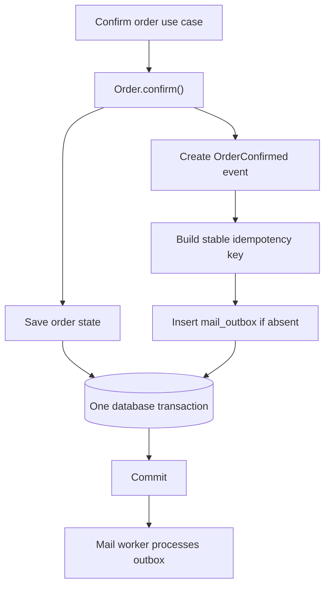
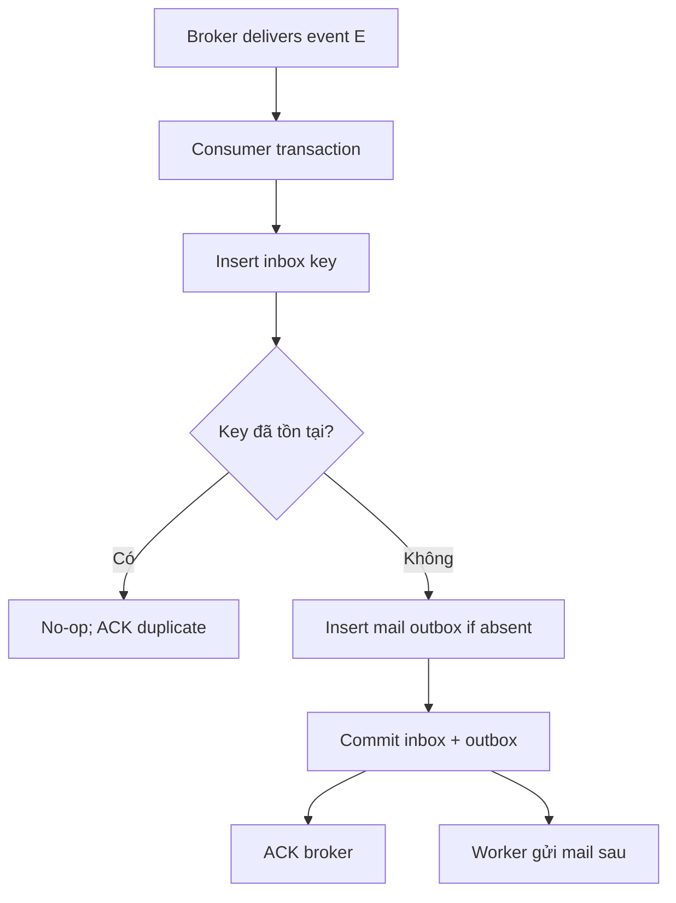

# Đảm bảo một sự kiện chỉ tạo một yêu cầu gửi

Một ứng dụng Spring Boot xác nhận đơn hàng và phát ra sự kiện `OrderConfirmed`. Handler nhận sự kiện này để gửi email xác nhận. Trong môi trường thật, cùng một sự kiện có thể được xử lý nhiều lần: broker giao lại message sau timeout, worker khởi động lại, scheduler chạy lại batch hoặc consumer nhận cùng event từ hai instance. Nếu mỗi lần xử lý đều tạo một bản ghi gửi mới, khách hàng có thể nhận nhiều email giống nhau.

Để **đảm bảo một sự kiện chỉ tạo một yêu cầu gửi**, hệ thống cần nhận diện sự kiện bằng ID ổn định, xác định ý nghĩa của yêu cầu gửi và áp dụng idempotency ở nơi lưu bền vững. Trong Spring Framework Mail, phần gửi cuối cùng có thể dùng `JavaMailSender`, nhưng việc chống tạo yêu cầu trùng phải được giải quyết ở application/database workflow, trước khi dựng `MimeMessage`.

Hãy phân biệt năm khái niệm:

- **Event:** sự kiện nghiệp vụ đã xảy ra, ví dụ đơn hàng được xác nhận.
- **Send request / notification intent:** yêu cầu logic cần gửi một thông báo cho mục đích và người nhận cụ thể.
- **Send attempt:** một lần worker thử gửi yêu cầu đó.
- **Submission:** mail transport/provider chấp nhận message để xử lý.
- **Delivery:** trạng thái chuyển phát được provider báo lại, nếu có.

Một event có thể được xử lý lại nhiều lần nhưng chỉ nên tạo một notification intent cho cùng mục đích. Intent đó có thể có nhiều attempt khi retry. Đây là nền tảng để tránh tạo yêu cầu gửi trùng.

## 1. Vì sao một event có thể được xử lý nhiều lần?

Trong hệ thống phân tán, việc nhận cùng một message nhiều lần là bình thường:

| Nguyên nhân | Ví dụ |
|---|---|
| Broker redelivery | Consumer xử lý xong nhưng ACK bị mất hoặc timeout, broker giao lại message. |
| Consumer restart | Process dừng sau khi xử lý một phần, message chưa được ACK. |
| Retry của application | Worker gặp lỗi tạm thời và chạy lại cùng event. |
| Duplicate publish | Producer publish event hai lần do timeout hoặc transaction retry. |
| Concurrent consumers | Hai instance cùng nhận hoặc xử lý một event do cơ chế phân phối/lease. |
| Replay | Đội vận hành phát lại event để phục hồi hoặc tái dựng trạng thái. |
| Scheduler overlap | Hai lần chạy batch cùng đọc một nguồn dữ liệu hoặc cùng phát sinh notification. |

Không thể giả định mỗi message chỉ được giao đúng một lần. Ngay cả khi broker có cơ chế exactly-once trong phạm vi riêng, hiệu ứng bên ngoài như SMTP không tự động nằm trong transaction của broker.

### 1.1. Lỗi tạo request trùng

Ví dụ handler đơn giản:

```java
public void handle(OrderConfirmed event) {
    OutgoingEmail email = emailFactory.from(event);
    outboxRepository.save(OutboxMessage.pending(email));
}
```

Nếu event đến ba lần, handler có thể lưu ba bản ghi:

```text
OrderConfirmed(eventId=E-100)
       |
       +--> handle lần 1 --> outbox row A
       |
       +--> handle lần 2 --> outbox row B
       |
       +--> handle lần 3 --> outbox row C

Kết quả: ba yêu cầu gửi cho cùng một thông báo.
```

Chỉ kiểm tra trong bộ nhớ bằng `Set` hoặc `ConcurrentHashMap` không đủ. Khi ứng dụng có nhiều instance hoặc restart, mỗi process có bộ nhớ riêng. Việc chống trùng phải dựa trên nơi lưu bền vững và có ràng buộc đồng thời.

## 2. Idempotency: xử lý lại nhưng không tạo thêm hiệu ứng

Một thao tác được gọi là **idempotent** nếu thực hiện nhiều lần với cùng một định danh/đầu vào logic vẫn cho kết quả hiệu ứng tương đương với thực hiện một lần.

Với yêu cầu gửi mail, ta muốn:

```text
process(event E-100) lần 1 --> tạo notification N-500
process(event E-100) lần 2 --> nhận ra N-500 đã tồn tại
process(event E-100) lần 3 --> vẫn dùng N-500

Tổng số notification intent: 1
```

Idempotency không có nghĩa code chỉ chạy một lần. Handler có thể chạy lại; điều quan trọng là các lần chạy lại không tạo thêm yêu cầu logic.

### 2.1. Phân biệt event ID và idempotency key

- **Event ID** nhận diện một event cụ thể trong hệ thống.
- **Idempotency key** nhận diện một hiệu ứng logic cần thực hiện tối đa một lần trong phạm vi đã chọn.

Hai giá trị có thể liên hệ chặt chẽ nhưng không nhất thiết giống nhau.

Ví dụ event `OrderConfirmed` có ID `evt-8f31`. Hệ thống có thể gửi email xác nhận và tạo push notification từ cùng event:

| Event ID | Notification purpose | Kênh | Idempotency key |
|---|---|---|---|
| `evt-8f31` | `ORDER_CONFIRMATION` | Email | `evt-8f31:ORDER_CONFIRMATION:EMAIL` |
| `evt-8f31` | `ORDER_CONFIRMATION` | Push | `evt-8f31:ORDER_CONFIRMATION:PUSH` |

Nếu yêu cầu là một email cho một người nhận, recipient identity cũng có thể là một phần của key. Nếu event có thể tạo một email cho mỗi người nhận trong danh sách, key cần phân biệt recipient để tránh vô tình gộp các yêu cầu hợp lệ.

### 2.2. Xác định phạm vi chống trùng

Trước khi viết code, hãy xác định:

1. Một event chỉ tạo một notification cho mỗi loại thông báo?
2. Một event có thể tạo notification cho nhiều người nhận?
3. Cùng event có thể tạo nhiều kênh như email, SMS và push?
4. Một thao tác gửi lại do người dùng yêu cầu có được xem là yêu cầu mới?
5. Hệ thống giữ lịch sử chống trùng trong bao lâu?

Ví dụ key:

```text
event_id + notification_type
```

nếu mỗi event chỉ được tạo một notification của loại đó.

Hoặc:

```text
event_id + notification_type + channel + recipient_id
```

nếu một event được gửi cho nhiều recipient hoặc nhiều channel.

Không chọn key chỉ dựa vào địa chỉ email và nội dung. Hai event khác nhau có thể hợp lệ khi gửi cùng nội dung cho cùng một địa chỉ. **Identity của sự kiện và mục đích thông báo** mới là cơ sở chống trùng phù hợp.

## 3. Event phải có ID ổn định

Idempotency chỉ hoạt động nếu những lần giao lại cùng một event mang cùng identity.

Ví dụ:

```java
public record OrderConfirmed(
        UUID eventId,
        UUID orderId,
        UUID customerId,
        Instant occurredAt) {
}
```

`eventId` được tạo một lần khi event được ghi nhận. Khi event được serialize, lưu vào outbox hoặc publish lên broker, ID đó phải được giữ nguyên trong mọi lần retry/replay của cùng event.

### 3.1. Không tạo event ID mới ở mỗi lần retry

Không nên:

```java
public void retryConfirmation(UUID orderId) {
    OrderConfirmed event = new OrderConfirmed(
            UUID.randomUUID(),
            orderId,
            customerId,
            clock.instant());
    eventPublisher.publish(event);
}
```

Nếu mỗi lần retry tạo event ID mới, consumer sẽ coi đó là các event khác nhau và idempotency key dựa trên event ID sẽ không ngăn được notification trùng.

Retry nên dùng **cùng event record** với cùng ID, hoặc retry notification/outbox row đã được tạo từ event đó. Nếu nghiệp vụ thực sự phát sinh sự kiện mới, hãy tạo ID mới.

### 3.2. Event ID không nên là timestamp đơn thuần

Timestamp có thể trùng khi nhiều event phát sinh gần nhau; độ chính xác và clock của các instance cũng khác nhau. Dùng UUID, ULID hoặc event sequence có phạm vi rõ ràng sẽ phù hợp hơn. Điều quan trọng là ID duy nhất trong phạm vi lưu trữ và được giữ nguyên qua replay.

### 3.3. Replay không đồng nghĩa event mới

Khi phát lại event để phục hồi, giữ nguyên event ID gốc. Nếu cố ý tạo một thông báo mới do người dùng bấm “Gửi lại email”, đó là một **command/request mới** với identity mới và lý do rõ ràng. Không giả dạng resend thành replay của event cũ.

## 4. Dùng database unique constraint làm hàng rào cuối

Một cách đáng tin cậy để chống hai instance cùng tạo notification là lưu idempotency key và đặt unique constraint trong database.

Ví dụ bảng outbox:

```sql
CREATE TABLE mail_outbox (
    id                  UUID PRIMARY KEY,
    event_id            UUID NOT NULL,
    notification_type   VARCHAR(80) NOT NULL,
    channel             VARCHAR(20) NOT NULL,
    recipient_key       VARCHAR(320) NOT NULL,
    idempotency_key     VARCHAR(240) NOT NULL,
    recipient_address   VARCHAR(320) NOT NULL,
    subject             VARCHAR(300) NOT NULL,
    payload              TEXT NOT NULL,
    status               VARCHAR(30) NOT NULL,
    attempt_count        INTEGER NOT NULL DEFAULT 0,
    next_attempt_at     TIMESTAMP WITH TIME ZONE,
    created_at          TIMESTAMP WITH TIME ZONE NOT NULL,
    submitted_at        TIMESTAMP WITH TIME ZONE,
    provider_message_id VARCHAR(240),
    last_error_code     VARCHAR(100),
    CONSTRAINT uq_mail_outbox_idempotency
        UNIQUE (idempotency_key)
);
```

Trong schema này:

- `event_id` liên kết notification với event nguồn.
- `notification_type` mô tả mục đích nghiệp vụ, ví dụ `ORDER_CONFIRMATION`.
- `channel` phân biệt email với các kênh khác nếu dùng chung bảng.
- `recipient_key` nhận diện người nhận theo quy ước ứng dụng.
- `idempotency_key` là khóa chống tạo request trùng.
- `status` và các cột retry mô tả vòng đời xử lý.

Nếu một event có thể tạo một yêu cầu email cho nhiều recipient, key cần chứa recipient identity. Nếu yêu cầu nghiệp vụ là đúng một email tổng thể cho mỗi event, key có thể chỉ gồm event ID và notification type. Chọn unique key theo **quy tắc nghiệp vụ thực sự**, không theo tiện lợi của schema.

### 4.1. Vì sao không chỉ SELECT rồi INSERT?

Một cách ngây thơ:

```java
if (!outboxRepository.existsByIdempotencyKey(key)) {
    outboxRepository.save(newOutboxMessage);
}
```

Khi hai instance chạy đồng thời:

```text
Instance A: SELECT key -> không tồn tại
Instance B: SELECT key -> không tồn tại
Instance A: INSERT row A
Instance B: INSERT row B
```

Cả hai lần kiểm tra đều thấy chưa có record. Đây là race condition. Unique constraint buộc database chỉ chấp nhận một row; thao tác insert còn lại bị từ chối hoặc được xử lý như duplicate tùy câu lệnh.

**SELECT trước có thể giúp tối ưu đường đi phổ biến, nhưng unique constraint mới là bảo vệ cuối cùng trước concurrency.**

### 4.2. Insert-if-absent trong PostgreSQL

PostgreSQL có thể dùng:

```sql
INSERT INTO mail_outbox (
    id, event_id, notification_type, channel, recipient_key,
    idempotency_key, recipient_address, subject, payload,
    status, created_at
)
VALUES (
    :id, :eventId, :notificationType, 'EMAIL', :recipientKey,
    :idempotencyKey, :recipientAddress, :subject, :payload,
    'PENDING', CURRENT_TIMESTAMP
)
ON CONFLICT (idempotency_key) DO NOTHING;
```

Kết quả:

- Nếu key chưa tồn tại, database tạo một row.
- Nếu key đã tồn tại, database không tạo row thứ hai.
- Hai transaction đồng thời vẫn được database điều phối qua unique index.

Cú pháp `ON CONFLICT` là đặc thù PostgreSQL; database khác có thể dùng cơ chế tương đương như merge/ignore hoặc xử lý unique violation.

### 4.3. Nếu dùng JPA

JPA có thể khai báo unique constraint trong entity mapping:

```java
@Entity
@Table(
    name = "mail_outbox",
    uniqueConstraints = @UniqueConstraint(
        name = "uq_mail_outbox_idempotency",
        columnNames = "idempotency_key"))
public class MailOutboxEntity {

    @Id
    private UUID id;

    @Column(name = "event_id", nullable = false)
    private UUID eventId;

    @Column(name = "idempotency_key", nullable = false, unique = true)
    private String idempotencyKey;

    @Enumerated(EnumType.STRING)
    @Column(nullable = false)
    private OutboxStatus status;
}
```

Mapping mô tả ràng buộc ở mức ORM; production vẫn cần migration/schema thực tế có unique index/constraint. Không chỉ dựa vào annotation nếu schema được quản lý bằng Flyway hoặc Liquibase.

Một lưu ý: bắt `DataIntegrityViolationException` sau `repository.save()` trong cùng transaction JPA không phải lúc nào cũng cho phép tiếp tục transaction. Persistence context hoặc transaction có thể đã bị đánh dấu rollback-only. Nếu muốn insert-if-absent, hãy dùng native query phù hợp, JDBC update count hoặc xử lý unique conflict ở transaction boundary riêng theo thiết kế.

## 5. Tạo notification intent trong cùng transaction nghiệp vụ

Để không mất yêu cầu gửi khi database commit, cập nhật trạng thái domain và tạo outbox row phải được commit cùng nhau.



Nếu order update và outbox insert ở hai transaction khác nhau, có thể xuất hiện:

- Đơn hàng đã xác nhận nhưng outbox chưa được ghi: email bị mất.
- Outbox đã ghi nhưng transaction đơn hàng rollback: email thông báo cho trạng thái chưa tồn tại.

Transactional outbox đặt hai thay đổi trong cùng một database transaction để tránh khoảng trống đó.

### 5.1. Application use case

```java
@Service
public class ConfirmOrderUseCase {

    private final OrderRepository orderRepository;
    private final MailOutboxRepository mailOutboxRepository;
    private final OrderConfirmationFactory confirmationFactory;
    private final Clock clock;

    public ConfirmOrderUseCase(
            OrderRepository orderRepository,
            MailOutboxRepository mailOutboxRepository,
            OrderConfirmationFactory confirmationFactory,
            Clock clock) {
        this.orderRepository = orderRepository;
        this.mailOutboxRepository = mailOutboxRepository;
        this.confirmationFactory = confirmationFactory;
        this.clock = clock;
    }

    @Transactional
    public void execute(UUID orderId) {
        Order order = orderRepository.getById(orderId);
        OrderConfirmed event = order.confirm(clock.instant());

        orderRepository.save(order);

        OutgoingEmail email = confirmationFactory.create(event);
        String key = "order-confirmation:"
                + event.eventId()
                + ":"
                + event.customerId();

        mailOutboxRepository.insertIfAbsent(
                event.eventId(), "ORDER_CONFIRMATION", key, email);
    }
}
```

`OrderRepository` và `MailOutboxRepository` là port do application định nghĩa; implementation thuộc infrastructure persistence. `insertIfAbsent` phải dựa vào unique constraint ở database, không chỉ dựa vào một câu SELECT trong Java.

Trong ví dụ, event ID phải được tạo đúng một lần trong lần chuyển trạng thái và được lưu cùng dữ kiện/outbox cần thiết. Nếu use case có thể chạy lại sau timeout, cần bảo đảm lần chạy lại nhận diện cùng một nghiệp vụ/event hoặc có command idempotency key ở đầu vào.

### 5.2. Không tạo key mới khi retry use case

Nếu request xác nhận đơn hàng bị client retry do HTTP timeout, application có thể gọi use case lại. Nếu mỗi lần chạy lại tạo event ID mới thì unique key dựa trên event ID sẽ khác nhau.

Có hai mức chống trùng:

1. **Command idempotency:** cùng một lệnh xác nhận được client gửi lại chỉ tạo một thay đổi/event.
2. **Event-to-notification idempotency:** cùng event được xử lý lại chỉ tạo một notification intent.

Hai mức giải quyết hai nguồn duplicate khác nhau. Với lệnh HTTP quan trọng, có thể dùng request idempotency key hoặc kiểm tra trạng thái aggregate để không tạo event xác nhận thứ hai. Sau đó unique key của outbox bảo vệ consumer khỏi event duplicate.

## 6. Inbox pattern khi nhận event từ broker

Nếu event đến từ Kafka, RabbitMQ hoặc broker khác, consumer có thể nhận cùng event nhiều lần. Một bảng **inbox** ghi nhận event đã được consumer xử lý giúp chống lặp ở ranh giới nhận message.

Ví dụ schema:

```sql
CREATE TABLE processed_event (
    consumer_name VARCHAR(120) NOT NULL,
    event_id UUID NOT NULL,
    processed_at TIMESTAMP WITH TIME ZONE NOT NULL,
    PRIMARY KEY (consumer_name, event_id)
);
```

Primary key bảo đảm một consumer chỉ ghi nhận một lần cho mỗi event ID.

### 6.1. Inbox và outbox trong cùng transaction

Consumer cần:

1. Thử ghi `(consumer_name, event_id)` vào inbox.
2. Nếu key đã tồn tại, dừng xử lý vì event đã được xử lý.
3. Nếu insert thành công, tạo notification intent trong outbox.
4. Commit inbox và outbox cùng nhau.
5. ACK broker sau khi transaction commit.



Nếu process dừng trước commit, inbox/outbox rollback và broker có thể giao lại event. Lần xử lý sau sẽ thực hiện lại. Nếu commit thành công nhưng ACK bị mất, broker giao lại; inbox unique key khiến consumer no-op.

### 6.2. Ví dụ consumer

```java
@Component
public class OrderConfirmedConsumer {

    private final ProcessedEventRepository processedEventRepository;
    private final MailOutboxRepository mailOutboxRepository;
    private final OrderConfirmationFactory confirmationFactory;

    @Transactional
    public void onMessage(OrderConfirmed event) {
        boolean firstDelivery =
                processedEventRepository.insertIfAbsent(
                        "order-confirmation-mail",
                        event.eventId());

        if (!firstDelivery) {
            return;
        }

        OutgoingEmail email = confirmationFactory.create(event);
        String key = "order-confirmation:"
                + event.eventId()
                + ":"
                + event.customerId();

        mailOutboxRepository.insertIfAbsent(
                event.eventId(), "ORDER_CONFIRMATION", key, email);
    }
}
```

`insertIfAbsent` của inbox và outbox cần là thao tác database an toàn dưới concurrency, ví dụ native insert-ignore/upsert hoặc JDBC với unique constraint. Cả hai thao tác phải tham gia cùng transaction.

Nếu chỉ ghi inbox rồi gửi SMTP trực tiếp, consumer có thể commit inbox trước khi gửi và mất email khi process crash. Nếu gửi SMTP trước rồi mới ghi inbox, crash sau khi SMTP chấp nhận nhưng trước khi ghi inbox có thể gây gửi trùng. Outbox tách việc ghi intent khỏi việc gửi network.

### 6.3. Vì sao inbox key có consumer name?

Cùng event có thể được nhiều consumer xử lý cho mục đích khác nhau:

- Consumer gửi email.
- Consumer cập nhật analytics.
- Consumer tạo tác vụ vận chuyển.

Unique key chỉ gồm event ID trên toàn database sẽ khiến consumer thứ hai bị chặn dù đó là xử lý hợp lệ. Dùng `consumer_name + event_id` để deduplicate trong phạm vi một consumer/handler logic.

Nếu một consumer cần tạo nhiều notification type từ cùng event, key inbox có thể gồm subscriber/handler name cụ thể hoặc outbox key sẽ chịu trách nhiệm phân biệt từng mục đích.

## 7. Một event có thể tạo nhiều notification hợp lệ

“Một sự kiện chỉ tạo một yêu cầu gửi” cần được hiểu theo **một mục đích gửi đã xác định**. Có trường hợp event hợp lệ tạo nhiều thông báo:

- Một email cho khách hàng.
- Một email cho bộ phận vận hành.
- Một email cho người nhận hóa đơn.

Nếu các recipient khác nhau là chủ đích nghiệp vụ, không được deduplicate tất cả chỉ bằng event ID.

Ví dụ:

```text
event: InvoiceIssued(evt-501)

notification intent:
  evt-501 + CUSTOMER_INVOICE + customer-10
  evt-501 + FINANCE_COPY + finance-team

Hai request này hợp lệ vì mục đích/người nhận khác nhau.
```

Ngược lại, nếu cùng event và cùng purpose/recipient được xử lý lại, key phải giống nhau để không tạo request thứ hai.

### 7.1. Lưu snapshot recipient hay tra cứu lại?

Nếu handler tra cứu địa chỉ email hiện tại mỗi lần retry, recipient có thể thay đổi giữa hai lần xử lý. Cần quyết định:

| Chính sách | Hành vi |
|---|---|
| Snapshot recipient lúc tạo intent | Retry gửi tới cùng địa chỉ đã chọn lúc event xử lý. |
| Resolve recipient lúc worker gửi | Có thể gửi tới địa chỉ hiện tại, nếu nghiệp vụ yêu cầu. |

Với thông báo hóa đơn/pháp lý, snapshot thường giúp giữ tính nhất quán. Với thông báo thông thường, resolve mới có thể phù hợp. Idempotency key phải phản ánh đúng định nghĩa “cùng yêu cầu”; không để retry vô tình tạo một yêu cầu khác chỉ vì recipient lookup thay đổi.

### 7.2. Resend có chủ đích là một yêu cầu mới

Nếu người dùng bấm “Gửi lại hóa đơn”, đó có thể là một hành động nghiệp vụ mới, không phải duplicate delivery của event cũ.

Có thể tạo command `ResendInvoice` với `commandId` mới, lưu `resend_request_id` và liên kết tới invoice/event gốc. Key khi đó dựa trên resend command ID:

```text
original event: evt-501
first notification: evt-501:INVOICE_EMAIL:customer-10

resend command: cmd-992
resend notification: cmd-992:INVOICE_EMAIL:customer-10
```

Không xóa dedupe record cũ hoặc sửa event ID cũ để “cho phép gửi lại”. Giữ lịch sử để audit và phân biệt resend hợp lệ với duplicate ngoài ý muốn.

## 8. Retry phải dùng lại cùng notification intent

Khi gửi email thất bại do lỗi SMTP tạm thời, worker nên retry **cùng outbox row**:

```text
Outbox N-500
   |
   +--> attempt 1: SMTP timeout
   |
   +--> attempt 2: SMTP 4xx
   |
   +--> attempt 3: submission accepted

Số notification intent: 1
Số send attempts: 3
```

Không tạo outbox row mới cho mỗi lần retry. Nếu retry tạo key mới, unique constraint không còn bảo vệ cùng một yêu cầu.

### 8.1. Trạng thái outbox

| Trạng thái | Ý nghĩa |
|---|---|
| `PENDING` | Đã tạo intent, chờ worker. |
| `PROCESSING` | Worker đang thực hiện attempt. |
| `RETRY_WAIT` | Attempt thất bại tạm thời, chờ thời điểm retry. |
| `SUBMITTED` | Transport/provider đã chấp nhận submission theo contract. |
| `FAILED_PERMANENT` | Lỗi không nên retry tự động. |
| `UNKNOWN` | Không xác định được provider đã nhận hay chưa. |

Tên trạng thái có thể khác nhau. Cần phân biệt “đã submission” với “đã delivery”.

### 8.2. Backoff có giới hạn

Ví dụ lịch retry:

```text
Attempt 1: ngay lập tức
Attempt 2: sau 30 giây
Attempt 3: sau 2 phút
Attempt 4: sau 10 phút
Sau đó: FAILED_PERMANENT hoặc dead-letter/manual review
```

Lịch trên chỉ minh họa. Thực tế nên dùng exponential backoff có jitter, số lần thử tối đa, giới hạn tuổi của notification và phân loại lỗi.

### 8.3. Không tạo notification mới khi retry

Worker chỉ cập nhật:

- `attempt_count`.
- `next_attempt_at`.
- `last_error_code`.
- `status`.
- Thông tin provider submission nếu có.

`idempotency_key`, `event_id` và identity của notification intent phải giữ ổn định. Nếu payload được snapshot, retry cũng dùng cùng payload để nội dung không thay đổi bất ngờ.

## 9. Worker concurrency: hai worker không nên gửi cùng lúc

Unique constraint chống tạo nhiều outbox row. Nhưng nó không tự ngăn hai worker cùng đọc một row `PENDING` và cùng gửi email.

Ví dụ:

```text
Worker A: SELECT N-500 WHERE status=PENDING
Worker B: SELECT N-500 WHERE status=PENDING
Worker A: send N-500
Worker B: send N-500
```

Đây là bài toán **claim/lease** ở tầng worker.

### 9.1. Claim bằng row lock

Trong PostgreSQL, một worker có thể chọn row chưa xử lý bằng:

```sql
SELECT id
FROM mail_outbox
WHERE status IN ('PENDING', 'RETRY_WAIT')
  AND (next_attempt_at IS NULL
       OR next_attempt_at <= CURRENT_TIMESTAMP)
ORDER BY created_at
LIMIT 20
FOR UPDATE SKIP LOCKED;
```

Trong cùng transaction, worker cập nhật các row đã chọn sang `PROCESSING`, đặt `locked_by`, `lease_until` và commit. `SKIP LOCKED` giúp worker khác lấy các row chưa bị worker này khóa.

Không giữ transaction database mở trong suốt thời gian gọi SMTP. Network call có thể kéo dài; giữ row lock/transaction quá lâu gây contention và làm cạn connection pool.

### 9.2. Lease và recovery

Nếu worker chết sau khi claim row, row có thể kẹt ở `PROCESSING`. Lease giúp worker khác lấy lại sau khi thời gian khóa hết:

```sql
UPDATE mail_outbox
SET status = 'RETRY_WAIT',
    next_attempt_at = CURRENT_TIMESTAMP,
    locked_by = NULL,
    lease_until = NULL
WHERE status = 'PROCESSING'
  AND lease_until < CURRENT_TIMESTAMP;
```

Đây là ví dụ recovery cho lease hết hạn. Cần bổ sung claim token/fencing để worker cũ không thể ghi đè kết quả của worker mới nếu nó sống lại sau khi lease đã hết.

### 9.3. Fencing token

Mỗi lần claim có thể cấp một `claim_token` mới. Khi worker cập nhật kết quả, chỉ cho phép cập nhật nếu token vẫn khớp:

```sql
UPDATE mail_outbox
SET status = 'SUBMITTED',
    submitted_at = CURRENT_TIMESTAMP,
    locked_by = NULL,
    lease_until = NULL
WHERE id = :id
  AND status = 'PROCESSING'
  AND claim_token = :claimToken;
```

Nếu worker cũ đã hết lease và worker mới claim, token mới khiến thao tác cập nhật của worker cũ không còn hiệu lực.

Fencing token bảo vệ trạng thái database. Nó không ngăn worker cũ đã bắt đầu SMTP call gửi email sau khi lease hết hạn. Muốn hạn chế hiệu ứng ngoài trùng, cần thêm provider idempotency nếu có, hoặc thiết kế timeout/lease và cơ chế kiểm soát attempt phù hợp.

## 10. “Exactly once” và giới hạn của SMTP

Một notification intent duy nhất không đồng nghĩa email chỉ được chuyển phát đúng một lần.

Hãy xét:

1. Worker gửi message tới SMTP server.
2. SMTP server nhận message và trả phản hồi thành công.
3. Network connection đứt trước khi worker nhận được phản hồi.
4. Worker không biết server đã nhận hay chưa.
5. Worker retry.

Nếu SMTP server đã nhận message ở bước 2, retry có thể tạo email thứ hai. Worker không thể suy ra chắc chắn trạng thái bên ngoài chỉ từ timeout.

### 10.1. Outbox bảo đảm điều gì?

Transactional outbox giúp:

- Domain transaction và notification intent được commit cùng nhau.
- Event duplicate không tạo thêm outbox row khi unique key được thiết kế đúng.
- Worker có thể retry cùng một intent.
- Trạng thái và lịch sử attempt được lưu bền vững.

Outbox **không tự bảo đảm exactly-once submission hoặc exactly-once delivery** qua SMTP.

### 10.2. Provider idempotency key

Một số email provider qua HTTP API có thể hỗ trợ idempotency key theo contract riêng. Nếu có, gửi cùng một key cho mọi retry của cùng notification:

```java
providerClient.send(
        request,
        notification.idempotencyKey());
```

Provider có thể nhận diện request trùng và trả kết quả của lần xử lý trước, tùy chính sách lưu key và thời hạn hỗ trợ. Cần đọc contract của provider:

- Key có được hỗ trợ cho endpoint gửi email không?
- Key được lưu trong bao lâu?
- Cùng key nhưng payload khác thì phản hồi thế nào?
- Key có phạm vi theo account/region không?
- Request timeout có thể tra cứu kết quả bằng key không?

Không giả định mọi HTTP API đều có idempotency chỉ vì request có header tùy ý.

### 10.3. SMTP Message-ID không phải idempotency guarantee

Có thể đặt header `Message-ID` ổn định để hỗ trợ trace/đối chiếu:

```java
message.setHeader(
        "Message-ID",
        "<notification-" + notificationId + "@mail.example.com>");
```

Nhưng SMTP và email client không có nghĩa vụ chung phải loại bỏ message trùng dựa trên Message-ID. Một số hệ thống có thể gom hoặc hiển thị hội thoại tương tự, nhưng không thể dựa vào đó để bảo đảm chỉ gửi một lần.

Message-ID ổn định hữu ích cho quan sát và điều tra; **nó không thay thế idempotency contract của provider**.

### 10.4. Trạng thái UNKNOWN

Khi timeout xảy ra ở thời điểm không xác định provider đã nhận DATA hay chưa, không nên tự động khẳng định `FAILED`. Có thể lưu:

- `UNKNOWN` hoặc `SUBMISSION_UNCERTAIN`.
- Provider/account và request reference.
- Notification ID/idempotency key.
- Thời điểm attempt và cause.

Nếu provider có API tra cứu, đối chiếu trước khi retry. Nếu chỉ dùng SMTP và không có cách tra cứu, phải chọn trade-off nghiệp vụ: retry có nguy cơ duplicate hoặc dừng để xử lý thủ công.

## 11. Command idempotency ở đầu vào

Unique outbox key bảo vệ bước event → notification. Nhưng nếu cùng một hành động HTTP được thực thi hai lần và tạo hai event ID khác nhau, outbox vẫn có thể tạo hai request hợp lệ theo khóa đã chọn.

Ví dụ client gửi:

```http
POST /orders/123/confirm
Idempotency-Key: client-request-7f91
```

Server có thể lưu command key trong cùng transaction với kết quả use case. Khi client retry cùng key:

- Trả lại kết quả đã ghi nhận.
- Không thực hiện lại hành vi nghiệp vụ.
- Không tạo event mới.
- Không tạo notification intent mới.

### 11.1. Bảng idempotency cho command

Ví dụ:

```sql
CREATE TABLE command_deduplication (
    idempotency_key VARCHAR(200) PRIMARY KEY,
    command_type VARCHAR(100) NOT NULL,
    result_reference VARCHAR(200),
    completed_at TIMESTAMP WITH TIME ZONE
);
```

Key cần có scope theo client/tenant và command type nếu cùng chuỗi key có thể xuất hiện ở nhiều phạm vi. Không dùng một key toàn cục không có namespace nếu nhiều consumer/client độc lập.

### 11.2. Không tái sử dụng command key cho hành động khác

Cùng một HTTP idempotency key chỉ nên nhận diện cùng một command và payload logic. Nếu key được dùng lại với payload khác, server nên trả lỗi conflict hoặc phản hồi theo contract đã định nghĩa; không âm thầm dùng kết quả cũ cho yêu cầu mới.

Có thể lưu request hash để phát hiện trường hợp cùng key nhưng payload khác. Hash payload là kiểm tra nhất quán bổ sung, không phải idempotency key duy nhất.

## 12. Deduplication record phải được giữ đủ lâu

Nếu outbox row bị xóa ngay sau khi gửi, unique constraint không còn dấu vết để ngăn event cũ được replay tạo lại request.

```text
Ngày 1: event E-100 tạo outbox N-500, gửi thành công
Ngày 2: cleanup xóa N-500
Ngày 30: event E-100 được replay
Ngày 30: unique key không còn trong outbox
Kết quả: notification mới được tạo
```

Nếu muốn chống duplicate trong suốt thời gian event có thể được replay, cần giữ một **deduplication ledger** hoặc inbox record lâu tương ứng, ngay cả khi payload/outbox đã được archive.

### 12.1. Retention theo replay horizon

Chọn thời gian lưu dựa trên:

- Broker retention và khả năng replay.
- Event store retention.
- Thời gian batch recovery.
- Chính sách vận hành và audit.
- Quy định lưu trữ dữ liệu.

Nếu event có thể được replay vô thời hạn, một unique record nhỏ có thể cần được giữ lâu hơn payload email. Có thể archive payload nhưng giữ tombstone chứa event ID, notification purpose và idempotency key.

### 12.2. Không deduplicate bằng cửa sổ thời gian tùy tiện

Không nên quy tắc “nếu trong 10 phút đã gửi email cùng recipient/subject thì bỏ qua”. Hai đơn hàng khác nhau có thể được xác nhận trong cùng 10 phút và đều cần email.

Deduplication phải dựa trên identity nghiệp vụ ổn định, không phải sự giống nhau của nội dung hoặc khoảng thời gian.

## 13. Payload consistency: cùng key phải cùng ý nghĩa

Nếu hai lần xử lý có cùng idempotency key nhưng payload khác nhau, hệ thống cần có quy tắc rõ.

Ví dụ event ID giống nhau nhưng lần đầu tạo subject `Đơn hàng đã xác nhận`, lần sau tạo subject `Đơn hàng đã hủy`. Đây có thể là bug trong event mapping hoặc event bị sửa sau khi phát hành.

Không nên dùng `ON CONFLICT DO UPDATE` để âm thầm thay payload của notification đã được tạo. Điều đó có thể làm nội dung gửi thay đổi khi retry.

Có thể lưu:

- Event ID và event type.
- Notification type.
- Template version.
- Recipient snapshot.
- Payload snapshot hoặc model đã chuẩn hóa.
- Payload hash.

Khi key đã tồn tại:

1. Không tạo request thứ hai.
2. So sánh payload hash/metadata nếu nghiệp vụ yêu cầu.
3. Nếu cùng key nhưng payload khác, ghi nhận conflict và cảnh báo.
4. Không tự ghi đè notification đã gửi hoặc đang retry nếu chưa có chính sách.

### 13.1. Snapshot nội dung hay render lại?

| Cách | Đặc điểm |
|---|---|
| Lưu rendered payload khi tạo intent | Retry dùng đúng nội dung đã chọn; dễ audit nhưng lưu nhiều dữ liệu hơn. |
| Lưu event/model + template version rồi render lúc worker chạy | Linh hoạt hơn, nhưng phải bảo đảm dữ liệu và template version nhất quán. |

Với hóa đơn hoặc thông báo pháp lý, snapshot có thể cần thiết. Với email thông báo ít ràng buộc, lưu model và template version có thể đủ.

Dù chọn cách nào, một idempotency key phải tiếp tục đại diện cho **cùng một ý nghĩa notification**.

## 14. Ví dụ repository insert-if-absent

Một abstraction application:

```java
public interface MailOutboxRepository {

    boolean insertIfAbsent(
            UUID eventId,
            String notificationType,
            String idempotencyKey,
            OutgoingEmail email);
}
```

Giá trị trả về:

- `true`: transaction này đã tạo notification intent mới.
- `false`: key đã tồn tại; không tạo thêm request.

Infrastructure implementation có thể dùng JDBC với PostgreSQL:

```java
@Repository
public class JdbcMailOutboxRepository implements MailOutboxRepository {

    private final NamedParameterJdbcTemplate jdbc;
    private final ObjectMapper objectMapper;

    public JdbcMailOutboxRepository(
            NamedParameterJdbcTemplate jdbc,
            ObjectMapper objectMapper) {
        this.jdbc = jdbc;
        this.objectMapper = objectMapper;
    }

    @Override
    public boolean insertIfAbsent(
            UUID eventId,
            String notificationType,
            String idempotencyKey,
            OutgoingEmail email) {

        String sql = """
                INSERT INTO mail_outbox (
                    id, event_id, notification_type, channel,
                    recipient_key, idempotency_key, recipient_address,
                    subject, payload, status, created_at
                )
                VALUES (
                    :id, :eventId, :notificationType, 'EMAIL',
                    :recipientKey, :idempotencyKey, :recipientAddress,
                    :subject, :payload, 'PENDING', CURRENT_TIMESTAMP
                )
                ON CONFLICT (idempotency_key) DO NOTHING
                """;

        MapSqlParameterSource params = new MapSqlParameterSource()
                .addValue("id", UUID.randomUUID())
                .addValue("eventId", eventId)
                .addValue("notificationType", notificationType)
                .addValue("recipientKey", email.recipient())
                .addValue("idempotencyKey", idempotencyKey)
                .addValue("recipientAddress", email.recipient())
                .addValue("subject", email.subject())
                .addValue("payload", serialize(email));

        return jdbc.update(sql, params) == 1;
    }

    private String serialize(OutgoingEmail email) {
        try {
            return objectMapper.writeValueAsString(email);
        } catch (JsonProcessingException ex) {
            throw new IllegalStateException(
                    "Cannot serialize outgoing email", ex);
        }
    }
}
```

Đây là ví dụ minh họa cho PostgreSQL và Spring JDBC; cần import các lớp JDBC/Jackson tương ứng. Cột `recipient_key` nên dùng ID người nhận ổn định nếu có; địa chỉ email chỉ là một lựa chọn khi đó là identity phù hợp với nghiệp vụ.

Repository phải tham gia transaction hiện tại; không tự mở một transaction độc lập nếu mục tiêu là atomicity với cập nhật aggregate.

### 14.1. Key builder

Không ghép chuỗi idempotency key rải rác ở nhiều handler. Có thể tạo factory:

```java
public final class NotificationIdempotencyKey {

    private NotificationIdempotencyKey() {}

    public static String orderConfirmation(
            UUID eventId,
            UUID customerId) {
        return "order-confirmation:"
                + eventId
                + ":"
                + customerId;
    }
}
```

Trong hệ thống nhiều tenant, thêm tenant scope nếu event ID không duy nhất toàn cục hoặc policy dedupe cần phân vùng theo tenant. Dùng encoding ổn định và giới hạn độ dài theo schema.

## 15. Kiểm thử idempotency

Không chỉ kiểm tra một lần gọi thành công. Cần kiểm tra duplicate delivery và concurrency.

### 15.1. Cùng event được xử lý hai lần

```java
@Test
void duplicateEventCreatesOnlyOneNotification() {
    OrderConfirmed event = sampleEvent();

    handler.handle(event);
    handler.handle(event);

    assertThat(outboxRepository.countByEventId(event.eventId()))
            .isEqualTo(1);
}
```

Test xác nhận cùng event ID và cùng mục đích tạo một outbox row.

### 15.2. Event khác nhau vẫn tạo request riêng

```java
@Test
void differentEventsCanCreateDifferentNotifications() {
    handler.handle(eventWithId(UUID.randomUUID()));
    handler.handle(eventWithId(UUID.randomUUID()));

    assertThat(outboxRepository.countPending()).isEqualTo(2);
}
```

Không deduplicate hai event chỉ vì recipient và subject giống nhau.

### 15.3. Concurrent insert

Dùng integration test với database thật hoặc Testcontainers:

1. Hai thread/transaction cùng insert một idempotency key.
2. Đồng bộ để hai thao tác xảy ra gần như đồng thời.
3. Xác nhận chỉ một insert thành công.
4. Xác nhận database chỉ có một row.

Mock repository không thể chứng minh unique constraint thực sự hoạt động dưới concurrency. Test cần chạy trên loại database tương thích production vì cú pháp upsert và isolation khác nhau.

### 15.4. Atomicity với transaction nghiệp vụ

Test rollback:

- Cập nhật order.
- Insert outbox.
- Cố ý ném exception trước commit.
- Xác nhận cả order change và outbox row đều rollback.

Test commit:

- Cập nhật order.
- Insert outbox.
- Commit.
- Xác nhận cả hai cùng tồn tại.

Đây là bằng chứng quan trọng cho transactional outbox.

### 15.5. Duplicate broker delivery

Gọi consumer hai lần với cùng event ID:

- Lần đầu inbox insert thành công và outbox được tạo.
- Lần hai inbox insert báo duplicate và handler no-op.
- Chỉ có một notification intent.

Sau đó test tình huống transaction rollback trước commit và xác nhận event có thể được xử lý lại.

### 15.6. Worker retry không tạo outbox row mới

Giả lập SMTP timeout rồi retry worker. Xác nhận:

- Outbox ID không đổi.
- Idempotency key không đổi.
- Attempt count tăng.
- Không có row mới.
- Khi thành công, trạng thái row chuyển sang `SUBMITTED`.

### 15.7. Crash window sau SMTP acceptance

Không thể dùng unit test đơn giản để chứng minh exactly-once qua SMTP. Có thể mô phỏng:

1. Fake provider ghi nhận request.
2. Worker bị lỗi trước khi cập nhật outbox.
3. Worker chạy lại.
4. Nếu provider hỗ trợ idempotency, xác nhận provider chỉ ghi nhận một hiệu ứng.
5. Nếu adapter SMTP không có idempotency, test phải thể hiện khả năng duplicate và trạng thái `UNKNOWN`/reconciliation.

## 16. Quan sát và vận hành

Một cơ chế idempotency cần được quan sát để phát hiện lỗi thiết kế hoặc replay bất thường.

Thông tin hữu ích:

| Trường | Mục đích |
|---|---|
| Event ID | Đối chiếu event nguồn. |
| Notification ID | Định danh yêu cầu gửi logic. |
| Idempotency key | Xác định duplicate scope. |
| Notification type/channel | Biết mục đích và kênh. |
| Recipient key | Xác định người nhận theo chính sách. |
| Attempt count | Theo dõi retry. |
| Worker/claim token | Điều tra concurrency và lease. |
| Provider reference | Đối chiếu submission. |
| Payload/template version | Giải thích nội dung đã chọn. |

Metric có thể theo dõi:

- Số event duplicate được inbox chặn.
- Số outbox insert bị unique conflict.
- Số notification intent được tạo.
- Số send attempts trên mỗi notification.
- Số notification ở `UNKNOWN`.
- Số lease hết hạn và worker claim lại.
- Số duplicate provider response nếu provider báo.

Không dùng email address, event ID hoặc idempotency key làm label metric có cardinality cao. Có thể log các ID đó theo quyền truy cập phù hợp, còn metric dùng notification type, provider và error category.

### 16.1. Phân biệt duplicate bị chặn và lỗi hệ thống

Một lần insert bị unique conflict có thể là **duplicate hợp lệ đã được chặn**, không nhất thiết là lỗi. Nên ghi nhận metric hoặc log mức phù hợp để quan sát tần suất, nhưng không báo lỗi nghiệp vụ cho người dùng chỉ vì broker giao lại event.

Nếu cùng key xuất hiện với payload khác, đó là dấu hiệu bất thường và cần log/cảnh báo riêng.

### 16.2. Cleanup và audit

Không xóa dedupe ledger quá sớm. Có thể:

- Archive payload cũ.
- Giữ event ID, notification type và idempotency key dạng tombstone.
- Giữ trạng thái cuối và timestamp phục vụ audit.
- Áp dụng retention theo replay horizon và quy định dữ liệu.

Việc xóa dữ liệu phải không làm mất khả năng nhận diện replay cũ trong khoảng thời gian hệ thống còn cho phép replay.

## 17. Các lỗi thường gặp

### 17.1. Dùng UUID mới mỗi lần consumer xử lý

Nếu key dựa trên ID mới tạo, mỗi lần redelivery sẽ trông như notification mới. Giữ nguyên event ID và tạo key xác định từ event/purpose/recipient.

### 17.2. Chỉ dùng SELECT trước INSERT

Hai instance có thể cùng thấy key chưa tồn tại. Đặt unique constraint và dùng insert-if-absent/upsert.

### 17.3. Deduplicate chỉ bằng email address hoặc subject

Hai event khác nhau có thể gửi cùng subject cho cùng người nhận. Dùng identity event và mục đích notification.

### 17.4. Retry bằng cách tạo outbox row mới

Retry phải cập nhật cùng intent và tăng attempt count. Không tạo key mới cho mỗi lần thử.

### 17.5. Gửi SMTP trong transaction nghiệp vụ

SMTP không tham gia transaction DB. Dùng outbox để ghi intent atomically rồi worker gửi sau.

### 17.6. Chỉ dùng AFTER_COMMIT listener cho email quan trọng

Listener trong bộ nhớ có thể mất khi process dừng sau commit. Dùng outbox khi cần độ bền và retry.

### 17.7. Ghi inbox trước rồi gửi trực tiếp

Nếu inbox commit nhưng process chết trước khi gửi, email bị mất. Ghi inbox và outbox cùng transaction, worker gửi sau.

### 17.8. Gửi trực tiếp rồi mới ghi inbox

Nếu SMTP nhận message nhưng process chết trước khi ghi inbox, redelivery có thể gửi trùng. Outbox giảm khoảng trống giữa event processing và send attempt.

### 17.9. Cho rằng unique outbox row ngăn hai worker gửi cùng lúc

Unique constraint ngăn tạo row trùng, không ngăn hai worker cùng claim một row. Dùng row lock, lease và fencing token.

### 17.10. Cho rằng outbox bảo đảm exactly-once delivery

Outbox bảo vệ việc ghi intent; crash sau khi provider nhận message vẫn có thể gây retry trùng. Dùng provider idempotency nếu có và xử lý trạng thái không rõ.

### 17.11. Dùng Message-ID làm khóa chống gửi trùng

Message-ID giúp trace nhưng không phải cam kết dedupe của SMTP/email client. Dùng idempotency contract được provider hỗ trợ.

### 17.12. Xóa outbox row ngay sau khi gửi

Event replay sau đó có thể tạo lại notification. Giữ dedupe ledger/tombstone theo replay horizon.

### 17.13. Cùng key nhưng âm thầm cập nhật payload

Có thể làm retry gửi nội dung khác với notification ban đầu. Snapshot payload/version và phát hiện conflict.

### 17.14. Không phân biệt resend với duplicate

Resend theo yêu cầu người dùng là một hành động mới. Tạo command/notification ID mới có liên kết với yêu cầu gốc.

## 18. Bài tập thực hành

### Bài 1 — Thiết kế idempotency key

Một event `InvoiceIssued` có thể gửi email cho khách hàng và bản sao cho kế toán. Hãy xác định key cho từng request. Vì sao chỉ dùng event ID là chưa đủ?

### Bài 2 — Race condition

Hai worker cùng chạy `existsByIdempotencyKey` và đều nhận `false`. Hãy mô tả interleaving và giải thích vai trò của unique constraint.

### Bài 3 — Transactional outbox

Viết use case phát sinh event và insert outbox row trong cùng `@Transactional`. Mô tả điều xảy ra nếu transaction rollback.

### Bài 4 — Inbox consumer

Một broker giao cùng event ba lần. Hãy thiết kế bảng inbox với unique key `consumer_name + event_id` và cách ghi inbox/outbox atomically.

### Bài 5 — Retry

Một notification có ba lần SMTP attempt. Hãy xác định trường nào thay đổi và trường nào phải giữ nguyên giữa các attempt. Vì sao không tạo outbox row mới?

### Bài 6 — Exactly once

SMTP server có thể đã nhận DATA nhưng worker timeout trước khi nhận phản hồi. Hãy giải thích vì sao worker không thể biết chắc trạng thái và thiết kế `UNKNOWN`/reconciliation.

### Bài 7 — Command idempotency

Client retry cùng request xác nhận đơn hàng sau HTTP timeout. Hãy thiết kế command idempotency key để không tạo event ID mới ở mỗi lần retry.

### Bài 8 — Retention

Outbox row bị xóa sau 7 ngày nhưng event store cho phép replay trong 90 ngày. Hãy phân tích nguy cơ và đề xuất dedupe ledger retention.

### Bài 9 — Resend hợp lệ

Khách hàng bấm “Gửi lại hóa đơn” sau một tuần. Hãy phân biệt resend command mới với replay event cũ và đề xuất identity cho notification mới.

### Bài 10 — Concurrent worker

Hai worker cùng đọc một notification. Hãy thiết kế claim bằng `FOR UPDATE SKIP LOCKED`, lease và fencing token. Giải thích fencing token không tự ngăn được một SMTP call đã bắt đầu.

## 19. Ghi nhớ và tài liệu tham khảo

Để **đảm bảo một sự kiện chỉ tạo một yêu cầu gửi** trong Spring Framework Mail:

1. Gán event ID ổn định một lần và giữ nguyên ID qua redelivery/replay.
2. Định nghĩa rõ duplicate scope bằng event ID, notification purpose, channel và recipient khi cần.
3. Tạo idempotency key xác định; không tạo key mới ở mỗi retry.
4. Đặt unique constraint trong database và dùng insert-if-absent/upsert để chống concurrency.
5. Ghi thay đổi nghiệp vụ và outbox intent trong cùng transaction.
6. Với broker consumer, dùng inbox key theo consumer/event và ghi inbox + outbox atomically.
7. Retry cùng notification row; worker claim bằng lock/lease để tránh hai worker xử lý cùng lúc.
8. Phân biệt notification intent duy nhất với send attempts và delivery; outbox không tự bảo đảm exactly-once SMTP.
9. Dùng provider idempotency key nếu provider thực sự hỗ trợ; Message-ID chỉ phục vụ trace.
10. Giữ dedupe record đủ lâu cho event replay và phân biệt resend có chủ đích với duplicate.
11. Nếu cùng key nhưng payload khác, ghi nhận conflict thay vì âm thầm ghi đè.
12. Kiểm thử duplicate delivery, concurrent insert, rollback, worker retry và crash window.

Tài liệu nên đọc:

- **Transactional Outbox pattern:** ghi notification/event intent cùng transaction nghiệp vụ và xử lý bằng worker.
- **Idempotent Consumer pattern:** nhận message lặp nhưng chỉ tạo hiệu ứng logic một lần.
- **Inbox pattern:** lưu dấu event đã xử lý theo consumer identity.
- **Spring Framework transaction management:** `@Transactional`, transaction boundary và event listener phase.
- **Spring JDBC / Spring Data JPA:** native insert, unique constraint, transaction và persistence exception.
- **PostgreSQL documentation — INSERT ... ON CONFLICT:** insert-if-absent và xử lý unique conflict.
- **Message broker delivery semantics:** ACK, redelivery, consumer retry và replay.
- **Provider API documentation:** idempotency key, request lookup, submission reference và retry policy của nhà cung cấp email.

**Mục tiêu là một notification intent cho mỗi event-purpose-recipient đã xác định, không phải giả định mọi thành phần mạng chỉ chạy một lần.** Event identity ổn định, unique constraint, transactional outbox/inbox và retry cùng một request tạo nên cơ chế chống trùng ở cấp ứng dụng. Khi chuyển sang SMTP, vẫn phải thừa nhận giới hạn của submission không rõ kết quả và dùng idempotency của provider nếu có.
