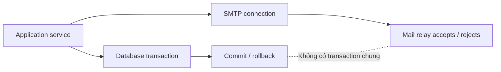
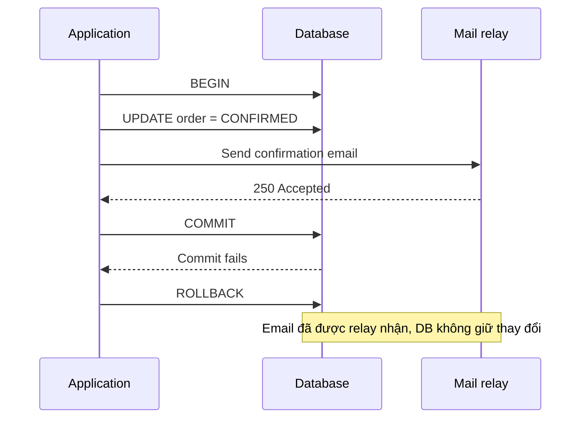
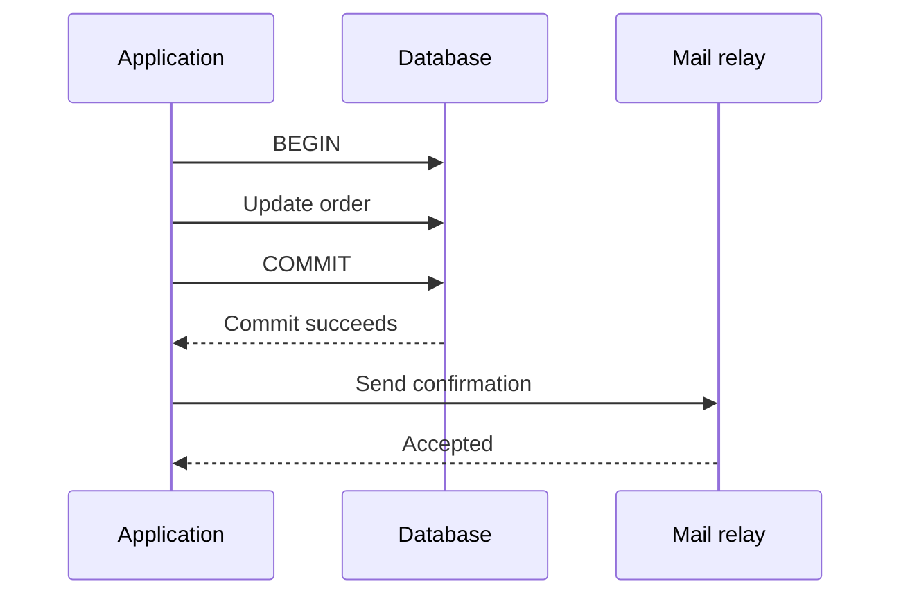
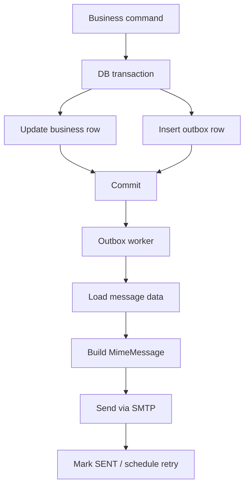

# Giới hạn của việc gọi SMTP trong transaction

Trong một ứng dụng Spring, một nghiệp vụ thường cập nhật dữ liệu trong database rồi gửi email thông báo cho người dùng. Ví dụ, khi đơn hàng được xác nhận, hệ thống lưu trạng thái đơn hàng và gửi email xác nhận; khi người dùng đổi mật khẩu, hệ thống cập nhật thông tin tài khoản rồi gửi thông báo bảo mật.

Hai thao tác này có vẻ thuộc cùng một nghiệp vụ, nhưng chúng chạy trên hai hệ thống khác nhau. Transaction của JDBC/JPA có thể commit hoặc rollback dữ liệu trong database. SMTP là một giao thức bên ngoài; mail server không tham gia transaction database và không thể tự động rollback một email đã chấp nhận. Vì vậy, **không thể coi một lời gọi SMTP bên trong phương thức có `@Transactional` là một phần nguyên tử của database transaction**.

Nếu gửi email trước khi database commit, người nhận có thể nhận thông báo về dữ liệu cuối cùng bị rollback. Nếu đợi commit xong mới gửi, email có thể thất bại trong khi dữ liệu đã được commit. Nếu process dừng giữa hai thao tác, hệ thống có thể mất thông báo hoặc gửi trùng khi retry. Đây là giới hạn cốt lõi cần hiểu trước khi thiết kế luồng sự kiện và giao dịch.

Bài này giải thích ranh giới giữa transaction database và SMTP, các lỗi khi gửi trước/sau commit, cách dùng `@TransactionalEventListener(AFTER_COMMIT)` cho thông báo đơn giản, transactional outbox cho thông báo cần độ tin cậy cao, retry/idempotency và cách kiểm thử. Ví dụ sử dụng Spring Framework 6.x, Spring Boot 3.x, Java 21, Spring Data JPA và Jakarta Mail.

## 1. Database transaction không bao gồm SMTP

Một database transaction thường quản lý các thao tác trên một transaction manager và một resource được enlist vào transaction, chẳng hạn JDBC connection hoặc JPA persistence context. Khi transaction commit, database xác nhận các thay đổi thuộc transaction đó; khi rollback, các thay đổi chưa commit bị hủy.

Một lời gọi:

```java
mailSender.send(message);
```

gửi dữ liệu tới mail transport qua SMTP. Mail server nhận lệnh và dữ liệu theo giao thức SMTP. Mail server không biết transaction database của ứng dụng đang ở trạng thái nào; nó cũng không nhận một lệnh rollback gắn với transaction ID của JDBC.

Sơ đồ hai hệ thống:



Hai kết quả độc lập:

- Database có thể commit trong khi SMTP gửi thất bại.
- SMTP có thể chấp nhận email trong khi database rollback.
- Ứng dụng có thể mất kết nối sau khi relay đã nhận email nhưng trước khi nhận phản hồi.

Ngay cả khi cùng một phương thức Java gọi cả repository và `JavaMailSender`, việc đặt hai lời gọi trong cùng call stack không làm chúng trở thành một transaction phân tán. `@Transactional` điều khiển transaction manager được cấu hình cho phương thức; nó không tự biến SMTP thành một resource có thể rollback.

## 2. Vì sao gửi SMTP trước khi database commit nguy hiểm?

Xét một nghiệp vụ xác nhận đơn hàng:

```java
@Transactional
public void confirmOrder(Long orderId) {
    Order order = orderRepository.findById(orderId).orElseThrow();
    order.confirm();
    orderRepository.save(order);

    mailService.sendOrderConfirmed(order);
}
```

Thứ tự thực tế:

1. Transaction database bắt đầu.
2. Ứng dụng cập nhật trạng thái đơn hàng trong transaction chưa commit.
3. Ứng dụng gọi SMTP.
4. Mail relay chấp nhận email.
5. Database commit được thực hiện.

Nếu bước 5 thất bại, database rollback nhưng email đã rời khỏi ứng dụng. Người nhận có thể thấy “Đơn hàng đã được xác nhận” dù trạng thái cuối cùng trong database vẫn là chưa xác nhận.



Rollback database chỉ hoàn tác thay đổi trong database. Nó không thể thu hồi email đã được mail relay chấp nhận, cũng không thể xóa email khỏi mailbox của người nhận.

### 2.1. Email có thể được gửi khi dữ liệu chưa commit

Trong một số cấu hình, SMTP server hoặc worker downstream xử lý email rất nhanh. Người nhận có thể mở link ngay khi transaction của ứng dụng vẫn đang chạy. Nếu link truy vấn dữ liệu mới chưa commit, endpoint có thể không tìm thấy bản ghi hoặc trả trạng thái cũ.

Ví dụ:

- Email chứa URL tới hóa đơn vừa tạo, nhưng transaction chưa commit nên trang hóa đơn chưa đọc được.
- Email báo tài khoản đã kích hoạt, nhưng transaction kích hoạt vẫn có thể rollback.
- Email báo thanh toán thành công, nhưng transaction cập nhật trạng thái thanh toán thất bại.

Vấn đề không chỉ là nội dung email sai. Email có thể tạo ra một hành động tiếp theo dựa trên dữ liệu chưa tồn tại bền vững.

### 2.2. SMTP chậm làm transaction database kéo dài

SMTP là I/O mạng. Một lần gửi có thể chờ DNS, kết nối TCP, TLS handshake, xác thực, truyền MIME body và phản hồi từ relay. Nếu thực hiện trong transaction database:

- Connection database có thể bị giữ lâu hơn cần thiết.
- Row lock có thể tồn tại trong suốt thời gian gửi.
- Các transaction khác phải chờ hoặc xảy ra lock contention.
- Timeout SMTP có thể khiến transaction rollback sau khi đã giữ lock đáng kể.
- Throughput của nghiệp vụ bị giới hạn bởi độ trễ mail relay.

Không nên giữ transaction database mở trong lúc thực hiện một thao tác mạng bên ngoài có thời gian không xác định, nếu có thể tách hai giai đoạn.

## 3. Gửi sau commit giải quyết được điều gì?

Nếu đợi transaction commit thành công rồi mới gọi SMTP, email sẽ không được gửi cho một thay đổi database đã rollback. Đây là cải thiện quan trọng: thông báo chỉ được kích hoạt sau khi trạng thái nghiệp vụ đã commit.

Luồng:



Tuy nhiên, gửi sau commit không tạo ra tính nguyên tử. Một khoảng trống mới xuất hiện:

1. Database commit thành công.
2. Process dừng đột ngột trước khi gọi SMTP.
3. Dữ liệu nghiệp vụ đã được lưu, nhưng không có email nào được gửi.

Hoặc:

1. Database commit thành công.
2. SMTP từ chối hoặc timeout.
3. Email không được gửi, nhưng nghiệp vụ đã hoàn tất.

Sau commit không thể rollback transaction cũ để đưa database trở về trạng thái trước đó. Gửi mail thất bại cần được xử lý như một công việc độc lập: ghi nhận lỗi, retry hoặc đưa vào trạng thái cần can thiệp.

### 3.1. Bảng so sánh ba cách gọi

| Cách thực hiện | Ưu điểm | Rủi ro |
|---|---|---|
| Gửi SMTP ngay trong transaction | Code đơn giản, lỗi gửi có thể làm phương thức ném exception | Transaction lâu; email có thể được gửi dù DB rollback |
| Gửi sau commit bằng callback/event | Không gửi khi transaction rollback; SMTP không giữ transaction DB trong phần callback | Process có thể dừng sau commit trước khi gửi; lỗi gửi không rollback được DB |
| Transactional outbox | Ghi ý định gửi cùng transaction nghiệp vụ; worker có thể retry sau restart | Cần bảng outbox, worker, trạng thái, cleanup và xử lý duplicate |

Lựa chọn phụ thuộc yêu cầu nghiệp vụ. Một email phụ trợ có thể chấp nhận mất thông báo hiếm gặp và dùng after-commit event. Email xác nhận giao dịch quan trọng thường cần outbox để có thể khôi phục sau lỗi process.

## 4. Dùng TransactionSynchronization sau commit

Spring cung cấp transaction synchronization để đăng ký callback chạy sau khi transaction commit thành công:

```java
import org.springframework.transaction.support.TransactionSynchronization;
import org.springframework.transaction.support.TransactionSynchronizationManager;

public void registerAfterCommit(Runnable action) {
    if (!TransactionSynchronizationManager.isSynchronizationActive()) {
        throw new IllegalStateException(
                "Phải gọi trong transaction đang hoạt động");
    }

    TransactionSynchronizationManager.registerSynchronization(
            new TransactionSynchronization() {
                @Override
                public void afterCommit() {
                    action.run();
                }
            });
}
```

Ví dụ gọi:

```java
@Transactional
public void confirmOrder(Long orderId) {
    Order order = orderRepository.findById(orderId).orElseThrow();
    order.confirm();
    orderRepository.save(order);

    registerAfterCommit(
            () -> mailService.sendOrderConfirmed(order.getId()));
}
```

Callback `afterCommit()` chỉ được gọi sau khi commit thành công. Nếu transaction rollback, callback không được chạy. Phương thức này giúp tránh gửi email trước khi trạng thái đơn hàng được commit.

Tuy vậy, callback không phải một hàng đợi bền vững. Nếu JVM bị dừng sau commit và trước khi callback chạy, công việc gửi không còn nơi lưu trữ để khôi phục. Nếu callback gọi SMTP và bị lỗi, transaction database đã commit rồi; exception đó không thể biến commit thành rollback.

### 4.1. Kiểm tra transaction đang hoạt động

Nếu code có thể được gọi cả trong và ngoài transaction, cần định nghĩa hành vi:

- Bắt buộc phải có transaction và từ chối nếu không có.
- Nếu không có transaction, gửi trực tiếp.
- Hoặc luôn publish event và để listener xử lý theo policy.

Không âm thầm giả định callback sẽ chạy khi không có transaction. `TransactionSynchronizationManager.isSynchronizationActive()` giúp xác định synchronization hiện có. Cần hiểu khác biệt giữa synchronization active và actual transaction active trong ứng dụng dùng nhiều transaction manager.

### 4.2. Callback không phải nơi để thực hiện công việc dài

Callback after-commit chạy trong luồng hoàn tất transaction của caller, trừ khi ứng dụng chủ động chuyển việc sang executor. Gửi SMTP đồng bộ ở đây có thể làm request chờ lâu dù database đã commit. Nếu cần gửi lâu, dùng executor hoặc worker; nếu cần bảo đảm bền vững qua restart, dùng outbox.

## 5. Dùng @TransactionalEventListener(AFTER_COMMIT)

Spring cung cấp `@TransactionalEventListener` để gắn một listener với phase của transaction. Với thông báo email, phase thường dùng là `AFTER_COMMIT`.

### 5.1. Publish event trong nghiệp vụ

Định nghĩa event nhỏ, chỉ mang ID nghiệp vụ:

```java
public record OrderConfirmedEvent(Long orderId) {}
```

Publish trong transaction:

```java
import org.springframework.context.ApplicationEventPublisher;
import org.springframework.stereotype.Service;
import org.springframework.transaction.annotation.Transactional;

@Service
public class OrderApplicationService {

    private final OrderRepository orderRepository;
    private final ApplicationEventPublisher eventPublisher;

    public OrderApplicationService(
            OrderRepository orderRepository,
            ApplicationEventPublisher eventPublisher) {
        this.orderRepository = orderRepository;
        this.eventPublisher = eventPublisher;
    }

    @Transactional
    public void confirm(Long orderId) {
        Order order = orderRepository.findById(orderId).orElseThrow();
        order.confirm();
        orderRepository.save(order);

        eventPublisher.publishEvent(
                new OrderConfirmedEvent(order.getId()));
    }
}
```

Event chỉ chứa order ID thay vì toàn bộ entity. Listener có thể đọc lại dữ liệu đã commit, giảm phụ thuộc vào entity đang được quản lý trong persistence context và tránh mang theo một object lớn qua ranh giới sự kiện.

### 5.2. Listener chỉ chạy sau commit

```java
import org.springframework.stereotype.Component;
import org.springframework.transaction.event.TransactionPhase;
import org.springframework.transaction.event.TransactionalEventListener;

@Component
public class OrderMailListener {

    private final OrderMailService mailService;

    public OrderMailListener(OrderMailService mailService) {
        this.mailService = mailService;
    }

    @TransactionalEventListener(phase = TransactionPhase.AFTER_COMMIT)
    public void onOrderConfirmed(OrderConfirmedEvent event) {
        mailService.sendConfirmation(event.orderId());
    }
}
```

Với cấu hình mặc định, listener chỉ được kích hoạt khi event được publish trong một transaction đang hoạt động và transaction đi tới phase tương ứng. Nếu event được publish ngoài transaction, listener không chạy vì `fallbackExecution` mặc định là false.

Có thể khai báo rõ:

```java
@TransactionalEventListener(
        phase = TransactionPhase.AFTER_COMMIT,
        fallbackExecution = false)
public void onOrderConfirmed(OrderConfirmedEvent event) {
    mailService.sendConfirmation(event.orderId());
}
```

### 5.3. Những gì AFTER_COMMIT bảo đảm và không bảo đảm

Listener `AFTER_COMMIT` bảo đảm thời điểm listener được gọi gắn với kết quả commit của transaction hiện tại. Nó giúp tránh gửi email cho thay đổi bị rollback.

Nó không bảo đảm:

- Event được lưu bền vững nếu process crash.
- SMTP sẽ luôn gửi thành công.
- Mail relay đã chấp nhận email thì email sẽ vào inbox.
- Listener chạy đúng một lần qua restart hoặc retry thủ công.
- Lỗi trong listener có thể rollback transaction vừa commit.

Nếu listener ném exception khi đang chạy sau commit, database đã commit. Tùy call path và cấu hình listener, exception có thể được truyền về luồng hoàn tất transaction hoặc được framework xử lý theo cơ chế event; trong mọi trường hợp, nó không hoàn tác commit đã hoàn tất. Hãy xử lý lỗi gửi tường minh và đừng dựa vào exception để đảo ngược dữ liệu nghiệp vụ.

### 5.4. Đọc lại dữ liệu trong listener

Listener có thể gọi một service đọc order theo ID. Nếu cần ghi trạng thái email hoặc cập nhật dữ liệu sau commit, hãy dùng một transaction mới một cách có chủ đích, ví dụ `@Transactional(propagation = Propagation.REQUIRES_NEW)` ở một service riêng. Không giả định transaction cũ vẫn có thể commit thêm dữ liệu sau callback.

Đối với một thông báo đơn giản, listener có thể gọi mail service và ghi log lỗi đã redaction. Với thông báo phải được retry bền vững, ghi ý định gửi vào outbox trong transaction nghiệp vụ sẽ phù hợp hơn.

## 6. Vì sao @Async sau commit vẫn chưa đủ bền vững?

Có thể kết hợp listener với `@Async`:

```java
@Async
@TransactionalEventListener(phase = TransactionPhase.AFTER_COMMIT)
public void onOrderConfirmed(OrderConfirmedEvent event) {
    mailService.sendConfirmation(event.orderId());
}
```

Điều này chuyển việc gửi sang executor để request thread không phải chờ SMTP. Tuy nhiên, event chỉ được dispatch sang executor trong bộ nhớ sau commit. Nếu process dừng sau commit nhưng trước khi task được thực thi, task có thể mất.

Một executor trong process không phải message broker bền vững. Hàng đợi trong bộ nhớ có thể mất khi restart; queue đầy hoặc executor bị shutdown cũng có thể làm task không chạy. `@Async` giải quyết cách phân phối thread, không giải quyết atomicity giữa database và SMTP.

Nếu dùng async listener cho email không quan trọng, cần có logging, metrics và cơ chế quan sát lỗi. Nếu mất email gây sai nghiệp vụ, hãy dùng outbox.

## 7. Transactional outbox giải quyết khoảng trống sau commit

Transactional outbox lưu một bản ghi mô tả công việc gửi email trong **cùng database transaction** với thay đổi nghiệp vụ. Vì cả hai cùng nằm trong một database transaction, hoặc cả thay đổi nghiệp vụ và outbox record đều commit, hoặc cả hai cùng rollback.

Một worker riêng đọc outbox sau commit và thực hiện gửi SMTP. Nếu worker dừng, bản ghi vẫn nằm trong database để worker khác xử lý sau khi ứng dụng khởi động lại.



Outbox không làm SMTP trở thành một phần của database transaction. Nó tạo một bản ghi bền vững về ý định gửi, nhờ đó hệ thống có thể tiếp tục công việc sau khi commit.

### 7.1. Tạo bảng outbox

Một schema khái niệm:

```sql
CREATE TABLE mail_outbox (
    id                  BIGINT GENERATED ALWAYS AS IDENTITY PRIMARY KEY,
    notification_key    VARCHAR(120) NOT NULL UNIQUE,
    recipient            VARCHAR(254) NOT NULL,
    template_id          VARCHAR(80) NOT NULL,
    template_version     INTEGER NOT NULL,
    payload_json         TEXT NOT NULL,
    status               VARCHAR(20) NOT NULL,
    attempts             INTEGER NOT NULL DEFAULT 0,
    next_attempt_at      TIMESTAMP NOT NULL,
    lease_until          TIMESTAMP NULL,
    created_at           TIMESTAMP NOT NULL,
    sent_at              TIMESTAMP NULL,
    last_error_code      VARCHAR(80) NULL
);
```

Đây là schema minh họa theo cú pháp SQL phổ biến; kiểu identity, JSON, timestamp và cách khóa cần điều chỉnh theo database thực tế. `notification_key` có unique constraint để ngăn nghiệp vụ tạo nhiều intent giống nhau ngoài ý muốn.

Các trường quan trọng:

- `notification_key`: khóa idempotency ở tầng ứng dụng.
- `template_id` và `template_version`: xác định nội dung được chọn.
- `payload_json`: dữ liệu tối thiểu cần render, đã được kiểm soát.
- `status`: trạng thái công việc.
- `attempts`: số lần thử gửi.
- `next_attempt_at`: thời điểm worker có thể thử tiếp.
- `lease_until`: thời điểm lease của worker hết hạn.
- `sent_at`: thời điểm relay đã chấp nhận thao tác gửi theo kết quả sender.
- `last_error_code`: mã lỗi đã được redaction, không lưu credential hoặc nội dung nhạy cảm.

Nếu attachment đi kèm, lưu storage key và version trong payload hoặc bảng liên kết. Không lưu một `InputStream` trong outbox. Dữ liệu attachment phải còn tồn tại trong toàn bộ thời gian retry.

### 7.2. Ghi nghiệp vụ và outbox trong cùng transaction

Ví dụ:

```java
@Service
public class OrderApplicationService {

    private final OrderRepository orderRepository;
    private final MailOutboxRepository outboxRepository;

    public OrderApplicationService(
            OrderRepository orderRepository,
            MailOutboxRepository outboxRepository) {
        this.orderRepository = orderRepository;
        this.outboxRepository = outboxRepository;
    }

    @Transactional
    public void confirm(Long orderId) {
        Order order = orderRepository.findById(orderId).orElseThrow();
        order.confirm();
        orderRepository.save(order);

        MailOutboxEntry entry = MailOutboxEntry.pending(
                "order-confirmed:" + order.getId(),
                order.getCustomerEmail(),
                "order-confirmed",
                1,
                OrderMailPayload.from(order));

        outboxRepository.save(entry);
    }
}
```

`MailOutboxEntry.pending(...)` và `OrderMailPayload.from(...)` là factory/model do ứng dụng định nghĩa. Điều cần chú ý là repository nghiệp vụ và repository outbox phải tham gia cùng một transaction manager/database transaction. Nếu outbox được ghi ở database khác hoặc transaction manager khác mà không có cơ chế phối hợp, tính nguyên tử này không còn được bảo đảm.

Nếu transaction rollback, cả order update và outbox insert đều rollback. Nếu commit thành công, cả hai đều tồn tại để worker xử lý.

### 7.3. Worker gửi bên ngoài transaction ngắn

Không nên giữ transaction database mở trong lúc worker gọi SMTP. Một thiết kế thường dùng là:

1. Trong transaction ngắn, worker claim một số outbox row và đặt lease.
2. Commit transaction claim.
3. Đọc payload/attachment, dựng MIME message và gọi SMTP ngoài transaction claim.
4. Trong transaction mới, cập nhật trạng thái SENT hoặc lên lịch retry.

Pseudo-flow:

```text
claimDueMessages()      // transaction ngắn, lease rows
commitClaim()

for each claimed message:
    renderAndValidate()
    createMimeMessage()
    sendViaSmtp()       // không giữ DB transaction claim

    if relayAccepted:
        markSent()      // transaction mới
    else if retryable:
        scheduleRetry() // transaction mới
    else:
        markFailed()    // transaction mới
```

Việc claim phải an toàn khi có nhiều worker. Có thể dùng row locking, optimistic locking hoặc lease token. Một số database hỗ trợ `FOR UPDATE SKIP LOCKED`; đây là lựa chọn theo database, không phải cú pháp SQL di động.

Lease giúp worker khác tiếp quản công việc nếu worker hiện tại crash. Lease phải đủ dài hoặc được gia hạn khi gửi lâu; nếu lease hết trong lúc worker vẫn gửi, một worker khác có thể claim cùng row và gây gửi trùng.

## 8. Outbox không tạo ra exactly-once delivery

Outbox bảo đảm ý định gửi được lưu cùng transaction nghiệp vụ và worker có thể tiếp tục xử lý. Nhưng SMTP vẫn là một hệ thống bên ngoài. Có một tình huống không thể loại bỏ chỉ bằng database transaction:

1. Worker gửi message.
2. Relay chấp nhận message.
3. Kết nối bị đứt trước khi worker nhận phản hồi hoặc trước khi worker cập nhật outbox thành SENT.
4. Worker không biết chắc relay đã nhận hay chưa.
5. Worker retry có thể gửi email thứ hai.

```mermaid
sequenceDiagram
    participant W as Outbox worker
    participant SMTP as Mail relay
    participant DB as Database
    W->>SMTP: SMTP DATA / message
    SMTP-->>SMTP: Accepts message
    SMTP--xW: Response lost
    W->>DB: Không thể ghi SENT
    Note over W,DB: Job được retry; relay có thể đã nhận lần trước
    W->>SMTP: Send again
```

Vì vậy, mô hình phổ biến là **at-least-once attempt**: hệ thống tiếp tục thử cho đến khi ghi nhận thành công hoặc đạt trạng thái cuối theo policy. Trong trường hợp kết quả SMTP không chắc chắn, retry có thể tạo duplicate.

Không nên tuyên bố exactly-once email delivery chỉ vì outbox có unique key. Unique key ngăn tạo nhiều outbox intent trùng ở database; nó không khiến SMTP relay deduplicate mọi lần gửi.

### 8.1. Idempotency key ở tầng nghiệp vụ

Tạo một khóa ổn định cho một thông báo:

```java
String notificationKey = "order-confirmed:" + orderId;
```

Đặt unique constraint trên khóa này. Khi một command bị gửi lại do client retry hoặc event được xử lý nhiều lần, ứng dụng có thể phát hiện intent đã tồn tại và không tạo thêm outbox row.

Khóa nên biểu diễn một thông báo cụ thể, không chỉ một loại template chung. Ví dụ, một order có thể có nhiều loại thông báo khác nhau; khóa cần chứa loại sự kiện hoặc phiên bản nghiệp vụ thích hợp.

### 8.2. Message-ID không phải cam kết deduplication

Có thể đặt một Message-ID ổn định cho notification nếu hệ thống có lý do vận hành phù hợp. Một số hệ thống nhận có thể dùng nó để hỗ trợ điều tra hoặc deduplication. Tuy nhiên, SMTP và mailbox provider không bắt buộc phải loại bỏ mọi email có cùng Message-ID. Đừng dựa vào Message-ID như bảo đảm exactly-once.

Nếu mail provider có API gửi hỗ trợ idempotency key, hãy xem hợp đồng của provider cụ thể. Khả năng đó không phải tính năng chung của SMTP.

## 9. Thiết kế trạng thái outbox

Một trạng thái tối thiểu có thể gồm:

| Trạng thái | Ý nghĩa |
|---|---|
| `PENDING` | Đang chờ worker xử lý |
| `PROCESSING` | Đã được worker claim và có lease |
| `RETRY_WAIT` | Thất bại tạm thời, chờ lần thử tiếp theo |
| `SENT` | Sender ghi nhận relay đã chấp nhận message |
| `FAILED` | Lỗi cuối cùng hoặc hết chính sách retry |
| `CANCELLED` | Notification bị hủy theo quy tắc nghiệp vụ |

Trạng thái SENT chỉ nên mang ý nghĩa sender/relay đã chấp nhận thao tác gửi theo phản hồi nhận được. Nó không đồng nghĩa người nhận đã đọc, hoặc email chắc chắn vào inbox. Bounce, spam filtering và lỗi giao thư sau đó cần một quy trình theo dõi riêng nếu sản phẩm cần.

### 9.1. Retry có backoff

Không retry liên tục với khoảng thời gian cố định quá ngắn. Một chính sách ví dụ:

| Attempt | Thời gian chờ trước lần kế tiếp |
|---:|---:|
| 1 | 30 giây |
| 2 | 2 phút |
| 3 | 10 phút |
| 4 | 30 phút |
| 5 | 2 giờ |

Thực tế nên dùng exponential backoff có jitter để nhiều worker không đồng loạt gửi lại cùng lúc. Giới hạn số lần thử và tổng tuổi thọ notification; sau đó chuyển FAILED hoặc đưa vào hàng đợi xử lý thủ công.

### 9.2. Phân loại lỗi trước khi retry

| Loại lỗi | Ví dụ | Hướng xử lý |
|---|---|---|
| Dữ liệu không hợp lệ | Recipient sai cú pháp, template thiếu biến | FAILED; sửa dữ liệu/template |
| Lỗi cấu hình | SMTP credentials sai, sender domain không được phép | Dừng hoặc retry sau khi cấu hình được sửa |
| Lỗi tạm thời | SMTP 4xx, network unavailable | Retry có backoff |
| Lỗi vĩnh viễn | Recipient bị relay từ chối với lỗi không thể khắc phục | FAILED hoặc suppression theo policy |
| Kết quả không chắc chắn | Timeout sau khi relay có thể đã nhận DATA | Ghi trạng thái UNKNOWN và xử lý theo chiến lược duplicate |

Không coi mọi `MailException` là retryable. Lỗi render hoặc attachment không tồn tại không được giải quyết bằng cách kết nối SMTP nhiều lần.

### 9.3. Trạng thái UNKNOWN

Một số timeout xảy ra sau khi relay có thể đã nhận nội dung nhưng ứng dụng không nhận được phản hồi cuối. Nếu hệ thống không thể xác định kết quả, có thể lưu trạng thái UNKNOWN để xử lý khác với lỗi chắc chắn bị từ chối.

Tùy mức độ quan trọng:

- Retry và chấp nhận khả năng duplicate.
- Chuyển sang xử lý thủ công hoặc reconciliation.
- Tra cứu trạng thái qua provider API nếu provider hỗ trợ.
- Đánh dấu notification đã được thử nhưng chưa xác nhận, không tự gửi lại ngay.

Quyết định này là trade-off nghiệp vụ giữa nguy cơ mất email và nguy cơ gửi trùng.

## 10. Không dùng exception SMTP để rollback nghiệp vụ đã commit

Nếu gửi sau commit và SMTP thất bại, không nên cố mở transaction mới để đảo ngược order chỉ vì email không gửi được. Email là side effect thông báo; việc đảo trạng thái order có thể gây sai nghiệp vụ nghiêm trọng hơn.

Ví dụ:

- Thanh toán đã được xác nhận bởi payment provider và database đã commit.
- Email xác nhận thanh toán thất bại.
- Hệ thống không nên đổi payment thành FAILED chỉ vì SMTP timeout.

Hãy quản lý trạng thái thông báo riêng với trạng thái nghiệp vụ:

```text
Order status: CONFIRMED
Notification status: RETRY_WAIT
```

Hai trạng thái phản ánh hai sự thật khác nhau. Khi email được gửi thành công, cập nhật notification status; không cần thay đổi trạng thái order.

Nếu thông báo là một phần bắt buộc của hợp đồng nghiệp vụ, hãy xác định rõ quy trình bù (compensation) hoặc trạng thái chờ thông báo. Đừng dùng rollback database như cách thu hồi một side effect bên ngoài đã xảy ra.

## 11. Transactional outbox và template/attachment version

Worker có thể chạy muộn hơn thời điểm nghiệp vụ commit. Trong thời gian đó, template hoặc file attachment có thể thay đổi. Hãy quyết định nội dung nào cần được cố định.

Với email giao dịch:

- Lưu template ID và version đã chọn.
- Lưu payload tối thiểu hoặc snapshot dữ liệu cần render.
- Lưu attachment key cùng object version/content hash.
- Giữ các nguồn dữ liệu tới khi job hoàn tất hoặc hết retention.
- Không để worker render email cũ bằng template mới ngoài ý muốn.

Với email thông báo không quan trọng, có thể chọn template hiện tại khi worker chạy, nếu đó là policy rõ ràng. Với hóa đơn hoặc biên nhận, thường cần nội dung và file đúng phiên bản giao dịch đã phát sinh.

Không lưu access token hoặc dữ liệu nhạy cảm không cần thiết trong payload outbox. Outbox là dữ liệu bền vững, nên cần kiểm soát quyền đọc, retention, mã hóa và logging giống các bảng nghiệp vụ khác.

## 12. Khi nào dùng AFTER_COMMIT và khi nào dùng outbox?

| Tiêu chí | AFTER_COMMIT event | Transactional outbox |
|---|---|---|
| Độ phức tạp | Thấp | Cao hơn: bảng, worker, retry |
| Không gửi khi rollback | Có | Có |
| Khôi phục sau process crash | Không tự bảo đảm | Có thể khôi phục từ outbox row |
| Retry bền vững | Phải tự bổ sung | Là phần tự nhiên của thiết kế |
| Theo dõi trạng thái từng notification | Cần tự xây | Có thể lưu trực tiếp trong outbox |
| Nguy cơ gửi trùng | Có nếu listener được gọi lại hoặc retry | Có ở cửa sổ relay accepted/DB update |
| Phù hợp | Thông báo phụ trợ, chấp nhận best effort | Email giao dịch cần độ tin cậy và audit |

Có thể dùng event và outbox cùng nhau: nghiệp vụ ghi outbox trong transaction, sau commit publish một tín hiệu để worker xử lý sớm. Nhưng tín hiệu chỉ là tối ưu đánh thức worker; outbox row vẫn là nguồn sự thật. Nếu tín hiệu mất, worker polling vẫn tìm được row.

## 13. Những lỗi thiết kế thường gặp

**Gọi `mailSender.send()` trực tiếp trong phương thức `@Transactional`.** SMTP có thể chấp nhận email rồi database rollback. Tách việc gửi ra sau commit hoặc dùng outbox.

**Cho rằng exception SMTP sẽ rollback email.** SMTP relay không tham gia transaction database. Một email đã được chấp nhận không thể được thu hồi bằng rollback.

**Cho rằng AFTER_COMMIT bảo đảm email không bao giờ mất.** Process có thể dừng sau commit trước khi callback gửi. Dùng outbox khi cần khôi phục bền vững.

**Dùng `@Async` như một message queue.** Executor trong process không phải storage bền vững. Task có thể mất khi process restart.

**Giữ database transaction mở trong lúc gửi SMTP.** Network I/O có thể chậm, giữ connection/lock và làm giảm throughput.

**Ghi outbox ở transaction khác với dữ liệu nghiệp vụ.** Hai commit độc lập vẫn có thể lệch nhau. Business row và outbox row cần cùng transaction manager/database transaction để có atomicity.

**Gửi SMTP rồi mới ghi SENT nhưng không xử lý timeout mơ hồ.** Relay có thể đã nhận message trước khi response bị mất. Retry có thể tạo duplicate; cần UNKNOWN/reconciliation policy.

**Tuyên bố exactly-once vì notification key có unique constraint.** Unique key chống tạo intent trùng ở database, không deduplicate việc relay chấp nhận cùng message nhiều lần.

**Retry mọi lỗi.** Lỗi validation, template, attachment hoặc recipient vĩnh viễn không được giải quyết bằng retry SMTP. Phân loại lỗi.

**Xóa attachment ngay sau attempt đầu tiên.** Job có thể cần retry. Giữ nguồn bất biến tới khi trạng thái cuối và retention cho phép cleanup.

**Đánh dấu email SENT khi chỉ mới xếp vào executor.** Task được enqueue không đồng nghĩa relay đã chấp nhận. Phân biệt QUEUED/PROCESSING/SENT.

**Coi SENT là đã tới inbox.** SMTP acceptance không chứng minh delivery cuối cùng. Nếu cần, theo dõi bounce/provider event riêng.

## 14. Kiểm thử giới hạn transaction

Test cần xác nhận cả thứ tự và failure mode. Không chỉ mock `mailSender.send()` rồi kiểm tra nó được gọi.

### 14.1. Kiểm thử AFTER_COMMIT không chạy khi rollback

Với Spring Test, có thể dùng transaction test và chủ động kết thúc transaction:

```java
import static org.mockito.Mockito.never;
import static org.mockito.Mockito.verify;

import org.junit.jupiter.api.Test;
import org.springframework.test.context.transaction.TestTransaction;
import org.springframework.transaction.annotation.Transactional;

class OrderMailListenerIntegrationTest {

    @Test
    @Transactional
    void doesNotSendWhenTransactionRollsBack() {
        orderApplicationService.confirm(orderId);

        TestTransaction.flagForRollback();
        TestTransaction.end();

        verify(orderMailService, never())
                .sendConfirmation(orderId);
    }
}
```

Fixture và test configuration cần bảo đảm event listener được đăng ký trong Spring context. `TestTransaction.end()` kết thúc transaction test; nếu đánh dấu rollback, listener `AFTER_COMMIT` không chạy.

### 14.2. Kiểm thử listener chạy sau commit

Có thể đánh dấu commit trong test:

```java
@Test
@Transactional
void sendsAfterSuccessfulCommit() {
    orderApplicationService.confirm(orderId);

    TestTransaction.flagForCommit();
    TestTransaction.end();

    verify(orderMailService).sendConfirmation(orderId);
}
```

Kiểm tra thêm rằng trạng thái order đã commit trước khi listener đọc lại. Không để test tự gọi listener trực tiếp, vì như vậy không kiểm tra transaction phase.

### 14.3. Kiểm thử outbox cùng transaction

Các integration test quan trọng:

1. Khi business transaction commit, business row và outbox row đều tồn tại.
2. Khi transaction rollback, cả hai đều không tồn tại.
3. Khi worker gửi thành công, outbox chuyển SENT.
4. Khi SMTP trả lỗi tạm thời, outbox chuyển RETRY_WAIT và có next attempt.
5. Khi worker crash sau claim, lease hết hạn và row có thể được claim lại.
6. Khi worker restart, row PENDING/RETRY_WAIT vẫn được xử lý.
7. Khi cùng notification key được tạo hai lần, unique constraint ngăn tạo intent trùng.
8. Khi SMTP accepted nhưng cập nhật SENT thất bại, hệ thống ghi nhận nguy cơ duplicate và áp dụng policy đã chọn.

### 14.4. Dùng SMTP giả lập

Mailpit hoặc một SMTP test server có thể kiểm tra MIME message và mô phỏng một số lỗi transport:

```bash
docker run --rm --name mailpit -p 1025:1025 -p 8025:8025 axllent/mailpit
```

SMTP giả lập không tự kiểm tra transaction database. Kết hợp nó với database test để xác nhận business row/outbox row và message được gửi theo đúng thứ tự.

### 14.5. Không dựa vào test transaction mặc định luôn commit

Spring test thường rollback transaction sau test để cô lập dữ liệu. Vì vậy, một `@TransactionalEventListener(AFTER_COMMIT)` có thể không chạy trong test nếu transaction kết thúc bằng rollback. Hãy chủ động dùng `TestTransaction.flagForCommit()` và `TestTransaction.end()` khi cần kiểm tra after-commit behavior, hoặc viết integration test quản lý transaction rõ ràng.

## 15. Ví dụ luồng outbox từ đầu tới cuối

Một mô hình ứng dụng có thể gồm:

- `OrderApplicationService` cập nhật order và insert outbox row trong cùng transaction.
- `MailOutboxRepository` claim các row đến hạn.
- `MailOutboxWorker` render template, tạo MIME message và gửi ngoài transaction claim.
- `MailOutboxStatusService` cập nhật SENT/RETRY_WAIT/FAILED trong transaction mới.

Worker minh họa:

```java
public class MailOutboxWorker {

    private final MailOutboxClaimService claimService;
    private final MailOutboxStatusService statusService;
    private final MailMessageFactory messageFactory;
    private final JavaMailSender mailSender;

    public void dispatchBatch() {
        List<ClaimedMail> claimed = claimService.claimDueBatch(20);

        for (ClaimedMail item : claimed) {
            try {
                MimeMessage message = messageFactory.create(item);

                // Gửi ngoài transaction claim.
                mailSender.send(message);

                statusService.markSent(item.id(), item.leaseToken());
            } catch (MailException | MessagingException ex) {
                RetryDecision decision = classify(ex, item.attempts());
                if (decision.retryable()) {
                    statusService.scheduleRetry(
                            item.id(),
                            item.leaseToken(),
                            decision.nextAttemptAt(),
                            decision.safeErrorCode());
                } else {
                    statusService.markFailed(
                            item.id(),
                            item.leaseToken(),
                            decision.safeErrorCode());
                }
            }
        }
    }
}
```

Đây là skeleton để giải thích ranh giới; `claimDueBatch(...)` và các phương thức status cần dùng transaction ngắn riêng. `leaseToken` giúp ngăn một worker cũ cập nhật row sau khi lease đã được cấp cho worker khác. `classify(...)` cần nhận biết cả lỗi có kết quả chắc chắn lẫn lỗi outcome không xác định.

Không đặt `@Transactional` trên toàn bộ `dispatchBatch()` nếu điều đó khiến transaction bao trùm lời gọi SMTP. Thay vào đó, các service claim/status thực hiện transaction riêng, còn phần gửi chạy ngoài transaction database.

### 15.1. Cập nhật trạng thái cần kiểm tra lease

Ví dụ ý tưởng:

```sql
UPDATE mail_outbox
SET status = 'SENT',
    sent_at = CURRENT_TIMESTAMP,
    lease_until = NULL
WHERE id = :id
  AND status = 'PROCESSING'
  AND lease_token = :leaseToken;
```

Nếu số row cập nhật bằng 0, worker không còn sở hữu lease. Nó không nên ghi đè trạng thái mới của worker khác. Tên cột và cú pháp thời gian tùy database.

### 15.2. Tránh giữ lock khi gửi

Transaction claim nên commit trước khi gửi. Nếu giữ row lock trong suốt thời gian SMTP, một server chậm có thể giữ lock lâu, ngăn worker khác xử lý batch và làm tăng contention. Lease giúp tách quyền sở hữu công việc khỏi transaction gửi.

Cần chọn thời hạn lease phù hợp và có heartbeat/gia hạn cho tác vụ dài. Nếu worker bị treo nhưng vẫn gửi sau khi lease hết, duplicate vẫn có thể xảy ra; fencing token hoặc version kiểm tra khi cập nhật trạng thái giúp ngăn worker cũ ghi đè dữ liệu, nhưng không thể thu hồi email đã gửi.

## 16. Những quyết định nghiệp vụ cần làm rõ

Trước khi chọn chiến lược, hãy xác định:

**Mất email có chấp nhận được không?** Nếu là thông báo phụ trợ, after-commit event có thể đủ. Nếu là xác nhận giao dịch quan trọng, dùng outbox.

**Duplicate có chấp nhận được không?** Nếu không, cần xem provider có hỗ trợ idempotency hay không và thiết kế reconciliation. SMTP thuần không cung cấp bảo đảm exactly-once chung.

**Nội dung phải phản ánh snapshot lúc commit hay trạng thái mới nhất khi gửi?** Chọn lưu payload/version hoặc đọc lại dữ liệu theo policy.

**Attachment được giữ tới khi nào?** Định nghĩa retention theo trạng thái cuối, retry window và yêu cầu audit.

**Khi recipient opt-out sau khi outbox được tạo thì sao?** Quyết định kiểm tra suppression lúc enqueue, lúc dispatch hoặc cả hai tùy loại thư.

**Khi SMTP outcome không chắc chắn thì sao?** Chọn retry có nguy cơ duplicate, tra cứu provider, hoặc đưa vào xử lý thủ công.

**Ai theo dõi job thất bại?** Cần metrics, alert, dashboard và quy trình xử lý FAILED/UNKNOWN thay vì chỉ ghi log.

## 17. Nguyên tắc triển khai

Database transaction và SMTP là hai ranh giới độc lập. Gửi mail trước commit có thể phát thông báo cho dữ liệu cuối cùng bị rollback; gửi sau commit tránh trường hợp đó nhưng vẫn có khoảng trống nếu process dừng hoặc SMTP thất bại. `@TransactionalEventListener(AFTER_COMMIT)` phù hợp với thông báo best-effort cần chạy sau commit, nhưng event trong bộ nhớ không phải một hàng đợi bền vững.

Với email giao dịch cần khả năng khôi phục, hãy ghi business data và outbox record trong cùng database transaction. Worker claim job trong transaction ngắn, gửi SMTP ngoài transaction, rồi cập nhật trạng thái trong transaction mới. Lưu idempotency key, attachment/template version, retry schedule và trạng thái UNKNOWN để quản lý những tình huống không chắc chắn.

Transactional outbox giúp bảo đảm **ý định gửi được lưu cùng thay đổi nghiệp vụ** và có thể được xử lý lại sau restart. Nó không thể làm SMTP trở thành một phần của database transaction và không tự bảo đảm exactly-once delivery. Hệ thống vẫn cần chấp nhận hoặc xử lý có chủ đích nguy cơ gửi trùng khi relay đã nhận email nhưng ứng dụng chưa ghi nhận kết quả.
