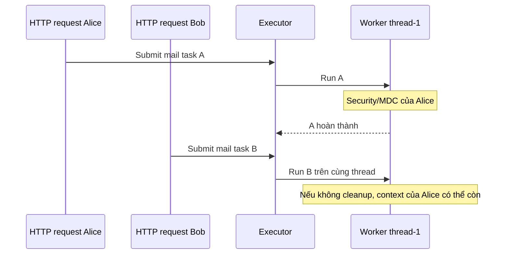
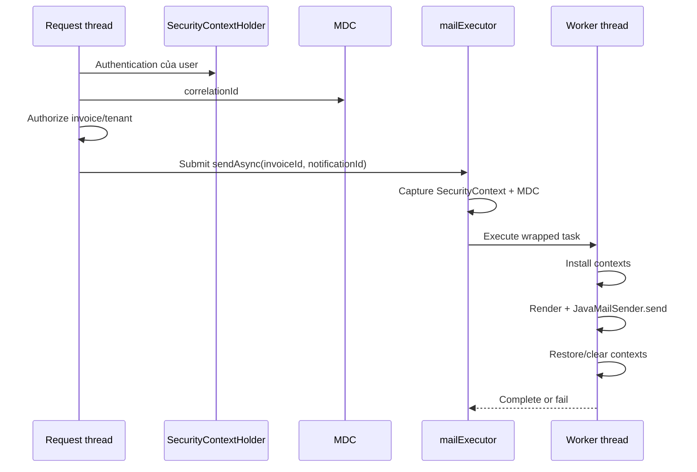

# Truyền security context và correlation context

Trong một ứng dụng Spring Framework Mail, việc gửi email thường được chuyển sang luồng khác để request HTTP không phải chờ kết nối SMTP, TLS handshake, truyền dữ liệu MIME hoặc phản hồi từ mail relay. Spring hỗ trợ cách làm này qua `@Async` và `TaskExecutor`. Tuy nhiên, khi công việc rời khỏi luồng xử lý request, các thông tin gắn với luồng ban đầu **không tự động đi theo**.

Hai nhóm thông tin đặc biệt dễ bị mất hoặc sử dụng sai là:

- **Security context:** người dùng đang được xác thực, các quyền và ngữ cảnh dùng cho kiểm tra truy cập.
- **Correlation context:** định danh request, notification, tenant, trace hoặc các giá trị dùng để liên kết log và theo dõi hành trình xử lý.

Nếu không xử lý đúng, worker gửi mail có thể thấy `SecurityContextHolder` trống, log không có `correlationId`, không xác định được ai đã kích hoạt sự kiện, hoặc tệ hơn là giữ nhầm context của công việc trước do thread pool tái sử dụng thread. Ngược lại, sao chép toàn bộ security context vào mọi job, nhất là job trong queue bền vững, cũng không phải thiết kế an toàn.

Bài học trình bày cách truyền context trong **bất đồng bộ nội bộ JVM**, ranh giới giữa `SecurityContextHolder`, SLF4J MDC và distributed tracing, cách cấu hình `DelegatingSecurityContextAsyncTaskExecutor` kết hợp `TaskDecorator`, mô hình metadata bất biến cho outbox/queue, nguyên tắc phân quyền và cleanup, cùng ví dụ kiểm thử. Ví dụ hướng tới Spring Framework 6.x, Spring Boot 3.x, Spring Security 6.x và Java 21.

## 1. Một tác vụ gửi mail có những loại context nào?

Ví dụ người dùng bấm nút “Gửi hóa đơn”:

```text
HTTP request
  User: alice
  Tenant: shop-42
  Correlation ID: 4c92a0f8-0e56-42b1-9929-bf292e6275d6
  Business event: invoice-ready:981

       |
       v
@Async mail task
       |
       +-- Đọc dữ liệu hóa đơn
       +-- Render template
       +-- Gửi SMTP
       +-- Ghi log kết quả
```

Thông tin được dùng trong tác vụ gồm nhiều loại, không nên gom vào một đối tượng “context” duy nhất rồi truyền mọi nơi:

| Loại dữ liệu | Ví dụ | Dùng để làm gì? | Có nên lưu trong outbox? |
|---|---|---|---|
| Authentication | `Authentication` của Spring Security | Kiểm tra quyền trong ngữ cảnh thực thi ngắn hạn | **Không** lưu nguyên object |
| Actor ID | `user-128` | Audit: ai khởi tạo thao tác | Có, nếu cần và được phép |
| Tenant ID | `shop-42` | Cô lập dữ liệu, chọn cấu hình sender | Có, sau khi xác thực |
| Correlation ID | UUID của luồng xử lý | Liên kết log ở các bước | Có |
| Notification ID | `invoice-ready:981` | Định danh công việc và chống tạo intent trùng | Có |
| Trace/span context | Trace ID, span ID, baggage | Distributed tracing, quan sát hệ thống | Tùy chính sách; không lưu nguyên span object |
| SMTP credentials | Username/password/token | Xác thực với mail relay | **Không** đưa vào job/context |
| HTTP request/session | `HttpServletRequest`, `HttpSession` | Gắn với lifecycle request | **Không** truyền sang worker dài hạn |

Một quy tắc hữu ích: **danh tính để audit, quyền để authorize, correlation ID để truy vết và notification ID để định danh nghiệp vụ là bốn khái niệm khác nhau**. Correlation ID không phải access token; biết correlation ID không cấp quyền đọc hóa đơn. Tương tự, việc log được một actor ID không chứng minh worker còn có quyền thao tác trên dữ liệu đó.

## 2. Vì sao context bị mất khi dùng @Async?

### 2.1. SecurityContextHolder thường gắn với thread

Trong ứng dụng Spring Security servlet thông thường, `SecurityContextHolder` sử dụng chiến lược dựa trên `ThreadLocal`. Filter chain thiết lập security context trên luồng xử lý request và dọn nó khi request kết thúc.

```java
Authentication authentication =
        SecurityContextHolder.getContext().getAuthentication();
```

Đoạn code trên lấy authentication gắn với **luồng đang chạy**. Khi công việc chuyển sang thread khác, thread mới không tự nhận đúng context từ request thread.

Ví dụ:

```java
@Service
public class MailNotificationService {

    @Async
    public void sendAsync(Long invoiceId) {
        Authentication authentication =
                SecurityContextHolder.getContext().getAuthentication();

        // Không thể giả định authentication là người dùng request.
        // Tùy cấu hình, nó có thể null hoặc là context khác.
        sendInvoiceMail(invoiceId);
    }
}
```

### 2.2. MDC cũng thường gắn với thread

SLF4J MDC (Mapped Diagnostic Context) thường được logging backend sử dụng để thêm thông tin vào từng dòng log:

```java
MDC.put("correlationId", "4c92a0f8-0e56-42b1-9929-bf292e6275d6");
log.info("Accepted invoice notification");
```

Nếu worker gọi:

```java
log.info("Sending invoice email");
```

thì chưa chắc log trên worker có `correlationId` đã được đặt trên request thread. MDC không phải một kho dữ liệu phân tán và việc đặt MDC ở một thread không tự cập nhật MDC của thread khác.

### 2.3. Thread pool làm vấn đề phức tạp hơn

`@Async` thường dùng executor tái sử dụng các thread. Một thread có thể phục vụ email của Alice, sau đó phục vụ email của Bob:



Điểm nguy hiểm không chỉ là context trống. Nếu tự gọi `SecurityContextHolder.setContext(...)` hoặc `MDC.put(...)` trong worker mà không dọn trong `finally`, luồng tái sử dụng có thể mang metadata của công việc trước sang công việc sau.

## 3. Chọn chiến lược truyền context theo ranh giới công việc

Không phải tác vụ bất đồng bộ nào cũng nên truyền cả `Authentication` object.

| Ranh giới | Chiến lược phù hợp |
|---|---|
| Request thread → `@Async` trong cùng JVM, chạy ngắn | Có thể dùng executor bọc security context và MDC; dọn context sau task |
| Sau commit → task trong cùng JVM | Có thể dùng listener/executor có propagation, nhưng không bảo đảm sống sót qua restart |
| Request → outbox trong database | Lưu actor ID, tenant ID, correlation ID và business intent đã xác thực, không lưu `SecurityContext` |
| Outbox → worker sau nhiều phút hoặc restart | Khởi tạo context xử lý mới, đọc metadata có kiểm soát, kiểm tra quyền tài nguyên |
| Ứng dụng → SMTP relay | Chỉ truyền thông tin cần thiết của email; không gửi Spring Security context qua SMTP |
| Service → service qua HTTP/message broker | Dùng cơ chế propagation trace chuẩn và danh tính service/authorization phù hợp |

Cần phân biệt **context propagation trong bộ nhớ** với **metadata nghiệp vụ được lưu bền vững**. Một wrapper của `Runnable` phù hợp cho task chạy trên executor nội bộ. Nó không phải cách serialize security principal thành payload queue.

## 4. Cách 1: Truyền SecurityContext bằng executor của Spring Security

Spring Security cung cấp các wrapper để chạy task trong security context phù hợp, trong đó có `DelegatingSecurityContextAsyncTaskExecutor`.

Khi dùng constructor **không truyền một security context cố định**, wrapper có thể lấy context của bên submit cho từng task và thiết lập nó trên thread thực thi trong khoảng thời gian task chạy. Sau khi task hoàn tất, wrapper khôi phục hoặc dọn security context theo contract của nó.

### 4.1. Cấu hình executor cho gửi email

```java
package com.example.mail.config;

import org.springframework.aop.interceptor.AsyncUncaughtExceptionHandler;
import org.springframework.context.annotation.Bean;
import org.springframework.context.annotation.Configuration;
import org.springframework.core.task.AsyncTaskExecutor;
import org.springframework.scheduling.annotation.EnableAsync;
import org.springframework.scheduling.concurrent.ThreadPoolTaskExecutor;
import org.springframework.security.task.DelegatingSecurityContextAsyncTaskExecutor;

@Configuration(proxyBeanMethods = false)
@EnableAsync
public class MailAsyncConfiguration {

    @Bean("mailExecutor")
    public AsyncTaskExecutor mailExecutor() {
        ThreadPoolTaskExecutor delegate = new ThreadPoolTaskExecutor();
        delegate.setThreadNamePrefix("mail-worker-");
        delegate.setCorePoolSize(2);
        delegate.setMaxPoolSize(8);
        delegate.setQueueCapacity(100);
        delegate.setTaskDecorator(new MdcCopyingTaskDecorator());
        delegate.initialize();

        // Không truyền SecurityContext cố định: capture theo từng task.
        return new DelegatingSecurityContextAsyncTaskExecutor(delegate);
    }
}
```

`@EnableAsync` bật xử lý `@Async` qua cơ chế proxy Spring. Bean tên `mailExecutor` được chỉ định tường minh cho tác vụ gửi mail. `ThreadPoolTaskExecutor` giới hạn số worker và queue; các giá trị ở đây chỉ mang tính ví dụ, cần chọn theo năng lực SMTP, timeout và yêu cầu backpressure.

Import `AsyncUncaughtExceptionHandler` trong ví dụ không bắt buộc khi chỉ định nghĩa executor; nếu dự án muốn xử lý exception cho các phương thức `@Async void`, hãy cấu hình handler qua `AsyncConfigurer` hoặc chọn `CompletableFuture` để quan sát lỗi theo cách tường minh.

### 4.2. Dùng executor trong service

```java
package com.example.mail;

import java.util.concurrent.CompletableFuture;

import org.springframework.scheduling.annotation.Async;
import org.springframework.stereotype.Service;

@Service
public class AsyncInvoiceMailService {

    private final InvoiceMailSender invoiceMailSender;

    public AsyncInvoiceMailService(InvoiceMailSender invoiceMailSender) {
        this.invoiceMailSender = invoiceMailSender;
    }

    @Async("mailExecutor")
    public CompletableFuture<Void> sendAsync(
            Long invoiceId, String notificationId) {

        invoiceMailSender.send(invoiceId, notificationId);
        return CompletableFuture.completedFuture(null);
    }
}
```

Khi phương thức này được gọi qua Spring proxy từ một bean khác, Spring submit công việc vào `mailExecutor`. Executor bọc tác vụ bằng security context của thread submit, trong khi `MdcCopyingTaskDecorator` (định nghĩa ở phần sau) sao chép MDC hiện tại.

Lưu ý:

- Nếu gọi `this.sendAsync(...)` từ chính bean đó, self-invocation thường không đi qua proxy nên `@Async` không có hiệu lực.
- Không suy đoán rằng `SecurityContextHolder` sẽ tồn tại trong mọi trường hợp: task được submit từ scheduler hoặc worker không xác thực có thể không có user authentication.
- Propagation giúp code chạy với context tại thời điểm submit; nó không thay thế kiểm tra quyền đối với invoice.
- `CompletableFuture` cho phép caller quan sát exception; việc không await hoặc không xử lý kết quả vẫn có thể làm lỗi gửi bị bỏ qua.

### 4.3. Tránh constructor với security context dùng chung ngoài ý muốn

Một số wrapper chấp nhận `SecurityContext` cụ thể trong constructor. Khi truyền một context cố định, các task có thể chạy với cùng context đó, bất kể người submit là ai. Điều này phù hợp trong tình huống được thiết kế có chủ đích, nhưng **không phù hợp** nếu một executor dùng chung phục vụ request của nhiều người dùng mà bạn muốn bảo toàn danh tính từng request.

Đừng dùng tài khoản admin hoặc một context có quyền rộng làm mặc định cho mọi email task để “giải quyết” lỗi permission. Làm như vậy có thể che lỗi phân quyền, tạo khả năng truy cập chéo tenant và làm audit mất ý nghĩa.

## 5. Cách 2: Truyền MDC bằng TaskDecorator

Spring cung cấp interface `TaskDecorator` để bọc `Runnable` trước khi executor thực thi. Một decorator dành riêng cho MDC nên:

1. Chụp bản sao map MDC ở thread submit.
2. Trên worker, lưu context cũ nếu có.
3. Đặt MDC của task trước khi chạy.
4. Thực thi task.
5. Khôi phục MDC cũ trong `finally`, kể cả khi task ném exception.

### 5.1. Implementation có cleanup

```java
package com.example.mail.config;

import java.util.Map;

import org.slf4j.MDC;
import org.springframework.core.task.TaskDecorator;

public final class MdcCopyingTaskDecorator implements TaskDecorator {

    @Override
    public Runnable decorate(Runnable task) {
        // Được gọi khi task được submit vào executor.
        Map<String, String> captured = MDC.getCopyOfContextMap();

        return () -> {
            Map<String, String> previous = MDC.getCopyOfContextMap();
            try {
                setOrClear(captured);
                task.run();
            } finally {
                setOrClear(previous);
            }
        };
    }

    private static void setOrClear(Map<String, String> values) {
        if (values == null || values.isEmpty()) {
            MDC.clear();
        } else {
            MDC.setContextMap(values);
        }
    }
}
```

Decorator không giữ tham chiếu tới HTTP request và không cần biết email được gửi thế nào. Nó chỉ quản lý một map string-to-string có vòng đời gắn với task.

Việc lấy map bằng `MDC.getCopyOfContextMap()` quan trọng hơn đọc một map có thể thay đổi sau đó. Ở thread chạy task, luôn đặt hoặc xóa toàn bộ MDC theo snapshot; nếu chỉ ghi đè một số key, các key còn sót từ công việc trước có thể tiếp tục xuất hiện.

Khối `finally` bảo đảm cleanup khi `task.run()` thành công hoặc thất bại. Khôi phục context cũ an toàn hơn chỉ gọi `MDC.clear()` trong các hệ thống có nhiều lớp decorator hoặc instrumentation lồng nhau, vì một lớp bên ngoài có thể đã thiết lập context hợp lệ.

### 5.2. MDC khác SecurityContext

`MdcCopyingTaskDecorator` chỉ sao chép các cặp key/value của MDC. Nó **không truyền Authentication**. Ngược lại, `DelegatingSecurityContextAsyncTaskExecutor` truyền security context nhưng **không tự bảo đảm MDC được sao chép**.

Vì vậy, hai cơ chế phục vụ hai trách nhiệm khác nhau:

```text
Request thread
  SecurityContextHolder  -----> DelegatingSecurityContextAsyncTaskExecutor
  MDC                   -----> MdcCopyingTaskDecorator

                               Worker thread
                                 SecurityContextHolder cho task
                                 MDC cho task
                                 try { run task } finally { restore }
```

Không đặt username, roles hoặc JWT thô vào MDC chỉ để bù cho việc không truyền security context. MDC là công cụ logging, không phải cơ chế phân quyền.

### 5.3. Chỉ sao chép những key cần thiết khi phù hợp

Sao chép toàn bộ MDC map có thể dễ triển khai, nhưng ứng dụng có thể chứa nhiều key nhạy cảm hoặc có cardinality cao. Một biến thể an toàn hơn là chỉ chụp các key được duyệt:

```java
String correlationId = MDC.get("correlationId");
String notificationId = MDC.get("notificationId");
String tenantId = MDC.get("tenantId");
```

Sau đó decorator chỉ đặt ba key này, giữ cơ chế lưu/khôi phục context cũ trong `try/finally`. Tuy nhiên, hãy thống nhất với tracing instrumentation: nếu thư viện tracing quản lý `traceId`/`spanId`, đừng tự ghi đè chúng một cách mù quáng.

## 6. Tạo correlation ID tại ranh giới request

Correlation ID là một định danh để liên kết log của một luồng xử lý. Nó có thể xuất phát từ reverse proxy/gateway tin cậy hoặc được ứng dụng tạo mới khi nhận request.

Ví dụ:

```text
HTTP request:
  X-Correlation-ID: 7d4272f7-99ef-4972-ac96-a9589169acc1

Application log:
  correlationId=7d4272f7-99ef-4972-ac96-a9589169acc1 action=invoice_requested

Mail worker log:
  correlationId=7d4272f7-99ef-4972-ac96-a9589169acc1 action=smtp_attempt
```

Không coi giá trị header do client tự gửi là đáng tin tuyệt đối. Client có thể truyền chuỗi rất dài, ký tự điều khiển hoặc cố ý trùng ID với yêu cầu khác. Có thể giới hạn format, độ dài và sinh ID mới nếu giá trị không đạt policy.

### 6.1. Filter thiết lập và dọn MDC

```java
package com.example.web;

import java.io.IOException;
import java.util.UUID;

import jakarta.servlet.FilterChain;
import jakarta.servlet.ServletException;
import jakarta.servlet.http.HttpServletRequest;
import jakarta.servlet.http.HttpServletResponse;

import org.slf4j.MDC;
import org.springframework.stereotype.Component;
import org.springframework.web.filter.OncePerRequestFilter;

@Component
public class CorrelationIdFilter extends OncePerRequestFilter {

    private static final String HEADER = "X-Correlation-ID";
    private static final String MDC_KEY = "correlationId";

    @Override
    protected void doFilterInternal(
            HttpServletRequest request,
            HttpServletResponse response,
            FilterChain chain) throws ServletException, IOException {

        String correlationId = resolveCorrelationId(
                request.getHeader(HEADER));
        String previous = MDC.get(MDC_KEY);

        try {
            MDC.put(MDC_KEY, correlationId);
            request.setAttribute(MDC_KEY, correlationId);
            response.setHeader(HEADER, correlationId);
            chain.doFilter(request, response);
        } finally {
            if (previous == null) {
                MDC.remove(MDC_KEY);
            } else {
                MDC.put(MDC_KEY, previous);
            }
        }
    }

    private static String resolveCorrelationId(String input) {
        if (input != null && input.length() <= 36) {
            try {
                UUID parsed = UUID.fromString(input);
                if (parsed.toString().equalsIgnoreCase(input)) {
                    return parsed.toString();
                }
            } catch (IllegalArgumentException ignored) {
                // Không chấp nhận header không đúng định dạng.
            }
        }
        return UUID.randomUUID().toString();
    }
}
```

Đây là một quy tắc minh họa: ứng dụng dùng UUID làm correlation ID. Nếu hệ thống đã có tracing/gateway cấp ID theo chuẩn khác, hãy thống nhất format thay vì tự tạo nhiều ID cạnh tranh nhau.

Filter đưa ID vào MDC để request log có thể sử dụng; `MdcCopyingTaskDecorator` đưa cùng ID vào worker khi task được submit từ request thread. Khi request kết thúc, filter khôi phục key cũ để không rò rỉ context sang request khác.

### 6.2. Không dùng correlation ID để authorize

Một UUID ngẫu nhiên không phải bằng chứng quyền truy cập. Không xây API kiểu “Ai có correlation ID thì được tải hóa đơn”. Các API đọc dữ liệu vẫn cần xác thực và phân quyền bằng user/tenant/business resource.

Correlation ID cũng không nhất thiết là bí mật, nhưng nên tránh đưa dữ liệu định danh cá nhân vào ID, ví dụ ghép email hoặc số điện thoại vào chuỗi. Dùng ID vô nghĩa về mặt nội dung giúp log an toàn hơn và giảm nguy cơ lộ dữ liệu.

## 7. Khởi tạo context cho luồng gửi mail ngắn hạn

Giả sử controller gọi một service thực hiện xác thực nghiệp vụ rồi submit công việc gửi:



Thứ tự đáng chú ý:

1. Xác thực và phân quyền trên thread nhận request.
2. Chuẩn bị dữ liệu/ID đã được cho phép.
3. Submit task qua executor có context propagation.
4. Worker sử dụng context chỉ trong phạm vi task.
5. Worker cleanup trong `finally`.

Điều này phù hợp với công việc tương đối ngắn chạy trong cùng JVM. Nếu task phải sống qua restart, được retry sau nhiều phút hoặc chạy trên máy khác, hãy dùng metadata bền vững thay vì cố giữ `SecurityContext`.

## 8. Không dùng security context thay cho quyền nghiệp vụ

Việc worker nhìn thấy `Authentication` không đủ để kết luận nó có quyền gửi hóa đơn cụ thể. `Authentication` có thể nói user đã đăng nhập và có role, nhưng quyền với resource cần được kiểm tra riêng.

Ví dụ không nên:

```java
@Async("mailExecutor")
public void sendInvoice(Long invoiceId) {
    // Không xác minh invoice thuộc user hoặc tenant nào.
    Invoice invoice = invoiceRepository.findById(invoiceId).orElseThrow();
    send(invoice);
}
```

Thay vào đó, service nhận command và actor/tenant đã được xác thực, kiểm tra ownership trước khi tạo intent gửi:

```java
public record InvoiceNotificationCommand(
        long invoiceId,
        String actorId,
        String tenantId,
        String correlationId,
        String notificationId
) {}
```

```java
@Transactional
public void requestInvoiceMail(long invoiceId) {
    Authentication authentication =
            SecurityContextHolder.getContext().getAuthentication();

    String actorId = currentActor.requireUserId(authentication);
    String tenantId = currentTenant.requireTenantId(authentication);

    Invoice invoice = invoiceRepository.findById(invoiceId).orElseThrow();
    invoicePolicy.requireCanReadAndEmail(
            actorId, tenantId, invoice);

    String notificationId = "invoice-ready:" + invoice.getId();
    String correlationId = correlationIdProvider.currentOrCreate();

    outboxRepository.insertIfAbsent(
            InvoiceNotificationCommand.of(
                    invoiceId,
                    actorId,
                    tenantId,
                    correlationId,
                    notificationId));
}
```

Các thành phần như `currentActor`, `currentTenant`, `invoicePolicy`, `correlationIdProvider` và `insertIfAbsent(...)` là abstraction do ứng dụng định nghĩa. Ví dụ minh họa nguyên tắc: **quyền gửi được quyết định từ danh tính đã xác thực và dữ liệu nghiệp vụ**, còn outbox chứa thông tin tối thiểu cần thiết để hoàn thành công việc.

Khi worker chạy, nó không được tin `actorId` hoặc `tenantId` chỉ vì chúng xuất hiện trong một message do nguồn ngoài gửi vào. Metadata này phải đến từ storage/command đã được tạo bởi luồng nghiệp vụ được tin cậy, có kiểm soát quyền. Nếu dùng message broker cho nhiều producer, cần xác thực producer và giới hạn payload.

## 9. Security context là snapshot tạm thời, không phải phiên đăng nhập vĩnh viễn

Ngay cả khi executor truyền được context, vẫn có rủi ro khi xem nó là quyền bất biến:

- User có thể bị khóa hoặc bị thu hồi quyền sau lúc submit task.
- Membership của user trong tenant có thể thay đổi.
- `Authentication` hoặc principal có thể chứa object mutable.
- Bản sao reference của `SecurityContext` không nhất thiết là deep copy của mọi thuộc tính.
- Task có thể chạy trễ so với request tạo ra nó.

Do đó:

1. **Dùng context để giữ danh tính và thực hiện kiểm tra thích hợp trong tác vụ ngắn.**
2. **Xác thực quyền nghiệp vụ tại thời điểm chấp nhận yêu cầu gửi.**
3. **Với task trì hoãn, quyết định rõ có cần kiểm tra lại trạng thái quyền, suppression hoặc ownership tại thời điểm dispatch không.**
4. **Không giữ access token hoặc session của user để worker gửi email sau nhiều giờ.**

Một hệ thống có thể chọn policy “quyền được kiểm tra tại thời điểm nghiệp vụ phát sinh” đối với hóa đơn đã phát hành, hoặc policy “kiểm tra lại quyền tại thời điểm gửi” đối với thông báo có thể hủy. Cả hai đều là quyết định nghiệp vụ cần được nêu rõ, không phải hành vi mặc định của `@Async`.

## 10. Vì sao không dùng MODE_INHERITABLETHREADLOCAL cho thread pool?

Spring Security hỗ trợ nhiều chiến lược `SecurityContextHolder`. `MODE_INHERITABLETHREADLOCAL` có thể chuyển context sang thread con lúc thread được tạo. Nhưng thread pool thường **tạo thread một lần và tái sử dụng cho nhiều task**.

Vì vậy, không nên giải quyết propagation cho executor bằng:

```java
SecurityContextHolder.setStrategyName(
        SecurityContextHolder.MODE_INHERITABLETHREADLOCAL);
```

trong một ứng dụng nhiều người dùng rồi kỳ vọng mỗi task sẽ tự có đúng authentication. Thread được tạo sớm có thể không có context; thread được tạo lúc request A chạy có thể giữ context không phù hợp khi tiếp nhận công việc B. Chiến lược inheritance không thay thế cơ chế capture và cleanup theo từng task.

Executor wrapper như `DelegatingSecurityContextAsyncTaskExecutor` rõ ràng hơn cho thread pool. Nó xác định context theo thời điểm submit/execute và giới hạn vòng đời ở task thay vì dựa vào thời điểm thread ra đời.

## 11. Correlation context trong log, tracing và audit

Để quan sát một tác vụ gửi mail, thường cần ít nhất ba ID:

| ID | Phạm vi | Ví dụ |
|---|---|---|
| `correlationId` | Một luồng xử lý xuyên request → job | UUID được truyền từ request |
| `notificationId` | Một thông báo nghiệp vụ | `invoice-ready:981` |
| `attemptId` | Một lần thử SMTP cụ thể | UUID mới cho mỗi attempt |

Nếu retry ba lần, cả ba lần giữ cùng `notificationId` và có thể cùng `correlationId`, nhưng mỗi attempt có `attemptId` riêng. Nhờ đó có thể trả lời:

- Request nào tạo notification?
- Notification nào được retry?
- Attempt nào trả SMTP 451?
- Attempt nào được relay chấp nhận?
- Có hai worker cùng xử lý một notification hay không?

Ví dụ log đã được giảm dữ liệu nhạy cảm:

```text
INFO correlationId=... notificationId=invoice-ready:981 attemptId=... event=mail_attempt_started
WARN correlationId=... notificationId=invoice-ready:981 attemptId=... event=smtp_temp_failure smtpCode=451
INFO correlationId=... notificationId=invoice-ready:981 attemptId=... event=mail_attempt_accepted
```

Không cần log body, token reset mật khẩu, thông tin hóa đơn hoặc mật khẩu SMTP để theo dõi các bước này.

### 11.1. Đặt notification ID trong scope của task

Ví dụ một worker xử lý một attempt:

```java
public void sendAttempt(MailJob job) {
    String previousNotification = MDC.get("notificationId");
    String previousAttempt = MDC.get("attemptId");

    try {
        MDC.put("notificationId", job.notificationId());
        MDC.put("attemptId", UUID.randomUUID().toString());

        log.info("Mail attempt started");
        mailComposerAndSender.send(job);
        log.info("Mail attempt accepted by sender");
    } finally {
        restoreKey("notificationId", previousNotification);
        restoreKey("attemptId", previousAttempt);
    }
}

private static void restoreKey(String key, String previous) {
    if (previous == null) {
        MDC.remove(key);
    } else {
        MDC.put(key, previous);
    }
}
```

Đoạn code là minh họa: `MailJob` và `mailComposerAndSender` là thành phần của ứng dụng, các import `MDC`/`UUID`/logger cần được khai báo. Trường `notificationId` dùng ổn định qua retry; `attemptId` dùng riêng cho từng lần gửi.

### 11.2. MDC không phải distributed tracing

Sao chép một chuỗi `traceId` trong MDC chỉ giúp log hiển thị cùng trace ID. Nó **không tự tạo quan hệ parent-child span**, không truyền trạng thái sampling và không quản lý lifecycle của span.

Nếu ứng dụng sử dụng Micrometer Tracing, OpenTelemetry hoặc cơ chế observability của Spring Boot, hãy dùng công cụ propagation tương ứng và đăng ký các context accessor phù hợp. Micrometer Context Propagation có abstraction như `ContextSnapshot` để capture/restore những context được hỗ trợ. Một `TaskDecorator` dành cho tracing có thể dùng abstraction đó, tùy phiên bản thư viện và cấu hình ứng dụng.

Đừng trộn hai cơ chế propagation mà không xác định ownership:

- Tracing instrumentation quản lý active span và các key MDC của nó.
- Decorator ứng dụng quản lý correlation/notification ID do ứng dụng định nghĩa.
- Nếu một decorator copy tất cả MDC, hãy hiểu thứ tự thiết lập/khôi phục với instrumentation; tránh ghi đè `traceId`/`spanId` không tương ứng với active span.

### 11.3. W3C trace context và correlation ID

Trong distributed tracing, các header như `traceparent` và `tracestate` dùng truyền trace context giữa các dịch vụ theo chuẩn. Correlation ID do ứng dụng tự định nghĩa là một cơ chế khác; hai ID có thể cùng tồn tại.

Đừng lấy một chuỗi tự đặt tên `traceId` rồi giả định nó đã đủ để backend tracing liên kết span. Nếu dùng OpenTelemetry/Micrometer, để instrumentation tạo, kích hoạt và kết thúc span đúng cách.

### 11.4. Baggage có thể mang thông tin nhạy cảm

Tracing baggage đôi khi được truyền qua ranh giới service và có thể xuất hiện trong log hoặc header downstream. Không đưa JWT, email, số điện thoại, session ID hoặc thông tin riêng tư vào baggage. Chỉ cho phép các giá trị cần thiết và phù hợp chính sách dữ liệu.

## 12. Cần mang context nào sang SMTP?

SMTP relay không cần biết Spring Security principal hoặc role của người kích hoạt. Nó cần địa chỉ gửi, người nhận, nội dung MIME và thông tin xác thực với SMTP provider do hệ thống quản lý.

Có thể có nhu cầu liên kết một email cụ thể với notification trong hệ thống. Khi đó, ứng dụng có thể thêm một header tùy chỉnh:

```java
MimeMessage message = mailSender.createMimeMessage();
MimeMessageHelper helper =
        new MimeMessageHelper(message, true, "UTF-8");

helper.setFrom(fromAddress);
helper.setTo(recipient);
helper.setSubject(subject);
helper.setText(plainText, html);

message.addHeader("X-Notification-ID", safeNotificationId);
```

Đây là lựa chọn, không phải yêu cầu bắt buộc. Header có thể hiển thị với mail relay và bên nhận; không đặt user access token, JWT, bí mật SMTP, chi tiết quyền hoặc dữ liệu cá nhân nhạy cảm vào đây.

`safeNotificationId` phải được chuẩn hóa/kiểm tra chiều dài và ký tự điều khiển trước khi thêm vào header để tránh header injection. Không dùng raw correlation header do client cung cấp mà chưa kiểm tra.

Một số provider có khả năng tra cứu hoặc webhook sự kiện theo message/notification ID riêng. Nếu cần tracking kết quả giao thư, dùng contract của provider và lưu mapping ID phù hợp; không giả định mọi SMTP relay bảo toàn header tùy chỉnh.

## 13. Vấn đề transaction khi gửi mail bất đồng bộ

`@Async` và `@Transactional` điều khiển hai cơ chế khác nhau:

- `@Async` chuyển lời gọi qua executor.
- `@Transactional` mở hoặc tham gia transaction trong **thread đang thực thi phương thức được proxy quản lý**.

Transaction của request thread không tự di chuyển sang worker thread. Nếu request đang cập nhật order nhưng ngay lập tức submit email task, worker có thể chạy trước commit và đọc trạng thái cũ.

Ví dụ nguy hiểm:

```java
@Transactional
public void confirmOrder(Long orderId) {
    Order order = orderRepository.findById(orderId).orElseThrow();
    order.confirm();
    orderRepository.save(order);

    asyncMailService.sendAsync(orderId);
    // Transaction có thể chưa commit khi worker bắt đầu.
}
```

Việc truyền `SecurityContext` hoặc MDC chính xác **không giải quyết** sự thiếu nhất quán transaction này. Context propagation không đồng nghĩa transaction propagation.

### 13.1. Gửi sau commit

Với email best-effort, có thể publish event trong transaction và xử lý sau commit:

```java
public record OrderConfirmedEvent(Long orderId, String correlationId) {}
```

```java
@Async("mailExecutor")
@TransactionalEventListener(phase = TransactionPhase.AFTER_COMMIT)
public void onOrderConfirmed(OrderConfirmedEvent event) {
    // ID đã được lấy từ event; không dựa vào HTTP request còn sống.
    mailService.sendOrderConfirmation(
            event.orderId(), event.correlationId());
}
```

Lưu ý:

- `AFTER_COMMIT` tránh chạy khi transaction rollback.
- `@Async` chuyển gửi SMTP sang thread executor.
- Event nên mang metadata cần thiết thay vì HTTP request hoặc entity JPA sống.
- Nếu event được publish ngoài transaction, listener mặc định không chạy khi `fallbackExecution=false`.
- Event và task chỉ ở bộ nhớ; JVM crash sau commit trước khi gửi vẫn có thể làm mất email.

### 13.2. Transactional outbox cho notification cần độ tin cậy

Nếu email cần retry qua restart, ghi notification intent vào outbox trong cùng database transaction với nghiệp vụ:

```text
Business transaction:
  UPDATE order
  INSERT mail_outbox(
      notification_id,
      tenant_id,
      actor_id,
      correlation_id,
      template_id,
      payload,
      status='PENDING')
  COMMIT

Later, mail worker:
  Claim outbox row
  Establish correlation context for this attempt
  Validate resource access
  Render + send SMTP
  Update SENT / RETRY_WAIT / FAILED
```

Outbox giữ được actor/tenant/correlation IDs qua restart mà không phải serialize `SecurityContext`. Worker không dùng session của user đã hết hạn; nó vận hành dưới service identity với quyền tối thiểu, và kiểm tra đúng tenant/resource theo policy.

Một nguyên tắc quan trọng: **không copy một `Authentication` object vào database, broker message hoặc cache dài hạn**. Nó có thể chứa credentials, details không serializable, thông tin hết hạn và trạng thái quyền đã cũ.

## 14. Dựng correlation context lại trong outbox worker

Worker lấy một row outbox có:

```java
public record MailJob(
        String notificationId,
        String actorId,
        String tenantId,
        String correlationId,
        String templateId,
        long businessObjectId
) {}
```

Trước mỗi attempt, worker chủ động thiết lập context logging của job và khôi phục trạng thái cũ khi kết thúc:

```java
public void dispatch(MailJob job) {
    Map<String, String> previous = MDC.getCopyOfContextMap();

    try {
        MDC.clear();
        MDC.put("correlationId", job.correlationId());
        MDC.put("notificationId", job.notificationId());
        MDC.put("tenantId", job.tenantId());
        MDC.put("attemptId", UUID.randomUUID().toString());

        mailJobPolicy.requireDispatchAllowed(
                job.tenantId(), job.businessObjectId());
        mailMessageFactory.createAndSend(job);
    } finally {
        if (previous == null) {
            MDC.clear();
        } else {
            MDC.setContextMap(previous);
        }
    }
}
```

Các thành phần `mailJobPolicy` và `mailMessageFactory` là abstraction của ứng dụng. Cần validate dữ liệu từ outbox, bao gồm không cho phép `null` hoặc chuỗi không đạt format ở các trường đưa vào MDC. Không nên để job chứa tenant ID do một producer không tin cậy tự khai báo rồi mặc nhiên cấp quyền theo tenant đó.

Điều kiện để đoạn code hoạt động đúng trong production:

- Worker có danh tính service phù hợp để truy cập storage và SMTP.
- Query đọc nghiệp vụ luôn được giới hạn theo tenant đáng tin cậy.
- Actor ID dùng để audit ai yêu cầu, không tự tạo quyền cho worker.
- Correlation ID là metadata logging, không phải bằng chứng authorization.
- Mỗi attempt có ID riêng và context được dọn trong `finally`.
- Nếu muốn có distributed trace, tạo/khôi phục span bằng instrumentation thay vì chỉ đặt MDC.

### 14.1. Không giả mạo người dùng trong worker

Không nên tạo `UsernamePasswordAuthenticationToken` với username và roles do outbox truyền vào để “giả làm” người dùng:

```java
// Không nên phục dựng quyền từ payload cũ hoặc không tin cậy.
Authentication auth = new UsernamePasswordAuthenticationToken(
        job.actorId(),
        "N/A",
        job.rolesFromPayload());
SecurityContextHolder.getContext().setAuthentication(auth);
```

Như vậy worker có thể nhận quyền đã bị thu hồi hoặc quyền do payload giả mạo. Nếu một tác vụ thực sự cần chạy theo quyền ủy quyền của user, phải dùng cơ chế delegation chính thức, có hạn dùng, phạm vi quyền rõ ràng và chính sách revocation; không dùng một danh sách role serialized làm bằng chứng quyền.

Đối với email giao dịch thông thường, tốt hơn là worker chạy bằng service identity với quyền tối thiểu, kiểm tra outbox intent và resource ownership, đồng thời lưu actor ID chỉ để audit.

## 15. Một security context cho task không có nghĩa là transaction context

Các context khác nhau có vòng đời riêng:

| Context | Cách gắn thông thường | Có tự truyền qua thread không? |
|---|---|---|
| Spring Security `SecurityContext` | `ThreadLocal` qua `SecurityContextHolder` | Không, trừ khi cấu hình propagation |
| SLF4J MDC | Context của logging thread | Không, trừ khi copy/restore |
| Transaction Spring JDBC/JPA | Transaction resources gắn với thread hiện tại | Không nên truyền trực tiếp |
| HTTP request attributes | Request thread/lifecycle | Không an toàn để giữ sau request |
| Tracing span context | Instrumentation/context mechanism | Tùy cấu hình propagation |
| Outbox metadata | Database row bền vững | Worker có thể đọc lại sau restart |

Nếu worker cần một transaction database, hãy mở transaction mới trong service worker cho phần đọc/cập nhật trạng thái. Đừng tìm cách sao chép transaction resources của request thread sang worker bằng `ThreadLocal`; việc đó có thể phá tính nhất quán và kéo dài connection/lock.

Tương tự, `HttpServletRequest` và `HttpSession` không nên được giữ trong task gửi mail. Khi request hoàn tất, lifecycle của các object này kết thúc hoặc bị tái sử dụng theo cách không phù hợp với worker dài hạn.

## 16. Bảo vệ dữ liệu cá nhân và bí mật trong context

Một context log tốt chứa đủ thông tin để truy vết mà không biến log thành nơi lưu dữ liệu nhạy cảm.

**Nên dùng khi cần và được phép:**

- Correlation ID ngẫu nhiên.
- Notification ID hoặc business reference đã được giảm thông tin.
- Tenant ID đã được xác thực và không tiết lộ dữ liệu nhạy cảm.
- Attempt ID.
- Loại template, mã lỗi SMTP đã redaction.

**Tránh đưa vào MDC, baggage, queue log hoặc email header:**

- Access token, refresh token, JWT.
- Password, SMTP credential hoặc API key.
- Session ID, cookie.
- Toàn bộ object `Authentication`.
- Email body, attachment bytes, URL reset password chứa token.
- Địa chỉ người nhận dạng nguyên văn nếu không thật sự cần.
- Thông tin nhạy cảm từ hồ sơ khách hàng.

Một logger có thể tự động xuất MDC vào mọi dòng log. Vì vậy, việc đưa bí mật vào MDC làm tăng phạm vi rò rỉ dữ liệu, ngay cả khi message log không nhắc đến bí mật đó.

### 16.1. Sanitization và giới hạn cardinality

Correlation ID, template ID và notification ID nên có giới hạn độ dài và ký tự được phép. Không nhận một chuỗi nhiều megabyte làm MDC field; việc này làm tăng dung lượng log và gây khó khăn cho hệ thống thu thập.

Trong metrics, không dùng `correlationId`, `notificationId` hoặc email người nhận làm label, vì cardinality gần như không giới hạn. Chúng phù hợp hơn với log hoặc trace attributes có chính sách sampling/redaction. Metrics nên dùng label ít biến thiên như template category, outcome và loại lỗi.

## 17. Xử lý exception và vòng đời async

Context propagation phải cleanup kể cả khi SMTP ném exception. Wrapper dùng `try/finally` bảo đảm không giữ MDC/security context ở worker sau khi task kết thúc, nhưng ứng dụng vẫn cần quan sát thất bại.

### 17.1. Với CompletableFuture

```java
CompletableFuture<Void> result =
        asyncInvoiceMailService.sendAsync(invoiceId, notificationId);

result.whenComplete((ignored, failure) -> {
    if (failure != null) {
        log.warn("Async mail attempt failed", failure);
    }
});
```

Đoạn code chỉ minh họa cách quan sát lỗi; trong production, log exception cần redaction và nên gắn notification ID. Nếu caller bỏ qua future, lỗi có thể không được xử lý như mong muốn.

### 17.2. Với @Async void

Một phương thức `@Async` trả về `void` không cho caller nhận một future để kiểm tra lỗi. Spring có cơ chế `AsyncUncaughtExceptionHandler` qua `AsyncConfigurer` cho loại phương thức này. Nên cấu hình handler hoặc ưu tiên một contract trả future/outcome phù hợp, đặc biệt khi cần theo dõi trạng thái gửi.

### 17.3. Queue đầy và task bị từ chối

Nếu executor hết capacity, task có thể bị từ chối ngay tại thời điểm submit. Việc propagation đúng không giải quyết được queue overload. Ứng dụng cần giới hạn concurrency, chính sách rejection, retry hoặc outbox phù hợp. Không coi “submit không ném exception” là bảo đảm email đã được gửi.

### 17.4. @Async không bảo đảm bền vững

Worker in-memory có thể mất task khi JVM restart. Với email giao dịch cần retry, dùng outbox, trạng thái gửi và lease. Giữ correlation metadata trong outbox để các lần retry vẫn truy vết được; mỗi attempt có span/attempt ID mới.

## 18. Kiểm thử propagation và cleanup

Kiểm thử cần tách hai điều:

1. **Task A nhận đúng context của bên submit.**
2. **Task B chạy trên cùng worker không thấy context còn sót của A.**

Test chỉ kiểm tra task đầu có username/correlation ID là chưa đủ. Thread pool có thể tái sử dụng thread; lỗi rò rỉ thường xuất hiện ở task thứ hai.

### 18.1. Test trực tiếp executor với hai task

Ví dụ sau dùng executor chỉ có một thread để dễ quan sát reuse:

```java
import static org.junit.jupiter.api.Assertions.assertEquals;
import static org.junit.jupiter.api.Assertions.assertNull;

import java.util.List;
import java.util.concurrent.TimeUnit;

import org.junit.jupiter.api.Test;
import org.slf4j.MDC;
import org.springframework.core.task.AsyncTaskExecutor;
import org.springframework.scheduling.concurrent.ThreadPoolTaskExecutor;
import org.springframework.security.authentication.UsernamePasswordAuthenticationToken;
import org.springframework.security.core.authority.SimpleGrantedAuthority;
import org.springframework.security.core.context.SecurityContext;
import org.springframework.security.core.context.SecurityContextHolder;
import org.springframework.security.task.DelegatingSecurityContextAsyncTaskExecutor;

class MailContextPropagationTest {

    record ContextSeen(String principal, String correlationId) {}

    @Test
    void propagatesAndDoesNotLeakBetweenTasks() throws Exception {
        ThreadPoolTaskExecutor delegate = new ThreadPoolTaskExecutor();
        delegate.setCorePoolSize(1);
        delegate.setMaxPoolSize(1);
        delegate.setQueueCapacity(10);
        delegate.setTaskDecorator(new MdcCopyingTaskDecorator());
        delegate.initialize();

        AsyncTaskExecutor executor =
                new DelegatingSecurityContextAsyncTaskExecutor(delegate);

        try {
            SecurityContext context =
                    SecurityContextHolder.createEmptyContext();
            context.setAuthentication(
                    new UsernamePasswordAuthenticationToken(
                            "alice",
                            "N/A",
                            List.of(new SimpleGrantedAuthority("ROLE_USER"))));

            SecurityContextHolder.setContext(context);
            MDC.put("correlationId", "req-alice");

            ContextSeen first = executor.submit(() -> snapshot())
                    .get(5, TimeUnit.SECONDS);

            assertEquals("alice", first.principal());
            assertEquals("req-alice", first.correlationId());

            // Bên submit không còn context của Alice.
            SecurityContextHolder.clearContext();
            MDC.clear();

            ContextSeen second = executor.submit(() -> snapshot())
                    .get(5, TimeUnit.SECONDS);

            assertNull(second.principal());
            assertNull(second.correlationId());
        } finally {
            SecurityContextHolder.clearContext();
            MDC.clear();
            delegate.shutdown();
        }
    }

    private static ContextSeen snapshot() {
        var authentication =
                SecurityContextHolder.getContext().getAuthentication();
        String principal = authentication == null
                ? null : authentication.getName();
        return new ContextSeen(principal, MDC.get("correlationId"));
    }
}
```

Với test backend sử dụng MDC thực sự (ví dụ Logback), kiểm tra được map MDC ở thread worker. Trong môi trường logging adapter không hỗ trợ MDC, `MDC.get(...)` có thể không trả giá trị như mong muốn; cấu hình backend test phù hợp.

Test chỉ dùng một worker thread để xác nhận task tiếp theo không giữ context cũ. Cleanup trong executor wrapper và decorator là yếu tố quan trọng, không phải việc test tự xóa context trên worker.

### 18.2. Test exception path

Thêm một task cố ý ném exception sau khi đã kiểm tra MDC:

```java
var failed = executor.submit(() -> {
    if (MDC.get("correlationId") == null) {
        throw new AssertionError("Missing correlation ID");
    }
    throw new IllegalStateException("Simulated SMTP failure");
});

assertThrows(ExecutionException.class,
        () -> failed.get(5, TimeUnit.SECONDS));
```

Sau đó submit một task mới không có context và xác nhận nó không nhận `correlationId` hoặc authentication từ task lỗi. Điều này kiểm tra đường `finally` khi có exception.

### 18.3. Test qua Spring proxy

Một integration test với Spring context nên gọi `@Async("mailExecutor")` từ **bean khác** thay vì gọi trực tiếp phương thức trong cùng instance. Kiểm tra tên thread thực thi, authentication được truyền và correlation ID xuất hiện trong logging context.

Đồng thời kiểm tra:

- Cùng một executor dùng cho nhiều người dùng không trộn context.
- Không có context submit thì worker không mang authentication của task trước.
- Security context được cleanup khi task ném exception.
- MDC được khôi phục dù task hoàn tất thành công hay thất bại.
- Queue đầy tạo tín hiệu lỗi rõ ràng.

### 18.4. Test outbox và worker restart

Với outbox, không kiểm tra propagation của một `SecurityContext` object qua database. Thay vào đó:

1. Tạo intent bằng một actor đã xác thực và có quyền.
2. Xác nhận outbox lưu đúng actor ID, tenant ID, correlation ID và notification ID.
3. Kết thúc request; xóa security context của request.
4. Worker đọc row và dựng context logging mới.
5. Xác nhận việc gửi/đọc attachment vẫn kiểm tra tenant/resource.
6. Giả lập retry hoặc restart; correlation/notification IDs giữ nguyên, attempt ID thay đổi.
7. Xác nhận worker không cần HTTP session hoặc JWT của actor ban đầu.

Đây mới là mô hình bền vững khi công việc chạy ngoài lifecycle request.

## 19. Những lỗi thường gặp

**Tin rằng @Async tự truyền Authentication.** Security context thường dựa trên ThreadLocal; cần executor wrapper hoặc metadata được thiết kế riêng.

**Tin rằng MDC tự có trên mọi worker.** MDC gắn với thread; cần capture/restore hoặc observability propagation phù hợp.

**Chỉ copy mà không cleanup.** Thread pool tái sử dụng worker, dễ rò rỉ tenant/user/correlation của tác vụ trước. Luôn dùng `finally`.

**Dùng MODE_INHERITABLETHREADLOCAL cho thread pool.** Inheritance gắn với thời điểm tạo thread, không phải mỗi lần submit task.

**Dùng một SecurityContext cố định cho executor đa người dùng.** Tác vụ của người dùng khác có thể chạy dưới quyền sai.

**Giả định bản sao SecurityContext là bất biến.** Authentication/principal có thể mutable và quyền có thể thay đổi; tránh giữ lâu.

**Lưu Authentication, JWT hoặc HttpServletRequest vào outbox.** Các object này có lifecycle và rủi ro bảo mật không phù hợp với queue bền vững.

**Tái tạo quyền worker từ actorId hoặc roles trong payload.** Metadata audit không phải bằng chứng authorization; dùng service identity và kiểm tra quyền tài nguyên.

**Dùng correlationId làm khóa cấp quyền.** Correlation ID phục vụ truy vết, không phải secret.

**Chỉ copy traceId trong MDC rồi coi là distributed trace.** Active span và propagation của tracing framework cần được quản lý riêng.

**Bỏ qua ranh giới transaction.** @Async có thể chạy trước commit; context propagation không chuyển transaction database sang thread mới.

**Cho rằng enqueue vào executor đồng nghĩa đã gửi SMTP.** Task có thể bị từ chối, thất bại hoặc mất khi process dừng.

**Log toàn bộ context để debug.** Có thể làm lộ token, dữ liệu người nhận, nội dung email và dữ liệu riêng tư.

**Dùng correlationId/notificationId làm metric label.** Cardinality quá cao; dùng chúng trong log/trace có kiểm soát.

## 20. Bài thực hành tổng hợp

### Phần A — Tái hiện vấn đề ThreadLocal

Tạo endpoint kích hoạt một tác vụ `@Async` gửi email. Trên request thread, đọc `SecurityContextHolder` và MDC; trong worker, đọc lại. Quan sát sự khác biệt khi chưa cấu hình propagation.

### Phần B — Cấu hình security propagation

Định nghĩa executor riêng cho mail bằng `DelegatingSecurityContextAsyncTaskExecutor`. Gọi qua Spring proxy và xác nhận worker nhận đúng principal của bên submit trong tác vụ ngắn.

### Phần C — Cấu hình MDC TaskDecorator

Thêm `MdcCopyingTaskDecorator`. Tạo correlation ID tại filter, đặt vào MDC và gửi mail. Xác nhận log request và log worker có cùng ID. Thử task ném exception và bảo đảm context được khôi phục.

### Phần D — Kiểm tra hai người dùng

Submit lần lượt công việc của Alice và Bob vào executor một thread. Kiểm tra task A không giữ context trong task B. Thử submit task thứ ba không có authentication; nó không được nhìn thấy principal của Alice hoặc Bob.

### Phần E — Phân quyền trước khi gửi

Tạo hóa đơn thuộc tenant B. Người dùng tenant A thử yêu cầu email. Xác nhận chính sách ownership từ chối trước khi enqueue. Không giải quyết bằng cách cấp role admin cho mail worker.

### Phần F — Correlation và attempt ID

Gắn `correlationId` từ request, `notificationId` từ nghiệp vụ và `attemptId` riêng cho từng lần gửi. Giả lập SMTP thất bại một lần rồi retry; kiểm tra log cho thấy cùng notification nhưng hai attempt khác nhau.

### Phần G — Outbox không lưu SecurityContext

Lưu actor ID, tenant ID, correlation ID và notification ID vào outbox cùng transaction nghiệp vụ. Khởi động worker trong một execution context mới, đọc metadata, kiểm tra resource access và gửi. Xác nhận worker không cần HTTP request/session hay `Authentication` ban đầu.

### Phần H — Kiểm thử tracing

Nếu ứng dụng dùng Micrometer Tracing/OpenTelemetry, xác nhận span của tác vụ async có quan hệ phù hợp với luồng gọi hoặc được liên kết theo chính sách tracing. Không chỉ kiểm tra chuỗi trace ID trong MDC.

### Phần I — Kiểm tra dữ liệu nhạy cảm

Đưa một token giả vào request test. Xác nhận token không xuất hiện trong MDC, queue payload, log hoặc email header. Chỉ các ID được cho phép mới được truyền đi.

## 21. Checklist triển khai

Trước khi đưa luồng gửi mail bất đồng bộ vào production, hãy trả lời:

- Tác vụ chạy trong cùng JVM hay qua outbox/queue bền vững?
- Ai là actor đã kích hoạt công việc? Actor ID được lấy từ nguồn tin cậy chưa?
- Quyền với recipient, tenant và business object được kiểm tra ở đâu?
- Worker có thực sự cần Authentication của user không, hay chỉ cần service identity?
- Executor nào chạy tác vụ? `@Async` có đi qua Spring proxy không?
- Security context được capture theo từng task hay bị gắn cố định cho executor?
- MDC/correlation ID được capture và khôi phục bằng `finally` chưa?
- Có khả năng task B nhìn thấy context của task A khi dùng chung thread không?
- Active trace span được propagation đúng framework hay chỉ copy chuỗi traceId?
- Có dữ liệu nhạy cảm nào vô tình xuất hiện trong MDC, baggage hoặc header?
- Nếu task chạy sau commit, event có bị mất khi process crash không?
- Nếu job retry qua restart, outbox có lưu metadata tối thiểu và đủ bền vững không?
- Có ID riêng cho notification và từng attempt không?
- Lỗi async được quan sát qua future/handler/status hay bị bỏ qua?
- Có giới hạn concurrency, queue capacity và chính sách xử lý task bị từ chối không?

## 22. Kết luận

Trong Spring Framework Mail, chuyển việc gửi SMTP sang `@Async` giúp không chặn request thread, nhưng đồng thời tạo ra **ranh giới thread**. `SecurityContextHolder` và MDC thường gắn với thread nên không tự chuyển chính xác sang worker. Với công việc ngắn trong cùng JVM, có thể kết hợp `DelegatingSecurityContextAsyncTaskExecutor` để truyền security context và `TaskDecorator` để sao chép/khôi phục MDC. Mọi thiết lập thủ công phải được dọn bằng `finally` để tránh rò rỉ giữa các tác vụ trên thread pool.

**Truyền được context không thay thế phân quyền.** Actor ID phục vụ audit; tenant ID phải được xác minh; correlation ID phục vụ log; trace context phải do tracing framework quản lý; và notification ID định danh công việc. Không truyền toàn bộ principal, session hoặc token qua outbox/queue dài hạn. Với job bền vững, hãy lưu metadata tối thiểu đã được xác thực, chạy worker dưới service identity có quyền tối thiểu và kiểm tra quyền tài nguyên theo chính sách.

Cuối cùng, context propagation không phải transaction propagation hay delivery guarantee. `@Async` vẫn có thể chạy trước database commit hoặc mất task khi process dừng. Email quan trọng nên dùng after-commit coordination hoặc transactional outbox phù hợp; correlation/notification/attempt IDs và trạng thái retry giúp theo dõi chính xác các lần gửi mà không phụ thuộc vào lifecycle của HTTP request.
