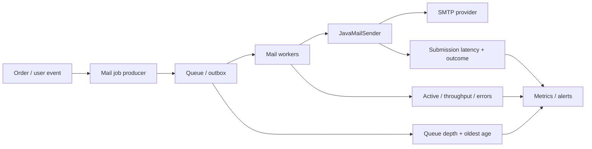
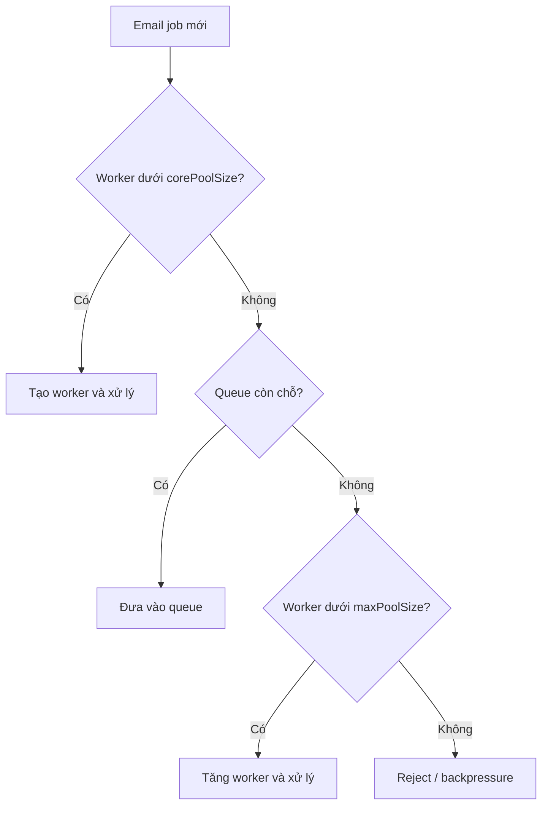

# Theo dõi queue và số tác vụ chờ khi gửi email bất đồng bộ với Spring Framework Mail

Gửi email bằng `JavaMailSender` có thể mất thời gian vì ứng dụng phải dựng nội dung, kết nối SMTP, xác thực, truyền message và chờ phản hồi từ mail server. Nếu thực hiện trực tiếp trong HTTP request hoặc luồng xử lý nghiệp vụ, tốc độ trả lời cho người dùng sẽ phụ thuộc vào SMTP provider. Vì vậy, nhiều ứng dụng sử dụng `@Async`, `ThreadPoolTaskExecutor` hoặc hàng đợi công việc bền vững để gửi email ở worker riêng.

Tuy nhiên, chuyển sang xử lý bất đồng bộ không đồng nghĩa hệ thống có thể nhận vô hạn yêu cầu. Nếu số email mới đến nhanh hơn khả năng gửi, **queue sẽ tăng**; nếu worker bị lỗi hoặc provider giới hạn tốc độ, tác vụ có thể chờ lâu, bị từ chối hoặc bị mất nếu chỉ lưu trong bộ nhớ.

Theo dõi queue không chỉ là đếm số phần tử trong một hàng đợi. Đội vận hành còn cần biết **bao nhiêu tác vụ đang chạy, bao nhiêu đang chờ, tác vụ lâu nhất đã chờ bao lâu, tốc độ tiếp nhận và hoàn tất, tỷ lệ lỗi, retry, rejection và độ trễ đến khi gửi thành công**.

Trong Spring Framework Mail, cách quan sát phụ thuộc vào nơi đặt queue: `ThreadPoolTaskExecutor` trong một JVM, message broker, database job table hoặc transactional outbox. Bài này trình bày cách đo và vận hành từng mô hình, với ví dụ Spring Boot, Micrometer, Spring Actuator và các tình huống thực tế.

## 1. Tại sao phải theo dõi số tác vụ chờ?

Giả sử hệ thống phát sinh 2.000 email xác nhận trong một đợt cao điểm. Worker chỉ có thể gửi 20 email/giây vì giới hạn SMTP. Trong khi đó, API tiếp tục đưa email mới vào queue. Nếu không theo dõi backlog, ứng dụng có thể gặp các tình huống sau:

- Email OTP hoặc xác nhận đến sau thời điểm còn hữu ích.
- Queue trong JVM đầy và `@Async` bị từ chối tác vụ.
- Memory tăng vì hàng đợi giữ nhiều object hoặc dữ liệu MIME lớn.
- Worker liên tục retry làm queue tắc dù số email mới không tăng.
- Nhà cung cấp SMTP trả lỗi tạm thời hoặc rate limit, nhưng dashboard chỉ hiển thị HTTP request thành công.
- Queue trống trên một instance nhưng tồn đọng ở instance khác, làm số liệu toàn hệ thống bị hiểu sai.
- Tiến trình khởi động lại khiến tác vụ đang chờ trong queue memory biến mất.

Một dashboard đúng phải trả lời được ba câu hỏi riêng:

1. **Nhu cầu:** có bao nhiêu email đang được yêu cầu gửi?
2. **Năng lực:** hệ thống đang xử lý và hoàn tất được bao nhiêu email mỗi giây?
3. **Độ trễ và độ tin cậy:** mất bao lâu từ khi tạo yêu cầu đến lúc SMTP chấp nhận; yêu cầu có còn an toàn khi worker bị restart hay không?



**Lưu ý:** `send()` không ném lỗi thường cho biết SMTP submission server đã chấp nhận message để xử lý; nó không xác nhận email đã vào inbox hay được người nhận mở. Cần phân biệt submission metrics với các delivery/bounce events do provider cung cấp.

## 2. Phân biệt queued, running, delayed, failed và delivered

Trước khi xây dashboard, cần định nghĩa rõ các trạng thái. Một con số `pending` không có cùng ý nghĩa trong mọi hệ thống.

| Trạng thái | Nghĩa | Có tính là tác vụ chờ ngay? |
|---|---|---|
| `QUEUED` / `PENDING` | Đã tiếp nhận, đang chờ worker | Có, nếu đã đến thời điểm xử lý |
| `RUNNING` / `PROCESSING` | Worker đã lấy và đang xử lý | Không; cần đo riêng |
| `RETRY_SCHEDULED` | Chờ đến mốc retry tiếp theo | Không nên gộp vào queue ready |
| `SUBMITTED` | SMTP server đã nhận submission | Không |
| `FAILED_PERMANENT` | Hết retry hoặc bị từ chối vĩnh viễn | Không; cần theo dõi lỗi/dead letter |
| `DELIVERED` | Provider xác nhận delivery theo khả năng theo dõi | Không |
| `BOUNCED` | Thư bị bounce sau submission | Không; cần metric delivery riêng |

Các hệ thống có thể đặt tên trạng thái khác nhau. Điều quan trọng là dashboard nhất quán về cách đếm: **ready queue**, **in-flight**, **delayed retry**, **terminal failure** và **delivery outcome** không nên gộp thành một số duy nhất.

### 2.1. Queue depth

`Queue depth` là số tác vụ đang nằm trong hàng đợi tại một thời điểm. Với executor trong JVM, nó thường tương ứng `executor.getThreadPoolExecutor().getQueue().size()`. Với database/broker, phải dùng metric hoặc truy vấn của nguồn queue tương ứng.

Queue depth là một **gauge**, tức số đo tức thời. Một queue depth bằng 0 có thể là dấu hiệu tốt, nhưng cũng có thể nghĩa là không có job nào được enqueue vì producer đang lỗi. Vì vậy cần quan sát cùng tốc độ nhận job.

### 2.2. Active workers

Số worker đang thực thi tác vụ, ví dụ `ThreadPoolTaskExecutor.getActiveCount()`. Worker đang chạy không nằm trong queue chờ, nhưng vẫn là khối lượng công việc chưa hoàn tất.

Với executor, một ước lượng công việc đang chờ hoặc đang thực thi trong executor:

```text
in_process_work ≈ active_count + queue_size
```

Đây là một ước lượng tại thời điểm đọc các chỉ số. Nó không bao gồm job ở database, broker, retry scheduler, hệ thống khác hoặc email đã được submit.

### 2.3. Queue wait time

`Queue wait time` là thời gian từ khi job được đưa vào queue đến khi worker thực sự bắt đầu chạy:

```text
queue_wait = started_processing_at - enqueued_at
```

Một queue có 100 tác vụ chờ có thể chấp nhận được nếu throughput lớn và mỗi tác vụ chỉ đợi 2 giây; nhưng 20 tác vụ chờ hơn 15 phút có thể là sự cố nghiêm trọng. Vì vậy queue depth phải đi kèm **thời gian chờ**, đặc biệt là tuổi của job lâu nhất.

### 2.4. Oldest pending age

`Oldest pending age` là thời gian mà job lâu nhất đang sẵn sàng xử lý đã chờ:

```text
oldest_ready_age = now - min(enqueued_at của các job ready)
```

Metric này đặc biệt hữu ích cho database queue hoặc outbox, nơi có thể truy vấn timestamp của job. Không nhầm tuổi job chưa đến `next_attempt_at` với job ready bị kẹt; retry được trì hoãn có chủ đích nên đo riêng.

### 2.5. Throughput, failures và rejection

Ngoài gauge, cần counter và timer:

| Metric | Loại | Ý nghĩa |
|---|---|---|
| `mail.jobs.enqueued` | Counter | Tổng yêu cầu gửi được nhận vào queue |
| `mail.jobs.started` | Counter | Tổng job được worker lấy xử lý |
| `mail.jobs.submitted` | Counter | Tổng lần gửi được SMTP server chấp nhận |
| `mail.jobs.failed` | Counter | Số lần xử lý thất bại, nên phân loại retryable/permanent |
| `mail.jobs.rejected` | Counter | Số tác vụ bị executor/broker từ chối |
| `mail.queue.depth` | Gauge | Số job ready đang chờ |
| `mail.queue.oldest.age` | Gauge | Độ tuổi của job ready lâu nhất |
| `mail.worker.active` | Gauge | Số job hiện đang thực thi |
| `mail.queue.wait` | Timer | Thời gian từ enqueue đến bắt đầu xử lý |
| `mail.submission.duration` | Timer | Thời gian thực hiện submit SMTP |

Tên metric là quy ước minh họa. Chọn một naming convention thống nhất, kèm nhãn có cardinality thấp để không gây quá tải hệ thống monitoring.

## 3. Xác định queue đang nằm ở đâu

Không phải ứng dụng nào dùng `@Async` cũng có một hàng đợi do nhóm phát triển chủ động tạo ra. Với `ThreadPoolTaskExecutor`, queue thường do `ThreadPoolExecutor` bên dưới quản lý. Trong kiến trúc khác, hàng đợi có thể nằm ở RabbitMQ, Kafka, SQS hoặc database.

| Mô hình | Nơi lưu job chờ | Cách đo chính | Độ bền sau restart |
|---|---|---|---|
| `@Async` + `ThreadPoolTaskExecutor` | Memory của JVM hiện tại | Executor queue size / active count | Không |
| RabbitMQ | Broker queue | Ready, unacked, consumer metrics | Tùy queue/message durability và ack |
| Kafka | Topic partition / consumer position | Consumer lag, processing rate | Theo retention và commit offset |
| Database job queue | Bảng job | Count theo status/due time, oldest age | Có nếu transaction commit |
| Transactional outbox | Bảng outbox cùng transaction nghiệp vụ | Unprocessed/ready event và age | Có nếu ghi cùng transaction |

**Không dùng một metric executor để đại diện cho tất cả job của toàn hệ thống** nếu ứng dụng chạy nhiều instance hoặc còn queue trong broker. Tạo dashboard theo lớp: queue bền vững, executor worker, và SMTP submission/delivery.

## 4. Cấu hình ThreadPoolTaskExecutor với queue có giới hạn

Khi dùng `@Async`, nên khai báo executor riêng cho email để đo lường và giới hạn tài nguyên dễ hơn. Ví dụ với Spring Boot 3+:

```java
package com.example.mail;

import java.util.concurrent.ThreadPoolExecutor;
import org.springframework.context.annotation.Bean;
import org.springframework.context.annotation.Configuration;
import org.springframework.scheduling.annotation.EnableAsync;
import org.springframework.scheduling.concurrent.ThreadPoolTaskExecutor;

@Configuration
@EnableAsync
public class MailExecutorConfiguration {

    @Bean(name = "mailExecutor")
    public ThreadPoolTaskExecutor mailExecutor() {
        ThreadPoolTaskExecutor executor = new ThreadPoolTaskExecutor();
        executor.setCorePoolSize(4);
        executor.setMaxPoolSize(8);
        executor.setQueueCapacity(200);
        executor.setKeepAliveSeconds(30);
        executor.setThreadNamePrefix("mail-worker-");
        executor.setRejectedExecutionHandler(
                new ThreadPoolExecutor.AbortPolicy());
        executor.setWaitForTasksToCompleteOnShutdown(true);
        executor.setAwaitTerminationSeconds(30);
        return executor;
    }
}
```

Những số `4`, `8`, `200` và `30` chỉ là ví dụ, không phải cấu hình tối ưu chung. Chúng cần được đo theo latency gửi SMTP thực tế, giới hạn kết nối của provider, số email mỗi giây, bộ nhớ và yêu cầu dừng ứng dụng.

### 4.1. Cách executor nhận job

Với cấu hình trên, executor cơ bản hoạt động theo quy tắc:

1. Khi ít hơn `corePoolSize` thread đang tồn tại, tạo thêm worker để chạy tác vụ.
2. Khi đã có core threads, tác vụ mới được đưa vào queue nếu còn chỗ.
3. Khi queue đầy, executor có thể mở thêm worker đến `maxPoolSize`.
4. Khi cả queue và worker đều đã đầy, tác vụ mới bị từ chối theo rejection policy.



**Điểm dễ nhầm:** tăng `maxPoolSize` không có nghĩa executor sẽ lập tức tạo đến số thread tối đa. Với queue còn chỗ, tác vụ thường tiếp tục chờ trong queue trước khi thread pool tăng vượt core size.

### 4.2. Tránh queue memory không giới hạn

`ThreadPoolTaskExecutor` có queue capacity mặc định rất lớn. Nếu để cấu hình mặc định mà nhận hàng trăm nghìn email trong thời gian ngắn, queue có thể giữ nhiều object trong memory và gây áp lực heap.

Với `queueCapacity > 0`, Spring thường dùng một queue có giới hạn dựa trên `LinkedBlockingQueue`. Với `queueCapacity = 0`, nó dùng `SynchronousQueue`: không lưu job chờ; khi không có worker nhận được ngay, executor phải tăng thread hoặc reject.

Khi queue quá lớn, `maxPoolSize` có thể gần như không được sử dụng vì queue chưa đầy. Nên chọn queue capacity theo mức backlog có thể chấp nhận, không phải theo dung lượng RAM tối đa.

### 4.3. Rejection không được biến thành mất mail âm thầm

Với `AbortPolicy`, executor từ chối job khi đã bão hòa; Spring thường bọc lỗi thành `TaskRejectedException` tại ranh giới thực thi. Tầng enqueue hoặc API phải ghi nhận rejection và quyết định hành vi nghiệp vụ:

- Trả lỗi phù hợp và yêu cầu gọi lại nếu chưa lưu job bền vững.
- Ghi job vào outbox/queue bền vững trước, rồi để worker nhận sau.
- Thực hiện rate limiting hoặc admission control ở phía producer.
- Không báo “email đã được xếp hàng” nếu thực tế executor từ chối nhận tác vụ.

`CallerRunsPolicy` đôi khi được dùng làm backpressure: thread gọi executor có thể bị buộc tự chạy tác vụ, làm request chậm lại. Tuy nhiên, điều này kéo công việc SMTP vào thread producer và có các trường hợp đặc biệt khi executor đã shutdown. Không chọn policy này mà không phân tích latency và thông tin kết quả gửi.

## 5. Gửi email bằng @Async với executor riêng

Để Spring dùng đúng pool, chỉ định tên executor trên `@Async`:

```java
package com.example.mail;

import java.util.UUID;
import org.springframework.scheduling.annotation.Async;
import org.springframework.stereotype.Service;

@Service
public class AsyncMailService {

    private final MailDeliveryService deliveryService;

    public AsyncMailService(MailDeliveryService deliveryService) {
        this.deliveryService = deliveryService;
    }

    @Async("mailExecutor")
    public void sendConfirmation(UUID jobId) {
        deliveryService.sendJob(jobId);
    }
}
```

`MailDeliveryService` chịu trách nhiệm đọc dữ liệu cần thiết, dựng MIME message và gửi bằng `JavaMailSender`. `jobId` là một ID được ứng dụng quản lý, không nhất thiết là job đã được lưu bền vững.

Một vài lưu ý:

- `@EnableAsync` phải được bật và bean được Spring quản lý.
- Lời gọi method async phải đi qua proxy; self-invocation trong cùng class thường không kích hoạt async.
- Thread async không kế thừa transaction imperative của thread gốc; truy vấn/ghi database cần transaction riêng.
- Exception trong method trả về `void` không tự quay về người gọi; cần theo dõi lỗi/handler trong worker.
- Queue memory của `ThreadPoolTaskExecutor` không sống sót qua restart.

Nếu cần bảo đảm job được nhận dù ứng dụng tắt ngay sau HTTP response, **đừng coi việc gọi method `@Async` là một cơ chế lưu job bền vững**. Hãy ghi vào database/outbox hoặc broker có persistence trước khi trả trạng thái chấp nhận.

## 6. Đọc trực tiếp số job chờ trong ThreadPoolTaskExecutor

Spring cho phép truy cập executor Java bên dưới qua `getThreadPoolExecutor()`:

```java
import java.util.concurrent.ThreadPoolExecutor;
import org.springframework.scheduling.concurrent.ThreadPoolTaskExecutor;

ThreadPoolExecutor pool = mailExecutor.getThreadPoolExecutor();

int queued = pool.getQueue().size();
int active = mailExecutor.getActiveCount();
int poolSize = mailExecutor.getPoolSize();
int maximum = mailExecutor.getMaxPoolSize();
int remainingQueueCapacity = pool.getQueue().remainingCapacity();
long completedTasks = pool.getCompletedTaskCount();
```

Ý nghĩa:

| Trường | Ý nghĩa |
|---|---|
| `getQueue().size()` | Tác vụ đang nằm trong queue và chưa được worker lấy |
| `getActiveCount()` | Số worker được ước lượng đang thực thi |
| `getPoolSize()` | Tổng thread hiện có trong pool |
| `getMaxPoolSize()` | Giới hạn số thread tối đa |
| `getQueue().remainingCapacity()` | Chỗ trống còn lại của queue |
| `getCompletedTaskCount()` | Số tác vụ đã kết thúc theo bộ đếm executor |

Các giá trị là snapshot **xấp xỉ** trong môi trường concurrent. Chúng có thể thay đổi ngay sau khi đọc. Không cần khóa toàn bộ executor chỉ để tạo dashboard; mục đích là quan sát xu hướng.

### Phân biệt completed task với email đã gửi thành công

`getCompletedTaskCount()` tăng khi một `Runnable` kết thúc, kể cả trường hợp tác vụ đã bắt exception hoặc thực hiện retry. Vì vậy:

```text
executor completed tasks != successfully submitted emails
```

Muốn biết bao nhiêu email gửi thành công, cần metric ở tầng `JavaMailSender.send(...)` sau khi call trả về bình thường. Đồng thời lưu riêng `mail.submission.failed` khi send ném lỗi.

### Nếu queueCapacity bằng 0

Với `SynchronousQueue`, `getQueue().size()` thường luôn bằng 0 vì queue không lưu phần tử. Điều này **không** có nghĩa hệ thống không bão hòa. Cần xem active count, pool size, rejection count và latency submit.

## 7. Đưa queue depth vào Spring Boot Actuator và Micrometer

Spring Boot Actuator kết hợp Micrometer để thu thập metrics. Thêm dependency:

```groovy
dependencies {
    implementation 'org.springframework.boot:spring-boot-starter-mail'
    implementation 'org.springframework.boot:spring-boot-starter-actuator'
}
```

Nếu xuất metrics cho Prometheus, bổ sung registry:

```groovy
dependencies {
    runtimeOnly 'io.micrometer:micrometer-registry-prometheus'
}
```

Một số phiên bản Spring Boot có instrumentation tự động cho executor. Tuy nhiên, để đo rõ ràng **một pool cụ thể dành cho mail** và tránh phụ thuộc tên bean hoặc cơ chế auto instrumentation, có thể đăng ký custom gauges.

### 7.1. MeterBinder cho mail executor

```java
package com.example.mail;

import io.micrometer.core.instrument.Gauge;
import io.micrometer.core.instrument.binder.MeterBinder;
import org.springframework.beans.factory.annotation.Qualifier;
import org.springframework.context.annotation.Bean;
import org.springframework.context.annotation.Configuration;
import org.springframework.scheduling.concurrent.ThreadPoolTaskExecutor;

@Configuration
public class MailMetricsConfiguration {

    @Bean
    public MeterBinder mailExecutorMetrics(
            @Qualifier("mailExecutor") ThreadPoolTaskExecutor executor) {

        return registry -> {
            Gauge.builder(
                    "mail.executor.queue.depth",
                    executor,
                    e -> e.getThreadPoolExecutor().getQueue().size())
                .description("Number of mail tasks waiting in JVM queue")
                .register(registry);

            Gauge.builder(
                    "mail.executor.queue.remaining",
                    executor,
                    e -> e.getThreadPoolExecutor()
                          .getQueue().remainingCapacity())
                .description("Free slots in bounded mail executor queue")
                .register(registry);

            Gauge.builder(
                    "mail.executor.workers.active",
                    executor,
                    ThreadPoolTaskExecutor::getActiveCount)
                .description("Active mail worker threads")
                .register(registry);

            Gauge.builder(
                    "mail.executor.workers.pool",
                    executor,
                    ThreadPoolTaskExecutor::getPoolSize)
                .description("Current mail executor thread count")
                .register(registry);
        };
    }
}
```

Ở đây object `executor` là Spring singleton bean nên tồn tại suốt vòng đời ứng dụng; gauge đọc trạng thái hiện tại khi registry được scrape. Các gauge không cần tạo timer hoặc thread polling riêng.

Metric `remaining` chỉ hữu ích với queue hữu hạn. Với queue không giới hạn, remaining capacity có thể rất lớn và gây hiểu nhầm. Không dùng gauge này làm tiêu chí duy nhất để kết luận pool an toàn.

### 7.2. Cấu hình Actuator

Ví dụ `application.yml`:

```yaml
management:
  endpoints:
    web:
      exposure:
        include: health,info,metrics,prometheus
  metrics:
    tags:
      application: mail-service
```

Khi đăng ký gauges, endpoint metrics có thể cho phép tra cứu:

```text
GET /actuator/metrics/mail.executor.queue.depth
GET /actuator/metrics/mail.executor.workers.active
```

Nếu cấu hình registry Prometheus, dữ liệu scrape ở endpoint Prometheus sẽ xuất dưới quy tắc chuyển đổi tên metric của registry, thường tương tự:

```text
mail_executor_queue_depth
mail_executor_queue_remaining
mail_executor_workers_active
mail_executor_workers_pool
```

Tên cuối cùng trong Prometheus có thể thay đổi theo naming convention hoặc tag configuration của hệ thống, vì vậy hãy kiểm tra series thực tế trước khi viết dashboard/alert.

**Không mở công khai endpoint Actuator chỉ để quan sát queue.** Đặt metrics phía sau bảo vệ mạng, authentication hoặc scrape path nội bộ; dữ liệu vận hành có thể tiết lộ tải hệ thống và kiến trúc triển khai.

### 7.3. Theo dõi nhiều instance

Nếu một dịch vụ có ba pod, mỗi pod có một `ThreadPoolTaskExecutor` riêng:

```text
pod A: queued = 18
pod B: queued = 75
pod C: queued = 4
```

Mỗi gauge mô tả queue memory của một pod. Dashboard có thể hiển thị cả:

- `sum` theo service để thấy tổng backlog memory.
- `max` theo instance để phát hiện một pod đang bị kẹt.
- Biểu đồ riêng theo pod để tìm mất cân bằng phân phối.

Không chỉ dùng tổng vì một instance bão hòa có thể bị che bởi các instance còn lại. Nếu queue ở database/broker là chung, đo thêm backlog của nguồn đó thay vì chỉ cộng queue local.

## 8. Đo thời gian chờ trước khi worker bắt đầu

Queue depth là số lượng; queue wait time mới cho biết người dùng có đang phải đợi lâu hay không. Với `ThreadPoolTaskExecutor`, có thể dùng `TaskDecorator` để ghi lại khoảng thời gian từ khi task được decorate trước khi nộp vào executor đến lúc task bắt đầu chạy.

Thêm vào phần cấu hình `mailExecutor` ở mục 4:

```java
import io.micrometer.core.instrument.MeterRegistry;
import io.micrometer.core.instrument.Timer;
import java.util.concurrent.TimeUnit;

// Bổ sung MeterRegistry registry vào tham số của @Bean mailExecutor(...).
Timer queueWaitTimer = Timer.builder("mail.executor.queue.wait")
        .description("Time from mail task submission to execution")
        .register(registry);

executor.setTaskDecorator(task -> {
    long submittedNanos = System.nanoTime();
    return () -> {
        long waitedNanos = System.nanoTime() - submittedNanos;
        queueWaitTimer.record(waitedNanos, TimeUnit.NANOSECONDS);
        task.run();
    };
});
```

Ở ví dụ này, `TaskDecorator` bọc từng `Runnable` khi executor nhận công việc. Timer được ghi khi worker bắt đầu thực thi. Đây là **thời gian chờ ở executor**, không phải toàn bộ thời gian từ khi event nghiệp vụ được tạo đến khi email đến SMTP.

Một số điểm cần lưu ý:

- TaskDecorator cần được gắn trước khi executor được khởi tạo và nhận job.
- Tác vụ chạy ngay vẫn có một khoảng thời gian điều phối rất nhỏ.
- Nếu executor reject trước khi chạy, task không ghi queue wait vào timer; rejection cần metric riêng.
- `TaskDecorator` không phải một cơ chế bắt exception hoàn chỉnh cho mọi `FutureTask`; đừng dùng nó để quyết định job gửi thành công hay thất bại.
- `System.nanoTime()` thích hợp đo elapsed time trong cùng process, không dùng làm timestamp tuyệt đối.

### Tính end-to-end waiting time

Nếu job được lưu vào database lúc 10:00 và worker chỉ bắt đầu xử lý lúc 10:03, phép đo ngay tại `ThreadPoolTaskExecutor` có thể chỉ phản ánh vài mili giây sau khi worker đã lấy job từ database. Trong trường hợp này, timer executor không phản ánh **3 phút chờ trong database**.

Nên tách hai loại latency:

```text
business_event_at
    |
    | database / broker wait
    v
worker_claimed_at
    |
    | executor queue wait
    v
worker_started_at
    |
    | rendering + MIME + SMTP submission
    v
smtp_submitted_at
```

Đo các khoảng:

| Khoảng | Công thức | Giúp phát hiện |
|---|---|---|
| Broker/database queue wait | `worker_claimed_at - enqueued_at` | Backlog ngoài JVM |
| Executor wait | `worker_started_at - executor_submitted_at` | Pool bị đầy |
| Processing duration | `processing_finished_at - worker_started_at` | Render, SMTP hoặc retry chậm |
| End-to-end submission latency | `smtp_submitted_at - business_event_at` | Trải nghiệm tổng thể |

Đối với email OTP, thời gian chờ toàn tuyến đặc biệt quan trọng vì token có hạn sử dụng; email được submit rất nhanh **sau khi worker bắt đầu** vẫn có thể vô dụng nếu đã đợi trong outbox quá lâu.

## 9. Ghi nhận số lần gửi, thất bại và độ trễ SMTP

Metric của executor không thể cho biết một email đã được SMTP server chấp nhận hay chưa. Cần đo kết quả tại chính tầng gọi `JavaMailSender.send(...)`.

Ví dụ một adapter ghi metrics:

```java
package com.example.mail;

import io.micrometer.core.instrument.MeterRegistry;
import io.micrometer.core.instrument.Timer;
import jakarta.mail.internet.MimeMessage;
import java.util.concurrent.TimeUnit;
import org.springframework.mail.MailException;
import org.springframework.mail.javamail.JavaMailSender;
import org.springframework.stereotype.Service;

@Service
public class MeteredMailGateway {

    private final JavaMailSender sender;
    private final MeterRegistry registry;
    private final Timer submissionTimer;

    public MeteredMailGateway(
            JavaMailSender sender,
            MeterRegistry registry) {
        this.sender = sender;
        this.registry = registry;
        this.submissionTimer = Timer.builder(
                "mail.smtp.submission.duration")
                .description("SMTP submission call duration")
                .register(registry);
    }

    public void send(MimeMessage message) {
        long startedNanos = System.nanoTime();
        try {
            sender.send(message);
            registry.counter(
                    "mail.smtp.submission.attempts",
                    "outcome", "accepted")
                    .increment();
        } catch (MailException ex) {
            registry.counter(
                    "mail.smtp.submission.attempts",
                    "outcome", "failed")
                    .increment();
            throw ex;
        } finally {
            submissionTimer.record(
                    System.nanoTime() - startedNanos,
                    TimeUnit.NANOSECONDS);
        }
    }
}
```

Tên outcome `accepted` ở đây nghĩa là phương thức submission trả về thành công, **không có nghĩa delivered**. Một email có thể bị bounce sau đó. Nếu provider có webhook về delivery, hãy có metric riêng như `mail.delivery.events` với nhãn `delivered`, `bounced` hoặc `complaint` theo dữ liệu thực tế.

Để phân loại lỗi chi tiết hơn, có thể gắn nhãn cardinality thấp như `failure_class=temporary/permanent/unknown` hoặc `reason=auth/rate_limit/network/recipient`. Đừng dùng nguyên văn exception message, địa chỉ email, tenant ID tùy ý hoặc message ID làm metric tag vì có thể tạo hàng triệu time series.

### Metric attempts không phải số email duy nhất

Với retry, cùng một mail job có thể có ba lần `send()`:

```text
job-42
   attempt 1 -> SMTP timeout
   attempt 2 -> rate limit
   attempt 3 -> accepted
```

Counter `mail.smtp.submission.attempts` sẽ tăng ba lần, trong khi chỉ có một job duy nhất. Nên ghi cả:

- Job đã tạo/tiếp nhận.
- Số attempts gửi SMTP.
- Số job hoàn tất cuối cùng.
- Số job retry hoặc thất bại vĩnh viễn.

Nếu chỉ nhìn attempts per second, dashboard có thể đánh giá sai throughput nghiệp vụ khi nhiều job liên tục retry.

## 10. Theo dõi hàng đợi bền vững bằng database/outbox

Với email giao dịch quan trọng, một queue in-memory thường không đủ vì process restart có thể làm mất job. Một mô hình phổ biến là ghi `mail_job` hoặc `outbox_event` vào database trong cùng transaction với sự kiện nghiệp vụ.

Ví dụ cấu trúc bảng:

```sql
CREATE TABLE mail_job (
    id              UUID PRIMARY KEY,
    mail_type       VARCHAR(80) NOT NULL,
    tenant_id       VARCHAR(80) NOT NULL,
    status          VARCHAR(30) NOT NULL,
    created_at      TIMESTAMPTZ NOT NULL,
    next_attempt_at TIMESTAMPTZ,
    started_at      TIMESTAMPTZ,
    completed_at    TIMESTAMPTZ,
    attempts        INTEGER NOT NULL DEFAULT 0,
    last_error_code VARCHAR(80)
);

CREATE INDEX idx_mail_job_ready
    ON mail_job (status, next_attempt_at, created_at);
```

Đây là schema minh họa theo PostgreSQL. Bảng thực tế cần có payload đã được kiểm soát, lưu ý mã hóa và retention, cơ chế claim/lease an toàn cho nhiều worker, giới hạn attempts và chính sách dead letter.

### 10.1. Đếm ready, in-flight và retry chờ đến hạn

Một truy vấn PostgreSQL mẫu:

```sql
SELECT
    COUNT(*) FILTER (
        WHERE status IN ('PENDING', 'RETRY')
          AND COALESCE(next_attempt_at, created_at) <= NOW()
    ) AS ready_jobs,

    COUNT(*) FILTER (
        WHERE status = 'PROCESSING'
    ) AS in_flight_jobs,

    COUNT(*) FILTER (
        WHERE status = 'RETRY'
          AND next_attempt_at > NOW()
    ) AS delayed_retry_jobs,

    EXTRACT(EPOCH FROM (
        NOW() - MIN(created_at) FILTER (
            WHERE status IN ('PENDING', 'RETRY')
              AND COALESCE(next_attempt_at, created_at) <= NOW()
        )
    )) AS oldest_ready_job_age_seconds
FROM mail_job;
```

Trong ví dụ, `ready_jobs` là số job có thể xử lý ngay, `delayed_retry_jobs` là số job đã lên lịch retry nhưng chưa đến hạn, và `in_flight_jobs` là số job đang được worker xử lý. `oldest_ready_job_age_seconds` là tuổi tính từ lúc tạo của job ready lâu nhất. Nếu không có job ready, aggregate age trả `NULL` và dashboard nên xử lý trạng thái “không có backlog”.

**Phân biệt tuổi tổng của job với thời gian chờ kể từ lần retry được mở lại.** Nếu cần chính xác cả hai, lưu thêm timestamp `ready_since` hoặc `last_enqueued_at` và tạo hai metric riêng. Một job retry nhiều lần có thể cũ theo created_at nhưng mới ready vài giây.

### 10.2. Không xem job PROCESSING là đã hoàn tất

Worker có thể crash sau khi claim job, khiến bản ghi kẹt ở `PROCESSING`. Ngoài queue depth, cần metric:

- Job đang chạy quá lâu so với thời gian xử lý thông thường.
- Lease đã hết hạn nhưng job chưa được lấy lại.
- Số lần retry trung bình.
- Số job `FAILED_PERMANENT` hoặc dead-letter.
- Khoảng thời gian từ `created_at` đến `completed_at`.

Nếu chỉ đo số `PENDING`, dashboard có thể hiển thị queue trống trong khi hàng nghìn job `PROCESSING` đã mắc kẹt.

### 10.3. Outbox và độ bền của job

Với transactional outbox:

```text
Transaction tạo đơn hàng
├── INSERT order
└── INSERT mail_outbox
       |
       v
     COMMIT
       |
       v
Worker đọc mail_outbox
       |
       v
JavaMailSender.send(...)
       |
       v
Update trạng thái outbox/job
```

Nếu transaction rollback, cả order và ý định gửi email đều rollback. Nếu commit thành công, job còn trong database ngay cả khi ứng dụng restart. Tuy nhiên, một worker có thể gửi xong SMTP rồi crash trước khi cập nhật trạng thái. Vì thế **outbox thường là at-least-once**, cần idempotency, ghi nhận attempt và chấp nhận/giảm rủi ro gửi trùng.

### 10.4. Tránh polling quá nặng

Nếu mỗi giây chạy `COUNT(*)` và `MIN(created_at)` trên hàng triệu bản ghi, chính hệ thống monitoring có thể tạo tải đáng kể lên database.

Nên:

- Tạo index cho các cột được lọc thường xuyên.
- Giới hạn tần suất polling theo nhu cầu vận hành.
- Duy trì thống kê tổng hợp nếu bảng rất lớn.
- Tách kho metrics ra khỏi transaction xử lý mail.
- Không chạy truy vấn scan toàn bộ bảng trên endpoint `health` mỗi lần load balancer kiểm tra.

Các con số dashboard cần đủ mới để cảnh báo, nhưng không nhất thiết phải lấy trực tiếp từ database theo từng HTTP request.

## 11. Theo dõi RabbitMQ, Kafka hoặc broker khác

Nếu mail job nằm trong broker, hãy dùng metric của broker và consumer thay vì xem executor queue là nguồn duy nhất.

### RabbitMQ

Các khái niệm quan trọng:

| Metric/khái niệm | Ý nghĩa |
|---|---|
| Ready messages | Message còn ở queue, sẵn sàng giao cho consumer |
| Unacknowledged | Message đã được consumer nhận nhưng chưa ack |
| Consumer count | Số consumer đang kết nối với queue |
| Publish/ack/deliver rates | Tốc độ message đi vào và được xử lý |
| Redeliveries | Message phải giao lại; có thể phản ánh retry/crash |

Một queue ready thấp nhưng unacknowledged cao có thể là worker đang chậm hoặc kẹt trong SMTP. Không diễn giải ready = 0 là “mọi email đã gửi”.

### Kafka

Với Kafka, khái niệm thường được theo dõi là **consumer lag**, chênh lệch offset giữa vị trí consumer đã xử lý/commit và vị trí mới nhất của partition. Lag thể hiện lượng record consumer còn phải theo kịp, nhưng không trực tiếp cho biết:

- Tuổi của record lâu nhất.
- Thời gian SMTP submission thực tế.
- Số email đang retry ở tầng khác.
- Email đã delivered hay chưa.

Nên đo cả lag, processing rate, tuổi record và trạng thái xử lý nghiệp vụ. Nếu sử dụng partition để giữ thứ tự, một message xử lý chậm có thể ảnh hưởng throughput của partition.

### Broker retry và dead-letter

Với RabbitMQ hoặc kiến trúc có retry topic/queue:

- Theo dõi số job ở primary ready queue.
- Theo dõi riêng delayed retry queue.
- Theo dõi dead-letter queue.
- Phân biệt redelivery vì worker crash với retry nghiệp vụ.
- Không chỉ tính tổng số message mà bỏ qua sự tăng trưởng của dead-letter.

Mỗi provider có naming conventions và cách xuất metrics khác nhau. Hãy đọc metric semantics của broker đang dùng để không cộng nhầm các chỉ số không cùng nghĩa.

## 12. Thiết kế dashboard cho mail queue

Một dashboard vận hành hữu ích có thể chia thành các nhóm:

### 12.1. Backlog

- Ready queue depth, tổng và theo instance/queue.
- Delayed retry depth.
- Processing/in-flight jobs.
- Oldest ready age.
- Số job xử lý quá thời gian cho phép.

### 12.2. Capacity

- Active workers, pool size và max pool size.
- Queue remaining capacity hoặc utilization.
- Executor rejection rate.
- CPU, memory, heap và GC pause.
- Số kết nối SMTP đang dùng nếu thư viện/provider cho phép quan sát.

### 12.3. Throughput và latency

- Jobs enqueued per second.
- SMTP submission attempts, accepted và failed per second.
- Job completions per second.
- P50/P95/P99 queue wait.
- P95 SMTP submission duration.
- End-to-end time từ tạo job đến submission.

### 12.4. Reliability

- Retry rate và attempts per job.
- Permanent failures, dead-letter queue.
- Số job không tiến triển.
- Bounce/delivery events nếu được provider cung cấp.
- Tỷ lệ tạo job nhưng không tìm thấy bản ghi outbox sau transaction.

Không trộn mọi trạng thái thành một đường `mail_count`. Các nhóm trên giúp phân biệt nguyên nhân: producer tăng, worker thiếu, SMTP chậm, retry gây lặp hoặc broker gặp sự cố.

### Ví dụ dashboard

```text
MAIL SYSTEM
=======================================================
Ready queue            120   | Oldest ready age     45s
Delayed retries         34   | In-flight              8
Active workers         8/8   | Executor queue      180/200
Enqueued/min           450   | Completed/min         390
Rejected/min             0   | Permanent failures      2
P95 queue wait         2.8s  | P95 SMTP duration    0.7s
=======================================================
```

Các số trên chỉ là minh họa. Nếu queue depth và oldest age cùng tăng trong khi active workers đã đạt tối đa, cần xem throughput bị giới hạn bởi worker, SMTP provider, CPU hay tài nguyên phụ thuộc.

### Tránh metric tag có cardinality cao

Các tag phù hợp thường là `service`, `environment`, `queue`, `pool`, `mail_type` (danh mục nhỏ) và `outcome`. Không dùng `recipient_email`, `job_id`, `message_id`, payload hash hoặc exception message làm tag cho mỗi series.

Những thông tin định danh job nên nằm trong structured logs/traces có kiểm soát truy cập, không phải nhãn metric.

## 13. Cảnh báo khi queue tăng hoặc tác vụ chờ quá lâu

Không nên cấu hình một cảnh báo đơn giản kiểu “queue > 0” vì queue có thể tăng ngắn hạn trong giờ cao điểm mà vẫn xử lý bình thường. Cảnh báo nên phản ánh **nguy cơ vi phạm thời hạn xử lý**, thiếu capacity hoặc lỗi kéo dài.

Một số điều kiện thường dùng:

| Cảnh báo | Ví dụ tiêu chí | Diễn giải |
|---|---|---|
| Queue gần đầy | Sử dụng trên 80% capacity trong 5 phút | Sắp xảy ra rejection |
| Oldest job quá tuổi | Job ready lâu nhất vượt ngưỡng SLO | Người nhận đang chờ quá lâu |
| Không có tiến triển | Ready queue > 0 nhưng completion rate gần 0 | Worker kẹt hoặc ngừng xử lý |
| SMTP failures cao | Tỷ lệ lỗi submission tăng trong 5 phút | Provider hoặc kết nối có vấn đề |
| Rejection xuất hiện | Rejected tasks tăng liên tục | Executor không nhận thêm tải |
| Retry backlog tăng | Delayed retries tăng không giảm | Provider bị throttle hoặc job lỗi lặp |
| Dead-letter tăng | Permanent failures/poison jobs mới | Cần xử lý nguyên nhân hoặc can thiệp |

Các ngưỡng 80%, 5 phút chỉ là ví dụ. Với email OTP hết hạn sau vài phút, threshold phải thấp hơn nhiều so với báo cáo hàng ngày không khẩn cấp.

### 13.1. Ví dụ alert Prometheus

Giả sử metric queue depth có tên sau khi export là `mail_executor_queue_depth` và executor cấu hình capacity 200:

```yaml
groups:
  - name: mail-queue
    rules:
      - alert: MailExecutorQueueNearlyFull
        expr: mail_executor_queue_depth{application="mail-service"} > 160
        for: 5m
        labels:
          severity: warning
        annotations:
          summary: "Mail executor queue is nearly full"
          description: "Investigate worker saturation and SMTP latency"
```

Ví dụ này đánh giá từng series của metric; nếu mỗi instance có queue riêng, Prometheus sẽ cảnh báo theo instance tương ứng. Khi dùng queue capacity khác nhau, không hard-code số 160. Xuất thêm capacity thành gauge hoặc đưa threshold vào cấu hình phù hợp với từng pool.

Nếu có metric tuổi job ready trong outbox, chẳng hạn `mail_outbox_oldest_ready_age_seconds`:

```yaml
- alert: MailReadyJobTooOld
  expr: mail_outbox_oldest_ready_age_seconds > 120
  for: 3m
  labels:
    severity: critical
  annotations:
    summary: "Oldest ready mail job has waited too long"
```

Ngưỡng 120 giây là minh họa. Với job không tồn tại, export age bằng 0 hoặc dùng cách biểu diễn no-data được dashboard/alert xử lý có chủ đích; không được biến giá trị NULL thành một số âm hoặc timestamp tùy ý.

### 13.2. Phân biệt spike và backlog kéo dài

Queue depth tăng lên 150 rồi giảm về 10 trong 20 giây có thể là burst bình thường. Queue depth đứng ở 150 suốt 30 phút và oldest age tiếp tục tăng là dấu hiệu không theo kịp tải.

Vì vậy cần kết hợp:

- `for` duration để tránh alert liên tục do spike.
- Queue depth và xu hướng tăng/giảm.
- Completion rate và time since last completed job.
- Oldest ready age.
- Active worker và SMTP latency.

Các metric có thể được thu thập mỗi 10–30 giây tùy hệ thống; thời gian scrape cần ngắn hơn thời gian phản ứng mong muốn. Không dựa vào ảnh chụp một thời điểm để khẳng định queue đã ổn định.

### 13.3. Cảnh báo theo ưu tiên mail

Không phải mọi email đều cần cùng SLO:

| Loại email | Mức nhạy thời gian | Cách tổ chức gợi ý |
|---|---|---|
| OTP/đặt lại mật khẩu | Rất cao | Queue riêng, TTL ngắn, age alert nghiêm |
| Xác nhận đặt hàng/thanh toán | Cao | Job bền vững, retry, theo dõi age |
| Email cập nhật tài khoản | Trung bình | Bounded queue và theo dõi completion |
| Báo cáo định kỳ | Thấp hơn | Queue riêng hoặc worker batch |
| Marketing/số lượng lớn | Theo chiến dịch | Rate limiting và tách khỏi transactional mail |

Nếu tất cả loại mail dùng chung một FIFO queue, một batch marketing lớn có thể làm OTP chờ quá lâu. Cân nhắc phân tách pool/queue, priority hoặc workload isolation; tránh để tác vụ khối lượng lớn tranh toàn bộ kết nối SMTP.

## 14. Ước tính capacity và thời gian chờ

Có thể dùng vài phép tính để hiểu backlog. Gọi:

- `λ` (lambda) là tốc độ job mới vào queue, job/giây.
- `μ` (mu) là tốc độ hệ thống hoàn tất job, job/giây.
- `L` là số job chờ trung bình.
- `W` là thời gian chờ trung bình trong điều kiện ổn định.

Nếu `λ > μ` trong một khoảng thời gian, backlog có xu hướng tăng xấp xỉ:

```text
backlog_growth_per_second ≈ arrivals_per_second - completions_per_second
```

Ví dụ:

```text
Tốc độ nhận:      25 email/giây
Tốc độ xử lý:     20 email/giây
Backlog tăng:      5 email/giây
Queue capacity:  200 tác vụ

Nếu queue ban đầu trống, giữ nguyên các tốc độ
và không có thay đổi về worker hoặc SMTP:
200 / 5 = khoảng 40 giây để queue đầy.
```

Đây là ước tính lý tưởng hóa, chưa xét burst, startup, độ trễ không ổn định, retry hoặc phân phối giữa nhiều instance. Nhưng nó cho thấy **tăng queue capacity chỉ kéo dài thời gian trước khi đầy**, không giải quyết sự thiếu hụt throughput kéo dài.

### Little's Law

Trong một hệ thống ổn định ở khoảng thời gian đủ dài:

\[
L \approx \lambda W
\]

Nếu trung bình 10 job/giây được xử lý và có 50 job chờ, thời gian chờ trung bình xấp xỉ 5 giây trong điều kiện áp dụng định luật này. Với hệ thống đang tăng backlog không ổn định, không nên dùng công thức như một lời hứa thời gian hoàn tất.

### Throughput phụ thuộc gì?

Khả năng gửi SMTP thường phụ thuộc:

- Số worker gửi đồng thời.
- Thời gian tạo template và attachment.
- Latency kết nối, TLS, AUTH và truyền MIME message.
- Connection reuse nếu SMTP client/provider hỗ trợ.
- Rate limit, quota và concurrent connection limit của provider.
- Tốc độ database/object storage khi worker đọc dữ liệu.
- Kích thước mỗi message, đặc biệt với PDF và ảnh inline.

Tăng số worker chỉ giúp khi bottleneck cho phép. Nếu SMTP provider giới hạn ở 20 email/giây, tăng pool lên 100 thread có thể tạo thêm timeout, lỗi 4xx và retry, làm tình hình xấu hơn.

### Capacity planning dựa trên SLO

Thay vì chọn queue capacity theo số đẹp, hãy bắt đầu từ:

1. Peak arrival rate có thể xảy ra.
2. Service time P95/P99 của SMTP submission.
3. Số concurrent requests mà provider cho phép.
4. Queue wait tối đa cho từng mail type.
5. Tỷ lệ retry và kích thước message.
6. Chính sách xử lý khi queue đầy.

Sau đó load test ở mức tải cao hơn thực tế có dự phòng và xem queue depth, oldest age, latency, rejection. Capacity được kiểm chứng bằng số đo sẽ tốt hơn ước lượng từ số core CPU đơn thuần.

## 15. Backpressure và xử lý queue đầy

Nếu hệ thống đang nhận nhanh hơn khả năng xử lý, phải có một chính sách rõ ràng thay vì chỉ đẩy job vào queue.

### 15.1. Bounded queue

Đặt giới hạn hàng đợi memory và tránh queue không giới hạn. Khi capacity sắp hết, producer có thể giảm tốc hoặc chuyển sang cơ chế bền vững. Tuy nhiên, bounded queue chỉ là một hàng rào; nếu không xử lý rejection, vẫn có thể mất email.

### 15.2. Đếm rejection bằng Micrometer

Có thể thay `AbortPolicy` ở ví dụ mục 4 bằng handler ghi metric rồi ném exception:

```java
import java.util.concurrent.RejectedExecutionException;

executor.setRejectedExecutionHandler((task, pool) -> {
    registry.counter("mail.executor.rejected").increment();
    throw new RejectedExecutionException(
            "Mail executor capacity exceeded");
});
```

Đoạn code được đặt **trong phương thức tạo executor có truy cập `MeterRegistry registry`**, trước khi khởi tạo pool. Khi Spring gọi executor và job bị reject, exception được truyền tới caller theo cơ chế API; ứng dụng phải xác nhận rằng job chưa được nhận và có chính sách xử lý phù hợp.

Metric `mail.executor.rejected` là counter số lần từ chối; nó không phải queue depth và không cho biết có bao nhiêu job đã mất nếu tầng gọi không quản lý retry.

### 15.3. Rate limiting

Giới hạn tốc độ gửi theo provider hoặc theo tenant. Ví dụ provider chỉ cho phép một mức gửi nhất định, worker không nên dồn hàng trăm connection cùng lúc. Có thể dùng token bucket/rate limiter để làm phẳng burst.

Không nên cài rate limit ở một instance mà quên các instance khác: nếu dịch vụ chạy nhiều pod, tổng tốc độ gửi có thể vượt quota chung. Dùng limiter phân tán hoặc chia quota theo worker khi cần.

### 15.4. Tách tải theo loại email

Có thể dùng:

```text
critical-mail-queue
  -> OTP / reset password

transactional-mail-queue
  -> order / payment confirmation

bulk-mail-queue
  -> report / campaign
```

Mỗi queue có worker count, retry và alert phù hợp. Ưu tiên ở đây không phải chỉ là thêm một nhãn `priority` vào mỗi job; cần cấu hình scheduler/broker/executor sao cho tải bulk không chiếm toàn bộ capacity của email khẩn cấp.

### 15.5. Thời hạn job

Với OTP, nếu job đã quá hạn trước khi worker bắt đầu, thường nên đánh dấu `EXPIRED` và không gửi một mã không còn dùng được. Điều này tránh gây hiểu nhầm cho người nhận và giải phóng capacity.

Với email hóa đơn, không được tự động xóa job chỉ vì chờ lâu nếu nghiệp vụ yêu cầu gửi chứng từ. Chính sách TTL phải gắn với mail type.

## 16. Retry: tách lỗi tạm thời khỏi lỗi vĩnh viễn

Không phải lỗi SMTP nào cũng nên retry vô hạn.

| Nhóm lỗi | Ví dụ | Cách xử lý thường dùng |
|---|---|---|
| Tạm thời | SMTP 4xx, timeout mạng, provider throttling | Retry có backoff và giới hạn |
| Vĩnh viễn | Địa chỉ không hợp lệ, policy từ chối cố định | Đánh dấu failed, không retry tự động mãi |
| Lỗi cấu hình | Sai password SMTP, sender chưa xác minh | Cảnh báo vận hành; retry liên tục thường vô ích |
| Lỗi dữ liệu | Template thiếu biến, attachment không tồn tại | Sửa dữ liệu/logic trước khi xử lý lại |
| Không chắc chắn | Mất kết nối sau khi gửi xong DATA | Retry thận trọng vì có thể đã được nhận |

Mã lỗi SMTP và exception có thể được phân loại khi có đủ thông tin; không dựa duy nhất vào câu chữ trong exception để xác định retryable.

### Exponential backoff có jitter

Một công thức thường dùng:

```text
retry_delay = min(max_delay, base_delay * 2^attempt) + jitter
```

Với base delay 5 giây, job có thể chờ khoảng 5 giây, 10 giây, 20 giây, 40 giây trước các lần retry tiếp theo; jitter giảm nguy cơ nhiều worker retry đồng loạt.

Các job chưa đến `next_attempt_at` cần được đếm vào `delayed_retry_jobs`, không phải `ready_jobs`. Nếu retry đến hạn và tiếp tục chờ vì worker không còn capacity, nó phải trở lại nhóm ready/overdue và làm tăng oldest ready age.

### Dead-letter

Khi hết retry hoặc gặp lỗi không thể tự khắc phục, chuyển job sang trạng thái `FAILED_PERMANENT` hoặc dead-letter queue. Cần lưu mã lỗi, số attempts và mốc thời gian phù hợp để hỗ trợ điều tra, nhưng tránh lưu credential hoặc toàn bộ email có dữ liệu nhạy cảm vào log/metric.

Theo dõi dead-letter count riêng. Một queue ready giảm có thể là do nhiều job bị đưa vào dead-letter, không phải vì hệ thống gửi thành công.

## 17. Kiểm thử hành vi queue và số tác vụ chờ

Không cần kết nối SMTP thật để kiểm tra queue. Có thể tạo một executor nhỏ và giữ worker đầu tiên bằng latch để tạo tình huống queue xác định.

Ví dụ JUnit 5:

```java
import static org.junit.jupiter.api.Assertions.*;

import java.util.concurrent.CountDownLatch;
import java.util.concurrent.TimeUnit;
import org.junit.jupiter.api.Test;
import org.springframework.core.task.TaskRejectedException;
import org.springframework.scheduling.concurrent.ThreadPoolTaskExecutor;

class MailExecutorQueueTest {

    @Test
    void queueDepthAndRejectionAreObservable() throws Exception {
        ThreadPoolTaskExecutor executor = new ThreadPoolTaskExecutor();
        executor.setCorePoolSize(1);
        executor.setMaxPoolSize(1);
        executor.setQueueCapacity(1);
        executor.initialize();

        CountDownLatch started = new CountDownLatch(1);
        CountDownLatch release = new CountDownLatch(1);

        try {
            executor.execute(() -> {
                started.countDown();
                try {
                    release.await();
                } catch (InterruptedException ex) {
                    Thread.currentThread().interrupt();
                }
            });

            assertTrue(started.await(2, TimeUnit.SECONDS));

            // Một worker đang bị giữ; job này phải chờ trong queue.
            executor.execute(() -> {});
            assertEquals(
                    1,
                    executor.getThreadPoolExecutor().getQueue().size());

            // Một worker + một vị trí queue đã hết capacity.
            assertThrows(
                    TaskRejectedException.class,
                    () -> executor.execute(() -> {}));
        } finally {
            release.countDown();
            executor.shutdown();
        }
    }
}
```

Đây là ví dụ kiểm thử hành vi executor của Spring, không phải kiểm thử gửi email. Nếu phiên bản Spring khác bọc rejection exception theo cách riêng, điều chỉnh assertion theo API thực tế. Việc dùng latch giúp kiểm soát thời điểm thay vì `Thread.sleep` với thời gian ước lượng.

### Kiểm thử mức tích hợp

Để xác nhận toàn bộ pipeline, có thể:

1. Dùng SMTP sink như Mailpit thay cho SMTP thật.
2. Tạo nhiều mail jobs có ID phân biệt.
3. Cố ý làm sender chậm hoặc cấu hình pool nhỏ.
4. Đọc metrics queue depth, active count và queue wait.
5. Tắt/restart worker khi có job đang chờ.
6. Với outbox/broker, xác nhận job pending vẫn có thể được xử lý lại.
7. Kiểm tra retry và dead-letter khi sender liên tục trả lỗi.

Với queue memory, test restart sẽ cho thấy job chưa chạy không được phục hồi tự động. Với outbox, dữ liệu job phải được lưu và có khả năng claim lại theo chính sách.

### Không dùng kiểm thử để phát email thật

Gửi mail số lượng lớn trong load test có thể vi phạm quota hoặc gửi nhầm nội dung. Dùng mock gateway, SMTP sink hoặc fake provider có kiểm soát tốc độ/trạng thái; đảm bảo test credentials và danh sách người nhận tách khỏi production.

## 18. Quy trình xử lý khi backlog bất thường

Khi queue tăng, không nên tăng thread ngay trước khi biết bottleneck. Một quy trình vận hành có thể đi theo thứ tự:

### Bước 1 — Xác nhận dấu hiệu

Đọc ready depth, oldest age, enqueued rate, completed rate, active workers và rejection. Xác định backlog đang tăng liên tục hay chỉ là một burst ngắn.

### Bước 2 — Xác định bottleneck

| Dấu hiệu | Khả năng | Kiểm tra tiếp |
|---|---|---|
| Active = max, SMTP duration cao | SMTP chậm hoặc throttle | Provider response, connection limit, timeout |
| Active thấp, queue nhiều | Worker không được schedule, lock/lease, lỗi executor | Thread dump, consumer status, queue claim |
| Queued = 0, rejection tăng | SynchronousQueue hoặc pool không nhận job | Pool config và rejection policy |
| Ready database cao, executor queue thấp | Worker không claim đủ job | Poller, query index, lease, broker |
| Retry queue tăng mạnh | Lỗi tạm thời lặp lại | SMTP 4xx, cấu hình backoff |
| Queue giảm nhưng dead-letter tăng | Job bị loại bỏ vì lỗi | Dead-letter reasons, alert |
| Một instance bị đầy, instance khác rỗng | Phân phối công việc mất cân bằng | Scheduler/consumer partition/affinity |

### Bước 3 — Kiểm tra giới hạn bên ngoài

Kiểm tra SMTP quota, 4xx/5xx, rate limits, authentication, TLS, DNS, network, kích thước message và số concurrent connections. Nếu provider đã throttle, tăng concurrency có thể làm lỗi và retry tăng thêm.

### Bước 4 — Giảm áp lực đầu vào

Tạm giảm bulk jobs, áp dụng rate limiting, dừng import/chạy lại batch không khẩn cấp hoặc tách hàng đợi email ưu tiên. Không hủy các email giao dịch chưa gửi nếu chính sách yêu cầu phải hoàn tất.

### Bước 5 — Khôi phục an toàn

Nếu queue bền vững, tăng worker dần, theo dõi throughput và provider rate limit. Dùng lease/claim để tránh nhiều worker cùng lấy một job. Nếu có poison job, tách nó vào dead-letter thay vì để chặn cả queue.

### Bước 6 — Xác nhận sau sự cố

Theo dõi oldest age giảm, completion rate phục hồi, rejection về 0 và dead-letter không tăng thêm. Kiểm tra dữ liệu job bị bỏ sót hoặc gửi trùng; nếu cần gửi lại, dùng ID và trạng thái để khoanh vùng, không gửi toàn bộ hàng đợi một lần nữa.

## 19. Những lỗi thường gặp

| Triệu chứng | Nguyên nhân | Cách xử lý |
|---|---|---|
| Queue size luôn bằng 0 | `queueCapacity=0` hoặc job chạy ngay | Xem active, rejection và throughput |
| Queue depth không giảm | Worker không chạy hoặc SMTP bị kẹt | Kiểm tra executor, timeout, broker, provider |
| Pool không tăng đến max | Queue còn chỗ nên executor chưa mở thêm thread | Hiểu thứ tự cấp phát core/queue/max |
| OutOfMemoryError | Queue không giới hạn, mỗi job giữ payload lớn | Bounded queue, payload nhỏ, backpressure |
| `TaskRejectedException` | Pool và queue đều đầy | Ghi rejection, xử lý admission/retry |
| HTTP 200 nhưng email bị mất | Chỉ enqueue memory rồi process restart | Dùng outbox/broker bền vững |
| Completed task count cao nhưng email thất bại | Executor count cả task thất bại | Đo submission outcome riêng |
| Metrics trên một pod bình thường nhưng service trễ | Queue ở pod khác hoặc broker | Dashboard theo instance và queue chung |
| Oldest ready age cao dù queue nhỏ | Một vài job kẹt lâu | Đo age và lease timeout, không chỉ count |
| Retry tràn queue | Backoff quá ngắn, lỗi provider kéo dài | Exponential backoff, jitter, dead-letter |
| Bị rate limit nhiều hơn sau scale-out | Tổng concurrency vượt quota SMTP | Global rate limit hoặc chia quota |
| Actuator không thấy metric | Bean/config registry không đăng ký hoặc endpoint chưa expose | Kiểm tra meter registration, config và scrape |
| Alert liên tục do burst | Chỉ so sánh depth tức thời | Thêm `for`, xu hướng và age |
| Sau commit không thấy job | Chỉ phát event trong memory, không có outbox | Ghi job bền vững cùng transaction nghiệp vụ |

## 20. Câu hỏi thường gặp

**Lấy số tác vụ chờ của `ThreadPoolTaskExecutor` như thế nào?** Dùng `executor.getThreadPoolExecutor().getQueue().size()`. Đây là số task đang chờ trong queue của một executor ở một instance, không phải số mail đã gửi và cũng không gồm job trong broker/database.

**`getActiveCount()` khác queue size ở đâu?** Active count đo worker đang chạy; queue size đo task đang đợi chưa có worker. Một task không nên bị đếm cả hai ở cùng một thời điểm, nhưng snapshot có thể thay đổi trong khi đọc.

**`getCompletedTaskCount()` có phải số email gửi thành công không?** Không. Nó là số task đã hoàn tất theo executor, kể cả khi logic gửi lỗi hoặc task đã xử lý retry. Ghi metric sau `JavaMailSender.send(...)` để đo submission outcome.

**Vì sao queue vẫn bằng 0 khi pool đầy?** Nếu `queueCapacity=0`, Spring dùng `SynchronousQueue`; không có nơi lưu task chờ. Khi bão hòa, dấu hiệu là active/max, rejection và latency, không phải queue depth.

**Tăng `maxPoolSize` có làm queue giảm ngay không?** Không nhất thiết. Với queue còn dung lượng, `ThreadPoolExecutor` thường queue task trước khi tăng pool vượt core size. Cần xem cấu hình core, queue capacity và giới hạn provider.

**Có nên dùng queue không giới hạn để tránh rejection?** Không nên mặc định. Queue không giới hạn có thể che giấu sự cố, kéo dài delay và làm cạn bộ nhớ. Bounded queue cộng admission/retry là cách kiểm soát rõ ràng hơn.

**Có thể dùng `@Async` mà không có queue bền vững không?** Có, cho tác vụ best-effort mà sản phẩm chấp nhận mất khi process dừng. Với email nghiệp vụ quan trọng, nên có job/outbox/broker bền vững.

**Queue depth bao nhiêu là nguy hiểm?** Không có một con số chung. Nó phụ thuộc throughput, queue capacity và SLO. Đo cả oldest age, queue wait, rejection và tốc độ tăng backlog.

**Oldest pending age có nên tính cả delayed retry không?** Nên theo dõi riêng. Job chưa tới thời điểm retry không phải job đang bị worker bỏ quên; đo delayed count và due age riêng để tránh cảnh báo sai.

**Có cần metric theo từng người nhận không?** Không nên dùng email address hoặc job ID làm metric tag vì cardinality cao và lộ thông tin. Dùng structured log/tracing có kiểm soát để tra cứu job cụ thể.

**Tại sao cần cả executor metrics và SMTP metrics?** Executor cho biết tình trạng scheduling/worker; SMTP metrics cho biết submission có thành công và mất bao lâu. Một executor hoàn tất nhanh vẫn có thể thực hiện rất nhiều task gửi lỗi.

**RabbitMQ ready bằng 0 nghĩa là mọi email đã gửi?** Không. Có thể còn unacked/in-flight, delayed retry hoặc job đã được consumer lấy nhưng gửi thất bại. Cần theo dõi trạng thái processing và outcome.

**Kafka consumer lag có phải queue wait time không?** Không. Lag thường đo khoảng cách offset. Muốn biết thời gian chờ cần timestamp và metric processing riêng.

**Email đã `SUBMITTED` có nghĩa `DELIVERED` không?** Không. Submission server chấp nhận chỉ là một giai đoạn. Delivery hoặc bounce cần sự kiện từ provider/gateway nếu có.

**Nếu muốn không mất email khi restart nên dùng gì?** Lưu ý định gửi vào database/outbox trong cùng transaction nghiệp vụ, hoặc broker persistent có quy tắc ack/retry đúng. `@Async` và queue memory không đủ để bảo đảm phục hồi sau restart.

**Thêm worker có luôn cải thiện throughput không?** Không. Nếu provider bị giới hạn rate hoặc kết nối, tăng worker có thể tăng lỗi. Scale dựa trên bottleneck đã đo và giới hạn của dependency.

## 21. Tài liệu kỹ thuật liên quan

- **Spring Framework — Task Execution and Scheduling:** `@Async`, `@EnableAsync`, `TaskExecutor` và `ThreadPoolTaskExecutor`.
- **Java SE — ThreadPoolExecutor:** `getQueue()`, `getActiveCount()`, `getCompletedTaskCount()` và rejection policy.
- **Spring Boot Actuator:** metrics endpoint, `MeterBinder` và quản lý endpoint.
- **Micrometer:** `Gauge`, `Counter`, `Timer`, histogram/percentile và naming convention cho registry.
- **Spring Framework Mail:** `JavaMailSender`, `MimeMessageHelper` và submission error handling.
- **Spring Transaction Management:** transactional outbox, transaction-bound events và sau-commit processing.
- **Broker documentation:** ready/unacked metrics của RabbitMQ, consumer lag của Kafka hoặc chỉ số tương đương của hệ thống được triển khai.
- **Prometheus/Alertmanager:** metric queries, alert `for` duration, label management và notification routing.

---

**Ghi nhớ:** gửi email bất đồng bộ cần quan sát cả **số tác vụ chờ, số worker đang xử lý, tuổi job lâu nhất, tốc độ tiếp nhận/hoàn tất, queue wait, SMTP latency, rejection và retry**. Với `ThreadPoolTaskExecutor`, dùng queue size và active count kết hợp Micrometer/Actuator; với broker/outbox, lấy backlog và age từ nguồn bền vững. Dùng bounded queue và backpressure để không nhận tải vô hạn, phân biệt submission với delivery, và áp dụng outbox/retry/idempotency cho email quan trọng để không mất yêu cầu gửi sau restart.
