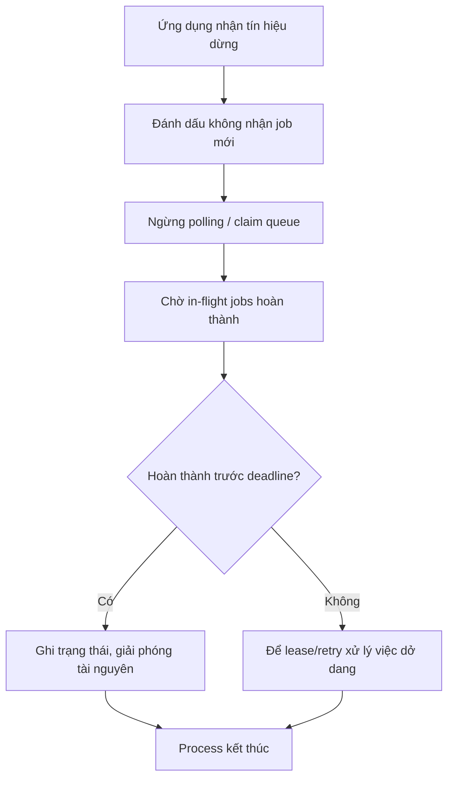

# Shutdown có kiểm soát khi ứng dụng dừng

Trong hệ thống Spring Framework Mail, gửi email bất đồng bộ giúp HTTP request hoặc luồng nghiệp vụ không phải chờ thao tác SMTP. Tuy nhiên, khi ứng dụng được triển khai lại, container nhận tín hiệu dừng, hoặc máy chủ cần bảo trì, những email đang chờ trong executor hay đang được worker gửi có thể bị ảnh hưởng. Nếu tắt ứng dụng ngay lập tức, một số tác vụ chưa kịp hoàn tất sẽ bị mất hoặc rơi vào trạng thái không rõ kết quả.

**Shutdown có kiểm soát** (*graceful shutdown*) là quá trình chủ động ngừng nhận công việc mới, cho các tác vụ đang thực hiện một khoảng thời gian để hoàn thành, ghi nhận kết quả và giải phóng tài nguyên trước khi process kết thúc. Với email, mục tiêu không chỉ là “không còn thread chạy” mà còn là biết yêu cầu gửi nào đã được SMTP chấp nhận, yêu cầu nào cần xử lý lại và trường hợp nào có thể đã gửi nhưng chưa ghi trạng thái.

Spring cung cấp các thành phần như `ThreadPoolTaskExecutor`, lifecycle callback và cấu hình graceful shutdown của Spring Boot. Nếu email được lưu trong hàng đợi bền vững hoặc transactional outbox, worker còn cần phối hợp việc dừng lấy job mới, hoàn tất job đang xử lý và xử lý lease/retry sau khi khởi động lại.

Bài học này phân biệt graceful shutdown cho `@Async` trong bộ nhớ với worker có queue/outbox bền vững, trình bày cách cấu hình, kiểm soát thời gian dừng, quản lý kết quả SMTP không chắc chắn và xây dựng quy trình vận hành an toàn.

## 1. Vấn đề phát sinh khi ứng dụng dừng

Giả sử một email được xử lý theo luồng:

```text
HTTP request / domain event
        |
        v
Submit mail task
        |
        v
Executor queue
        |
        v
Worker thread
        |
        v
Build MIME -> connect SMTP -> send
        |
        v
Record SMTP outcome
```

Tại thời điểm tắt ứng dụng, tác vụ có thể ở một trong những trạng thái:

| Trạng thái | Điều có thể xảy ra nếu dừng đột ngột |
|---|---|
| Yêu cầu mới chưa được nhận | Caller cần nhận phản hồi từ chối hoặc lưu yêu cầu bền vững. |
| Đã được đưa vào hàng đợi trong bộ nhớ | Có thể biến mất khi process kết thúc. |
| Đang render template hoặc đọc attachment | Có thể dừng giữa chừng; chưa chắc đã kết nối SMTP. |
| Đang kết nối/xác thực SMTP | Có thể timeout hoặc bị ngắt. |
| Đã gửi lệnh SMTP DATA, chờ phản hồi | Có thể chưa biết SMTP đã chấp nhận hay chưa. |
| SMTP đã chấp nhận, chưa ghi kết quả | Có nguy cơ gửi trùng khi retry. |
| Đã ghi kết quả thành công | Có thể khôi phục trạng thái theo bản ghi đã lưu. |

Một lời gọi `mailSender.send(...)` trả về bình thường thường phản ánh **SMTP đã chấp nhận message theo giao tiếp transport**, không bảo đảm email đã vào inbox. Graceful shutdown phải giữ nguyên sự phân biệt này khi báo cáo trạng thái.

### Dừng có kiểm soát không phải dừng vô hạn

Ứng dụng thường có ngân sách thời gian để dừng. Container orchestrator, service manager hoặc nền tảng cloud có thể gửi tín hiệu kết thúc cưỡng bức khi vượt thời hạn. Vì vậy, graceful shutdown cần cả **quy trình ngừng nhận việc** lẫn **giới hạn thời gian chờ** và **phương án khôi phục** nếu không kịp hoàn tất.

Không thể dựa vào graceful shutdown của process như cơ chế duy nhất để bảo đảm email không bị mất. Mất điện, kernel crash và `SIGKILL` không cho ứng dụng cơ hội chạy shutdown hook.

## 2. Các mục tiêu của shutdown đúng cách

Một quy trình tốt cần đáp ứng các mục tiêu:

1. **Ngừng tiếp nhận việc mới:** không tiếp tục đưa email mới vào executor đang dừng.
2. **Ngừng lấy việc mới từ queue:** worker không claim thêm job sau khi bắt đầu shutdown.
3. **Cho công việc đang chạy hoàn thành có giới hạn:** tránh cắt ngang SMTP nếu còn thời gian.
4. **Ghi nhận kết quả:** lưu trạng thái gửi, số lần thử và nguyên nhân lỗi.
5. **Không làm thất lạc yêu cầu đã được xác nhận:** job quan trọng nên nằm trong storage bền vững.
6. **Không tạo retry đồng thời không cần thiết:** tránh worker mới xử lý cùng job khi worker cũ chưa dừng.
7. **Đóng tài nguyên có thứ tự:** kết thúc worker trước khi phá hủy dependency mà worker còn dùng.
8. **Kết thúc trong ngân sách:** trả quyền điều khiển cho container/orchestrator đúng hạn.

Sơ đồ tổng quát:



Thứ tự rất quan trọng: nếu đóng sender, database hoặc queue client quá sớm trong khi worker còn chạy, worker có thể không thể gửi email hoặc ghi kết quả.

## 3. Phân biệt ba cách chạy email bất đồng bộ

Trong Spring, từ “bất đồng bộ” có thể chỉ nhiều cơ chế khác nhau:

| Cơ chế | Công việc chờ ở đâu? | Khi process chết | Shutdown cần làm gì? |
|---|---|---|---|
| `@Async` + `ThreadPoolTaskExecutor` | Hàng đợi trong bộ nhớ ứng dụng | Job chưa chạy có thể mất; job đang chạy bị ngắt bởi process | Ngừng submit và cho executor drain trong giới hạn. |
| Executor tự tạo bằng `ExecutorService` | Hàng đợi trong bộ nhớ process | Tương tự | Chủ động `shutdown()`, `awaitTermination(...)` hoặc để bean lifecycle quản lý. |
| Message broker / database outbox | Storage bền vững bên ngoài process | Job có thể được worker mới xử lý lại | Dừng consumer/claim, hoàn tất in-flight, ack/commit đúng lúc, dùng retry/lease. |

**Điểm khác biệt quyết định là nơi lưu ý định gửi mail.** Với `@Async`, caller có thể nhận kết quả “đã đưa vào executor” nhưng executor chỉ lưu việc trong RAM. Với outbox, yêu cầu gửi được commit vào database; shutdown không xóa ý định gửi đó.

Graceful shutdown của executor giúp giảm rủi ro trong lần dừng bình thường. Nó không biến hàng đợi RAM thành hàng đợi bền vững.

## 4. Cấu hình ThreadPoolTaskExecutor để drain tác vụ

`ThreadPoolTaskExecutor` là executor phổ biến khi dùng `@Async` trong Spring. Có thể cấu hình số thread, kích thước queue và hành vi khi context đóng.

Ví dụ:

```java
import org.springframework.context.annotation.Bean;
import org.springframework.context.annotation.Configuration;
import org.springframework.scheduling.annotation.EnableAsync;
import org.springframework.scheduling.concurrent.ThreadPoolTaskExecutor;

@Configuration
@EnableAsync
public class MailAsyncConfiguration {

    @Bean("mailExecutor")
    public ThreadPoolTaskExecutor mailExecutor() {
        ThreadPoolTaskExecutor executor =
                new ThreadPoolTaskExecutor();

        executor.setCorePoolSize(2);
        executor.setMaxPoolSize(4);
        executor.setQueueCapacity(100);
        executor.setThreadNamePrefix("mail-");

        executor.setWaitForTasksToCompleteOnShutdown(true);
        executor.setAwaitTerminationSeconds(30);

        return executor;
    }
}
```

Ý nghĩa chính:

- `setCorePoolSize(2)`: số thread nền thường duy trì.
- `setMaxPoolSize(4)`: số thread tối đa theo chính sách pool.
- `setQueueCapacity(100)`: giới hạn tác vụ chờ trong bộ nhớ.
- `setThreadNamePrefix("mail-")`: giúp theo dõi thread trong log và thread dump.
- `setWaitForTasksToCompleteOnShutdown(true)`: khi executor bị shutdown theo lifecycle, cố gắng tiếp tục thực hiện cả các tác vụ đã xếp hàng thay vì hủy ngay chúng.
- `setAwaitTerminationSeconds(30)`: khi shutdown executor, đợi tối đa khoảng thời gian được cấu hình để pool kết thúc.

Đây là cấu hình minh họa, không phải giá trị mặc định tốt cho mọi ứng dụng. Pool size, queue capacity và thời gian chờ cần dựa vào tốc độ SMTP, kích thước email, tần suất tạo job và thời hạn dừng của môi trường triển khai.

### Hai cài đặt không giống nhau

`waitForTasksToCompleteOnShutdown` quyết định **cách xử lý các task đã được nhận** khi executor bắt đầu shutdown. `awaitTerminationSeconds` quyết định **thời gian thread thực hiện shutdown được phép đợi executor chấm dứt**.

Đặt một giá trị chờ không có nghĩa mọi tác vụ chắc chắn xong. Nếu một tác vụ gửi mail bị treo hoặc queue còn quá nhiều việc, thời hạn chờ có thể hết mà worker vẫn chưa hoàn tất. Khi process sau đó bị dừng cưỡng bức, công việc trong RAM có thể mất.

### Lưu ý khác biệt lifecycle giữa các phiên bản Spring

Hành vi chính xác ở thời điểm context close, thứ tự dừng các bean và việc từ chối tác vụ mới có thể khác theo phiên bản Spring Framework và cấu hình executor. Trong một số cách cấu hình, bật chờ hoàn thành task khiến executor tiếp tục hoạt động muộn hơn trong chu trình đóng context.

Vì vậy, không chỉ dựa vào hai setter trên để ngừng submit job mới. Hãy có một cơ chế admission riêng, đồng thời kiểm tra lifecycle order nếu worker cần `JavaMailSender`, database hoặc các bean khác trong lúc drain.

## 5. Dùng @Async với executor đã cấu hình

Ví dụ một worker chạy qua `@Async`:

```java
import java.util.concurrent.CompletableFuture;
import org.springframework.mail.javamail.JavaMailSender;
import org.springframework.scheduling.annotation.Async;
import org.springframework.stereotype.Service;

@Service
public class AsyncMailWorker {

    private final JavaMailSender mailSender;

    public AsyncMailWorker(JavaMailSender mailSender) {
        this.mailSender = mailSender;
    }

    @Async("mailExecutor")
    public CompletableFuture<Void> send(MailJob job) {
        mailSender.send(job.message());
        return CompletableFuture.completedFuture(null);
    }
}
```

`MailJob` là model minh họa chứa message của tác vụ. Một job thực tế nên có message ID, notification type, recipient và dữ liệu dựng email; không nên chia sẻ một `MimeMessage` mutable giữa nhiều worker.

Một service khác có thể submit:

```java
@Service
public class MailSubmissionService {

    private final AsyncMailWorker worker;

    public MailSubmissionService(AsyncMailWorker worker) {
        this.worker = worker;
    }

    public CompletableFuture<Void> submit(MailJob job) {
        return worker.send(job);
    }
}
```

Lưu ý:

- `@EnableAsync` phải được bật.
- Lời gọi cần đi qua Spring proxy; gọi phương thức `@Async` nội bộ trong cùng instance thường không kích hoạt chuyển thread.
- Job được nhận vào executor không có nghĩa SMTP đã chấp nhận email.
- Nếu worker ném exception, `CompletableFuture` có thể hoàn thành với lỗi; caller hoặc bộ giám sát phải quan sát kết quả đó.
- Với phương thức `@Async` trả về `void`, exception không tự động quay lại caller; cần cơ chế `AsyncUncaughtExceptionHandler` hoặc logging/monitoring khác.

**Chưa có outbox thì job này vẫn chỉ tồn tại trong bộ nhớ.** Dù executor có graceful shutdown, việc dừng bất ngờ vẫn có thể làm mất job.

## 6. Ngừng nhận công việc mới trước khi drain

Một vấn đề phổ biến là executor bắt đầu đóng, nhưng HTTP request hoặc event listener vẫn tiếp tục submit email. Khi đó có thể xảy ra `TaskRejectedException`, hoặc caller tưởng rằng công việc được nhận dù chưa được lưu bền vững.

Nên tách trạng thái **ứng dụng có nhận thêm việc hay không** khỏi trạng thái **executor còn chạy hay không**.

Ví dụ một admission gate:

```java
import java.util.concurrent.atomic.AtomicBoolean;
import org.springframework.context.event.ContextClosedEvent;
import org.springframework.context.event.EventListener;
import org.springframework.stereotype.Component;

@Component
public class MailAdmissionGate {

    private final AtomicBoolean accepting =
            new AtomicBoolean(true);

    public void requireAccepting() {
        if (!accepting.get()) {
            throw new IllegalStateException(
                    "Mail submission is stopping"
            );
        }
    }

    @EventListener(ContextClosedEvent.class)
    public void stopOnContextClose() {
        accepting.set(false);
    }
}
```

Service submit có thể kiểm tra gate rồi gọi worker:

```java
public CompletableFuture<Void> submit(MailJob job) {
    admissionGate.requireAccepting();
    return asyncMailWorker.send(job);
}
```

Cách này minh họa chủ trương chặn công việc mới khi đóng context. Tuy nhiên, **kiểm tra gate và submit không phải một thao tác nguyên tử**. Context vẫn có thể đóng giữa hai dòng. Tầng submit cần bắt `TaskRejectedException` từ executor và trả lỗi có ý nghĩa hoặc chuyển sang lưu bền vững.

Đối với thao tác bắt buộc không được mất, không nên dựa vào gate rồi bỏ job. Hãy ghi yêu cầu vào database/outbox trước, sau đó worker chỉ chịu trách nhiệm xử lý những record đã được commit.

### Readiness và admission là hai lớp khác nhau

Trong môi trường có load balancer hoặc Kubernetes, readiness probe có thể báo rằng instance không còn nhận traffic mới. Tuy nhiên, lưu lượng đã được định tuyến từ trước vẫn có thể đến, hoặc các tác vụ nội bộ vẫn được phát sinh. Admission gate trong ứng dụng giúp xử lý ranh giới đó.

Readiness false không thay thế việc chặn scheduler, broker consumer, event listener hoặc các nơi có thể tạo mail job từ bên trong process.

## 7. Cấu hình graceful shutdown trong Spring Boot

Một số cấu hình Spring Boot có thể dùng làm nền:

```yaml
server:
  shutdown: graceful

spring:
  lifecycle:
    timeout-per-shutdown-phase: 30s
  task:
    execution:
      shutdown:
        await-termination: true
        await-termination-period: 30s
  mail:
    host: smtp.example.org
    port: 587
    properties:
      "mail.smtp.connectiontimeout": 5000
      "mail.smtp.timeout": 5000
      "mail.smtp.writetimeout": 5000
```

Các cấu hình trên phục vụ những mục đích khác nhau:

| Cấu hình | Tác động |
|---|---|
| `server.shutdown=graceful` | Yêu cầu web server hỗ trợ graceful shutdown cho các request đang xử lý. |
| `spring.lifecycle.timeout-per-shutdown-phase` | Giới hạn thời gian chờ cho một phase của Spring lifecycle. |
| `spring.task.execution.shutdown.await-termination` | Chính sách chờ shutdown cho task executor do Boot tự cấu hình. |
| `spring.task.execution.shutdown.await-termination-period` | Thời gian chờ executor tự cấu hình kết thúc. |
| `mail.smtp.connectiontimeout` | Giới hạn chờ kết nối SMTP. |
| `mail.smtp.timeout` | Giới hạn chờ đọc trên SMTP connection. |
| `mail.smtp.writetimeout` | Giới hạn chờ ghi lên SMTP connection. |

Các property và cơ chế áp dụng cần đối chiếu với phiên bản Spring Boot thực tế. **Cấu hình `spring.task.execution.*` không mặc nhiên thay thế cấu hình của một `ThreadPoolTaskExecutor` custom được tự khai báo**. Nếu ứng dụng đã tạo bean `mailExecutor` riêng, hãy đặt chính sách shutdown trực tiếp trên bean đó hoặc cấu hình một cách nhất quán.

### Graceful shutdown của web server không đủ cho @Async

Web server có thể đợi HTTP request đang hoạt động, nhưng task `@Async` đã được submit trước đó có thể tiếp tục trên một executor riêng. Việc HTTP request kết thúc không có nghĩa tác vụ mail nền cũng đã hoàn tất.

Do đó cần cấu hình và kiểm soát **cả vòng đời web server lẫn executor**. Nếu có broker consumer hoặc scheduler, vòng đời của chúng cũng cần được xử lý riêng.

### Timeout phải có thứ bậc hợp lý

Không nên cấu hình thời gian chờ executor dài hơn tổng thời gian process được phép tồn tại, rồi kỳ vọng nó luôn drain xong. Hãy lập một ngân sách dừng tổng thể cho ingress, worker, kết thúc transaction và cleanup; để khoảng dự phòng cho nền tảng triển khai.

## 8. SMTP timeout là điều kiện để drain có giới hạn

Một job đang gọi `JavaMailSender.send(...)` có thể bị chậm ở bước connect, TLS, write hoặc read. Nếu không có timeout thích hợp, worker có thể giữ thread quá lâu.

Ví dụ JavaMail SMTP properties:

```yaml
spring:
  mail:
    host: smtp.example.org
    port: 587
    properties:
      "mail.smtp.connectiontimeout": 5000
      "mail.smtp.timeout": 5000
      "mail.smtp.writetimeout": 5000
```

Các giá trị là millisecond và chỉ minh họa. Timeout cần được lựa chọn theo mạng, kích thước message, giới hạn nhà cung cấp và thời gian dừng được cấp.

**Socket timeout không phải deadline tổng cho toàn bộ job.** Một lần gửi có thể đi qua nhiều thao tác đọc/ghi. Deadline tổng có thể dài hơn một timeout đơn lẻ. Nếu nghiệp vụ cần giới hạn tối đa cho cả attempt, thiết kế cơ chế đo deadline và xử lý hủy/khôi phục phù hợp; không giả định ngắt thread sẽ luôn ngừng tức thì mọi thao tác I/O của SMTP library.

### Không dựa hoàn toàn vào interrupt

`Thread.interrupt()` chỉ đánh dấu/cố gắng ngắt một số thao tác đang chờ. Nó không bảo đảm một lệnh SMTP đã truyền xong sẽ bị đảo ngược, cũng không bảo đảm socket I/O của mọi transport bị hủy ngay.

Nếu cần shutdown chủ động, ưu tiên để job hoàn thành trong timeout, ghi kết quả, rồi đóng tài nguyên. Khi deadline hết và process bị dừng cưỡng bức, chấp nhận rằng một số kết quả có thể không chắc chắn và để cơ chế lưu bền vững xử lý sau.

## 9. Thiết kế shutdown cho queue hoặc transactional outbox

Với email quan trọng, thường nên lưu yêu cầu gửi vào một kho bền vững:

```text
Database transaction
    ├── Persist business state
    └── Insert mail_outbox(PENDING)
                |
                v
           Commit once
                |
                v
          Mail worker polls
                |
                v
           Claim with lease
                |
                v
        JavaMailSender.send(...)
                |
                v
        Persist SMTP outcome
```

Khi shutdown:

1. Đánh dấu worker không nhận job mới.
2. Dừng scheduler/poller hoặc broker consumer.
3. Không claim thêm outbox record.
4. Cho job đang gửi hoàn thành trong giới hạn.
5. Ghi nhận kết quả và commit transaction.
6. Kết thúc worker; job chưa hoàn tất vẫn còn trong outbox hoặc chờ lease hết hạn.

Ở mô hình này, **shutdown không cần ép hoàn tất toàn bộ backlog**. Backlog vẫn được lưu và có thể xử lý bởi instance khác hoặc sau khi ứng dụng khởi động lại. Mục tiêu drain chủ yếu là những job đã claim và đang chạy.

### Trạng thái của một outbox record

Có thể dùng các trạng thái:

| Trạng thái | Ý nghĩa |
|---|---|
| `PENDING` | Đang chờ worker xử lý. |
| `PROCESSING` | Đã được worker claim, có lease/claim token. |
| `SMTP_ACCEPTED` | Lần submit đến SMTP thành công; chưa bảo đảm inbox delivery. |
| `RETRYABLE_FAILURE` | Lỗi được phân loại có thể thử lại. |
| `PERMANENT_FAILURE` | Không tiếp tục retry tự động theo chính sách. |
| `UNKNOWN` | Không biết chắc SMTP đã nhận hay chưa. |

Tên trạng thái có thể thay đổi theo hệ thống. Quan trọng là **không gộp “SMTP accepted” với “delivered”**, và không biến một timeout không rõ kết quả thành “chưa bao giờ gửi”.

## 10. Lease, retry và job bị dở dang

Trong hệ thống có nhiều worker, một outbox job cần được claim an toàn. Thông thường worker ghi:

```text
jobId = mail-741
status = PROCESSING
claimedBy = mail-worker-3
leaseUntil = 2026-11-12T10:00:30Z
attempt = 2
claimToken = 8a12...
```

Nếu worker dừng trước khi ghi kết quả, job vẫn còn trong database. Sau khi lease hết hạn, worker khác có thể claim lại theo chính sách.

### Vì sao không giải phóng lease ngay khi nhận SIGTERM?

Nếu worker cũ vẫn còn đang truyền SMTP nhưng record đã được giải phóng ngay, worker mới có thể lấy cùng job và gửi song song. Điều này làm tăng nguy cơ email trùng.

Cách xử lý thường an toàn hơn:

- Dừng claim job mới.
- Cho job in-flight hoàn thành và ghi kết quả khi còn thời gian.
- Nếu job chưa hoàn tất, để lease hết hạn hoặc dùng cơ chế handoff được phối hợp chặt.
- Worker mới chỉ nhận lại job theo quy tắc claim/lease.
- Dùng claim token hoặc cơ chế fencing để ngăn worker cũ ghi đè kết quả sau khi lease đã bị chuyển quyền.

Với job dài, có thể cần gia hạn lease (*heartbeat*). Khi shutdown bắt đầu, hệ thống phải quyết định có tiếp tục gia hạn lease cho job đang drain hay không, theo deadline còn lại và khả năng ghi kết quả.

### Retry không có nghĩa exactly-once

SMTP và database không cùng một distributed transaction. Có thể xảy ra:

1. Worker gọi `send`.
2. SMTP server chấp nhận email.
3. Worker bị tắt trước khi commit `SMTP_ACCEPTED`.
4. Lease hết hạn.
5. Worker khác gửi lại.

Kết quả có thể là hai email. Queue/outbox thường đem lại cơ chế xử lý **at-least-once** cho yêu cầu gửi, không mặc định bảo đảm recipient chỉ nhận đúng một thư.

Có thể giảm trùng bằng idempotency key ở bước tạo yêu cầu, unique constraint trong outbox, theo dõi message ID và kiểm soát retry. Nhưng một `Message-ID` MIME cố định không buộc SMTP server hoặc mailbox phải loại bỏ bản trùng.

## 11. Dừng broker consumer đúng thứ tự

Nếu dùng RabbitMQ, Kafka hoặc một broker khác, graceful shutdown thường cần dừng nhận thêm message trước khi đóng các tài nguyên xử lý.

Sơ đồ:

```text
SIGTERM
    |
    v
Stop consumer / pause polling
    |
    v
Finish messages already being processed
    |
    +--> Submit to SMTP
    |
    +--> Persist local outcome if needed
    |
    +--> ACK / commit offset according to policy
    |
    v
Close consumer/channel
    |
    v
Stop application
```

**Không ACK một job trước khi công việc bắt buộc đã hoàn thành**, nếu broker là nơi duy nhất lưu yêu cầu gửi và ứng dụng cần khả năng retry khi gặp sự cố. Ngược lại, nếu job được lưu ở outbox bền vững riêng, ACK có thể phản ánh bước chuyển quyền xử lý sang outbox; contract này cần được nêu rõ.

Các lưu ý theo loại broker:

- Với RabbitMQ, unacked message trên channel/connection bị đóng có thể được broker đưa trở lại queue, tùy cấu hình và trạng thái message.
- Với Kafka, offset commit và consumer group rebalance quyết định khả năng message được xử lý lại; phải xử lý ranh giới giữa gửi SMTP và commit offset.
- Với scheduler polling database, cần dừng tick mới và quản lý lease của record đang xử lý.
- Với nhiều replica, tránh cùng claim một job do race hoặc claim thiếu transaction/locking.

Không áp dụng một “công thức ACK” duy nhất cho mọi broker. Hãy thiết kế thứ tự commit/ack theo nguồn lưu bền vững và semantics của hệ thống.

## 12. Shutdown trong Kubernetes hoặc container

Một deployment thường gặp sử dụng Kubernetes. Khi Pod bị terminate, hệ thống bắt đầu thời gian grace, thực hiện hook liên quan rồi gửi tín hiệu để process kết thúc; nếu quá thời hạn, có thể buộc dừng.

Một quy trình nên đạt:

```text
Pod termination begins
    |
    +--> Stop routing new work / readiness changes
    |
    +--> Application receives termination signal
    |
    +--> Stop mail admissions and pollers
    |
    +--> Drain in-flight jobs within budget
    |
    +--> Close resources and exit
    |
    +--> Force kill if grace period is exceeded
```

Ví dụ tham số deployment:

```yaml
apiVersion: apps/v1
kind: Deployment
metadata:
  name: notification-service
spec:
  replicas: 2
  selector:
    matchLabels:
      app: notification-service
  template:
    metadata:
      labels:
        app: notification-service
    spec:
      terminationGracePeriodSeconds: 75
      containers:
        - name: application
          image: example/notification-service:1.0.0
          ports:
            - containerPort: 8080
```

Đây là cấu hình minh họa. Thời gian grace cần bao gồm phần thời gian bị dùng bởi hook, drain, cleanup và một khoảng dự phòng; không chỉ lấy đúng giá trị `awaitTerminationSeconds`.

### Readiness không có tác dụng ngay tức thì ở mọi nơi

Pod có thể còn nhận một số request đang trên đường tới trong khi cập nhật endpoint hoặc load balancer đang lan truyền. Vì vậy:

- API tạo mail job cần xử lý trường hợp instance đang draining.
- Nếu không thể nhận việc mới, trả response rõ ràng hoặc chuyển yêu cầu sang nơi lưu bền vững.
- Không tạo queue chỉ nằm trong RAM khi instance sắp bị dừng.
- Hệ thống phải có retry ở phía client hoặc cơ chế failover phù hợp.

Một `preStop` hook có thể được dùng để hỗ trợ quá trình rút traffic, nhưng thời gian hook vẫn tính vào ngân sách termination. Đừng dùng sleep tùy ý làm phương án duy nhất để bảo đảm drain.

### PID 1 và tín hiệu kết thúc

Process Java cần nhận được tín hiệu dừng của container. Khi dùng shell script làm entrypoint, nên bảo đảm tín hiệu được chuyển đúng tới JVM, ví dụ sử dụng cách khởi chạy `exec java ...` phù hợp. Nếu PID 1 là một shell không forward tín hiệu, Spring có thể không thực hiện quy trình đóng context như dự kiến.

Dừng cưỡng bức như `SIGKILL` không chạy callback Java. Đây là lý do job quan trọng phải được lưu bền vững.

## 13. Quy trình shutdown theo giai đoạn

Một playbook vận hành có thể chia thành năm giai đoạn.

### Giai đoạn A — Quiesce: dừng nhận việc mới

- Đánh dấu instance đang shutting down.
- Readiness hoặc cơ chế routing không nhận traffic mới theo chính sách.
- Chặn hoặc chuyển hướng request gửi mail mới.
- Dừng polling, consumer và scheduled trigger.
- Ghi thời điểm bắt đầu shutdown và số in-flight hiện tại.

### Giai đoạn B — Drain: chờ những việc đang thực hiện

- Cho SMTP attempts đang chạy có cơ hội hoàn thành.
- Cho phép ghi kết quả cuối cùng vào database.
- Hạn chế tạo thêm công việc phụ từ chính worker.
- Theo dõi số in-flight và deadline còn lại.
- Không cố xử lý toàn bộ backlog bền vững nếu thời gian không cho phép.

### Giai đoạn C — Reconcile: xác định việc chưa hoàn tất

- Với job hoàn tất: ghi `SMTP_ACCEPTED` hoặc trạng thái lỗi đã phân loại.
- Với job chưa rõ kết quả: ghi `UNKNOWN` nếu có thể, hoặc để lease hết hạn.
- Với queue: bảo đảm ack/offset theo semantics đã thiết kế.
- Với công việc RAM: nếu không thể chuyển thành bản ghi bền vững, phải chấp nhận khả năng mất task sau khi process kết thúc.

### Giai đoạn D — Close: giải phóng tài nguyên

- Đóng consumer sau khi đã dừng nhận message và xử lý in-flight.
- Kết thúc executor theo chính sách shutdown.
- Đóng connection pool, database và các tài nguyên phụ thuộc sau khi worker không còn cần.
- Tránh block vô hạn trong callback shutdown.

### Giai đoạn E — Exit: thoát trong ngân sách

- Ghi nhận kết quả shutdown ở mức tổng hợp.
- Thoát process trong grace period.
- Khi startup lại, worker quét job còn `PENDING` hoặc lease đã hết hạn và xử lý theo chính sách.
- Theo dõi job bị dở dang, retry trùng và thời gian phục hồi.

Đây là quy trình định hướng. Thứ tự callback cụ thể phụ thuộc Spring lifecycle phases, executor, consumer container và cấu hình application context của dự án.

## 14. Lifecycle hook nào nên dùng?

Spring cung cấp một số cơ chế liên quan:

| Cơ chế | Khi phù hợp | Lưu ý |
|---|---|---|
| `ContextClosedEvent` | Báo cho thành phần biết context bắt đầu đóng, ví dụ chặn submit job mới | Callback chạy khi context đang đóng; không dùng để chờ vô hạn. |
| `@PreDestroy` | Cleanup tài nguyên của bean | Không đủ để đảm bảo thứ tự đóng giữa mọi dependency. |
| `DisposableBean.destroy()` | Hook destroy mức thấp | Dùng khi cần tích hợp lifecycle của một bean cụ thể. |
| `SmartLifecycle` | Điều phối start/stop với lifecycle phase | Phải thiết kế phase và callback `stop(Runnable)` chính xác. |
| Executor shutdown settings | Drain tác vụ đã submit | Không bảo đảm job bền vững qua crash. |
| Broker listener/container lifecycle | Dừng consumer và in-flight message | Phụ thuộc công nghệ broker và ack mode. |

### SmartLifecycle và phase

`SmartLifecycle` cho phép một thành phần tham gia start/stop của application context. Khi shutdown, các thành phần ở phase cao thường được stop trước phase thấp; thứ tự giữa bean cùng phase còn phụ thuộc dependency và implementation.

Có thể dùng phase để bảo đảm ingress/consumer ngừng nhận công việc trước khi sender hoặc nguồn dữ liệu được đóng. Tuy nhiên, không nên đoán phase mặc định của mọi executor/consumer. Hãy xem tài liệu version đang dùng và kiểm thử thứ tự thực tế của ứng dụng.

Một ý tưởng thiết kế:

```text
High phase: stop mail intake / broker consumer
     |
     v
Middle phase: drain worker tasks
     |
     v
Low phase: close shared services and data resources
```

Nếu tự triển khai `SmartLifecycle.stop(Runnable callback)`, hãy gọi callback khi việc stop thực sự hoàn tất. Không để callback bị bỏ quên, vì điều đó có thể khiến quá trình đóng context đợi đến timeout.

### Không đặt toàn bộ shutdown logic trong @PreDestroy

Một `@PreDestroy` làm `Thread.sleep(...)` để “đợi email xong” không biết job nào đang chạy và có thể ngăn các bean khác đóng đúng cách. Nếu cần drain, hãy dùng executor lifecycle, tracking in-flight và timeout rõ ràng.

## 15. Kiểm soát số lượng in-flight và backlog

Để quyết định khi nào có thể shutdown, cần biết có bao nhiêu job đang được xử lý và bao nhiêu job chờ.

Với `ThreadPoolTaskExecutor` có thể quan sát các thông số như:

- Số thread đang hoạt động.
- Kích thước pool.
- Độ dài queue hiện tại.
- Số task đã hoàn tất.

Ví dụ ý tưởng:

```java
int active = mailExecutor.getActiveCount();
int poolSize = mailExecutor.getPoolSize();
int waiting = mailExecutor.getThreadPoolExecutor()
        .getQueue()
        .size();
```

Các con số này là snapshot. Chúng có thể thay đổi ngay sau khi đọc. Không nên xây correctness chỉ dựa trên một lần kiểm tra `active == 0`; executor và cơ chế admit/submit phải được đồng bộ theo quy trình shutdown.

Với outbox, metric quan trọng hơn thường gồm:

- Số job đang `PROCESSING` theo worker ID.
- Tuổi của job `PENDING` lâu nhất.
- Số lease sắp hết hạn hoặc đã hết hạn.
- Số retry và số job thất bại vĩnh viễn.
- Thời gian trung bình/p95/p99 của SMTP attempt.
- Số job in-flight khi shutdown bắt đầu và khi kết thúc.

Backlog có thể lớn nhưng shutdown vẫn thành công nếu job được lưu bền vững và worker mới tiếp tục xử lý. Ngược lại, với queue RAM, backlog 100 job là 100 tác vụ có thể mất nếu hết thời gian drain.

## 16. Thiết kế deadline thay vì chỉ đếm job

Giả sử một lần gửi SMTP thường mất một vài giây, nhưng có thể kéo dài hơn khi provider chậm. Nếu executor có bốn worker và còn 100 job trong queue, chờ toàn bộ backlog có thể vượt thời gian Pod được phép tồn tại.

Do đó cần phân biệt:

- **Deadline cho từng SMTP attempt:** dựa trên connect/read/write timeout và chính sách job.
- **Deadline cho drain:** số thời gian còn lại trước khi application phải dừng.
- **Deadline của nền tảng:** thời hạn process được phép tồn tại trước cưỡng bức.

Một nguyên tắc:

```text
termination grace
    >= traffic drain
     + worker drain
     + resource cleanup
     + safety margin
```

Đây là quan hệ lập ngân sách, không phải công thức bảo đảm. Các hoạt động có thể chồng lấn, một số hook đã tiêu hao một phần grace period và nền tảng có thể cắt ngắn thời gian vì điều kiện bên ngoài.

Khi không còn đủ thời gian cho một job mới, worker nên ngừng nhận job thay vì claim rồi chắc chắn bỏ dở. Với hàng đợi bền vững, job vẫn sẽ được worker khác xử lý sau.

## 17. Các tình huống lỗi khi shutdown

| Hiện tượng | Nguyên nhân có thể | Hướng xử lý |
|---|---|---|
| Email bị mất sau redeploy | Job chỉ nằm trong queue RAM | Dùng outbox/queue bền vững cho job quan trọng. |
| Request tạo email gặp `TaskRejectedException` | Executor đã shutdown nhưng nơi submit vẫn hoạt động | Chặn admission sớm và xử lý reject rõ ràng. |
| Shutdown đợi quá lâu | SMTP treo hoặc backlog quá lớn | Đặt timeout, deadline và giới hạn lượng in-flight. |
| SMTP đã gửi nhưng job vẫn `PROCESSING` | Worker dừng trước khi commit kết quả | Dùng lease, trạng thái UNKNOWN và chính sách retry có xét trùng. |
| Hai replica cùng gửi một email | Lease hết hạn hoặc giải phóng quá sớm | Claim có locking, heartbeat và fencing token. |
| Worker lỗi vì database đã đóng | Thứ tự lifecycle không hợp lý | Stop/drain worker trước khi destroy dependency. |
| `@Async` vẫn chạy sau khi web server dừng | Executor có lifecycle riêng | Điều phối shutdown của web, scheduler, executor. |
| Grace period không đủ dù đặt wait 60 giây | Nền tảng chỉ cho process tồn tại 30 giây | Thiết kế ngân sách thống nhất. |
| Job bị retry liên tục sau restart | ACK/offset hoặc trạng thái job không được commit | Kiểm tra transaction boundary và retry/backoff. |
| Người dùng nhận email trùng | SMTP accepted nhưng ứng dụng không nhận/ghi kết quả | Idempotency và chống trùng ở mức nghiệp vụ; chấp nhận ambiguity. |
| Lỗi bị che trong `@Async void` | Exception không quay về caller | Trả `CompletableFuture` hoặc cấu hình handler và metrics. |
| Shutdown hook không chạy | Process nhận force kill hoặc JVM không nhận SIGTERM | Cấu hình entrypoint và lưu job bền vững. |

### Không retry một cách mù quáng sau timeout

Trường hợp nguy hiểm nhất là worker không biết chắc SMTP đã chấp nhận hay chưa. Khi retry, hệ thống nên ghi nhận rằng đây là một attempt tiếp theo của cùng logical notification và áp dụng chính sách hạn chế trùng. Không coi timeout là bằng chứng message chưa được gửi.

## 18. Kiểm thử shutdown có kiểm soát

Kiểm thử shutdown cần mô phỏng thời điểm ứng dụng dừng khi job đang ở những giai đoạn khác nhau, không chỉ tắt một ứng dụng rảnh.

### 18.1. Executor có job đang chạy và job chờ

Trong test, tạo một executor nhỏ với task đồng bộ hóa bằng latch:

1. Submit task thứ nhất, cho nó bắt đầu và chờ latch.
2. Submit task thứ hai vào queue.
3. Khởi động đóng context.
4. Mở latch cho task thứ nhất.
5. Xác nhận task đã nhận được hoàn thành theo chính sách shutdown.
6. Xác nhận executor không nhận job mới sau khi đóng.

Không cần gửi email thật; có thể dùng sender giả lập để kiểm tra hành vi thread và thứ tự.

### 18.2. SMTP chậm hơn thời gian drain

Dùng SMTP test server hoặc fake sender có độ trễ có kiểm soát. Cho một attempt kéo dài quá deadline, rồi quan sát:

- Process/bean kết thúc theo thời gian đã đặt hay không.
- Job RAM có thể bị mất nếu ép dừng hay không.
- Job bền vững có được retry sau restart hay không.
- Trạng thái ghi nhận có phân biệt lỗi và kết quả không chắc chắn không.

### 18.3. Worker chết sau khi SMTP accepted

Đây là trường hợp bắt buộc cần xem xét với hệ thống dùng queue/outbox:

```text
Worker sends mail
      |
      v
SMTP accepts message
      |
      X  worker stops before database commit
      |
      v
Lease expires -> another worker retries
```

Test cần xác nhận không mất record yêu cầu gửi và retry được theo chính sách, đồng thời hệ thống không đưa ra cam kết exactly-once không thực tế.

### 18.4. Rolling deployment với nhiều replica

Khi một replica đang shutdown:

- Replica mới còn đủ khả năng xử lý job.
- Replica cũ ngừng claim.
- Job in-flight được commit hoặc lease hết hạn đúng cách.
- Không có hai worker cùng sở hữu một claim token.
- Queue lag, số lỗi gửi và latency trở lại bình thường.

### 18.5. Test SIGTERM và force kill

Kiểm tra process có nhận SIGTERM và chạy callback không. Sau đó mô phỏng trường hợp bị force kill để bảo đảm job bền vững vẫn được khôi phục, thay vì chỉ test luồng shutdown “đẹp”.

**Không cần gửi email tới địa chỉ thật** khi kiểm thử. Dùng Mailpit/GreenMail hoặc một SMTP server test được kiểm soát và ghi nhận message đã nhận.

## 19. Checklist trước khi đưa vào production

| Câu hỏi | Kỳ vọng |
|---|---|
| Email quan trọng có được ghi bền vững trước khi xác nhận request? | Có, nếu không được phép mất job. |
| Ứng dụng có trạng thái ngừng nhận job mới? | Có. |
| Poller/consumer có dừng claim trước khi executor drain? | Có. |
| Executor có queue size và thread count giới hạn? | Có. |
| Shutdown có timeout rõ và phù hợp với nền tảng? | Có. |
| SMTP connect/read/write timeout đã được cấu hình? | Có. |
| Worker có thể ghi kết quả trước khi database đóng? | Có. |
| Có cơ chế lease/retry cho job đang xử lý dở dang? | Có, với queue/outbox bền vững. |
| Timeout không rõ kết quả được phân biệt với từ chối chắc chắn? | Có. |
| Retry có chính sách chống trùng ở mức nghiệp vụ? | Có. |
| Có metrics in-flight, queue lag và shutdown duration? | Có. |
| Đã test shutdown khi đang gửi, khi SMTP chậm và khi force kill? | Có. |

Không phải tất cả yêu cầu đều cần một hệ thống queue phức tạp. Nếu chỉ gửi email thử nghiệm thủ công, có thể dùng executor nhỏ và shutdown chờ hoàn thành. Nhưng với email giao dịch cần được gửi đáng tin cậy, **lưu yêu cầu bền vững** là bước quan trọng hơn mọi tinh chỉnh thời gian chờ executor.

## 20. Ghi nhớ

- Graceful shutdown là **ngừng nhận việc mới, dừng lấy job, drain việc đang chạy và đóng tài nguyên theo thứ tự**, trong một ngân sách thời gian hữu hạn.
- `@Async` và `ThreadPoolTaskExecutor` chỉ giữ queue trong bộ nhớ; shutdown chờ hoàn thành không bảo vệ trước crash, `SIGKILL` hoặc mất điện.
- `setWaitForTasksToCompleteOnShutdown(true)` và `setAwaitTerminationSeconds(...)` giúp điều khiển cách executor dừng, nhưng không bảo đảm mọi job đều được hoàn tất.
- Cần chặn submit mới và xử lý `TaskRejectedException`; readiness của web server không tự dừng scheduler hay broker consumer.
- Spring Boot web graceful shutdown, task executor shutdown và lifecycle phase là các cơ chế liên quan nhưng khác nhau. Custom executor phải được cấu hình phù hợp.
- SMTP timeout và drain deadline cần tương thích với termination grace period của container.
- Với queue/outbox, ngừng claim job mới, hoàn tất in-flight, ghi trạng thái rồi mới đóng dependency; backlog chưa xử lý vẫn ở storage.
- Lease, heartbeat, claim token và retry giúp khôi phục job dở dang trong hệ thống nhiều worker.
- SMTP accepted không đồng nghĩa delivered; worker có thể chết giữa bước gửi và ghi trạng thái, tạo nguy cơ gửi trùng khi retry.
- Không thể bảo đảm exactly-once email bằng cách chỉ cấu hình executor; hãy dùng idempotency và quy trình xử lý kết quả không chắc chắn.
- Kiểm thử cả SIGTERM, shutdown có thời hạn, SMTP chậm, nhiều replica và force kill.

Shutdown có kiểm soát giúp ứng dụng Spring Framework Mail giảm gián đoạn khi redeploy hoặc bảo trì. Với email ít quan trọng và tải thấp, cấu hình executor chờ task trong một thời hạn có thể đã đủ. Với email giao dịch quan trọng, hướng tiếp cận vững chắc hơn là **lưu ý định gửi bền vững, dừng consumer đúng thứ tự và để worker khác tiếp tục những job chưa hoàn tất**.
