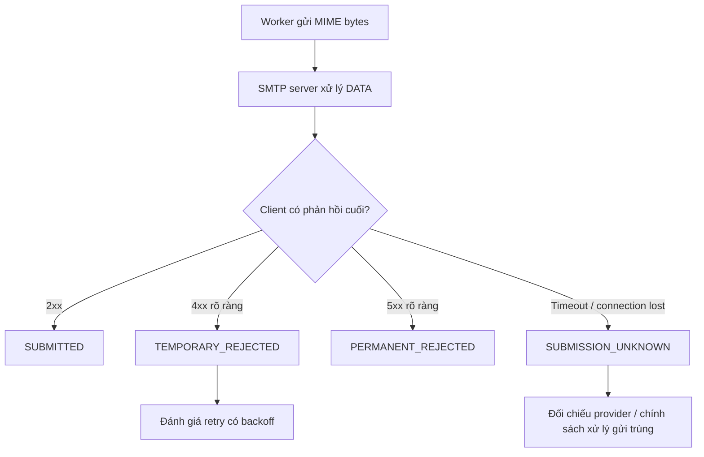
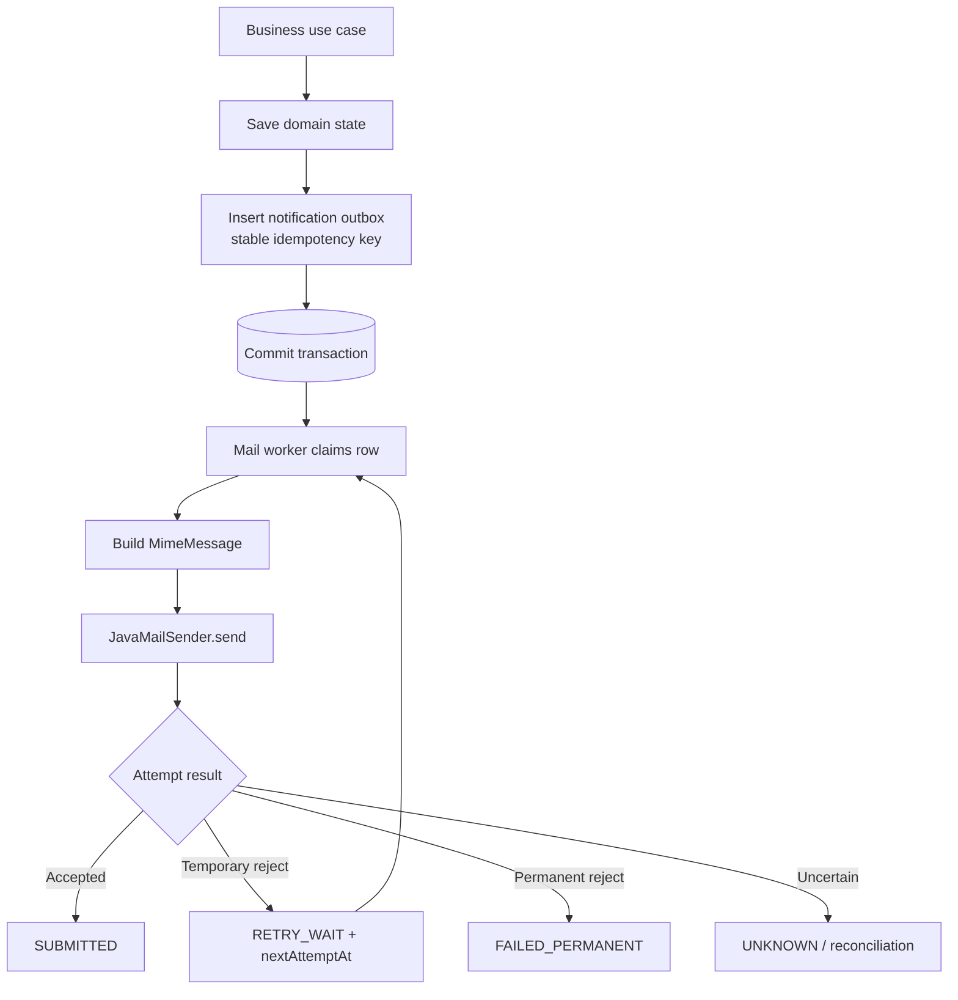

# Lỗi tạm thời và điều kiện thử lại

Một hệ thống Spring Boot gửi email xác nhận đơn hàng bằng `JavaMailSender`. Khi SMTP server tạm thời bận, trả về mã `451` hoặc `421`, ứng dụng có thể gửi lại sau một khoảng chờ. Nhưng nếu server trả về `550` vì địa chỉ không tồn tại, việc thử lại liên tục thường vô ích. Khó hơn, khi kết nối bị ngắt ngay sau lúc ứng dụng gửi xong dữ liệu email, server có thể đã nhận thư nhưng ứng dụng chưa kịp đọc phản hồi. Thử lại trong trường hợp đó có thể tạo **hai email giống nhau**.

Vì vậy, trong **Spring Framework Mail**, không nên coi “gửi thất bại” là một loại lỗi duy nhất rồi gọi `mailSender.send(...)` nhiều lần bằng vòng lặp. Hệ thống cần phân biệt lỗi **tạm thời** với lỗi **vĩnh viễn**, xác định **lỗi xảy ra ở giai đoạn nào**, đánh giá **kết quả bàn giao thư có chắc chắn hay không**, rồi mới quyết định **có thử lại, thử khi nào và tối đa bao nhiêu lần**.

Bài học này thuộc chương **Thử lại và idempotency**. Trọng tâm là điều kiện retry cho email gửi qua Spring Mail, bao gồm các phản hồi SMTP, lỗi kết nối, chính sách giới hạn, hàng đợi bền vững và nguy cơ gửi trùng.

## 1. Làm rõ những trạng thái của một email

Trước hết cần phân biệt các sự kiện trong vòng đời email:

| Khái niệm | Ý nghĩa | Điều không thể kết luận |
|---|---|---|
| `Notification intent` | Yêu cầu logic cần gửi một email cho mục đích xác định | Không có nghĩa SMTP đã được gọi. |
| `Send attempt` | Một lần worker thử thực hiện yêu cầu gửi | Không có nghĩa provider đã chấp nhận. |
| `SMTP submission accepted` | SMTP server chấp nhận trách nhiệm xử lý message ở giai đoạn submission | Không bảo đảm người nhận đã nhận trong Inbox. |
| `Delivery` | Hệ thống chuyển phát báo thư đã tới đích theo ngữ nghĩa của provider | Không bảo đảm người nhận đã mở hoặc đọc. |
| `Bounce / DSN` | Phản hồi chuyển phát không thành công hoặc bị chậm | Không nhất thiết là lỗi của lời gọi `send` ban đầu. |

Ví dụ một notification có thể có ba attempt nhưng chỉ có **một yêu cầu gửi logic**:

```text
Notification ID: N-1024
      |
      +-- Attempt #1: SMTP 451 (temporary) --> RETRY_WAIT
      |
      +-- Attempt #2: SMTP 421 (temporary) --> RETRY_WAIT
      |
      +-- Attempt #3: SMTP 250 after DATA --> SUBMITTED
```

Khi retry, nên tiếp tục xử lý **cùng notification ID**. Không tạo một notification mới mỗi lần thử, vì điều này làm mất dấu lịch sử và tăng nguy cơ tạo nhiều email cho cùng một sự kiện nghiệp vụ.

## 2. “Tạm thời” là đặc tính của lỗi, không phải mọi exception

Một lỗi tạm thời là lỗi có thể biến mất mà không cần thay đổi yêu cầu nghiệp vụ. Ví dụ SMTP server đang quá tải, quota theo thời gian vừa chạm ngưỡng hoặc mạng bị gián đoạn ngắn hạn.

Một lỗi vĩnh viễn là lỗi không có cơ sở để tin rằng gửi lại cùng một yêu cầu sẽ thành công. Ví dụ địa chỉ nhận sai, bị từ chối theo chính sách lâu dài, thông tin xác thực SMTP không đúng hoặc MIME message không thể dựng được do dữ liệu không hợp lệ.

Tuy nhiên, việc phân loại phải dựa trên **ngữ cảnh**:

- `451` thường báo lỗi tạm thời, nhưng một cấu hình hỏng kéo dài cũng có thể khiến `451` xuất hiện liên tục. Retry vẫn phải có giới hạn.
- `550` thường là lỗi vĩnh viễn đối với recipient hoặc policy hiện tại; không nên retry vô hạn chỉ vì đội vận hành có thể sửa dữ liệu sau này.
- `IOException` có thể là lỗi mạng phục hồi được, lỗi file nguồn bị xóa, hoặc một tình huống không xác định server đã nhận thư hay chưa.
- `MailException` là kiểu ngoại lệ của Spring, **không phải mã phân loại retry**.

**Quy tắc:** chỉ retry khi có cơ sở hợp lý rằng nguyên nhân có thể phục hồi, yêu cầu còn hiệu lực và việc retry không vượt quá rủi ro gửi trùng mà nghiệp vụ chấp nhận.

## 3. Giai đoạn SMTP quyết định điều kiện thử lại

Khi dùng SMTP submission, luồng đơn giản thường gồm:

```text
Client (Spring Mail / Jakarta Mail)       SMTP server
             |                                |
             |------ TCP connect ------------>|
             |<----- Greeting 220 ------------|
             |------ EHLO -------------------->|
             |<----- Capabilities 250 ---------|
             |------ STARTTLS (nếu dùng) ----->|
             |<----- TLS negotiation ----------|
             |------ AUTH (nếu dùng) --------->|
             |<----- Authentication result ----|
             |------ MAIL FROM --------------->|
             |<----- Result -------------------|
             |------ RCPT TO ----------------->|
             |<----- Result -------------------|
             |------ DATA -------------------->|
             |<----- 354 ----------------------|
             |------ MIME bytes + terminator ->|
             |<----- Final result after DATA --|
             |------ QUIT -------------------->|
             |                                |
```

### 3.1. Lỗi trước khi message được nhận

Nếu kết nối TCP không mở được, STARTTLS handshake thất bại, hoặc server từ chối `MAIL FROM` trước khi nhận dữ liệu message, client thường có cơ sở nhận định **message chưa được chấp nhận trong attempt đó**.

Ví dụ:

- Server không kết nối được do lỗi mạng.
- SMTP trả `421` trước khi chấp nhận message.
- Server trả `450` cho recipient tại `RCPT TO`.
- Server trả `451` trước giai đoạn `DATA`.

Nếu nguyên nhân được phân loại là tạm thời, retry có thể phù hợp. Nhưng cần lưu rõ **attempt bị dừng ở giai đoạn nào**, không suy diễn chỉ từ một chuỗi lỗi chung.

### 3.2. Lỗi sau khi đã gửi DATA

Giai đoạn quan trọng nhất là sau khi client đã truyền nội dung MIME và dấu kết thúc DATA. Nếu client nhận phản hồi `250` cuối cùng, SMTP server đã chấp nhận trách nhiệm xử lý message theo ngữ nghĩa SMTP.

Nếu client **không nhận được phản hồi** vì timeout hoặc mất kết nối, có ít nhất hai khả năng:

1. Server chưa xử lý xong hoặc không chấp nhận message.
2. Server đã chấp nhận message nhưng phản hồi bị mất trên đường về.

Client không thể phân biệt chắc chắn hai trường hợp chỉ từ timeout.



Với lỗi `SUBMISSION_UNKNOWN`, retry có thể làm người nhận nhận hai email. Không được tự động gộp trạng thái này với `TEMPORARY_REJECTED` rồi khẳng định “chưa gửi”.

### 3.3. Sau SMTP acceptance vẫn có thể bounce

Một message được chấp nhận ở submission có thể gặp lỗi khi relay hoặc chuyển phát sau đó. Lỗi này thường được thông báo bằng DSN/bounce hoặc sự kiện từ provider, không phải bằng exception đồng bộ của `JavaMailSender.send(...)`.

Không tự retry nguyên message ngay khi nhận một bounce mà chưa phân loại:

- Recipient vĩnh viễn không tồn tại: suppression hoặc yêu cầu sửa địa chỉ.
- Mailbox tạm đầy: có thể có chính sách retry hoặc trì hoãn tùy provider.
- Server đích đang lỗi: thường provider/relay tự thực hiện retry chuyển phát; ứng dụng không nên tạo thêm message nếu provider vẫn đang chịu trách nhiệm retry.

**Retry của application và retry của SMTP relay là hai tầng khác nhau.**

## 4. Đọc mã phản hồi SMTP

SMTP dùng mã phản hồi ba chữ số. Chữ số đầu thể hiện nhóm kết quả:

| Nhóm | Ý nghĩa | Hướng xử lý thường gặp |
|---|---|---|
| `2xx` | Positive completion | Tiếp tục giao thức hoặc đánh dấu thành công ở bước tương ứng. |
| `3xx` | Positive intermediate | Tiếp tục giao thức (ví dụ `354` yêu cầu gửi dữ liệu). |
| `4xx` | Transient negative completion | Có thể thử lại sau khi đáp ứng điều kiện và backoff. |
| `5xx` | Permanent negative completion | Thường không retry cùng yêu cầu nếu không thay đổi nguyên nhân. |

Không chỉ nhìn chữ số đầu và lập tức retry. Cần xác định phản hồi áp dụng cho `MAIL FROM`, `RCPT TO`, `DATA` hay giai đoạn xác thực, và xác định chính sách provider.

### 4.1. Một số mã 4xx thường gặp

| Mã | Ý nghĩa khái quát | Quyết định ban đầu |
|---|---|---|
| `421` | Dịch vụ không sẵn sàng; server có thể đóng kết nối | Retry có backoff, theo dõi tình trạng provider. |
| `450` | Mailbox hoặc recipient tạm thời không khả dụng | Retry theo recipient, có giới hạn. |
| `451` | Lỗi xử lý cục bộ tạm thời | Retry nếu dữ kiện cho thấy lỗi phục hồi được. |
| `452` | Không đủ tài nguyên hoặc vấn đề dung lượng tạm thời | Giảm tốc độ, kiểm tra quota và retry có giới hạn. |
| `454` | Temporary authentication failure / TLS-related temporary condition trong một số ngữ cảnh | Retry có điều kiện, phân biệt outage với lỗi cấu hình. |

Thông điệp đi kèm và giai đoạn SMTP có thể khác nhau giữa server. Ví dụ `452` có thể phản ánh giới hạn tài nguyên của server chứ không nhất thiết là mailbox người nhận đầy. Dựa trên phản hồi có cấu trúc và tài liệu provider nếu có.

### 4.2. Một số mã 5xx thường gặp

| Mã | Ý nghĩa thường gặp | Hướng xử lý |
|---|---|---|
| `550` | Mailbox không khả dụng, recipient không tồn tại hoặc policy từ chối | Không retry mù quáng; kiểm tra recipient/chính sách. |
| `551` | Recipient không thuộc server này; có thể có thông tin forward | Xử lý theo chính sách routing/provider, không retry vô hạn. |
| `552` | Vượt hạn mức lưu trữ hoặc giới hạn, tùy server | Không retry cùng payload cho tới khi nguyên nhân được làm rõ. |
| `553` | Tên mailbox/address không được cho phép | Kiểm tra định dạng, địa chỉ và quy tắc provider. |
| `554` | Transaction thất bại hoặc bị từ chối | Xem chi tiết nguyên nhân và chính sách; thường không retry ngay. |

Một `5xx` là **permanent negative completion đối với thao tác đó tại thời điểm phản hồi**. Trong vận hành, nguyên nhân có thể được người quản trị sửa về sau, nhưng application không nên coi nó là lỗi retry tự động không giới hạn.

### 4.3. Enhanced status codes

Nhiều SMTP server cung cấp thêm mã như:

```text
451 4.3.0 Temporary local problem
450 4.2.2 Mailbox temporarily unavailable
451 4.7.1 Temporary policy / greylisting
550 5.1.1 Recipient address rejected
```

Enhanced status code có dạng `class.subject.detail`. Lớp:

- `2.x.x`: thành công.
- `4.x.x`: thất bại mang tính tạm thời.
- `5.x.x`: thất bại mang tính vĩnh viễn.

Ví dụ `4.7.1` thường được dùng cho chính sách bảo mật, greylisting hoặc giới hạn tạm thời; ý nghĩa chi tiết tùy server. Không nên tự xây bộ phân loại bằng cách so khớp text tự do của provider nếu đã có status code có cấu trúc.

### 4.4. Greylisting và throttling

Greylisting là cơ chế tạm từ chối để sender thử lại sau. Throttling là giới hạn tốc độ hoặc số lượng message.

Với hai tình huống này:

- Không retry ngay lập tức hàng trăm lần.
- Dùng backoff và jitter.
- Tôn trọng hạn mức theo tài khoản, IP, domain hoặc recipient.
- Giảm concurrency nếu nhiều request cùng bị từ chối.
- Dừng retry khi quá hạn thông báo hoặc chạm giới hạn attempt.

Nếu provider cung cấp thời gian retry được hỗ trợ chính thức, hãy dùng thông tin đó làm cận dưới. SMTP không có một header `Retry-After` tiêu chuẩn tương đương HTTP áp dụng chung cho mọi 4xx; không suy diễn thời gian từ một chuỗi phản hồi tùy ý.

## 5. Phân loại lỗi của Spring Mail

Spring Mail cung cấp `JavaMailSender` và các ngoại lệ thuộc họ `org.springframework.mail.MailException`. Một số kiểu có thể gặp:

| Ngoại lệ Spring | Giai đoạn hoặc loại lỗi hay gặp | Có retry ngay được không? |
|---|---|---|
| `MailAuthenticationException` | Xác thực SMTP không thành công | Thường không, trừ khi chứng minh provider/auth service đang lỗi tạm thời. |
| `MailParseException` | Parse hoặc thiết lập message không hợp lệ | Thường không; cần sửa nội dung/đầu vào. |
| `MailPreparationException` | Chuẩn bị message thất bại | Tùy nguyên nhân; không mặc định retry. |
| `MailSendException` | Lỗi trong lúc gửi message | Phải xem lỗi gốc, SMTP stage và kết quả submission. |
| `MailException` | Lớp cha của các lỗi mail trong Spring | Không đủ dữ liệu để quyết định. |

Đặc biệt, `MailSendException` có thể bọc:

- Lỗi kết nối.
- Lỗi timeout.
- Phản hồi SMTP 4xx/5xx.
- Lỗi đọc attachment trong lúc dựng/ghi MIME.
- Thất bại một phần nếu gọi gửi nhiều message.

Vì vậy, **không viết logic `catch (MailException e) { retry(); }`**. Phải phân loại ở adapter nơi biết chi tiết transport.

### 5.1. Lỗi Jakarta Mail và provider-specific exception

Ở tầng thấp, `MessagingException` có thể chứa cause hoặc exception kế tiếp qua `getNextException()`. Một số SMTP provider implementation có những exception chuyên biệt để lộ mã phản hồi SMTP và địa chỉ bị từ chối.

Ví dụ luồng phân loại:

```text
MailSendException
      |
      +--> MessagingException
                 |
                 +--> provider SMTP exception
                         code = 451
                         command = RCPT TO
                         recipient = ...
```

Những lớp provider cụ thể phụ thuộc Jakarta Mail implementation/phiên bản. Infrastructure adapter nên chuyển chúng thành một kết quả trung lập như `SMTP_TEMPORARY_REJECTED`, `SMTP_PERMANENT_REJECTED` hoặc `SUBMISSION_UNKNOWN` thay vì để application import exception của mail provider.

Không chỉ duyệt `Throwable.getCause()` rồi kết luận đã có mọi dữ liệu: `MessagingException` có thể mang **next exception** riêng; một số ngoại lệ gửi còn chứa danh sách recipient được chấp nhận hoặc bị từ chối.

### 5.2. Lỗi authentication có thể thuộc hai loại

Nếu username/password sai hoặc tài khoản bị vô hiệu hóa, retry không giải quyết được. Nếu dịch vụ xác thực của provider tạm thời không sẵn sàng, retry sau có thể thành công.

Nên xét:

- Mã SMTP rõ ràng, nếu có.
- Tài liệu lỗi của provider.
- Lỗi vừa xuất hiện trên toàn hệ thống hay chỉ một account.
- Có dấu hiệu credential/configuration thay đổi không.

Không log password, token OAuth2, thông tin AUTH raw hoặc toàn bộ SMTP transcript trong production.

### 5.3. Lỗi MIME/attachment không phải lỗi mạng SMTP

Nếu file PDF đã bị xóa trước khi Jakarta Mail đọc, `send` có thể ném exception mail bao bọc một `IOException`. Retry SMTP sẽ không giúp gì nếu file vẫn không tồn tại.

Hãy phân loại riêng:

- `FILE_MISSING`: kiểm tra storage/lifecycle.
- `FILE_ACCESS_DENIED`: sửa quyền, thường cần can thiệp.
- `MIME_INVALID`: sửa dữ liệu hoặc template.
- `STORAGE_TEMPORARY`: có thể retry khi storage phục hồi.

Giai đoạn chuẩn bị message nên kiểm tra nguồn dữ liệu, nhưng vẫn phải xử lý lỗi đọc muộn tại ranh giới send.

## 6. Điều kiện cần đáp ứng trước khi retry

Đánh giá một attempt thất bại bằng nhiều điều kiện, không chỉ bằng một boolean “isTransient”.

| Điều kiện | Câu hỏi quyết định |
|---|---|
| **Loại lỗi** | Lỗi được phân loại là temporary, permanent, policy, data hay unknown? |
| **Giai đoạn gửi** | Lỗi trước khi server có thể nhận message, hay sau khi đã gửi DATA? |
| **Tính chắc chắn** | Có bằng chứng provider đã từ chối hoặc chấp nhận, hay kết quả chưa rõ? |
| **Số attempt** | Đã đạt giới hạn thử lại chưa? |
| **Tuổi thông báo** | Thông báo còn ý nghĩa sau thời gian chờ không? |
| **Provider quota** | Có cần giảm tốc hoặc chờ quota phục hồi? |
| **Recipient policy** | Người nhận có bị suppression, unsubscribe hoặc bị khóa gửi không? |
| **Idempotency** | Lần thử lại có tiếp tục cùng notification intent không? |
| **Nguồn dữ liệu** | Attachment, template, recipient snapshot có còn hợp lệ và nhất quán? |
| **Circuit state** | Provider đang outage diện rộng, có nên tạm dừng dispatch không? |

### 6.1. Kiểm tra yêu cầu còn hợp lệ

Ví dụ một email OTP chỉ còn giá trị vài phút. Nếu provider tạm thời lỗi trong 20 phút, retry gửi OTP cũ không còn hữu ích.

Ngược lại, email hóa đơn có thể có thời gian retry dài hơn vì giá trị nghiệp vụ còn tồn tại.

Thiết kế notification với:

- `createdAt`: thời điểm tạo intent.
- `expiresAt` hoặc `maxAge`: thời hạn nghiệp vụ.
- `maxAttempts`: giới hạn số attempt.
- `nextAttemptAt`: lịch thử tiếp theo.

Không áp dụng cùng một retry window cho OTP, hóa đơn, marketing và thông báo vận hành.

### 6.2. Kiểm tra recipient và suppression

Trước mỗi retry hoặc trước khi claim notification, kiểm tra chính sách áp dụng:

- Địa chỉ bị xác định không hợp lệ vĩnh viễn?
- Người nhận đã unsubscribe khỏi loại mail marketing này?
- Có hard bounce hoặc complaint cần suppression?
- Domain/tenant có bị tạm khóa gửi?
- Có ràng buộc pháp lý hoặc chính sách liên hệ mới?

Không dùng retry để lách suppression hoặc gửi lại một email mà người nhận không còn đủ điều kiện nhận.

### 6.3. Không retry nếu dữ liệu đầu vào chắc chắn sai

Ví dụ:

- Email address bị parser từ chối do cú pháp.
- Template thiếu biến bắt buộc.
- Attachment không tồn tại vĩnh viễn.
- Kích thước message vượt giới hạn cố định của provider.
- Credential SMTP sai theo cấu hình.

Thao tác đúng là ghi lỗi, cảnh báo, sửa dữ liệu hoặc chờ người vận hành can thiệp. Chỉ khi nguyên nhân đã được sửa mới có một workflow requeue có kiểm soát, không phải vòng retry tự động vô hạn.

## 7. Một mô hình phân loại lỗi trung lập

Application không nên phụ thuộc trực tiếp vào exception của Spring Mail hoặc implementation của SMTP provider. Infrastructure có thể ánh xạ chi tiết kỹ thuật thành dữ liệu lỗi trung lập.

Ví dụ:

```java
public enum FailureKind {
    SMTP_TEMPORARY_REJECTED,
    SMTP_PERMANENT_REJECTED,
    NETWORK_BEFORE_SUBMISSION,
    SUBMISSION_UNCERTAIN,
    AUTH_OR_CONFIGURATION,
    MIME_OR_INVALID_INPUT,
    ATTACHMENT_UNAVAILABLE,
    PROVIDER_RATE_LIMIT,
    PROVIDER_OUTAGE
}
```

Một kiểu dữ liệu kết quả:

```java
public record MailFailure(
        FailureKind kind,
        Integer smtpCode,
        String diagnosticCode,
        Instant providerRetryAfter,
        String safeMessage) {
}
```

`diagnosticCode` là mã nội bộ do adapter chuẩn hóa. `safeMessage` chỉ nên chứa thông tin an toàn cho log và hỗ trợ vận hành; không chép raw exception/SMTP transcript nếu có thể chứa PII hoặc credential.

### 7.1. Quy tắc phân loại ban đầu

| FailureKind | Quyết định mặc định |
|---|---|
| `SMTP_TEMPORARY_REJECTED` | Retry có giới hạn và backoff. |
| `SMTP_PERMANENT_REJECTED` | Dừng tự động; lưu lý do, có thể suppression. |
| `NETWORK_BEFORE_SUBMISSION` | Retry nếu nguồn dữ liệu và quota còn hợp lệ. |
| `SUBMISSION_UNCERTAIN` | Cần đối chiếu hoặc chính sách retry duplicate-aware. |
| `AUTH_OR_CONFIGURATION` | Thường dừng và cảnh báo, trừ lỗi xác thực tạm thời được chứng minh. |
| `MIME_OR_INVALID_INPUT` | Không retry; sửa template/đầu vào. |
| `ATTACHMENT_UNAVAILABLE` | Theo chính sách storage; thường không retry SMTP. |
| `PROVIDER_RATE_LIMIT` | Chờ quota hoặc provider retry deadline; giảm tốc. |
| `PROVIDER_OUTAGE` | Retry có backoff/circuit breaker nếu không có nguy cơ kết quả gửi không rõ. |

Đây là **quy tắc mặc định**, không thay thế tài liệu lỗi của provider. Ví dụ `PROVIDER_OUTAGE` có thể bao gồm một timeout sau khi provider đã nhận message; khi đó kết quả phải được đánh dấu uncertain thay vì chắc chắn thất bại.

## 8. Thiết kế RetryPolicy riêng với code gửi

Không nên để `JavaMailSender` tự quyết định retry theo business policy. Application hoặc worker nên có một thành phần `RetryPolicy` nhận lỗi đã phân loại và trạng thái notification, rồi trả về quyết định.

### 8.1. Các quyết định có thể có

```java
public enum RetryAction {
    RETRY_LATER,
    STOP_PERMANENTLY,
    NEED_RECONCILIATION
}
```

```java
public record RetryDecision(
        RetryAction action,
        Instant nextAttemptAt,
        String reason) {
}
```

Với `NEED_RECONCILIATION`, `nextAttemptAt` có thể là `null` vì notification được đưa vào hàng đợi đối chiếu thay vì tự gửi lại ngay.

### 8.2. Mã minh họa RetryPolicy

```java
import java.time.Duration;
import java.time.Instant;

public final class MailRetryPolicy {

    private static final int MAX_ATTEMPTS = 6;
    private static final Duration MAX_AGE = Duration.ofHours(24);

    private final BackoffPolicy backoffPolicy;

    public MailRetryPolicy(BackoffPolicy backoffPolicy) {
        this.backoffPolicy = backoffPolicy;
    }

    public RetryDecision decide(
            MailFailure failure,
            int attemptsAlreadyMade,
            Instant createdAt,
            Instant now) {

        if (attemptsAlreadyMade >= MAX_ATTEMPTS) {
            return new RetryDecision(
                    RetryAction.STOP_PERMANENTLY,
                    null,
                    "MAX_ATTEMPTS");
        }

        if (!now.isBefore(createdAt.plus(MAX_AGE))) {
            return new RetryDecision(
                    RetryAction.STOP_PERMANENTLY,
                    null,
                    "NOTIFICATION_EXPIRED");
        }

        if (failure.kind() == FailureKind.SUBMISSION_UNCERTAIN) {
            return new RetryDecision(
                    RetryAction.NEED_RECONCILIATION,
                    null,
                    "SUBMISSION_RESULT_UNKNOWN");
        }

        boolean retryable = switch (failure.kind()) {
            case SMTP_TEMPORARY_REJECTED,
                 NETWORK_BEFORE_SUBMISSION,
                 PROVIDER_RATE_LIMIT,
                 PROVIDER_OUTAGE -> true;

            default -> false;
        };

        if (!retryable) {
            return new RetryDecision(
                    RetryAction.STOP_PERMANENTLY,
                    null,
                    "NON_RETRYABLE_FAILURE");
        }

        Instant retryAt = backoffPolicy.nextAttemptAt(
                attemptsAlreadyMade, now);

        if (failure.providerRetryAfter() != null
                && failure.providerRetryAfter().isAfter(retryAt)) {
            retryAt = failure.providerRetryAfter();
        }

        if (!retryAt.isBefore(createdAt.plus(MAX_AGE))) {
            return new RetryDecision(
                    RetryAction.STOP_PERMANENTLY,
                    null,
                    "RETRY_AFTER_EXPIRY");
        }

        return new RetryDecision(
                RetryAction.RETRY_LATER,
                retryAt,
                "TEMPORARY_FAILURE");
    }
}
```

`BackoffPolicy` là một abstraction do ứng dụng định nghĩa ở phần tiếp theo. `MAX_ATTEMPTS` và `MAX_AGE` chỉ là ví dụ; trong production chúng có thể được cấu hình theo notification type. Hàm này giả định đã kiểm tra recipient policy, attachment availability và trạng thái circuit breaker trước khi gọi hoặc tại bước dispatch.

Quan trọng: nếu SMTP code là `4xx` nhưng client **đã mất kết nối sau khi gửi DATA và không có final response**, failure kind phải là `SUBMISSION_UNCERTAIN`, không được ép thành `SMTP_TEMPORARY_REJECTED`.

## 9. Exponential backoff và jitter

Retry ngay lập tức thường làm tình trạng quá tải tệ hơn. Nếu một nghìn worker nhận `421` rồi cùng thử lại sau đúng 30 giây, server có thể tiếp tục bị dồn tải. Đây là **thundering herd**.

### 9.1. Backoff tăng dần

Một lịch minh họa:

| Attempt đã thất bại | Khoảng chờ cơ sở |
|---|---|
| 1 | 30 giây |
| 2 | 60 giây |
| 3 | 120 giây |
| 4 | 240 giây |
| 5 | 480 giây |
| 6+ | Giới hạn 900 giây |

Đó là exponential backoff với base delay 30 giây và cap 15 phút. Không có một bộ thông số đúng cho mọi provider; cần kết hợp giới hạn của provider và giá trị nghiệp vụ của email.

### 9.2. Full jitter

Với full jitter, khoảng chờ thực tế được chọn ngẫu nhiên trong phạm vi từ 0 đến mức backoff đang áp dụng. Các worker sẽ ít đồng loạt thử lại hơn.

Ví dụ Java:

```java
import java.time.Instant;
import java.util.concurrent.ThreadLocalRandom;

public final class ExponentialJitterBackoff
        implements BackoffPolicy {

    private static final long BASE_SECONDS = 30;
    private static final long CAP_SECONDS = 900;

    @Override
    public Instant nextAttemptAt(
            int attemptsAlreadyMade, Instant now) {

        int exponent = Math.min(
                Math.max(attemptsAlreadyMade - 1, 0), 10);
        long exponential = BASE_SECONDS * (1L << exponent);
        long capped = Math.min(exponential, CAP_SECONDS);
        long delaySeconds = ThreadLocalRandom.current()
                .nextLong(capped + 1);

        return now.plusSeconds(delaySeconds);
    }
}
```

Interface:

```java
import java.time.Instant;

public interface BackoffPolicy {
    Instant nextAttemptAt(
            int attemptsAlreadyMade, Instant now);
}
```

Trong ví dụ, `attemptsAlreadyMade=1` nghĩa là attempt đầu tiên vừa thất bại. Hàm trả lịch retry ngẫu nhiên trong khoảng 0–30 giây. Nếu cần bảo đảm không retry quá sớm, đặt một minimum delay hoặc dùng equal jitter.

### 9.3. Jitter phải có khả năng kiểm thử

Với unit test, không phụ thuộc `ThreadLocalRandom` thực tế. Có thể inject một nguồn random hoặc một `BackoffPolicy` giả trả về thời điểm cố định:

```java
BackoffPolicy fixedBackoff =
        (attempts, now) -> now.plusSeconds(60);
```

Nhờ vậy, test `MailRetryPolicy` có thể xác nhận chính xác `nextAttemptAt` mà không bị flaky do ngẫu nhiên.

### 9.4. Provider Retry-After và quota

Nếu API provider trả `Retry-After` hoặc một retry deadline có cấu trúc, nên không gửi lại trước thời điểm đó. HTTP API thường có thể trả `429 Too Many Requests` hoặc `503 Service Unavailable` cùng header hoặc metadata tương ứng.

Với SMTP, việc server trả `4xx` không tự động kèm một thời gian retry tiêu chuẩn. Cần dùng tài liệu provider hoặc một quy tắc backoff nội bộ.

**Không dùng `Retry-After` để vượt qua điều kiện khác**: nếu recipient đã bị suppression, payload không hợp lệ hoặc notification đã hết hạn, vẫn không nên retry.

## 10. Outbox: retry bền vững thay vì vòng lặp trong request

Đặt retry trong thread xử lý HTTP thường có nhiều rủi ro:

- Request bị kéo dài và timeout.
- Tiến trình dừng làm mất lịch retry.
- Client retry HTTP có thể tạo request email mới.
- Không có lịch sử attempt để điều tra.
- Không thể điều tiết tải theo quota toàn hệ thống.

Một **transactional outbox** lưu yêu cầu gửi vào database để worker xử lý sau.



### 10.1. Outbox schema minh họa

```sql
CREATE TABLE mail_notification (
    notification_id UUID PRIMARY KEY,
    idempotency_key VARCHAR(240) NOT NULL UNIQUE,
    notification_type VARCHAR(100) NOT NULL,
    recipient_address VARCHAR(320) NOT NULL,
    payload_json TEXT NOT NULL,
    status VARCHAR(40) NOT NULL,
    attempts INTEGER NOT NULL DEFAULT 0,
    created_at TIMESTAMP WITH TIME ZONE NOT NULL,
    expires_at TIMESTAMP WITH TIME ZONE,
    next_attempt_at TIMESTAMP WITH TIME ZONE,
    claim_token UUID,
    lease_until TIMESTAMP WITH TIME ZONE,
    provider_message_id VARCHAR(240),
    last_failure_kind VARCHAR(80),
    last_smtp_code INTEGER,
    updated_at TIMESTAMP WITH TIME ZONE NOT NULL
);
```

Mô hình thực tế có thể thêm tenant ID, template version, recipient identity và bảng lịch sử attempt. Những thông tin như password/token/secret không nên lưu vào payload JSON.

### 10.2. Retry cùng notification row

Ví dụ:

```text
notification_id = N-1024
idempotency_key = ORDER_CONFIRMATION:E-400:C-25

attempts = 1, status = RETRY_WAIT, next_attempt_at = 10:02
attempts = 2, status = RETRY_WAIT, next_attempt_at = 10:08
attempts = 3, status = SUBMITTED, submitted_at = 10:08
```

`notification_id` và `idempotency_key` giữ nguyên; chỉ trạng thái, số attempt, thời điểm và kết quả thay đổi.

Nếu lần xử lý lại cùng domain event tạo outbox row mới, retry sẽ trở thành nguồn duplicate. Hãy dùng unique key ở database để bảo đảm một event-purpose-recipient chỉ tạo một notification intent trong phạm vi đã định nghĩa.

### 10.3. Claim row an toàn khi có nhiều worker

Hai worker không nên cùng gửi một notification trong cùng thời điểm. Với PostgreSQL, có thể claim bằng transaction ngắn và `FOR UPDATE SKIP LOCKED`:

```sql
SELECT notification_id
FROM mail_notification
WHERE status IN ('PENDING', 'RETRY_WAIT')
  AND (next_attempt_at IS NULL
       OR next_attempt_at <= CURRENT_TIMESTAMP)
ORDER BY created_at
LIMIT 20
FOR UPDATE SKIP LOCKED;
```

Trong transaction claim, cập nhật row sang `PROCESSING` và đặt `claim_token`/`lease_until`, rồi commit trước khi gọi SMTP. Không giữ transaction và row lock trong lúc network call.

Khi worker cập nhật kết quả, dùng `claim_token` để ngăn worker cũ ghi đè trạng thái của worker mới. Cơ chế lease/fencing **không tự ngăn duplicate SMTP call** nếu worker cũ đã bắt đầu gửi trước khi lease hết hạn; vẫn cần xử lý kết quả ambiguous và provider idempotency nếu có.

### 10.4. Cơ chế phục hồi worker

Nếu worker chết ở `PROCESSING`, recovery có thể đưa các row đã hết lease về trạng thái chờ. Nhưng cần phân biệt:

- Worker chết **trước SMTP acceptance**: có thể retry.
- Worker chết **sau SMTP acceptance nhưng trước DB update**: kết quả có thể không rõ.

Không thể chỉ vì lease hết hạn mà khẳng định email chưa được gửi. Với hệ thống có yêu cầu cao, cần lưu thêm attempt stage/provider reference và áp dụng chính sách reconciliation.

## 11. Idempotency và nguy cơ gửi trùng khi retry

Outbox unique key bảo vệ việc **tạo notification intent**. Nó không bảo đảm mỗi attempt chỉ tạo một hiệu ứng ở mail provider.

Ví dụ:

```text
Worker A -> SMTP server: DATA + end marker
SMTP server -> accepted 250
Mất kết nối trước khi worker đọc 250
Worker A -> lưu UNKNOWN
Worker B -> retry N-1024
SMTP server -> có thể nhận thêm một message giống hệt
```

### 11.1. Message-ID giúp truy vết nhưng không chống trùng tuyệt đối

Ứng dụng có thể thiết kế một email identifier ổn định liên kết với notification ID. Tuy nhiên, SMTP và email client không có nghĩa vụ toàn cục phải loại bỏ email có `Message-ID` trùng.

`Message-ID` có thể giúp đối chiếu log hoặc thread email, nhưng **không phải idempotency guarantee**.

### 11.2. Idempotency của HTTP mail provider

Một số provider gửi email qua HTTP API hỗ trợ idempotency key. Nếu dùng API như vậy, hãy truyền cùng key cho retry của cùng notification, theo đúng contract của provider:

- Key có được chấp nhận trên endpoint gửi?
- Provider giữ key bao lâu?
- Cùng key nhưng payload khác được xử lý thế nào?
- Có cách tra cứu request sau timeout không?
- Provider có thể trả lại message ID của lần trước không?

Không giả định mọi provider đều hỗ trợ. Với `JavaMailSender`/SMTP thuần, một header tùy ý mang idempotency key thường **không đủ** để server tự loại bỏ duplicate.

### 11.3. Chính sách cho trạng thái UNKNOWN

Một chiến lược:

1. Ghi `UNKNOWN` và attempt metadata.
2. Nếu provider có API tra cứu, đối chiếu bằng notification/provider request ID.
3. Nếu biết provider đã nhận, chuyển sang `SUBMITTED`.
4. Nếu có bằng chứng provider không nhận, đưa về `RETRY_WAIT`.
5. Nếu vẫn không rõ, áp dụng chính sách nghiệp vụ: chấp nhận rủi ro duplicate, hoặc dừng để xử lý thủ công.

Không tồn tại một lựa chọn tự động hoàn hảo cho mọi email. Với email giao dịch quan trọng, bỏ sót có thể nghiêm trọng hơn duplicate; với OTP hoặc email marketing, gửi lại có thể gây rủi ro khác. Quyết định phải được tài liệu hóa.

## 12. Thất bại một phần khi gửi nhiều người nhận

Một message có nhiều recipient có thể gặp kết quả khác nhau:

```text
To: a@example.net, b@example.net, c@example.net

a@example.net -> RCPT accepted
b@example.net -> 450 temporary rejected
c@example.net -> 550 permanent rejected
```

Tùy cách cấu hình Jakarta Mail/SMTP transport, server và provider implementation, có thể có thông tin về địa chỉ được chấp nhận, địa chỉ tạm từ chối và địa chỉ vĩnh viễn từ chối. Không nên mặc định lỗi gửi một người nhận có nghĩa **toàn bộ người nhận chưa nhận message**.

### 12.1. Không retry nguyên danh sách mù quáng

Nếu một số recipient đã được chấp nhận rồi ứng dụng retry nguyên message, họ có thể nhận email lần hai.

Một thiết kế đơn giản cho thông báo quan trọng là:

- Mỗi notification intent chỉ có một recipient.
- Mỗi recipient có idempotency key riêng.
- Trạng thái và retry được theo dõi độc lập.

Nếu một email có nhiều recipient là yêu cầu nghiệp vụ, cần model kết quả per-recipient và retry **chỉ những recipient thích hợp**, theo dữ liệu chắc chắn từ provider.

### 12.2. BCC và quyền riêng tư

Không đưa danh sách khách hàng vào `To`/`Cc` chỉ để tiết kiệm SMTP calls. Người nhận có thể nhìn thấy địa chỉ của nhau. Với gửi hàng loạt, dùng provider bulk API hoặc từng notification độc lập theo chính sách.

### 12.3. MailSendException khi gửi nhiều message

Nếu gọi `JavaMailSender.send(...)` với nhiều `MimeMessage`, một số message có thể thành công và số khác thất bại. Spring `MailSendException` có thể cung cấp thông tin các message thất bại.

Không retry toàn bộ batch chỉ dựa vào một exception chung. Cần biết message nào đã được chấp nhận, message nào thất bại và message nào không rõ kết quả. Dùng notification ID cho từng message để đối chiếu.

## 13. Spring Boot: cấu hình timeout cho SMTP

Không cấu hình timeout có thể khiến worker bị treo lâu, giữ tài nguyên và chặn hàng đợi.

Ví dụ `application.yml`:

```yaml
spring:
  mail:
    host: ${MAIL_HOST}
    port: 587
    protocol: smtp
    username: ${MAIL_USERNAME}
    password: ${MAIL_PASSWORD}
    default-encoding: UTF-8
    properties:
      "[mail.smtp.auth]": true
      "[mail.smtp.starttls.enable]": true
      "[mail.smtp.starttls.required]": true
      "[mail.smtp.ssl.checkserveridentity]": true
      "[mail.smtp.connectiontimeout]": 5000
      "[mail.smtp.timeout]": 10000
      "[mail.smtp.writetimeout]": 10000

app:
  mail:
    from: ${MAIL_FROM:notifications@example.com}
```

Đây là ví dụ SMTP submission cổng 587 với STARTTLS; provider dùng implicit TLS cổng 465 cần thiết lập tương ứng. Các timeout là ví dụ, cần điều chỉnh theo độ trễ thực tế và service-level objective.

Ý nghĩa thường gặp:

| Thuộc tính | Tác dụng |
|---|---|
| `mail.smtp.connectiontimeout` | Giới hạn chờ thiết lập kết nối TCP. |
| `mail.smtp.timeout` | Giới hạn thời gian đọc phản hồi/đọc trên socket. |
| `mail.smtp.writetimeout` | Giới hạn thời gian chờ ghi dữ liệu SMTP. |

Timeout giúp tránh chờ vô hạn, **nhưng không chứng minh message chưa được server nhận**. Một write/read timeout gần kết thúc DATA có thể là lỗi kết quả không rõ.

### 13.1. Không bật retry vô hạn bằng @Retryable

Spring Retry hỗ trợ `@Retryable` khi dự án cài dependency/cấu hình phù hợp. Nó có thể dùng cho thao tác tạm thời, nhưng áp dụng trực tiếp:

```java
@Retryable
public void sendEmail() {
    javaMailSender.send(message);
}
```

là một ví dụ **không đủ an toàn** cho hệ thống cần tránh duplicate:

- Không phân loại rõ SMTP 4xx/5xx.
- Không xử lý timeout sau DATA.
- Không lưu lịch retry qua restart.
- Không giữ state của notification intent và attempt.
- Có thể làm việc gửi diễn ra nhiều lần trong một request/transaction.

Nếu dùng Spring Retry ở adapter, phải giới hạn chặt phạm vi và chỉ áp dụng với những lỗi có bằng chứng chưa được chấp nhận. Với email quan trọng, persisted outbox và retry policy rõ ràng thường phù hợp hơn.

## 14. Ví dụ Spring Mail adapter chỉ thực hiện một attempt

Một thiết kế tốt là để mail adapter chỉ dựng và gửi **một lần**, sau đó trả kết quả hoặc ném lỗi có nguyên nhân cho worker phân loại.

```java
import jakarta.mail.MessagingException;
import jakarta.mail.internet.MimeMessage;

import org.springframework.mail.MailException;
import org.springframework.mail.javamail.JavaMailSender;
import org.springframework.mail.javamail.MimeMessageHelper;

public final class SpringMailAttemptSender {

    private final JavaMailSender javaMailSender;
    private final String fromAddress;

    public SpringMailAttemptSender(
            JavaMailSender javaMailSender,
            String fromAddress) {
        this.javaMailSender = javaMailSender;
        this.fromAddress = fromAddress;
    }

    public void submitOnce(OutgoingEmail email)
            throws MessagingException, MailException {

        MimeMessage message = javaMailSender.createMimeMessage();
        MimeMessageHelper helper =
                new MimeMessageHelper(message, true, "UTF-8");

        helper.setFrom(fromAddress);
        helper.setTo(email.recipient());
        helper.setSubject(email.subject());
        helper.setText(email.plainText(), email.html());

        javaMailSender.send(message);
    }
}
```

`OutgoingEmail` là application-owned DTO, ví dụ:

```java
public record OutgoingEmail(
        String recipient,
        String subject,
        String plainText,
        String html) {
}
```

Đoạn code chỉ minh họa việc tạo một `MimeMessage` và gọi `send` một lần. Recipient, From, nội dung HTML và các dữ liệu động cần được kiểm tra/escape theo ngữ cảnh. Adapter thực tế có thể bao bọc `MailException`/`MessagingException` thành kết quả phân loại, ghi SMTP stage và provider code nếu implementation cung cấp.

**Không đặt vòng `for` retry bên trong `submitOnce`.** Worker ở tầng application mới là nơi chịu trách nhiệm retry, schedule và idempotency.

## 15. Worker xử lý một attempt và lưu quyết định

Một worker có thể được tổ chức như sau:

```java
public final class MailOutboxWorker {

    private final NotificationRepository repository;
    private final MailAttemptPort attemptPort;
    private final MailRetryPolicy retryPolicy;
    private final Clock clock;

    public void processClaimed(Notification notification, UUID claimToken) {
        Instant now = clock.instant();

        if (notification.isExpiredAt(now)
                || notification.isRecipientSuppressed()) {
            repository.stopIfClaimMatches(
                    notification.id(), claimToken, "NO_LONGER_ELIGIBLE");
            return;
        }

        try {
            attemptPort.submitOnce(notification.email());
            repository.markSubmittedIfClaimMatches(
                    notification.id(), claimToken, clock.instant());

        } catch (MailAttemptFailureException ex) {
            MailFailure failure = ex.failure();

            RetryDecision decision = retryPolicy.decide(
                    failure,
                    notification.attempts() + 1,
                    notification.createdAt(),
                    clock.instant());

            repository.applyDecisionIfClaimMatches(
                    notification.id(),
                    claimToken,
                    decision,
                    failure);
        }
    }
}
```

Trong ví dụ:

- `MailAttemptPort` và `MailAttemptFailureException` là abstraction giả định của ứng dụng; chúng không có sẵn trong Spring.
- Worker được gọi với một row đã claim và một claim token.
- `submitOnce` chỉ thực hiện một attempt.
- `attempts() + 1` đếm attempt vừa thất bại; nếu repository đã tăng attempt khi claim, cần điều chỉnh để không đếm hai lần.
- Repository dùng claim token/fencing để không cho worker cũ cập nhật row sau khi lease đã bị worker khác claim.
- Các phương thức repository phải cập nhật trạng thái atomically theo transaction của database.

Không đánh dấu `SUBMITTED` trước khi lời gọi mail transport thành công. Nếu process chết sau khi provider đã chấp nhận message nhưng trước khi repository cập nhật, hệ thống vẫn phải xử lý trường hợp ambiguous; code minh họa trên không tự loại bỏ khả năng đó.

### 15.1. Quy tắc cập nhật trạng thái

Một bảng quyết định:

| Kết quả | Trạng thái tiếp theo | Hành động |
|---|---|---|
| Send trả về thành công | `SUBMITTED` | Ghi thời gian/metadata submission. |
| SMTP 4xx rõ ràng trước hoặc tại final response | `RETRY_WAIT` | Tính nextAttemptAt nếu còn hạn. |
| SMTP 5xx rõ ràng | `FAILED_PERMANENT` | Dừng retry, có thể suppression. |
| Timeout sau DATA / không rõ provider đã nhận | `UNKNOWN` | Reconciliation hoặc chính sách duplicate-aware. |
| MIME/payload không hợp lệ | `FAILED_PERMANENT` | Sửa dữ liệu hoặc template. |
| File tạm thời không đọc được | `RETRY_WAIT` hoặc trạng thái storage riêng | Phụ thuộc khả năng phục hồi và vòng đời tài liệu. |
| Quá số attempt hoặc hết hạn | `FAILED_PERMANENT` / `EXPIRED` | Dừng retry tự động. |

Một số lỗi không có thông tin giai đoạn rõ ràng. Khi thiếu bằng chứng, phân loại thận trọng thay vì khẳng định thất bại an toàn để retry.

## 16. Provider outage, rate limit và circuit breaker

Nếu provider gặp sự cố diện rộng, hàng nghìn notification có thể cùng nhận `421` hoặc timeout. Mỗi notification retry theo lịch riêng là cần thiết nhưng chưa đủ; toàn bộ worker pool có thể tiếp tục dồn tải vào provider.

### 16.1. Rate limiting

Áp dụng giới hạn theo:

- Tài khoản gửi hoặc API key.
- Tenant hoặc loại notification.
- Domain đích.
- Số kết nối SMTP đồng thời.
- Tổng message và recipient trong một cửa sổ thời gian.

Khi nhận phản hồi throttling có cấu trúc, giảm tốc hoặc tạm dừng hàng đợi tương ứng thay vì chỉ đổi delay của từng row.

### 16.2. Circuit breaker

Circuit breaker tạm ngưng gửi tới provider sau khi tỷ lệ lỗi hạ tầng vượt ngưỡng. Khi hết khoảng chờ, thử một lượng nhỏ request để đánh giá provider đã hồi phục hay chưa.

Circuit breaker không nên:

- Che giấu lỗi permanent của từng recipient.
- Xóa notification pending.
- Biến lỗi submission uncertain thành lỗi chắc chắn chưa gửi.
- Giữ hàng đợi dừng vô thời hạn mà không có giám sát.

### 16.3. Bulkhead và giới hạn concurrency

Giới hạn worker đồng thời giúp tránh một hàng đợi email làm cạn thread/connection pool của toàn ứng dụng. Có thể ưu tiên email giao dịch quan trọng hơn email marketing bằng queue hoặc policy riêng.

### 16.4. Failure storm và retry budget

Khi quá nhiều lỗi cùng lúc, áp dụng **retry budget** để số attempt thử lại không vượt một tỷ lệ hoặc mức tài nguyên hợp lý. Điều này giúp tránh retry trở thành nguồn tải lớn hơn lưu lượng mới.

## 17. Kiểm thử điều kiện retry

Các test quan trọng không chỉ xác nhận phương thức được gọi lại, mà còn xác nhận **khi nào không được gọi lại**.

### 17.1. Unit test cho RetryPolicy

Các trường hợp:

| Tình huống | Kỳ vọng |
|---|---|
| SMTP `451` đã được phân loại temporary, attempt chưa quá hạn | `RETRY_LATER`. |
| SMTP `550` là permanent rejection | `STOP_PERMANENTLY`. |
| MIME payload không hợp lệ | `STOP_PERMANENTLY`. |
| Số attempt đạt max | `STOP_PERMANENTLY`. |
| Notification hết maxAge | `STOP_PERMANENTLY`. |
| Provider retry deadline muộn hơn backoff | Không retry trước deadline. |
| Timeout sau DATA | `NEED_RECONCILIATION`. |
| Lỗi mạng có bằng chứng xảy ra trước submission | `RETRY_LATER` nếu policy cho phép. |

Ví dụ JUnit/AssertJ với fake backoff:

```java
@Test
void temporarySmtpFailureIsScheduledForRetry() {
    Instant now = Instant.parse("2026-11-12T08:00:00Z");
    BackoffPolicy backoff = (attempts, time) ->
            time.plusSeconds(60);
    MailRetryPolicy policy = new MailRetryPolicy(backoff);

    MailFailure failure = new MailFailure(
            FailureKind.SMTP_TEMPORARY_REJECTED,
            451,
            "SMTP_TEMPORARY",
            null,
            "Temporary provider rejection");

    RetryDecision decision = policy.decide(
            failure, 1, now.minusSeconds(300), now);

    assertThat(decision.action())
            .isEqualTo(RetryAction.RETRY_LATER);
    assertThat(decision.nextAttemptAt())
            .isEqualTo(now.plusSeconds(60));
}
```

Với trường hợp permanent:

```java
@Test
void permanentSmtpFailureIsNotRetried() {
    Instant now = Instant.parse("2026-11-12T08:00:00Z");
    MailRetryPolicy policy = new MailRetryPolicy(
            (attempts, time) -> time.plusSeconds(60));

    MailFailure failure = new MailFailure(
            FailureKind.SMTP_PERMANENT_REJECTED,
            550,
            "RECIPIENT_REJECTED",
            null,
            "Recipient rejected");

    RetryDecision decision = policy.decide(
            failure, 1, now.minusSeconds(120), now);

    assertThat(decision.action())
            .isEqualTo(RetryAction.STOP_PERMANENTLY);
}
```

### 17.2. Kiểm thử thời gian bằng Clock

Không dùng `Thread.sleep` để kiểm tra delay. Inject `Clock` hoặc dùng `Instant` cố định, rồi xác nhận giá trị `nextAttemptAt` được ghi. Worker chỉ claim row có lịch retry đã đến hạn.

### 17.3. Kiểm thử restart và durability

Một integration test với database test có thể:

1. Tạo notification `PENDING`.
2. Simulate SMTP temporary failure.
3. Xác nhận row chuyển `RETRY_WAIT` với `nextAttemptAt`.
4. Khởi tạo lại worker/application component.
5. Xác nhận row vẫn còn và chỉ được gửi lại khi đến hạn.

In-memory `ScheduledExecutorService` đơn thuần không thể chứng minh lịch retry vẫn tồn tại sau process restart.

### 17.4. Kiểm thử concurrent worker claim

Cho hai worker cùng claim hàng đợi:

- Chỉ một worker lấy cùng notification trong một lease hợp lệ.
- Worker còn lại có thể claim notification khác.
- Worker có claim token cũ không cập nhật được kết quả sau khi lease bị thay.
- Row hết lease được phục hồi theo policy và không bị kẹt vĩnh viễn.

Test này cần database có concurrency semantics gần production; mock repository không đủ để chứng minh `SKIP LOCKED` và unique key hoạt động đúng.

### 17.5. Kiểm thử submission uncertain

Fake transport có thể mô phỏng:

1. Provider đã ghi nhận message.
2. Client nhận timeout trước phản hồi.
3. Notification được chuyển `UNKNOWN`.
4. Worker không tự retry nếu policy yêu cầu reconciliation.
5. Nếu provider hỗ trợ idempotency, retry với cùng key và xác nhận provider không tạo submission mới.

Đây là test cho **phản ứng của ứng dụng** khi kết quả không rõ, không phải bằng chứng SMTP có exactly-once delivery.

### 17.6. Kiểm thử partial failure

Nếu có nhiều recipient hoặc gửi batch nhiều message, tạo tình huống:

- Một recipient được chấp nhận.
- Một recipient bị 450.
- Một recipient bị 550.

Xác nhận chỉ những recipient cần thiết mới được lên lịch retry, không gửi lại toàn bộ cho người đã được chấp nhận nếu kết quả đó có thể xác định chắc chắn.

## 18. Logging và quan sát retry

Khi điều tra một email gửi chậm, cần biết **tại sao** và **bao giờ** nó sẽ được thử lại.

Thông tin nên ghi:

| Trường | Mục đích |
|---|---|
| `notificationId` | Đối chiếu một yêu cầu gửi logic. |
| `eventId` / idempotency key | Nhận diện nguồn và chống tạo trùng. |
| `attemptNumber` | Biết đang ở lần thử nào. |
| `failureKind` | Phân loại temporary, permanent, unknown, storage, MIME. |
| `smtpCode` / enhanced code | Điều tra phản hồi có cấu trúc. |
| `smtpStage` | Biết thất bại trước hay sau DATA. |
| `nextAttemptAt` | Lịch retry tiếp theo. |
| `providerReference` | Đối chiếu submission hoặc webhook. |
| `lease/claim token` | Điều tra worker concurrency. |
| `notificationType` | Phân biệt chính sách giao dịch, OTP, marketing. |

Metric gợi ý:

- Tỷ lệ temporary failure theo provider.
- Tỷ lệ permanent rejection.
- Số notification ở `RETRY_WAIT`, `UNKNOWN` và `FAILED_PERMANENT`.
- Độ trễ từ tạo intent tới submission.
- Số attempt trung bình mỗi notification.
- Tỷ lệ max-attempt exhausted.
- Số worker lease hết hạn.
- Tốc độ throttling/greylisting.
- Tỷ lệ bounce và complaint sau submission.

Không gắn địa chỉ email, notification ID hoặc raw SMTP error message vào metric label có cardinality cao. Log phải hạn chế PII, không ghi password, token hoặc nội dung attachment.

### 18.1. Cảnh báo nên dựa trên tác động

Một vài lỗi `450` đơn lẻ có thể là bình thường. Nhưng nếu một provider đồng loạt trả `421`, queue lag tăng và phần lớn notification chạm maxAge, cần cảnh báo sự cố.

Ví dụ các tín hiệu:

- `RETRY_WAIT` tăng nhanh trong một khoảng thời gian.
- `UNKNOWN` tăng bất thường.
- Notification quan trọng sắp hết hạn mà chưa submission.
- SMTP AUTH lỗi trên mọi attempt sau khi rotate credential.
- Provider rate limit kéo dài, khiến queue không thể giảm.

Không tạo alert khẩn cho mọi temporary failure đơn lẻ; nếu không, hệ thống cảnh báo sẽ quá nhiễu.

## 19. Những sai lầm thường gặp

### 19.1. Retry mọi MailException

`MailException` bao gồm nhiều loại lỗi. Cần xem cause, mã SMTP và giai đoạn gửi. Retry lỗi `MailParseException` hoặc địa chỉ sai thường vô ích.

### 19.2. Xem mọi 4xx là có thể retry vô hạn

4xx thường mang tính temporary, nhưng phải có max attempts, max age và backoff. Một nguyên nhân hạ tầng kéo dài cần cảnh báo hoặc chuyển dead-letter.

### 19.3. Xem mọi IOException là chưa gửi

Timeout sau DATA có thể xảy ra dù server đã nhận message. Đánh dấu `UNKNOWN` nếu không có bằng chứng xác định.

### 19.4. Dùng vòng while retry trong HTTP request

Làm request kéo dài, dễ timeout và khó giữ trạng thái khi restart. Dùng persisted outbox với worker.

### 19.5. Retry ngay khi bị throttle

Retry dồn dập làm provider tiếp tục quá tải. Dùng exponential backoff, jitter và giới hạn throughput.

### 19.6. Không phân biệt lỗi SMTP với lỗi file đính kèm

File bị xóa không được sửa bằng cách retry SMTP. Phân loại storage failure và quản lý vòng đời file.

### 19.7. Coi send() thành công là email đã tới Inbox

Spring Mail thành công tại submission không đảm bảo delivery. Xử lý bounce/DSN hoặc provider event riêng khi cần.

### 19.8. Tạo notification mới mỗi lần retry

Mất idempotency và gây trùng. Retry cùng notification ID và lưu lịch sử attempt.

### 19.9. Hai worker cùng gửi một row

Unique key bảo vệ tạo intent, không ngăn concurrent worker. Dùng claim/lease/fencing, nhưng vẫn chấp nhận giới hạn hiệu ứng ngoài của SMTP.

### 19.10. Xóa record ngay sau khi gửi

Event replay có thể tạo lại notification. Giữ deduplication ledger đủ lâu theo replay horizon.

### 19.11. Retry cả batch dù một số message đã thành công

Phải theo dõi kết quả per-message hoặc per-recipient. Không biến partial failure thành duplicate toàn bộ.

### 19.12. Tự suy diễn Retry-After cho SMTP

Không có một `Retry-After` chuẩn áp dụng chung như HTTP. Dựa vào provider contract hoặc backoff policy nội bộ.

### 19.13. Bỏ qua giới hạn nghiệp vụ của email

OTP đã hết hạn hoặc email đã bị suppression không nên tiếp tục retry chỉ vì lỗi cũ là 451.

### 19.14. Che lỗi AUTH bằng retry

Credential sai hoặc cấu hình TLS hỏng thường cần sửa. Retry vô hạn chỉ tăng lỗi và có thể gây khóa tài khoản.

### 19.15. Dùng một lịch retry cho mọi kênh

Email hóa đơn, OTP, marketing và thông báo hệ thống có giá trị/thời hạn khác nhau. Cần chính sách riêng theo notification type.

## 20. Bài tập thực hành

### Bài 1 — Phân loại mã SMTP

Hệ thống nhận `421`, `451`, `550` và `554`. Hãy phân loại tạm thời/vĩnh viễn theo mặc định, nêu điều kiện cần kiểm tra trước khi retry và cách lưu trạng thái.

### Bài 2 — Timeout sau DATA

Client gửi xong MIME body nhưng mất kết nối trước khi nhận final response. Vì sao không được khẳng định “chưa gửi”? Thiết kế trạng thái `UNKNOWN` và bước đối chiếu.

### Bài 3 — RetryPolicy

Viết `RetryPolicy` với `MAX_ATTEMPTS=5`, `MAX_AGE=2h`, rule cho `SMTP_TEMPORARY_REJECTED` và `SMTP_PERMANENT_REJECTED`. Giải thích thứ tự kiểm tra điều kiện.

### Bài 4 — Backoff và jitter

Thiết kế exponential backoff có cap 10 phút và jitter. Giải thích vì sao 1.000 worker không nên cùng retry đúng sau 30 giây.

### Bài 5 — Outbox

Thiết kế bảng notification outbox có notification ID, idempotency key, attempts, nextAttemptAt và status. Mô tả cách worker retry cùng một row sau process restart.

### Bài 6 — Partial failure

Email có ba recipient: một recipient được accept, một recipient nhận 450, một recipient nhận 550. Hãy thiết kế retry per-recipient và tránh gửi trùng cho recipient đã được accept.

### Bài 7 — Lỗi attachment

`JavaMailSender.send` ném `MailSendException` với cause từ filesystem do PDF bị xóa. Vì sao retry SMTP không phải hành động đúng? Nên phân loại ở tầng nào?

### Bài 8 — Provider rate limit

Provider trả nhiều 4xx do vượt giới hạn gửi theo phút. Hãy thiết kế backoff, rate limiter và circuit breaker để tránh retry storm.

### Bài 9 — Email hết hạn

Một OTP có hạn 5 phút, nhưng retry policy muốn thử trong 1 giờ. Hãy giải thích điều kiện `expiresAt` và cách dừng retry khi notification không còn ý nghĩa.

### Bài 10 — Crash sau submission

Worker gửi thành công nhưng crash trước khi cập nhật outbox. Đề xuất cách lưu `UNKNOWN`/reconcile, điều kiện retry và giới hạn exactly-once nếu chỉ dùng SMTP.

### Bài 11 — Spring integration test

Dùng SMTP catcher để tạo phản hồi temporary failure và kiểm tra notification chuyển sang `RETRY_WAIT`. Test riêng trường hợp permanent reject và timeout không rõ kết quả; đừng kiểm tra bằng cách đợi `Thread.sleep` thực tế.

### Bài 12 — Quyền riêng tư

Đề xuất các field log cần thiết để điều tra retry mà không ghi full email body, recipient list, attachment bytes hoặc authentication secrets.

## 21. Ghi nhớ và tài liệu tham khảo

Khi xử lý **lỗi tạm thời và điều kiện thử lại** trong Spring Framework Mail:

1. Phân biệt `notification intent` với `send attempt` và `SMTP submission`.
2. SMTP `4xx` thường chỉ lỗi tạm thời; `5xx` thường chỉ lỗi vĩnh viễn, nhưng phải xem lệnh, giai đoạn và provider code.
3. Không dùng riêng kiểu `MailException` để quyết định retry. Phân loại cause và mã SMTP ở infrastructure adapter.
4. Xác định giai đoạn lỗi: trước DATA, final response rõ ràng hay mất kết nối sau DATA.
5. Với submission không rõ, dùng `UNKNOWN` và reconciliation hoặc chính sách retry chấp nhận nguy cơ duplicate.
6. Chỉ retry khi notification còn hiệu lực, chưa vượt max attempts/max age, recipient hợp lệ và nguyên nhân có khả năng phục hồi.
7. Dùng exponential backoff có jitter, tôn trọng provider quota và giảm concurrency khi bị throttle.
8. Lưu notification trong outbox; retry cùng row và idempotency key, không tạo request mới mỗi lần thử.
9. Dùng worker claim/lease/fencing và theo dõi trạng thái bền vững qua restart.
10. Xử lý partial failure theo message hoặc recipient; không retry toàn bộ batch mù quáng.
11. Không đánh đồng submission thành công với delivery; bounce/DSN là một giai đoạn khác.
12. Kiểm thử cả điều kiện **không retry**, đặc biệt với lỗi permanent và submission uncertain.

Tài liệu kỹ thuật nên tham khảo:

- **Spring Framework Reference — Email:** `JavaMailSender`, `MimeMessageHelper` và cơ chế gửi MIME mail.
- **Spring Framework API — `MailException`, `MailSendException`, `MailAuthenticationException`:** phân biệt họ ngoại lệ.
- **Jakarta Mail API — `MessagingException`, `SendFailedException`:** lỗi ở tầng mail và thông tin ngoại lệ liên quan.
- **RFC 5321 — Simple Mail Transfer Protocol:** các giai đoạn SMTP, mã phản hồi 4xx/5xx, DATA và submission.
- **RFC 3463 — Enhanced Mail System Status Codes:** mã trạng thái `2.x.x`, `4.x.x`, `5.x.x`.
- **Transactional Outbox pattern:** lưu yêu cầu gửi bền vững cùng transaction nghiệp vụ.
- **Idempotent Consumer pattern:** xử lý event redelivery mà không tạo notification intent trùng.
- **Provider SMTP/API documentation:** quota, rate limiting, reply codes và điều kiện retry.

**Retry đúng không phải là gửi lại càng nhiều càng tốt.** Đó là một quyết định có điều kiện dựa trên tín hiệu lỗi, giai đoạn submission, giới hạn thời gian và khả năng gây trùng. Với Spring Mail, hãy để adapter phân loại lỗi và để worker/outbox quản lý retry có backoff, trạng thái bền vững và idempotency; như vậy hệ thống có thể phục hồi từ lỗi tạm thời mà không biến retry thành một nguồn lỗi mới.
