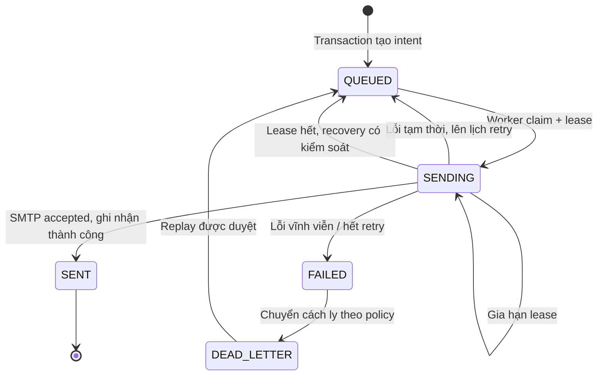
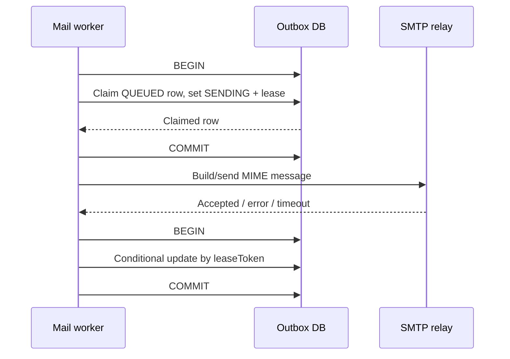

# Trạng thái queued, sending, sent, failed và dead letter

Khi ứng dụng Spring Framework Mail gửi email trực tiếp bằng `JavaMailSender.send(...)`, lời gọi Java thường kết thúc theo một trong hai cách: trả về hoặc ném exception. Điều đó đủ cho một ví dụ “gửi thử”, nhưng chưa đủ để xây dựng hệ thống gửi thông báo có hàng đợi, retry, nhiều worker và khả năng phục hồi sau khi process dừng. Một email có thể đang chờ, đã được worker nhận xử lý, đang được truyền tới SMTP relay, đã được relay chấp nhận, thất bại không thể tự phục hồi hoặc được chuyển sang khu vực cách ly để điều tra.

Vì vậy, một hệ thống gửi email cần **mô hình trạng thái rõ ràng**. Trong bài này, năm trạng thái chính là **`QUEUED`, `SENDING`, `SENT`, `FAILED` và `DEAD_LETTER`**. Tên trạng thái chỉ hữu ích khi mỗi tên có ý nghĩa chính xác, có điều kiện chuyển tiếp và có quy tắc xử lý khi lỗi hoặc chạy song song.

Điểm cần ghi nhớ ngay từ đầu: **`SENT` không có nghĩa email đã nằm trong inbox**. Với SMTP, ứng dụng thường chỉ biết mail relay đã chấp nhận một lần gửi mà không báo lỗi. Trạng thái phát thư cuối cùng, bounce, spam filtering và việc người nhận đọc thư là những vấn đề khác. Tương tự, khi xảy ra timeout sau khi truyền dữ liệu, ứng dụng có thể không biết chắc relay đã chấp nhận hay chưa; retry có thể tạo email trùng.

Bài học giải thích state machine, schema outbox, claim và lease, retry/backoff, idempotency, dead-letter handling, Spring worker, kiểm thử và vận hành. Ví dụ minh họa dùng Spring Framework 6.x, Spring Boot 3.x, Java 21, Spring Mail và PostgreSQL. Những đoạn SQL sử dụng cú pháp PostgreSQL cần được điều chỉnh nếu dự án dùng hệ quản trị khác.

## 1. Vì sao cần trạng thái thay vì một biến boolean?

Một thiết kế sơ khai có thể lưu:

```java
boolean emailSent;
```

Nhưng khi `emailSent == false`, ứng dụng không biết:

- Email chưa từng được enqueue?
- Đã enqueue nhưng đang chờ thời điểm retry?
- Worker đã nhận và đang gửi?
- SMTP vừa timeout, kết quả chưa chắc chắn?
- Lần gửi đã thất bại vĩnh viễn?
- Job đã được chuyển vào dead-letter queue để điều tra?

Một boolean khiến quá trình vận hành phải suy đoán từ log và dễ retry sai. State machine biểu diễn tình trạng xử lý của **một notification intent** cùng với metadata như `attempts`, `nextAttemptAt`, `leaseToken` và `lastErrorCode`.

Ví dụ:

```text
notificationId = invoice-issued:2026-00981
status         = QUEUED
attempts       = 2
nextAttemptAt  = 2026-11-12T12:30:00Z
lastErrorCode  = SMTP_TEMPORARY_FAILURE
```

Điều đó cho biết notification đã được thử hai lần, đang chờ attempt tiếp theo và chưa được ghi nhận là relay đã chấp nhận. Không cần mở một SMTP connection để hỏi liệu job có nên chạy ngay không; worker chỉ cần so sánh `nextAttemptAt` với thời điểm hiện tại và kiểm tra lease.

## 2. Định nghĩa năm trạng thái

| Trạng thái | Ý nghĩa trong hệ thống | Có tự động gửi tiếp? |
|---|---|---|
| `QUEUED` | Ý định gửi đã được lưu bền vững; chưa có worker nào đang sở hữu job. Có thể đang chờ thời điểm retry. | Có, khi đến hạn và thỏa policy |
| `SENDING` | Một worker đã claim job, giữ lease và đang thực hiện một attempt. | Không claim thêm khi lease còn hiệu lực |
| `SENT` | Lần gửi được sender/relay chấp nhận theo kết quả ứng dụng nhận được. | Không |
| `FAILED` | Job đã có lỗi cuối theo chính sách: không retry tự động nữa. | Không; chỉ khi có hành động khắc phục có chủ đích |
| `DEAD_LETTER` | Job đã bị cách ly khỏi luồng gửi thông thường để phân tích/khắc phục hoặc replay có kiểm soát. | Không, cho đến khi operator/recovery workflow xử lý |

**Quy ước dùng trong bài:** lỗi tạm thời còn khả năng retry **không** đặt status thành `FAILED`; worker chuyển về `QUEUED` với `nextAttemptAt` trong tương lai và ghi thêm `lastErrorCode`. Trạng thái `FAILED` ở đây biểu thị **đã kết thúc retry tự động**. Một số hệ thống khác dùng `FAILED` cho mỗi attempt rồi từ đó lên lịch retry; cách đó cũng có thể hợp lệ nếu được mô tả và triển khai nhất quán. Không trộn hai quy ước trong cùng một bảng.

`DEAD_LETTER` khác `FAILED` ở **hành động vận hành**: `FAILED` ghi nhận kết cục thất bại của notification; `DEAD_LETTER` ghi nhận job đã được chuyển sang nhánh cách ly, có metadata điều tra và quy trình replay/review. Một hệ thống nhỏ có thể chỉ dùng `FAILED`, còn hệ thống lớn thường thêm dead-letter workflow để tách lỗi cần con người hoặc hệ thống phục hồi xử lý.

## 3. State machine cơ bản



Đây là một mô hình chuẩn hóa. Một số hệ thống chuyển trực tiếp từ `SENDING` sang `DEAD_LETTER` khi hết retry mà không lưu `FAILED` như một trạng thái trung gian; nếu chọn cách đó, hãy ghi rõ quy tắc transition và thời điểm dead-letter. Bài này chọn `FAILED → DEAD_LETTER` để dễ phân biệt **kết quả gửi** với **quyết định cách ly**.

Mỗi transition cần được định nghĩa bằng bốn thông tin:

1. **Điều kiện:** trạng thái ban đầu, attempt hiện tại, lease còn hiệu lực và loại lỗi.
2. **Chủ thể:** API nghiệp vụ, mail worker, recovery worker hoặc operator.
3. **Side effect:** tạo message, gọi SMTP, ghi trạng thái, cập nhật thời điểm retry hoặc lưu lý do.
4. **Tính nguyên tử:** transaction database nào bảo vệ transition và điều kiện chống tranh chấp.

Một state machine mà worker chỉ thực hiện `setStatus("SENT")` không có điều kiện sẽ dễ bị race khi nhiều worker cùng xử lý hoặc khi lease đã chuyển sang worker khác.

## 4. Trạng thái QUEUED: ý định gửi đã được ghi nhận

`QUEUED` là trạng thái của một notification intent đã được lưu trong storage bền vững, chẳng hạn bảng transactional outbox. Nó không chỉ là một `Runnable` nằm trong `ThreadPoolTaskExecutor`: hàng đợi trong bộ nhớ có thể mất khi JVM restart.

Một row `QUEUED` nên có ít nhất:

- `notificationId` hoặc `notificationKey` duy nhất cho ý định gửi.
- `recipient` hoặc reference tới recipient đã được xác thực.
- `templateId` và nếu cần `templateVersion`.
- Payload tối thiểu để render subject/plain text/HTML.
- Tham chiếu attachment bền vững, nếu có.
- `nextAttemptAt` để biết khi nào đến hạn gửi.
- `attempts` để biết đã claim/thử bao nhiêu lần.
- `createdAt` để đánh giá tuổi của notification.

### 4.1. QUEUED không có nghĩa đã gửi SMTP

API có thể trả về:

```json
{
  "notificationId": "invoice-issued:2026-00981",
  "status": "QUEUED"
}
```

Điều này có nghĩa yêu cầu gửi đã được chấp nhận và lưu để xử lý. Không trả thông điệp “Email đã được gửi thành công” chỉ vì transaction tạo outbox row đã commit.

Nếu ứng dụng thiết kế HTTP API cho enqueue, `202 Accepted` có thể phù hợp vì xử lý diễn ra về sau. Response cần mô tả trạng thái job hoặc cách truy vấn trạng thái, không hứa email đã vào inbox.

### 4.2. Retry vẫn có thể dùng QUEUED

Ví dụ worker gặp SMTP 451 tạm thời và đặt:

```text
status        = QUEUED
attempts      = 2
nextAttemptAt = 2026-11-12T12:30:00Z
lastErrorCode = SMTP_451
```

Job chỉ đủ điều kiện claim khi `nextAttemptAt <= now()`. Dù tên trạng thái là QUEUED, nó chưa cần chạy ngay. Nếu muốn hiển thị rõ hơn trên dashboard, có thể suy ra nhãn `RETRY_SCHEDULED` từ `status=QUEUED` và `attempts>0`, hoặc mở rộng state machine với trạng thái riêng. Không bắt buộc thêm một status mới nếu metadata đã đủ diễn đạt.

## 5. Trạng thái SENDING: worker đã claim job

`SENDING` phải biểu thị **quyền xử lý tạm thời** của một worker, không chỉ là một flag. Trong hệ thống có nhiều instance, nếu hai worker cùng đọc `QUEUED` rồi cùng gọi SMTP, người nhận có thể nhận thư trùng.

Khi chuyển `QUEUED → SENDING`, hãy đồng thời:

- Tăng `attempts` theo quy ước đếm attempt.
- Ghi `leaseOwner` hoặc worker ID.
- Tạo `leaseToken` mới cho lần claim.
- Ghi `leaseUntil`.
- Ghi `lastAttemptAt`.
- Thay status bằng `SENDING`.

Các trường này cần được cập nhật **nguyên tử** trong database. Không tách thành “SELECT job, sau đó UPDATE status” không có lock/condition vì worker khác có thể chen vào giữa.

### 5.1. Lease là gì?

Lease là thời hạn worker được phép sở hữu job. Ví dụ:

```text
status      = SENDING
leaseOwner  = mail-worker-3
leaseToken  = 9b7f0e09-7c0e-4d50-82e8-1d0832aba651
leaseUntil  = 2026-11-12T12:42:00Z
attempts    = 3
```

Nếu worker crash, lease sẽ hết hạn và recovery worker có thể nhận lại job. Nếu SMTP gửi lâu, worker cần heartbeat/gia hạn lease hoặc chọn timeout phù hợp. Lease quá ngắn có thể làm worker B claim job trong khi worker A vẫn gửi; cả hai có thể gọi SMTP.

**Lease không bảo đảm exactly-once SMTP.** Nó giảm tranh chấp và cho phép khôi phục, nhưng không thể hủy một email đã được relay nhận.

### 5.2. Không giữ transaction DB mở trong khi gửi

Luồng đúng thường là:



SMTP là I/O mạng nên không nên giữ row lock và connection database trong suốt thời gian gửi. Transaction claim ngắn bảo vệ quyền sở hữu; transaction cập nhật outcome ngắn ghi kết quả.

## 6. Trạng thái SENT: relay đã chấp nhận, không phải inbox đã nhận

Khi `JavaMailSender.send(message)` trả về bình thường với sender SMTP đồng bộ thông thường, ứng dụng có cơ sở để ghi nhận lần gửi đã được chấp nhận ở tầng sender/relay. Đó là thời điểm phù hợp để chuyển `SENDING → SENT` nếu update trạng thái DB cũng thành công.

Điều **không được suy luận** từ `SENT`:

- Email đã vào inbox.
- Email đã được người nhận mở.
- Email không bị đánh dấu spam.
- Email không thể bị bounce ở bước giao tiếp tiếp theo.
- Relay downstream không thể từ chối sau đó.

Một notification có thể cần tách thêm trạng thái delivery cấp cao như `DELIVERED`, `BOUNCED` hoặc `COMPLAINT` dựa trên webhook từ provider. Đó là luồng hậu gửi riêng; không nên thay đổi ngữ nghĩa `SENT` của hàng đợi khi chưa thiết kế rõ.

### 6.1. SENT và Message-ID

Mỗi email có thể có header `Message-ID` của MIME message. Có thể lưu ID này để điều tra; tuy nhiên, `Message-ID` không phải bằng chứng inbox đã nhận và SMTP không yêu cầu mọi recipient server phải deduplicate các email có Message-ID trùng nhau.

Nếu mail provider có tracking ID riêng, lưu mapping giữa `notificationId`, ID của provider và attempt. Đừng nhầm ID của một notification với ID của một lần submit tới relay.

### 6.2. Chỉ worker sở hữu lease mới được ghi SENT

Ví dụ:

```sql
UPDATE mail_outbox
SET status = 'SENT',
    sent_at = now(),
    lease_owner = NULL,
    lease_token = NULL,
    lease_until = NULL
WHERE id = :id
  AND status = 'SENDING'
  AND lease_token = :lease_token;
```

Ứng dụng phải kiểm tra số row được update. Nếu bằng 0, worker đã mất quyền sở hữu hoặc trạng thái đã đổi; không được giả định việc ghi `SENT` thành công. Kết quả SMTP đã xảy ra, còn kết quả ghi trạng thái cần được điều tra riêng.

## 7. Trạng thái FAILED: thất bại cuối theo chính sách

Trong quy ước của bài, `FAILED` có nghĩa ứng dụng **không tiếp tục retry tự động** cho notification đó. Nguyên nhân có thể là:

- Dữ liệu không hợp lệ và không thể tạo message an toàn.
- Template hoặc attachment bắt buộc không tồn tại và không thể phục hồi.
- Recipient bị từ chối vĩnh viễn theo thông tin chắc chắn.
- Job vượt giới hạn số attempt.
- Job vượt thời hạn tối đa (TTL) dù số attempt chưa chạm ngưỡng.
- Policy nghiệp vụ quyết định không gửi nữa.

Ví dụ:

```text
status            = FAILED
attempts          = 5
lastErrorCode     = SMTP_PERMANENT_RECIPIENT_REJECTION
failedAt          = 2026-11-12T12:45:00Z
nextAttemptAt     = null
leaseOwner        = null
leaseToken        = null
```

`FAILED` không nhất thiết là một exception “lạ” không thể hiểu. Nó là **kết quả chính thức** sau khi policy xác định không còn đường retry tự động. Một lỗi 4xx tạm thời có thể dẫn đến FAILED nếu đã hết retry window; một lỗi validation có thể dẫn đến FAILED ngay ở attempt đầu.

### 7.1. Phân biệt failed attempt và FAILED job

Một attempt có thể thất bại trong khi job vẫn tiếp tục:

```text
Attempt 1: SMTP 451 -> QUEUED, nextAttemptAt +30s
Attempt 2: SMTP 451 -> QUEUED, nextAttemptAt +2m
Attempt 3: Accepted -> SENT
```

Các lần thử 1 và 2 là **attempt failures**, nhưng notification không đi qua trạng thái FAILED. Chúng được ghi trong attempt history hoặc `lastErrorCode` cùng metadata retry. Làm vậy giúp dashboard phân biệt “đang retry bình thường” với “đã thất bại cuối”.

## 8. DEAD_LETTER: khu vực cách ly, không phải thùng rác

Dead letter là cơ chế đưa một notification không thể xử lý tự động sang vùng riêng để điều tra hoặc can thiệp. Nó có thể được biểu diễn bằng:

1. Trạng thái `DEAD_LETTER` trong cùng bảng outbox; hoặc
2. Một bảng `mail_dead_letter` / dead-letter queue (DLQ) riêng, có bản ghi liên kết với notification gốc.

Trong bài này, state machine dùng `DEAD_LETTER` trong bảng outbox. Nếu dùng DLQ riêng, cần giao dịch nguyên tử hoặc cơ chế bền vững để tránh mất bản ghi khi chuyển.

### 8.1. Khi nào chuyển sang dead letter?

Ví dụ policy:

- Job đã `FAILED` vì vượt `maxAttempts`.
- Job có lỗi cấu hình cần con người sửa.
- Payload không thể deserialize do schema đã thay đổi.
- Template ID/version không còn được triển khai.
- Attachment đã bị xóa hoặc thuộc vùng lưu trữ không được phép.
- Job nghi ngờ đã gửi nhưng không xác định được kết quả, cần reconciliation.

Không nhất thiết mọi FAILED đều được đưa vào dead letter. Một hệ thống có thể giữ các lỗi recipient vĩnh viễn trong FAILED để thống kê và chỉ đưa lỗi cần điều tra vào DEAD_LETTER. Quy tắc chuyển phải được định nghĩa trong policy.

### 8.2. Metadata để điều tra

Một dead-letter record nên có:

- `notificationId`, tenant ID và template ID/version.
- Thời điểm enqueue, thời điểm cuối được thử, số attempts.
- Error code đã chuẩn hóa và bước thất bại (validation, MIME, SMTP, storage).
- Trạng thái outcome có chắc chắn hay không.
- Correlation/trace reference nếu có.
- Người/hệ thống thực hiện thao tác replay hoặc discard.
- Retention và thời điểm xóa dữ liệu nhạy cảm.

Không lưu SMTP password, JWT, email body đầy đủ, URL chứa token hoặc attachment bytes trong log lỗi. Nếu cần giữ payload để replay, quản lý quyền truy cập và encryption/retention như dữ liệu nghiệp vụ.

### 8.3. DEAD_LETTER không tự chạy lại

Một row DEAD_LETTER không nên được worker polling bình thường claim. Replay phải là thao tác được kiểm soát, vì nguyên nhân gốc có thể chưa được sửa; replay tự động không giới hạn sẽ tạo vòng lặp lỗi, phát spam hoặc làm cạn tài nguyên.

Một workflow thường gồm:

```text
DEAD_LETTER
  -> Triage / phân loại nguyên nhân
  -> Sửa template, config hoặc nguồn attachment
  -> Kiểm tra quyền, suppression, TTL và outcome
  -> Operator phê duyệt replay
  -> QUEUED với audit và attempt budget mới (nếu policy cho phép)
```

Nếu có khả năng relay đã chấp nhận email trước đó, replay có nguy cơ tạo duplicate. Cần hiển thị cảnh báo và áp dụng quy trình riêng cho trường hợp **kết quả gửi không chắc chắn**.

## 9. Thiết kế bảng outbox cho năm trạng thái

Một schema PostgreSQL minh họa:

```sql
CREATE TABLE mail_outbox (
    id                  UUID PRIMARY KEY,
    tenant_id           VARCHAR(80) NOT NULL,
    notification_key    VARCHAR(160) NOT NULL,
    recipient           VARCHAR(254) NOT NULL,
    template_id         VARCHAR(100) NOT NULL,
    template_version    INTEGER NOT NULL,
    payload_json        JSONB NOT NULL,

    status              VARCHAR(24) NOT NULL
                        CHECK (status IN (
                            'QUEUED', 'SENDING', 'SENT',
                            'FAILED', 'DEAD_LETTER'
                        )),
    attempts            INTEGER NOT NULL DEFAULT 0
                        CHECK (attempts >= 0),
    next_attempt_at     TIMESTAMPTZ NULL,
    lease_owner         VARCHAR(100) NULL,
    lease_token         UUID NULL,
    lease_until         TIMESTAMPTZ NULL,

    created_at          TIMESTAMPTZ NOT NULL DEFAULT now(),
    last_attempt_at     TIMESTAMPTZ NULL,
    sent_at             TIMESTAMPTZ NULL,
    failed_at           TIMESTAMPTZ NULL,
    dead_letter_at      TIMESTAMPTZ NULL,
    last_error_code     VARCHAR(100) NULL,
    last_error_phase    VARCHAR(40) NULL,
    smtp_message_id     VARCHAR(255) NULL,
    version             BIGINT NOT NULL DEFAULT 0,

    CONSTRAINT uq_mail_outbox_intent
        UNIQUE (tenant_id, notification_key)
);

CREATE INDEX ix_mail_outbox_due
    ON mail_outbox (next_attempt_at, created_at)
    WHERE status = 'QUEUED';

CREATE INDEX ix_mail_outbox_expired_leases
    ON mail_outbox (lease_until)
    WHERE status = 'SENDING';
```

Đây là một thiết kế tham khảo, không phải schema bắt buộc. Các hệ thống khác có thể tách `mail_attempt`, `mail_dead_letter`, recipient list và attachment references thành các bảng riêng.

### 9.1. Ý nghĩa một số cột

`notification_key` là idempotency key của **ý định gửi** theo nghiệp vụ. Unique constraint theo tenant ngăn cùng một notification được enqueue hai lần ngoài ý muốn. Nếu cùng một sự kiện cần gửi đến nhiều recipient khác nhau, khóa phải bao gồm thông tin phân biệt từng thông báo/recipient theo policy.

`attempts` trong schema này tăng khi claim attempt. Vì vậy, nếu worker crash ngay sau claim nhưng trước khi bắt đầu SMTP, bộ đếm vẫn tăng. Đây là quy ước đếm **lần chiếm quyền xử lý**, không phải số email chắc chắn đã được relay nhận.

`lease_token` là fencing token: worker phải cung cấp token đang sở hữu khi cập nhật outcome. `version` có thể dùng thêm cho optimistic locking hoặc kiểm soát cập nhật từ UI.

`sent_at` là thời điểm ứng dụng **ghi nhận** thành công từ sender, không phải thời điểm recipient đọc thư. `smtp_message_id` là metadata theo dõi tùy chọn; không dùng nó làm cơ chế deduplication duy nhất.

### 9.2. Các invariants nên bảo vệ

Với quy ước trên:

- `SENDING` phải có `lease_token` và `lease_until`.
- `SENT` không còn active lease.
- `FAILED` và `DEAD_LETTER` không còn active lease hoặc lịch retry tự động.
- `QUEUED` không có active lease và có `next_attempt_at` xác định lúc được phép claim.
- `attempts` không giảm, trừ khi policy replay cố ý tạo một execution generation mới.
- `notification_key` không đổi trong vòng đời của intent.

Có thể thực thi một phần invariants bằng database `CHECK` constraint. Những điều kiện liên quan tới transition, lease token, quyền replay và trạng thái trước/sau cần kiểm soát bằng service và transaction.

## 10. Enqueue nguyên tử cùng nghiệp vụ

Với email giao dịch, nên ghi outbox row trong **cùng database transaction** với thay đổi nghiệp vụ:

```java
@Service
public class OrderApplicationService {

    private final OrderRepository orders;
    private final MailOutboxRepository outbox;

    public OrderApplicationService(
            OrderRepository orders,
            MailOutboxRepository outbox) {
        this.orders = orders;
        this.outbox = outbox;
    }

    @Transactional
    public void confirm(long orderId) {
        Order order = orders.findById(orderId).orElseThrow();
        order.confirm();

        outbox.insertIfAbsent(
                MailIntent.orderConfirmed(
                        order.getTenantId(),
                        "order-confirmed:" + order.getId(),
                        order.getCustomerId(),
                        order.getId()));
    }
}
```

`MailIntent` và `insertIfAbsent(...)` là abstraction của ứng dụng. Trong thực tế, `insertIfAbsent` nên dựa vào unique constraint ở database, không chỉ “SELECT rồi INSERT” không khóa.

Nếu transaction rollback, order update và outbox insert cùng rollback. Nếu commit thành công, notification intent đã được lưu để worker có thể gửi sau restart. Điều này **không** biến SMTP thành một phần của transaction; worker vẫn gửi riêng và có khả năng duplicate khi outcome không chắc chắn.

### 10.1. Tránh gửi SMTP trong transaction tạo outbox

Không gọi:

```java
@Transactional
public void confirm(long orderId) {
    updateOrder(orderId);
    mailSender.send(buildMessage(orderId)); // Rủi ro trước commit.
    saveOutboxStatus();
}
```

SMTP có thể được relay chấp nhận rồi database rollback; hoặc SMTP chậm làm transaction giữ lock lâu. Outbox đúng nghĩa ghi **ý định gửi**, không thực hiện mạng trong transaction nghiệp vụ.

## 11. Claim job đúng cách khi có nhiều worker

Một phương án dùng PostgreSQL `FOR UPDATE SKIP LOCKED` trong transaction ngắn:

```sql
WITH picked AS (
    SELECT id
    FROM mail_outbox
    WHERE status = 'QUEUED'
      AND next_attempt_at <= now()
    ORDER BY next_attempt_at, created_at, id
    FOR UPDATE SKIP LOCKED
    LIMIT :batch_size
)
UPDATE mail_outbox AS m
SET status = 'SENDING',
    attempts = m.attempts + 1,
    last_attempt_at = now(),
    lease_owner = :worker_id,
    lease_token = gen_random_uuid(),
    lease_until = now() + interval '120 seconds',
    version = m.version + 1
FROM picked
WHERE m.id = picked.id
RETURNING m.id, m.notification_key, m.tenant_id,
          m.attempts, m.lease_token, m.lease_until;
```

Ví dụ cần PostgreSQL có hàm tạo UUID tương ứng và một transaction manager bao quanh statement. `SKIP LOCKED` cho phép worker bỏ qua row đang bị transaction khác khóa, giảm tranh chấp khi nhiều instance poll đồng thời.

**Không giữ transaction claim mở trong lúc gọi SMTP.** Commit claim xong rồi worker mới render/gửi và cập nhật outcome bằng transaction khác.

### 11.1. Đếm attempts đúng thời điểm

Ở thiết kế này, `attempts` tăng khi worker claim:

```text
QUEUED attempts=0
claim -> SENDING attempts=1
SMTP 451 -> QUEUED attempts=1
claim -> SENDING attempts=2
SMTP accepted -> SENT attempts=2
```

Nếu muốn đếm riêng số lần kết nối SMTP đã thực sự bắt đầu, cần một trường khác hoặc attempt history. Không gán cho `attempts` hai ý nghĩa khác nhau trong metrics, retry policy và báo cáo.

### 11.2. Gửi từng recipient hay một message nhiều recipient?

Nếu một notification có nhiều recipient, `JavaMailSender` có thể gặp partial delivery hoặc lỗi theo từng địa chỉ. Khi hệ thống cần retry/idempotency chính xác, thường dễ quản lý **một outbox row cho một recipient**; các row có thể cùng business event ID nhưng có notification key riêng.

Nếu một job gửi một message tới nhiều địa chỉ, cần mô hình trạng thái riêng cho từng recipient hoặc xử lý `MailSendException`/SMTP partial success cẩn thận. Không mark cả job SENT nếu một phần recipient chắc chắn thất bại.

## 12. Gửi và cập nhật trạng thái ngoài transaction claim

Một worker Spring có thể tổ chức các service như sau:

```java
@Component
public class MailDispatchWorker {

    private final MailClaimService claimService;
    private final MailStatusService statusService;
    private final MailMessageFactory messageFactory;
    private final JavaMailSender mailSender;
    private final MailFailureClassifier classifier;

    public MailDispatchWorker(
            MailClaimService claimService,
            MailStatusService statusService,
            MailMessageFactory messageFactory,
            JavaMailSender mailSender,
            MailFailureClassifier classifier) {
        this.claimService = claimService;
        this.statusService = statusService;
        this.messageFactory = messageFactory;
        this.mailSender = mailSender;
        this.classifier = classifier;
    }

    public void dispatchOnce() {
        List<ClaimedMailJob> jobs = claimService.claimDueBatch(20);

        for (ClaimedMailJob job : jobs) {
            dispatchOne(job);
        }
    }

    private void dispatchOne(ClaimedMailJob job) {
        try {
            // Tạo message mới cho mỗi attempt.
            MimeMessage message = messageFactory.compose(job);

            // SMTP diễn ra ngoài transaction claim.
            mailSender.send(message);

            boolean recorded = statusService.markSent(
                    job.id(), job.leaseToken());
            if (!recorded) {
                // Relay có thể đã nhận, nhưng worker đã mất lease.
                // Ghi metric/incident; không tự kết luận job chưa gửi.
                reportOwnershipConflict(job.notificationKey());
            }
        } catch (MessagingException | MailException ex) {
            FailureDecision decision =
                    classifier.classify(job, ex);
            statusService.applyFailure(
                    job.id(), job.leaseToken(), decision);
        }
    }

    private void reportOwnershipConflict(String notificationKey) {
        // Ghi metric/alert an toàn, không log email body hoặc credential.
    }
}
```

`MailClaimService`, `MailStatusService`, `MailMessageFactory`, `ClaimedMailJob`, `MailFailureClassifier` và `FailureDecision` là các abstraction do ứng dụng định nghĩa; các import Spring/Jakarta/Java tương ứng cần có trong dự án. Ví dụ thể hiện rõ thứ tự, không phải một package có thể copy và chạy độc lập.

Chú ý: exception từ **database khi ghi SENT** không nằm trong hai loại exception `MessagingException`/`MailException`. Đây là cố ý: nếu SMTP đã được relay chấp nhận nhưng ghi database thất bại, không được xử lý như một lỗi SMTP chắc chắn để retry ngay. Để job hết lease và đi qua recovery policy, đồng thời ghi nhận khả năng outcome mơ hồ.

### 12.1. Service transition cần transaction riêng

Ví dụ:

```java
@Service
public class MailStatusService {

    private final NamedParameterJdbcTemplate jdbc;

    public MailStatusService(NamedParameterJdbcTemplate jdbc) {
        this.jdbc = jdbc;
    }

    @Transactional
    public boolean markSent(UUID jobId, UUID leaseToken) {
        int updated = jdbc.update("""
                UPDATE mail_outbox
                SET status = 'SENT',
                    sent_at = now(),
                    lease_owner = NULL,
                    lease_token = NULL,
                    lease_until = NULL,
                    next_attempt_at = NULL,
                    last_error_code = NULL,
                    version = version + 1
                WHERE id = :jobId
                  AND status = 'SENDING'
                  AND lease_token = :leaseToken
                """,
                Map.of("jobId", jobId, "leaseToken", leaseToken));
        return updated == 1;
    }
}
```

Các import gồm `UUID`, `Map`, `@Transactional`, `@Service` và `NamedParameterJdbcTemplate`. Lời gọi đến service này cần đi qua proxy Spring để transaction được áp dụng. Nếu worker tự gọi một phương thức `@Transactional` trong cùng instance bằng `this.method()`, proxy có thể bị bỏ qua.

Hàm trên kiểm tra lease token nhưng không kiểm tra lease expiry bằng thời gian. Điều đó phù hợp với một policy cho phép worker hiện đang sở hữu token kết thúc trước khi job bị claim lại. Nếu chính sách yêu cầu lease còn hạn tuyệt đối khi ghi kết quả, thêm điều kiện phù hợp; cần đồng bộ với heartbeat/recovery để tránh trạng thái bất ngờ.

## 13. Retry: từ SENDING về QUEUED có lịch hẹn

Khi lỗi được phân loại là tạm thời và còn budget, worker chuyển `SENDING → QUEUED`, đồng thời đặt `nextAttemptAt` ở tương lai:

```sql
UPDATE mail_outbox
SET status = 'QUEUED',
    next_attempt_at = :next_attempt_at,
    last_error_code = :error_code,
    last_error_phase = :error_phase,
    lease_owner = NULL,
    lease_token = NULL,
    lease_until = NULL,
    version = version + 1
WHERE id = :id
  AND status = 'SENDING'
  AND lease_token = :lease_token;
```

Kiểm tra row count giống transition SENT. Nếu update không thành công, worker không còn sở hữu job; đừng ghi đè thông tin từ worker khác.

### 13.1. Backoff và jitter

Retry ngay lập tức có thể gây quá tải SMTP relay đang có sự cố. Một chính sách phổ biến là exponential backoff, capped và jitter.

Ví dụ với `baseDelay=30s` và giới hạn `maxDelay=30m`:

| Attempt vừa thất bại | Thời gian chờ cơ sở trước attempt tiếp |
|---:|---:|
| 1 | 30 giây |
| 2 | 1 phút |
| 3 | 2 phút |
| 4 | 4 phút |
| 5 | 8 phút |
| 6 | 16 phút |
| 7 trở đi | Tối đa 30 phút |

Sau khi tính delay, có thể dùng **full jitter**: chọn ngẫu nhiên từ 0 đến delay trần, hoặc dùng một dải jitter không bằng 0 theo policy. Hệ thống cần thêm số lần retry tối đa và TTL để tránh chạy vô hạn. Đừng chọn các số trong bảng như SLA cố định cho mọi SMTP provider.

Pseudo Java:

```java
static Duration nextDelay(int attempt, Duration base, Duration cap) {
    int safePower = Math.max(0, Math.min(attempt - 1, 20));
    long factor = 1L << safePower;
    long rawMillis = Math.multiplyExact(base.toMillis(), factor);
    long capped = Math.min(rawMillis, cap.toMillis());

    // Ví dụ full jitter; đảm bảo cap và base đều hợp lệ.
    long millis = ThreadLocalRandom.current()
            .nextLong(capped + 1);
    return Duration.ofMillis(millis);
}
```

Đoạn này minh họa; nếu cấu hình cho phép giá trị quá lớn, `Math.multiplyExact` có thể ném overflow. Production cần validate base/cap ở cấu hình và xử lý overflow tường minh. Full jitter có thể chọn 0 ms; nếu muốn tránh retry ngay, đặt lower bound hoặc dùng equal jitter.

### 13.2. Giới hạn retry bằng số attempt và thời gian

Ví dụ:

```text
maxAttempts = 5
maxJobAge   = 24 hours

Retry nếu:
  retryableError
  AND attempts < maxAttempts
  AND now < createdAt + maxJobAge
```

Nếu hết budget hoặc quá TTL, job chuyển `FAILED`. Nếu nguyên nhân cần điều tra, hệ thống có thể chuyển tiếp sang `DEAD_LETTER` theo policy.

### 13.3. Retry không phải gửi lại cùng MimeMessage/stream

Mỗi attempt nên:

1. Đọc một snapshot hoặc template version đã xác định.
2. Tạo `MimeMessage` mới.
3. Tạo source attachment có thể mở stream mới.
4. Gọi `mailSender.send(message)`.
5. Ghi result và transition theo lease.

Không giữ một `InputStream` đã mở trong outbox, không dùng lại message có thể đã serialize và không xóa attachment khi còn retry.

## 14. Phân loại lỗi trước khi chuyển trạng thái

Không nên bắt mọi `MailException` rồi luôn retry. Lỗi có thể đến từ validation, template, attachment, DNS, TLS, SMTP authentication hoặc recipient policy; một số lỗi là vĩnh viễn, một số tạm thời, một số **không biết chắc kết quả**.

| Lỗi | Ví dụ | Quyết định thường gặp |
|---|---|---|
| Input/authorization không hợp lệ | Người gửi không có quyền, recipient sai cấu trúc | FAILED; không kết nối SMTP |
| Template không render được | Thiếu biến bắt buộc, version không tồn tại | FAILED hoặc DEAD_LETTER để sửa cấu hình |
| Attachment mất/không đọc được | Object key bị xóa, storage tạm unavailable | Phân loại: dữ liệu mất vĩnh viễn → FAILED; storage lỗi tạm → QUEUED |
| SMTP 4xx | Relay báo lỗi tạm thời | QUEUED với backoff nếu còn budget |
| SMTP 5xx | Relay từ chối vĩnh viễn theo ngữ cảnh | FAILED; đôi khi cần policy đặc biệt theo mã |
| TLS/AUTH/config | Certificate sai, SMTP credential sai | Thường cần sửa cấu hình; tránh retry dồn dập |
| Timeout trước khi gửi DATA | Không kết nối hoặc không bắt đầu truyền message | Có thể retry nếu biết chắc chưa được chấp nhận |
| Timeout sau DATA | Relay có thể đã nhận nhưng response thất lạc | Outcome UNKNOWN; retry có nguy cơ duplicate |
| Rate limit | Relay tạm giới hạn lưu lượng | QUEUED; tôn trọng retry-after nếu provider có |

Mã SMTP 4xx/5xx là tín hiệu quan trọng nhưng không phải classifier duy nhất. `MailSendException` còn có thể chứa lỗi theo từng message/recipient. Nếu gửi nhiều người nhận một lần, cần biết đã chấp nhận địa chỉ nào trước khi retry.

### 14.1. Không nhầm trạng thái FAILED với outcome UNKNOWN

Giả sử:

```text
12:00:00 Worker gửi DATA tới SMTP.
12:00:01 Relay lưu message và chuẩn bị trả 250.
12:00:02 Kết nối bị mất; worker không nhận 250.
```

Ứng dụng không biết chắc relay đã nhận message hay chưa. Nếu ghi `FAILED` như một khẳng định “thư chắc chắn không gửi”, điều đó không chính xác. Nếu retry, email có thể được gửi hai lần.

Năm trạng thái của bài vẫn có thể giữ nguyên, nhưng cần metadata phụ để biểu diễn tính mơ hồ:

```text
status                = QUEUED
lastOutcome           = UNKNOWN
lastErrorCode         = SMTP_RESPONSE_LOST
requiresReconciliation = true
```

Hoặc chọn chuyển sang `DEAD_LETTER` để con người kiểm tra trước khi replay. Với hệ thống phức tạp, có thể bổ sung trạng thái `UNKNOWN` riêng. Quan trọng là **không đánh mất thông tin outcome mơ hồ** chỉ vì state machine chính có năm trạng thái.

## 15. Idempotency ở hai ranh giới khác nhau

Idempotency không chỉ có một lớp. Với mail, cần phân biệt:

1. **Idempotency khi enqueue:** cùng một nghiệp vụ không tạo nhiều notification intent.
2. **Idempotency khi dispatch:** nhiều worker hoặc retry không tạo nhiều lần gửi nếu có thể tránh, nhưng SMTP thuần không bảo đảm exactly-once.

### 15.1. Idempotency key cho intent

Ví dụ:

```java
String notificationKey =
        "invoice-issued:" + invoiceId + ":recipient:" + recipientId;
```

Đặt unique constraint trên `(tenant_id, notification_key)`. Khi client retry API hoặc event được phát hai lần, `INSERT ... ON CONFLICT DO NOTHING` (PostgreSQL) có thể tránh tạo row trùng.

Không tạo key ngẫu nhiên mới cho cùng một sự kiện nếu mục tiêu là deduplicate. Key phải ổn định đối với cùng intent. Nhưng cũng không dùng key quá rộng khiến hai thông báo hợp lệ bị coi là trùng; ví dụ invoice có nhiều lần reissue có chủ đích thì key cần phiên bản/sự kiện tương ứng.

### 15.2. Lease và conditional update giảm duplicate từ concurrency

Claim nguyên tử giúp thông thường chỉ một worker sở hữu job trong một lease. Token giúp worker mất lease không thể ghi đè status. Tuy nhiên, token chỉ bảo vệ **database state**, không bảo vệ SMTP relay khỏi nhận hai message nếu worker cũ và mới cùng gửi.

### 15.3. Trường hợp không thể bảo đảm exactly-once

Một cửa sổ lỗi kinh điển:

```mermaid
sequenceDiagram
    participant W as Worker
    participant SMTP as SMTP relay
    participant DB as Outbox DB
    W->>SMTP: Send message
    SMTP-->>SMTP: Accepted
    SMTP--xW: Response lost / process crash
    Note over W,DB: Database vẫn SENDING
    W->>DB: Lease expires; another worker recovers
    W->>SMTP: Retry same notification
    Note over SMTP: Duplicate có thể xảy ra
```

Ngay cả khi response đã về, process có thể crash sau SMTP acceptance nhưng trước khi commit `SENT`. Outbox vẫn có thể được retry. Đây là cơ sở của mô hình **at-least-once sending attempts**: hệ thống đảm bảo cố gắng hoàn thành công việc nhưng phải chấp nhận nguy cơ gửi trùng trong trường hợp mơ hồ.

`Message-ID` trùng nhau không phải một cơ chế deduplication bắt buộc theo SMTP. Nếu provider có API riêng hỗ trợ idempotency key hoặc lookup, cần dựa vào hợp đồng của provider đó; không suy ra tính năng ấy từ `JavaMailSender`.

## 16. Recover job SENDING khi worker bị mất

Một worker có thể crash trong khi job đang `SENDING`. Nếu không có recovery, job bị kẹt mãi.

Điều kiện phát hiện:

```sql
SELECT id, notification_key, attempts, lease_until
FROM mail_outbox
WHERE status = 'SENDING'
  AND lease_until < now();
```

Từ đây có hai chiến lược:

**A. Requeue có kiểm soát.** Chuyển sang `QUEUED`, đặt thời điểm retry, ghi `WORKER_LEASE_EXPIRED` và đánh dấu outcome có thể chưa chắc chắn.

**B. Claim lại trực tiếp.** Một worker mới dùng transaction có lock để claim row SENDING hết lease, tạo lease token mới và tăng attempt. Cách này cần classifier/recovery policy phù hợp.

Ví dụ requeue:

```sql
UPDATE mail_outbox
SET status = 'QUEUED',
    next_attempt_at = now() + interval '1 minute',
    lease_owner = NULL,
    lease_token = NULL,
    lease_until = NULL,
    last_error_code = 'WORKER_LEASE_EXPIRED',
    version = version + 1
WHERE status = 'SENDING'
  AND lease_until < now()
RETURNING id, notification_key;
```

Statement này cần chạy trong transaction phù hợp và được giới hạn batch khi số row lớn. Nếu worker cũ vẫn đang thực hiện SMTP nhưng lease đã hết hạn, nó có thể gửi xong; recovery có nguy cơ duplicate. Vì vậy, lease expiry là **mất quyền sở hữu DB**, không phải bằng chứng SMTP chưa gửi.

### 16.1. Gia hạn lease

Nếu gửi attachment lớn hoặc SMTP chậm, worker có thể heartbeat:

```sql
UPDATE mail_outbox
SET lease_until = now() + interval '120 seconds'
WHERE id = :id
  AND status = 'SENDING'
  AND lease_token = :lease_token;
```

Kiểm tra row count. Nếu bằng 0, worker đã mất lease; việc tiếp tục gửi có thể gây duplicate với worker mới. Trên thực tế, không phải lúc nào cũng có thể hủy ngay một SMTP operation đã bắt đầu. Nên chọn timeout SMTP, lease duration, heartbeat và recovery delay như một bộ thống nhất.

### 16.2. Fencing token không hủy side effect ngoài DB

Fencing token chỉ giúp ngăn worker cũ cập nhật outbox sau khi lease đã chuyển. Nó không gửi lệnh “undo” tới SMTP relay. Vì vậy, hạ nguy cơ duplicate còn cần provider idempotency nếu có, chính sách xử lý outcome mơ hồ và thiết kế nội dung thông báo chịu được trùng lặp.

## 17. Chuyển FAILED sang DEAD_LETTER

Khi job thất bại cuối và được chọn để cách ly, có thể ghi transition trong transaction ngắn:

```sql
UPDATE mail_outbox
SET status = 'DEAD_LETTER',
    dead_letter_at = now(),
    next_attempt_at = NULL,
    lease_owner = NULL,
    lease_token = NULL,
    lease_until = NULL,
    version = version + 1
WHERE id = :id
  AND status = 'FAILED';
```

Nếu có bảng DLQ riêng, nên ghi bản ghi DLQ và thay đổi outbox status trong cùng transaction database. Nếu gửi tới message broker DLQ bên ngoài, không giả định database và broker publish tự động nguyên tử; dùng cơ chế outbox cho event chuyển DLQ hoặc workflow có idempotency để tránh mất record.

### 17.1. Tại sao cần phân tách FAILED và DEAD_LETTER?

Hai trạng thái trả lời hai câu hỏi khác nhau:

- `FAILED`: “Tác vụ này có còn được hệ thống tự động retry không?” — Không.
- `DEAD_LETTER`: “Tác vụ này đã được đưa vào quy trình điều tra/cách ly chưa?” — Có.

Một số thất bại là điều bình thường, ví dụ địa chỉ bị từ chối vĩnh viễn và được đưa vào suppression list. Không phải tất cả đều cần tạo ticket điều tra. Ngược lại, template không tồn tại sau deploy hoặc payload không parse được là lỗi hệ thống nên đưa vào DLQ sớm và tạo alert.

## 18. Replay dead letter đúng cách

Replay không đơn giản là cập nhật mọi row `DEAD_LETTER → QUEUED`. Trước khi replay:

1. Kiểm tra nguyên nhân gốc đã được sửa.
2. Xác định notification còn ý nghĩa nghiệp vụ không (TTL, order đã hủy, reset link đã hết hạn).
3. Xác minh người nhận và suppression/opt-out theo policy.
4. Kiểm tra tenant, authorization và nguồn attachment.
5. Xem outcome có thể đã được relay chấp nhận trước đó hay không.
6. Chọn replay cùng intent hay tạo notification mới có idempotency key khác.
7. Ghi audit: ai replay, khi nào, vì sao và replay generation nào.
8. Bảo đảm không đồng thời có hai worker replay cùng row.

### 18.1. Replay in-place hay tạo job mới?

**Replay in-place:** giữ nguyên outbox ID, đưa từ DEAD_LETTER về QUEUED, cập nhật budget và metadata recovery. Phù hợp khi muốn giữ một lịch sử trạng thái liên tục; cần audit rõ lần khôi phục.

**Tạo job mới:** tạo intent mới có `replayOfNotificationId` và unique key mới có chủ đích. Phù hợp khi cần bảo toàn bản ghi gốc bất biến; cần bảo đảm key mới không vô tình nhân đôi một yêu cầu được xử lý bình thường.

Trong cả hai mô hình, không xóa lịch sử attempt cũ chỉ để dashboard trông “sạch”. Audit và điều tra sau sự cố cần biết tại sao job đã vào DLQ.

### 18.2. Quản lý retry generation

Nếu reset `attempts=0` khi replay, hãy lưu một `replay_generation` hoặc attempt history để không đánh mất số lần gửi đã xảy ra. Nếu không reset, policy cần xác định ngân sách attempt mới áp dụng thế nào cho job đã hết retry trước đó.

### 18.3. Không replay bừa các email nhạy cảm

Email reset mật khẩu, OTP hoặc link xác minh có token ngắn hạn thường không nên replay nguyên nội dung cũ. Thay vào đó, cần kiểm tra hạn dùng và có thể tạo một flow phát hành token mới sau khi người dùng yêu cầu lại. Với biên nhận giao dịch, cần bảo đảm attachment/snapshot phản ánh đúng phiên bản nghiệp vụ đã chốt.

## 19. Retry sau lỗi SMTP và kết quả không chắc chắn

Một worker cần phân biệt **lỗi chắc chắn chưa được relay chấp nhận**, **lỗi chắc chắn bị từ chối** và **lỗi không xác định**:

```text
SMTP temporary rejection (có response rõ ràng)
    -> QUEUED + backoff

SMTP permanent rejection (có response rõ ràng)
    -> FAILED, suppression theo policy

SMTP accepted (có phản hồi thành công)
    -> SENT sau khi DB ack thành công

Connection drops after DATA / DB ack fails
    -> outcome có thể UNKNOWN
    -> recovery hoặc DEAD_LETTER theo policy
```

Nếu sản phẩm ưu tiên **không mất thông báo**, có thể retry outcome UNKNOWN và chấp nhận khả năng duplicate. Nếu email rất nhạy cảm với duplicate, có thể giữ job lại để reconciliation với provider hoặc xử lý thủ công. Không có một lựa chọn duy nhất đúng cho mọi loại email.

Một phương án dùng metadata phụ:

```java
public enum SmtpAttemptOutcome {
    ACCEPTED,
    TEMPORARY_REJECTION,
    PERMANENT_REJECTION,
    UNKNOWN
}
```

Outcome của attempt không nhất thiết trùng trạng thái tổng thể của job. Ví dụ job `QUEUED` có thể giữ `lastAttemptOutcome=TEMPORARY_REJECTION`, hoặc job `DEAD_LETTER` có thể giữ `lastAttemptOutcome=UNKNOWN`.

## 20. Tách status job khỏi lịch sử attempt

Chỉ lưu một `last_error_code` có thể đủ cho demo, nhưng thường không đủ để phân tích sự cố. Một bảng attempt history giúp thấy toàn bộ quá trình:

```sql
CREATE TABLE mail_attempt (
    id                  UUID PRIMARY KEY,
    outbox_id           UUID NOT NULL REFERENCES mail_outbox(id),
    attempt_number      INTEGER NOT NULL,
    lease_token         UUID NOT NULL,
    started_at          TIMESTAMPTZ NOT NULL,
    finished_at         TIMESTAMPTZ NULL,
    smtp_outcome        VARCHAR(40) NULL,
    error_code          VARCHAR(100) NULL,
    duration_ms         BIGINT NULL,
    UNIQUE (outbox_id, attempt_number)
);
```

Với bảng này:

- Outbox row cho biết trạng thái hiện tại của notification.
- Attempt history cho biết các lần thử, thời gian, outcome và lỗi.
- Dashboard có thể hiển thị “QUEUED, retry sau 2 phút, đã thử 3 lần”.
- Operator có thể điều tra vì sao job vào DEAD_LETTER.

Không ghi raw MIME, attachment bytes hoặc SMTP credential vào attempt history. Nếu cần lưu phản hồi provider, sanitize và giới hạn dữ liệu.

## 21. Quan sát hệ thống bằng metrics và log

Một pipeline gửi email cần số liệu về cả **độ trễ**, **khối lượng**, **lỗi** và **hàng đợi đang kẹt**.

### 21.1. Metrics hữu ích

| Metric | Ý nghĩa |
|---|---|
| `mail_outbox_queued` | Số notification đang QUEUED |
| `mail_outbox_sending` | Số notification đang SENDING |
| `mail_outbox_failed` | Số job FAILED chưa xử lý |
| `mail_outbox_dead_letter` | Số job trong DLQ/cách ly |
| `mail_dispatch_attempts_total` | Tổng số attempt theo outcome |
| `mail_send_duration_seconds` | Thời gian gọi SMTP |
| `mail_queue_age_seconds` | Tuổi của job QUEUED cũ nhất |
| `mail_lease_expired_total` | Số lần lease hết hạn |
| `mail_retry_scheduled_total` | Số retry đã lên lịch |
| `mail_dead_letter_replays_total` | Số thao tác replay |

Với metrics, dùng các label ít cardinality như `templateCategory`, `outcome` và `errorClass`. Không dùng recipient email, notification ID hoặc correlation ID làm label vì số giá trị có thể gần như vô hạn.

### 21.2. Structured log

Ví dụ:

```text
INFO event=mail_job_claimed notificationId=... attempt=3 workerId=mail-2
WARN event=mail_attempt_failed notificationId=... attempt=3 errorCode=SMTP_451
INFO event=mail_retry_scheduled notificationId=... nextAttemptAt=...
INFO event=mail_job_sent notificationId=... smtpOutcome=ACCEPTED
ERROR event=mail_job_dead_letter notificationId=... reason=RETRY_EXHAUSTED
```

Correlation ID giúp nối API request, outbox insert, worker attempt và phản hồi SMTP. Mỗi attempt nên có `attemptId` riêng. Không ghi token trong URL, nội dung hóa đơn, email body hoặc attachment bytes vào log.

### 21.3. Alert đúng tình huống

Không nhất thiết alert từng lỗi tạm thời. Nên cảnh báo khi:

- Hàng đợi QUEUED tăng liên tục hoặc tuổi job vượt SLA.
- Nhiều job kẹt SENDING và lease hết hạn.
- Tỷ lệ retry/SMTP 4xx tăng bất thường.
- FAILED/DEAD_LETTER tăng vượt ngưỡng.
- Worker không claim job dù hàng đợi có item đến hạn.
- Database ack SENT thất bại lặp lại.
- SMTP authentication/TLS lỗi trên toàn hệ thống.

Alert cần kèm dashboard và runbook để operator biết cách xử lý chứ không chỉ tạo thêm một notification mới bị kẹt.

## 22. Runbook vận hành cho từng trạng thái

### 22.1. QUEUED tồn quá lâu

Kiểm tra `nextAttemptAt`, worker availability, queue backlog, rate limit và transaction claim. Không ép mọi job chạy ngay nếu relay đang áp dụng giới hạn. Tăng worker chỉ hữu ích khi SMTP/provider và storage chịu được lưu lượng bổ sung.

### 22.2. SENDING vượt lease

Kiểm tra worker crash, SMTP timeout, attachment read latency, heartbeat và lease duration. Đừng chỉ chuyển toàn bộ SENDING về QUEUED rồi gửi lại ngay; có thể có worker vẫn đang gửi hoặc relay đã chấp nhận message.

### 22.3. SENT nhưng recipient báo không nhận

Kiểm tra provider event, bounce, spam filtering, mailbox policy và địa chỉ người nhận. `SENT` chỉ phản ánh kết quả ứng dụng đã ghi nhận. Không xóa status SENT và resend ngay như phản xạ; nếu cần gửi lại, tạo một nghiệp vụ resend được audit, có idempotency riêng.

### 22.4. FAILED tăng đột biến

Phân nhóm `lastErrorCode`: recipient vĩnh viễn, template, attachment, SMTP config hoặc timeout. Một lỗi cấu hình chung có thể làm cả hệ thống chuyển FAILED sai nếu policy giới hạn attempt quá nhỏ; cần phân loại lỗi chính xác.

### 22.5. DEAD_LETTER tăng

Kiểm tra nguyên nhân gốc, dữ liệu cần sửa, job có còn hợp lệ không và có thể đã được relay chấp nhận chưa. Tạo ticket hoặc báo cáo nhóm lỗi; không mass replay trước khi hiểu nguyên nhân.

## 23. Kiểm thử state machine

Test nên xác nhận **transition, điều kiện sở hữu, kết quả SMTP và hành vi khôi phục**, không chỉ kiểm tra một biến status sau khi gọi phương thức.

### 23.1. Unit test bảng quyết định

Có thể viết một policy function:

```java
public enum JobStatus {
    QUEUED, SENDING, SENT, FAILED, DEAD_LETTER
}

public enum FailureKind {
    TEMPORARY, PERMANENT, UNKNOWN
}

public record RetryDecision(
        JobStatus nextStatus,
        boolean scheduleRetry,
        boolean needsReconciliation
) {}

public final class RetryPolicy {

    public RetryDecision decide(
            FailureKind kind,
            int attempts,
            int maxAttempts,
            boolean expired) {

        if (kind == FailureKind.UNKNOWN) {
            return new RetryDecision(
                    JobStatus.DEAD_LETTER, false, true);
        }
        if (kind == FailureKind.PERMANENT
                || attempts >= maxAttempts || expired) {
            return new RetryDecision(
                    JobStatus.FAILED, false, false);
        }
        return new RetryDecision(
                JobStatus.QUEUED, true, false);
    }
}
```

Đây là một **ví dụ policy**, không phải quy định mọi lỗi UNKNOWN phải vào DLQ. Một hệ thống khác có thể retry UNKNOWN với cảnh báo duplicate. Điều cần kiểm thử là hành vi nhất quán với policy đã quyết định.

Một vài test case:

| Input | Kết quả kỳ vọng theo policy ví dụ |
|---|---|
| TEMPORARY, attempts=1, max=5, chưa hết hạn | QUEUED + retry |
| TEMPORARY, attempts=5, max=5 | FAILED |
| PERMANENT ở attempt đầu | FAILED |
| TEMPORARY nhưng TTL hết | FAILED |
| UNKNOWN outcome | DEAD_LETTER + reconciliation |

### 23.2. Integration test claim với hai worker

Tạo một row QUEUED đến hạn. Cho hai worker đồng thời claim batch. Kiểm tra chỉ một worker nhận được job với một lease token hợp lệ; worker còn lại không được gửi cùng job. Test này cần database thật hoặc môi trường tương đương, vì mock repository không mô phỏng chính xác row lock và `SKIP LOCKED`.

### 23.3. Test transition SENT yêu cầu token

Cho job ở SENDING có token A. Worker B thử `markSent(id, tokenB)`. Kỳ vọng update count bằng 0 và trạng thái không đổi. Worker A dùng token A mới được cập nhật.

### 23.4. Test retry và backoff

Giả lập SMTP 451 rõ ràng. Xác nhận job chuyển SENDING → QUEUED, attempts không giảm, `nextAttemptAt` lớn hơn hiện tại theo retry policy và không có active lease. Sau khi đến hạn, worker có thể claim lại.

### 23.5. Test lỗi vĩnh viễn và DLQ

Giả lập lỗi recipient vĩnh viễn. Xác nhận job vào FAILED, không được claim tự động. Chạy dead-letter workflow theo policy, xác nhận DEAD_LETTER có reason, thời điểm và audit phù hợp.

### 23.6. Test worker crash và lease expiry

Worker A claim job, sau đó mô phỏng crash trước khi cập nhật outcome. Dùng clock điều khiển được thay vì sleep thời gian thật. Sau lease expiry, recovery xử lý job theo policy, nhưng test phải xem xét khả năng relay đã chấp nhận để không gán nhầm trạng thái “chắc chắn chưa gửi”.

### 23.7. Test accepted nhưng ghi SENT thất bại

Fake SMTP sender trả về bình thường, nhưng repository `markSent` ném lỗi database. Job vẫn SENDING hoặc bước recovery tương ứng; hệ thống không được coi lỗi DB là bằng chứng SMTP đã thất bại. Test nên xác nhận log/metric ghi nhận nguy cơ outcome mơ hồ.

### 23.8. Test idempotent enqueue

Gọi nghiệp vụ enqueue cùng `notification_key` hai lần. Xác nhận database có một intent. Nếu cùng template cần gửi tới hai recipient, dùng hai key được thiết kế riêng và xác nhận mỗi người nhận có một job.

### 23.9. Test replay có kiểm soát

Cho row DEAD_LETTER; operator có quyền mới được replay. Kiểm tra quyền tenant, suppression, TTL, template và attachment source. Nếu replay được, lưu audit và generation; nếu không, giữ DEAD_LETTER và trả lỗi rõ ràng.

### 23.10. Test với SMTP giả lập

Có thể chạy Mailpit để nhận email trong môi trường test:

```bash
docker run --rm --name mailpit -p 1025:1025 -p 8025:8025 axllent/mailpit
```

Kết hợp test database để quan sát QUEUED → SENDING → SENT và kiểm tra MIME body. Một SMTP test server không tự chứng minh tính nguyên tử của database transaction hoặc behavior khi process crash; các failure mode đó cần test riêng.

## 24. Ví dụ cấu hình ứng dụng

Một cấu hình do ứng dụng định nghĩa:

```yaml
app:
  mail:
    dispatch:
      batch-size: 20
      concurrency: 4
      lease-seconds: 120
      max-attempts: 5
      max-job-age-hours: 24
      base-retry-seconds: 30
      max-retry-minutes: 30
      dead-letter-retention-days: 30

spring:
  mail:
    host: localhost
    port: 1025
    properties:
      mail:
        smtp:
          connectiontimeout: 5000
          timeout: 10000
          writetimeout: 10000
```

Các property dưới `app.mail.dispatch` là **tự định nghĩa**, cần map vào `@ConfigurationProperties` của dự án. Các property SMTP là ví dụ cho môi trường test; production phải cấu hình TLS, authentication, secret storage và network policy phù hợp. Không hardcode password SMTP vào YAML commit lên repository.

Chọn `lease-seconds`, SMTP timeout và concurrency nhất quán. Nếu tổng timeout có thể vượt lease, cần heartbeat hoặc nâng lease có kiểm soát; nếu queue backlog quá lớn, tăng concurrency cần xét rate limit của provider.

## 25. Bài thực hành

### Phần A — Vẽ state machine

Tạo bảng transition cho QUEUED, SENDING, SENT, FAILED và DEAD_LETTER. Ghi rõ điều kiện, ai thực hiện và metadata được cập nhật. Quyết định FAILED là terminal hay retryable theo policy của dự án, rồi dùng đúng một quy ước trong toàn hệ thống.

### Phần B — Tạo bảng outbox

Tạo PostgreSQL table có unique notification key, attempts, nextAttemptAt, leaseToken, leaseUntil, lastErrorCode và các mốc thời gian. Insert hai lần cùng idempotency key; xác nhận chỉ có một intent.

### Phần C — Chạy hai worker

Viết một câu lệnh claim nguyên tử dùng `FOR UPDATE SKIP LOCKED`. Cho hai worker poll đồng thời. Xác nhận chỉ một worker sở hữu mỗi row.

### Phần D — Gửi thành công

Worker claim QUEUED → SENDING, tạo `MimeMessage` mới, gọi sender giả lập thành công và chuyển sang SENT. Kiểm tra `sent_at` và lease đã được dọn.

### Phần E — Retry lỗi tạm thời

Giả lập SMTP 451. Đặt `nextAttemptAt` theo exponential backoff, chuyển về QUEUED và không cho worker claim trước hạn. Cho lần tiếp theo thành công.

### Phần F — Hết retry và dead letter

Giả lập các lần thử liên tục thất bại. Khi chạm `maxAttempts`, chuyển FAILED. Dùng policy để chuyển DEAD_LETTER; kiểm tra reason, audit và không còn retry tự động.

### Phần G — Worker crash

Claim job rồi dừng worker trước khi ghi outcome. Đợi lease hết hạn bằng clock giả. Cho recovery tiếp quản và quan sát nguy cơ duplicate khi relay có thể đã chấp nhận message trước crash.

### Phần H — Mất phản hồi SMTP

Giả lập relay nhận message nhưng client không nhận được phản hồi. Quyết định policy UNKNOWN: retry hay reconciliation/DLQ. Viết test xác nhận outcome mơ hồ không bị báo thành “chắc chắn không gửi”.

### Phần I — Replay có kiểm soát

Tạo một job DEAD_LETTER, sửa lỗi template và thực hiện replay có quyền operator. Lưu lý do, người replay, generation và kết quả. Thử replay khi token trong email đã hết hạn và xác nhận hệ thống từ chối hoặc yêu cầu tạo notification mới theo policy.

### Phần J — Dashboard và alert

Hiển thị số lượng QUEUED/SENDING/FAILED/DEAD_LETTER, tuổi job cũ nhất, tỉ lệ retry và số lease hết hạn. Tạo alert khi job QUEUED vượt SLA hoặc DLQ tăng. Không gắn recipient email hay notification ID vào metric labels.

## 26. Checklist thiết kế

Trước khi đưa hệ thống vào production, cần xác định:

- QUEUED có bao gồm retry đang chờ thời gian không?
- FAILED có nghĩa terminal hay chỉ là một attempt thất bại?
- SENT được định nghĩa ở mức relay acceptance hay provider delivery event?
- DEAD_LETTER là status trong DB hay một queue/bảng riêng?
- Business transaction và outbox insert có cùng transaction manager không?
- Idempotency key có ổn định theo event, tenant và recipient không?
- Claim có nguyên tử dưới nhiều worker không?
- Lease token có được kiểm tra khi cập nhật SENT/QUEUED/FAILED không?
- Worker gửi SMTP ngoài transaction claim chưa?
- SMTP timeout, lease duration và heartbeat có tương thích không?
- Có lưu attempt history và phân biệt outcome UNKNOWN không?
- Retry có backoff, jitter, maxAttempts và TTL không?
- Attachment/template version có bền vững qua retry không?
- Có xử lý accepted-but-DB-ack-failed và duplicate risk không?
- DLQ có triage, replay được audit và retention policy không?
- Metrics/log/alert có đủ để tìm stuck jobs, lỗi provider và backlog không?
- Test có bao gồm rollback, worker crash, tranh chấp lease và replay không?

## 27. Tổng kết

Năm trạng thái **QUEUED → SENDING → SENT / QUEUED / FAILED → DEAD_LETTER** giúp tách ý định gửi, quyền xử lý của worker, kết quả được ghi nhận, lỗi cuối và việc cách ly để điều tra. `QUEUED` là intent bền vững đủ điều kiện được dispatch khi đến hạn; `SENDING` phải đi kèm lease và fencing token; `SENT` chỉ ghi nhận thao tác gửi được sender/relay chấp nhận; `FAILED` chấm dứt retry tự động theo policy; `DEAD_LETTER` mở ra quy trình triage và replay được kiểm soát.

State machine phải đi cùng **transaction ngắn**, claim nguyên tử, điều kiện cập nhật theo lease token, retry có backoff/jitter, idempotency key ở tầng enqueue và attempt history. Transactional outbox có thể lưu ý định gửi cùng nghiệp vụ để khôi phục qua restart, nhưng SMTP vẫn không phải một phần của database transaction. Khi relay đã nhận message còn ứng dụng mất phản hồi hoặc chưa ghi SENT, retry có nguy cơ tạo duplicate: đó là giới hạn cần được mô hình hóa tường minh, không được che bằng một status boolean.

Một mô hình trạng thái tốt không hứa “email chắc chắn đến inbox”. Nó giúp hệ thống trả lời chính xác hơn: **email đang ở bước nào, ai đang sở hữu, lần thử nào đã xảy ra, khi nào được retry, lỗi nào cần xử lý và làm sao phục hồi mà không mất dấu vết vận hành**.
