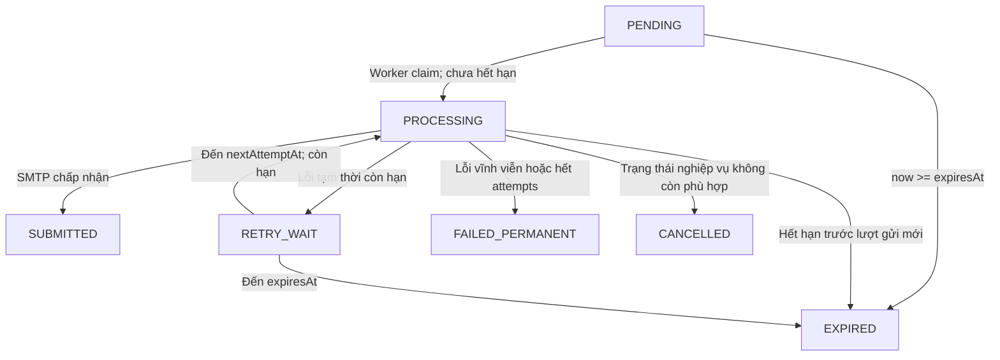
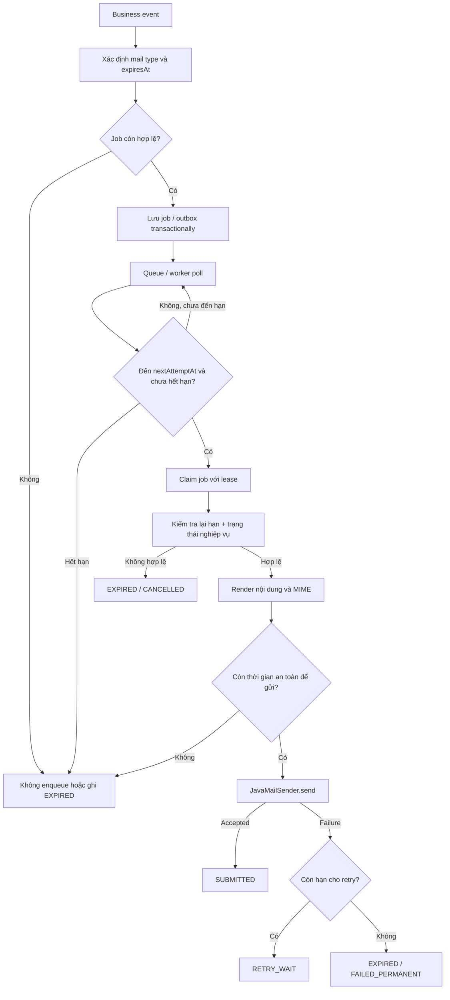

# Thời hạn hết hiệu lực của email trong cơ chế retry và idempotency của Spring Framework Mail

Trong hệ thống gửi email bất đồng bộ, một yêu cầu gửi thư không nhất thiết được thực hiện ngay. Nó có thể nằm trong queue, chờ một worker rảnh, bị SMTP server giới hạn tốc độ hoặc phải retry sau lỗi mạng. Vì vậy, một email được tạo đúng vào thời điểm ban đầu vẫn có thể **không còn giá trị** khi worker thực sự chuẩn bị gửi.

Ví dụ:

- Mã OTP có hiệu lực ba phút, nhưng email chứa mã bị kẹt trong queue năm phút.
- Link đặt lại mật khẩu đã hết hạn trước khi SMTP phục hồi.
- Nhắc thanh toán hôm nay bị retry sang tuần sau, khi hóa đơn đã được thanh toán.
- Báo cáo “số liệu trong ngày” đến sau khi nội dung đã lỗi thời.
- Email xác nhận một thao tác đã bị hủy vẫn được gửi vì job retry không kiểm tra lại trạng thái nghiệp vụ.

**Thời hạn hết hiệu lực của email** là quy tắc xác định thời điểm sau đó hệ thống **không nên tiếp tục khởi tạo một lần gửi mới** cho mail job. Quy tắc này cần được áp dụng cùng retry, idempotency, queue và trạng thái nghiệp vụ. Nó không đồng nghĩa với việc xóa email đã nằm trong mailbox của người nhận, cũng không đồng nghĩa với thời gian giữ bản ghi trong database.

Trong Spring Framework Mail, `JavaMailSender` và `MimeMessageHelper` đảm nhiệm việc tạo/gửi thư, nhưng **không có một TTL nghiệp vụ tự động** áp dụng cho mọi message. Ứng dụng phải tự định nghĩa `expiresAt`, lưu nó cùng job và kiểm tra ở các ranh giới xử lý.

## 1. Phân biệt bốn loại thời hạn

Từ “email hết hạn” có thể chỉ nhiều sự kiện khác nhau. Không tách bạch chúng sẽ dẫn tới thiết kế retry sai.

| Khái niệm | Câu hỏi | Ví dụ |
|---|---|---|
| **Mail job expiry** | Đến lúc nào ứng dụng còn được phép bắt đầu gửi email này? | OTP email job hết hạn sau 2 phút |
| **Token/link expiry** | Đến lúc nào mã hoặc liên kết trong email còn sử dụng được? | Reset token hết hạn sau 15 phút |
| **Content freshness** | Đến lúc nào nội dung thư còn đúng về mặt nghiệp vụ? | Email nhắc giao hàng không còn phù hợp sau khi đơn bị hủy |
| **Storage retention** | Bản ghi job, log hoặc artifact được giữ bao lâu? | Giữ audit metadata 30 ngày |

Bốn loại thời hạn này có thể khác nhau.

Ví dụ, link tải hóa đơn có thể chỉ hiệu lực 24 giờ, nhưng email thông báo hóa đơn đã phát hành vẫn có thể được gửi sau nhiều giờ nếu nghiệp vụ yêu cầu. Khi người nhận nhấp link đã hết hạn, ứng dụng có thể cung cấp một luồng tạo link mới sau khi xác thực. Ngược lại, email chứa OTP có tuổi rất ngắn: gửi thư chứa một mã đã vô hiệu gần như không có ích.

### Ví dụ minh họa theo trục thời gian

```text
10:00  Người dùng yêu cầu OTP
       |---- Mail job cho phép gửi trong 2 phút ----|
       |----------- OTP có hiệu lực 3 phút ----------|

10:02  Job hết hạn: không khởi tạo lượt gửi mới
10:03  OTP hết hạn: mã không còn được xác thực
10:05  SMTP hoạt động lại: KHÔNG retry email OTP cũ
```

Việc đặt hạn gửi sớm hơn hạn sử dụng mã chừa thời gian cho network, provider và người dùng đọc thư. Tuy nhiên, một email được SMTP chấp nhận trước 10:02 vẫn có thể được phát đến mailbox sau 10:03; ứng dụng không điều khiển được toàn bộ hành trình delivery.

## 2. Vì sao TTL phải là quy tắc nghiệp vụ?

Không có TTL tối ưu cho tất cả các loại email. Quy định cần xuất phát từ ý nghĩa của nội dung:

| Loại email | Chiến lược thường phù hợp | Lý do |
|---|---|---|
| OTP đăng nhập | Hạn gửi rất ngắn; hết hạn thì bỏ job | Mã nhanh chóng mất giá trị |
| Reset password | Hạn gửi nhỏ hơn hoặc bằng token expiry, trừ khoảng đệm | Không gửi link đã vô hiệu |
| Xác nhận đăng ký | Hạn gửi theo hiệu lực của verification link | Link cần dùng được khi người nhận mở |
| Nhắc thanh toán | Hạn gửi gắn với ngày thanh toán và trạng thái hóa đơn | Tránh nhắc việc đã hoàn tất |
| Thông báo lịch hẹn | Hạn gửi trước giờ bắt đầu hoặc trước mốc nghiệp vụ | Tránh thông báo sau khi cuộc hẹn đã qua |
| Xác nhận đặt hàng | Thường giữ đủ lâu, kiểm tra trạng thái đơn | Đây có thể là thông tin cần lưu |
| Hóa đơn/chứng từ bắt buộc | Không tự ý bỏ chỉ vì chờ lâu; cần quy trình bù/retry | Có thể có yêu cầu pháp lý hoặc hợp đồng |
| Báo cáo định kỳ | Hạn theo kỳ báo cáo và độ mới của số liệu | Tránh gửi bản tổng hợp quá cũ |
| Marketing | Theo lịch chiến dịch và consent còn hiệu lực | Tránh gửi nội dung ngoài thời gian chiến dịch |

Các thời lượng trong sản phẩm phải do yêu cầu nghiệp vụ và chính sách an toàn quyết định. Ví dụ “OTP tối đa 2 phút trong queue” chỉ là cấu hình minh họa, không phải thông số bắt buộc của Spring hay SMTP.

**Không tự động đặt TTL 5 phút cho mọi email.** Nếu áp một hạn quá ngắn cho chứng từ, hệ thống có thể bỏ mất yêu cầu gửi quan trọng. Nếu đặt hạn quá dài cho OTP, hệ thống lại gửi thông tin không còn dùng được.

### Chính sách gồm nhiều điều kiện

Một mail job có thể hết hiệu lực vì:

1. Đã đến `expiresAt` tuyệt đối.
2. Token bảo mật trong thư không còn hợp lệ.
3. Trạng thái nghiệp vụ đã thay đổi, chẳng hạn đơn hàng bị hủy.
4. Người nhận đã yêu cầu mã mới khiến mã cũ bị thu hồi.
5. Chiến dịch hoặc consent không còn cho phép gửi.
6. Job đã vượt `maxAttempts` và chuyển sang trạng thái kết thúc.

Không phải điều kiện nào cũng biểu diễn được bằng một timestamp. `expiresAt` giải quyết hạn thời gian; các điều kiện còn lại thường cần **kiểm tra trạng thái hiện tại** trước khi gửi.

## 3. Dùng expiresAt tuyệt đối thay vì chỉ lưu TTL

Với một mail job bất đồng bộ, nên lưu thời điểm hết hiệu lực tuyệt đối, ví dụ ISO-8601 UTC:

```json
{
  "jobId": "mail-otp-00042",
  "type": "LOGIN_OTP",
  "createdAt": "2026-11-12T08:30:00Z",
  "notBefore": "2026-11-12T08:30:00Z",
  "expiresAt": "2026-11-12T08:32:00Z",
  "status": "PENDING",
  "attempts": 0
}
```

Các trường:

- `createdAt`: thời điểm job được tạo.
- `notBefore` hoặc `nextAttemptAt`: thời điểm sớm nhất được bắt đầu lần xử lý tiếp theo.
- `expiresAt`: thời điểm kể từ đó không được bắt đầu gửi mới.
- `attempts`: số lần xử lý/gửi đã thực hiện, tùy định nghĩa nhất quán của ứng dụng.
- `status`: trạng thái hàng đợi.

Tại thời điểm `now == expiresAt`, job được coi là **đã hết hạn**:

```java
boolean expired = !clock.instant().isBefore(job.expiresAt());
```

Quy tắc này tương đương `now >= expiresAt`. Dùng một quy tắc nhất quán ở nơi enqueue, claim, retry và worker.

### Vì sao không chỉ lưu Duration?

Nếu mỗi lần retry tính lại `now + Duration.ofMinutes(2)`, thời hạn liên tục bị kéo dài:

```text
10:00  tạo job, hạn dự kiến 10:02
10:01  retry 1: nếu đặt lại TTL thì hạn thành 10:03
10:02  retry 2: nếu đặt lại TTL thì hạn thành 10:04
10:04  retry 3: nội dung đã cũ nhưng job vẫn tiếp tục tồn tại
```

Hạn nghiệp vụ cần được xác định từ **sự kiện gốc hoặc thời điểm phát hành token**, không phải từ mỗi attempt. Retry chỉ cập nhật `nextAttemptAt` và `attempts`; nó không tự làm mới `expiresAt`.

### UTC, Instant và đồng hồ

Trong Java, sử dụng `Instant` để lưu thời điểm; nếu cần tính theo lịch địa phương, chuyển từ `ZonedDateTime` với timezone rõ ràng. Nên:

- Lưu timestamp theo UTC.
- Dùng `Clock` được inject để dễ kiểm thử.
- Đồng bộ đồng hồ giữa các worker/DB server bằng cơ chế time synchronization phù hợp.
- Không dùng chuỗi local time thiếu timezone để so sánh hạn.
- Tránh dùng `System.nanoTime()` cho hạn tuyệt đối; nó dành cho đo elapsed time trong cùng process.

Nếu sử dụng database `NOW()` để claim và Java `Clock.instant()` để kiểm tra lần cuối, sai lệch đồng hồ là một yếu tố phải cân nhắc. Có thể chọn DB làm nguồn thời gian ở các thao tác claim bền vững và có thêm biên an toàn trước khi gửi.

## 4. Mô hình trạng thái của một mail job

Trạng thái nên đủ rõ để phân biệt hoàn tất, hết hạn, lỗi tạm thời và lỗi vĩnh viễn:



Đây là một state machine minh họa, không phải trạng thái dựng sẵn của Spring Mail. Mỗi tổ chức có thể bổ sung `LEASED`, `UNKNOWN_SUBMISSION`, `DELIVERY_CONFIRMED` hoặc trạng thái riêng của provider.

| Trạng thái | Cần worker xử lý ngay? | Có được retry? |
|---|---:|---|
| `PENDING` | Có nếu đã đến `nextAttemptAt` và chưa hết hạn | Có |
| `PROCESSING` | Đang do worker giữ lease | Theo cơ chế phục hồi lease |
| `RETRY_WAIT` | Chưa, đến khi tới thời điểm retry | Có nếu còn hạn và attempts |
| `EXPIRED` | Không | Không, trừ khi tạo yêu cầu nghiệp vụ mới |
| `CANCELLED` | Không | Không, trừ khi có event mới |
| `FAILED_PERMANENT` | Không | Không tự động |
| `SUBMITTED` | Không | Không retry như job chưa gửi |

Nếu một request nghiệp vụ mới được tạo sau khi job cũ hết hạn, nó thường nên có **job ID, token và idempotency scope mới**, thay vì đổi trạng thái `EXPIRED` về `PENDING` và tái sử dụng dữ liệu cũ.

## 5. Kiến trúc tổng quát: kiểm tra hạn ở nhiều ranh giới

Một thiết kế vững chắc không chỉ kiểm tra hạn một lần khi tạo job. Job có thể chờ lâu hoặc thay đổi trạng thái giữa các bước.



Các ranh giới quan trọng:

1. **Enqueue:** tính hạn chính xác và loại job vốn đã không còn ý nghĩa.
2. **Poll/claim:** không lấy các job đã hết hạn để tốn worker slot.
3. **Trước render hoặc thao tác tốn kém:** bỏ job đã hết hạn hoặc bị hủy.
4. **Ngay trước lần gửi SMTP:** kiểm tra hạn lần cuối, tránh gửi MIME đã dựng quá lâu.
5. **Khi lên lịch retry:** không tạo attempt mới nếu attempt kế tiếp chắc chắn không còn hạn.
6. **Cleanup:** chuyển job quá hạn sang trạng thái kết thúc, đo metric và giữ audit theo retention.

Không thể bảo đảm chắc chắn email đến mailbox trước `expiresAt` bằng các kiểm tra trên; sau khi message được provider chấp nhận, hệ thống chỉ có thể theo dõi delivery/bounce khi provider hỗ trợ.

## 6. Chính sách thời hạn theo loại email

Có thể định nghĩa chính sách một cách có kiểu trong Java, thay vì rải `Duration.ofMinutes(...)` khắp code:

```java
package com.example.mail;

import java.time.Duration;

public enum MailKind {
    LOGIN_OTP,
    PASSWORD_RESET,
    ORDER_CONFIRMATION,
    APPOINTMENT_REMINDER,
    DAILY_REPORT,
    INVOICE
}

public final class MailExpiryPolicy {

    private MailExpiryPolicy() {
    }

    public static Duration maxQueueAge(MailKind kind) {
        return switch (kind) {
            case LOGIN_OTP -> Duration.ofMinutes(2);
            case PASSWORD_RESET -> Duration.ofMinutes(10);
            case ORDER_CONFIRMATION -> Duration.ofHours(24);
            case APPOINTMENT_REMINDER -> Duration.ofHours(2);
            case DAILY_REPORT -> Duration.ofHours(12);
            case INVOICE -> Duration.ofDays(7);
        };
    }
}
```

Đây là **chính sách minh họa**, không phải giá trị mặc định của Spring. Một hóa đơn có thể cần quy trình xử lý kéo dài hơn bảy ngày, hoặc không được tự động hết hạn theo quy định doanh nghiệp. Với ứng dụng thực tế, nên đưa các thời lượng vào cấu hình có kiểm soát/version và kiểm tra chúng theo loại mail.

### 6.1. Hạn cuối phải xét cả token, sự kiện và lịch nghiệp vụ

Ví dụ OTP token hết hạn lúc `tokenExpiresAt`, còn chính sách cho phép email chờ tối đa hai phút từ khi tạo:

```java
import java.time.Clock;
import java.time.Instant;
import java.time.Duration;

public final class ExpiryCalculator {

    public Instant forOtp(
            Instant jobCreatedAt,
            Instant tokenExpiresAt,
            Duration queueWindow,
            Duration recipientSafetyMargin) {

        Instant queueDeadline = jobCreatedAt.plus(queueWindow);
        Instant tokenDeadline = tokenExpiresAt.minus(recipientSafetyMargin);
        return queueDeadline.isBefore(tokenDeadline)
                ? queueDeadline
                : tokenDeadline;
    }
}
```

Quy tắc:

\[
\text{mailExpiresAt} = \min(\text{jobCreatedAt} + \text{queueWindow},\
\text{tokenExpiresAt} - \text{safetyMargin})
\]

Nếu giá trị tính ra không nằm sau thời điểm tạo job, không enqueue email. Ví dụ token chỉ còn vài giây mà phải mất thời gian render/gửi, việc gửi mã cũ sẽ gây trải nghiệm kém; có thể yêu cầu cấp token mới từ đúng luồng nghiệp vụ.

### 6.2. Hạn trước mốc sự kiện

Với reminder lịch hẹn bắt đầu lúc `appointmentStartsAt`, có thể chọn:

```java
Instant deadline = appointmentStartsAt.minus(Duration.ofMinutes(30));
```

Như vậy worker sẽ không gửi một email “còn 1 giờ nữa” khi cuộc hẹn đã bắt đầu. Nếu lịch hẹn bị đổi hoặc hủy, job cũ cần bị hủy hoặc được xác thực trạng thái trước gửi.

### 6.3. Nội dung có thời gian hiển thị khác

Nếu một báo cáo được tạo với dữ liệu chốt lúc 08:00 nhưng SMTP chỉ phục hồi lúc 23:00, hạn gửi có thể phụ thuộc vào thời điểm chốt dữ liệu và loại báo cáo. Không được tự đổi tiêu đề “Báo cáo hôm nay” thành một ngày mới mà vẫn dùng dữ liệu cũ.

Đối với email yêu cầu snapshot, nên lưu `contentVersion` hoặc `snapshotId` để retry dùng đúng thông tin đã được phát hành, thay vì render lại từ dữ liệu đã thay đổi mà không theo chính sách.

## 7. Lưu expiry trong một bảng job/outbox

Với mail giao dịch cần gửi đáng tin cậy sau restart, dùng bảng job hoặc transactional outbox. Ví dụ cấu trúc PostgreSQL:

```sql
CREATE TABLE mail_job (
    id               UUID PRIMARY KEY,
    idempotency_key  VARCHAR(160) NOT NULL UNIQUE,
    kind             VARCHAR(64) NOT NULL,
    status           VARCHAR(32) NOT NULL,
    recipient_id     VARCHAR(120) NOT NULL,
    payload_ref      VARCHAR(200) NOT NULL,
    created_at       TIMESTAMPTZ NOT NULL,
    next_attempt_at  TIMESTAMPTZ NOT NULL,
    expires_at       TIMESTAMPTZ NOT NULL,
    attempts         INTEGER NOT NULL DEFAULT 0,
    lease_owner      VARCHAR(120),
    lease_until      TIMESTAMPTZ,
    last_error_code  VARCHAR(80),
    submitted_at     TIMESTAMPTZ,
    CHECK (expires_at > created_at),
    CHECK (attempts >= 0)
);

CREATE INDEX idx_mail_job_due
    ON mail_job (next_attempt_at, created_at)
    WHERE status IN ('PENDING', 'RETRY_WAIT');

CREATE INDEX idx_mail_job_expiry
    ON mail_job (expires_at)
    WHERE status IN ('PENDING', 'RETRY_WAIT');
```

Schema minh họa; thực tế có thể lưu tenant ID, template version, token reference, priority, job lease token, provider message ID, lỗi và thời điểm retry sau cùng. `recipient_id` và `payload_ref` đại diện cho dữ liệu được quản lý có phân quyền, tránh nhúng secret/OTP trực tiếp vào bảng hoặc log khi không cần thiết.

### 7.1. Tại sao cần lưu expiresAt trong DB?

Nếu chỉ tính hạn trong RAM:

- Sau restart, worker mới không biết thời gian tạo/hạn ban đầu.
- Nhiều instance có thể áp dụng cấu hình TTL khác nhau khi triển khai rolling update.
- Retry có thể tự gia hạn sai do tạo lại đối tượng.
- Không thể tra cứu backlog đã hết hạn bằng SQL một cách rõ ràng.

Lưu `expires_at` như một timestamp bất biến khiến worker có thể lấy đúng hạn đã được quyết định lúc job được tạo.

### 7.2. Ghi job cùng transaction nghiệp vụ

Ví dụ khi tạo yêu cầu gửi email xác nhận:

```java
@Service
public class RegistrationService {

    private final RegistrationRepository registrationRepository;
    private final MailJobRepository mailJobRepository;
    private final Clock clock;

    public RegistrationService(
            RegistrationRepository registrationRepository,
            MailJobRepository mailJobRepository,
            Clock clock) {
        this.registrationRepository = registrationRepository;
        this.mailJobRepository = mailJobRepository;
        this.clock = clock;
    }

    @Transactional
    public void register(RegisterCommand command) {
        Registration registration = registrationRepository.save(
                Registration.from(command));

        Instant now = clock.instant();
        Instant expiry = now.plus(Duration.ofHours(1));
        mailJobRepository.save(MailJob.pending(
                registration.getId(),
                "registration-" + registration.getId(),
                now,
                expiry));
    }
}
```

`MailJob.pending(...)` là factory method do ứng dụng định nghĩa. Khi transaction rollback, cả registration và job cùng rollback. Khi commit, job tồn tại bền vững để worker xử lý.

Không gửi trực tiếp SMTP trong transaction này. SMTP không tham gia rollback của database; nên để worker xử lý mail sau khi transaction đã commit.

### 7.3. Idempotency key gắn với ý định gửi

`idempotency_key` có thể được tạo từ loại sự kiện và business aggregate, ví dụ `registration-<id>`. Unique constraint giúp cùng event không tạo nhiều mail job trùng trong cùng scope.

Tuy nhiên, không dùng một key bất biến cho mọi lần người dùng yêu cầu mã OTP mới. **Một lần phát hành OTP mới là một ý định nghiệp vụ mới**: nó cần token mới, expiry mới và idempotency key/sequence mới. Các lần retry của **cùng ý định** phải giữ nguyên key và expiry.

## 8. Chọn job còn hạn bằng truy vấn DB

Với nhiều worker, cần claim job an toàn trước khi gửi. PostgreSQL có thể dùng `FOR UPDATE SKIP LOCKED` để các worker không cùng chọn một bản ghi.

### 8.1. Ví dụ claim batch

```sql
WITH candidates AS (
    SELECT id
    FROM mail_job
    WHERE status IN ('PENDING', 'RETRY_WAIT')
      AND next_attempt_at <= NOW()
      AND expires_at > NOW()
    ORDER BY next_attempt_at, created_at
    FOR UPDATE SKIP LOCKED
    LIMIT 20
)
UPDATE mail_job AS job
SET status = 'PROCESSING',
    lease_owner = :worker_id,
    lease_until = NOW() + INTERVAL '2 minutes',
    attempts = attempts + 1
FROM candidates
WHERE job.id = candidates.id
RETURNING job.*;
```

Chạy câu lệnh trong **transaction ngắn** và commit trước khi bắt đầu SMTP submission. `SKIP LOCKED` giúp tránh chờ lock của worker khác, nhưng hệ thống vẫn cần cơ chế xử lý job `PROCESSING` khi worker crash. `lease_until` là một phần của cơ chế đó.

Không giữ database transaction mở trong suốt thời gian gửi SMTP, vì điều này làm lock, connection và transaction sống lâu theo network latency.

### 8.2. Đánh dấu job hết hạn

Một cleanup job có thể cập nhật những job đang chờ đã hết hạn:

```sql
UPDATE mail_job
SET status = 'EXPIRED',
    last_error_code = 'MAIL_DEADLINE_EXCEEDED'
WHERE status IN ('PENDING', 'RETRY_WAIT')
  AND expires_at <= NOW();
```

Nên lưu metric số job được expire, theo loại mail, và audit metadata tối thiểu cần thiết. Không nhầm việc đổi trạng thái `EXPIRED` với việc xóa dữ liệu vĩnh viễn: retention là một chính sách khác.

### 8.3. Job đã được claim nhưng worker xử lý lâu

Query claim chỉ bảo đảm job còn hạn **ở thời điểm claim**. Worker có thể mất vài phút tải dữ liệu, render PDF hoặc chờ SMTP quota. Vì vậy cần kiểm tra lại trong code ngay trước lần gửi.

Nếu một worker crash, `lease_until` có thể hết hạn. Cơ chế reaper hoặc worker khác cần xác định job còn hiệu lực không trước khi trả về `PENDING`. **Không hồi sinh job đã EXPIRED chỉ vì lease hết hạn.**

### 8.4. Tránh race giữa nhiều worker

Nếu worker A có lease hết hạn và worker B claim lại, A có thể vẫn sống và chuẩn bị gửi. Một kiểm tra `expiresAt` riêng lẻ không ngăn được hai worker cùng gửi.

Nên dùng lease token/fencing token thay đổi mỗi lần claim, cùng điều kiện cập nhật trạng thái:

```sql
UPDATE mail_job
SET status = 'SUBMITTED',
    submitted_at = NOW()
WHERE id = :job_id
  AND status = 'PROCESSING'
  AND lease_owner = :worker_id;
```

Điều kiện này giúp ngăn cập nhật sai bản ghi từ worker mất ownership; nhưng nếu có thể tái sử dụng `worker_id` qua nhiều lần claim, cần token duy nhất cho từng claim. Quan trọng hơn, **chặn cập nhật DB không có nghĩa có thể thu hồi một SMTP request đã được gửi**. Để giảm gửi trùng, worker phải kiểm tra còn quyền sở hữu job ngay trước send, chọn lease dài đủ, gia hạn lease khi xử lý lâu và kết hợp idempotency ở tầng downstream nếu được hỗ trợ.

## 9. Kiểm tra hạn trong Spring worker

Đoạn code dưới đây minh họa cách tách phần xử lý gửi khỏi transaction claim job. Các interface `MailJobStore`, `MailComposer` và `RetryPlanner` là hợp đồng do ứng dụng định nghĩa, không phải lớp có sẵn của Spring.

```java
package com.example.mail;

import java.time.Clock;
import java.time.Instant;
import org.springframework.mail.MailException;
import org.springframework.stereotype.Service;

@Service
public class MailJobProcessor {

    private final MailJobStore store;
    private final MailComposer composer;
    private final MailGateway gateway;
    private final RetryPlanner retryPlanner;
    private final Clock clock;

    public MailJobProcessor(
            MailJobStore store,
            MailComposer composer,
            MailGateway gateway,
            RetryPlanner retryPlanner,
            Clock clock) {
        this.store = store;
        this.composer = composer;
        this.gateway = gateway;
        this.retryPlanner = retryPlanner;
        this.clock = clock;
    }

    public void process(ClaimedMailJob job) {
        if (isExpired(job.expiresAt())) {
            store.markExpired(job.id(), job.leaseToken());
            return;
        }

        if (!store.isStillRelevant(job)) {
            store.markCancelled(job.id(), job.leaseToken());
            return;
        }

        try {
            // Render xong mới kiểm tra hạn sát thời điểm send.
            PreparedMail mail = composer.compose(job);

            if (isExpired(job.expiresAt())) {
                store.markExpired(job.id(), job.leaseToken());
                return;
            }

            // Kiểm tra lease/fencing token ngay trước side effect.
            if (!store.stillOwnsClaim(job.id(), job.leaseToken())) {
                return;
            }

            gateway.send(mail);
            store.markSubmitted(job.id(), job.leaseToken());
        } catch (MailException ex) {
            Instant now = clock.instant();
            retryPlanner.scheduleFailure(job, ex, now);
        }
    }

    private boolean isExpired(Instant expiresAt) {
        return !clock.instant().isBefore(expiresAt);
    }
}
```

Lưu ý về ví dụ:

- `ClaimedMailJob` chứa deadline bất biến và token ownership của claim.
- `isStillRelevant` kiểm tra trạng thái nghiệp vụ (ví dụ OTP đã thu hồi hay đơn đã bị hủy).
- `PreparedMail` đại diện cho message đã render; `MailGateway` bọc `JavaMailSender`.
- `store.markExpired`, `markCancelled`, `markSubmitted` cần là những transaction ngắn, cập nhật có điều kiện theo lease token.
- `composer.compose(...)` có thể ném exception ngoài `MailException`, chẳng hạn lỗi template; service thực tế cần phân loại những lỗi này.
- `store.stillOwnsClaim` cần xử lý race và lease expiration. Một phép đọc ownership đơn lẻ không tạo giao dịch nguyên tử với SMTP send; thiết kế phải chấp nhận giới hạn phân tán này.
- Nếu SMTP đã chấp nhận message nhưng `markSubmitted` thất bại, retry có thể gửi trùng. Idempotency và trạng thái không chắc chắn cần được quản lý ở mức job/provider.

### 9.1. MailGateway dựa trên JavaMailSender

Ví dụ adapter Spring Mail:

```java
package com.example.mail;

import jakarta.mail.MessagingException;
import jakarta.mail.internet.MimeMessage;
import java.nio.charset.StandardCharsets;
import org.springframework.mail.MailException;
import org.springframework.mail.javamail.JavaMailSender;
import org.springframework.mail.javamail.MimeMessageHelper;
import org.springframework.stereotype.Component;

@Component
public class SpringMailGateway implements MailGateway {

    private final JavaMailSender sender;

    public SpringMailGateway(JavaMailSender sender) {
        this.sender = sender;
    }

    @Override
    public void send(PreparedMail mail) throws MailException {
        MimeMessage message = sender.createMimeMessage();
        try {
            MimeMessageHelper helper = new MimeMessageHelper(
                    message, false, StandardCharsets.UTF_8.name());
            helper.setFrom(mail.from());
            helper.setTo(mail.to());
            helper.setSubject(mail.subject());
            helper.setText(mail.plainText(), false);
        } catch (MessagingException ex) {
            throw new IllegalStateException(
                    "Unable to assemble mail message", ex);
        }

        sender.send(message);
    }
}
```

`PreparedMail` là DTO do ứng dụng định nghĩa chứa `from`, `to`, `subject` và `plainText`. Với HTML, ảnh inline hoặc attachment, dùng `MimeMessageHelper` ở multipart mode phù hợp và đặt content từ template đã kiểm soát.

**Gateway không tự quyết định TTL.** Quyết định job có còn được gửi phải nằm ở coordinator/worker dựa trên metadata job và trạng thái nghiệp vụ. Điều này giúp cùng một gateway gửi được nhiều loại email có chính sách khác nhau.

### 9.2. Kiểm tra sát thời điểm gửi không phải bảo đảm delivery

Giả sử check thành công ở 10:01:59.900, job hết hạn lúc 10:02:00.000 và SMTP call bắt đầu ngay sau đó. Network handshake có thể kéo dài tới 10:02:10.00. Ứng dụng có thể tránh **khởi tạo** send sau hạn với mức kiểm tra tốt nhất, nhưng không thể dừng một message đã nộp vào SMTP sau khi thời hạn trôi qua.

Nếu cần chắc chắn token không hoạt động sau giờ hết hạn, hãy **thực thi expiry ở API xác thực token**, không chỉ ở mail worker. TTL của email là tối ưu hóa hành vi gửi; kiểm tra token expiry là ranh giới bảo mật thực sự.

## 10. Retry phải tôn trọng deadline ban đầu

Retry được thiết kế để vượt qua lỗi tạm thời như timeout mạng hoặc SMTP 4xx. Nhưng retry không nên tiếp tục vượt `expiresAt`.

### 10.1. Nguyên tắc tính nextAttemptAt

Giả sử:

- `expiresAt` = 10:02:00
- Lần gửi đầu thất bại lúc 10:01:45
- Backoff lần kế tiếp = 30 giây
- `nextAttemptAt` tính được = 10:02:15

Lần retry kế tiếp sẽ bắt đầu sau khi job đã hết hạn; không nên lập lịch retry đó.

```java
Instant nextAttemptAt = now.plus(backoff);

if (!nextAttemptAt.isBefore(job.expiresAt())) {
    store.markExpired(job.id(), job.leaseToken());
} else {
    store.scheduleRetry(
            job.id(),
            job.leaseToken(),
            nextAttemptAt);
}
```

Điều kiện phải dùng so sánh nghiêm ngặt `nextAttemptAt < expiresAt`. Nếu bằng hạn thì không còn thời gian để bắt đầu lượt gửi.

### 10.2. Ví dụ RetryPlanner

```java
package com.example.mail;

import java.time.Duration;
import java.time.Instant;

public final class RetryDecision {

    public static Instant nextAttempt(
            Instant now,
            Instant expiresAt,
            int attemptNumber,
            int maxAttempts) {

        if (attemptNumber >= maxAttempts) {
            return null; // Kết thúc do giới hạn số lần.
        }

        long seconds = Math.min(
                60L,
                5L * (1L << Math.min(attemptNumber - 1, 4)));
        Instant candidate = now.plusSeconds(seconds);

        return candidate.isBefore(expiresAt)
                ? candidate
                : null; // Không còn một retry hợp lệ trong deadline.
    }
}
```

Ví dụ giới hạn backoff tối đa 60 giây. Production nên có jitter để nhiều job không retry đồng loạt, cần phân biệt kết thúc do hết hạn với kết thúc do hết attempts và không retry lỗi vĩnh viễn. `attemptNumber` cần là số nguyên dương được kiểm soát bởi state machine.

### 10.3. Thứ tự ưu tiên khi kết thúc

Một policy rõ ràng:

1. Nếu giờ hiện tại đã vượt `expiresAt` → `EXPIRED`.
2. Nếu trạng thái nghiệp vụ đã hủy/đã xử lý → `CANCELLED`.
3. Nếu lỗi không thể retry → `FAILED_PERMANENT`.
4. Nếu hết `maxAttempts` trước hạn → `FAILED_PERMANENT` hoặc `RETRY_EXHAUSTED`.
5. Nếu backoff khiến lần kế tiếp tới sau hạn → `EXPIRED`.
6. Còn lại → `RETRY_WAIT` với `nextAttemptAt`.

Một job có thể vừa hết hạn vừa gặp lỗi gửi. Chọn quy tắc ưu tiên để metric và audit không mâu thuẫn. Không đánh dấu `SUBMITTED` chỉ vì đã lên lịch retry.

### 10.4. Timeout và deadline

Đặt connect/read/write timeout của SMTP để một worker không giữ job vô thời hạn. Ví dụ Spring Boot:

```yaml
spring:
  mail:
    host: ${SMTP_HOST}
    port: 587
    username: ${SMTP_USERNAME}
    password: ${SMTP_PASSWORD}
    properties:
      "[mail.smtp.auth]": true
      "[mail.smtp.starttls.enable]": true
      "[mail.smtp.connectiontimeout]": 5000
      "[mail.smtp.timeout]": 5000
      "[mail.smtp.writetimeout]": 5000
```

Các giá trị tính bằng mili giây và chỉ minh họa. Timeout SMTP không tự động lấy giá trị từ `expiresAt` của job. Hãy chọn timeout và deadline margin hợp lý; timeout quá ngắn có thể làm tăng lỗi mạng tạm thời. Cần xác nhận cấu hình TLS theo yêu cầu provider.

## 11. Kết hợp @Async và @TransactionalEventListener

Trong Spring, `@Async` và `@TransactionalEventListener(phase = AFTER_COMMIT)` thường được dùng để gửi email sau khi transaction nghiệp vụ commit:

```java
@Component
public class RegistrationMailListener {

    private final AsyncRegistrationMailService asyncMailService;

    @TransactionalEventListener(
            phase = TransactionPhase.AFTER_COMMIT)
    public void onRegistration(RegistrationCreatedEvent event) {
        asyncMailService.process(event.mailJobId());
    }
}

@Service
public class AsyncRegistrationMailService {

    @Async("mailExecutor")
    public void process(UUID jobId) {
        // Nạp job, kiểm tra expiresAt, lease, rồi gửi.
    }
}
```

Ý nghĩa:

- `AFTER_COMMIT` ngăn listener chạy nếu transaction gốc rollback.
- `@Async` chuyển công việc khỏi luồng request.
- Worker có thể đọc metadata expiry đã được lưu cùng job.

Tuy nhiên, listener sau commit và executor in-memory **không bảo đảm job được xử lý sau crash**. Nếu gửi mail quan trọng, bản ghi job/outbox phải tồn tại bền vững và có một worker polling độc lập. Khi đó listener AFTER_COMMIT chỉ là tín hiệu tăng tốc việc đánh thức worker, không phải nguồn dữ liệu duy nhất.

Khi dùng `@Async`, transaction context của thread gốc không tự truyền sang worker. Claim job, cập nhật retry/expired/submitted phải được thực hiện trong transaction mới ở tầng store/service.

## 12. Hạn gửi trên broker không thay thế hạn nghiệp vụ

Các hệ thống queue có thể có message TTL hoặc retention. Các tính năng này hữu ích, nhưng không thể thay thế hoàn toàn kiểm tra `expiresAt` trong mail job.

### RabbitMQ

RabbitMQ có thể cấu hình TTL cho message hoặc queue theo cơ chế broker. Khi TTL hết, message có thể bị loại bỏ hoặc dead-letter theo chính sách. Tuy nhiên:

- TTL ở broker chủ yếu áp dụng khi message đang chờ trong queue, không giải quyết message đã được consumer nhận và đang xử lý.
- Thời điểm message bị xóa/dead-letter có thể chịu ảnh hưởng từ cách queue quản lý expiration.
- Broker TTL không biết OTP còn hợp lệ hay đơn hàng đã bị hủy.
- Retry queue và main queue có thể có TTL khác nhau.

Vì vậy consumer vẫn phải kiểm tra deadline và trạng thái nghiệp vụ trước khi gửi. Nếu broker dead-letter job hết hạn, cần metric/audit để người vận hành phân biệt `EXPIRED` với `FAILED`.

### Amazon SQS

SQS có message retention và visibility timeout. Retention xác định thời gian message tồn tại trên queue; visibility timeout hỗ trợ việc message tạm ẩn khi consumer xử lý. Đây **không phải deadline nghiệp vụ** của email OTP.

Một message có retention vài ngày vẫn có thể đại diện cho một mail job chỉ có ích trong hai phút. Worker phải đọc `expiresAt` của payload hoặc metadata bền vững và bỏ job cũ.

### Kafka

Kafka lưu record theo retention của topic và consumer theo offset. Consumer lag cho biết vị trí đọc còn chậm so với topic, nhưng không tự vô hiệu hóa một mail job theo thời gian nghiệp vụ. Consumer cần so sánh timestamp deadline trước khi thực hiện side effect.

### Executor trong JVM

`ThreadPoolTaskExecutor` thường không có một TTL dành riêng cho từng `Runnable` mà tự bỏ task đúng theo hạn nghiệp vụ. `queueCapacity` chỉ giới hạn số tác vụ chờ, không quyết định nội dung nào còn hợp lệ. Do đó, worker phải kiểm tra expiry khi thực sự bắt đầu và sát thời điểm gửi.

### Bảng so sánh

| Cơ chế | Có tác dụng | Không thay thế được |
|---|---|---|
| Broker message TTL | Loại message cũ ở hàng đợi | Kiểm tra khi consumer đã nhận job |
| Queue retention | Giới hạn thời gian lưu message | Hạn có ý nghĩa của OTP/token |
| Visibility timeout / lease | Cho phép claim lại khi worker crash | Chặn email đã lỗi thời |
| Retry backoff | Giãn khoảng cách giữa attempts | Deadline bất biến của job |
| `expiresAt` trong job | Deadline theo nghiệp vụ | Xác thực token và delivery status |

## 13. Idempotency khi job hết hạn rồi có yêu cầu mới

Thời hạn và idempotency gắn với nhau nhưng giải quyết hai vấn đề khác nhau:

- **Expiry:** Có còn nên thực hiện ý định gửi này?
- **Idempotency:** Khi thực hiện lại cùng ý định, làm sao giảm nguy cơ tạo nhiều side effect?

### 13.1. Không gia hạn job cũ bằng retry

Ví dụ người dùng yêu cầu OTP lần 1:

```text
request-1 -> token A -> mail-job-A -> expires 10:02
```

Tới 10:03, người dùng yêu cầu OTP mới:

```text
request-2 -> token B -> mail-job-B -> expires 10:05
```

Mail-job-A phải hết hạn hoặc bị hủy. Retry của job A không được cập nhật `expiresAt` sang 10:05. Nếu API xác thực chỉ chấp nhận token B, việc gửi lại token A sau đó còn gây nhầm lẫn.

### 13.2. Idempotency key theo scope

Với một email xác nhận đơn hàng, key có thể dựa trên `orderId` + `eventType` + `eventVersion`. Nếu cùng event được publish hai lần, unique constraint ngăn tạo hai job.

Với OTP, key cần phân biệt mỗi lần phát hành mới. Có thể dùng `challengeId` hoặc `otpIssueId`, không dùng duy nhất user ID và mail type; nếu dùng một key chung cho mọi OTP của người dùng, một yêu cầu mới có thể bị coi nhầm là bản lặp của yêu cầu cũ.

### 13.3. Không có exactly-once SMTP phổ quát

Giả sử worker gửi SMTP thành công nhưng mất kết nối trước khi nhận kết quả, hoặc crash trước khi cập nhật job `SUBMITTED`. Một retry có thể tạo thư trùng, dù state machine và idempotency key ở database đã đúng.

Có thể giảm rủi ro bằng:

- Claim/lease có điều kiện và giới hạn worker đồng thời.
- Lưu `attemptId`, provider message ID khi có.
- Sử dụng API gửi email có idempotency key nếu provider cụ thể hỗ trợ.
- Đặt một Message-ID ổn định nếu kiến trúc cần truy vết, nhưng không giả định nó khiến SMTP tự loại bản gửi trùng.
- Thiết kế nội dung chịu được duplicate, chẳng hạn xác nhận một đơn hàng đã tồn tại.

Idempotency ở tầng job ngăn tạo/lấy job lặp không cần thiết, nhưng **không chứng minh người nhận sẽ chỉ nhận một email**.

## 14. Email đã nộp SMTP có thể “hết hạn” không?

Đây là ranh giới rất quan trọng:

```text
PENDING -> PROCESSING -> JavaMailSender.send() -> SMTP accepted
                                          |
                                          v
                                  Provider delivery queue
                                          |
                                          v
                                      Mailbox
```

Trước `JavaMailSender.send(...)`, ứng dụng kiểm soát việc có khởi tạo gửi hay không. Sau khi SMTP server chấp nhận message, email có thể nằm trong queue của provider, đi qua nhiều mail transfer agent hoặc đến inbox trễ.

Không có một API chung của Spring Mail để “thu hồi” một email đã được nộp vào SMTP. Các nhà cung cấp có thể có cơ chế riêng để hủy một số message chưa giao, nhưng không thể dựa vào đó như bảo đảm chung.

Vì vậy:

1. Không viết điều kiện bảo mật dựa trên việc người nhận chắc chắn nhận thư trước deadline.
2. Token phải hết hạn ở server khi được sử dụng.
3. Link có thể chuyển tới trang xác thực hoặc yêu cầu tạo link mới.
4. Trạng thái `SUBMITTED` không được biến về `EXPIRED` chỉ vì thời gian trôi qua, nếu điều đó làm mất dấu email đã nộp.
5. Có thể lưu thêm `contentExpiredAt` để thể hiện nội dung/token đã mất hiệu lực trong khi email đã được gửi.

Nếu email đã được submit trước hạn nhưng đến mailbox sau hạn, trạng thái đúng có thể là **submission succeeded, token expired**. Đừng sửa lịch sử thành “chưa gửi”.

## 15. Cách xử lý email chứa liên kết hoặc mã hết hạn

Đối với OTP và reset password, cần đặc biệt chú ý tính an toàn khi nội dung đến muộn.

### 15.1. Xác thực ở server

Ví dụ kiểm tra token:

```java
public boolean isTokenUsable(
        ResetToken token,
        Instant now) {
    return !token.isRevoked()
            && !token.isUsed()
            && now.isBefore(token.expiresAt());
}
```

Ngay cả khi email được gửi hoặc delivery xảy ra trước hạn, token đã hết hạn phải bị từ chối ở API xác thực. Không để email tự quyết định mã có còn hiệu lực.

### 15.2. Không để lộ OTP trong log/metric

Log có thể ghi `jobId`, loại email, thời điểm tạo, `expiresAt`, số attempts và mã lỗi ở mức tổng quát. Không ghi raw OTP, reset token, signed URL có secret hoặc body email chứa thông tin nhạy cảm.

Nếu payload được lưu ở outbox, mã hóa và giới hạn quyền đọc dữ liệu nhạy cảm. Với token một lần, cân nhắc lưu tham chiếu challenge thay vì raw token, đồng thời kiểm tra challenge vẫn còn hợp lệ khi worker gửi.

### 15.3. Khi người dùng yêu cầu mã mới

Luồng hợp lý có thể là:

1. Tạo challenge/token mới và ghi nhận trong transaction.
2. Thu hồi challenge trước theo chính sách.
3. Hủy các mail job chưa gửi liên quan đến challenge cũ.
4. Tạo mail job mới với `expiresAt` mới, không cập nhật deadline của job cũ.
5. Worker kiểm tra challenge ID còn được phép gửi trước khi gửi.

Ngay cả khi job cũ đã được SMTP chấp nhận, token cũ có thể bị thu hồi ở server. Nội dung email nên nêu rõ việc chỉ dùng mã mới nhất nếu sản phẩm áp dụng quy tắc đó.

## 16. Observability cho email hết hạn

Nếu hệ thống chỉ đo queue depth và SMTP success rate, job bị expire có thể biến mất khỏi queue mà không ai biết. Cần đo expiry như một kết quả xử lý riêng.

### Metric đề xuất

| Metric | Loại | Ý nghĩa |
|---|---|---|
| `mail.jobs.expired` | Counter | Số job bị kết thúc do quá hạn |
| `mail.jobs.expired.before_claim` | Counter | Hết hạn trong queue trước khi worker lấy |
| `mail.jobs.expired.before_send` | Counter | Hết hạn sau khi claim/render nhưng trước SMTP |
| `mail.jobs.cancelled` | Counter | Bị hủy do trạng thái nghiệp vụ |
| `mail.jobs.retry_skipped` | Counter | Không lập lịch retry do deadline |
| `mail.jobs.ready` | Gauge | Job còn hạn và đã đến lúc xử lý |
| `mail.jobs.oldest_ready_age` | Gauge | Tuổi job ready lâu nhất |
| `mail.jobs.submitted` | Counter | SMTP submission được chấp nhận |
| `mail.jobs.failed_permanent` | Counter | Lỗi vĩnh viễn hoặc hết attempts |
| `mail.jobs.time_to_expiry` | Timer/distribution | Khoảng thời gian còn lại khi job được claim |

Các tên trên là gợi ý convention. Trong Micrometer, có thể ghi:

```java
registry.counter(
        "mail.jobs.expired",
        "kind", job.kind().name(),
        "phase", "before_send")
        .increment();
```

Chỉ dùng tag có tập giá trị nhỏ như loại email, phase xử lý hoặc outcome. Không dùng `jobId`, email address, token, tenant ID tùy ý làm metric tag vì cardinality cao và nguy cơ lộ dữ liệu.

### Alert theo mức độ ảnh hưởng

Ví dụ:

- OTP expiration rate tăng đột biến trong năm phút.
- Job đã đến hạn gửi nhưng `oldest_ready_age` vượt SLO.
- SMTP throttling kéo dài khiến retry liên tục bị skip do expiry.
- Không có worker nào xử lý trong khi ready jobs tăng.
- Tỷ lệ `EXPIRED` cao ở một template/version cụ thể.

Đo cả queue depth và retry backlog. Một queue depth giảm có thể nghĩa là job được gửi thành công, nhưng cũng có thể vì chúng bị expire hàng loạt.

### Structured log tối thiểu

```json
{
  "event": "mail_job_expired",
  "jobId": "mail-00042",
  "mailKind": "LOGIN_OTP",
  "reason": "deadline_reached_before_send",
  "attempts": 2,
  "createdAt": "2026-11-12T08:30:00Z",
  "expiresAt": "2026-11-12T08:32:00Z"
}
```

Không cần log body email, token hoặc SMTP password để chẩn đoán một job hết hạn. Nếu có tracing, có thể liên kết request ID và job ID trong log/tracing có quyền truy cập phù hợp.

## 17. Kiểm thử deadline bằng Clock cố định

Test không nên phụ thuộc vào `Thread.sleep` để chờ một job hết hạn thật. Dùng `Clock.fixed` hoặc clock có thể điều chỉnh nhằm kiểm tra các mốc chính xác:

```java
import static org.junit.jupiter.api.Assertions.*;
import java.time.Clock;
import java.time.Instant;
import java.time.ZoneOffset;
import org.junit.jupiter.api.Test;

class ExpirationTest {

    @Test
    void jobExpiresExactlyAtDeadline() {
        Instant deadline = Instant.parse("2026-11-12T08:32:00Z");
        Clock atDeadline = Clock.fixed(
                deadline, ZoneOffset.UTC);

        boolean expired = !atDeadline.instant().isBefore(deadline);
        assertTrue(expired);
    }

    @Test
    void jobIsValidOneMillisecondBeforeDeadline() {
        Instant deadline = Instant.parse("2026-11-12T08:32:00Z");
        Clock before = Clock.fixed(
                deadline.minusMillis(1), ZoneOffset.UTC);

        assertTrue(before.instant().isBefore(deadline));
    }
}
```

Đây là test nhỏ cho quy tắc thời gian. Test processor cần mock các collaborator để xác nhận behavior:

| Kịch bản | Kết quả kỳ vọng |
|---|---|
| Job hết hạn trước khi claim | Không được claim/send, chuyển EXPIRED |
| Hết hạn trong lúc render | Không gọi SMTP |
| `now == expiresAt` | Đã hết hạn |
| Token bị thu hồi dù chưa hết giờ | CANCELLED, không gửi |
| Backoff vượt deadline | Không tạo retry mới |
| Backoff còn trong hạn | Lưu RETRY_WAIT đúng nextAttemptAt |
| SMTP accepted trước hạn | SUBMITTED, không chuyển EXPIRED theo thời gian |
| Provider timeout không rõ đã nhận hay chưa | Ghi nhận ambiguity và áp chính sách retry/idempotency |
| Worker mất lease | Không tự nhận quyền xử lý; tránh cập nhật sai job |
| Nhiều worker claim cùng lúc | Chỉ một worker sở hữu claim hợp lệ |
| Process restart | Job/outbox bền vững vẫn còn và được kiểm tra hạn lại |

### Test lựa chọn retry

```java
@Test
void doesNotRetryPastExpiry() {
    Instant now = Instant.parse("2026-11-12T08:31:45Z");
    Instant expiresAt = Instant.parse("2026-11-12T08:32:00Z");

    Instant next = RetryDecision.nextAttempt(
            now, expiresAt, 4, 5);

    assertNull(next); // Backoff sẽ nằm sau expiresAt.
}
```

Trong test tích hợp, có thể dùng SMTP sink như Mailpit thay vì SMTP thật. Chủ động gây delay, failure và retry để quan sát rằng không có send được gọi khi job đã hết hạn tại thời điểm worker kiểm tra. Không phát email đến người dùng thực trong test tự động.

## 18. Vấn đề đồng thời và khoảng cách giữa check với send

Với hệ thống phân tán, hai thao tác “kiểm tra còn hạn” và “gửi SMTP” không thể gom vào một database transaction nguyên tử:

```text
Worker                        Database               SMTP provider
  |                              |                         |
  |-- kiểm tra expiry ---------->|                         |
  |<-- còn hạn ------------------|                         |
  |                              |                         |
  |-- bắt đầu send --------------------------------------> |
  |                              |                 có thể delay
  |                              |                         |
  |<------------------------------------- accepted / error |
```

Giữa hai bước có thể trôi qua vài mili giây hoặc lâu hơn. Nếu deadline là yêu cầu rất nghiêm ngặt, hãy có một **submission safety margin**:

```java
Instant latestStart = job.expiresAt()
        .minus(Duration.ofSeconds(10));

boolean enoughTime = clock.instant().isBefore(latestStart);
```

Khoảng 10 giây là ví dụ; chọn theo SMTP duration P95/P99 và tính chất mail. Không xem margin này là bảo đảm delivery trước hạn.

### Khi worker đã gửi nhưng không nhận được ACK

Đây là tình huống khó nhất cho idempotency: server có thể đã nhận thư nhưng ứng dụng bị timeout. Không thể suy ra “chưa gửi” chỉ từ một network timeout. Cân nhắc:

- Ghi `UNKNOWN_SUBMISSION` hoặc kết quả attempt không chắc chắn.
- Dùng provider API có idempotency nếu phù hợp.
- Áp dụng chính sách retry theo loại email; OTP có thể không retry khi gần hết hạn.
- Không tự động gửi lại email nhạy cảm sau hạn.
- Truy vết provider events khi được cung cấp.

Đừng chạy một transaction DB dài quanh network call với kỳ vọng rollback sẽ “thu hồi” được email; SMTP không tham gia transaction đó.

## 19. Dọn dẹp job hết hạn và retention

Khi `expiresAt` trôi qua, nên chuyển trạng thái để job không tiếp tục được worker chọn. Nhưng việc xóa bản ghi, attachment hoặc raw payload là vấn đề riêng.

### Quy trình cleanup

1. Chọn job ở trạng thái chờ đã hết hạn.
2. Cập nhật `EXPIRED` bằng điều kiện trạng thái hiện tại.
3. Ghi metric và một audit event tối thiểu.
4. Đảm bảo worker không claim lại job.
5. Xóa hoặc ẩn payload nhạy cảm theo retention policy.
6. Giữ metadata cần thiết cho đối soát, giới hạn thời gian theo chính sách.

Không được xóa một job `PROCESSING` khi worker vẫn đang dùng artifact hoặc đã bắt đầu SMTP call mà không có cơ chế lease và trạng thái phù hợp. Cleanup cần phối hợp với ownership.

### Token revocation là một bước khác

Expiry của mail job không thay thế việc hết hạn hoặc thu hồi token. Ngược lại, token hết hạn không tự động cập nhật `mail_job.status` nếu chưa có worker/cleanup. Hai trạng thái nên độc lập nhưng có thể phối hợp:

```text
mail_job: EXPIRED
auth_token: EXPIRED hoặc REVOKED
```

Không giữ raw token trong mail job lâu hơn nhu cầu an toàn của sản phẩm. Nếu token cần bị hủy ngay khi người dùng yêu cầu lại, logic xác thực phải cập nhật ở hệ thống token, không chờ worker xử lý queue.

### Email pháp lý hoặc chứng từ

Đối với chứng từ cần lưu và gửi theo quy định, không nên coi “đến deadline thì bỏ hẳn” là lựa chọn mặc định. Có thể thay cách xử lý thành **escalate/alert/recreate approved content** sau khi job trễ quá SLA, hoặc lưu yêu cầu giao chứng từ trong một workflow riêng. Quy tắc phải do nghiệp vụ và yêu cầu pháp lý quyết định, không do framework mặc định.

## 20. Lỗi thiết kế thường gặp

| Lỗi | Hậu quả | Cách khắc phục |
|---|---|---|
| Chỉ tính TTL ở mỗi retry | Job cũ được gia hạn vô hạn | Lưu expiresAt từ yêu cầu gốc |
| Chỉ kiểm tra expiry khi enqueue | Job nằm queue quá hạn vẫn được gửi | Kiểm tra ở claim và ngay trước send |
| Dựa vào broker TTL để bảo vệ token | Message đã được consumer lấy vẫn có thể gửi | Kiểm tra deadline trong worker và API token |
| Dùng queue retention như mail expiry | Email cũ vẫn tồn tại hoặc bị xóa sai | Lưu business deadline riêng |
| Tính timestamp theo giờ local không timezone | Sai hạn khi server ở timezone khác | Dùng Instant UTC |
| Dùng `isAfter(expiresAt)` | Cho phép gửi đúng thời điểm bằng hạn | Dùng `!now.isBefore(expiresAt)` |
| Gia hạn expiry khi đổi trạng thái RETRY_WAIT | Retry kéo dài vượt ý định gốc | Không đổi expiresAt trong retry |
| Quên kiểm tra trạng thái nghiệp vụ | Email nhắc việc đã xong hoặc OTP đã bị thu hồi | Kiểm tra relevance trước send |
| Lấy JPA entity lazy trong worker sau commit | Lỗi lazy loading hoặc dữ liệu lệch | DTO snapshot hoặc truy vấn có transaction riêng |
| Gửi SMTP bên trong DB transaction dài | Lock/connection bị giữ theo network, rollback không thu hồi email | Tách claim, send, finalize |
| Dùng một key cho mọi lần phát OTP | Yêu cầu mã mới bị dedupe sai | Key theo từng challenge/token issuance |
| Retry vô hạn email bảo mật | Người dùng nhận nhiều link vô hiệu | Max attempts, expiry và terminal states |
| Đánh dấu SUBMITTED khi mới enqueue | Không phản ánh trạng thái gửi thực | Cập nhật sau SMTP accepted |
| Xóa job ngay khi hết hạn | Mất khả năng audit/debug hoặc race worker | Chuyển trạng thái, cleanup theo retention |
| Kết luận send thành công là delivered | Báo cáo sai trạng thái | Theo dõi provider delivery/bounce riêng |
| Worker mất lease vẫn gửi | Có thể gửi trùng | Claim token/fencing, kiểm tra lease, idempotency |
| Chỉ quan sát queue depth | Job expire hàng loạt nhưng queue giảm | Đo expired, cancelled và completion outcome |

## 21. Câu hỏi thường gặp

**Spring Framework Mail có hỗ trợ thuộc tính `mail.expire-after` mặc định không?** Không có một thuộc tính TTL nghiệp vụ chung cho `JavaMailSender`. Ứng dụng cần tự xác định deadline của job hoặc dùng queue/outbox có metadata expiry.

**Email đã gửi có thể bị tự xóa khỏi inbox sau khi hết hạn không?** Không theo cơ chế SMTP/Spring Mail thông thường. Thời hạn của job chỉ chặn lần gửi mới trước submission; nó không điều khiển email đã được giao vào mailbox.

**TTL của OTP email có nên bằng TTL của OTP token không?** Thường nên ngắn hơn để chừa thời gian cho submission và người dùng sử dụng. Dù vậy, token expiry vẫn phải được thực thi ở backend khi xác thực.

**Nếu job hết hạn đúng lúc worker bắt đầu thì sao?** Quy tắc đề xuất là `now >= expiresAt` thì không gửi. Kiểm tra sát thời điểm gửi và có thể dùng margin theo SLO.

**Nếu email đã gửi thành công nhưng token hết hạn trước lúc người nhận mở thì sao?** Token phải bị từ chối khi sử dụng. Nên cung cấp luồng yêu cầu mã/link mới; không coi việc SMTP success là gia hạn token.

**Retry có nên đặt lại `expiresAt` không?** Không đối với cùng một ý định gửi. Retry giữ deadline ban đầu; chỉ sự kiện nghiệp vụ mới mới nên tạo job/deadline mới.

**Nếu email là hóa đơn có cần hết hạn không?** Không có đáp án chung. Có thể áp SLA và escalation thay vì bỏ yêu cầu gửi. Phải theo quy định nghiệp vụ và pháp lý.

**Tại sao phải kiểm tra trạng thái nghiệp vụ ngoài expiry?** Vì một email có thể mất ý nghĩa trước khi đến hạn, ví dụ lịch hẹn bị hủy, đơn đã hoàn tiền hoặc OTP bị thay thế.

**`@Async` có tự bỏ task khi quá hạn không?** Không. Executor thực thi `Runnable` theo lịch và capacity; logic worker phải kiểm tra `expiresAt`.

**RabbitMQ message TTL có đủ không?** Không. Nó giúp dọn message đang chờ ở broker nhưng không thay thế kiểm tra khi consumer đã nhận job hoặc khi nội dung nghiệp vụ thay đổi.

**SQS retention có phải email expiry không?** Không. Retention kiểm soát thời gian lưu message trong queue, không quyết định nội dung OTP còn giá trị.

**Có nên tăng deadline nếu SMTP provider đang lỗi?** Không tự động. Với email khẩn cấp, bỏ job cũ khi quá hạn. Với email bắt buộc, chuyển sang quy trình escalation hoặc tạo yêu cầu hợp lệ mới theo chính sách.

**Email có thể bị gửi trùng dù dùng idempotency key không?** Có. SMTP có trường hợp đã chấp nhận message nhưng worker mất ACK trước khi cập nhật DB; retry có thể gây trùng. Dùng provider idempotency nếu có và thiết kế side effect chịu được duplicate.

**Có cần xóa dữ liệu sau khi job EXPIRED không?** Có thể cần theo retention/privacy policy, nhưng expiry và retention là hai chính sách riêng. Giữ audit metadata cần thiết và xóa payload nhạy cảm đúng hạn.

**Vì sao phải dùng `Clock` thay cho `Instant.now()` trực tiếp?** Inject Clock giúp viết test tại chính xác ranh giới deadline, tránh sleep và kiểm soát múi giờ/determinism.

**Cần metric nào để theo dõi hết hạn?** Ít nhất expired count theo loại mail, oldest ready age, retry skipped due to expiry, submission success/failure và queue depth. Đừng chỉ nhìn số job còn trong queue.

## 22. Tài liệu kỹ thuật liên quan

- **Spring Framework Mail:** `JavaMailSender`, `MimeMessageHelper`, `MailException` và SMTP submission.
- **Spring Task Execution:** `@Async`, `ThreadPoolTaskExecutor`, executor queues và rejection policy.
- **Spring Transaction Management:** `@Transactional`, `@TransactionalEventListener(AFTER_COMMIT)` và transactional outbox pattern.
- **Java Time API:** `Instant`, `Duration`, `Clock`, `ZonedDateTime`.
- **Spring Data JPA/JDBC:** repository, conditional update, optimistic locking và short transaction.
- **PostgreSQL:** `TIMESTAMPTZ`, `FOR UPDATE SKIP LOCKED` và batch claim patterns.
- **Micrometer / Spring Boot Actuator:** metrics về queue depth, expiry, retry và SMTP submission.
- **Broker documentation:** message TTL/retention, visibility timeout, acknowledgment và dead-letter policy của hệ thống đang dùng.

---

**Ghi nhớ:** thời hạn email là **deadline nghiệp vụ cho việc khởi tạo một lần gửi**, không phải cơ chế thu hồi thư đã submit. Hãy xác định `expiresAt` bất biến từ sự kiện gốc, lưu cùng job/outbox, kiểm tra ở bước enqueue, claim, trước SMTP và khi lập lịch retry; đồng thời kiểm tra token và trạng thái nghiệp vụ. `@Async`, broker TTL và retry không thay thế được các kiểm tra đó. Với email có yêu cầu độ tin cậy cao, kết hợp outbox bền vững, claim/lease, idempotency, metrics và chiến lược xử lý lỗi/expiry đúng loại email.
