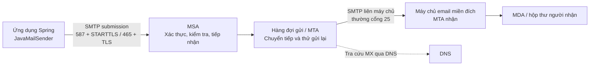
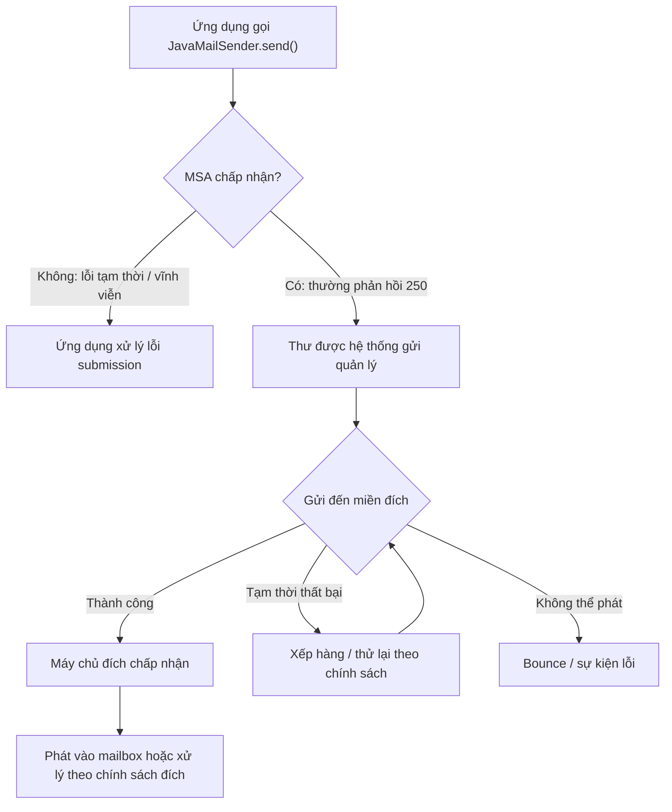

# Mail Submission Agent (MSA): tiếp nhận email từ ứng dụng

Khi một ứng dụng Spring gửi email xác nhận đăng ký, đặt lại mật khẩu hoặc thông báo giao dịch, ứng dụng không tự tìm máy chủ của từng người nhận để phát thư. Thông thường, nó kết nối đến **Mail Submission Agent (MSA)**: điểm tiếp nhận thư gửi đi từ các ứng dụng hoặc người dùng đã được cấp quyền. MSA xác thực bên gửi, kiểm tra chính sách và tiếp nhận thông điệp để hệ thống email tiếp tục chuyển phát.

Trong **Spring Framework Mail**, `JavaMailSender` đóng vai trò **SMTP client** nằm trong ứng dụng Java. MSA là dịch vụ SMTP ở phía hạ tầng email mà client kết nối tới. Phân biệt đúng hai vai trò này giúp cấu hình kết nối, bảo mật, xử lý lỗi và thiết kế cơ chế gửi email đáng tin cậy.

## 1. MSA nằm ở đâu trong kiến trúc email?

Một luồng gửi thư điển hình:



Các thành phần có trách nhiệm khác nhau:

| Thành phần | Vai trò chính | Ví dụ |
|---|---|---|
| Ứng dụng / SMTP client | Tạo nội dung thư, chọn người nhận, kết nối và gửi yêu cầu SMTP | `JavaMailSender` trong Spring |
| **MSA — Mail Submission Agent** | Tiếp nhận thư từ client được phép gửi; áp dụng chính sách gửi đi | Dịch vụ SMTP submission của tổ chức hoặc nhà cung cấp email |
| MTA — Mail Transfer Agent | Định tuyến, chuyển tiếp thư giữa các máy chủ, xếp hàng và thử lại khi cần | Máy chủ chuyển tiếp SMTP |
| MDA — Mail Delivery Agent | Đưa thư được chấp nhận vào hộp thư hoặc kho lưu trữ của người nhận | Thành phần phát thư nội bộ của máy chủ đích |

Một phần mềm hoặc nhà cung cấp có thể thực hiện **nhiều vai trò trên cùng một hệ thống**. Vì vậy, ranh giới MSA/MTA là ranh giới *chức năng*, không nhất thiết là hai máy chủ vật lý khác nhau.

Điểm cần nhớ: người dùng nhấn nút “Gửi mã xác minh” trong ứng dụng, Spring xây dựng email rồi **nộp thư** cho MSA; các bước chuyển phát về sau là trách nhiệm của hệ thống thư. MSA phục vụ thư **đi từ ứng dụng**, không phải dịch vụ nhận email để hiển thị trong inbox.

### Submission khác relay giữa các máy chủ

Trong thực tế có ba cổng SMTP thường gặp:

| Cổng | Ngữ cảnh | Cách bảo vệ kết nối |
|---|---|---|
| **587** | Message submission từ ứng dụng/client đến MSA | Kết nối SMTP rồi nâng cấp qua **STARTTLS**; thường có SMTP AUTH |
| **465** | Message submission với TLS ngay từ khi kết nối | **Implicit TLS**; thường có SMTP AUTH |
| **25** | Chuyển thư SMTP giữa các MTA | Chính sách TLS và xác thực phụ thuộc quan hệ giữa các máy chủ |

Khi cấu hình một ứng dụng gửi email ra ngoài, hãy dùng **cổng submission do nhà cung cấp chỉ định**, thường là 587 hoặc 465. Không xem cổng 25 như lựa chọn mặc định để ứng dụng gửi trực tiếp đến từng tên miền nhận.

## 2. MSA làm gì khi ứng dụng nộp một thư?

MSA là “cửa vào” của hệ thống gửi thư. Tùy tổ chức hoặc nhà cung cấp, nó có thể thực hiện các công việc sau:

1. **Thiết lập phiên SMTP an toàn.** MSA công bố khả năng qua `EHLO`, đàm phán STARTTLS hoặc chấp nhận kết nối TLS ngay từ đầu.
2. **Xác thực client.** MSA có thể yêu cầu SMTP AUTH bằng tài khoản, mật khẩu ứng dụng hoặc cơ chế token do nhà cung cấp hỗ trợ. Đây là xác thực *ứng dụng được phép gửi*.
3. **Ủy quyền người gửi.** MSA có thể kiểm tra tài khoản vừa xác thực có quyền gửi với địa chỉ `From` hoặc miền gửi được khai báo hay không.
4. **Kiểm tra thông điệp và người nhận.** Nó đánh giá cú pháp SMTP, giới hạn kích thước, số người nhận, tần suất gửi, chính sách chống lạm dụng và những điều kiện khác.
5. **Chấp nhận hoặc từ chối.** MSA trả mã phản hồi SMTP. Với thông điệp được chấp nhận, nó thường bàn giao cho hàng đợi hoặc thành phần chuyển tiếp của hệ thống.
6. **Cung cấp dấu vết vận hành.** Hệ thống có thể gắn mã hàng đợi, ghi sự kiện tiếp nhận, từ chối hoặc kết quả gửi tiếp; phạm vi quan sát tùy nhà cung cấp.

Không phải mọi MSA đều tự ký DKIM, tự xử lý bounce hay tự quản lý toàn bộ hàng đợi. Các chức năng này có thể nằm ở tầng MTA, dịch vụ ký thư hoặc nền tảng gửi email tích hợp.

**Ranh giới cam kết:** phản hồi `250` sau bước `DATA` có nghĩa máy chủ đã **chấp nhận thư để xử lý tiếp**, *chưa có nghĩa* thư đã được đưa vào inbox của người nhận. Việc gửi đến máy chủ đích có thể mất thêm thời gian, bị từ chối về sau hoặc được xử lý thành bounce.

## 3. Những gì MSA nhận: SMTP envelope và nội dung email

Một email có hai lớp thông tin thường bị nhầm:

- **SMTP envelope**: địa chỉ gửi dùng cho quá trình vận chuyển (`MAIL FROM`), danh sách địa chỉ nhận (`RCPT TO`). Envelope phục vụ định tuyến và xử lý thư bị trả lại.
- **Message headers/body**: các trường hiển thị trong thư như `From:`, `To:`, `Cc:`, `Subject:` và phần nội dung MIME. Đây là dữ liệu được truyền trong `DATA`.

Ví dụ về một email thông báo:

```text
SMTP envelope:
  MAIL FROM:<bounces@example.com>
  RCPT TO:<lan@example.net>

Message data:
  From: "Ứng dụng Demo" <notifications@example.com>
  To: <lan@example.net>
  Subject: Xac nhan dang ky
  MIME-Version: 1.0
  Content-Type: text/plain; charset=UTF-8

  Cam on ban da dang ky.
```

Ở ví dụ này, địa chỉ nhận bounce (`bounces@example.com`) khác địa chỉ `From:` mà người đọc nhìn thấy (`notifications@example.com`). Hai địa chỉ có thể khác nhau vì phục vụ những mục đích khác nhau; chúng vẫn cần đáp ứng chính sách gửi thư và xác thực miền của hệ thống.

Không nên tự thêm một header `Return-Path:` để cố quyết định nơi nhận bounce. `Return-Path` liên quan đến envelope sender và thường được hệ thống phát thư cuối cùng ghi vào thư đã phát. Nếu cần thay đổi envelope sender khi dùng Jakarta Mail, phải tuân theo chính sách nhà cung cấp và cấu hình transport tương ứng; thay `From:` không luôn đồng nghĩa với việc đặt một địa chỉ bounce riêng.

Tương tự, `Bcc` có thể là một người nhận của SMTP envelope nhưng không được hiển thị như người nhận công khai trong bản thư đến. Đây là lý do không thể suy ra toàn bộ tập người nhận chỉ bằng cách nhìn trường `To:`.

## 4. Một phiên SMTP submission diễn ra thế nào?

Giả sử ứng dụng kết nối đến `smtp.example.com:587` và được yêu cầu STARTTLS cùng SMTP AUTH. Luồng tổng quát:

```mermaid
sequenceDiagram
    participant App as Spring / JavaMailSender
    participant MSA as MSA (submission)
    participant MTA as Hệ thống chuyển tiếp
    App->>MSA: Kết nối TCP, EHLO
    MSA-->>App: Công bố STARTTLS
    App->>MSA: STARTTLS
    MSA-->>App: 220 Ready
    Note over App,MSA: Thiết lập TLS; gửi EHLO lần nữa
    App->>MSA: SMTP AUTH
    MSA-->>App: 235 Xác thực thành công
    App->>MSA: MAIL FROM, RCPT TO, DATA
    MSA-->>App: 250 Đã chấp nhận thông điệp
    MSA->>MTA: Đưa thư vào luồng chuyển phát
    MTA-->>MSA: Kết quả xử lý tiếp theo
```

Một đoạn hội thoại SMTP đơn giản hóa (dòng `C:` là client, `S:` là server):

```smtp
C: EHLO app.example.com
S: 250-smtp.example.com
S: 250-STARTTLS
S: 250 SIZE 10485760
C: STARTTLS
S: 220 Ready to start TLS
   [Bắt tay TLS thành công; các lệnh tiếp theo đi trong kết nối mã hóa]
C: EHLO app.example.com
S: 250-smtp.example.com
S: 250 AUTH PLAIN LOGIN
C: AUTH [thông tin xác thực được lược bỏ]
S: 235 2.7.0 Authentication successful
C: MAIL FROM:<notifications@example.com>
S: 250 2.1.0 Sender OK
C: RCPT TO:<lan@example.net>
S: 250 2.1.5 Recipient OK
C: DATA
S: 354 End data with <CRLF>.<CRLF>
C: From: notifications@example.com
C: To: lan@example.net
C: Subject: Registration confirmation
C:
C: Your registration was successful.
C: .
S: 250 2.0.0 Accepted for delivery
```

Đây là **minh họa giao thức**, không phải bản ghi dùng để sao chép vào chương trình. Dữ liệu AUTH thực tế phải được thư viện và kết nối bảo mật xử lý; tránh ghi mật khẩu hoặc token vào log. MSA có thể không công bố `AUTH` trước khi phiên TLS được thiết lập, và khả năng SMTP cụ thể khác nhau giữa các nhà cung cấp.

Một vài chi tiết đáng chú ý:

- `EHLO` hỏi khả năng của máy chủ; sau STARTTLS cần `EHLO` lại vì các khả năng được công bố có thể thay đổi.
- `MAIL FROM` và `RCPT TO` cung cấp envelope. Một thư có thể có nhiều `RCPT TO`; một số người nhận có thể bị từ chối riêng.
- `DATA` chứa message headers và body theo định dạng email/MIME. Thư viện Jakarta Mail lo việc tạo định dạng này.
- MSA trả `354` để yêu cầu gửi dữ liệu và thường trả `250` sau khi nhận xong thông điệp được chấp nhận.
- Nếu thất bại tại một bước, ứng dụng cần dựa vào phản hồi và loại lỗi để quyết định có nên thử lại; không thể tự xem một kết nối TCP thành công là gửi thư thành công.

## 5. Spring Framework Mail kết nối đến MSA như thế nào?

Spring cung cấp API `MailSender`, `JavaMailSender`, `SimpleMailMessage` và `MimeMessageHelper`. Các API này giúp ứng dụng tạo và nộp email. Việc triển khai kết nối SMTP do Jakarta Mail và SMTP transport thực hiện; MSA vẫn là dịch vụ bên ngoài.

Với **Spring Boot 3.x/4.x**, dự án thường dùng Spring Boot Mail starter để có `JavaMailSender` được cấu hình từ thuộc tính `spring.mail.*`. Ví dụ Gradle:

```groovy
dependencies {
    implementation 'org.springframework.boot:spring-boot-starter-mail'
}
```

> Ví dụ Java bên dưới dùng namespace `jakarta.mail`, tương ứng các thế hệ Spring hiện đại. Dự án cũ sử dụng Spring Boot 2 / Spring Framework 5 thường có namespace `javax.mail`; không nên trộn hai bộ import.

### Cấu hình MSA qua `application.yml`

Với MSA yêu cầu STARTTLS trên cổng 587:

```yaml
spring:
  mail:
    host: ${MAIL_HOST}
    port: 587
    username: ${MAIL_USERNAME}
    password: ${MAIL_PASSWORD}
    properties:
      "[mail.smtp.auth]": true
      "[mail.smtp.starttls.enable]": true
      "[mail.smtp.starttls.required]": true
      "[mail.smtp.ssl.checkserveridentity]": true
      "[mail.smtp.connectiontimeout]": 5000
      "[mail.smtp.timeout]": 10000
      "[mail.smtp.writetimeout]": 10000

app:
  mail:
    from: ${MAIL_FROM}
```

Ý nghĩa những cấu hình quan trọng:

| Thuộc tính | Tác dụng |
|---|---|
| `spring.mail.host` và `port` | Địa chỉ của MSA và cổng submission |
| `username`, `password` | Danh tính SMTP AUTH nếu MSA yêu cầu |
| `mail.smtp.auth` | Bật SMTP AUTH |
| `mail.smtp.starttls.enable` | Cho phép nâng cấp kết nối SMTP lên TLS |
| `mail.smtp.starttls.required` | Yêu cầu STARTTLS; báo lỗi nếu không thể thiết lập |
| `mail.smtp.ssl.checkserveridentity` | Kiểm tra tên máy chủ trên chứng chỉ TLS |
| Các timeout | Giới hạn thời gian kết nối, chờ đọc và chờ ghi để tránh treo quá lâu |
| `app.mail.from` | Địa chỉ gửi hiển thị, cần được MSA/nhà cung cấp cho phép |

Tên miền và thông tin đăng nhập do nhà cung cấp SMTP cấp. Các giá trị `MAIL_*` nên được lấy từ biến môi trường hoặc hệ thống quản lý bí mật. Không đưa mật khẩu thật vào mã nguồn, log hoặc file cấu hình được commit.

Nếu nhà cung cấp yêu cầu **implicit TLS trên cổng 465**, chuyển sang `port: 465` và bật `"[mail.smtp.ssl.enable]": true`; không dùng cấu hình STARTTLS của ví dụ cổng 587 làm công thức chung cho cả hai chế độ. Nếu nhà cung cấp dùng OAuth2 hoặc cơ chế khác, chỉ khai báo username/password theo ví dụ trên có thể chưa đủ: cần cấu hình cơ chế xác thực do họ hỗ trợ.

### Viết dịch vụ gửi thông báo

```java
package com.example.notification;

import jakarta.mail.MessagingException;
import jakarta.mail.internet.MimeMessage;
import java.nio.charset.StandardCharsets;
import org.springframework.beans.factory.annotation.Value;
import org.springframework.mail.javamail.JavaMailSender;
import org.springframework.mail.javamail.MimeMessageHelper;
import org.springframework.stereotype.Service;

@Service
public class NotificationMailService {
    private final JavaMailSender mailSender;
    private final String fromAddress;

    public NotificationMailService(
            JavaMailSender mailSender,
            @Value("${app.mail.from}") String fromAddress) {
        this.mailSender = mailSender;
        this.fromAddress = fromAddress;
    }

    public void sendWelcomeEmail(String recipient, String displayName) {
        try {
            MimeMessage message = mailSender.createMimeMessage();
            MimeMessageHelper helper = new MimeMessageHelper(
                    message, false, StandardCharsets.UTF_8.name());

            helper.setFrom(fromAddress);
            helper.setTo(recipient);
            helper.setSubject("Chào mừng bạn");
            helper.setText(
                    "Xin chào " + displayName + ",\n"
                            + "Tài khoản của bạn đã được tạo thành công.",
                    false);

            mailSender.send(message);
        } catch (MessagingException ex) {
            throw new IllegalStateException(
                    "Không thể tạo thông điệp email", ex);
        }
    }
}
```

Khi `mailSender.send(message)` chạy, Spring/Jakarta Mail gửi thông điệp đến **MSA đã cấu hình**. Lệnh này thường thực hiện đồng bộ trong lời gọi hiện tại. Nếu MSA chấp nhận, phương thức có thể kết thúc thành công ngay cả khi người nhận chưa thấy thư. Nếu quá trình xác thực hoặc submission thất bại, Spring có thể ném các ngoại lệ thuộc họ `MailException` (ví dụ lỗi xác thực hoặc gửi); `MessagingException` trong ví dụ trên chỉ xử lý lỗi lúc dựng `MimeMessage`.

Trong ứng dụng thực tế, nên tách địa chỉ `From` và nội dung thư khỏi controller; kiểm tra địa chỉ người nhận, không ghép trực tiếp dữ liệu người dùng vào HTML chưa được escape, và dùng mẫu thư có kiểm soát cho các trường hợp như OTP hoặc thông báo bảo mật.

### Trường hợp chỉ gửi văn bản đơn giản

`JavaMailSender` cũng có thể gửi `SimpleMailMessage`:

```java
SimpleMailMessage message = new SimpleMailMessage();
message.setFrom("notifications@example.com");
message.setTo("lan@example.net");
message.setSubject("Thông báo");
message.setText("Tác vụ của bạn đã hoàn tất.");
mailSender.send(message);
```

`SimpleMailMessage` thích hợp cho nội dung text đơn giản; `MimeMessage` hữu ích khi cần HTML, nhiều phần MIME, tệp đính kèm hoặc cấu hình header phức tạp. Cả hai đều nộp thư qua cùng hạ tầng MSA.

## 6. Điều gì xảy ra sau khi MSA trả lời “đã chấp nhận”?

Đây là phần quan trọng khi thiết kế luồng nghiệp vụ: **submission thành công không tương đương delivery thành công**.



Nên dùng từ ngữ trạng thái chính xác:

| Trạng thái nghiệp vụ | Điều có thể khẳng định |
|---|---|
| `PENDING` | Ứng dụng đã ghi nhận yêu cầu gửi |
| `SUBMITTING` | Worker đang giao tiếp với SMTP client/MSA |
| `SUBMITTED` | MSA đã chấp nhận submission |
| `DELIVERED` | Chỉ gán khi có bằng chứng phát thư từ nhà cung cấp hoặc phía đích, với ý nghĩa theo nhà cung cấp |
| `BOUNCED` / `FAILED` | Có tín hiệu thư bị trả lại hoặc không thể tiếp tục phát |

Đối với ứng dụng có độ tin cậy cao, có thể đưa yêu cầu gửi vào **job queue hoặc transactional outbox**. Nghiệp vụ ghi dữ liệu và bản ghi outbox cùng giao dịch; worker đọc outbox, nộp thư lên MSA rồi cập nhật kết quả. Điều này giúp xử lý sự cố mạng và tránh làm request HTTP của người dùng chờ SMTP quá lâu.

Tuy nhiên, SMTP **không đảm bảo gửi đúng một lần**. Nếu MSA đã nhận thư nhưng kết nối mất ngay trước khi ứng dụng đọc phản hồi `250`, ứng dụng không thể chắc chắn đã submission thành công. Gửi lại có thể tạo thư trùng. Với thư nhạy cảm (OTP, hóa đơn, giao dịch), cần chiến lược phù hợp: lưu mã tác vụ, kiểm soát số lần gửi, ghi nhận mã thông điệp/trạng thái nhà cung cấp khi có và chấp nhận rằng khóa idempotency nội bộ không tự khiến SMTP loại bỏ bản sao.

### Lỗi tạm thời và lỗi vĩnh viễn

Mã SMTP bắt đầu bằng **4xx** thường biểu thị lỗi tạm thời (ví dụ server bận hoặc giới hạn tạm thời); **5xx** thường biểu thị lỗi vĩnh viễn hoặc từ chối theo chính sách. Không nên retry vô hạn mọi lỗi như nhau.

| Hiện tượng | Nguyên nhân thường gặp | Hướng xử lý |
|---|---|---|
| Không kết nối được / timeout | Sai host, port, DNS, firewall, MSA không phản hồi | Kiểm tra endpoint và mạng; retry có giới hạn nếu là lỗi tạm thời |
| STARTTLS thất bại | Sai chế độ TLS/cổng, chứng chỉ hoặc chính sách TLS | Đối chiếu tài liệu MSA, xử lý nguyên nhân TLS; không tắt kiểm tra chứng chỉ để “chạy được” |
| `535` hoặc lỗi SMTP AUTH | Sai thông tin đăng nhập, cơ chế AUTH bị vô hiệu hoặc không được phép | Kiểm tra tài khoản, secret, quyền và loại xác thực |
| `550 5.7.1` | Có thể là địa chỉ `From` không được phép, relay bị từ chối hoặc vi phạm chính sách | Đọc phản hồi chi tiết và kiểm tra quyền gửi |
| `550 5.1.1` | Có thể là địa chỉ nhận không tồn tại | Sửa hoặc loại bỏ địa chỉ nhận sai; thường không retry nguyên trạng |
| `421` / `451` | Máy chủ tạm thời không phục vụ, quá tải hoặc hoãn xử lý | Thử lại với backoff và giới hạn |
| MSA trả `250` nhưng người dùng không nhận được | Thư còn trong hàng đợi, bị từ chối ở chặng sau, vào spam hoặc xử lý khác | Tra log/mã thư của nhà cung cấp, sự kiện delivery/bounce và cấu hình miền |

Mã ở bảng là **ví dụ phổ biến**, không đủ để kết luận duy nhất một nguyên nhân. Khi nhiều người nhận nằm trong một giao dịch SMTP, kết quả còn có thể khác nhau theo từng `RCPT TO` và chính sách gửi một phần của thư viện/nhà cung cấp.

## 7. Bảo mật và uy tín của miền gửi

MSA tiếp nhận thư từ ứng dụng có khả năng bị lạm dụng nếu thiếu kiểm soát. Cấu hình sản xuất cần đặc biệt quan tâm đến:

- **TLS đúng chế độ và xác minh chứng chỉ.** Với 587, yêu cầu STARTTLS; với 465, sử dụng implicit TLS. Không sử dụng tùy chọn tin cậy mọi chứng chỉ trong sản xuất.
- **SMTP AUTH và phân quyền.** Dùng tài khoản/danh tính riêng cho môi trường và ứng dụng khi có thể; cấp quyền gửi tối thiểu; giới hạn địa chỉ/miền `From` được phép.
- **Quản lý bí mật.** Đặt mật khẩu hoặc token trong secret manager/biến môi trường, có cơ chế thay đổi bí mật; không đưa payload thư chứa dữ liệu nhạy cảm vào log công khai.
- **Giới hạn lưu lượng.** Kiểm soát gửi OTP, email marketing, kích thước tệp, người nhận và tần suất để tránh spam, bị khóa tài khoản hoặc tăng chi phí.
- **Theo dõi sự kiện.** Ghi mã tác vụ nội bộ, loại thông báo, thời điểm gửi, kết quả submission và mã lỗi đã lọc dữ liệu nhạy cảm; tích hợp webhook/trạng thái nhà cung cấp nếu cần theo dõi delivery.

Phân biệt **xác thực SMTP client** với **xác thực danh tính miền email**:

| Cơ chế | Câu hỏi nó giúp trả lời |
|---|---|
| SMTP AUTH | Ứng dụng có được phép nộp thư đến MSA này không? |
| SPF | IP/máy chủ gửi có được miền liên quan ủy quyền gửi không? |
| DKIM | Thư có chữ ký mật mã hợp lệ của miền ký không và phần đã ký có bị thay đổi không? |
| DMARC | Danh tính miền trong `From:` có phù hợp với kết quả SPF/DKIM theo chính sách miền không? |

Một ứng dụng xác thực SMTP thành công vẫn có thể gặp vấn đề phát thư nếu DNS, SPF, DKIM, DMARC hoặc uy tín miền gửi chưa đúng. Việc thiết lập chữ ký DKIM và bản ghi DNS thường thuộc phần quản trị hệ thống gửi thư hoặc nhà cung cấp, không phải do `JavaMailSender` tự hoàn tất chỉ nhờ gọi `send()`.

## 8. Kiểm thử và quan sát đường đi của thư

Trong môi trường phát triển, có thể trỏ Spring đến một SMTP sink cục bộ như **Mailpit** để xem email trên giao diện kiểm thử mà không gửi ra Internet. Ví dụ với Mailpit đang lắng nghe SMTP tại `localhost:1025`:

```yaml
spring:
  mail:
    host: localhost
    port: 1025
    properties:
      "[mail.smtp.auth]": false
      "[mail.smtp.starttls.enable]": false
```

Cấu hình không xác thực/không TLS này chỉ phù hợp với **dịch vụ giả lập được kiểm soát trong môi trường local**. Khi kiểm tra tích hợp với MSA thật, dùng tài khoản sandbox hoặc miền gửi được cấp phép, kiểm tra cả submission thành công, từ chối AUTH, từ chối sender, lỗi kết nối và giới hạn tần suất.

Khi điều tra một email chưa đến người nhận, xác định chính xác chặng bị lỗi:

1. **Ứng dụng có tạo yêu cầu gửi không?** Kiểm tra job/outbox, địa chỉ đích và thông điệp lỗi từ Spring.
2. **MSA có nhận và chấp nhận thư không?** Kiểm tra log SMTP/phản hồi lúc submission; ghi mã queue hoặc mã provider nếu có.
3. **Hệ thống chuyển tiếp có giao thư đến máy chủ đích không?** Đọc sự kiện hoãn, bounce, chặn theo chính sách và trạng thái nhà cung cấp.
4. **Máy chủ đích xử lý thế nào?** Kiểm tra mailbox, spam/quarantine, phản hồi máy chủ đích và dấu vết delivery có thể truy cập.

Đi theo từng chặng sẽ tránh kết luận sai rằng “`mailSender.send()` không ném exception” đồng nghĩa với “người dùng chắc chắn đã nhận email”.

## 9. Một số câu hỏi thường gặp

**Spring Framework có cung cấp MSA không?** Không. Spring Mail cung cấp API gửi email, như `JavaMailSender`; MSA là máy chủ/dịch vụ SMTP mà ứng dụng cấu hình kết nối đến. Nếu tổ chức vận hành MSA riêng, đó là một thành phần hạ tầng độc lập.

**Có nhất thiết phải dùng SMTP không?** Không. Một số nền tảng gửi email cung cấp HTTP API. Nếu ứng dụng dùng API đó, đường tích hợp không đi qua `JavaMailSender`/SMTP submission, dù nền tảng vẫn thực hiện các công việc tiếp nhận và chuyển phát tương tự ở phía sau.

**MSA có lưu thư vào inbox của người nhận không?** Thông thường không. MSA xử lý cửa vào của thư gửi đi; việc chuyển tiếp thuộc MTA và việc đưa vào hộp thư thuộc hạ tầng phía nhận.

**MSA chấp nhận thư thì có thể báo cho người dùng “email đã gửi” không?** Có thể báo “yêu cầu gửi email đã được tiếp nhận” hoặc “email đã được chuyển vào hệ thống gửi”. Nếu UI cần khẳng định email **đã phát đến máy chủ/hộp thư đích**, hãy dựa vào sự kiện delivery phù hợp thay vì chỉ dựa trên phản hồi SMTP submission.

**Ứng dụng nên chọn một MSA hay gửi thẳng đến MX của người nhận?** Trong đa số ứng dụng Spring, MSA được cấp quyền, có TLS, authentication và cơ chế quản lý lưu lượng là điểm kết nối phù hợp. Nó tập trung chính sách gửi và giúp ứng dụng không phải tự vận hành toàn bộ quy trình chuyển phát SMTP giữa các miền.

---

**Mô hình cần ghi nhớ:** `Ứng dụng Spring → JavaMailSender/Jakarta Mail → SMTP submission → MSA → MTA → máy chủ nhận → hộp thư`. Spring chịu trách nhiệm tạo và nộp thông điệp; MSA chịu trách nhiệm kiểm soát việc tiếp nhận; trạng thái được MSA chấp nhận và trạng thái phát thư tới người nhận là hai mốc khác nhau.
