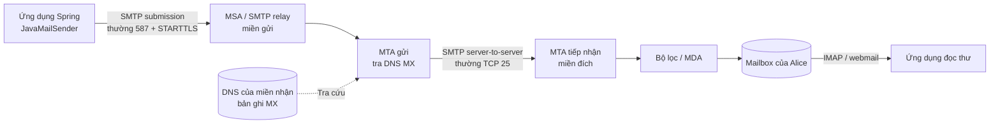

# Mail Transfer Agent (MTA): Định tuyến thư giữa các miền

Khi ứng dụng Spring gửi email đến một địa chỉ thuộc miền khác, thông điệp thường không đi thẳng từ ứng dụng đến hộp thư của người nhận. Nó được chuyển qua một hoặc nhiều **Mail Transfer Agent (MTA)**, là các máy chủ chịu trách nhiệm nhận thư qua SMTP, xác định nơi chuyển tiếp, xếp hàng khi cần và bàn giao thư cho máy chủ tiếp theo. Bài học này tập trung vào cách MTA **định tuyến email giữa các miền** và làm rõ phần trách nhiệm của Spring Framework Mail trong chuỗi đó.

Giả sử `notification@shop.example` gửi thông báo đến `alice@company.example`. Ứng dụng Spring có thể giao thông điệp cho máy chủ SMTP của nhà cung cấp. Sau đó, MTA phía gửi tra cứu thông tin DNS của `company.example`, kết nối đến MTA tiếp nhận của miền này và chuyển thư bằng SMTP. Việc `JavaMailSender.send(...)` trả về thành công chỉ cho biết máy chủ SMTP mà ứng dụng kết nối đã chấp nhận thao tác gửi ở thời điểm đó; nó **không bảo đảm** người nhận đã nhận hoặc đọc email.

## 1. MTA đứng ở đâu trong kiến trúc email?

Để hiểu đúng đường đi của thư, cần phân biệt các vai trò:

| Thành phần | Trách nhiệm chính | Ví dụ |
| --- | --- | --- |
| **MUA (Mail User Agent)** | Soạn, gửi hoặc đọc thư ở phía người dùng/ứng dụng | Ứng dụng email, ứng dụng Spring tạo thông báo |
| **MSA (Mail Submission Agent)** | Tiếp nhận thư do người dùng/ứng dụng gửi lên, thường xác thực và áp dụng chính sách gửi | SMTP submission của nhà cung cấp |
| **MTA (Mail Transfer Agent)** | Chuyển tiếp thư từ máy chủ này sang máy chủ khác, quyết định next hop và xử lý hàng đợi | Postfix, Exim, Sendmail |
| **MDA (Mail Delivery Agent)** | Đưa thư đã đến đích vào hộp thư hoặc kho lưu trữ của người nhận | Thành phần local delivery của hệ thống mail |
| **Mail store / mailbox** | Lưu email để người nhận truy cập | Hộp thư người dùng |
| **IMAP/POP3 server** | Cho phép ứng dụng đọc thư đã lưu | Dịch vụ IMAP/POP3 |

Các vai trò có thể được triển khai trên cùng một máy chủ hoặc nhiều dịch vụ riêng biệt. Một hệ thống email lớn còn có gateway chống spam, dịch vụ quét virus, bộ lọc nội dung và nhiều lớp chuyển tiếp nội bộ.



**Điểm then chốt:** Spring Framework Mail cung cấp API gửi email qua SMTP; việc tìm MTA nhận thư của một miền, chọn tuyến tiếp theo và quản lý hàng đợi thường do SMTP relay/MTA thực hiện. Spring không tự biến thành một MTA chỉ vì ứng dụng có thể gửi email.

### Submission khác gì với chuyển tiếp giữa hai MTA?

- **Submission:** ứng dụng gửi đến máy chủ SMTP đã cấu hình; phổ biến là cổng **587** với STARTTLS và SMTP AUTH. Cổng **465** dùng TLS ngay từ khi bắt đầu kết nối (implicit TLS), khi dịch vụ hỗ trợ.
- **Relay giữa các MTA:** MTA phía gửi kết nối đến MTA được quảng bá cho miền người nhận; phổ biến dùng cổng **25**. Việc xác thực thông thường dựa vào chính sách máy chủ và hệ thống xác thực miền, không mặc định dùng tài khoản đăng nhập như submission.
- **Truy cập hộp thư:** IMAP/POP3 hoặc webmail phục vụ việc đọc thư; chúng không đảm nhiệm việc MTA định tuyến thư đến miền khác.

## 2. Định tuyến dựa trên SMTP envelope, không dựa riêng vào header

Một email có **hai lớp địa chỉ** cần tách bạch:

1. **SMTP envelope:** địa chỉ người gửi ở lệnh `MAIL FROM` (reverse-path) và danh sách người nhận ở các lệnh `RCPT TO`. Đây là dữ liệu MTA dùng để chuyển thư và xử lý lỗi gửi.
2. **Message headers:** các trường `From:`, `To:`, `Cc:`, `Subject:`, `Date:`… là nội dung thông điệp mà ứng dụng thư hiển thị. Chúng không thay thế danh sách `RCPT TO`.

Ví dụ:

```text
SMTP envelope:
  MAIL FROM:<bounces@shop.example>
  RCPT TO:<alice@company.example>
  RCPT TO:<audit@shop.example>

Message headers:
  From: "Shop" <notification@shop.example>
  To: Alice <alice@company.example>
  Subject: Your order is ready
```

MTA phải xử lý hai người nhận theo **envelope** dù header `To:` chỉ hiển thị Alice. Vì vậy thư gửi bằng **Bcc** vẫn được định tuyến đến người nhận Bcc khi người đó có mặt trong `RCPT TO`; địa chỉ Bcc thường không xuất hiện trong header của bản thư được phát. Ngược lại, việc tự sửa nội dung `To:` trong một chuỗi ký tự không có nghĩa là đã thêm người nhận SMTP.

Địa chỉ `MAIL FROM` cũng có thể khác `From:`: dịch vụ gửi hàng loạt thường đặt địa chỉ nhận thông báo lỗi (bounce) ở envelope sender. Máy chủ phát cuối có thể thêm header `Return-Path:` phản ánh envelope sender. Đừng nhầm `Reply-To:` (nơi người dùng trả lời) với địa chỉ nhận bounce.

## 3. MTA tìm máy chủ nhận thư bằng DNS MX như thế nào?

Phần sau dấu `@` trong địa chỉ envelope của người nhận xác định **miền đích**. Với `alice@company.example`, miền đích là `company.example`. MTA gửi cần tra cứu DNS để tìm nơi nhận thư của miền đó.

Giả sử miền đích khai báo:

```dns
company.example.  IN MX 10 mx-primary.company.example.
company.example.  IN MX 20 mx-backup.company.example.

mx-primary.company.example. IN A 192.0.2.10
mx-backup.company.example.  IN A 192.0.2.20
```

Đây là tên miền và địa chỉ IP minh họa, không phải dịch vụ cần kết nối thực tế.

Mỗi bản ghi MX cung cấp:

- **Preference**: số ưu tiên; **số nhỏ hơn được ưu tiên trước** (10 trước 20).
- **Exchange**: tên máy chủ nhận mail. MTA tiếp tục phân giải tên máy chủ này thành địa chỉ IP bằng bản ghi A hoặc AAAA.

MTA thường thử tuyến có preference tốt hơn trước; nếu tuyến không thể kết nối hoặc không sử dụng được, nó có thể thử tuyến MX khác theo chính sách và trạng thái phiên gửi. Nhiều MX cùng preference cho phép phân phối tải; không nên hiểu thứ tự hiển thị của kết quả DNS là thứ tự bắt buộc. Một MX dự phòng không có nghĩa là thư được nhân bản sang cả hai máy chủ.

### Quy trình định tuyến ở mức khái niệm

```text
for each recipient domain in the SMTP envelope:
    if domain is handled locally:
        route according to local mail policy
    else:
        lookup MX records for domain
        if domain explicitly publishes Null MX:
            treat the domain as not accepting email
        else if MX records exist:
            select reachable MX hosts by preference and policy
            resolve their A/AAAA addresses
        else if domain exists and has address records:
            apply SMTP implicit-MX fallback to domain's A/AAAA
        else:
            fail or defer according to DNS result and retry policy

        establish SMTP connection to next hop
        attempt recipient and message transfer
        record success, permanent failure, or retryable failure
```

Đó là mô hình giải thích; thuật toán thực tế còn chịu ảnh hưởng bởi DNS cache, IPv4/IPv6, giới hạn kết nối, ưu tiên IPv6, giới hạn kích thước thư, chính sách TLS, cấu hình relay và quy tắc chống vòng lặp.

### Những trường hợp DNS cần nhớ

| Trạng thái DNS | Cách hiểu và hướng xử lý |
| --- | --- |
| Có một hoặc nhiều MX hợp lệ | Tra cứu máy chủ MX và thử theo preference/chính sách MTA |
| Không có MX, nhưng miền tồn tại và có A/AAAA | Quy tắc SMTP truyền thống cho phép coi chính miền là đích SMTP ngầm định (implicit MX) |
| MX có giá trị `0 .` (**Null MX**) | Miền tuyên bố **không nhận email**; không fallback sang A/AAAA để cố giao thư |
| Miền không tồn tại (NXDOMAIN) | Không có đích hợp lệ; thường dẫn tới lỗi gửi vĩnh viễn sau khi xác định kết quả DNS |
| DNS tạm thời lỗi (ví dụ timeout/SERVFAIL) | Có thể trì hoãn và thử lại; không đồng nghĩa với địa chỉ người nhận không tồn tại |
| MX chỉ đến tên máy chủ nhưng không có địa chỉ IP sử dụng được | Không thể kết nối theo tuyến đó; có thể thử MX khác hoặc tạm hoãn |

**Hai hiểu nhầm phổ biến:** MX là bản ghi **nhận** thư của một miền, không phải danh sách tài khoản email; và MX của miền gửi không quyết định ứng dụng Spring sẽ gửi vào SMTP relay nào. Relay đầu tiên là nơi ứng dụng cấu hình `spring.mail.host` (hoặc `JavaMailSenderImpl.setHost(...)`).

## 4. SMTP chuyển thư giữa hai MTA

Sau khi có địa chỉ máy chủ đích, MTA gửi thiết lập một phiên SMTP. Ví dụ rút gọn sau cho thấy hành vi cơ bản; mỗi dòng `C:` là phía gửi, `S:` là phía nhận:

```smtp
S: 220 mx-primary.company.example ESMTP ready
C: EHLO relay.shop.example
S: 250-mx-primary.company.example
S: 250-STARTTLS
S: 250 SIZE 52428800
C: STARTTLS
S: 220 Ready to start TLS

[TLS handshake hoàn tất; mở lại trao đổi SMTP bên trong TLS]

C: EHLO relay.shop.example
S: 250 mx-primary.company.example
C: MAIL FROM:<bounces@shop.example>
S: 250 2.1.0 Sender OK
C: RCPT TO:<alice@company.example>
S: 250 2.1.5 Recipient OK
C: DATA
S: 354 End data with <CRLF>.<CRLF>
C: From: Shop <notification@shop.example>
C: To: Alice <alice@company.example>
C: Subject: Your order is ready
C:
C: Hello Alice, your order is ready.
C: .
S: 250 2.0.0 Message queued for delivery
C: QUIT
S: 221 2.0.0 Bye
```

Lưu ý: trong SMTP thực tế, thông điệp là chuỗi octet với dòng kết thúc theo CRLF; dòng chỉ chứa dấu chấm kết thúc khối `DATA`. Nếu một dòng dữ liệu vốn bắt đầu bằng dấu chấm, SMTP sử dụng quy tắc **dot-stuffing** để không nhầm với dấu kết thúc. Đoạn minh họa bỏ qua nhiều extension và trường header để dễ theo dõi.

Các mốc có ý nghĩa:

1. **`EHLO`:** phía gửi giới thiệu tên và nhận danh sách khả năng SMTP (ESMTP extensions) mà phía nhận quảng bá.
2. **`STARTTLS` (nếu được hỗ trợ/chính sách yêu cầu):** nâng cấp kết nối sang TLS; sau khi thiết lập TLS, phía gửi gửi lại `EHLO` vì khả năng của phiên có thể thay đổi.
3. **`MAIL FROM`:** mở một giao dịch chuyển thư và xác định địa chỉ nhận thông báo lỗi.
4. **`RCPT TO`:** khai báo từng người nhận trong envelope. Máy chủ có thể chấp nhận một người nhận và từ chối người khác.
5. **`DATA`:** truyền headers và body. Phản hồi `250` sau `DATA` nghĩa là máy chủ nhận đã chấp nhận trách nhiệm xử lý tiếp ở mức SMTP.
6. **`QUIT`:** đóng phiên SMTP có trật tự.

Khi thư trải qua nhiều MTA, mỗi MTA nhận/chuyển tiếp thường bổ sung header `Received:`. Đọc chuỗi `Received:` từ dưới lên trên giúp hình dung đường đi qua các hop, nhưng dữ liệu header từ các hop không tin cậy có thể bị giả mạo; ưu tiên log và dấu vết từ hệ thống do mình quản lý.

## 5. Hàng đợi, retry, bounce và ý nghĩa mã SMTP

Giao thư giữa các miền không luôn xảy ra tức thì. MTA duy trì một **mail queue** để lưu thông điệp khi đích tạm thời không sẵn sàng. Đây là lý do kết nối SMTP không thành công ở lần đầu vẫn có thể dẫn đến phát thư thành công sau đó.

| Nhóm phản hồi | Ý nghĩa | Hành vi điển hình |
| --- | --- | --- |
| `2xx` (ví dụ `250`) | Thao tác SMTP được chấp nhận | Tiếp tục phiên hoặc xác nhận máy chủ tiếp theo đã nhận trách nhiệm |
| `3xx` (ví dụ `354`) | Cần gửi thêm dữ liệu | Truyền nội dung theo đúng trạng thái giao thức |
| `4xx` (ví dụ `421`, `450`, `451`) | Lỗi tạm thời | Giữ hàng đợi và thử lại theo lịch/giới hạn của MTA |
| `5xx` (ví dụ `550`, `554`) | Lỗi vĩnh viễn đối với thao tác hiện tại | Dừng gửi đến người nhận/tuyến bị từ chối và báo lỗi theo chính sách |

Ví dụ: MTA của `company.example` trả `451 Temporary local problem`. Relay phía gửi có thể giữ thư lại và thử sau vài phút hoặc theo backoff. Ngược lại, `550 User unknown` thường cho thấy người nhận bị từ chối vĩnh viễn; thử liên tục cùng địa chỉ không giải quyết được vấn đề.

Khi hết thời gian retry hoặc có lỗi vĩnh viễn, hệ thống có thể sinh **Delivery Status Notification (DSN)**, thường gọi là *bounce*, gửi về envelope sender. DSN tự phát nên dùng reverse-path rỗng `MAIL FROM:<>` để giảm nguy cơ tạo vòng lặp bounce. Không phải mọi thư bị từ chối đều tạo bounce: một số lỗi được báo trực tiếp lúc submission; một số thư bị lọc/bỏ theo chính sách; gửi bounce cho địa chỉ giả mạo cũng có nguy cơ tạo *backscatter*.

Phân biệt các trạng thái sau:

```text
Spring app gọi JavaMailSender.send()
         |
         v
SMTP relay chấp nhận thư             = submitted / accepted by relay
         |
         v
MTA giao thư sang miền nhận          = accepted by destination SMTP hop
         |
         v
MDA phát vào mailbox                 = delivered to mailbox
         |
         v
Người dùng mở thư                    = read/opened (không suy ra từ SMTP)
```

Phản hồi `250` của relay đầu tiên không chứng minh thư đã đến hộp thư. Ngay cả phản hồi `250` của MTA đích cũng có thể đi trước bước quét, kiểm duyệt và phát nội bộ.

### Các tình huống ảnh hưởng đến tuyến

- **Greylisting:** máy chủ nhận tạm từ chối lần thử đầu bằng `4xx`; MTA gửi hợp lệ sẽ retry sau.
- **Nhiều người nhận:** cùng một thông điệp có thể được chuyển thành nhiều giao dịch/tuyến theo miền; trạng thái phát của từng người nhận có thể khác nhau.
- **Forwarding:** miền nhận có thể chuyển thư đến một miền khác; phát sinh thêm hop, vòng lặp chuyển tiếp có thể bị phát hiện qua giới hạn hop và header.
- **Alias / mailing list:** đích có thể mở rộng thành nhiều địa chỉ nội bộ hoặc địa chỉ ngoài; kết quả của một địa chỉ không đại diện cho tất cả.
- **Giới hạn kích thước hoặc chính sách nội dung:** MTA có thể từ chối thư trước/sau `DATA`, hoặc chấp nhận rồi xử lý theo bộ lọc của hệ thống.

## 6. Độ tin cậy, xác thực và bảo mật khi chuyển thư

MTA không chỉ tìm đường. Máy chủ nhận còn quyết định có tin tưởng luồng gửi hay không. Các cơ chế dưới đây xử lý **những vấn đề khác nhau**:

| Cơ chế | Trả lời câu hỏi gì? | Giới hạn quan trọng |
| --- | --- | --- |
| **SMTP AUTH** | Ứng dụng có được phép gửi qua submission server này không? | Chủ yếu dùng cho submission; không phải bằng chứng rằng mọi email qua Internet đều đáng tin |
| **SPF** | IP gửi có được miền sử dụng trong envelope sender/HELO cho phép không? | Forwarding có thể làm SPF thất bại; không ký nội dung thư |
| **DKIM** | Chữ ký số trên headers/body có xác minh được theo khóa công khai DNS không? | Chữ ký hợp lệ không tự bảo đảm nội dung vô hại |
| **DMARC** | SPF/DKIM có đạt yêu cầu *alignment* với miền ở `From:` hiển thị không, và nên áp dụng chính sách gì khi không đạt? | Phụ thuộc việc phía nhận kiểm tra và thực thi chính sách |
| **STARTTLS** | Kết nối SMTP hop này có thể được mã hóa bằng TLS không? | TLS giữa các hop không mã hóa email từ đầu đến cuối |
| **MTA-STS / DANE** | Có chính sách hoặc bằng chứng ràng buộc việc dùng TLS khi chuyển mail tới miền đích không? | Cần hạ tầng và cấu hình tương ứng ở bên gửi/nhận |

MTA-STS công bố chính sách TLS cho máy chủ MX và dùng cơ chế xác thực chứng chỉ theo chính sách; DANE cho SMTP dựa vào TLSA được bảo vệ bởi DNSSEC. Trên đường truyền SMTP thông thường, STARTTLS có thể theo cơ chế *opportunistic*: hai bên dùng TLS nếu khả dụng nhưng có thể không bắt buộc trong mọi tuyến. Mức bảo vệ thực tế phụ thuộc chính sách gửi, chứng chỉ và hỗ trợ của miền đích.

Một nguyên tắc vận hành quan trọng là **không biến MTA thành open relay**. Nếu một máy chủ cho phép bất kỳ nguồn nào chuyển thư đến bất kỳ miền nào mà không có chính sách phù hợp, máy chủ dễ bị lạm dụng phát tán spam. Submission server phải kiểm soát quyền gửi, giới hạn tốc độ và bảo vệ thông tin đăng nhập. MX công khai cần nhận thư cho các miền mà nó quản lý nhưng không vì vậy mà chuyển tiếp tự do sang mọi miền khác.

Ngoài cấu hình MX, quản trị viên thường quan tâm đến PTR/reverse DNS, danh tiếng IP, HELO/EHLO hợp lệ, giới hạn tần suất gửi, chính sách chặn spam và sự thống nhất giữa `From:`, DKIM, SPF và DMARC. Đây là các yếu tố về **khả năng được chấp nhận/phát thư** chứ không thay thế thuật toán chọn đích theo MX.

## 7. Spring Framework Mail liên quan đến MTA như thế nào?

Trong ứng dụng Spring, API phổ biến là `JavaMailSender` của `spring-context-support` (và thư viện Jakarta Mail). Với Spring Boot, dependency `spring-boot-starter-mail` và `spring.mail.*` giúp tạo/cấu hình sender khi đủ điều kiện auto-configuration.

### Cấu hình SMTP relay của ứng dụng

Ví dụ Gradle cho ứng dụng Spring Boot:

```groovy
dependencies {
    implementation 'org.springframework.boot:spring-boot-starter-mail'
}
```

```yaml
# application.yml
spring:
  mail:
    host: smtp.provider.example
    port: 587
    username: ${SMTP_USERNAME}
    password: ${SMTP_PASSWORD}
    properties:
      mail:
        smtp:
          auth: true
          starttls:
            enable: true
            required: true
          connectiontimeout: 5000
          timeout: 5000
          writetimeout: 5000

app:
  mail:
    from: notification@shop.example
```

Đây là **cấu hình submission đến SMTP relay**. Không đặt `host` là bản ghi MX của `company.example` chỉ vì người nhận nằm ở miền đó; nhiều nhà cung cấp không cho ứng dụng tùy ý kết nối trực tiếp tới MX, và cổng 25 có thể bị chặn. Bí mật `SMTP_USERNAME`/`SMTP_PASSWORD` phải lấy từ biến môi trường hoặc kho bí mật, không commit giá trị thật vào mã nguồn.

### Tạo email và giao nó cho relay

```java
import org.springframework.beans.factory.annotation.Value;
import org.springframework.mail.SimpleMailMessage;
import org.springframework.mail.javamail.JavaMailSender;
import org.springframework.stereotype.Service;

@Service
public class OrderNotificationMailService {

    private final JavaMailSender mailSender;
    private final String fromAddress;

    public OrderNotificationMailService(
            JavaMailSender mailSender,
            @Value("${app.mail.from}") String fromAddress) {
        this.mailSender = mailSender;
        this.fromAddress = fromAddress;
    }

    public void sendOrderReady(String recipient, String orderId) {
        SimpleMailMessage message = new SimpleMailMessage();
        message.setFrom(fromAddress);
        message.setTo(recipient);
        message.setSubject("Order " + orderId + " is ready");
        message.setText("Your order " + orderId + " is ready for pickup.");
        mailSender.send(message);
    }
}
```

`sendOrderReady("alice@company.example", "ORD-123")` thực hiện chuỗi sau:

1. Spring/Jakarta Mail tạo thông điệp và kết nối đến `smtp.provider.example:587` theo cấu hình.
2. Ứng dụng xác thực với submission server và giao thông điệp qua SMTP.
3. Relay xử lý địa chỉ envelope `alice@company.example`, tự chọn next hop dựa trên routing policy và/hoặc DNS MX.
4. MTA của miền đích chấp nhận hoặc từ chối thư; nếu cần, MTA gửi xếp hàng và retry.
5. Mailbox phía nhận chỉ được cập nhật sau khi hệ thống tiếp nhận hoàn thành các bước delivery.

`SimpleMailMessage` phù hợp thư văn bản đơn giản. Với HTML, attachment hoặc multipart, ứng dụng dùng `MimeMessage`/`MimeMessageHelper`; **cơ chế định tuyến MTA vẫn dựa trên SMTP envelope**, không thay đổi vì body là HTML hay có file đính kèm.

Nếu dùng **Spring Framework thuần** mà không có Spring Boot auto-configuration, cần tự khai báo và cấu hình bean `JavaMailSenderImpl` (host, port, thông tin xác thực, TLS, timeout) thay vì giả định `spring.mail.*` tự có hiệu lực.

### Độ bền của luồng gửi từ ứng dụng

Khi gửi email gắn với nghiệp vụ (ví dụ xác nhận đơn hàng), nên phân biệt:

- **Lỗi khi submit:** `JavaMailSender` có thể ném `MailException`; ứng dụng ghi nhận và quyết định retry hoặc báo thất bại. Không trả HTTP thành công giả nếu nghiệp vụ yêu cầu submission thành công.
- **Lỗi sau khi relay đã nhận:** không nhất thiết đi ngược lại qua lời gọi `send()`; cần theo dõi bounce/DSN, event hoặc webhook của nhà cung cấp nếu yêu cầu trạng thái phát cuối.
- **Gửi trong giao dịch nghiệp vụ:** có thể dùng outbox/queue và worker gửi mail để tránh phụ thuộc network SMTP trong request chính. Thiết kế retry cẩn thận vì timeout xảy ra sau khi relay đã nhận thư vẫn có thể gây gửi trùng.
- **Observability:** lưu id nghiệp vụ, recipient domain, thời điểm submit, mã lỗi SMTP đã nhận và message/provider ID nếu có; tránh log mật khẩu hoặc toàn bộ nội dung email nhạy cảm.

## 8. Theo dõi và chẩn đoán một email bị kẹt giữa các miền

Khi người dùng nói "Spring gửi thành công nhưng không thấy email", đừng chỉ nhìn log của controller. Cần xác định chính xác **hop cuối cùng được xác nhận đã nhận thư**.

| Hiện tượng | Khả năng cần kiểm tra | Bằng chứng nên tìm |
| --- | --- | --- |
| Spring báo lỗi kết nối đến SMTP host | Sai host/port, DNS, firewall, TLS hoặc timeout | Exception của `JavaMailSender`, log kết nối, cấu hình submission |
| Spring báo authentication failure | Sai credential hoặc chính sách SMTP AUTH | Mã `535`/phản hồi server, quyền tài khoản, thiết lập TLS |
| Relay nhận thư nhưng thư chưa tới miền đích | DNS MX lỗi, MTA đích không reachable, bị `4xx`, hàng đợi chưa retry xong | Mail queue, log relay, DNS MX và mã SMTP của next hop |
| MTA đích trả `550` | Mailbox không tồn tại hoặc chính sách từ chối vĩnh viễn | Phản hồi theo từng recipient, DSN/bounce, chính sách máy chủ nhận |
| MTA đích đã nhận nhưng người dùng không thấy | Spam/quarantine, alias, rule lọc, chậm phát nội bộ | Log gateway/MDA, mailbox, thư mục spam, trạng thái provider |
| Chỉ lỗi với một số miền | Lỗi routing/TLS/reputation/policy đặc thù ở miền đó | So sánh MX, mã SMTP, TLS handshake và log theo miền |

Một vài lệnh kiểm tra định tuyến DNS (chạy trong môi trường có công cụ tương ứng):

```powershell
# Windows PowerShell: xem bản ghi MX của miền nhận
Resolve-DnsName -Name company.example -Type MX

# Từ một hệ điều hành có nslookup
nslookup -type=mx company.example
```

Nếu có quyền vận hành MTA, quản trị viên có thể xem log SMTP và mail queue (ví dụ `postqueue -p` trên Postfix); cấu trúc log/command tùy phần mềm. Với TLS liên máy chủ, có thể kiểm tra trực tiếp bằng công cụ SMTP/TLS phù hợp và so sánh chính sách TLS của miền nhận. Việc thử kết nối đến TCP 25 không thành công từ máy phát triển **chưa đủ** kết luận MX bị hỏng: nhà mạng hoặc mạng cloud có thể chặn outbound port 25.

### Quy trình điều tra theo một message cụ thể

1. Xác nhận địa chỉ người nhận thuộc miền nào, thời điểm gửi và request/business ID.
2. Kiểm tra ứng dụng đã gửi đến relay nào và nhận phản hồi/exception gì.
3. Tìm message trong log/provider của relay bằng queue ID hoặc message ID; kiểm tra trạng thái deferred, bounced, sent.
4. Nếu bị defer, xem mã `4xx`, DNS MX, địa chỉ MX được thử và lần retry gần nhất.
5. Nếu relay báo đã chuyển sang MTA đích, kiểm tra thông tin gateway đích/DSN/spam/quarantine thay vì liên tục gửi lại từ Spring.

## 9. Ví dụ suy luận đường đi của một bức thư

Giả sử:

```text
Người gửi envelope: bounces@shop.example
Người nhận envelope: alice@company.example
SMTP relay của Spring: smtp.provider.example:587
MX company.example:
    10 mx-a.company.example
    20 mx-b.company.example
```

**Tình huống A — `mx-a` sẵn sàng.** Ứng dụng submit thư cho `smtp.provider.example`; MTA relay tra MX và thử `mx-a` trước. Khi `mx-a` chấp nhận `DATA` bằng `250`, relay có thể đánh dấu đã bàn giao cho hop đó; phần delivery tiếp theo thuộc hệ thống `company.example`.

**Tình huống B — `mx-a` không kết nối được.** Relay có thể thử `mx-b` theo policy, hoặc defer và retry. Việc có MX preference 20 tạo một đích dự phòng, không bảo đảm phát ngay lập tức và không có nghĩa là gửi song song hai bản.

**Tình huống C — máy chủ trả `451`.** Đây là thất bại tạm thời: thư có thể còn trong queue của relay và được thử lại. Spring không cần tự tra MX để chọn `mx-b`, và cũng không nên tự phát lại ngay mỗi khi người dùng không nhìn thấy thư.

**Tình huống D — `company.example` công bố Null MX.** Miền tuyên bố không nhận mail. MTA không chuyển sang A record của website để cố gửi SMTP; cần báo người gửi rằng đích không tiếp nhận thư.

**Tình huống E — hai người nhận thuộc hai miền.** Một lời gọi gửi mail có thể tạo một thông điệp với hai envelope recipients; MTA vẫn phải xác định tuyến theo từng miền. `alice@company.example` có thể được nhận trong khi `bob@partner.example` bị defer/bounce.

## 10. Câu hỏi tự kiểm tra kiến thức

1. **Vì sao Spring đã gọi `send()` thành công nhưng email vẫn có thể bị bounce?** Vì relay đầu tiên đã nhận thư, còn những hop sau mới quyết định việc giao cho miền đích; lỗi phát sinh muộn không nhất thiết xuất hiện ở call stack của Spring.
2. **Nếu người nhận là `alice@company.example`, ứng dụng nên cấu hình `spring.mail.host=mx-a.company.example` không?** Thông thường không. Ứng dụng dùng SMTP submission do dịch vụ gửi quy định; relay/MTA chịu trách nhiệm chọn MX miền đích.
3. **`MX 10` và `MX 20` có nghĩa là gửi hai bản thư?** Không. Preference là thứ tự ưu tiên tuyến; hành vi failover/retry phụ thuộc MTA.
4. **Vì sao sửa `To:` chưa chắc làm đổi người nhận thực tế?** Vì MTA định tuyến theo `RCPT TO` trong envelope, không chỉ theo header hiển thị.
5. **STARTTLS có bảo đảm nội dung được mã hóa từ ứng dụng đến người đọc không?** Không. TLS bảo vệ từng kết nối khi được sử dụng; các MTA trung gian có thể xử lý thông điệp ở dạng rõ và từng hop có chính sách riêng.

### Ghi nhớ

Trong kiến trúc Spring Framework Mail, **ứng dụng tạo thông điệp và submit qua SMTP**, còn **MTA định tuyến giữa các miền bằng envelope recipient, DNS MX và chính sách chuyển tiếp**. Hàng đợi, mã SMTP, DSN và bộ lọc ở các hop quyết định kết quả cuối cùng. Muốn chẩn đoán chính xác một email, hãy theo dấu từ `JavaMailSender` đến SMTP relay, qua MTA nhận và cuối cùng là mailbox thay vì đánh đồng "đã submit" với "đã phát thành công".
