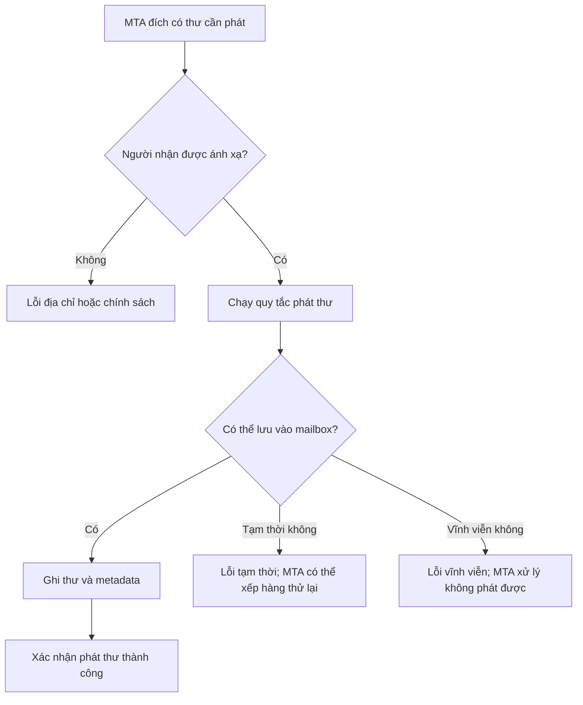

# Mail Delivery Agent đưa thư vào mailbox

## 1. Vị trí của Mail Delivery Agent trong kiến trúc email

Trong hệ thống email, **Mail Delivery Agent (MDA)** là thành phần thực hiện bước **phát thư cuối cùng**: nhận một email đã được hệ thống chuyển thư chấp nhận và đưa email đó vào **mailbox** của người nhận, hoặc giao cho một đích lưu trữ/phân phối nội bộ theo chính sách máy chủ. MDA thường làm việc ở phía máy chủ đích; nó không phải thành phần người dùng dùng để soạn thư hay đọc thư.

Một luồng phổ biến:

```text
Người gửi
   |
   v
Mail User Agent (MUA) -- SMTP submission --> Mail Submission Agent (MSA)
                                               |
                                               v
                                      Mail Transfer Agent (MTA)
                                               |
                                    SMTP giữa các máy chủ
                                               |
                                               v
                                      MTA phía người nhận
                                               |
                                     local delivery / LMTP
                                               |
                                               v
                                      Mail Delivery Agent
                                               |
                                               v
                                     Mailbox / message store
                                               |
                                      IMAP hoặc POP3
                                               |
                                               v
                                      MUA của người nhận
```

Ví dụ, ứng dụng Spring Boot gửi thông báo qua `JavaMailSender`: ứng dụng đóng vai trò **SMTP client** để gửi thông điệp đến máy chủ SMTP. Sau khi email được định tuyến đến máy chủ của miền người nhận, MDA phía nhận mới quyết định đặt thư vào mailbox nào. `JavaMailSender` không trực tiếp thao tác với MDA hay mailbox của miền đích.

### Phân biệt các thành phần dễ nhầm

| Thành phần | Trách nhiệm chính | Giao thức/giao diện thường gặp |
|---|---|---|
| MUA (Mail User Agent) | Soạn, gửi, xem, quản lý email của người dùng | SMTP submission, IMAP, POP3 |
| MSA (Mail Submission Agent) | Nhận email gửi ra từ người dùng/ứng dụng, xác thực và kiểm tra chính sách gửi | SMTP submission (thường cổng 587) |
| MTA (Mail Transfer Agent) | Chuyển và định tuyến email giữa các máy chủ; xếp hàng và thử gửi lại khi cần | SMTP |
| MDA (Mail Delivery Agent) | Phát email đã nhận vào mailbox hoặc message store của người nhận | Local delivery, LMTP hoặc API nội bộ |
| IMAP/POP3 server | Cho MUA truy cập thư đã lưu | IMAP/POP3 |

Ranh giới giữa MTA và MDA là **ranh giới trách nhiệm**, không nhất thiết là hai tiến trình riêng biệt. Một máy chủ thư có thể tích hợp cả chuyển thư và phát thư cục bộ; một hệ thống khác có thể dùng MTA riêng và giao tiếp với dịch vụ phát thư qua LMTP.

## 2. Điều gì xảy ra khi email đến máy chủ đích?

Giả sử `alice@example.com` gửi email đến `bob@example.net`.

1. SMTP server phía `example.net` nhận thư, kiểm tra có thể chấp nhận người nhận `bob@example.net` hay không, áp dụng chính sách tại thời điểm nhận SMTP và đưa thư vào hàng đợi phù hợp. Một số kiểm tra có thể thực hiện ở MTA, gateway hoặc bộ lọc độc lập.
2. Máy chủ xác định người nhận cục bộ, tài khoản hoặc bí danh (alias), đồng thời tìm cấu hình giao thư như đường dẫn mailbox hay dịch vụ lưu trữ đích.
3. MTA chuyển thông điệp và metadata liên quan cho thành phần phát thư nội bộ. Tùy hệ thống, đây có thể là lời gọi tới chương trình local delivery hoặc phiên **LMTP** (Local Mail Transfer Protocol).
4. MDA áp dụng các quy tắc phát thư được cấu hình: ánh xạ người nhận, chuyển tiếp/alias, bộ lọc Sieve, phân thư vào thư mục, kiểm tra quota hay trạng thái lưu trữ. Thứ tự cụ thể tùy sản phẩm; lọc spam/virus có thể đã diễn ra trước MDA.
5. MDA ghi nội dung thư và metadata vào message store theo cơ chế bảo đảm nhất quán của hệ thống lưu trữ, rồi mới báo kết quả giao thư thành công hoặc thất bại cho bên gọi.
6. IMAP server đọc message store và trình bày email cho MUA khi Bob mở hộp thư. **Phát thư thành công không đồng nghĩa Bob đã đọc thư.**



Sơ đồ mô tả trách nhiệm cơ bản. Thực tế, một thư có nhiều người nhận có thể phát thành công cho người này và thất bại cho người khác; kết quả cần được theo dõi **theo từng địa chỉ nhận**.

## 3. Mailbox là gì và MDA lưu thư ra sao?

**Mailbox** là không gian lưu trữ logic dành cho thư của người dùng. Nó có thể được triển khai bằng file, thư mục, cơ sở dữ liệu hoặc kho lưu trữ phân tán. Mailbox không đồng nghĩa với một file duy nhất, và **thư mục Inbox trong ứng dụng email** cũng không nhất thiết là thư mục hệ thống tệp trên máy chủ.

Hai định dạng lưu trữ truyền thống minh họa cách MDA có thể ghi dữ liệu:

| Cơ chế | Cách lưu thư | Đặc điểm cần chú ý |
|---|---|---|
| **mbox** | Nhiều thư nối tiếp trong một file mailbox | Cần khóa và xử lý ghi đồng thời cẩn thận; file có thể lớn |
| **Maildir** | Mỗi thư là một file, thường dùng các thư mục `tmp`, `new`, `cur` | Hỗ trợ mô hình ghi qua file tạm và đổi tên, phù hợp phát thư đồng thời trên hệ thống tệp đáp ứng giả định của định dạng |
| **Message store chuyên dụng** | Nội dung và chỉ mục được lưu bằng dịch vụ/cơ sở dữ liệu của nhà cung cấp | Cho phép quản lý quota, chỉ mục, sao chép và truy cập qua các dịch vụ khác nhau |

Ví dụ một cấu trúc Maildir giản lược:

```text
/var/vmail/example.net/bob/Maildir/
├── tmp/     # Vị trí file tạm khi đang giao thư
├── new/     # Thư mới được giao, chưa chuyển sang cur
└── cur/     # Thư đang được theo dõi với trạng thái/flags
```

MDA có thể ghi nội dung hoàn chỉnh vào `tmp/`, hoàn tất thao tác lưu an toàn theo cơ chế hệ thống, rồi chuyển file sang `new/` bằng thao tác rename phù hợp. Các chi tiết về tên file duy nhất, `fsync`, quota và tính bền vững của dữ liệu phụ thuộc cách triển khai. Không nên tự giả định cứ gọi `write()` thành công là email đã được lưu bền vững.

Nội dung thư được lưu thường là **thông điệp RFC 5322/MIME**: header (`From`, `To`, `Subject`, `Date`, `Message-ID`, v.v.) và body có thể chứa nhiều phần, tệp đính kèm. MDA có thể lưu thêm metadata như thời gian nhận, trạng thái chưa đọc, mailbox đích, dấu cờ hoặc chỉ mục tìm kiếm. SMTP envelope (`MAIL FROM`, `RCPT TO`) là thông tin phục vụ vận chuyển; nó có thể khác địa chỉ trong header `From`/`To`, nên hệ thống phát thư không được chỉ suy ra người nhận thực tế từ header `To`.

## 4. Ánh xạ người nhận và quy tắc phát thư

Không phải mọi `RCPT TO:<bob@example.net>` đều được ghi thẳng vào Inbox có tên `bob`.

**Ánh xạ người nhận.** Máy chủ có thể sử dụng tài khoản hệ điều hành, virtual mailbox, LDAP, SQL hoặc dịch vụ danh tính để chuyển từ địa chỉ email sang mailbox thực tế. Với virtual mailbox, `bob@example.net` và `bob@another-domain.test` có thể cùng tên cục bộ nhưng phải tách biệt theo miền.

**Alias và phân phối đa đích.** `support@example.net` có thể là alias đến nhiều người nhận hoặc một hộp thư chung. Quy tắc này thường được xử lý trong giai đoạn định tuyến/expansion của MTA hoặc dịch vụ địa chỉ, tùy cấu hình; không mặc định mọi MDA tự hỗ trợ alias.

**Bộ lọc thư.** Một hệ thống có thể dùng Sieve để phân thư theo người gửi, tiêu đề hoặc điều kiện khác. Ví dụ quy tắc minh họa:

```sieve
require ["fileinto"];

if header :contains "subject" "Invoice" {
    fileinto "Finance";
    stop;
}
```

Quy tắc trên chỉ hoạt động khi máy chủ đích hỗ trợ Sieve, extension `fileinto` và mailbox `Finance` tồn tại hoặc được tạo theo chính sách. Quy tắc lọc có thể chuyển thư sang folder khác, chuyển tiếp, loại bỏ hoặc từ chối theo khả năng/cấu hình hệ thống. Không có quy tắc chung buộc mọi thư được phát vào `INBOX`.

## 5. MDA báo thành công và thất bại như thế nào?

Trong SMTP/LMTP, mã phản hồi là cơ chế để thành phần gửi biết liệu lần chuyển giao có được chấp nhận hay chưa. LMTP tương tự SMTP nhưng được thiết kế cho giao thư cục bộ, đặc biệt hỗ trợ phản hồi kết quả **riêng cho từng người nhận** sau nội dung thư.

| Nhóm phản hồi | Ý nghĩa vận hành | Phản ứng thường thấy của MTA |
|---|---|---|
| `2xx` | Đích xác nhận đã nhận trách nhiệm xử lý/phát thư | Đánh dấu lần giao tương ứng thành công |
| `4xx` | Lỗi tạm thời, ví dụ store đang không sẵn sàng hoặc hết tài nguyên nhất thời | Giữ thư trong queue và retry theo chính sách |
| `5xx` | Lỗi vĩnh viễn, ví dụ người nhận không hợp lệ hoặc chính sách từ chối vĩnh viễn | Ngừng retry cho người nhận đó; có thể tạo thông báo không phát được |

Ví dụ phiên LMTP **minh họa**, lược bỏ bắt tay và các bước khai báo phong bì:

```text
C: DATA
S: 354 Start mail input
C: From: Alice <alice@example.com>
C: To: Bob <bob@example.net>
C: Subject: Monthly report
C:
C: Report attached.
C: .
S: 250 2.1.5 <bob@example.net> OK
```

Phản hồi thực tế phụ thuộc server và số người nhận. Với nhiều địa chỉ RCPT, LMTP trả kết quả lần lượt cho từng người nhận sau dấu kết thúc `DATA`. Không nên coi `250` của một người nhận là thành công của tất cả.

Một số tình huống điển hình:

* **Mailbox vượt quota:** có thể là lỗi tạm thời hoặc vĩnh viễn tùy cấu hình và chính sách máy chủ.
* **Địa chỉ không tồn tại:** thường bị từ chối ngay ở SMTP recipient validation; nếu được phát hiện muộn thì kết quả giao thư có thể báo lỗi vĩnh viễn.
* **Lưu trữ không khả dụng:** thường được báo lỗi tạm thời để queue retry thay vì làm mất thư.
* **Quy tắc lọc gây reject:** cần phân biệt lỗi có chủ ý theo chính sách với sự cố lưu trữ.

Mốc quan trọng là **thời điểm nhận trách nhiệm**. MTA không nên xóa bản queued trước khi nhận xác nhận giao thành công phù hợp; MDA không nên báo thành công khi chưa bảo đảm đã lưu hoặc tiếp nhận trách nhiệm theo hợp đồng của message store. Lỗi mạng đúng lúc trao đổi phản hồi có thể khiến bên gửi không biết bên nhận đã lưu chưa; retry vì thế có nguy cơ tạo bản sao. Hệ thống cần thiết kế nhận diện và xử lý trùng phù hợp, không mặc định SMTP/LMTP cung cấp giao thư exactly-once từ đầu đến cuối.

## 6. Bảo mật và vận hành mailbox

MDA xử lý dữ liệu nhạy cảm của người nhận. Các yêu cầu thường gặp gồm:

* **Cách ly mailbox:** bảo đảm người dùng/tenant chỉ ghi và truy cập đúng mailbox được cấp; kiểm soát quyền file hoặc quyền truy cập message store.
* **Xác thực và phân quyền ở ranh giới giao thư:** kết nối LMTP qua mạng nên giới hạn nguồn truy cập và bảo vệ đường truyền theo mô hình triển khai. Không công khai endpoint phát thư nội bộ cho máy khách tùy ý.
* **Giới hạn tài nguyên:** kiểm soát dung lượng từng mailbox, kích thước thư, số file/chỉ mục và độ đầy ổ đĩa; phân biệt quota người dùng và sự cố hạ tầng.
* **Theo dõi khả năng phát thư:** giám sát queue của MTA, tỷ lệ lỗi `4xx`/`5xx`, độ trễ phát thư, dung lượng store và log có gắn message identifier phù hợp.
* **Bảo vệ nội dung:** mã hóa khi truyền và khi lưu theo chính sách; hạn chế đưa body, token xác thực hoặc thông tin cá nhân vào log.
* **Sao lưu và phục hồi:** kiểm tra khả năng khôi phục cả nội dung, metadata, chỉ mục và quyền truy cập; backup dữ liệu mà không có phương án phục hồi nhất quán có thể chưa đủ.

Một queue SMTP trống chỉ phản ánh phía chuyển thư đã xử lý xong công việc tương ứng; nó không chứng minh người dùng đã nhìn thấy email trong ứng dụng. Nếu thư “biến mất”, cần kiểm tra cả luồng: SMTP acceptance, queue, log local delivery/LMTP, kết quả ghi store, bộ lọc và folder được IMAP hiển thị.

## 7. Liên hệ với Spring Framework Mail

Spring Framework cung cấp `JavaMailSender` để **tạo và gửi** email từ ứng dụng Java qua hạ tầng SMTP. Spring Mail không tự trở thành MTA/MDA chỉ vì ứng dụng gọi `send()`.

Ví dụ gửi thông báo văn bản thuần:

```java
import org.springframework.mail.SimpleMailMessage;
import org.springframework.mail.javamail.JavaMailSender;
import org.springframework.stereotype.Service;

@Service
public class NotificationMailService {
    private final JavaMailSender mailSender;

    public NotificationMailService(JavaMailSender mailSender) {
        this.mailSender = mailSender;
    }

    public void sendStatus(String recipient) {
        SimpleMailMessage message = new SimpleMailMessage();
        message.setFrom("notifications@example.com");
        message.setTo(recipient);
        message.setSubject("Status update");
        message.setText("Your request has been recorded.");
        mailSender.send(message);
    }
}
```

Với cấu hình SMTP hợp lệ, `send()` thành công thường nghĩa là SMTP server đã **chấp nhận xử lý** thư từ ứng dụng tại bước gửi. Điều đó **không bảo đảm** MDA cuối đường đã ghi thành công vào mailbox, thư xuất hiện ở Inbox, hay người nhận mở thư. Việc phát thư có thể diễn ra sau đó; SMTP server có thể gửi thông báo thất bại (bounce/DSN) về địa chỉ envelope sender nếu được cấu hình và có thể gửi thông báo.

Ví dụ chuỗi kết quả:

```text
Spring app: JavaMailSender.send() thành công
       -> SMTP submission server đã chấp nhận thư
       -> MTA chuyển tới MX đích
       -> MDA ghi thư vào mailbox
       -> IMAP server cho phép đọc thư
       -> Người dùng nhìn thấy/thao tác với thư
```

Mỗi bước có thể thất bại hoặc chậm độc lập. Nếu yêu cầu nghiệp vụ là “người dùng đã đọc”, ứng dụng phải dùng một cơ chế xác nhận phù hợp; receipt hoặc pixel tracking cũng có giới hạn và không phải bằng chứng đọc tuyệt đối. Trong thiết kế ứng dụng, nên phân biệt ít nhất trạng thái **đã tạo yêu cầu gửi**, **SMTP đã chấp nhận**, **đã có thông tin phát thư** và **đã có tín hiệu tương tác từ người nhận** khi nguồn dữ liệu cho phép.

## 8. Ví dụ truy vết sự cố: đã gửi nhưng không thấy trong Inbox

Giả sử Spring Boot ghi log `Mail sent`, còn Bob không tìm thấy email. Cách phân tích theo từng ranh giới:

1. **Ứng dụng → SMTP submission:** kiểm tra server nào nhận thư, thời điểm nhận và message identifier có sẵn. Thành công ở đây chưa cho biết kết quả phát thư cuối cùng.
2. **MTA → miền đích:** tra queue/log chuyển thư để biết MX nào xử lý, có retry, timeout, reject hoặc bounce không.
3. **MTA đích → MDA:** kiểm tra alias/virtual recipient mapping, mã phản hồi local delivery hay LMTP theo người nhận.
4. **MDA → message store:** kiểm tra quota, quyền ghi, dung lượng, log lưu trữ, bộ lọc Sieve, folder đích và trạng thái cách ly spam.
5. **Message store → MUA:** kiểm tra thư qua IMAP, thư mục khác Inbox, bộ lọc phía client, đồng bộ offline và cách client hiển thị conversation.

Một phản hồi `250` tại SMTP submission không thay thế được log MDA. Ngược lại, nếu MDA xác nhận lưu thành công mà client không hiển thị, cần kiểm tra truy cập mailbox và cách MUA đồng bộ, thay vì gửi lại liên tục gây trùng thư.

## 9. Ghi nhớ kiến trúc

**MTA chuyển thư đến nơi có trách nhiệm tiếp nhận; MDA thực hiện phát thư vào mailbox/message store; IMAP/POP3 server cho phép người nhận truy cập thư đã lưu.** Trong Spring Framework Mail, ứng dụng thường chỉ tham gia bước gửi tới SMTP. Muốn giải thích trạng thái “email đã đến hộp thư” phải có dữ liệu từ hạ tầng phát thư/nhà cung cấp, không chỉ từ việc gọi `JavaMailSender.send()` thành công.
