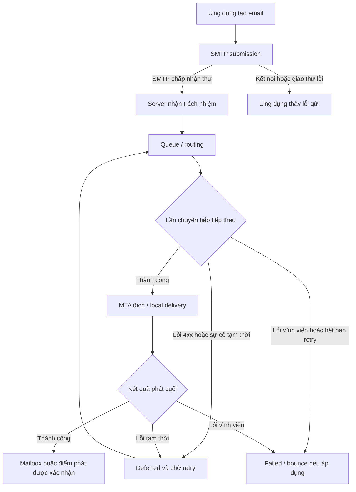
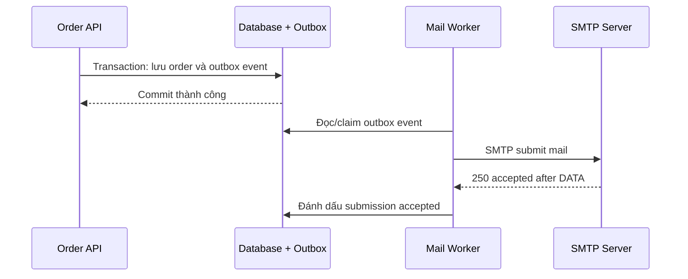

# Queue thư trên máy chủ và thời điểm thư được coi là đã gửi

## 1. Vì sao email cần hàng đợi?

Email được thiết kế theo mô hình **store-and-forward**: một máy chủ có thể **nhận trách nhiệm** đối với thông điệp, lưu thông điệp vào hàng đợi (**mail queue**) rồi mới tìm cách chuyển tới máy chủ hoặc mailbox đích. Người gửi và người nhận không bắt buộc phải trực tuyến cùng lúc. Đường truyền có thể gián đoạn, máy chủ nhận có thể bận, DNS có thể gặp trục trặc hoặc mailbox có thể tạm thời không nhận thư. Hàng đợi giúp hệ thống giữ lại công việc và **thử gửi lại** theo chính sách thay vì thất bại ngay khi một đích tạm thời không khả dụng.

Trong **Spring Framework Mail**, ứng dụng thường dùng `JavaMailSender` để kết nối đến một máy chủ SMTP. Việc ứng dụng gọi `send()` thành công và việc người nhận thật sự nhận thư là **hai sự kiện ở hai tầng khác nhau**. Muốn diễn giải chính xác trạng thái “đã gửi”, phải xác định thành phần nào đã chấp nhận thư, ai đang giữ thư trong queue và có bằng chứng nào về lần phát cuối cùng.

### Các thành phần trong đường đi của một email

```text
Ứng dụng Spring Boot
    |
    | JavaMailSender / SMTP submission
    v
SMTP server / Mail Submission Agent (MSA)
    |
    | Chấp nhận thư, kiểm tra chính sách, có thể đưa vào queue
    v
Mail Transfer Agent (MTA) / outbound queue
    |
    | DNS MX, SMTP relay, retry khi cần
    v
MTA phía người nhận
    |
    | Local delivery / LMTP / cơ chế nội bộ
    v
Mail Delivery Agent (MDA) / message store
    |
    v
Mailbox của người nhận
    |
    | IMAP/POP3 hoặc giao diện webmail
    v
Ứng dụng đọc email của người nhận
```

Queue trong sơ đồ là **khái niệm logic**: nơi giữ các thư đang chờ xử lý, thử lại hoặc cần định tuyến. Tùy hệ thống, nó có thể là file spool trên đĩa, cơ sở dữ liệu, message store phân tán hoặc một dịch vụ nội bộ. Không nên mặc định mỗi hệ thống chỉ có một queue hay queue luôn nằm ở cùng một máy chủ.

## 2. Một email đi qua những trạng thái nào?

Tên trạng thái chính xác thay đổi theo SMTP server và nhà cung cấp dịch vụ, nhưng có thể dùng mô hình sau để hiểu luồng:

| Giai đoạn | Điều gì đã xảy ra? | Điều **chưa** được bảo đảm |
|---|---|---|
| `CREATED` | Ứng dụng đã tạo nội dung thông điệp | Chưa có nỗ lực kết nối SMTP |
| `SUBMITTING` | SMTP client đang kết nối và truyền thư | Server chưa chắc đã chấp nhận toàn bộ thư |
| `ACCEPTED` | SMTP server trả lời thành công sau khi nhận toàn bộ nội dung thư | Mailbox đích chưa chắc có thư |
| `QUEUED` | Một máy chủ hoặc dịch vụ đang giữ thư để định tuyến/phát tiếp | Chưa chắc đường đi tiếp theo đã thành công |
| `DEFERRED` | Một lần thử chuyển thư bị lỗi tạm thời; thư chờ retry | Chưa phải lỗi vĩnh viễn |
| `DELIVERED` | Thành phần theo dõi đã nhận xác nhận giao tới đích mà **nó định nghĩa** | Chưa chắc là Inbox cuối cùng hoặc người dùng đã đọc |
| `BOUNCED` / `FAILED` | Hệ thống đã xác định không thể phát cho một người nhận và dừng retry | Không có nghĩa mọi người nhận cùng thư đều thất bại |

**`ACCEPTED` và `QUEUED` có thể là hai cách nhìn của cùng một chuyển giao**: SMTP server chấp nhận thư rồi đưa vào queue của chính nó. Một nhà cung cấp lại có thể báo `queued` ngay trước khi thực sự thử SMTP, hoặc có nhiều hàng đợi nối tiếp. Vì vậy, cần định nghĩa các trạng thái theo **nguồn phát sinh sự kiện**, không chỉ theo tên tiếng Anh.



Sơ đồ mô tả hành trình một người nhận. Với nhiều địa chỉ, mỗi người nhận có thể có kết quả khác nhau sau khi thư được nhận vào hệ thống.

## 3. SMTP server xác nhận “đã nhận” ở thời điểm nào?

Trong một phiên SMTP thông thường, client gửi lần lượt `MAIL FROM`, một hoặc nhiều `RCPT TO`, rồi `DATA`. Sau khi server trả `354`, client gửi header/body và kết thúc bằng dòng chỉ chứa một dấu chấm (`.`). **Phản hồi thành công sau dấu chấm kết thúc `DATA`** mới là mốc quan trọng thể hiện server đã chấp nhận **toàn bộ thông điệp** cho các địa chỉ nhận mà nó đã đồng ý xử lý trong giao dịch đó.

Ví dụ phiên giao tiếp rút gọn, chỉ nhằm minh họa luồng:

```text
C: EHLO app.example.com
S: 250-mail.example.net Hello
S: 250 SIZE 10485760
C: MAIL FROM:<notifications@example.com>
S: 250 2.1.0 OK
C: RCPT TO:<bob@example.net>
S: 250 2.1.5 OK
C: DATA
S: 354 End data with <CR><LF>.<CR><LF>
C: From: Notifications <notifications@example.com>
C: To: Bob <bob@example.net>
C: Subject: Your order
C:
C: Order confirmed.
C: .
S: 250 2.0.0 OK queued as A1B2C3
```

Phần `queued as A1B2C3` là **ví dụ** định danh queue mà một SMTP server có thể trả về; không phải trường bắt buộc hay cú pháp đồng nhất giữa mọi nhà cung cấp. Trong một phiên thực tế có thể có `STARTTLS`, xác thực SMTP, MIME encoding và các phần mở rộng khác.

Đọc các mốc đúng nghĩa:

* `250` sau `MAIL FROM`: chấp nhận địa chỉ envelope sender cho giao dịch hiện tại; **chưa** xác nhận đã nhận email.
* `250` sau `RCPT TO`: chấp nhận người nhận ở giai đoạn khai báo; **chưa** xác nhận đã nhận body.
* `354` sau `DATA`: cho phép client bắt đầu truyền nội dung; **chưa** phải kết quả giao thư.
* `250` sau dấu chấm kết thúc `DATA`: server đã chấp nhận thông điệp và nhận trách nhiệm xử lý/phát tiếp theo hợp đồng SMTP.

Theo mô hình SMTP, server trả xác nhận thành công khi nó có thể nhận trách nhiệm đối với thư; từ thời điểm đó, lỗi phát tiếp theo là trách nhiệm của hạ tầng đã chấp nhận thư, thường được xử lý qua retry hoặc thông báo không phát được. Điều này **không đồng nghĩa** server đã thực hiện xong chuyển tiếp đến MX đích hay ghi vào Inbox.

### Nếu kết nối mất ngay trước khi client nhận được `250`?

Đây là trường hợp quan trọng trong thiết kế retry. Server có thể đã nhận và lưu thư nhưng phản hồi thành công bị mất trên đường truyền. Client thấy lỗi hoặc timeout và **không biết chắc** liệu thư đã được chấp nhận hay chưa. Nếu lập tức gửi lại, người nhận có thể nhận **hai bản**. Vì thế, kết quả lỗi phía client đôi khi phải được ghi là **`UNKNOWN` hoặc `SUBMISSION_UNCERTAIN`**, không nhất thiết là “chắc chắn chưa gửi”.

## 4. Queue hoạt động thế nào trên máy chủ?

Sau khi tiếp nhận, MTA hoặc dịch vụ thư duy trì bản ghi công việc cho một hoặc nhiều người nhận. Một bản ghi queue thường có dữ liệu cần chuyển như nội dung thông điệp, envelope sender, các envelope recipient, thời điểm nhận, số lần thử, lỗi gần nhất và thời điểm đủ điều kiện retry. Tên trường và cách lưu thay đổi theo sản phẩm.

```text
Queue record (minh họa)
  queueId:          A1B2C3
  envelopeFrom:     notifications@example.com
  recipients:       bob@example.net, team@example.org
  acceptedAt:       2026-11-12T08:00:00Z
  attemptCount:     2
  nextAttemptAt:    2026-11-12T08:15:00Z
  lastResponse:     451 4.4.1 connection timed out
  state:            DEFERRED
```

**Đây là mô hình dữ liệu minh họa**, không phải định dạng queue file chuẩn SMTP. Các hệ thống có thể ghi một record chung rồi theo dõi trạng thái từng recipient, hoặc tách thành nhiều công việc độc lập.

Quá trình xử lý thường gồm:

1. **Chấp nhận và lưu:** nhận thông điệp từ client hoặc MTA khác, kiểm tra điều kiện và lưu trách nhiệm xử lý.
2. **Định tuyến:** xác định relay hoặc miền đích, tra DNS MX khi cần, áp dụng quy tắc định tuyến và chính sách bảo mật.
3. **Thử chuyển:** mở phiên SMTP/LMTP hoặc dùng giao thức nội bộ để giao thư cho đích kế tiếp.
4. **Ghi kết quả:** cập nhật trạng thái theo người nhận, lỗi và thời gian thử tiếp theo; nếu một đích đã chấp nhận, không cần retry chính người nhận đó trừ khi giao dịch ở trạng thái không chắc chắn.
5. **Kết thúc:** loại bỏ công việc đã giao thành công; hoặc xử lý lỗi cuối cùng theo chính sách thông báo không phát được, thời hạn retry và bảo vệ chống vòng lặp.

Một mail queue hữu ích không chỉ là danh sách thư đang chờ. Nó còn là công cụ **chịu lỗi**, **giới hạn tốc độ gửi**, **phân phối tải**, **kiểm soát backoff**, và **quan sát sức khỏe hệ thống**. Queue tăng nhanh liên tục thường là tín hiệu hạ tầng đang bị nghẽn hoặc chính sách gửi chưa phù hợp.

## 5. Retry: lỗi tạm thời khác lỗi vĩnh viễn

SMTP dùng mã phản hồi ba chữ số; chữ số đầu giúp phân biệt thành công, lỗi tạm thời và lỗi vĩnh viễn. Nội dung phản hồi cụ thể và các mã enhanced status có thể cho biết nguyên nhân chi tiết hơn.

| Phản hồi | Ý nghĩa tổng quát | Phản ứng thường gặp |
|---|---|---|
| `2xx` | Thành công ở **bước SMTP hiện tại** | Tiếp tục bước kế hoặc kết thúc công việc tương ứng |
| `4xx` | Thất bại tạm thời | Giữ queue, trì hoãn rồi thử lại nếu còn trong giới hạn chính sách |
| `5xx` | Thất bại vĩnh viễn trong ngữ cảnh phản hồi | Dừng retry theo chính sách cho phần công việc bị từ chối |

Ví dụ:

```text
421 4.3.2 Service not available       # Tạm thời không nhận kết nối
450 4.2.0 Mailbox temporarily busy      # Mailbox tạm thời không thể nhận
451 4.4.1 Temporary local error         # Lỗi tạm thời khi xử lý
550 5.1.1 User unknown                 # Người nhận không tồn tại
552 5.2.2 Mailbox full                  # Có thể bị quy định là lỗi vĩnh viễn
```

Mã và lời giải thích trên chỉ là tình huống thường gặp; nguyên nhân thực tế phụ thuộc server. Cùng một tình huống “mailbox đầy” có thể dẫn đến `4xx` hoặc `5xx` theo chính sách.

**Backoff** là việc giãn khoảng cách giữa các lần retry. Ví dụ lịch minh họa:

```text
08:00  Lần 1: 451 temporary failure
08:05  Lần 2: 451 temporary failure
08:20  Lần 3: 451 temporary failure
09:20  Lần 4: 250 accepted by next server
```

Lịch retry thực tế do MTA hoặc nhà cung cấp quyết định. Không có một khoảng retry, số lần thử hoặc thời hạn giữ queue duy nhất áp dụng cho tất cả máy chủ. Khi vượt quá giới hạn, hệ thống có thể **bỏ cuộc và tạo DSN/bounce** phù hợp, hoặc báo trạng thái thất bại qua API/webhook.

**Lưu ý về báo lỗi:** việc tạo email thông báo không phát được có thể không thực hiện được nếu envelope sender rỗng (`MAIL FROM:<>`) hoặc nếu gửi thông báo sẽ gây vòng lặp. Một hệ thống bảo vệ chống spam cũng có thể không gửi bounce tùy chính sách. Vì vậy, “chưa nhận được bounce” không đủ để khẳng định thư đã tới mailbox.

## 6. Nhiều người nhận: thành công có thể chỉ là một phần

Một thông điệp có thể có nhiều `RCPT TO`:

```text
MAIL FROM:<notifications@example.com>
RCPT TO:<alice@example.net>
RCPT TO:<bob@example.net>
RCPT TO:<carol@example.org>
DATA
...
.
```

Server submission có thể chấp nhận một số recipient và từ chối các recipient khác trước khi nhận `DATA`. Sau khi chấp nhận một thông điệp, các đích được định tuyến riêng: Alice đã phát thành công, Bob đang chờ retry vì `4xx`, Carol bị từ chối vĩnh viễn. Một lời khẳng định “cả email đã gửi thành công” sẽ làm mất thông tin cần thiết.

| Người nhận | Kết quả tại một thời điểm | Diễn giải |
|---|---|---|
| `alice@example.net` | `DELIVERED_TO_DESTINATION` | Đích theo dõi đã xác nhận nhận trách nhiệm/phát thành công |
| `bob@example.net` | `DEFERRED` | Đang chờ lần thử tiếp theo |
| `carol@example.org` | `BOUNCED` | Đã dừng phát cho địa chỉ này |

Trạng thái nên được theo dõi theo **message + recipient + giai đoạn xử lý**. `Message-ID` trong header có thể giúp tương quan giữa các log, nhưng nó do bên tạo thư cung cấp, không nhất thiết duy nhất tuyệt đối và không thay thế queue ID hoặc event ID của hạ tầng. Cùng một email có thể có **nhiều queue ID** khi đi qua các MTA khác nhau.

## 7. “Đã gửi” có bao nhiêu nghĩa trong hệ thống thực tế?

Khi xây dựng API hay giao diện gửi mail, nên đặt tên trạng thái theo mức độ chứng cứ:

| Khẳng định | Bằng chứng thường dùng | Có được nói người nhận đã nhận thư? |
|---|---|---|
| **Đã tạo yêu cầu gửi** | Ứng dụng đã ghi request hoặc outbox thành công | Chưa |
| **Đã đưa vào job queue của ứng dụng** | Broker/DB/outbox đã nhận công việc | Chưa; worker còn chưa chắc đã chạy |
| **SMTP đã chấp nhận** | SMTP submission trả thành công sau `DATA`; `JavaMailSender.send()` thành công trong luồng tương ứng | Chưa |
| **Nhà cung cấp đang xử lý** | Provider báo `queued`, `processed` hoặc `sent` theo định nghĩa riêng | Chưa thể kết luận nếu chưa đọc định nghĩa sự kiện |
| **Máy chủ đích đã chấp nhận** | MTA nhận được phản hồi SMTP thành công từ hop đích | Có xác nhận ở hop đó; chưa chắc thư nằm trong Inbox |
| **Phát vào mailbox thành công** | Log MDA, LMTP hoặc event được nhà cung cấp định nghĩa rõ là lưu vào mailbox | Có bằng chứng mạnh về phát thư, chưa chứng minh đã đọc |
| **Đã đọc** | Tín hiệu từ phần mềm/người dùng nhận, nếu có | Không phải mốc SMTP; tín hiệu đọc có thể thiếu hoặc không đáng tin tuyệt đối |

Trong một hệ thống tự quản trị cả MTA và MDA, có thể quan sát chính xác nhiều mốc. Nếu dùng nhà cung cấp email bên ngoài, ứng dụng phụ thuộc vào **webhook, event stream, DSN hoặc API tra cứu** mà nhà cung cấp cung cấp. Event `delivered` của nhiều dịch vụ gửi ra ngoài có nghĩa là **máy chủ nhận đã chấp nhận thư qua SMTP**, chứ chưa chắc nhà cung cấp biết email nằm trong Inbox hay thư mục spam. Định nghĩa trạng thái phải được ghi rõ trong tài liệu sản phẩm.

Không nên dùng một cột boolean `sent = true` để đại diện mọi ý nghĩa. Một mô hình linh hoạt hơn:

```text
mail_request
  id                # ID nghiệp vụ của yêu cầu gửi
  recipient         # Địa chỉ nhận
  subject           # Tiêu đề; tránh lưu nội dung nhạy cảm không cần thiết
  state             # PENDING, SUBMITTING, SMTP_ACCEPTED,
                    # SUBMISSION_UNKNOWN, DEFERRED, DELIVERED,
                    # FAILED ... theo mức quan sát được
  providerMessageId # ID do provider trả về, nếu có
  lastErrorCode     # Mã lỗi có thể quan sát
  lastEventAt       # Thời điểm event gần nhất
```

Đây chỉ là mô hình khái niệm. Hệ thống thật cần lịch sử event, thời điểm cập nhật đáng tin và cách xử lý event trễ hoặc đến không đúng thứ tự. Không được tự suy diễn `DELIVERED` nếu không có nguồn bằng chứng hỗ trợ.

## 8. Liên hệ với `JavaMailSender` trong Spring Framework Mail

`JavaMailSender` là giao diện Spring để gửi email qua thư viện Jakarta Mail và SMTP transport được cấu hình. Phương thức `send()` chạy thành công cho biết thư viện gửi không báo lỗi ở bước submission tương ứng. Trong cấu hình SMTP thông thường, đây là kết quả **máy chủ SMTP đã chấp nhận thông điệp**, không phải kết quả phát cuối cùng đến hộp thư.

Ví dụ:

```java
import org.springframework.mail.MailException;
import org.springframework.mail.SimpleMailMessage;
import org.springframework.mail.javamail.JavaMailSender;
import org.springframework.stereotype.Service;

@Service
public class ReceiptMailService {
    private final JavaMailSender mailSender;

    public ReceiptMailService(JavaMailSender mailSender) {
        this.mailSender = mailSender;
    }

    public void submitReceipt(String recipient, String receiptNumber) {
        SimpleMailMessage message = new SimpleMailMessage();
        message.setFrom("receipts@example.com");
        message.setTo(recipient);
        message.setSubject("Receipt " + receiptNumber);
        message.setText("Your receipt is ready: " + receiptNumber);

        try {
            mailSender.send(message);
            // Có thể ghi SMTP_ACCEPTED (nếu SMTP transport đã xác nhận).
            // Không ghi DELIVERED hoặc READ chỉ từ lời gọi này.
        } catch (MailException ex) {
            // Ghi lỗi submission để điều tra và quyết định retry.
            // Với timeout/mất kết nối, kết quả đôi khi là UNKNOWN.
            throw ex;
        }
    }
}
```

Một cấu hình Spring Boot minh họa:

```yaml
spring:
  mail:
    host: smtp.example.com
    port: 587
    username: ${SMTP_USERNAME}
    password: ${SMTP_PASSWORD}
    properties:
      mail.smtp.auth: true
      mail.smtp.starttls.enable: true
      mail.smtp.connectiontimeout: 5000
      mail.smtp.timeout: 10000
      mail.smtp.writetimeout: 10000
```

Các giá trị timeout là **ví dụ tính bằng mili giây**, cần điều chỉnh theo môi trường. Cổng 587 thường dùng SMTP submission với STARTTLS; máy chủ thực tế phải hỗ trợ và được cấu hình tương ứng. Việc có timeout giúp tránh worker chờ vô hạn, nhưng timeout **không khẳng định** thư chắc chắn chưa được server nhận: nó có thể xảy ra ngay sau khi server hoàn tất tiếp nhận và trước lúc ứng dụng đọc được phản hồi.

### HTTP API nên trả gì khi gửi mail?

Nếu HTTP endpoint gọi trực tiếp `JavaMailSender.send()`, việc trả `200 OK` thường chỉ mô tả yêu cầu xử lý đã hoàn tất ở **bước SMTP submission**. Nếu endpoint chỉ ghi một job rồi để worker gửi, `202 Accepted` thể hiện rõ hơn: **hệ thống đã tiếp nhận công việc, việc gửi còn đang diễn ra**. Tuy nhiên, mã HTTP chỉ có nghĩa theo **hợp đồng API** mà đội phát triển định nghĩa; `200` không tự động có nghĩa “email đã đến”.

Ví dụ response cho endpoint tạo job:

```http
HTTP/1.1 202 Accepted
Content-Type: application/json

{
  "requestId": "mail-7f93",
  "status": "QUEUED_FOR_SUBMISSION",
  "message": "Yeu cau gui email da duoc tiep nhan"
}
```

Khi worker gửi xong SMTP, hệ thống có thể cập nhật `SMTP_ACCEPTED`; nếu có provider webhook thích hợp, có thể cập nhật trạng thái phát dựa trên ngữ nghĩa sự kiện được ghi rõ.

## 9. Phân biệt application queue và SMTP server queue

Một hệ thống Spring có thể có **hai hoặc nhiều tầng queue**:

```text
HTTP / nghiệp vụ
       |
       v
Database outbox / job queue / message broker
       |     (Spring worker thực thi)
       v
JavaMailSender
       |     (SMTP submission)
       v
MSA/MTA queue
       |     (SMTP relay, routing, retry)
       v
Mailbox hoặc máy chủ nhận tiếp theo
```

**Application queue** lưu *ý định gửi email*. Nó giải quyết việc không chặn luồng nghiệp vụ, chống mất job khi ứng dụng restart và kiểm soát tần suất gửi. **MTA queue** lưu *thư hoặc trách nhiệm chuyển thư* sau khi SMTP server tiếp nhận. Chúng có phạm vi lỗi, retry và ID khác nhau. Thấy job biến mất khỏi broker sau khi worker xử lý **không đủ** để kết luận mail đã vào mailbox. Ngược lại, khi SMTP server đã chấp nhận thư, việc tiếp tục retry ở application queue có thể tạo bản sao không mong muốn.

### Outbox để phối hợp với giao dịch nghiệp vụ

Giả sử ứng dụng cần gửi email sau khi đơn hàng được xác nhận. Nếu gọi SMTP ngay trong transaction cơ sở dữ liệu, có thể xảy ra tình huống email đã được server chấp nhận nhưng transaction đơn hàng sau đó rollback. Mô hình **transactional outbox** giúp ghi thay đổi đơn hàng và yêu cầu gửi mail trong **cùng một giao dịch cơ sở dữ liệu**, rồi xử lý gửi bất đồng bộ sau commit.



Outbox bảo đảm yêu cầu gửi được ghi cùng giao dịch nghiệp vụ, nhưng **không tự bảo đảm gửi email exactly-once**. Ví dụ worker gửi SMTP thành công rồi crash trước khi cập nhật outbox: lúc khởi động lại, nó có thể gửi lại cùng một email. Vì vậy cần xử lý retry có kiểm soát, trạng thái không chắc chắn, khả năng trùng và cơ chế giảm trùng phù hợp với nghiệp vụ. `Message-ID` hay business ID giúp truy vết; chúng không tự ép mọi SMTP server chống trùng.

## 10. Cần làm gì khi ứng dụng hoặc server gặp lỗi?

| Tình huống | Dữ liệu có thể biết | Hướng xử lý |
|---|---|---|
| Chưa tạo được job/outbox | Giao dịch nghiệp vụ báo lỗi | Thực hiện lại theo hợp đồng của thao tác nghiệp vụ |
| Worker không kết nối được SMTP | Không có bằng chứng server nhận thư | Retry có giới hạn và backoff; phân loại lỗi kết nối/xác thực/cấu hình |
| SMTP trả `4xx` trước khi nhận trách nhiệm | Từ chối tạm thời ở giao dịch hiện tại | Có thể retry tại tầng đang chịu trách nhiệm |
| SMTP trả `5xx` | Server từ chối vĩnh viễn trong ngữ cảnh đó | Ghi lỗi, xử lý địa chỉ/chính sách; tránh retry vô hạn |
| Mất kết nối lúc chờ phản hồi sau `DATA` | Không biết server đã nhận chưa | Lưu trạng thái `SUBMISSION_UNKNOWN`, truy vết trước khi retry nếu có khả năng |
| SMTP trả `250` sau `DATA`, MTA sau đó bị defer | Submission đã thành công, hạ tầng SMTP đang chịu trách nhiệm chuyển tiếp | Theo dõi queue/provider; tránh tự động gửi mới chỉ vì chưa thấy `delivered` |
| MTA trả bounce về sau | Phát thư thất bại ở một hop/recipient | Liên kết DSN/event với yêu cầu ban đầu để thông báo hoặc xử lý nghiệp vụ |
| Provider báo delivered nhưng người nhận không thấy Inbox | Nhà cung cấp đã xác nhận đến ranh giới họ theo dõi | Kiểm tra spam, rule lọc, alias, mailbox và định nghĩa event |

Khi bắt lỗi Spring Mail, lưu ý `MailException` có thể bao gồm nhiều nguyên nhân như xác thực, lỗi kết nối hoặc thất bại gửi một hay nhiều thông điệp. Phải xem loại ngoại lệ và chi tiết nguyên nhân từ transport thay vì coi mọi `MailException` là lỗi vĩnh viễn. Tuy nhiên, không nên log mật khẩu SMTP, token, toàn bộ thư hoặc tệp đính kèm để điều tra lỗi.

## 11. Quan sát queue và truy vết thư bằng log

Khi vận hành hệ thống, nên theo dõi **độ dài queue**, **tuổi của thư cũ nhất**, **thời gian chờ trước lần thử tiếp theo**, **tỷ lệ retry**, **tỷ lệ bounce**, **số thư đang deferred** và **độ trễ từ accepted đến kết quả chuyển giao**. Một queue có vài nghìn thư chưa chắc bất thường nếu đó là tải dự kiến, nhưng queue tăng đều cùng với tuổi thư tăng là dấu hiệu đáng điều tra.

Chuỗi truy vết mẫu:

```text
2026-11-12T08:00:00Z app    requestId=mail-7f93 event=SUBMIT_START
2026-11-12T08:00:01Z smtp   queueId=A1B2C3 event=ACCEPTED
2026-11-12T08:00:03Z mta    queueId=A1B2C3 recipient=bob@example.net
                             event=DEFERRED response="451 4.4.1 temporary error"
2026-11-12T08:05:03Z mta    queueId=A1B2C3 recipient=bob@example.net
                             event=DELIVERED_TO_NEXT_HOP response="250 2.0.0 OK"
```

Các log này chỉ minh họa cấu trúc và không thuộc chuẩn logger bắt buộc. Event cuối cho biết **hop kế tiếp đã chấp nhận**; nếu hop kế tiếp là MTA trung gian, đây chưa phải bằng chứng thư nằm trong mailbox cuối cùng.

Một số điểm thực hành:

* **Tương quan ID:** liên kết `requestId`, outbox/job ID, provider ID, `Message-ID`, queue ID và recipient khi có thể. Không giả định cùng một ID đi xuyên mọi hệ thống.
* **Tách event theo hop:** `SMTP_ACCEPTED`, `NEXT_HOP_ACCEPTED`, `MAILBOX_DELIVERED` là những khẳng định khác nhau.
* **Giữ lịch sử:** một trạng thái cuối không giải thích được email đã retry bao nhiêu lần, qua máy chủ nào, và khi nào thất bại.
* **Nhận event bất đồng bộ an toàn:** webhook có thể được gửi lại hoặc đến lệch thứ tự; xác thực nguồn webhook và xử lý trùng event trước khi cập nhật trạng thái.
* **Giám sát theo recipient:** một thông điệp có nhiều người nhận thì không thể suy ra toàn bộ đã phát thành công từ kết quả của một người.

### Các câu hỏi khi điều tra “Spring báo gửi thành công nhưng không thấy email”

1. `JavaMailSender.send()` kết thúc thành công ở thời điểm nào? SMTP host thực tế là gì? Có thông tin queue ID hay provider ID không?
2. SMTP submission đã xác nhận sau `DATA` hay chỉ ứng dụng mới ghi được job vào queue?
3. Thư vẫn nằm trong MTA queue hay đã rời queue? Nếu đang deferred thì lỗi cụ thể, lần thử cuối và lịch retry là gì?
4. Server nhận cuối cùng chấp nhận thư, trả lỗi tạm thời hay lỗi vĩnh viễn? Kết quả thuộc recipient nào?
5. Nếu đã được phát vào message store, thư ở Inbox, thư mục khác, vùng cách ly spam hay alias/mailbox khác?
6. Nếu nhà cung cấp chỉ báo `delivered`, tài liệu của họ định nghĩa đó là SMTP hop acceptance hay mailbox delivery?

Chỉ kiểm tra log ứng dụng hoặc chỉ kiểm tra giao diện Inbox có thể bỏ sót đoạn đường trung gian. Phân tích theo **mốc xác nhận và bên chịu trách nhiệm** giúp tránh kết luận sai.

## 12. Giới hạn của “gửi thành công” và các quyết định thiết kế

**Không có một tín hiệu chung bảo đảm vừa giao thư exactly-once, vừa thư đến Inbox, vừa người dùng đã đọc.** SMTP giải quyết vận chuyển và chuyển giao trách nhiệm. Các cơ chế lưu mailbox, lọc spam, đồng bộ IMAP, thông báo đọc và tracking xảy ra ở những lớp khác nhau, với độ tin cậy và phạm vi quan sát khác nhau.

Đối với các ứng dụng Spring Mail, một thiết kế dễ vận hành nên:

1. Xác định **hợp đồng trạng thái** của API gửi mail: đã ghi job, SMTP chấp nhận hay có xác nhận phát từ hạ tầng.
2. Lưu yêu cầu gửi bền vững nếu email quan trọng với nghiệp vụ, thường qua outbox hoặc job store.
3. Ghi nhận tách biệt submission và delivery; chỉ chuyển trạng thái khi có event đủ thẩm quyền.
4. Retry theo nguyên nhân và theo bên chịu trách nhiệm, tránh để application queue và MTA queue cùng lặp một công việc không cần thiết.
5. Dự phòng khả năng retry gây trùng, nhất là khi mất phản hồi sau `DATA` hoặc worker crash trước khi ghi kết quả.
6. Theo dõi queue, thời gian tồn đọng và kết quả theo người nhận; công khai rõ giới hạn của trạng thái `sent`/`delivered` cho người dùng hệ thống.

Ví dụ cách hiển thị trung thực với người dùng:

```text
08:00:00  Yêu cầu gửi thông báo đã được ghi nhận.
08:00:01  Máy chủ gửi mail đã chấp nhận thông điệp.
08:00:03  Đang thử chuyển tới miền người nhận; đích tạm thời chưa sẵn sàng.
08:05:03  Máy chủ email phía nhận đã chấp nhận thư.
           (Chưa có dữ liệu xác nhận người nhận đã mở thư.)
```

Ở đây, **mốc “đã gửi” chính xác nhất của ứng dụng gọi `JavaMailSender.send()` là SMTP server đã chấp nhận thông điệp tại bước submission**, khi không có ngoại lệ và transport thật sự nhận xác nhận thành công. **Mốc “đã phát” cần bằng chứng từ hạ tầng vận chuyển/phát thư phía sau.** Giữ rõ hai mốc này là nền tảng để thiết kế queue, xử lý retry, truy vết lỗi và thông báo trạng thái email đúng nghĩa trong Spring Framework Mail.
