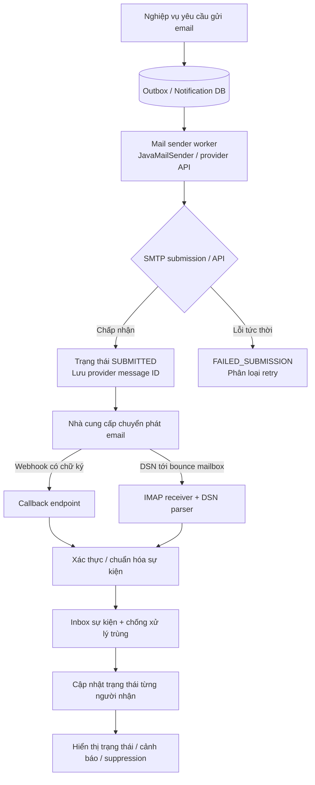

# Bounces, delivery status notification và phản hồi không đồng bộ

Một ứng dụng Spring Boot gọi `JavaMailSender.send(...)` để gửi email xác nhận đơn hàng. Hàm trả về bình thường, giao diện thông báo “Đã gửi email”. Mười phút sau, hệ thống email của người nhận trả về lỗi “User unknown”. Nếu ứng dụng chỉ dựa vào kết quả của lệnh `send(...)`, nó sẽ không biết email đã thất bại.

Đây là tình huống điển hình của **phản hồi bất đồng bộ trong hệ sinh thái email**. Đường đi của email có nhiều chặng, mỗi chặng có thể xác nhận một mức độ thành công khác nhau. **Bounce** và **Delivery Status Notification (DSN)** cho phép các hệ thống trao đổi thông tin về việc chuyển phát thất bại, bị trì hoãn hoặc, trong một số trường hợp, thành công. Đối với **Spring Framework Mail**, bài toán không chỉ là gọi SMTP để gửi thư, mà còn là thiết kế cách ghi nhận những gì xảy ra *sau khi* thư đã được máy chủ SMTP tiếp nhận.

## 1. Gửi thành công có nghĩa là thành công ở chặng nào?

Xem luồng xử lý một email gửi tới `buyer@example.net`:

```mermaid
sequenceDiagram
    participant App as Spring Boot
    participant SMTP as SMTP submission server
    participant Relay as Mail transfer / hàng đợi
    participant MX as Máy chủ tên miền nhận
    participant Box as Hộp thư người nhận
    App->>SMTP: SMTP: MAIL FROM, RCPT TO, DATA
    SMTP-->>App: 250 Queued / Accepted
    Note over App,SMTP: Ứng dụng chỉ biết máy chủ SMTP đã chấp nhận
    SMTP->>Relay: Chuyển tiếp email
    Relay->>MX: Thử phát thư
    alt Máy chủ nhận chấp nhận
        MX-->>Relay: 250 Accepted
        MX->>Box: Phân phối / lọc / lưu trữ theo chính sách
    else Lỗi tạm thời
        MX-->>Relay: 4xx Temporary failure
        Relay->>Relay: Xếp hàng và thử lại
    else Lỗi lâu dài
        MX-->>Relay: 5xx Permanent failure
        Relay-->>App: DSN/bounce tới địa chỉ nhận lỗi hoặc sự kiện provider
    end
```

Các kết quả cần tách biệt:

| Giai đoạn | Bằng chứng có thể quan sát | Điều **chưa** thể kết luận |
|---|---|---|
| Ứng dụng chuẩn bị thư | Tạo được đối tượng email và yêu cầu gửi | Chưa có máy chủ nào chấp nhận thư. |
| SMTP submission chấp nhận | Phản hồi `250` ở chặng submission; `send(...)` thường hoàn thành không lỗi | Chưa chắc máy chủ đích đã nhận, chưa chắc thư vào Inbox. |
| Máy chủ nhận chấp nhận | SMTP `2xx` ở chặng nhận hoặc sự kiện `delivered` do provider định nghĩa | Chưa chắc người dùng nhìn thấy thư; spam, quarantine hoặc lọc nội bộ vẫn có thể áp dụng. |
| Bị trì hoãn | SMTP `4xx` hoặc sự kiện deferred/delayed | Chưa phải thất bại vĩnh viễn; có thể được thử lại. |
| Không thể chuyển phát | SMTP `5xx` hoặc bounce/DSN `failed` đáng tin cậy | Cần biết thư thất bại ở người nhận nào và lý do cụ thể. |
| Người dùng mở thư | Tương tác trong ứng dụng hoặc tín hiệu theo dõi mở thư, nếu có | Tín hiệu mở thư có thể thiếu, sai lệch do proxy, chặn ảnh hoặc các cơ chế riêng tư. |

**SMTP là giao thức kiểu store-and-forward:** máy chủ trung gian có thể nhận trách nhiệm chuyển tiếp rồi xử lý tiếp trong hàng đợi. Vì vậy phản hồi `250` của máy chủ SMTP submission là sự chấp nhận tại một chặng, **không phải xác nhận chuyển phát đầu cuối**.

## 2. Bounce là gì?

**Bounce** thường chỉ thông báo rằng email không thể được chuyển phát đến một hoặc nhiều người nhận. Bounce còn được gọi là **non-delivery report** (NDR) hoặc thông báo thư bị trả lại.

Ví dụ:

- Hộp thư đích không tồn tại: `550 5.1.1 User unknown`.
- Tên miền hoặc địa chỉ không thể định tuyến, tùy ngữ cảnh lỗi.
- Hệ thống nhận từ chối vì chính sách chống spam hoặc yêu cầu xác thực.
- Hộp thư đầy kéo dài đến khi máy chủ gửi ngừng thử lại.
- Hạ tầng gửi hết thời gian retry mà vẫn không tiếp cận được hệ thống nhận.

Một email có thể bị lỗi theo **hai thời điểm khác nhau**.

### 2.1. Từ chối ngay trong phiên SMTP — phản hồi đồng bộ

Giả sử ứng dụng đang gửi qua một SMTP server và nhận:

```text
C: MAIL FROM:<bounce@example.com>
S: 250 OK
C: RCPT TO:<unknown@example.net>
S: 550 5.1.1 User unknown
```

Máy chủ đang đối thoại **từ chối người nhận ngay tại lệnh `RCPT TO`**. Bên gửi đã biết lỗi trong cùng phiên SMTP. Tùy ứng dụng có nhiều người nhận và cách thư viện xử lý, API gửi có thể ném ngoại lệ như `MailSendException`, chứa thêm chi tiết lỗi ở tầng SMTP/Jakarta Mail.

Đây là lỗi chuyển phát có thể nhận biết *đồng bộ*; nó không nhất thiết tạo ra một email bounce riêng.

### 2.2. Từ chối sau khi máy chủ trung gian đã nhận — phản hồi bất đồng bộ

Một luồng khác:

```text
14:00  Ứng dụng gửi thư tới smtp.provider.example
14:00  Submission server trả 250 2.0.0 Queued
14:02  Provider thử chuyển thư sang MX của example.net
14:02  MX trả 451 4.7.1 Temporary failure
14:10  Provider thử lại; MX tiếp tục trả lỗi tạm thời
15:30  Sau các lần thử, provider xác định không thể chuyển phát
15:30  Provider phát sinh DSN/bounce hoặc callback sự kiện "bounced"
```

Ở thời điểm 14:00, `JavaMailSender.send(...)` đã kết thúc. Thông tin lúc 15:30 là **một thông điệp/sự kiện khác được gửi ngược về sau**, không thể tự động xuất hiện trong giá trị trả về của lời gọi trước đó.

Điểm mấu chốt: **bounce là kết quả thất bại chuyển phát được báo về, không đồng nhất với mọi phản hồi SMTP `5xx`**. Một lỗi `5xx` có thể xảy ra trực tiếp trước khi máy chủ chấp nhận email; một bounce có thể đến sau khi thư đã được chấp nhận ở chặng trước.

### 2.3. Hard bounce và soft bounce

Đây là hai **cách phân loại nghiệp vụ phổ biến**, không phải hai loại thông điệp độc lập được định nghĩa cứng trong giao thức SMTP:

| Nhóm | Ý nghĩa thường gặp | Ví dụ | Cách xử lý điển hình |
|---|---|---|---|
| **Hard bounce** | Lỗi được đánh giá là lâu dài | Địa chỉ không tồn tại, miền không tồn tại, chính sách chặn lâu dài | Dừng gửi tự động đến địa chỉ đã xác minh là không hợp lệ; cho phép người dùng sửa địa chỉ. |
| **Soft bounce** | Lỗi tạm thời hoặc chưa có kết luận cuối | Hộp thư đầy tạm thời, rate limit, máy chủ nhận bận | Chờ/retry theo chính sách, giới hạn số lần, đánh giá lại nếu lỗi kéo dài. |

**Không nên phân loại cứng chỉ từ một chuỗi lỗi.** SMTP `4xx` thường diễn đạt lỗi tạm thời và `5xx` thường diễn đạt lỗi lâu dài; nhưng cách nhà cung cấp gắn nhãn `soft`/`hard` còn phụ thuộc lần retry, chính sách và trạng thái cuối. Ví dụ lỗi tạm thời kéo dài có thể dẫn đến **bounce cuối cùng** khi hết thời gian thử lại.

## 3. Delivery Status Notification (DSN) là gì?

**DSN** là cơ chế và định dạng thông báo tình trạng chuyển phát email, được chuẩn hóa để các hệ thống mail trao đổi thông tin máy có thể đọc. Những tài liệu nền tảng gồm:

- **RFC 3461:** mở rộng dịch vụ SMTP cho yêu cầu DSN.
- **RFC 3464:** định dạng MIME có cấu trúc cho DSN.
- **RFC 3463:** mã trạng thái email mở rộng (enhanced mail system status codes).

Trong thực tế, người dùng thường gọi mọi thông báo lỗi gửi email là “bounce”, nhưng **DSN** có nghĩa rộng hơn: thông báo có thể báo **thất bại** (`failed`), **trì hoãn** (`delayed`) và có thể báo các kết quả khác khi hệ thống hỗ trợ. Không phải nhà cung cấp hoặc máy chủ nào cũng tạo DSN đầy đủ theo mọi yêu cầu.

### 3.1. DSN có những trạng thái nào?

Ở phần theo từng người nhận của một DSN theo RFC 3464, trường `Action` thường nhận một trong các giá trị:

| `Action` | Ý nghĩa |
|---|---|
| `failed` | Không thể chuyển phát; báo cáo thất bại cuối cùng đối với người nhận đó. |
| `delayed` | Đã bị trì hoãn, còn có thể tiếp tục thử gửi. |
| `delivered` | Hệ thống báo đã chuyển phát thành công theo phạm vi nó quan sát được. |
| `relayed` | Đã chuyển tiếp cho một hệ thống khác nhưng không có xác nhận cuối cùng ở cùng mức độ. |
| `expanded` | Đã mở rộng địa chỉ thành nhiều người nhận, ví dụ khi xử lý danh sách phân phối. |

Trạng thái `Action` mô tả **sự kiện đối với một người nhận cụ thể**, không phải kết luận cho toàn bộ thư nếu email có nhiều người nhận. `delivered` trong DSN cũng không đồng nghĩa thư đã được đọc hoặc đã vào Inbox chính.

### 3.2. Mã SMTP và mã trạng thái mở rộng

Một phản hồi lỗi có thể gồm cả mã SMTP ba chữ số và mã trạng thái mở rộng dạng `X.Y.Z`:

```text
550 5.1.1 User unknown
451 4.7.1 Temporarily rate-limited
452 4.2.2 Mailbox full
550 5.7.1 Delivery not authorized
```

- **Mã SMTP ba chữ số** như `250`, `451`, `550`: kết quả lệnh giao tiếp SMTP.
- **Mã trạng thái mở rộng** như `5.1.1`, `4.2.2`: mô tả rõ hơn bản chất tình trạng. Chữ số đầu `2` = thành công, `4` = tình trạng tạm thời, `5` = lỗi lâu dài.
- **Chuỗi giải thích** như `User unknown` là văn bản có thể khác nhau giữa nhà cung cấp; dùng mã và trường có cấu trúc làm tín hiệu chính khi có.

Đừng phụ thuộc vào việc cắt chuỗi “Mailbox full” hoặc “blocked” để kết luận duy nhất. Cần giữ mã lỗi, nguồn báo lỗi, thời điểm và phân loại của nhà cung cấp.

### 3.3. Ví dụ cấu trúc của một email DSN

DSN chuẩn thường có kiểu MIME `multipart/report; report-type=delivery-status`. Ví dụ **rút gọn mang tính minh họa**:

```text
Return-Path: <>
From: Mail Delivery Subsystem <mailer-daemon@mx.example.com>
To: bounce@example.com
Subject: Delivery Status Notification (Failure)
MIME-Version: 1.0
Content-Type: multipart/report;
  report-type=delivery-status;
  boundary="dsnboundary"

--dsnboundary
Content-Type: text/plain; charset=UTF-8

Your message could not be delivered to unknown@example.net.

--dsnboundary
Content-Type: message/delivery-status

Reporting-MTA: dns; mx.example.com
Arrival-Date: Thu, 12 Nov 2026 14:00:00 +0700

Final-Recipient: rfc822; unknown@example.net
Action: failed
Status: 5.1.1
Remote-MTA: dns; inbound.example.net
Diagnostic-Code: smtp; 550 5.1.1 User unknown
Last-Attempt-Date: Thu, 12 Nov 2026 14:02:00 +0700

--dsnboundary
Content-Type: text/rfc822-headers

From: notify@example.com
To: unknown@example.net
Subject: Your verification code

--dsnboundary--
```

Các phần chính:

1. **Phần người đọc:** diễn giải bằng ngôn ngữ tự nhiên việc chuyển phát không thành công.
2. **Phần có cấu trúc `message/delivery-status`:** metadata về máy chủ báo cáo và một hoặc nhiều nhóm tình trạng theo người nhận.
3. **Phần thư gốc (không bắt buộc):** có thể chỉ chứa header hoặc nội dung thư ban đầu, tùy chính sách riêng tư và thiết lập hệ thống.

Một số trường hữu ích:

| Trường | Ý nghĩa |
|---|---|
| `Reporting-MTA` | Máy chủ tạo báo cáo. |
| `Original-Envelope-Id` | Mã phong bì ban đầu, nếu hệ thống có cung cấp và bảo toàn. |
| `Final-Recipient` | Người nhận cuối được báo cáo. |
| `Original-Recipient` | Người nhận nguyên thủy, nếu có thông tin này. |
| `Action` | Kết quả chuyển phát (`failed`, `delayed`, v.v.). |
| `Status` | Mã trạng thái mở rộng, ví dụ `5.1.1`. |
| `Diagnostic-Code` | Chi tiết chẩn đoán, có thể chứa phản hồi SMTP nhận được. |
| `Remote-MTA` | Máy chủ liên quan tới thử chuyển phát, nếu được ghi nhận. |
| `Last-Attempt-Date` | Thời điểm thử phát gần nhất, nếu có. |

**Không được giả định mọi bounce đều là DSN theo RFC 3464.** Có hệ thống trả thư bằng định dạng riêng, chỉ gửi phản hồi văn bản, hoặc đưa trạng thái vào bảng điều khiển/API/webhook của dịch vụ mail.

### 3.4. Vì sao nhiều DSN có `Return-Path: <>`?

Trong SMTP, **envelope sender** (`MAIL FROM`) là địa chỉ tiếp nhận thông báo lỗi chuyển phát. Khi máy chủ phát DSN do lỗi, nó thường gửi thông báo bằng **reverse-path rỗng**:

```text
MAIL FROM:<>
RCPT TO:<bounce@example.com>
```

Mục tiêu là tránh vòng lặp: nếu chính email báo lỗi không chuyển phát được, hệ thống **không nên tạo thêm một bounce khác về lỗi đó**, rồi lặp vô hạn.

`Return-Path` được thêm trong quá trình phát thư đến mailbox, phản ánh reverse-path của phong bì SMTP trong phạm vi hệ thống đã xử lý. **Header `From:` hiển thị và envelope sender không phải một**. Ví dụ thư có `From: notifications@example.com` nhưng bounce quay về `bounces.example.com` theo `MAIL FROM`.

## 4. Yêu cầu DSN trong phiên SMTP

SMTP có extension **DSN**. Máy khách có thể kiểm tra máy chủ công bố `DSN` trong phản hồi `EHLO`:

```text
C: EHLO app.example.com
S: 250-smtp.example.com
S: 250-STARTTLS
S: 250-DSN
S: 250 SIZE 52428800
```

Khi máy chủ hỗ trợ extension, máy khách có thể sử dụng những tham số như:

```text
MAIL FROM:<bounce@example.com> RET=HDRS ENVID=order-4821
RCPT TO:<buyer@example.net> NOTIFY=FAILURE,DELAY ORCPT=rfc822;buyer@example.net
DATA
...
```

| Tham số | Vị trí | Mục đích |
|---|---|---|
| `RET=HDRS` hoặc `RET=FULL` | `MAIL FROM` | Yêu cầu chỉ trả header hoặc nội dung đầy đủ của thông điệp gốc nếu tạo DSN thất bại. |
| `ENVID` | `MAIL FROM` | Gửi kèm mã nhận diện phong bì để hỗ trợ đối chiếu DSN. |
| `NOTIFY=FAILURE,DELAY` | `RCPT TO` | Yêu cầu thông báo khi thất bại hoặc bị trì hoãn. Có thể yêu cầu `SUCCESS` khi thích hợp. |
| `NOTIFY=NEVER` | `RCPT TO` | Yêu cầu không gửi DSN cho người nhận đó; `NEVER` không kết hợp với giá trị khác. |
| `ORCPT` | `RCPT TO` | Chỉ rõ người nhận ban đầu, hữu ích khi thư được chuyển tiếp hoặc biến đổi địa chỉ. |

Chú ý: việc máy chủ đầu tiên hỗ trợ DSN hoặc chấp nhận tham số **không bảo đảm hệ thống đích sẽ phát ra mọi loại thông báo**, cũng không bảo đảm các trường theo dõi được bảo toàn qua mọi máy chủ trung gian. Trong nhiều sản phẩm gửi mail, hệ thống **webhook sự kiện** của nhà cung cấp là nguồn quan sát thực dụng hơn.

## 5. Phản hồi bất đồng bộ đến ứng dụng bằng những đường nào?

Sau khi gửi email thành công ở chặng submission, ứng dụng có thể nhận trạng thái thông qua:

1. **Hộp thư bounce:** DSN được gửi về envelope sender/địa chỉ nhận bounce. Dịch vụ đọc email đến (thường IMAP hoặc cơ chế nhận mail chuyên dụng) phân tích cấu trúc DSN.
2. **Webhook của nhà cung cấp email:** nhà cung cấp gửi HTTP request đến endpoint của ứng dụng khi có sự kiện như `delivered`, `deferred`, `bounce`, `complaint`.
3. **API truy vấn sự kiện:** ứng dụng định kỳ đối chiếu trạng thái với nhà cung cấp, phù hợp khi không có webhook hoặc cần bổ sung những sự kiện đã bỏ lỡ.
4. **Hạ tầng nội bộ:** MTA hoặc hệ thống mail riêng có thể phát log/sự kiện lên message broker để dịch vụ xử lý.

Không có một chuẩn chung bắt buộc mọi webhook dùng cùng cấu trúc JSON. Mỗi nhà cung cấp có định nghĩa trạng thái, cơ chế xác thực callback và chính sách retry khác nhau; ứng dụng nên **chuẩn hóa thành event nội bộ** trước khi tác động đến nghiệp vụ.

### 5.1. Một luồng xử lý end-to-end



Trong mô hình này, **outbox** ở bước đầu là bản ghi ý định gửi được lưu bền vững theo giao dịch nghiệp vụ; **inbox sự kiện** ở bước nhận là kho ghi các callback/DSN để xử lý đúng một lần ở mức tác động nghiệp vụ, dù nhà cung cấp gửi lại nhiều lần. Tên `outbox`/`inbox` ở đây là **mẫu thiết kế dữ liệu**, không liên quan trực tiếp đến thư mục Inbox của hộp email.

### 5.2. Các mốc trạng thái nội bộ

Một hệ thống có thể lưu trạng thái gửi theo **từng người nhận**, ví dụ:

| Trạng thái | Ý nghĩa ứng dụng |
|---|---|
| `PENDING` | Đã có yêu cầu gửi nhưng chưa gửi tới hạ tầng email. |
| `SUBMITTING` | Worker đã nhận xử lý yêu cầu; chưa biết kết quả submission. |
| `SUBMITTED` | SMTP/API chấp nhận hoặc đã tạo message ID phía provider. |
| `DEFERRED` | Hệ thống mail báo trở ngại tạm thời, còn có thể thử tiếp. |
| `DELIVERED` | Provider/DSN báo đã chuyển phát theo định nghĩa của họ. |
| `BOUNCED` | Có sự kiện thất bại cuối cùng đối với người nhận. |
| `FAILED_SUBMISSION` | Ứng dụng không thể bàn giao email cho hạ tầng gửi; có thể là lỗi tạm thời hoặc lâu dài. |
| `UNKNOWN` | Không có đủ bằng chứng về kết quả sau thời gian theo dõi. |

Đây chỉ là **ví dụ mô hình nghiệp vụ**, không phải bộ trạng thái bắt buộc của Spring hoặc SMTP. Một số hệ thống dùng mô hình nhiều chiều thay vì một enum duy nhất, chẳng hạn `submissionStatus`, `deliveryStatus`, `engagementStatus` và `suppressionStatus`. Cách này tránh nhầm sự kiện complaint hoặc unsubscribe với kết quả chuyển phát SMTP.

## 6. Liên hệ với Spring Framework Mail

### 6.1. `JavaMailSender` xử lý phía gửi

Spring Boot thường tích hợp SMTP thông qua starter Mail:

```groovy
dependencies {
    implementation 'org.springframework.boot:spring-boot-starter-mail'
}
```

Ví dụ cấu hình `application.yml` cho submission qua cổng 587 với STARTTLS:

```yaml
spring:
  mail:
    host: ${MAIL_HOST}
    port: 587
    username: ${MAIL_USERNAME}
    password: ${MAIL_PASSWORD}
    properties:
      mail:
        smtp:
          auth: true
          starttls:
            enable: true
            required: true
          connectiontimeout: 5000
          timeout: 5000
          writetimeout: 5000
```

Các biến môi trường cần được cấp qua cơ chế quản lý bí mật của môi trường triển khai. Nếu nhà cung cấp yêu cầu implicit TLS cổng 465, phải dùng cấu hình SSL/TLS phù hợp với cổng đó.

Một service gửi mail tối thiểu:

```java
import org.springframework.mail.MailException;
import org.springframework.mail.SimpleMailMessage;
import org.springframework.mail.javamail.JavaMailSender;
import org.springframework.stereotype.Service;

@Service
public class OrderMailSender {
    private final JavaMailSender mailSender;

    public OrderMailSender(JavaMailSender mailSender) {
        this.mailSender = mailSender;
    }

    public void submitOrderConfirmation(String recipient, String orderCode) {
        SimpleMailMessage message = new SimpleMailMessage();
        message.setFrom("orders@example.com");
        message.setTo(recipient);
        message.setSubject("Xác nhận đơn hàng " + orderCode);
        message.setText("Đơn hàng " + orderCode + " đã được ghi nhận.");

        try {
            mailSender.send(message);
            // Chỉ có thể xác nhận submission ở mức SMTP mà thư viện biết.
            // Chưa thể ghi nhận là DELIVERED hoặc đọc thư.
        } catch (MailException exception) {
            // Ghi nhận lỗi submission; phân loại retry theo nguyên nhân.
            // Không coi mọi lỗi là địa chỉ nhận không tồn tại.
            throw exception;
        }
    }
}
```

Mẫu trên tập trung vào **ranh giới trách nhiệm**. Trong một hệ thống đầy đủ, thay vì cập nhật trực tiếp trạng thái cuối ngay tại `send(...)`, dịch vụ gửi nên ghi bền vững `notificationId`, địa chỉ nhận, thời điểm thử gửi và kết quả submission. Việc gửi thật nên được gọi từ worker/outbox khi nghiệp vụ có yêu cầu chắc chắn không mất thông báo.

**Giới hạn quan trọng:** `JavaMailSender` không có phương thức chuẩn kiểu `waitUntilRecipientReceives(...)`. Một exception SMTP mô tả lỗi mà máy khách biết lúc gửi; DSN và callback xảy ra sau đó phải đi vào một cơ chế **nhận riêng**.

### 6.2. Nhận sự kiện từ provider webhook

Giả sử nhà cung cấp trả về một sự kiện chuẩn hóa có các trường như sau:

```json
{
  "eventId": "evt_9421",
  "notificationId": "notify_4821",
  "providerMessageId": "provider-msg-571",
  "recipient": "buyer@example.net",
  "type": "BOUNCE",
  "bounceClass": "HARD",
  "smtpReplyCode": 550,
  "enhancedStatus": "5.1.1",
  "occurredAt": "2026-11-12T08:30:00Z"
}
```

**Đây là schema nội bộ minh họa, không phải payload chuẩn của mọi nhà cung cấp.** Adapter phía ngoài phải kiểm tra nguồn gửi, chuẩn hóa payload thật của dịch vụ và gắn được callback với bản ghi gửi ban đầu.

Ví dụ bộ điều khiển HTTP ở mức kiến trúc:

```java
@RestController
@RequestMapping("/internal/mail")
class MailEventController {
    private final MailWebhookVerifier verifier;
    private final MailEventIngestion ingestion;

    MailEventController(
            MailWebhookVerifier verifier,
            MailEventIngestion ingestion) {
        this.verifier = verifier;
        this.ingestion = ingestion;
    }

    @PostMapping("/events")
    ResponseEntity<Void> accept(
            @RequestHeader HttpHeaders headers,
            @RequestBody byte[] rawBody) {
        // Pseudocode về hợp đồng; các interface tùy nhà cung cấp.
        if (!verifier.isValid(headers, rawBody)) {
            return ResponseEntity.status(HttpStatus.UNAUTHORIZED).build();
        }

        ingestion.persistForProcessing(rawBody);
        return ResponseEntity.ok().build();
    }
}
```

Trong ví dụ trên, `MailWebhookVerifier` và `MailEventIngestion` là **các abstraction do ứng dụng tự định nghĩa**; snippet không phải một ứng dụng hoàn chỉnh. Các điểm thực thi quan trọng:

- Xác minh chữ ký/token callback bằng **raw request body** và cơ chế đúng của nhà cung cấp; nếu có timestamp/nonce thì kiểm tra chống replay.
- Lưu sự kiện vào kho bền vững rồi mới trả HTTP `2xx`; nếu lưu thất bại, trả lỗi có thể retry theo hợp đồng provider.
- Dùng `eventId` hoặc khóa duy nhất thích hợp để bỏ qua callback gửi lại, nhưng vẫn trả thành công cho sự kiện trùng đã xử lý.
- Đưa xử lý trạng thái nghiệp vụ vào worker/giao dịch riêng; không giữ request HTTP để chờ toàn bộ nghiệp vụ hoàn tất.
- Không tin mặc định các trường `recipient`, `type`, `reason` trong request chưa xác thực.

Ở mô hình thực tế, có thể tổ chức code thành adapter provider → normalized event → event inbox → state machine/suppression service. Controller chỉ chịu trách nhiệm tiếp nhận an toàn.

### 6.3. Nhận DSN qua mailbox

Nếu sử dụng SMTP server trực tiếp hoặc không có webhook, hệ thống có thể cấu hình địa chỉ bounce chuyên dụng như `bounce@example.com` và đọc thư đến bằng **IMAP/Jakarta Mail** hoặc **Spring Integration Mail**.

Luồng gợi ý:

1. Máy chủ mail nhận DSN vào mailbox chuyên trách.
2. Receiver đọc email bằng tài khoản có quyền tối thiểu, xác định `Content-Type: multipart/report` và phần `message/delivery-status` nếu có.
3. Parser đọc metadata theo từng người nhận: `Final-Recipient`, `Action`, `Status`, `Diagnostic-Code`, cùng thông tin đối chiếu thông điệp gốc khi có.
4. Adapter chuẩn hóa thành sự kiện nội bộ, ghi bền vững, chống trùng và cập nhật bản ghi gửi.
5. Sau khi xử lý an toàn, receiver đánh dấu/di chuyển thư đã xử lý hoặc lưu vị trí nhận để không bỏ sót khi khởi động lại.

Điều cần cẩn trọng là **không phải email nhận từ “MAILER-DAEMON” đều là DSN xác thực**. Thư giả mạo, autoresponder và nội dung độc hại có thể mang tên tương tự. Chỉ dựa vào `From`, `Subject` hoặc chuỗi “Delivery failed” là không đủ để tự động khóa địa chỉ người dùng.

Ngoài ra, header `Message-ID` trong phần thư gốc có thể không được gửi kèm hoặc bị biến đổi; đừng thiết kế hệ thống dựa vào đúng một trường không chắc có mặt.

## 7. Đối chiếu phản hồi với đúng email và người nhận

Đây là một trong những phần khó nhất khi xử lý bounce. Không chỉ cần biết “email thất bại”, ứng dụng phải biết **thông báo nghiệp vụ nào, lần gửi nào và người nhận nào** bị ảnh hưởng.

### 7.1. Phân biệt các mã định danh

| Định danh | Do ai tạo | Dùng để làm gì? |
|---|---|---|
| `notificationId` | Ứng dụng | Khóa nghiệp vụ nội bộ để theo dõi một thông báo cần gửi. |
| `attemptId` | Ứng dụng | Ghi nhận mỗi lần thử submission, hỗ trợ xử lý retry. |
| `providerMessageId` | Nhà cung cấp email | Gắn sự kiện provider với yêu cầu đã được hệ thống họ nhận. |
| `Message-ID` | Hệ thống tạo MIME message | Header nhận diện thông điệp ở tầng nội dung; hữu ích nhưng không phải khóa duy nhất đáng tin trong mọi DSN. |
| `ENVID` | Máy khách SMTP (khi DSN extension được hỗ trợ) | Hỗ trợ đối chiếu phong bì ban đầu nếu được bảo toàn trong DSN. |
| `envelope sender / VERP` | Hệ thống gửi | Có thể mã hóa khóa liên hệ vào địa chỉ bounce để hỗ trợ routing. |

**VERP (Variable Envelope Return Path)** là kỹ thuật đặt địa chỉ trả lỗi thay đổi theo lần gửi hoặc người nhận, ví dụ `bounce+notify4821.recipient7@example.com`. Khi DSN quay về địa chỉ đó, hệ thống có thêm dữ liệu đối chiếu. Nhưng phải kiểm tra nhà cung cấp có hỗ trợ custom return-path/bounce routing hay không; nhiều nền tảng quản lý envelope sender của họ và cung cấp event ID riêng.

Đừng nhầm **header `From:`** với **envelope sender `MAIL FROM`**. Sửa `From:` hiển thị không tự động thay đổi nơi nhận DSN. Trong Jakarta Mail, tùy SMTP transport và cấu hình, envelope sender có thể điều khiển qua thuộc tính như `mail.smtp.from` hoặc đối tượng SMTP message chuyên dụng; cách làm cụ thể cần phù hợp với Spring `JavaMailSenderImpl` và chính sách của provider.

### 7.2. Một thư có nhiều người nhận

Giả sử ứng dụng gửi cùng một email cho A và B:

```text
MAIL FROM:<bounce@example.com>
RCPT TO:<a@example.net>  -> 250 OK
RCPT TO:<b@example.org>  -> 250 OK
DATA                       -> 250 Queued
```

Sau đó A được phát thành công, còn B bị bounce. Nếu hệ thống chỉ lưu một cờ `DELIVERED` cho toàn bộ thư, nó sẽ đánh mất thông tin người nhận B.

Một mô hình dễ theo dõi là:

```text
notification
  id
  business_key
  created_at

notification_recipient
  notification_id
  recipient
  current_delivery_status

send_attempt
  attempt_id
  notification_id
  provider_message_id
  submission_status
  submitted_at

delivery_event
  source
  external_event_id
  attempt_id
  recipient
  event_type
  occurred_at
  received_at
  diagnostic_code
```

Đây là sơ đồ dữ liệu khái niệm. Cần khóa duy nhất phù hợp để chống trùng callback, ràng buộc theo provider/tài khoản, và chính sách lưu thông tin nhận diện người dùng.

## 8. Xử lý retry, sự kiện trùng và sự kiện đến sai thứ tự

### 8.1. Lỗi nào nên thử lại?

- **Lỗi tạm thời ở submission** (mất kết nối, timeout, SMTP `4xx`): có thể retry với exponential backoff và jitter, trong giới hạn thời gian/đợt retry.
- **Lỗi ở chặng chuyển phát sau submission:** thông thường hạ tầng SMTP/provider tự retry; ứng dụng cần tránh tự gửi lại một **email mới** chỉ vì thấy `deferred`, vì điều đó có thể tạo thư trùng.
- **Lỗi cuối cùng** (DSN `failed`, provider `hard bounce` đáng tin cậy): thường nên dừng retry đến địa chỉ đó cho tới khi có thay đổi hợp lệ hoặc cơ chế xử lý cụ thể.
- **Lỗi cấu hình/xác thực tài khoản gửi**: cần sửa cấu hình hoặc quyền; retry liên tục với cùng cấu hình không giải quyết nguyên nhân.

Một vùng nguy hiểm là **timeout khi gọi SMTP/API**: ứng dụng có thể không biết máy chủ đã chấp nhận thư trước khi kết nối đứt hay chưa. Retry có thể gây gửi trùng. Sử dụng khóa idempotency nếu API nhà cung cấp hỗ trợ; nếu không, lưu attempt và thiết kế quy trình đối chiếu, chấp nhận rằng SMTP thuần không tự cung cấp exactly-once cho nghiệp vụ.

### 8.2. Sự kiện bất đồng bộ không có thứ tự tuyệt đối

Giả sử:

```text
10:00  provider ghi nhận DEFERRED
10:03  provider ghi nhận DELIVERED
10:04  webhook DELIVERED đến ứng dụng
10:05  webhook DEFERRED cũ mới đến ứng dụng
```

Nếu chỉ lấy “sự kiện nhận sau cùng” để ghi đè trạng thái, hệ thống sẽ quay từ `DELIVERED` về `DEFERRED` dù thư đã chuyển phát thành công.

Một số nguyên tắc vận hành:

1. Lưu **lịch sử sự kiện bất biến** để truy vết.
2. Phân biệt `occurredAt` (thời gian sự kiện phía nguồn) và `receivedAt` (lúc ứng dụng nhận); thời gian từ các nguồn khác nhau có thể lệch.
3. Định nghĩa quy tắc chuyển trạng thái hợp lệ dựa trên **attempt, recipient, loại sự kiện, nguồn và độ tin cậy**, không mặc định “last write wins”.
4. Ghi nhận callback trùng bằng khóa duy nhất, bảo đảm xử lý idempotent.
5. Trường hợp có các sự kiện mâu thuẫn (chẳng hạn `BOUNCED` và `DELIVERED` cho cùng attempt/recipient), lưu nguyên bản và đối chiếu với provider; không âm thầm xóa dấu vết.

### 8.3. Địa chỉ suppression

**Suppression list** là danh sách địa chỉ không được tự động gửi tiếp trong một số điều kiện. Ví dụ:

- Hard bounce đã xác minh: tránh gửi liên tục đến địa chỉ rõ ràng không tồn tại.
- Spam complaint: áp dụng chính sách ngừng gửi và xử lý phản ánh.
- Người dùng unsubscribe khỏi email marketing: tuân thủ lựa chọn nhận thư của họ.

Không nên gộp tất cả các lý do vào một cờ `blocked` thiếu thông tin. Email giao dịch bắt buộc, email marketing và email bảo mật có thể có chính sách khác nhau; mỗi hệ thống cần thiết kế quyền ưu tiên, khả năng sửa địa chỉ, lịch sử và kiểm soát vận hành phù hợp.

## 9. Các tình huống và bẫy thường gặp

### 9.1. Bounce và auto-reply có giống nhau không?

Không. Thông báo out-of-office (“Tôi đang nghỉ phép”) là **phản hồi tự động từ phía hộp thư hoặc người dùng**; nó không chứng minh email thất bại chuyển phát. DSN thường biểu diễn tình trạng truyền tải. **MDN (Message Disposition Notification)**, đôi khi gọi là read receipt, lại là cơ chế thông báo cách ứng dụng nhận xử lý/thể hiện thư; nó **khác với DSN** và cũng không bảo đảm người thật đã đọc nội dung.

### 9.2. Có DSN thành công thì chắc chắn đã vào Inbox?

Không. DSN `delivered` hoặc event `delivered` của provider thường nói rằng thư đã được nhận ở một phạm vi kỹ thuật cụ thể. Hệ thống spam, quarantine, bộ lọc nội bộ và hành vi người dùng là các bước khác. Chính sách của provider quyết định ý nghĩa chính xác của callback “delivered”.

### 9.3. Không thấy bounce thì email đã thành công?

Không. DSN có thể không được yêu cầu, không được hỗ trợ, bị chặn, thất lạc, hoặc nhà cung cấp không phát callback cho trường hợp đó. **Không có bằng chứng thất bại** không đồng nghĩa **có bằng chứng thành công**. Sau một ngưỡng theo dõi, trạng thái `UNKNOWN` có thể trung thực hơn `DELIVERED`.

### 9.4. Bounce có thể bị giả mạo không?

Có. Người gửi có thể bị giả mạo trong email thông thường, tạo ra **backscatter**: một máy chủ gửi bounce tới người vô can vì địa chỉ phong bì bị giả. Vì vậy hệ thống nhận bounce không nên tự động tin toàn bộ nội dung DSN hoặc khóa tài khoản chỉ vì một email không xác thực tự xưng là lỗi chuyển phát.

Với hệ thống tự vận hành MTA, nên từ chối những địa chỉ không hợp lệ **trong phiên SMTP** khi có thể thay vì nhận rồi mới tạo bounce gửi đến địa chỉ có thể bị giả mạo. Với webhook, hãy kiểm tra chữ ký/hợp đồng của nhà cung cấp; với mailbox, hãy có quy tắc đối chiếu cùng log gửi và nhiều dấu hiệu tin cậy.

### 9.5. Có cần lưu nguyên email đã bounce?

Không phải lúc nào cũng cần. Bản DSN có thể đính kèm header, địa chỉ và thậm chí nội dung email ban đầu. Để điều tra vận hành, thường chỉ cần mã tham chiếu, người nhận, mã trạng thái, nguyên nhân, thời gian và nguồn sự kiện. Nếu lưu bản gốc, hãy hạn chế quyền truy cập, thời gian lưu trữ, che dữ liệu cá nhân, tránh log mật khẩu/OTP và không hiển thị HTML không tin cậy như nội dung an toàn.

## 10. Quan sát, đo lường và vận hành

Một hệ thống gửi mail nên theo dõi số liệu theo **nguồn/provider, tên miền người nhận, loại thư và khoảng thời gian**, ví dụ:

| Chỉ số | Cách hiểu |
|---|---|
| `submission_acceptance_rate` | Tỷ lệ yêu cầu được SMTP/API chấp nhận so với những yêu cầu đã thử gửi. |
| `temporary_failure_rate` | Tỷ lệ lỗi tạm thời tại submission hoặc delivery, cần tách rõ giai đoạn. |
| `hard_bounce_rate` | Tỷ lệ bản ghi gửi/người nhận có hard bounce cuối cùng theo phân loại đáng tin cậy. |
| `delivery_confirmation_rate` | Tỷ lệ có xác nhận chuyển phát; phụ thuộc provider và độ đầy đủ của sự kiện. |
| `event_ingestion_lag` | Chênh lệch giữa thời điểm sự kiện xảy ra và thời điểm xử lý. |
| `unknown_outcome_count` | Số lần gửi chưa có kết quả sau ngưỡng theo dõi. |
| `duplicate_webhook_count` | Số webhook bị gửi lại/đã có trong inbox sự kiện. |

Khi tính tỷ lệ, cần thống nhất **mẫu số** (lượt gửi, thông điệp hay người nhận) và cửa sổ thời gian; nếu sự kiện đến muộn, tỷ lệ của lô gửi gần đây sẽ chưa hoàn chỉnh. Một email có ba người nhận có thể tạo ba kết quả chuyển phát khác nhau.

Ví dụ cảnh báo vận hành:

- Bounce `5.1.1` tăng đột biến sau đợt import danh sách người nhận: có thể do dữ liệu địa chỉ sai.
- Lỗi `4.7.x` tăng trên một miền đích: có thể là rate limit hoặc chính sách chống lạm dụng; cần kiểm tra danh tiếng và nhịp gửi.
- Nhiều thư ở `SUBMITTED` nhưng không có sự kiện: kiểm tra webhook endpoint, secret, độ trễ, hàng đợi callback và khả năng provider không công bố sự kiện.
- Số sự kiện trùng tăng: kiểm tra việc trả HTTP status và thời gian xử lý của callback; retry của nhà cung cấp thường là hành vi hợp lệ.

## 11. Tình huống thực hành

Một ứng dụng gửi email xác nhận thanh toán đến `customer@example.net` và ghi nhận:

```text
09:00:01  SMTP submission: 250 2.0.0 Accepted
09:01:30  Provider event: deferred, 451 4.7.1
09:07:00  Provider event: deferred, 451 4.7.1
09:12:20  Provider event: delivered
09:13:00  Callback deferred của 09:01:30 được gửi lại
```

Hãy tự trả lời:

1. Ở 09:00:01, ứng dụng nên ghi `SUBMITTED` hay `DELIVERED`? Vì sao?
2. Có nên gửi lại một email hoàn toàn mới ở 09:01:30 khi thấy `deferred` không?
3. Sau sự kiện 09:12:20, callback cũ đến ở 09:13:00 có được phép ghi đè trạng thái cuối thành `DEFERRED` không?
4. Những khóa nào giúp phân biệt callback trùng với một lần gửi mới?
5. Nếu provider không phát callback nào sau `250 Accepted`, ứng dụng nên thể hiện trạng thái thế nào để tránh khẳng định quá mức?

Trong một trường hợp khác, SMTP trả `550 5.1.1` ngay ở `RCPT TO`. Hãy xác định đây là lỗi đồng bộ hay bất đồng bộ, có nên chờ DSN mới kết luận hay không, và cách ghi lỗi đủ thông tin để hỗ trợ người dùng sửa địa chỉ.

## 12. Nguyên tắc thiết kế cần ghi nhớ

**Một luồng email đáng tin cậy có hai nửa độc lập nhưng liên quan nhau:** gửi thông điệp đến hạ tầng SMTP/API và tiếp nhận những bằng chứng chuyển phát xuất hiện về sau. `JavaMailSender` giúp triển khai phần gửi; bounce mailbox, DSN parser, webhook và event processing đảm nhiệm phần phản hồi.

Để hệ thống hoạt động đúng trong thực tế, hãy lưu bền vững các lần thử gửi, theo dõi người nhận riêng biệt, xác minh nguồn sự kiện, xử lý callback trùng hoặc đảo thứ tự và phân biệt **chấp nhận gửi**, **đang thử chuyển phát**, **đã xác nhận chuyển phát**, **thất bại cuối cùng** và **không rõ kết quả**. Khi thư thất bại, mã trạng thái và dữ liệu chẩn đoán hỗ trợ quyết định retry, suppression hoặc yêu cầu người dùng sửa địa chỉ.

**Các tài liệu giao thức nên tham khảo:** RFC 5321 (SMTP), RFC 3461 (SMTP DSN extension), RFC 3464 (DSN message format), RFC 3463 (enhanced mail status codes). Khi triển khai, đối chiếu thêm tài liệu sự kiện, retry và xác thực webhook chính thức của nhà cung cấp email đang dùng.
