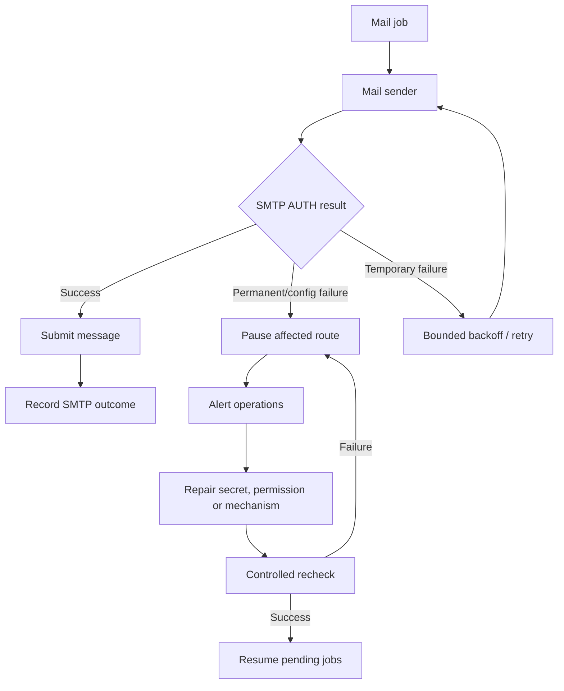

# MailAuthenticationException khi xác thực thất bại

Trong **Spring Framework Mail**, `MailAuthenticationException` là exception dùng để thông báo việc **xác thực với máy chủ thư không thành công**. Lỗi này thường xuất hiện khi ứng dụng dùng `JavaMailSender` để kết nối SMTP với tài khoản hoặc phương thức xác thực không được máy chủ chấp nhận.

Một ví dụ điển hình là tài khoản SMTP có mật khẩu sai, tài khoản đã bị khóa, ứng dụng dùng mật khẩu thông thường khi nhà cung cấp yêu cầu app password hoặc OAuth2, hoặc máy chủ không cho phép cơ chế `AUTH` mà ứng dụng đang sử dụng. Tuy nhiên, **không phải mọi lỗi gửi email đều là lỗi xác thực**: lỗi kết nối mạng, TLS, địa chỉ người nhận, kích thước thư và chính sách gửi là các nhóm sự cố khác nhau.

Mục tiêu khi chẩn đoán là xác định **thời điểm lỗi xảy ra**, **thông điệp phản hồi SMTP**, **cấu hình client** và **chính sách của nhà cung cấp**, thay vì chỉ thấy `MailAuthenticationException` rồi liên tục đổi mật khẩu hoặc retry. Bài học này hướng dẫn cách đọc chuỗi exception, xác định nguyên nhân, cấu hình Spring Boot, xử lý OAuth2/TLS, thiết kế phản hồi an toàn và kiểm thử.

## 1. MailAuthenticationException nằm ở đâu trong Spring Mail?

Spring cung cấp các lớp liên quan:

| Thành phần | Vai trò |
|---|---|
| `JavaMailSender` | Giao diện tạo và gửi `MimeMessage`. |
| `JavaMailSenderImpl` | Triển khai sender dựa trên Jakarta Mail. |
| `MailException` | Exception runtime cơ sở của Spring Mail. |
| `MailAuthenticationException` | Lỗi liên quan đến xác thực tài khoản mail. |
| `MailSendException` | Lỗi phát sinh khi gửi message; có thể có thông tin message gửi thất bại. |
| `MailPreparationException` | Lỗi chuẩn bị message/MIME trước khi gửi trong một số luồng. |
| `jakarta.mail.AuthenticationFailedException` | Lỗi xác thực ở tầng Jakarta Mail, thường là nguyên nhân gốc của `MailAuthenticationException`. |
| `jakarta.mail.MessagingException` | Exception checked liên quan đến thao tác message hoặc transport. |

Trong Spring Framework 6 và Jakarta Mail, code thường import:

```java
import org.springframework.mail.MailAuthenticationException;
import org.springframework.mail.MailException;
import org.springframework.mail.javamail.JavaMailSender;
import jakarta.mail.AuthenticationFailedException;
```

Ứng dụng Spring đời cũ có thể dùng namespace `javax.mail` thay vì `jakarta.mail`. Không trộn các namespace hoặc sử dụng dependency Jakarta Mail không tương thích với phiên bản Spring của dự án.

### Quan hệ ngoại lệ

```text
Spring MailException
    |
    +-- MailAuthenticationException
    |
    +-- MailSendException
    |
    +-- MailPreparationException

Jakarta Mail AuthenticationFailedException
    |
    v
Cause của MailAuthenticationException
(trong những trường hợp xác thực bị từ chối)
```

`MailAuthenticationException` là một `MailException`, nên code bắt `MailException` cũng có thể bắt lỗi xác thực. Tuy nhiên, nếu cần phân loại lỗi đúng cách, hãy đặt `catch (MailAuthenticationException)` trước `catch (MailException)`.

## 2. Xác thực SMTP diễn ra ở bước nào?

Một phiên gửi email qua SMTP submission thường đi qua các bước:

```text
Application
    |
    v
Connect smtp.example.org:587
    |
    v
SMTP greeting (220)
    |
    v
EHLO -> server capabilities
    |
    v
STARTTLS -> TLS handshake
    |
    v
EHLO again / negotiated capabilities
    |
    v
AUTH <mechanism>
    |
    +--> Success -> SMTP submission allowed
    |
    +--> Failure -> AuthenticationFailedException
    |
    v
MAIL FROM / RCPT TO / DATA
    |
    v
SMTP accepts message
```

Sơ đồ mô tả luồng điển hình dùng port 587 và STARTTLS. Với port 465, TLS thường được thiết lập ngay khi kết nối (*implicit TLS*), không cần bước STARTTLS theo cách này.

**Xác thực thành công không đồng nghĩa với gửi thành công.** Sau bước AUTH, server vẫn có thể từ chối địa chỉ From, recipient, nội dung hoặc giới hạn gửi. Ngược lại, lỗi kết nối hoặc TLS xảy ra trước AUTH không nhất thiết là lỗi mật khẩu.

### Ví dụ phản hồi SMTP

Một phiên xác thực thất bại có thể chứa phản hồi như:

```text
535 5.7.8 Authentication credentials invalid
```

Ý nghĩa tổng quát:

- `535`: thông tin xác thực không được chấp nhận.
- `5.7.8`: mã trạng thái mở rộng có liên quan đến thông tin xác thực.
- Phần mô tả bằng chữ: do server cung cấp và có thể khác giữa các nhà cung cấp.

Đây là ví dụ, **không phải thông điệp cố định mà Spring luôn trả về**. Nhà cung cấp có thể trả mã khác, message khác hoặc che bớt chi tiết vì lý do bảo mật.

## 3. Triệu chứng thường thấy trong stack trace

Ví dụ log rút gọn:

```text
org.springframework.mail.MailAuthenticationException:
  Authentication failed
Caused by: jakarta.mail.AuthenticationFailedException:
  535 5.7.8 Authentication credentials invalid
```

Điểm cần đọc:

1. **Exception Spring bên ngoài**: `MailAuthenticationException`.
2. **Cause bên trong**: thường là `AuthenticationFailedException`.
3. **Mã SMTP**: có thể chỉ ra sai credential, cơ chế AUTH không được phép hoặc chính sách tài khoản.
4. **Thời điểm**: ở bước kết nối/xác thực hay sau khi message đã được đưa sang SMTP.
5. **Host/port/mode TLS**: xác định server và chế độ submission thực tế.

Đừng kết luận chỉ từ chữ “Authentication failed”. Một số server dùng thông báo chung cho nhiều chính sách: mật khẩu không hợp lệ, tài khoản bị chặn đăng nhập SMTP, cần OAuth2, chưa được cấp quyền gửi hoặc IP đang bị giới hạn.

### Đọc cause chain bằng Java

```java
import org.springframework.mail.MailAuthenticationException;
import org.springframework.mail.MailException;

try {
    mailSender.send(message);
} catch (MailAuthenticationException exception) {
    Throwable cause = exception.getCause();

    logger.warn(
            "SMTP authentication failed, causeType={}",
            cause == null ? "unknown" : cause.getClass().getSimpleName()
    );

    throw exception;
} catch (MailException exception) {
    logger.error(
            "Mail submission failed, errorType={}",
            exception.getClass().getSimpleName()
    );
    throw exception;
}
```

Không log username/password, raw AUTH command, access token hoặc toàn bộ `MimeMessage`. Một số thông điệp gốc có thể chứa địa chỉ tài khoản hoặc dữ liệu nội bộ; hãy kiểm soát thông tin được ghi log.

## 4. Phân biệt lỗi xác thực với các lỗi liên quan

Các mã SMTP và giai đoạn xử lý giúp định hướng, nhưng phải xét cả nguyên nhân thực tế.

| Triệu chứng hoặc phản hồi | Nhóm nghi vấn | Không nên kết luận vội |
|---|---|---|
| `535 5.7.8` | Credential hoặc cơ chế xác thực bị từ chối | Chỉ có thể là sai mật khẩu. |
| `534` kèm hướng dẫn của provider | Chính sách tài khoản hoặc phương thức đăng nhập | Spring Mail bị lỗi. |
| `530 5.7.0 Authentication required` | Client chưa AUTH, hoặc server yêu cầu AUTH trước thao tác gửi | Mật khẩu chắc chắn sai. |
| `504 5.5.4` với AUTH mechanism | Cơ chế AUTH không được hỗ trợ/chấp nhận | Server không cho phép gửi email nói chung. |
| `454 4.7.0` | Có thể là lỗi xác thực tạm thời hoặc dịch vụ AUTH không khả dụng | Cần thay đổi credential ngay. |
| `421` hoặc timeout khi kết nối | Server/network/service không khả dụng | Lỗi password. |
| TLS handshake exception | Chứng chỉ, protocol hoặc cấu hình TLS | Lỗi AUTH. |
| `550` ở `MAIL FROM` hoặc `RCPT TO` | Quyền gửi, sender policy hoặc recipient rejection | Luôn là `MailAuthenticationException`. |

Mã phản hồi là tín hiệu chẩn đoán, không phải hợp đồng lỗi tuyệt đối áp dụng cho mọi nhà cung cấp. Một số hệ thống không để lộ mã mở rộng; đôi khi cần đọc dashboard quản trị, tài liệu provider hoặc log server SMTP.

### 530 Authentication required có nghĩa gì?

Thông báo `530 Authentication required` thường cho thấy client chưa xác thực trong khi server đòi AUTH để thực hiện thao tác tiếp theo. Khi đó cần kiểm tra `mail.smtp.auth=true` và server có công bố hỗ trợ AUTH sau khi STARTTLS hay không.

Nó khác với tình huống client đã AUTH nhưng credential bị từ chối (`535`). Hai lỗi có thể liên quan đến cấu hình xác thực, nhưng cách sửa không giống nhau.

## 5. Những nguyên nhân phổ biến

### 5.1. Username hoặc password không đúng

Có thể xảy ra do:

- Gõ nhầm credential.
- Secret chưa được cập nhật sau khi đổi mật khẩu.
- Environment variable rỗng, bị cắt hoặc chứa ký tự thừa.
- Đọc nhầm cấu hình của profile khác.
- Username phải là địa chỉ email đầy đủ nhưng code chỉ dùng local-part.
- Tài khoản đã bị disable hoặc bị khóa.

Ví dụ ứng dụng dùng:

```yaml
spring:
  mail:
    username: ${SMTP_USERNAME}
    password: ${SMTP_PASSWORD}
```

Nếu biến môi trường không được truyền vào container, một số môi trường có thể fail khởi động do placeholder chưa resolve; ở môi trường khác, cơ chế cấu hình có default rỗng khiến đến bước AUTH mới lộ lỗi. Hãy kiểm tra việc binding cấu hình nhưng **không in giá trị password ra log**.

### 5.2. Chưa bật SMTP AUTH

Khai báo username/password không nên được coi là sự thay thế cho việc xác nhận cấu hình AUTH. Với SMTP submission yêu cầu xác thực, thường đặt:

```yaml
spring:
  mail:
    properties:
      "mail.smtp.auth": true
```

Property `mail.smtp.auth=true` yêu cầu Jakarta Mail thực hiện xác thực SMTP. Nếu thiếu hoặc sai, server có thể từ chối việc gửi bằng `530 Authentication required`, hoặc ứng dụng không thực hiện bước AUTH như dự định.

Một số SMTP relay nội bộ dựa trên IP allowlist và không dùng username/password. Trường hợp đó **không nên bật AUTH theo thói quen**; hãy tuân thủ chính sách thật của relay.

### 5.3. Tài khoản yêu cầu app password hoặc OAuth2

Nhiều nhà cung cấp không cho phép ứng dụng SMTP đăng nhập bằng mật khẩu đăng nhập web thông thường, nhất là khi tài khoản bật MFA hoặc tổ chức hạn chế xác thực bằng mật khẩu.

Tùy nhà cung cấp và chính sách:

- App password có thể được cho phép đối với một số tài khoản/ứng dụng.
- OAuth2/XOAUTH2 có thể là phương thức được yêu cầu.
- Tài khoản có thể bị tổ chức chặn hoàn toàn SMTP AUTH.
- Việc sử dụng password-based SMTP AUTH có thể đã bị ngừng hỗ trợ.

**Không tắt MFA hoặc hạ chính sách bảo mật chỉ để gửi mail cho chạy được.** Kiểm tra phương thức gửi được hỗ trợ chính thức; nếu provider không cho phép SMTP AUTH, cân nhắc API gửi mail của provider hoặc tài khoản dịch vụ có quyền phù hợp.

### 5.4. Cơ chế AUTH không phù hợp

Máy chủ SMTP công bố danh sách cơ chế AUTH, chẳng hạn `PLAIN`, `LOGIN` hoặc `XOAUTH2`, tùy dịch vụ và cấu hình. Nếu client chọn cơ chế không hỗ trợ, có thể nhận lỗi cơ chế AUTH hoặc auth failed.

Với Jakarta Mail, có thể điều chỉnh cơ chế theo yêu cầu provider bằng property:

```properties
mail.smtp.auth.mechanisms=XOAUTH2
```

Property này **chỉ chọn cơ chế**, không tự lấy access token hoặc cấu hình OAuth2. Nếu dùng XOAUTH2, ứng dụng phải có quy trình cấp, lưu, làm mới token và phân quyền đúng.

### 5.5. Sai host, port hoặc chế độ mã hóa

Một dịch vụ có thể cung cấp nhiều endpoint:

- Port 587: thường dùng SMTP submission với STARTTLS.
- Port 465: thường dùng SMTP submission với implicit TLS.
- Port 25: thường dùng chuyển tiếp SMTP giữa server hoặc relay theo chính sách.

Các port này là quy ước phổ biến, **không phải quy tắc tuyệt đối**. Phải dựa trên cấu hình provider.

Nếu kết nối vào endpoint không phù hợp, client có thể không thấy AUTH, handshake lỗi hoặc bị từ chối. Trước khi xoay credential, hãy xác nhận host/port và cách thiết lập TLS.

### 5.6. Tài khoản không được phép gửi theo chính sách

Ngay cả khi có credential đúng, provider có thể từ chối vì:

- SMTP AUTH đã bị tắt ở tenant/mailbox.
- Tài khoản chưa được cấp quyền dùng dịch vụ.
- Chính sách IP hoặc mạng hạn chế client.
- Đã vượt giới hạn đăng nhập, quota hoặc rate limit.
- Tài khoản cần xác minh hoặc mở khóa.
- Địa chỉ From không được phép dùng cho tài khoản đó.

Lưu ý: lỗi “From không được phép” thường xảy ra ở giai đoạn gửi sau AUTH, nên không nhất thiết được ném dưới dạng `MailAuthenticationException`.

## 6. Cấu hình Spring Boot cho SMTP AUTH với STARTTLS

Một cấu hình ví dụ khi provider yêu cầu SMTP submission trên port 587:

```yaml
spring:
  mail:
    host: smtp.example.org
    port: 587
    username: ${SMTP_USERNAME}
    password: ${SMTP_PASSWORD}
    properties:
      "mail.smtp.auth": true
      "mail.smtp.starttls.enable": true
      "mail.smtp.starttls.required": true
      "mail.smtp.connectiontimeout": 5000
      "mail.smtp.timeout": 5000
      "mail.smtp.writetimeout": 5000
```

Giải thích:

| Property | Mục đích |
|---|---|
| `spring.mail.host` | Host SMTP do provider cung cấp. |
| `spring.mail.port` | Port submission phù hợp. |
| `spring.mail.username` | Tên tài khoản SMTP. |
| `spring.mail.password` | Password, app password hoặc credential theo cơ chế sử dụng. |
| `mail.smtp.auth` | Bật bước SMTP AUTH. |
| `mail.smtp.starttls.enable` | Cho phép nâng kết nối lên TLS bằng STARTTLS. |
| `mail.smtp.starttls.required` | Yêu cầu STARTTLS; nếu server không hỗ trợ thì không gửi tiếp ở dạng không được bảo vệ. |
| `mail.smtp.connectiontimeout` | Giới hạn chờ tạo kết nối TCP. |
| `mail.smtp.timeout` | Giới hạn chờ đọc phản hồi SMTP. |
| `mail.smtp.writetimeout` | Giới hạn chờ ghi dữ liệu. |

Các timeout tính bằng millisecond, giá trị chỉ là ví dụ. Với dữ liệu nhạy cảm, có thể bổ sung kiểm tra danh tính chứng chỉ TLS theo chính sách triển khai.

**STARTTLS chỉ mã hóa kết nối khi được thương lượng thành công.** Khi đang dùng tài khoản/password, tránh cấu hình cho phép client hạ xuống kết nối không TLS ngoài ý muốn. Giá trị `required=true` giúp thể hiện yêu cầu bảo mật rõ ràng.

### Biến môi trường và secret

Ví dụ cách truyền secret (mang tính minh họa):

```text
SMTP_USERNAME=mailer@example.org
SMTP_PASSWORD=<managed-secret>
```

Không đặt mật khẩu thật trong file YAML được commit, tài liệu, log hoặc ví dụ code. Nên dùng secret manager hoặc cơ chế secret của nền tảng triển khai; giới hạn quyền đọc và có quy trình rotation.

## 7. Cấu hình SMTP implicit TLS trên port 465

Nếu provider yêu cầu implicit TLS:

```yaml
spring:
  mail:
    host: smtp.example.org
    port: 465
    username: ${SMTP_USERNAME}
    password: ${SMTP_PASSWORD}
    properties:
      "mail.smtp.auth": true
      "mail.smtp.ssl.enable": true
      "mail.smtp.connectiontimeout": 5000
      "mail.smtp.timeout": 5000
      "mail.smtp.writetimeout": 5000
```

Ở mode này TLS bắt đầu ngay khi kết nối. Không sao chép cứng bộ property STARTTLS của port 587 sang endpoint 465 nếu provider không yêu cầu.

So sánh:

| Cách kết nối | Port thường gặp | TLS bắt đầu lúc nào? |
|---|---|---|
| SMTP + STARTTLS | 587 | Sau greeting/EHLO và lệnh STARTTLS. |
| SMTPS/implicit TLS | 465 | Từ khi tạo kết nối. |

Nếu xuất hiện lỗi TLS, cần chẩn đoán handshake và chứng chỉ trước; đổi password không sửa được lỗi chứng chỉ hoặc giao thức không tương thích.

## 8. Cấu hình JavaMailSenderImpl không dùng Spring Boot

Spring Framework thuần có thể tự tạo sender:

```java
import java.util.Properties;
import org.springframework.context.annotation.Bean;
import org.springframework.context.annotation.Configuration;
import org.springframework.mail.javamail.JavaMailSenderImpl;

@Configuration
public class SmtpConfiguration {

    @Bean
    public JavaMailSenderImpl mailSender() {
        JavaMailSenderImpl sender = new JavaMailSenderImpl();

        sender.setHost("smtp.example.org");
        sender.setPort(587);
        sender.setUsername(System.getenv("SMTP_USERNAME"));
        sender.setPassword(System.getenv("SMTP_PASSWORD"));
        sender.setDefaultEncoding("UTF-8");

        Properties properties = new Properties();
        properties.put("mail.smtp.auth", "true");
        properties.put("mail.smtp.starttls.enable", "true");
        properties.put("mail.smtp.starttls.required", "true");
        properties.put("mail.smtp.connectiontimeout", "5000");
        properties.put("mail.smtp.timeout", "5000");
        properties.put("mail.smtp.writetimeout", "5000");

        sender.setJavaMailProperties(properties);
        return sender;
    }
}
```

Code minh họa cấu hình Spring thuần. Trong production, cần validate biến môi trường, quản lý secret an toàn và dùng cấu hình riêng cho từng môi trường. Việc dùng `System.getenv` ở đây không có nghĩa đó là cách duy nhất hoặc luôn tốt nhất; có thể dùng configuration properties được quản lý bởi nền tảng.

Quan trọng: `setUsername` và `setPassword` chỉ thiết lập credential cho sender. Với nhiều SMTP server, vẫn cần `mail.smtp.auth=true` để thực hiện AUTH.

## 9. Kiểm tra cấu hình trước khi gửi email thật

Spring Boot có cấu hình kiểm tra kết nối mail khi khởi động:

```yaml
spring:
  mail:
    test-connection: true
```

Tùy phiên bản và auto-configuration, kiểm tra này có thể làm startup thất bại nếu không kết nối hoặc xác thực SMTP được. Nó hữu ích khi SMTP là dependency bắt buộc và cần phát hiện credential/cấu hình sai sớm.

Tuy nhiên, khi provider gặp sự cố ngắn hạn, bật fail-fast có thể khiến instance không khởi động. Với hệ thống dùng outbox và chấp nhận tạm hoãn gửi email, nên cân nhắc tách kiểm tra connectivity thành health/operational check thay vì phụ thuộc cứng vào startup.

### Kiểm tra bằng JavaMailSenderImpl.testConnection()

`JavaMailSenderImpl` cung cấp `testConnection()` để thử kết nối tới mail server mà không gửi email có nội dung tới recipient.

```java
import jakarta.mail.MessagingException;
import org.springframework.mail.javamail.JavaMailSenderImpl;

public class MailConnectivityProbe {

    private final JavaMailSenderImpl sender;

    public MailConnectivityProbe(JavaMailSenderImpl sender) {
        this.sender = sender;
    }

    public boolean canAuthenticate() {
        try {
            sender.testConnection();
            return true;
        } catch (MessagingException exception) {
            return false;
        }
    }
}
```

Trong ví dụ, bean được inject bằng kiểu cụ thể `JavaMailSenderImpl`; điều này phù hợp khi ứng dụng thực sự sử dụng implementation đó. Nếu có custom sender chỉ triển khai `JavaMailSender`, không nên ép kiểu một cách mù quáng.

`testConnection()` giúp phát hiện nhiều lỗi kết nối/xác thực, nhưng **không kiểm tra toàn bộ hành trình gửi và phân phát thư**. Nó không xác nhận rằng địa chỉ From được phép gửi, recipient tồn tại, nội dung được chấp nhận, hoặc thư tới inbox.

Không gọi probe SMTP trong mọi HTTP request: việc thử đăng nhập liên tục vừa tăng tải vừa có thể kích hoạt rate limit/chính sách chống lạm dụng của nhà cung cấp.

## 10. Phương pháp chẩn đoán theo thứ tự

Khi nhận `MailAuthenticationException`, nên đi từ thông tin ít nhạy cảm tới bước can thiệp tài khoản.

### Bước 1: Xác nhận exception và nguyên nhân gốc

Ghi nhận:

- `MailAuthenticationException` hay `MailSendException`?
- Cause có phải `AuthenticationFailedException`?
- Có mã SMTP như `535`, `534`, `530` hoặc `454`?
- Lỗi xảy ra ngay khi connect/AUTH hay sau bước `MAIL FROM`?
- Lỗi có lặp lại mọi lần, mọi instance hay chỉ một môi trường?

Một dòng “Authentication failed” không đủ để chọn giải pháp.

### Bước 2: Kiểm tra endpoint SMTP và transport

Xác nhận host, port và chế độ TLS theo cấu hình chính thức của provider. Kiểm tra endpoint có reachable từ mạng chạy ứng dụng, không dựa chỉ vào việc máy developer kết nối thành công.

Nếu dùng STARTTLS, xác nhận server hỗ trợ và cho phép cơ chế đó. Nếu dùng implicit TLS, chọn đúng cổng và property.

### Bước 3: Kiểm tra cấu hình không lộ password

Xác nhận tên environment variable/secret key đúng và giá trị có mặt trong runtime. Có thể log **trạng thái có/không của cấu hình**, nhưng không log nội dung:

```java
boolean usernameConfigured =
        username != null && !username.isBlank();

boolean passwordConfigured =
        password != null && !password.isBlank();

logger.info(
        "SMTP configuration present: username={}, password={}",
        usernameConfigured,
        passwordConfigured
);
```

Cách kiểm tra này không xác minh credential đúng; nó chỉ phát hiện thiếu cấu hình. Không log độ dài hoặc fragment của secret nếu không có nhu cầu hợp lệ.

### Bước 4: Xác nhận username format và credential hiệu lực

Đối chiếu tài khoản SMTP được cấp, yêu cầu dùng địa chỉ email đầy đủ hay username riêng, account active hay bị khóa, secret mới nhất đã được deploy chưa.

Nếu có secret rotation, kiểm tra instance nào đã lấy secret mới và instance nào vẫn giữ giá trị cũ. Với nhiều replica, việc một số instance gửi thành công và số khác thất bại thường gợi ý cấu hình/secret rollout không đồng nhất.

### Bước 5: Xác nhận chính sách AUTH của provider

Kiểm tra provider có cho phép:

- Password-based SMTP AUTH không?
- App password không?
- OAuth2/XOAUTH2 không?
- SMTP AUTH cho tenant/mailbox cụ thể không?
- Client IP, region hoặc network path hiện tại không?

Không áp dụng hướng dẫn của một nhà cung cấp cho nhà cung cấp khác khi chưa xác thực khả năng hỗ trợ.

### Bước 6: Thử kết nối được kiểm soát

Dùng `testConnection()`, công cụ quản trị hoặc một thử nghiệm độc lập có kiểm soát. Tránh thử sai credential nhiều lần liên tiếp vì có thể làm account bị khóa hoặc bị rate-limit.

Nếu cần kiểm tra thủ công, ưu tiên công cụ kết nối an toàn có quản lý secret. Không dán password vào shell history, command-line argument hoặc ticket hỗ trợ.

### Bước 7: Phân loại và xử lý

- Credential sai/hết hiệu lực: sửa secret hoặc quyền tài khoản; **không retry liên tục**.
- Mechanism AUTH không hỗ trợ: thay cơ chế hoặc chọn API phù hợp.
- TLS/endpoint sai: sửa transport config.
- Lỗi AUTH tạm thời từ provider: retry có backoff nếu chính sách cho phép.
- Chính sách tenant/mailbox: yêu cầu quản trị viên cập nhật quyền đúng quy trình.

Sau mỗi thay đổi, kiểm tra bằng một số lượng thử nghiệm nhỏ, không phát động gửi lại toàn bộ backlog ngay lập tức.

## 11. Debug SMTP mà không làm lộ credential

Jakarta Mail hỗ trợ chế độ debug SMTP giúp quan sát quá trình kết nối và các bước giao thức.

Ví dụ cấu hình chỉ dành cho môi trường chẩn đoán:

```yaml
spring:
  mail:
    properties:
      "mail.debug": true
```

Debug có thể cung cấp thông tin về EHLO, STARTTLS, cơ chế AUTH và phản hồi SMTP. Nhưng log giao thức có thể chứa địa chỉ email, hostname, dữ liệu session hoặc thông tin nhạy cảm. **Không bật tùy tiện trong production**.

Một số phiên bản/configuration có tùy chọn debug riêng cho nội dung xác thực, chẳng hạn `mail.debug.auth`. Không bật log nội dung xác thực hay token. Mục đích là tìm giai đoạn lỗi, không phải thu thập credential.

Các nguyên tắc:

1. Bật debug chỉ trong thời gian ngắn và môi trường được kiểm soát.
2. Không dùng tài khoản production với quyền rộng khi có thể dùng tài khoản test.
3. Che hoặc loại bỏ dữ liệu nhạy cảm trước khi chuyển log cho người khác.
4. Bảo vệ log bằng quyền truy cập và retention phù hợp.
5. Tắt debug sau khi xác định vấn đề.

### Đọc khả năng AUTH từ phiên SMTP

Một server có thể trả về các capability sau EHLO:

```text
250-STARTTLS
250-AUTH PLAIN LOGIN
250 SIZE 10485760
```

Đây chỉ là ví dụ. Một số server chỉ công bố AUTH sau khi client đã hoàn tất STARTTLS. Nếu chưa thấy AUTH trước TLS, chưa đủ căn cứ kết luận server không hỗ trợ xác thực.

Không gửi chuỗi chứa password hoặc token lên công cụ debug không tin cậy chỉ để xem server phản hồi gì.

## 12. Khi provider yêu cầu OAuth2 hoặc XOAUTH2

Một số SMTP service hỗ trợ xác thực bằng OAuth2 access token thay cho mật khẩu thông thường.

Về mặt khái niệm:

```text
Application
    |
    v
Obtain access token with correct SMTP scope/permissions
    |
    v
Connect + establish TLS to SMTP
    |
    v
AUTH XOAUTH2 using token
    |
    v
Server validates token and mailbox permissions
    |
    v
Submit message
```

Với Jakarta Mail, cấu hình chọn cơ chế có thể dùng:

```yaml
spring:
  mail:
    properties:
      "mail.smtp.auth": true
      "mail.smtp.starttls.enable": true
      "mail.smtp.starttls.required": true
      "mail.smtp.auth.mechanisms": XOAUTH2
```

Đây mới là lựa chọn **cơ chế AUTH**, chưa phải một tích hợp OAuth2 hoàn chỉnh.

Một triển khai thực tế cần:

- Đăng ký ứng dụng tại identity provider.
- Quyền/scope SMTP đúng với tài khoản gửi.
- Phân biệt token của người dùng và token ứng dụng theo cơ chế provider hỗ trợ.
- Lưu token/refresh credential bằng cơ chế an toàn.
- Làm mới access token trước khi hết hạn.
- Truyền token vào Jakarta Mail theo phương thức thư viện/provider hỗ trợ.
- Phân loại lỗi token hết hạn, revoked hoặc thiếu permission.
- Giới hạn concurrency và tránh đồng loạt refresh token khi nhiều worker cùng gửi.

Không thể sửa `MailAuthenticationException` chỉ bằng việc đặt `XOAUTH2` nếu không có token hợp lệ. Đồng thời, không giả định mọi SMTP server hỗ trợ XOAUTH2 hoặc mọi tổ chức cho phép client lấy token bằng cùng một OAuth flow.

## 13. App password có phải giải pháp luôn đúng?

Không. App password chỉ phù hợp nếu nhà cung cấp **có hỗ trợ và chính sách tổ chức cho phép**.

| Phương thức | Khi nào dùng | Hạn chế |
|---|---|---|
| Password thông thường | Provider cho phép SMTP AUTH bằng password | Có thể bị cấm bởi MFA/chính sách bảo mật. |
| App password | Provider hỗ trợ và account được phép tạo | Có thể bị tắt ở cấp tổ chức hoặc không tồn tại. |
| OAuth2/XOAUTH2 | Provider và loại tài khoản hỗ trợ | Cần vòng đời token, scope và permission. |
| SMTP relay theo IP/service | Tổ chức quản lý relay đáng tin cậy | Phải giới hạn nguồn gửi và áp dụng bảo vệ phù hợp. |
| API gửi mail của provider | SMTP AUTH không phù hợp hoặc API có tính năng cần thiết | Cần tích hợp API, quyền và cơ chế retry riêng. |

Nếu provider chặn phương thức đăng nhập cũ, không nên cố bật những tùy chọn “less secure” để né kiểm soát. Chọn giải pháp xác thực được nhà cung cấp và tổ chức phê duyệt.

## 14. Phân biệt lỗi AUTH với lỗi From hoặc quyền gửi

Một trường hợp gây nhầm lẫn là đăng nhập tài khoản A nhưng đặt:

```java
helper.setFrom("billing@example.org");
```

trong khi tài khoản SMTP chỉ có quyền gửi thay mặt `notifications@example.org`.

AUTH có thể thành công, nhưng server từ chối lệnh `MAIL FROM` hoặc message vì sender không được phép. Tùy cách triển khai và thời điểm từ chối, lỗi có thể được đóng gói trong `MailSendException` hoặc cause thuộc Jakarta Mail transport, chứ không nhất thiết là `MailAuthenticationException`.

Cần phân biệt:

- **Authentication:** “Bạn là tài khoản nào?”
- **Authorization:** “Tài khoản này được phép làm gì?”
- **Sender policy:** “Bạn được phép gửi từ địa chỉ/domain nào?”
- **Recipient policy:** “Đích nhận và nội dung có được chấp nhận không?”

Không nên sửa bằng cách tăng quyền tài khoản toàn cục khi chỉ cần cấp quyền Send As hoặc dùng địa chỉ From đúng theo chính sách provider.

## 15. Xử lý MailAuthenticationException trong service

Một dịch vụ có thể phân biệt lỗi xác thực với lỗi gửi khác:

```java
import org.springframework.mail.MailAuthenticationException;
import org.springframework.mail.MailException;
import org.springframework.mail.javamail.JavaMailSender;
import org.springframework.stereotype.Service;

@Service
public class NotificationMailGateway {

    private final JavaMailSender mailSender;

    public NotificationMailGateway(JavaMailSender mailSender) {
        this.mailSender = mailSender;
    }

    public SubmissionResult submit(MimeMessage message) {
        try {
            mailSender.send(message);
            return SubmissionResult.acceptedBySmtp();
        } catch (MailAuthenticationException exception) {
            return SubmissionResult.failed(
                    "SMTP_AUTHENTICATION_FAILED",
                    false
            );
        } catch (MailException exception) {
            return SubmissionResult.failed(
                    "SMTP_SUBMISSION_FAILED",
                    true
            );
        }
    }
}
```

`SubmissionResult` ở đây là một kiểu minh họa của ứng dụng, gồm trạng thái và cờ cho biết có nên xem xét retry. Ví dụ đặt `false` cho lỗi xác thực là **chính sách cơ bản** để tránh retry liên tục khi credential sai; hệ thống thực tế nên phân loại cause chi tiết hơn. Cũng không phải mọi `MailException` đều retry được: lỗi message không hợp lệ hoặc địa chỉ bị từ chối có thể là lỗi vĩnh viễn.

**Không đưa raw exception message ra API cho người dùng cuối.** Câu lỗi của SMTP server có thể chứa thông tin tài khoản, host nội bộ, policy hoặc chi tiết vận hành. Giao diện người dùng chỉ cần mã lỗi an toàn và hướng dẫn phù hợp.

### Không bắt rồi báo gửi thành công

Mẫu không nên dùng:

```java
try {
    mailSender.send(message);
} catch (MailAuthenticationException exception) {
    logger.error("Authentication failed", exception);
}

return "Email sent";
```

Code đã nuốt lỗi rồi tiếp tục báo thành công. Nếu email là mục tiêu chính của thao tác, hãy trả kết quả thất bại. Nếu email là tác dụng phụ của một nghiệp vụ đã thành công, cần ghi trạng thái thất bại vào outbox/delivery record để xử lý sau, thay vì làm mất dấu job.

## 16. Retry và circuit breaker khi xác thực thất bại

Có hai nhóm lỗi cần ứng xử khác nhau.

### Lỗi xác thực có khả năng kéo dài

Ví dụ:

- Password sai hoặc đã được rotate.
- SMTP AUTH bị disable ở tenant.
- Scope OAuth2 không đủ.
- Account bị khóa hoặc thiếu quyền.

Retry lại cùng credential mỗi giây thường không có ích; nó còn tăng tải, dễ bị rate-limit và làm nhiễu log.

Hướng xử lý:

1. Ghi nhận `AUTH_CONFIG_ERROR` hoặc trạng thái cần can thiệp.
2. Tạm dừng worker gửi qua credential bị ảnh hưởng.
3. Cảnh báo vận hành đúng mức.
4. Cập nhật secret/quyền/cơ chế AUTH.
5. Thử lại có kiểm soát và tiếp tục backlog.

### Lỗi xác thực tạm thời

Ví dụ server trả một phản hồi 4xx tạm thời liên quan dịch vụ xác thực. Khi chắc chắn là transient, có thể retry với exponential backoff và jitter:

```text
Attempt 1 -> temporary auth failure
Wait with backoff
Attempt 2 -> temporary auth failure
Wait longer
Attempt 3 -> success or stop by retry policy
```

Mọi retry đều phải có giới hạn số lần, tổng thời gian và khả năng giám sát. Không dựa duy nhất vào tên `MailAuthenticationException` để kết luận có thể retry hay không.

### Circuit breaker có lợi trong trường hợp nào?

Nếu lỗi AUTH xảy ra đồng loạt, mở circuit để không tạo hàng nghìn lần đăng nhập thất bại có thể giúp bảo vệ provider và hệ thống. Tuy nhiên, circuit breaker không sửa credential và không thay thế cảnh báo/chẩn đoán. Khi sửa cấu hình, cần cơ chế kiểm tra lại và đóng circuit theo chính sách.

## 17. Gửi bất đồng bộ và outbox khi SMTP AUTH lỗi

Với email được gửi qua `@Async` hoặc worker queue, lỗi xác thực có thể xuất hiện sau khi HTTP request đã trả về thành công.

```text
Business action
    |
    v
Persist mail request (PENDING)
    |
    v
Async mail worker
    |
    v
SMTP AUTH
    |
    +--> Success -> send -> record SMTP outcome
    |
    +--> Failure -> AUTH_CONFIG_ERROR
                      |
                      v
                 Alert / pause / repair
```

Nếu chỉ dùng `@Async void`, exception không tự trở lại caller. Cần handler, `CompletableFuture` hoặc cơ chế ghi nhận job/delivery result.

Với outbox, có thể dùng các trạng thái:

| Trạng thái | Ý nghĩa |
|---|---|
| `PENDING` | Job chưa được xử lý. |
| `PROCESSING` | Worker đã claim. |
| `SMTP_ACCEPTED` | SMTP đã chấp nhận message. |
| `AUTH_CONFIG_ERROR` | Đường gửi bị lỗi xác thực, cần sửa cấu hình/quyền. |
| `RETRYABLE_FAILURE` | Lỗi tạm thời theo chính sách. |
| `PERMANENT_FAILURE` | Không được retry tự động. |

Khi phát hiện lỗi xác thực kéo dài, nhiều job cùng route SMTP có thể bị ảnh hưởng. Tốt hơn là đánh dấu lỗi ở mức **credential/provider route** và tạm hoãn gửi qua route đó, thay vì retry từng job hàng loạt để nhận cùng một lỗi.

### Bảo toàn ý định gửi

Credential sai là lỗi vận hành, không có nghĩa event nghiệp vụ chưa xảy ra. Nếu đơn hàng đã được tạo thành công, không nên rollback nghiệp vụ hoặc gửi email giả định thành công. Hãy lưu yêu cầu email, cảnh báo và cho phép xử lý lại sau khi credential được sửa.

## 18. Không nhầm lỗi SMTP với khả năng phân phát

Nếu AUTH thất bại trước khi SMTP nhận message, attempt đó chưa được chấp nhận để gửi. Khi credential được sửa, một lần gửi mới có thể được thực hiện theo chính sách.

Nhưng nếu lỗi xảy ra ở giai đoạn sau khi đã gửi nội dung, trạng thái có thể không chắc chắn. Ví dụ connection mất sau khi server xử lý DATA. Khi đó caller có thể không biết mail đã được nhận hay chưa.

Vì vậy, nên ghi lại:

- Stage gặp lỗi nếu có thể suy ra.
- SMTP response code.
- Cause category.
- Attempt ID và logical message ID.
- Kết quả xác nhận từ transport.
- Có thể retry hay chưa rõ.

Không tự động gắn nhãn “chưa gửi” cho mọi `MailException`. Đối với `MailAuthenticationException` thực sự xảy ra ở bước AUTH, chưa có submission thành công trong attempt đó; còn exception loại khác có thể mang ngữ nghĩa kết quả không chắc chắn.

## 19. Giám sát và cảnh báo

Một sự cố AUTH thường ảnh hưởng hàng loạt email hơn là một recipient đơn lẻ. Các metric nên theo dõi gồm:

- Số `MailAuthenticationException` theo mail route/provider.
- Tỷ lệ SMTP authentication failure.
- Tỷ lệ mail submission thành công.
- Thời gian lỗi AUTH kéo dài liên tục.
- Số email đang `PENDING` và tuổi của job cũ nhất.
- Số route SMTP đang bị tạm dừng.
- Số lần retry do lỗi cấu hình.
- Tỷ lệ instance có cấu hình/credential không nhất quán sau rollout.

Ví dụ log cấu trúc, không kèm secret:

```text
event=SMTP_AUTH_FAILURE
providerRoute=transactional-mail-primary
smtpHost=smtp.example.org
smtpPort=587
tlsMode=STARTTLS
errorType=MailAuthenticationException
causeType=AuthenticationFailedException
smtpReplyCategory=535
messageId=mail-8721
retryPolicy=PAUSED_UNTIL_REPAIRED
```

Không nhất thiết log full username. Nếu cần phân biệt account, dùng account alias không nhạy cảm hoặc mã cấu hình nội bộ. Không log raw access token, app password, AUTH command hoặc nội dung email.

### Khi nào cảnh báo khẩn cấp?

Nếu toàn bộ email giao dịch bị chặn do AUTH failure, đây có thể là sự cố ảnh hưởng đến trải nghiệm người dùng. Hệ thống cần alert theo **tỷ lệ lỗi và backlog**, tránh gửi một cảnh báo riêng cho từng job rồi tạo bão thông báo.

Với mail không quan trọng, có thể dùng mức cảnh báo thấp hơn và xử lý theo SLO đã xác định.

## 20. Kiểm thử lỗi xác thực

Nên kiểm thử ở ít nhất hai lớp: logic xử lý exception trong ứng dụng và tích hợp thật với SMTP server thử nghiệm.

### 20.1. Unit test phân loại exception

Ví dụ với Mockito và AssertJ:

```java
@Test
void authenticationFailureIsClassifiedWithoutRetry()
        throws Exception {

    MimeMessage message = mailSender.createMimeMessage();

    doThrow(new MailAuthenticationException(
            new jakarta.mail.AuthenticationFailedException(
                    "Invalid test credential"
            )
    )).when(mailSender).send(message);

    SubmissionResult result = gateway.submit(message);

    assertThat(result.errorCode())
            .isEqualTo("SMTP_AUTHENTICATION_FAILED");
    assertThat(result.retryable()).isFalse();
}
```

Code minh họa giả định `mailSender` là mock và `gateway` là instance sử dụng mock đó. `SubmissionResult` là model kết quả của ứng dụng. Test này không kết nối SMTP thật và không cần credential production.

### 20.2. Integration test bằng SMTP test server

Dùng GreenMail hoặc một SMTP server test có hỗ trợ AUTH:

1. Cấu hình server với tài khoản test.
2. Cấu hình sender dùng username đúng nhưng password sai.
3. Gọi `send(...)` hoặc `testConnection()`.
4. Xác nhận ứng dụng nhận lỗi tương ứng.
5. Đổi sang credential test hợp lệ.
6. Xác nhận kết nối/gửi thành công tới server test.

Kết quả phụ thuộc cách server test triển khai AUTH và cách Jakarta Mail chuyển exception. Hãy kiểm tra cả cause và phản hồi SMTP thay vì bắt buộc mọi server test phải trả đúng cùng một đoạn văn bản.

Không dùng hộp thư thật hoặc thử hàng loạt credential production trong CI.

### 20.3. Test sai cơ chế AUTH

Nếu ứng dụng hỗ trợ nhiều loại SMTP provider, có thể kiểm tra:

- Server chỉ hỗ trợ cơ chế A nhưng client ép dùng B.
- Server yêu cầu STARTTLS trước AUTH.
- Client thiếu `mail.smtp.auth`.
- Provider từ chối credential đã hết hiệu lực.

### 20.4. Test xử lý vận hành

Với worker/outbox:

- AUTH fail không xóa yêu cầu gửi.
- Job không retry liên tục khi credential sai.
- Alert/metric được phát ra.
- Sau khi sửa secret, worker có thể resume.
- Không phát sinh duplicate job do nhiều instance cùng restart.

## 21. Checklist khắc phục theo dấu hiệu

| Câu hỏi | Việc cần kiểm tra |
|---|---|
| Có `MailAuthenticationException` và cause liên quan AUTH không? | Xem class exception và chuỗi cause. |
| Host và port có đúng môi trường không? | So với cấu hình SMTP provider. |
| Kết nối có dùng đúng STARTTLS hay implicit TLS? | Kiểm tra transport mode và TLS handshake. |
| Server yêu cầu AUTH không? | Kiểm tra capability và cấu hình `mail.smtp.auth`. |
| Username có đúng format không? | Email đầy đủ hay username theo provider. |
| Secret có tồn tại và được rollout đúng không? | Secret manager, env binding và version. |
| Account có bị khóa/disabled không? | Dashboard hoặc quản trị viên provider. |
| MFA có yêu cầu app password/OAuth2 không? | Chính sách provider và tenant. |
| Cơ chế AUTH có được server chấp nhận không? | PLAIN/LOGIN/XOAUTH2 hoặc cơ chế được hỗ trợ. |
| Lỗi có phải do quyền From không? | Phân biệt bước AUTH với MAIL FROM. |
| Có đang retry vô hạn credential sai không? | Tạm dừng route và sửa cấu hình. |
| Có test bằng SMTP test server không? | Tái hiện lỗi an toàn trước khi deploy. |
| Sau khi sửa, backlog được xử lý có giới hạn không? | Throttle, retry và theo dõi kết quả. |

## 22. Các lỗi vận hành thường gặp

### Lỗi chỉ xảy ra sau khi deploy

Có thể liên quan đến:

- Secret chưa được mount vào Pod/container mới.
- Sai Spring profile hoặc namespace.
- Secret rotation chưa đồng bộ.
- Network/IP của môi trường mới không nằm trong allowlist.
- Chính sách SMTP provider khác với môi trường local.

Cách xử lý: so sánh **tên cấu hình, tình trạng binding, secret version và network route**, không sao chép password vào log để so sánh.

### Lỗi xuất hiện sau khi bật MFA

MFA có thể làm phương thức SMTP AUTH bằng mật khẩu thông thường không còn hợp lệ. Kiểm tra giải pháp app password hoặc OAuth2 được provider cho phép. Không vô hiệu hóa MFA chỉ để tránh sửa code.

### Lỗi sau khi đổi địa chỉ From

Nếu credential vẫn dùng account cũ nhưng From được đổi sang alias hoặc domain khác, có thể xảy ra lỗi sender authorization sau khi AUTH thành công. Cần quyền Send As hoặc thay địa chỉ From theo chính sách, không nhất thiết thay password.

### Lỗi chỉ có trên một replica

Kiểm tra các instance có cùng cấu hình host/port, secret version, profile và cơ chế AUTH không. Có thể một replica vẫn giữ token hết hạn hoặc chưa restart sau khi secret đổi.

### Lỗi xảy ra sau một thời gian chạy

Nếu ban đầu thành công rồi thất bại, xem xét token OAuth2 hết hạn, refresh thất bại, account rate limit, password rotation, session lifecycle hoặc thay đổi chính sách provider. Với OAuth2, token không thể được sử dụng vô hạn.

## 23. Kiến trúc xử lý sự cố xác thực

Một thiết kế đơn giản nhưng có khả năng vận hành:



Các thành phần có nhiệm vụ rõ ràng:

- **Mail sender:** thực hiện kết nối và gửi SMTP.
- **Error classifier:** phân biệt AUTH configuration error, lỗi tạm thời và lỗi gửi khác.
- **Route controller:** tạm dừng đường gửi có credential lỗi thay vì đánh lỗi mọi job liên tục.
- **Outbox/delivery store:** giữ ý định gửi và trạng thái attempt.
- **Operations alerting:** phát hiện sự cố và cung cấp metadata an toàn.
- **Recovery flow:** kiểm tra credential mới rồi tiếp tục backlog có giới hạn.

Với ứng dụng nhỏ chỉ gửi email thử nghiệm thủ công, không nhất thiết phải xây toàn bộ kiến trúc này. Tuy nhiên, khi email là một thành phần nghiệp vụ quan trọng, khả năng phát hiện và khôi phục sau AUTH failure nên được thiết kế từ đầu.

## 24. Ghi nhớ

- `MailAuthenticationException` là lỗi Spring Mail cho biết thao tác xác thực mail thất bại; thường có cause `jakarta.mail.AuthenticationFailedException`.
- Lỗi xác thực khác với lỗi TCP, TLS, sender authorization, recipient rejection và delivery sau khi SMTP chấp nhận message.
- Đọc **exception chain, SMTP response code và giai đoạn xảy ra lỗi** trước khi thay đổi cấu hình.
- Kiểm tra hostname, port, `mail.smtp.auth`, STARTTLS/implicit TLS, username format và secret binding.
- Nhà cung cấp có thể yêu cầu app password, OAuth2/XOAUTH2 hoặc cơ chế khác. Hãy tuân thủ chính sách chính thức thay vì tắt MFA hay hạ mức bảo mật.
- Cấu hình `test-connection` hoặc `JavaMailSenderImpl.testConnection()` có thể giúp phát hiện lỗi sớm, nhưng không chứng minh email đã tới inbox.
- Không log mật khẩu, token, raw AUTH command hoặc nội dung email; chỉ bật SMTP debug khi có kiểm soát.
- Không retry vô hạn khi credential sai hoặc AUTH bị cấm. Với lỗi cấu hình kéo dài, tạm dừng mail route và cảnh báo để sửa.
- Với gửi bất đồng bộ, giữ yêu cầu gửi trong queue/outbox bền vững và ghi nhận kết quả; đừng để exception bị mất trong `@Async void`.
- Kiểm thử bằng mock và SMTP test server có hỗ trợ AUTH, không dùng credential thật trong CI.
- Sau khi sửa lỗi, xác minh bằng một số email thử nghiệm và resume backlog theo giới hạn tốc độ.

Khi gặp `MailAuthenticationException`, hãy bắt đầu từ **chẩn đoán xác thực có căn cứ**, không phải retry hoặc đổi mật khẩu theo phỏng đoán. Phân biệt được credential, cơ chế AUTH, TLS, chính sách tài khoản và quyền gửi sẽ giúp ứng dụng Spring Framework Mail phục hồi nhanh, an toàn và không làm thất lạc các thông báo đang chờ.
