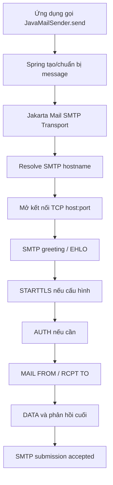

# MailConnectException khi không kết nối được máy chủ

Một ứng dụng Spring Boot đã cấu hình `spring.mail.host`, `spring.mail.port` và tài khoản SMTP. Khi gọi `JavaMailSender.send(...)`, ứng dụng không gửi được thư và log xuất hiện `MailConnectException`, chẳng hạn “Couldn't connect to host” hoặc “Connection refused”. Điều này thường khiến lập trình viên nghĩ ngay đến sai mật khẩu hay địa chỉ người nhận. Nhưng **MailConnectException chủ yếu hướng tới vấn đề thiết lập kết nối với SMTP server**, trước khi hệ thống có thể hoàn tất một giao dịch gửi thư.

Để xử lý chính xác, cần biết ngoại lệ này đến từ **Jakarta Mail/JavaMail provider** chứ không phải mặc nhiên là một lớp trong `org.springframework.mail`; Spring có thể bọc nó trong `MailSendException`. Người vận hành phải phân biệt tên host không phân giải được, port không mở, firewall chặn, timeout kết nối, cấu hình TLS không khớp và lỗi xác thực xảy ra ở bước sau. Việc retry cũng phải dựa trên giai đoạn thất bại để không tạo email trùng.

Bài học này thuộc chương **Lỗi và chẩn đoán** của **Spring Framework Mail**. Nội dung trình bày từ cơ chế phát sinh ngoại lệ, cách đọc cause chain, cấu hình Spring Boot, chẩn đoán bằng công cụ mạng, đến cách test và vận hành khi kết nối SMTP không thành công.

## 1. MailConnectException là lỗi gì?

`MailConnectException` là tên ngoại lệ thường được SMTP/JavaMail provider sử dụng khi không thể thiết lập kết nối đến mail server. Tên package chính xác phụ thuộc thư viện và phiên bản:

- Trong một số phiên bản JavaMail cũ, có thể gặp `com.sun.mail.util.MailConnectException`.
- Trong các bản triển khai **Eclipse Angus Mail** dùng với Jakarta Mail hiện đại, có thể gặp lớp tương ứng trong package `org.eclipse.angus.mail.util`.
- Ở ranh giới Spring Mail, application thường quan sát một ngoại lệ Spring như `org.springframework.mail.MailSendException`; nguyên nhân kết nối nằm sâu hơn trong exception chain.

Do vậy, không nên mặc định ứng dụng có thể import `org.springframework.mail.MailConnectException` — đó **không phải** tên exception tương ứng trong Spring Mail API.

### 1.1. Lỗi này thường nói lên điều gì?

Khi chuẩn bị gửi email, Jakarta Mail SMTP transport cần kết nối tới host và port. Nếu thao tác kết nối không hoàn thành được, provider có thể ném ngoại lệ chứa thông tin như:

- Host đã thử kết nối.
- Port đã thử kết nối.
- Thời gian timeout hoặc lỗi socket.
- Cause là `java.net.ConnectException`, `SocketTimeoutException`, `UnknownHostException` hoặc lỗi mạng khác.

Ví dụ log **minh họa**, không phải output cố định của mọi provider:

```text
org.springframework.mail.MailSendException:
  Mail server connection failed
  nested exception is:
    org.eclipse.angus.mail.util.MailConnectException:
      Couldn't connect to host, port: smtp.example.com, 587
    Caused by: java.net.ConnectException: Connection refused
```

Đọc từ trong ra ngoài:

1. `MailSendException` cho biết Spring không hoàn tất lời gọi gửi.
2. `MailConnectException` chỉ ra vấn đề mở kết nối tới SMTP server.
3. `ConnectException: Connection refused` gợi ý đích có thể truy cập ở mức mạng nhưng kết nối TCP tới port bị từ chối; còn cần điều tra host/port, listener và firewall.
4. Chưa có bằng chứng để kết luận sai mật khẩu, recipient hay nội dung MIME.

### 1.2. Không phải mọi lỗi mạng đều mang đúng lớp này

Một lỗi thiết lập kết nối có thể xuất hiện dưới dạng `MessagingException`, `MailSendException` hoặc ngoại lệ khác tùy provider và thời điểm xảy ra. Một TLS handshake failure sau khi TCP đã mở thường có cause `SSLHandshakeException`, không nhất thiết là `MailConnectException`. Tương tự, lỗi AUTH sau khi kết nối thường được báo bằng lỗi xác thực.

**Chẩn đoán dựa vào giai đoạn, thông điệp và cause gốc**, không chỉ tên class của exception ngoài cùng.

## 2. Mail được gửi qua Spring như thế nào?

Trong Spring Boot, bạn thường khai báo `spring-boot-starter-mail` và inject `JavaMailSender`:

```java
@Service
public class NotificationMailService {
    private final JavaMailSender mailSender;

    public NotificationMailService(JavaMailSender mailSender) {
        this.mailSender = mailSender;
    }

    public void sendText(String recipient) {
        SimpleMailMessage mail = new SimpleMailMessage();
        mail.setFrom("notifications@example.com");
        mail.setTo(recipient);
        mail.setSubject("Thông báo");
        mail.setText("Đơn hàng đã được xác nhận.");

        mailSender.send(mail);
    }
}
```

Một luồng gửi khái quát:



Các bước thực tế khác nhau theo loại SMTP transport và server, nhưng chuỗi này giúp xác định ngoại lệ có thể xảy ra ở đâu.

- `createMimeMessage()` chủ yếu tạo đối tượng message; **không chứng minh SMTP reachable**.
- `MimeMessageHelper.setTo(...)` và `setText(...)` chuẩn bị message; **không thực hiện TCP connect**.
- Với `JavaMailSenderImpl` thông thường, kết nối SMTP được thiết lập trong đường đi của `send(...)` hoặc khi gọi phép kiểm tra kết nối chuyên biệt.
- Lỗi DNS/TCP thường xuất hiện **trước** giao dịch `MAIL FROM`, `RCPT TO`, `DATA`.
- Lỗi xảy ra **sau** khi truyền DATA cần xử lý riêng vì kết quả submission có thể không rõ.

### 2.1. Phân biệt với MailAuthenticationException

`MailAuthenticationException` trong Spring thường hướng đến thất bại ở bước xác thực. Nếu server yêu cầu AUTH và username/password sai, bạn cần kiểm tra credential và cơ chế xác thực, không mặc định sửa DNS/port.

Ngược lại, nếu client chưa kết nối được TCP, server chưa có cơ hội kiểm tra mật khẩu. **Đừng rotate credential chỉ vì log có `MailConnectException`.**

### 2.2. Phân biệt với MailParseException và lỗi MIME

Nếu email address không hợp lệ hoặc message được tạo sai, lỗi có thể xuất hiện ở bước chuẩn bị MIME. Những lỗi này không được giải quyết bằng cách mở firewall.

### 2.3. Phân biệt với SMTP phản hồi 4xx/5xx

Phản hồi `421`, `450`, `451` hay `550` là mã **SMTP reply** từ server ở một giai đoạn của phiên giao thức. Điều đó có nghĩa client đã trao đổi được ít nhất một phần giao thức với server. Một `ConnectException: Connection refused` thường xảy ra trước khi có SMTP reply hợp lệ.

| Tình huống | Giai đoạn | Gợi ý chẩn đoán |
|---|---|---|
| Không phân giải được `smtp.example.com` | DNS | Hostname/config/DNS resolver. |
| TCP connect bị từ chối | Kết nối | Port/listener/firewall reject. |
| TCP connect timeout | Kết nối | Routing/firewall drop/egress/provider unreachable. |
| SSL handshake bị từ chối | TLS | Sai chế độ TLS, certificate, trust, protocol. |
| SMTP AUTH 535 | Sau kết nối | Credential hoặc cơ chế xác thực. |
| SMTP RCPT 550 | Giao dịch SMTP | Recipient/policy, không phải không connect. |
| Timeout sau DATA | Submission | Có nguy cơ kết quả không rõ và gửi trùng. |

## 3. Các nguyên nhân thường gặp

### 3.1. Sai hostname

Ví dụ cấu hình:

```yaml
spring:
  mail:
    host: smpt.example.com
    port: 587
```

`smpt` là lỗi gõ thay vì `smtp`. Nếu tên không tồn tại trong DNS, Java có thể phát sinh `UnknownHostException`; tùy provider, lỗi được bọc trong một `MessagingException`/Spring exception.

Cũng có thể host là tên nội bộ chỉ phân giải được trên VPN hoặc một mạng riêng, trong khi ứng dụng chạy ở môi trường cloud.

**Cần kiểm tra hostname từ chính môi trường triển khai, không chỉ từ laptop của lập trình viên.**

### 3.2. Sai port

Một số cổng SMTP phổ biến:

| Cổng | Mục đích/chế độ phổ biến | Ghi chú |
|---|---|---|
| `587` | Message submission, thường dùng STARTTLS | Kết nối TCP ban đầu không mã hóa rồi nâng cấp qua STARTTLS khi server hỗ trợ. |
| `465` | Message submission với TLS ngay khi kết nối (implicit TLS) | Cần cấu hình SSL-on-connect, không dùng STARTTLS thay thế một cách máy móc. |
| `25` | SMTP relay giữa các mail server và một số hệ thống nội bộ | Nhiều cloud/network chặn outbound 25; không mặc định dùng cho app submission. |
| `2525` | Cổng thay thế do **một số** provider cung cấp | Không phải cổng SMTP submission phổ quát; phải xác nhận provider hỗ trợ. |

Sai port có thể gây `Connection refused`, timeout hoặc kết nối tới một dịch vụ không phải SMTP. Cùng hostname nhưng port khác có thể áp dụng chính sách network và TLS hoàn toàn khác.

### 3.3. SMTP server không chạy hoặc không lắng nghe cổng

Nguyên nhân:

- Dịch vụ SMTP bị dừng hoặc đang restart.
- Server chỉ bind trên `127.0.0.1`, không lắng nghe giao diện mạng ứng dụng cần.
- Listener chỉ mở cổng 465 nhưng ứng dụng gọi 587.
- Load balancer không có backend healthy.
- Firewall ở server từ chối cổng.

Nếu kết nối nhận phản hồi từ chối tức thời, hãy kiểm tra service listener và endpoint đích trước.

### 3.4. Firewall, network egress và routing

Trong môi trường container/cloud, một máy có thể truy cập Internet qua HTTPS nhưng **không** có quyền mở kết nối TCP tới SMTP port. Các vị trí chặn:

- Firewall máy chủ/container host.
- Security group hoặc network ACL của cloud.
- Kubernetes NetworkPolicy.
- Corporate firewall/proxy chỉ cho phép HTTP(S).
- Nhà mạng hoặc nhà cung cấp cloud hạn chế outbound SMTP.
- Route/VPN/private link không tồn tại.
- DNS trả về địa chỉ thuộc mạng riêng ngoài phạm vi có thể route.

Một `connect timed out` thường là tín hiệu cần kiểm tra đường mạng, nhưng **không đủ để chứng minh firewall là nguyên nhân**. Server treo, sự cố route hoặc proxy cũng có thể tạo triệu chứng tương tự.

### 3.5. DNS trả IP sai hoặc địa chỉ không còn hợp lệ

Hostname có thể resolve được nhưng trỏ tới endpoint cũ, IP trong private subnet, hoặc IPv6 không có đường đi. Cần xem các bản ghi `A` và `AAAA` cùng TTL, và thử từ chính môi trường chạy ứng dụng.

Một truy vấn DNS thành công **chưa đủ**: IP đúng vẫn cần listener TCP ở cổng đã chọn.

### 3.6. Khác biệt IPv4 và IPv6

Một số môi trường resolve cả `A` và `AAAA`, nhưng chỉ có đường mạng hoạt động với một trong hai. Nếu provider/JVM chọn địa chỉ không reachable, ứng dụng có thể timeout hoặc báo network unreachable.

Không vội đặt `java.net.preferIPv4Stack=true` như một giải pháp toàn cục. Trước tiên cần xác định:

1. DNS trả những địa chỉ nào.
2. JVM chọn endpoint nào (nếu logging/network tracing có hỗ trợ).
3. Mạng pod/VM có route cho IPv6 hay không.
4. SMTP provider công bố hỗ trợ IPv6 ra sao.

Nếu cần thay đổi chiến lược IP, áp dụng theo chính sách nền tảng và kiểm thử ảnh hưởng đến những kết nối khác của JVM.

### 3.7. Port mở nhưng cấu hình SSL/TLS không khớp

Với cổng 465, server thường đợi TLS handshake ngay sau TCP connect. Với 587, client thường kết nối trước, đọc SMTP greeting/EHLO rồi dùng `STARTTLS` để nâng cấp.

Một cặp cấu hình sai có thể dẫn đến chờ phản hồi, EOF, timeout hoặc lỗi handshake. Không phải mọi trường hợp đều ném đúng `MailConnectException`.

Ví dụ sai nguyên tắc:

```text
Port 465 -> cấu hình như plain SMTP/STARTTLS-only
Port 587 -> ép TLS ngay khi socket vừa mở
```

Hãy dùng **đúng cấu hình TLS theo tài liệu provider**, thay vì chỉ đổi port và giữ nguyên mọi thuộc tính.

### 3.8. Proxy không hỗ trợ SMTP

Một số doanh nghiệp có HTTP proxy nhưng không cho TCP socket trực tiếp ra Internet. Jakarta Mail/SMTP không mặc nhiên đi qua HTTP proxy chỉ vì JVM có cấu hình proxy dành cho HTTP.

Nếu chính sách yêu cầu gửi qua relay nội bộ, ứng dụng nên dùng endpoint relay đó. Đừng tự cấu hình bypass/proxy không được phê duyệt chỉ để “thử cho kết nối được”.

### 3.9. Hết connection/socket resource

Khi quá nhiều worker gửi đồng thời, JVM hoặc hệ điều hành có thể gặp cạn file descriptor, ephemeral port, connection pool hoặc tài nguyên khác. Log có thể có `BindException`, “Too many open files” hoặc lỗi kết nối không ổn định.

Đây không đơn thuần là lỗi host sai. Cần kiểm tra concurrency, số socket mở, timeout, vòng đời transport và tốc độ tạo kết nối.

## 4. Các thông báo lỗi và cách đọc

Những ví dụ sau chỉ minh họa kiểu thông điệp thường gặp; tên lớp và câu chữ có thể khác theo phiên bản.

### 4.1. Connection refused

```text
MailConnectException: Couldn't connect to host, port: smtp.example.com, 587
Caused by: java.net.ConnectException: Connection refused
```

Gợi ý:

- TCP connect không được chấp nhận.
- Kiểm tra host, port, listener, firewall reject và endpoint load balancer.
- Không kết luận lỗi AUTH vì chưa có bằng chứng đã vào bước đó.

### 4.2. Connection timed out

```text
MailConnectException: Couldn't connect to host, port: smtp.example.com, 587
Caused by: java.net.SocketTimeoutException: Connect timed out
```

Gợi ý:

- Không có kết quả mở kết nối trước giới hạn `connectiontimeout`.
- Kiểm tra route, egress, firewall, service outage và địa chỉ IP.
- Thử lại chỉ khi lỗi có khả năng tạm thời và có giới hạn/backoff.

### 4.3. Unknown host

```text
Caused by: java.net.UnknownHostException: smtp.internal.example
```

Gợi ý:

- Tên host không được resolve từ DNS/JVM tại thời điểm đó.
- Kiểm tra hostname, DNS search domain, VPN, private DNS và resolver.
- Có thể là cấu hình sai vĩnh viễn hoặc DNS outage tạm thời.

### 4.4. No route to host / Network unreachable

```text
Caused by: java.net.NoRouteToHostException: No route to host
```

Gợi ý:

- Đường route tới endpoint không sẵn sàng hoặc bị mạng chặn.
- Kiểm tra subnet, gateway, routing table, VPN, IPv4/IPv6 và network policy.

### 4.5. SSL handshake exception

```text
Caused by: javax.net.ssl.SSLHandshakeException:
  PKIX path building failed
```

Gợi ý:

- TCP có thể đã kết nối nhưng TLS validation thất bại.
- Kiểm tra chứng chỉ server, truststore, hostname verification và chế độ TLS.
- **Không tắt certificate validation** trong production chỉ để vượt lỗi.

### 4.6. Authentication failed

```text
535 5.7.8 Authentication credentials invalid
```

Gợi ý:

- Server đã xử lý ít nhất một phần giao thức SMTP/AUTH.
- Kiểm tra username/password, token, SMTP AUTH policy và account.
- Không coi đây là `MailConnectException` chỉ vì cùng xuất hiện trong `MailSendException`.

## 5. Cấu hình Spring Boot cho STARTTLS trên cổng 587

Ví dụ cấu hình thông thường cho SMTP provider dùng STARTTLS:

```yaml
spring:
  mail:
    host: ${MAIL_HOST}
    port: 587
    protocol: smtp
    username: ${MAIL_USERNAME}
    password: ${MAIL_PASSWORD}
    default-encoding: UTF-8
    properties:
      "[mail.smtp.auth]": true
      "[mail.smtp.starttls.enable]": true
      "[mail.smtp.starttls.required]": true
      "[mail.smtp.ssl.checkserveridentity]": true
      "[mail.smtp.connectiontimeout]": 5000
      "[mail.smtp.timeout]": 10000
      "[mail.smtp.writetimeout]": 10000
```

Giải thích:

- `spring.mail.host`: hostname SMTP server; nên lấy từ cấu hình provider/relay chính thức.
- `spring.mail.port`: cổng TCP.
- `spring.mail.protocol`: transport, thông thường là `smtp`.
- `mail.smtp.auth=true`: bật xác thực khi provider yêu cầu.
- `mail.smtp.starttls.enable=true`: yêu cầu client thử nâng cấp TLS bằng STARTTLS khi server công bố hỗ trợ.
- `mail.smtp.starttls.required=true`: không tiếp tục kết nối SMTP không được nâng cấp TLS khi server không hỗ trợ STARTTLS.
- `mail.smtp.ssl.checkserveridentity=true`: bật kiểm tra danh tính server theo hostname cho kết nối TLS.
- Các timeout giới hạn thời gian chờ socket theo giai đoạn.

**Lưu ý:** `starttls.enable` và `starttls.required` không giúp mở TCP nếu hostname/port sai hoặc firewall chặn. STARTTLS diễn ra **sau** khi kết nối và trao đổi SMTP ban đầu đã hoạt động.

Cấu hình trên giả định provider thực sự dùng STARTTLS trên 587. Không copy y nguyên nếu provider chỉ hỗ trợ implicit TLS hoặc relay trong mạng riêng có chính sách khác.

### 5.1. Cấu hình implicit TLS trên cổng 465

Với provider yêu cầu TLS ngay khi mở kết nối:

```yaml
spring:
  mail:
    host: ${MAIL_HOST}
    port: 465
    protocol: smtp
    username: ${MAIL_USERNAME}
    password: ${MAIL_PASSWORD}
    properties:
      "[mail.smtp.auth]": true
      "[mail.smtp.ssl.enable]": true
      "[mail.smtp.ssl.checkserveridentity]": true
      "[mail.smtp.connectiontimeout]": 5000
      "[mail.smtp.timeout]": 10000
      "[mail.smtp.writetimeout]": 10000
```

Trong ví dụ này, `mail.smtp.ssl.enable=true` cho transport `smtp` dùng socket TLS ngay từ đầu. Không cần cố bật STARTTLS cho một kết nối vốn đã được TLS bảo vệ từ lúc mở, trừ khi provider có hướng dẫn đặc biệt.

Có một cách cấu hình protocol `smtps` riêng ở một số provider; nếu dùng, phải dùng đúng namespace thuộc tính `mail.smtps.*` và xác nhận cách tích hợp của phiên bản thư viện. Ví dụ ở đây dùng `smtp` + `mail.smtp.ssl.enable` để giữ cách cấu hình nhất quán.

### 5.2. Dùng environment variables cho bí mật

Ví dụ môi trường triển khai:

```text
MAIL_HOST=smtp.example.com
MAIL_USERNAME=mailer-account
MAIL_PASSWORD=<secret-from-secret-manager>
```

Trong thực tế, mật khẩu nên đến từ secret manager/Kubernetes Secret hoặc cơ chế quản lý credential đã được tổ chức phê duyệt. Không commit credential thật vào repository hoặc đưa token vào log chẩn đoán.

### 5.3. Xác nhận cấu hình hiệu lực

Một lỗi khá thường gặp là YAML chứa host đúng, nhưng profile hoặc biến môi trường ghi đè:

- `application-dev.yml` có host thử nghiệm.
- `application-prod.yml` có host nội bộ.
- Biến `SPRING_MAIL_HOST` ghi đè thuộc tính.
- Docker/Kubernetes config map chứa host cũ.
- Một Bean `JavaMailSenderImpl` custom làm cấu hình auto-configuration không được áp dụng như dự kiến.

Vì vậy, cần xác nhận **giá trị hiệu lực** của host, port và các thuộc tính TLS tại runtime, trong phạm vi logging an toàn. Chỉ log hostname/port/protocol và boolean flags cần thiết; tuyệt đối không log password.

## 6. Các timeout khác nhau ở điểm nào?

Jakarta Mail SMTP transport thường nhận các thuộc tính socket timeout sau (đơn vị mili giây):

| Thuộc tính | Giai đoạn | Ý nghĩa |
|---|---|---|
| `mail.smtp.connectiontimeout` | TCP connect | Giới hạn thời gian chờ mở socket đến host/port. |
| `mail.smtp.timeout` | Socket read | Giới hạn thời gian chờ đọc phản hồi/dữ liệu từ SMTP server. |
| `mail.smtp.writetimeout` | Socket write | Giới hạn thời gian ghi dữ liệu qua socket theo cơ chế của provider. |

### 6.1. Không nhầm connect timeout với read timeout

Ví dụ:

```text
connect timeout = 5 giây
read timeout    = 10 giây
write timeout   = 10 giây
```

- Nếu mạng không hoàn thành TCP handshake trong 5 giây, lỗi liên quan `connectiontimeout`.
- Nếu TCP đã mở nhưng server không gửi greeting/SMTP response trước 10 giây, lỗi có thể liên quan `timeout` (read).
- Nếu write bị treo do kết nối/network, lỗi có thể liên quan `writetimeout`.

Trong nhiều cấu hình mặc định, các timeout không được giới hạn chặt; hệ thống có thể chờ quá lâu. Nên đặt timeout có kiểm soát cho workload gửi mail.

### 6.2. Thời gian mỗi attempt không chỉ bằng một timeout

Một lần gửi có thể qua nhiều bước đọc/ghi. Tổng thời gian attempt có thể lớn hơn bất kỳ timeout đơn lẻ nào. Application nên có ngân sách thời gian/scheduling phù hợp, nhưng không kết luận “thư chưa được gửi” chỉ vì tổng attempt bị timeout.

### 6.3. Giá trị timeout cần dựa trên SLO

- Quá ngắn: dễ tạo lỗi giả khi mạng có độ trễ.
- Quá dài: giữ worker và connection slot lâu.
- Không có timeout: rủi ro job kẹt.
- Retry nhanh sau timeout: có thể tạo cơn bão kết nối khi SMTP server đang quá tải.

Chọn giá trị dựa trên độ trễ quan sát được, chính sách provider, concurrency và mức ưu tiên thông báo. Các số 5000/10000 ở ví dụ là **giá trị minh họa**, không phải chuẩn bắt buộc.

## 7. Quy trình chẩn đoán theo từng lớp

Khi gặp `MailConnectException`, đi theo thứ tự từ gần đến xa để tránh sửa sai chỗ.

### 7.1. Bước 1 — Xác nhận thông tin cấu hình

Thu thập an toàn:

```text
Environment: production / staging / local
SMTP host: smtp.example.com
SMTP port: 587
Protocol: smtp
TLS mode: STARTTLS required
Auth enabled: true
Connect timeout: 5000 ms
Application node/pod: mail-worker-3
Time of failure: 2026-11-12T10:00:00Z
```

Không thu thập password vào ticket hoặc nhật ký. Nếu profile/config override khác nhau giữa các pod, cần xác định pod nào có cấu hình lỗi.

### 7.2. Bước 2 — Kiểm tra DNS ngay trong môi trường ứng dụng

Trên Windows PowerShell:

```powershell
Resolve-DnsName smtp.example.com
```

Trên Linux:

```bash
getent ahosts smtp.example.com
# Hoặc khi có công cụ:
dig A smtp.example.com
dig AAAA smtp.example.com
```

Kiểm tra:

- Tên có phân giải được không?
- Có `A`/`AAAA` nào bất thường?
- Kết quả từ máy ứng dụng có khác máy cá nhân không?
- Host là private DNS chỉ hoạt động trong một VPC/VPN không?
- DNS có thay đổi gần thời điểm lỗi không?

Không suy diễn SMTP khỏe chỉ vì DNS trả IP.

### 7.3. Bước 3 — Kiểm tra TCP host:port

Windows PowerShell:

```powershell
Test-NetConnection -ComputerName smtp.example.com -Port 587
```

Kết quả thường có thuộc tính `TcpTestSucceeded`. Nếu là `False`, ứng dụng có thể cũng không mở được kết nối từ môi trường đó.

Linux:

```bash
nc -vz -w 5 smtp.example.com 587
```

`nc` chỉ kiểm tra khả năng mở TCP; nó không kiểm tra SMTP AUTH hay bảo đảm server chấp nhận mail.

**Quan trọng:** Thực hiện từ container/pod/VM có cùng network namespace và egress policy với application, khi điều kiện vận hành cho phép. Test thành công từ laptop không chứng minh pod production có đường kết nối tương tự.

### 7.4. Bước 4 — Kiểm tra giao thức SMTP/TLS

Với cổng 587 hỗ trợ STARTTLS:

```bash
openssl s_client \
  -starttls smtp \
  -connect smtp.example.com:587 \
  -servername smtp.example.com
```

Với implicit TLS trên 465:

```bash
openssl s_client \
  -connect smtp.example.com:465 \
  -servername smtp.example.com
```

Cần xem:

- TCP có mở được không?
- Server có đáp ứng cơ chế STARTTLS/TLS tương ứng không?
- Chứng chỉ có được xác minh hợp lệ bởi trust store phù hợp không?
- Hostname trên chứng chỉ có khớp endpoint không?
- TLS protocol/cipher có tương thích không?

`openssl s_client` giúp quan sát handshake, nhưng kết quả kiểm tra trust có thể phụ thuộc flags và CA store của OpenSSL; nó không mặc nhiên chứng minh Java truststore của ứng dụng sẽ chấp nhận chứng chỉ đó. Nếu cần, dùng chế độ xác minh CA/hostname của công cụ và kiểm tra riêng trong JVM.

### 7.5. Bước 5 — Chỉ khi kết nối đã tốt mới kiểm tra AUTH

Nếu TCP và TLS thành công nhưng `send` thất bại tại AUTH, mới cần kiểm tra:

- Username/password hoặc OAuth2 token.
- SMTP AUTH có bật trên account/tenant không?
- Provider có yêu cầu app password hay phương pháp OAuth2 không?
- Có policy chặn đăng nhập từ IP/vùng triển khai không?
- Có cơ chế rotate credential đang lỗi không?

Không gửi credential thật qua `telnet` hoặc một công cụ thử nghiệm không bảo vệ TLS.

### 7.6. Bước 6 — Kiểm tra phản hồi ở MAIL FROM/RCPT TO/DATA

Sau khi connect/TLS/AUTH ổn, mới xét:

- Sender address hoặc envelope sender bị từ chối.
- Recipient bị từ chối.
- Provider rate limit.
- Message quá lớn.
- Chính sách SPF/DKIM/DMARC hoặc policy gửi (khi provider báo).
- SMTP 4xx/5xx ở từng giai đoạn.

Đó là **lớp lỗi khác** với MailConnectException khi không mở được TCP.

## 8. Chẩn đoán trong Docker và Kubernetes

Một ứng dụng chạy được trên laptop nhưng không gửi được mail trong container là tình huống phổ biến.

### 8.1. Kiểm tra từ container, không chỉ host

Một container có thể:

- Không có route trực tiếp ra Internet.
- Chịu firewall/egress khác host.
- Dùng DNS resolver riêng.
- Không có CA certificate/truststore phù hợp.
- Dùng `SPRING_MAIL_HOST` khác môi trường local.

Trong môi trường được cấp phép, thực hiện công cụ DNS/TCP từ container hoặc pod debug có **cùng network policy** với ứng dụng. Nếu image ứng dụng tối giản không có `nc`/`dig`, có thể dùng debug container theo quy trình vận hành. Không cần cài thêm công cụ vào production image chỉ để chẩn đoán.

### 8.2. Kubernetes NetworkPolicy

Ví dụ cluster có default-deny egress. Pod mail worker có thể gọi database nội bộ nhưng không thể gọi cổng 587 ra ngoài. Khi đó SMTP connect thường timeout.

Kiểm tra:

- NetworkPolicy có cho traffic từ namespace/pod tới SMTP endpoint và port không?
- VPC/security group/NAT gateway có cho outbound không?
- SMTP provider có allowlist source IP không?
- Endpoint có phải private relay bên trong cluster hoặc VPC không?

Không tự mở toàn bộ egress cho namespace như một cách sửa tạm không kiểm soát. Chỉ mở đường đi cần thiết theo chính sách bảo mật.

### 8.3. DNS trong cluster

Pod có thể được cấu hình DNS search domains làm thay đổi cách resolve hostname không đầy đủ. Dùng **FQDN chính xác** do provider công bố; hạn chế dùng hostname viết tắt không có domain trong môi trường nhiều namespace.

### 8.4. Cloud hạn chế outbound 25

Nhiều nhà cung cấp cloud hạn chế outbound cổng 25 nhằm chống spam. Ứng dụng nên dùng submission port/provider đúng chính sách, thường là 587 hoặc 465, hoặc relay nội bộ đã được phê duyệt. Việc đổi sang 587 chỉ hữu ích nếu provider hỗ trợ và tài khoản được cấu hình đúng.

## 9. JavaMailSenderImpl.testConnection() để cô lập lỗi kết nối

Spring có `JavaMailSenderImpl` với phương thức `testConnection()` để thử kết nối mail server, không cần gửi thư thực tế.

Ví dụ trong một công cụ chẩn đoán nội bộ:

```java
import jakarta.mail.MessagingException;
import org.springframework.mail.javamail.JavaMailSenderImpl;

public final class SmtpConnectionDiagnostic {
    private final JavaMailSenderImpl sender;

    public SmtpConnectionDiagnostic(JavaMailSenderImpl sender) {
        this.sender = sender;
    }

    public boolean canConnect() {
        try {
            sender.testConnection();
            return true;
        } catch (MessagingException ex) {
            return false;
        }
    }
}
```

### 9.1. testConnection() xác minh được gì?

Nó có thể kiểm tra các bước kết nối của mail transport với cấu hình thực tế, tùy transport/provider: TCP, SMTP negotiation, TLS và authentication theo cấu hình.

Nhưng nó không chứng minh:

- Người nhận cụ thể được chấp nhận.
- Sender được phép dùng địa chỉ `From`.
- Message MIME/attachment hợp lệ.
- Quota gửi còn đủ cho một message thật.
- Email sẽ được deliver vào Inbox.

### 9.2. Không dùng testConnection() trên mọi request

Một lần kiểm tra cũng mở kết nối network. Nếu gọi trước mọi `send(...)`, hệ thống có thể **nhân đôi số kết nối SMTP**, tăng tải và tạo thêm lỗi giả.

Nên dùng cho:

- Tool chẩn đoán theo yêu cầu.
- Startup validation có chủ đích.
- Health check được giới hạn tần suất, timeout và tác động.
- Sự cố vận hành cần xác nhận lại connectivity.

Nếu dùng Spring Boot property `spring.mail.test-connection=true`, Spring Boot có thể kiểm tra kết nối lúc khởi động. Điều này hữu ích trong một số môi trường nhưng có thể làm ứng dụng không khởi động được khi SMTP tạm outage. Hãy cân nhắc nếu email là dependency bắt buộc cho readiness/startup.

### 9.3. Phân biệt readiness và liveness

Một mail provider outage không nhất thiết làm ứng dụng “chết”:

- **Liveness:** process vẫn hoạt động, không nên tự restart vô hạn chỉ vì SMTP bên ngoài đang lỗi.
- **Readiness:** có thể phản ánh khả năng phục vụ use case liên quan email, tùy thiết kế.
- **Mail subsystem health:** có thể hiển thị trạng thái suy giảm và queue lag riêng.

Nếu hệ thống dùng outbox, ứng dụng có thể tiếp nhận yêu cầu mới và lưu notification để retry sau; đánh dấu toàn bộ service unready chỉ vì SMTP tạm lỗi đôi khi không phù hợp.

## 10. Đọc cause chain trong Spring Mail

Lỗi connect có thể bị bọc qua nhiều lớp:

```text
org.springframework.mail.MailSendException
    -> jakarta.mail.MessagingException
        -> MailConnectException của provider
            -> java.net.SocketTimeoutException
```

Có hai điều quan trọng:

1. `Throwable.getCause()` cung cấp một liên kết trong chuỗi nguyên nhân.
2. `jakarta.mail.MessagingException` còn có `getNextException()`; chỉ duyệt `getCause()` có thể bỏ sót thông tin mà provider lưu trong chuỗi exception riêng.

Ngoài ra, `MailSendException` có thể lưu danh sách lỗi message qua API riêng nếu gửi nhiều message.

### 10.1. Ví dụ helper trích xuất lớp lỗi

Ví dụ sau duyệt cả cause chain và `MessagingException.getNextException()`, đồng thời tránh lặp vô hạn khi có liên kết trùng:

```java
import jakarta.mail.MessagingException;
import org.springframework.mail.MailSendException;

import java.util.ArrayDeque;
import java.util.ArrayList;
import java.util.Collections;
import java.util.IdentityHashMap;
import java.util.List;
import java.util.Set;

public final class MailExceptionTree {

    private MailExceptionTree() {}

    public static List<Throwable> flatten(Throwable root) {
        if (root == null) {
            return List.of();
        }

        Set<Throwable> visited =
                Collections.newSetFromMap(new IdentityHashMap<>());
        ArrayDeque<Throwable> pending = new ArrayDeque<>();
        List<Throwable> result = new ArrayList<>();

        pending.add(root);

        while (!pending.isEmpty()) {
            Throwable current = pending.removeFirst();
            if (!visited.add(current)) {
                continue;
            }

            result.add(current);

            if (current.getCause() != null) {
                pending.addLast(current.getCause());
            }

            if (current instanceof MessagingException mailError) {
                Exception next = mailError.getNextException();
                if (next != null) {
                    pending.addLast(next);
                }
            }

            if (current instanceof MailSendException sendError) {
                for (Exception item : sendError.getMessageExceptions()) {
                    if (item != null) {
                        pending.addLast(item);
                    }
                }
            }
        }

        return result;
    }
}
```

Dùng trong adapter hoặc trình chẩn đoán:

```java
try {
    javaMailSender.send(message);
} catch (MailException ex) {
    for (Throwable cause : MailExceptionTree.flatten(ex)) {
        log.warn("Mail failure cause type={}",
                cause.getClass().getName());
    }
    throw ex;
}
```

Ví dụ giả định đã import `org.springframework.mail.MailException` và cấu hình `log`. Trong production, chỉ log tên class và mã lỗi cần thiết; **không tự động log toàn bộ exception message/stacktrace của mọi message** nếu chứa địa chỉ người nhận, host nội bộ hoặc thông tin nhạy cảm.

### 10.2. Phân loại cause ở tầng infrastructure

Có thể tìm các kiểu socket lỗi:

```java
import java.net.ConnectException;
import java.net.NoRouteToHostException;
import java.net.SocketTimeoutException;
import java.net.UnknownHostException;
import javax.net.ssl.SSLHandshakeException;

public enum ConnectionFailureKind {
    DNS_RESOLUTION,
    CONNECTION_REFUSED,
    CONNECTION_TIMEOUT,
    ROUTING_OR_NETWORK,
    TLS_HANDSHAKE,
    OTHER_MAIL_FAILURE
}
```

Sau khi lấy `List<Throwable> causes`, duyệt:

```java
ConnectionFailureKind classify(List<Throwable> causes) {
    for (Throwable c : causes) {
        if (c instanceof UnknownHostException) {
            return ConnectionFailureKind.DNS_RESOLUTION;
        }
        if (c instanceof ConnectException) {
            return ConnectionFailureKind.CONNECTION_REFUSED;
        }
        if (c instanceof NoRouteToHostException) {
            return ConnectionFailureKind.ROUTING_OR_NETWORK;
        }
        if (c instanceof SSLHandshakeException) {
            return ConnectionFailureKind.TLS_HANDSHAKE;
        }
        if (c instanceof SocketTimeoutException) {
            return ConnectionFailureKind.CONNECTION_TIMEOUT;
        }
    }
    return ConnectionFailureKind.OTHER_MAIL_FAILURE;
}
```

Đây là **bộ phân loại sơ bộ** cho minh họa. Một `SocketTimeoutException` ở giai đoạn đọc sau DATA không đồng nghĩa `connection timeout`. Trong adapter thực tế, phải kết hợp **SMTP stage**, exception chuyên biệt của provider và thời điểm gửi để không đánh dấu mọi timeout là “an toàn để retry”.

### 10.3. Vì sao không import trực tiếp MailConnectException ở application?

Nếu application hoặc domain import lớp provider-specific, code bị ràng buộc phiên bản/thư viện:

```text
domain/application
        |
        | import org.eclipse.angus.mail.util.MailConnectException
        v
provider-specific implementation
```

Thay vào đó:

- Infrastructure adapter có thể biết ngoại lệ provider.
- Adapter chuyển thành mã lỗi trung lập, ví dụ `SMTP_CONNECT_REFUSED` hoặc `SMTP_CONNECT_TIMEOUT`.
- Application quyết định retry/backoff.
- Domain chỉ biết trạng thái nghiệp vụ, không biết SMTP.

## 11. Bật JavaMail debug khi cần chẩn đoán

Trong môi trường phát triển hoặc khi có quy trình chẩn đoán được phê duyệt, JavaMail/Angus hỗ trợ debug protocol. Một ví dụ cấu hình:

```yaml
spring:
  mail:
    properties:
      "[mail.debug]": true
```

Debug có thể cho thấy:

- Provider đã đọc hostname/port nào.
- Thứ tự thiết lập kết nối.
- Giai đoạn EHLO/STARTTLS/AUTH.
- Mức độ tiến triển trước khi lỗi.

**Cảnh báo:** Debug SMTP có thể để lộ metadata, địa chỉ email, SMTP conversation hoặc những thông tin khác tùy provider và mức debug. Không bật debug trên production dài hạn, không log nội dung thư/bí mật, không chia sẻ raw transcript ra ngoài phạm vi vận hành.

### 11.1. Kiểm soát thời gian và phạm vi debug

Một quy trình an toàn:

1. Chọn một instance/canary hoặc môi trường staging nếu có thể.
2. Bật logging trong một khoảng ngắn.
3. Tái hiện lỗi bằng một notification thử nghiệm không chứa dữ liệu nhạy cảm.
4. Thu thập stage, host, port, kết quả DNS/TCP.
5. Tắt debug và xóa dữ liệu nhạy cảm theo policy retention.

### 11.2. Không kết luận từ “DEBUG SMTP: useEhlo true”

Một dòng debug xác nhận client có ý định EHLO không có nghĩa TCP đã kết nối hoặc server đã gửi phản hồi. Cần đọc theo thứ tự và xác định **dòng cuối trước khi ngoại lệ**.

## 12. Không nhầm “test trên laptop thành công” với “production kết nối được”

Một số khác biệt có thể gây lỗi:

| Môi trường local | Môi trường production |
|---|---|
| DNS public | DNS private hoặc resolver của cluster. |
| Outbound 587 được mở | Security group/network policy chặn 587. |
| Không dùng proxy | Corporate egress qua proxy. |
| Truststore riêng của developer | JRE/container truststore khác. |
| SMTP credentials trong profile local | Secret production sai hoặc thiếu. |
| Tối đa vài email/phút | Nhiều worker mở nhiều kết nối đồng thời. |
| IPv4 hoạt động | Container ưu tiên IPv6 nhưng không có route. |
| Gửi qua relay localhost | Container `localhost` trỏ về chính container, không phải host chạy relay. |

Đặc biệt với Docker:

```text
spring.mail.host=localhost
```

trong container thường có nghĩa **container đó**, không phải máy host. Nếu SMTP catcher/relay chạy container khác, hãy dùng đúng service name/network alias. Nếu chạy trên host, dùng hostname cơ chế mạng do môi trường hỗ trợ, không mặc định `localhost`.

## 13. Ví dụ thiết kế adapter tách lỗi kết nối

Một ứng dụng có thể định nghĩa lỗi trung lập để tầng application biết cách xử lý mà không phụ thuộc vào Angus/JavaMail:

```java
public enum MailFailureCategory {
    CONNECTIVITY,
    TLS,
    AUTHENTICATION,
    SMTP_TEMPORARY_REJECTION,
    SMTP_PERMANENT_REJECTION,
    MIME_OR_DATA,
    SUBMISSION_UNKNOWN
}

public record MailFailure(
        MailFailureCategory category,
        String diagnosticCode,
        boolean mayRetry,
        String safeExplanation) {
}
```

Ở tầng infrastructure:

```java
public interface MailAttemptPort {
    void submitOnce(OutgoingMail mail) throws MailAttemptException;
}

public record OutgoingMail(
        String recipient,
        String subject,
        String plainText,
        String html) {
}

public class MailAttemptException extends RuntimeException {
    private final MailFailure failure;

    public MailAttemptException(MailFailure failure, Throwable cause) {
        super(failure.safeExplanation(), cause);
        this.failure = failure;
    }

    public MailFailure failure() {
        return failure;
    }
}
```

Adapter Spring Mail:

```java
import jakarta.mail.MessagingException;
import jakarta.mail.internet.MimeMessage;

import org.springframework.mail.MailException;
import org.springframework.mail.javamail.JavaMailSender;
import org.springframework.mail.javamail.MimeMessageHelper;

public final class SmtpMailAttemptAdapter implements MailAttemptPort {

    private final JavaMailSender sender;
    private final SmtpFailureClassifier classifier;
    private final String fromAddress;

    public SmtpMailAttemptAdapter(
            JavaMailSender sender,
            SmtpFailureClassifier classifier,
            String fromAddress) {
        this.sender = sender;
        this.classifier = classifier;
        this.fromAddress = fromAddress;
    }

    @Override
    public void submitOnce(OutgoingMail mail) {
        try {
            MimeMessage message = sender.createMimeMessage();
            MimeMessageHelper helper = new MimeMessageHelper(
                    message, true, "UTF-8");

            helper.setFrom(fromAddress);
            helper.setTo(mail.recipient());
            helper.setSubject(mail.subject());
            helper.setText(mail.plainText(), mail.html());

            // Một lần gọi transport, không retry ở đây.
            sender.send(message);

        } catch (MessagingException | MailException ex) {
            MailFailure failure = classifier.classify(ex);
            throw new MailAttemptException(failure, ex);
        }
    }
}
```

`SmtpFailureClassifier` ở ví dụ là interface/implementation do ứng dụng định nghĩa, không phải class có sẵn trong Spring. Nó có thể đọc cause chain, mã SMTP và giai đoạn lỗi; không chỉ kiểm tra exception type.

### 13.1. Trách nhiệm từng tầng

| Tầng | Trách nhiệm |
|---|---|
| Domain | Quy tắc: đơn hàng đã xác nhận, hóa đơn đã phát hành. |
| Application | Tạo notification intent, xác định retry policy và trạng thái. |
| Infrastructure mail adapter | Dựng MIME, gọi JavaMailSender, phân loại lỗi kết nối/SMTP. |
| Outbox/worker | Schedule attempt, giữ idempotency key, recovery sau restart. |
| Observability | Log/metrics/alert an toàn. |

### 13.2. Không để constructor tạo message mở kết nối giả định

Trong code mẫu, `createMimeMessage()`/`MimeMessageHelper` tạo dữ liệu message. Thao tác mở TCP thường xảy ra khi `send` thực hiện transport. Vì vậy test “dựng được MimeMessage” **không** phải connectivity test.

### 13.3. Dữ liệu HTML phải được escape

Ví dụ adapter nhận nội dung đã render và không tự ghép chuỗi từ dữ liệu người dùng. Template rendering nên làm ở tầng phù hợp, sử dụng escaping theo ngữ cảnh HTML và URL. Việc khắc phục MailConnectException không thay thế các yêu cầu an toàn nội dung.

## 14. Điều kiện retry cho lỗi kết nối

Nếu lỗi **chắc chắn xảy ra trước khi message có thể được SMTP server chấp nhận**, retry thường có nguy cơ gửi trùng thấp hơn timeout cuối DATA.

Tuy vậy, không phải mọi lỗi kết nối đều nên retry tự động.

| Nhóm lỗi | Có nên retry? | Điều kiện |
|---|---|---|
| TCP connect timeout do outage tạm thời | Có thể | Hạn mức attempt, backoff, notification còn hiệu lực. |
| Connection refused do server đang restart | Có thể | Endpoint đúng, provider có dấu hiệu phục hồi. |
| DNS outage thoáng qua | Có thể | Host cấu hình hợp lệ, lỗi DNS có tính tạm thời. |
| Hostname bị gõ sai | Không | Sửa cấu hình. |
| Port sai hoặc không được provider hỗ trợ | Không | Sửa port/chế độ transport. |
| Outbound network policy chặn | Không retry vô hạn | Cần thay đổi chính sách mạng được phê duyệt. |
| TLS certificate invalid | Không retry mù quáng | Khắc phục trust/certificate/hostname. |
| AUTH 535 do credential sai | Không | Sửa credential/policy. |
| SMTP 4xx sau kết nối | Có thể | Theo giai đoạn, mã reply và provider guidance. |
| Timeout sau DATA, kết quả không rõ | Không tự coi là lỗi connect an toàn | Đối chiếu provider hoặc chính sách duplicate-aware. |

### 14.1. Cần tối thiểu bốn giới hạn

Một retry policy thực tế nên có:

1. **Max attempts:** số lần thử tối đa, ví dụ 5.
2. **Max age / expiresAt:** thông báo còn ý nghĩa bao lâu.
3. **Exponential backoff + jitter:** không retry dồn dập.
4. **Provider/tenant rate limit:** tránh nhiều worker cùng gây quá tải.

Với email OTP có thời hạn rất ngắn, thời gian retry phải ngắn hơn thời điểm OTP hết hiệu lực. Với email hóa đơn, có thể dùng thời gian dài hơn và cảnh báo nếu không gửi được.

### 14.2. Backoff minh họa

```text
Attempt 1: ngay khi notification sẵn sàng
Attempt 2: sau khoảng 30 giây
Attempt 3: sau khoảng 1 phút
Attempt 4: sau khoảng 2 phút
Attempt 5: sau khoảng 4 phút
Sau đó: stop / dead letter / manual review
```

Lịch này chỉ minh họa. Trong thực tế thêm jitter để tránh nhiều worker retry cùng thời điểm. Nếu provider có chỉ dẫn thời gian retry hợp lệ, áp dụng theo contract đó.

### 14.3. Circuit breaker khi SMTP outage diện rộng

Nếu hầu hết kết nối tới cùng SMTP provider thất bại, liên tục thử mở TCP từ hàng trăm worker có thể làm vấn đề nặng hơn. Circuit breaker có thể tạm ngưng dispatch tới provider, sau đó thử một số request để kiểm tra hồi phục.

Circuit breaker **không xóa notification**; outbox vẫn giữ chúng ở trạng thái pending/retry theo chính sách. Không dùng circuit breaker để che một cấu hình host/port sai kéo dài mà không có cảnh báo.

## 15. Outbox và idempotency: vì sao quan trọng với MailConnectException?

Một lỗi connect có thể khiến request HTTP bị timeout. Nếu client gửi lại HTTP request và use case tạo email intent mới, hệ thống có thể sinh nhiều notification dù lần lỗi đầu tiên chỉ là sự cố mạng.

Hãy lưu **một notification intent** với idempotency key ổn định, rồi cho worker retry cùng row:

```text
OrderConfirmed event: E-200
       |
       v
Outbox notification: N-400
idempotency_key: ORDER_CONFIRMATION:E-200:CUSTOMER-12
       |
       +--> Attempt 1: connect timeout
       |                  -> RETRY_WAIT
       |
       +--> Attempt 2: connection refused
       |                  -> RETRY_WAIT
       |
       +--> Attempt 3: SMTP accepted
                          -> SUBMITTED
```

Tổng cộng chỉ có một intent `N-400`, dù có ba lần gọi gửi. Unique constraint trên idempotency key bảo vệ bước tạo intent khi một event được xử lý lại.

### 15.1. Tại sao “một outbox row” vẫn chưa đủ chống mọi duplicate?

Nếu worker đã gửi xong DATA và server nhận message, nhưng ứng dụng crash trước khi cập nhật trạng thái, lần recovery có thể gửi lại. Unique outbox key không ngăn hiệu ứng bên ngoài đó.

Phải phân biệt:

- **Duplicate intent:** tạo nhiều row từ cùng sự kiện — unique constraint có thể ngăn.
- **Duplicate attempt:** cùng notification được gửi nhiều lần — worker claim/lease giúp hạn chế.
- **Duplicate acceptance/delivery:** provider nhận cùng email nhiều lần do kết quả không rõ — SMTP không có cơ chế idempotency phổ quát.

### 15.2. Submission unknown khác MailConnectException ở giai đoạn TCP

Nếu có bằng chứng kết nối TCP chưa từng thiết lập, SMTP server chưa thể nhận nội dung message qua attempt đó. Nhưng nếu chỉ có một `MailSendException` chung và một timeout mà không biết giai đoạn, **không được tự khẳng định đây là connect failure trước DATA**.

Adapter cần thu thập dấu hiệu từ cause, provider exception và instrumentation phù hợp. Khi không chắc, phân loại thận trọng thành `SUBMISSION_UNKNOWN`.

## 16. Worker xử lý lỗi kết nối theo trạng thái bền vững

Một mô hình trạng thái:

```text
PENDING
   |
   v
PROCESSING
   |
   +--> SUBMITTED              (transport accepted)
   |
   +--> RETRY_WAIT             (temporary, safe enough, within limits)
   |
   +--> FAILED_CONFIGURATION   (host/port/credential invalid)
   |
   +--> FAILED_PERMANENT       (not retryable)
   |
   +--> UNKNOWN                (submission outcome uncertain)
```

Worker cần lưu:

- `notificationId` và idempotency key.
- `attemptCount`.
- `lastFailureCode`/loại cause.
- `nextAttemptAt`.
- `createdAt` và `expiresAt`.
- `smtpHostAlias` hoặc provider key (không nhất thiết log raw host).
- `leaseUntil` và claim token nếu có nhiều worker.

### 16.1. Claim row an toàn

Nếu nhiều worker có cùng queue, hai worker không nên cùng gửi một row `PENDING`. Với PostgreSQL, một cách chọn việc là:

```sql
SELECT notification_id
FROM mail_outbox
WHERE status IN ('PENDING', 'RETRY_WAIT')
  AND (next_attempt_at IS NULL
       OR next_attempt_at <= CURRENT_TIMESTAMP)
ORDER BY created_at
LIMIT 20
FOR UPDATE SKIP LOCKED;
```

Trong transaction ngắn, worker claim row, lưu `PROCESSING` và claim token/lease, rồi commit trước khi mở TCP tới SMTP. Không giữ transaction hoặc row lock trong suốt network call.

### 16.2. Worker không được ghi đè kết quả sau khi lease hết hạn

Khi worker A treo, lease hết hạn và worker B claim row, worker A có thể thức dậy sau đó. Fencing token giúp DB từ chối update của A nếu token không còn hợp lệ.

Điều đó bảo vệ **trạng thái lưu trữ**, nhưng không thu hồi được một SMTP call đã bắt đầu. Cần timeout và policy xử lý ambiguous submission.

### 16.3. Không gọi send trong database transaction nghiệp vụ

Nếu gửi SMTP ngay trong `@Transactional` của use case xác nhận đơn hàng:

- Database lock có thể bị giữ trong lúc mạng timeout.
- SMTP có thể chấp nhận thư rồi DB rollback.
- Client retry request có thể tạo event/send mới.

Transactional outbox tách việc commit domain state và intent khỏi network I/O, giúp lưu lại việc cần làm mà không block business transaction lâu.

## 17. Kiểm thử trường hợp kết nối thất bại

Có thể chia test thành nhiều tầng; không nhất thiết dùng SMTP server thật cho mọi unit test.

### 17.1. Unit test classifier

Test các cause điển hình:

```java
@Test
void classifiesConnectionRefused() {
    Throwable error = new ConnectException("Connection refused");

    ConnectionFailureKind kind =
            classify(MailExceptionTree.flatten(error));

    assertThat(kind).isEqualTo(
            ConnectionFailureKind.CONNECTION_REFUSED);
}
```

Ví dụ trên dùng `classify` từ phần trước và các import JUnit/AssertJ/`ConnectException` tương ứng. Nó xác nhận logic classifier, không chứng minh thực tế có port nào bị từ chối.

### 17.2. Unit test retry decision

Các case nên có:

| Input | Kỳ vọng |
|---|---|
| `CONNECTION_TIMEOUT`, attempt 1, notification chưa hết hạn | `RETRY_WAIT` theo policy. |
| Host sai được đánh dấu `CONFIGURATION_ERROR` | Không retry tự động. |
| `TLS_HANDSHAKE` do trust failure | Không retry mù quáng. |
| Attempt chạm max | `FAILED_PERMANENT` hoặc chuyển cần can thiệp. |
| Notification hết hạn | `EXPIRED`. |
| Submission unknown | `UNKNOWN`/đối chiếu, không khẳng định safe retry. |

Dùng `Clock` hoặc thời điểm cố định, không viết test chờ thực bằng `Thread.sleep`.

### 17.3. Integration test với SMTP catcher

Có thể dùng GreenMail, Mailpit hoặc MailHog để kiểm tra cấu hình kết nối và gửi message tới local test server.

Các trường hợp:

1. Server chạy và đúng port: `testConnection()` hoặc gửi test email thành công.
2. Server tắt hoặc port không có listener: thao tác mở kết nối thất bại.
3. Network delay/timeout được mô phỏng bằng test proxy có kiểm soát: kiểm tra timeout.
4. STARTTLS được cấu hình đúng với test server hỗ trợ TLS: kết nối thành công.
5. STARTTLS bắt buộc nhưng server không hỗ trợ: xử lý lỗi negotiation theo provider.
6. AUTH credential sai: xác nhận đây là lỗi xác thực, không phải chẩn đoán “host unreachable”.

Không cố ý gửi email thật tới khách hàng trong integration test. Dùng địa chỉ/SMTP sink thử nghiệm và không đính kèm dữ liệu nhạy cảm.

### 17.4. Unit test với mock JavaMailSender

Một test ở tầng adapter có thể dùng mock `JavaMailSender`:

```java
@Test
void translatesSpringSendFailure() {
    JavaMailSender sender = mock(JavaMailSender.class);
    MimeMessage message = new MimeMessage(
            Session.getInstance(new Properties()));

    when(sender.createMimeMessage()).thenReturn(message);

    doThrow(new MailSendException("SMTP unavailable"))
            .when(sender).send(message);

    // Dựng adapter với classifier test và OutgoingMail mẫu.
    // Kỳ vọng adapter ném MailAttemptException và giữ cause.
}
```

Ví dụ giả định dùng Mockito và Jakarta Mail test dependency. Để kiểm tra phân loại `MailConnectException` thực sự, nên tạo exception chain có cause phù hợp với version mail provider hoặc test classifier bằng loại nguyên nhân socket rõ ràng.

### 17.5. Kiểm thử môi trường container

Nếu lỗi chỉ xảy ra trên Kubernetes/staging:

- Kiểm tra DNS từ đúng pod/network policy.
- Kiểm tra TCP từ cùng môi trường.
- Xác nhận ConfigMap/Secret/profile hiệu lực.
- Gửi email thử qua SMTP sink/relay được phê duyệt.
- So sánh lỗi trước/sau thay đổi network rule.

Không dùng production mailbox làm đối tượng thử tùy tiện và không tắt các kiểm soát bảo mật để “kiểm tra nhanh”.

## 18. Runbook chẩn đoán MailConnectException

Khi có incident, một runbook ngắn giúp giảm thời gian điều tra:

### Bước A — Thu thập tín hiệu

Ghi nhận:

```text
Incident ID:
Application / environment / pod:
SMTP provider key:
Host/port/protocol:
TLS mode:
Exception outer class:
Nested root cause:
Connect/read/write timeout:
Time first observed:
Affected notification count:
```

Không chép mật khẩu hoặc raw nội dung message vào incident ticket.

### Bước B — Phân loại nhanh

| Dấu hiệu | Ưu tiên kiểm tra |
|---|---|
| `UnknownHostException` | DNS, typo, private hostname, search domain. |
| `Connection refused` | Port, SMTP listener, firewall reject, load balancer. |
| `Connect timed out` | Routing, firewall drop, egress, provider outage. |
| `No route to host` | Routing/VPN/subnet/IP family. |
| `SSLHandshakeException` | TLS mode, certificate, truststore, hostname. |
| `AuthenticationFailedException` | Credential/account/auth method. |
| SMTP `4xx/5xx` reply | SMTP stage, sender/recipient/provider policy. |

### Bước C — Tái hiện từ cùng đường mạng

Kiểm tra DNS → TCP → TLS → AUTH theo thứ tự; không bắt đầu bằng đổi tất cả cấu hình cùng lúc. Ghi lại bước nào thành công, bước nào thất bại.

### Bước D — Xác định phạm vi ảnh hưởng

- Một pod hay toàn bộ pods?
- Một environment hay toàn bộ?
- Một provider account hay tất cả accounts?
- Một SMTP endpoint hay nhiều endpoints?
- Lỗi xảy ra sau deploy/rotate credential/đổi firewall không?

Nếu chỉ một pod lỗi, ưu tiên kiểm tra node/network policy/config của pod đó. Nếu mọi pod cùng lỗi, ưu tiên provider outage, egress chung và cấu hình dùng chung.

### Bước E — Khắc phục đúng tầng

- Sai host/port: sửa cấu hình, deploy an toàn.
- DNS outage: sửa resolver/route, chờ hồi phục theo incident process.
- Egress block: thay đổi rule được phê duyệt.
- Server down: chuyển relay/provider dự phòng nếu kiến trúc hỗ trợ, hoặc giữ outbox chờ.
- TLS mismatch: sửa implicit TLS/STARTTLS và certificate trust.
- AUTH sai: rotate credential/khắc phục policy.
- Quota: giảm tốc, backoff, điều chỉnh capacity theo provider contract.

### Bước F — Xử lý email đang chờ

Đừng xóa hàng đợi để “dập lỗi”. Đánh giá:

- Bao nhiêu notification còn hợp lệ?
- Những intent nào chắc chắn chưa được gửi?
- Có notification `UNKNOWN` cần đối chiếu không?
- Có OTP/marketing đã hết hạn hoặc cần suppression không?
- Retry có tạo spike sau khi provider hồi phục không?

Dùng rate limiter và backoff để khôi phục dần thay vì release toàn bộ pending cùng lúc.

## 19. Logging, metrics và cảnh báo

Một hệ thống có thể log exception một lần nhưng vẫn khó chẩn đoán nếu thiếu metadata có cấu trúc.

### 19.1. Log nên chứa gì?

| Trường | Ví dụ | Mục đích |
|---|---|---|
| `notificationId` | `notif-abc` | Truy vết một intent. |
| `attemptNo` | `3` | Phân biệt retry. |
| `smtpProvider` | `primary-relay` | Phân nhóm endpoint. |
| `smtpPort` | `587` | Phát hiện cấu hình sai. |
| `transportMode` | `STARTTLS_REQUIRED` | Kiểm tra TLS. |
| `failureKind` | `CONNECT_TIMEOUT` | Alert/phân loại. |
| `rootCauseClass` | `SocketTimeoutException` | Điều tra lỗi socket. |
| `nextAttemptAt` | ISO 8601 timestamp | Biết lịch thử lại. |
| `node/pod` | `mail-worker-3` | Khoanh vùng môi trường. |
| `networkZone` | `production-vpc` | Đối chiếu egress. |

Tránh log:

- Password, access token, AUTH transcript.
- Toàn bộ địa chỉ người nhận trong metric label.
- Email body, attachment bytes.
- URL chứa token.
- Raw message chứa dữ liệu cá nhân.

### 19.2. Metric hữu ích

- `smtp_connect_attempts_total` theo provider/environment.
- `smtp_connect_failures_total` theo loại lỗi.
- `smtp_connect_duration_seconds` cho attempt mở kết nối.
- `mail_retry_wait_count`.
- `mail_unknown_submission_count`.
- `mail_notification_oldest_pending_age_seconds`.
- `mail_submitted_total`.
- `mail_permanent_failures_total`.

Không dùng `notificationId`, recipient hoặc raw hostname có cardinality cao làm metric label. Dùng provider key hoặc environment thay vì từng địa chỉ email.

### 19.3. Cảnh báo theo tác động

Một timeout đơn lẻ có thể do mạng chập chờn. Nhưng cần cảnh báo nếu:

- Hầu hết kết nối tới SMTP endpoint đều thất bại trong vài phút.
- Queue lag tăng nhanh.
- Notification giao dịch sắp hết hạn.
- Tỷ lệ `Connection refused` tăng ngay sau deploy.
- Một nhóm pod bị lỗi DNS/TCP còn nhóm khác hoạt động.
- `UNKNOWN` tăng và không có reconciliation.

Alert nên gắn với khả năng gửi thông báo và ảnh hưởng nghiệp vụ, không chỉ số dòng stacktrace.

## 20. Những sai lầm phổ biến

### 20.1. Đổi mật khẩu khi đang bị Connection refused

Server chưa đến bước AUTH. Kiểm tra DNS, TCP, port và listener trước.

### 20.2. Nghĩ host resolve được thì SMTP hoạt động

DNS chỉ trả IP; TCP port có thể vẫn bị chặn hoặc server không chạy.

### 20.3. Chỉ thử trên laptop

Môi trường production/container có thể khác hoàn toàn về DNS, route, network policy và TLS truststore.

### 20.4. Bật SSL/STARTTLS bừa bãi

Cổng 465 và 587 có cách bắt đầu TLS khác nhau. Mismatch có thể dẫn tới timeout/EOF/handshake failure.

### 20.5. Tắt hostname verification để sửa SSLHandshakeException

Việc này làm yếu bảo mật và không giải quyết nguyên nhân kết nối gốc. Sửa certificate, hostname hoặc truststore đúng cách.

### 20.6. Không đặt socket timeout

Worker có thể chờ quá lâu. Đặt connection/read/write timeout và đánh giá tổng thời gian attempt.

### 20.7. Catch MailException rồi retry vô hạn

`MailException` không đồng nghĩa lỗi tạm thời. Phân loại root cause, SMTP stage, attempt limit và max age.

### 20.8. Retry ngay khi provider đang quá tải

Có thể tạo retry storm và kéo dài outage. Dùng backoff, jitter, circuit breaker và rate limiter.

### 20.9. Gửi mail trong transaction nghiệp vụ

SMTP không tham gia database transaction. Dùng outbox nếu cần độ bền và retry.

### 20.10. Nghĩ MailConnectException luôn bảo đảm không có thư nào được gửi

Nếu chỉ nhìn outer exception hoặc một lỗi timeout không rõ giai đoạn, không thể kết luận submission chưa xảy ra. Chỉ khi có bằng chứng lỗi xảy ra **trước khi gửi message qua kết nối đó**, mới đánh giá nguy cơ trùng thấp.

### 20.11. Xem MailSendException là MailConnectException

`MailSendException` là lớp Spring rộng, có thể bọc nhiều lỗi. Xem cause chain và message-level exceptions.

### 20.12. Kích hoạt mail.debug lâu dài trên production

Có thể lộ dữ liệu/metadata và gây log volume lớn. Bật có phạm vi, thời hạn và quyền kiểm soát.

### 20.13. Dùng localhost sai ngữ cảnh Docker

Trong container, `localhost` thường trỏ về chính container. Dùng hostname/service name phù hợp môi trường.

### 20.14. Coi testConnection là delivery test

`testConnection()` không gửi email cho recipient, không xác minh delivery hay nội dung MIME.

### 20.15. Sửa firewall bằng cách mở toàn bộ outbound

Nên cấp quyền tối thiểu tới SMTP relay/host/port cần thiết; giữ log thay đổi và chính sách bảo mật.

## 21. Bài tập thực hành

### Bài 1 — Đọc stacktrace

Ứng dụng log:

```text
MailSendException
  -> MailConnectException: Couldn't connect to host smtp.example.com:587
  -> ConnectException: Connection refused
```

Giải thích giai đoạn lỗi, thứ tự kiểm tra và lý do chưa nên thay credential.

### Bài 2 — Phân biệt timeout

Cho ba trường hợp: timeout khi TCP connect, timeout lúc chờ SMTP greeting và timeout sau khi gửi xong DATA. Với từng trường hợp, xác định mức độ chắc chắn message chưa được server nhận và chính sách retry thích hợp.

### Bài 3 — So sánh port 465 và 587

Viết hai cấu hình Spring Boot: STARTTLS cho 587 và implicit TLS cho 465. Giải thích vì sao đổi port mà không đổi TLS mode có thể gây lỗi.

### Bài 4 — Chẩn đoán trên Kubernetes

Laptop kết nối được `smtp.example.com:587` nhưng pod không kết nối được. Hãy lập danh sách bước kiểm tra DNS, NetworkPolicy, NAT, VPC route và ConfigMap/Secret mà không yêu cầu mở toàn bộ egress.

### Bài 5 — DNS và IPv6

DNS trả cả A và AAAA nhưng cluster không có route IPv6. Đề xuất các bước xác nhận và cách phối hợp với đội nền tảng để sửa, thay vì sửa JVM flags tùy tiện.

### Bài 6 — Duyệt exception chain

Viết hàm nhận `MailException` và tìm các cause `UnknownHostException`, `ConnectException`, `SocketTimeoutException`, `SSLHandshakeException`. Mở rộng để duyệt `MessagingException.getNextException()`.

### Bài 7 — TestConnection

Tạo công cụ chẩn đoán dùng `JavaMailSenderImpl.testConnection()`. Nêu ba điều nó xác minh được và ba điều không thể chứng minh.

### Bài 8 — Retry policy

Thiết kế policy cho:
- TCP connect timeout tạm thời.
- Host cấu hình sai.
- TLS certificate invalid.
- Timeout sau DATA với submission unknown.

Giải thích vì sao không nên retry giống nhau.

### Bài 9 — Outbox và idempotency

Một lệnh `OrderConfirmed` tạo notification N-400. Hai lần kết nối SMTP đầu thất bại. Hãy mô tả cách lưu attempts/nextAttemptAt và bảo đảm chỉ một notification intent được tạo.

### Bài 10 — Sự cố DNS toàn vùng

Toàn bộ mail workers bắt đầu báo `UnknownHostException` trong 10 phút. Hãy đề xuất alert, circuit breaker, cách giữ pending queue và thứ tự khôi phục có rate limit.

### Bài 11 — TLS không đúng

Server hỗ trợ STARTTLS trên 587. Application bật `mail.smtp.ssl.enable=true` trên cùng port và gặp EOF/timeout. Hãy giải thích khác biệt giữa TLS ngay khi connect và STARTTLS sau EHLO.

### Bài 12 — Log an toàn

Thiết kế log/metric hỗ trợ điều tra MailConnectException mà không ghi password, token, raw MIME hoặc địa chỉ khách hàng làm metric label.

## 22. Ghi nhớ và tài liệu tham khảo

Khi gặp **MailConnectException khi không kết nối được máy chủ** trong Spring Framework Mail:

1. `MailConnectException` thường thuộc Jakarta Mail/JavaMail provider; Spring có thể bọc nó bằng `MailSendException`.
2. Xác định lỗi ở **DNS, TCP, TLS, AUTH hay SMTP transaction**, không chỉ dựa vào tên exception ngoài.
3. `Connection refused` thường hướng đến host/port/listener/firewall reject; `Connect timed out` hướng đến kết nối không hoàn tất trong timeout.
4. `UnknownHostException` gợi ý vấn đề hostname/DNS; `NoRouteToHostException` gợi ý route/network policy.
5. Chọn đúng SMTP host, port và TLS mode: phổ biến là 587 + STARTTLS hoặc 465 + implicit TLS theo provider.
6. Cấu hình `mail.smtp.connectiontimeout`, `mail.smtp.timeout` và `mail.smtp.writetimeout` để tránh worker kẹt vô hạn.
7. Kiểm tra từ **môi trường chạy ứng dụng**, nhất là pod/container/cloud có egress và DNS khác laptop.
8. Duyệt cause chain và `MessagingException.getNextException()`; đừng retry mọi `MailException`.
9. `JavaMailSenderImpl.testConnection()` hữu ích để cô lập lỗi connectivity nhưng không phải delivery test.
10. Retry có giới hạn/backoff và lưu trong outbox; giữ idempotency key của notification intent.
11. Nếu kết quả submission không rõ, phải đánh giá nguy cơ duplicate trước khi retry.
12. Bật protocol debug có giới hạn và không log bí mật hoặc nội dung thư.

Tài liệu kỹ thuật nên tham khảo:

- **Spring Framework Reference — Email:** `JavaMailSender`, `JavaMailSenderImpl` và gửi Simple/MIME email.
- **Spring Framework API — `MailSendException`, `MailAuthenticationException`:** mô hình ngoại lệ Spring Mail.
- **Spring Framework API — `JavaMailSenderImpl.testConnection()`:** kiểm tra kết nối SMTP.
- **Jakarta Mail / Eclipse Angus Mail API:** SMTP transport, `MessagingException` và các exception liên quan kết nối.
- **RFC 5321 — Simple Mail Transfer Protocol:** SMTP greeting, EHLO, MAIL FROM, RCPT TO, DATA và mã phản hồi.
- **RFC 3207 — SMTP Service Extension for Secure SMTP over TLS:** STARTTLS.
- **RFC 8314 — Cleartext Considered Obsolete: Use of TLS for Email Submission and Access:** implicit TLS cho submission.
- **Spring Boot Reference — Mail:** `spring.mail.*` và tùy chỉnh Jakarta Mail properties.
- **Java Networking API:** `ConnectException`, `SocketTimeoutException`, `UnknownHostException` và `NoRouteToHostException`.

**MailConnectException là một tín hiệu cần điều tra đường kết nối tới SMTP server, không phải lời giải sẵn có cho nguyên nhân gốc.** Hãy đi từ cấu hình hiệu lực đến DNS, TCP, TLS rồi mới xét AUTH và giao dịch SMTP; kết hợp quan sát cause chain, kiểm tra từ đúng môi trường và retry có kiểm soát. Cách tiếp cận này giúp khắc phục sự cố nhanh hơn mà không tạo ra lỗi bảo mật, retry storm hoặc email gửi trùng.
