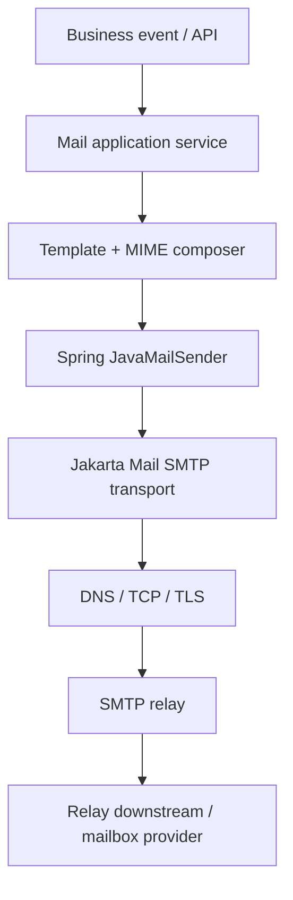
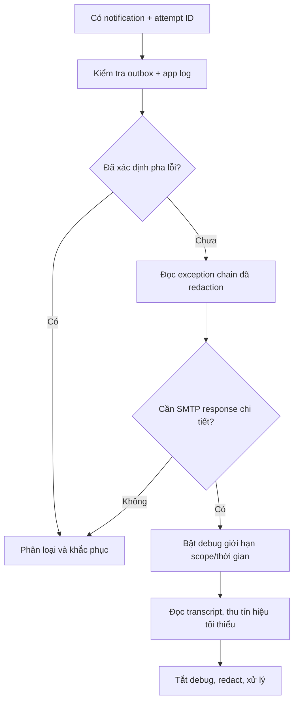
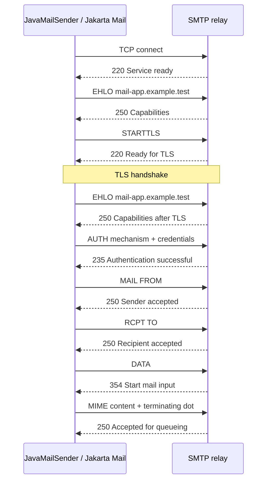

# Đọc log SMTP ở mức phù hợp

Khi một ứng dụng Spring Framework Mail không gửi được email, phản ứng tự nhiên là bật chế độ debug và tìm dòng chứa `ERROR`. Nhưng debug quá rộng dễ tạo lượng log lớn, khó đọc và có nguy cơ lộ địa chỉ người nhận, header, nội dung thư, attachment, token trong đường dẫn hoặc thông tin xác thực SMTP.

Chẩn đoán email hiệu quả không phải thu thập càng nhiều log càng tốt. Điều quan trọng là **đọc đúng tầng log, ở mức chi tiết vừa đủ để xác định giai đoạn lỗi và hành động tiếp theo**. Có sự cố chỉ cần trạng thái outbox và exception của Spring Mail; có sự cố cần response code của relay; chỉ một số tình huống mới cần transcript SMTP hoặc log TLS handshake được bật tạm trong môi trường kiểm soát.

Bài học này hướng dẫn cách đọc log SMTP trong Spring Framework Mail: phân biệt log ứng dụng, Spring exception, Jakarta Mail debug và log provider; hiểu `EHLO`, `STARTTLS`, `AUTH`, `MAIL FROM`, `RCPT TO`, `DATA`; đọc mã 2xx/3xx/4xx/5xx và enhanced status code; khoanh vùng DNS/TCP/TLS/AUTH/recipient/content errors; xử lý timeout không chắc chắn; bật debug an toàn; ghi log có correlation ID; và kiểm thử chẩn đoán. Ví dụ dựa trên Spring Framework 6.x, Spring Boot 3.x, Java 21 và Jakarta Mail.

## 1. Những tầng log trong luồng gửi mail

Một yêu cầu gửi có thể đi qua nhiều thành phần:



| Tầng | Tín hiệu thường thấy | Câu hỏi phù hợp |
|---|---|---|
| Nghiệp vụ/outbox | Notification ID, QUEUED/SENDING/SENT/FAILED, attempt | Job đã được tạo, claim và retry đúng chưa? |
| Ứng dụng | Template ID, email type, error category | Lỗi trước SMTP hay trong khi gửi? |
| Spring Mail | `MailException`, nested cause, failed messages | Bước nào của mail sender báo lỗi? |
| Jakarta Mail SMTP | Command và reply code | Relay phản hồi ở EHLO, TLS, AUTH, MAIL, RCPT hay DATA? |
| Mạng/TLS | Socket timeout, handshake, certificate | Kết nối an toàn có được thiết lập? |
| Provider | Queue ID, bounce, deferred/delivery events | Điều gì diễn ra sau khi relay nhận email? |

Không lấy tín hiệu của tầng này để khẳng định kết quả của tầng khác. `mailSender.send(...)` trả về bình thường hoặc log có `250 accepted` sau DATA thường cho biết relay chấp nhận thông điệp; nó **không** chứng minh thư đã vào inbox hay đã được đọc.

### 1.1. Ba câu hỏi trước khi tăng mức log

1. **Notification nào?** Dùng `notificationId`, không nhất thiết dùng email của người nhận làm khóa tìm kiếm.
2. **Attempt nào?** Một notification có thể retry nhiều lần, thậm chí trên các worker khác nhau. Cần `attemptId` và thời gian.
3. **Lỗi ở pha nào?** Template/MIME, DNS, TCP, TLS, AUTH, sender, recipient, DATA hay ghi trạng thái `SENT` vào database?

Nếu không tách attempt, một dòng SMTP 451 của lần thử đầu có thể bị gán cho lần thứ ba đã thành công. Nếu không biết pha, timeout sau DATA có thể bị coi sai là “chắc chắn chưa gửi”, dẫn đến email trùng khi retry.

## 2. Chọn mức log dựa trên mục tiêu

| Mức ứng dụng | Thông tin nên ghi | Dùng trong trường hợp |
|---|---|---|
| `INFO` | Enqueue, claim, attempt start, relay accepted, state transition | Theo dõi hằng ngày |
| `WARN` | Retry, lỗi tạm thời, recipient bị từ chối, lease hết hạn | Bất thường còn có khả năng phục hồi |
| `ERROR` | Lỗi cấu hình hệ thống, nhiều job dead letter, không thể gửi diện rộng | Incident và alert |
| `DEBUG/TRACE` giới hạn | Exception chain, SMTP command phase, transcript đã kiểm soát | Tái hiện sự cố có mục tiêu |

Đây là quy ước log ứng dụng, **không phải quy tắc ánh xạ cứng giữa mã SMTP và logger level**. Một mã 550 cho một địa chỉ sai có thể chỉ là WARN nghiệp vụ, còn hàng loạt 535 do secret bị rotate có thể là ERROR hệ thống.

### 2.1. Khi nào không cần SMTP debug?

Nếu lỗi nằm ở template không tồn tại, dữ liệu recipient rỗng, attachment mất khỏi storage, job chưa đến hạn hoặc worker chưa được deploy, transcript SMTP không trả lời được gì. Những bước đó có thể thất bại **trước khi mở socket SMTP**.

Một quy trình escalation:



Đừng để protocol debug chạy liên tục chỉ vì một incident đã xảy ra trong quá khứ.

## 3. Các pha của phiên SMTP

SMTP là giao thức request-response. Client gửi command, relay trả mã ba chữ số, đôi khi kèm mã mở rộng và mô tả. Một phiên gửi qua cổng 587 với STARTTLS có thể diễn ra như sau:



Đây là **sơ đồ minh họa** chứ không phải transcript bắt buộc của mọi server. Có relay không yêu cầu AUTH, có relay dùng implicit TLS, có các extension/capability khác hoặc từ chối ở pha sớm hơn.

### 3.1. Connect và SMTP banner

Relay thường phản hồi `220` khi sẵn sàng nhận lệnh. Nếu ứng dụng bị `Connection refused` hoặc `Connect timed out`, rất có thể chưa có phiên SMTP đủ để thấy banner. Đó thường là điểm cần kiểm tra network/endpoint, không phải recipient.

### 3.2. EHLO và khả năng server

Client dùng `EHLO` để hỏi server về các capability như STARTTLS, AUTH, SIZE, 8BITMIME. Danh sách quảng bá trước và sau TLS có thể khác nhau; client có thể gửi lại EHLO sau khi STARTTLS thành công.

Không đọc một đoạn log EHLO bị cắt rồi kết luận relay không hỗ trợ STARTTLS. Hãy xem transcript có đầy đủ không và EHLO đó ở trước hay sau nâng cấp TLS.

### 3.3. STARTTLS và SSL handshake

Với STARTTLS, client gửi `STARTTLS` sau kết nối plaintext và bắt đầu TLS handshake khi server chấp nhận. Lỗi certificate, hostname hoặc cipher/TLS version có thể được diễn giải rõ hơn bởi nested `SSLHandshakeException` thay vì một mã SMTP duy nhất.

### 3.4. AUTH

Nếu relay yêu cầu xác thực, client dùng AUTH mechanism được thỏa thuận. Phản hồi thành công phổ biến là `235`. Một lỗi như `535` gợi ý authentication bị từ chối, nhưng cần xem cả provider policy, secret, TLS mode và pha cụ thể. **Không bật chế độ log credential để tìm password sai.**

### 3.5. MAIL FROM và RCPT TO

`MAIL FROM` là envelope sender; `RCPT TO` là envelope recipient. Chúng không nhất thiết giống hoàn toàn các header MIME `From`, `To`, `Cc`. Khi bị từ chối ở `MAIL FROM`, kiểm tra quyền sender/domain; ở `RCPT TO`, kiểm tra recipient và relaying policy.

### 3.6. DATA và phản hồi cuối

Sau `DATA`, `354` báo relay sẵn sàng nhận nội dung. Client gửi MIME message cùng dấu kết thúc dữ liệu; phản hồi **sau khi DATA kết thúc** mới quyết định việc relay có chấp nhận nội dung để xử lý tiếp không. Nếu socket mất ngay sau khi client truyền DATA mà chưa có phản hồi cuối, outcome có thể **không chắc chắn**.

## 4. Ví dụ transcript SMTP được redaction

```text
S: 220 smtp.example.test ESMTP service ready
C: EHLO mail-app.example.test
S: 250-smtp.example.test
S: 250-STARTTLS
S: 250-AUTH PLAIN LOGIN
S: 250 SIZE 26214400
C: STARTTLS
S: 220 Ready to start TLS
[TLS handshake completed]
C: EHLO mail-app.example.test
S: 250-AUTH PLAIN LOGIN
S: 250 SIZE 26214400
[AUTH exchange intentionally omitted]
S: 235 2.7.0 Authentication successful
C: MAIL FROM:<sender@example.test>
S: 250 2.1.0 Sender OK
C: RCPT TO:<recipient@example.test>
S: 250 2.1.5 Recipient OK
C: DATA
S: 354 End data with <CRLF>.<CRLF>
[MIME body intentionally omitted]
S: 250 2.0.0 Message accepted; queue id [REDACTED]
C: QUIT
S: 221 Closing connection
```

`C:` và `S:` là nhãn hướng truyền do người viết thêm để dễ học. Output debug thực tế của Jakarta Mail/Angus có thể dùng những prefix khác, ví dụ `DEBUG SMTP:`, hoặc chỉ in một phần command. Đừng viết parser phụ thuộc tuyệt đối vào cách format log của một phiên bản provider.

Diễn giải:

1. `220` đầu tiên: relay sẵn sàng cho kết nối SMTP.
2. `250-...` sau EHLO: capability được quảng bá.
3. `STARTTLS → 220` rồi handshake: có nâng cấp TLS.
4. `235`: AUTH thành công cho phiên này.
5. `MAIL FROM → 250`: envelope sender được chấp nhận.
6. `RCPT TO → 250`: recipient được chấp nhận ở pha RCPT.
7. `DATA → 354`: client được phép bắt đầu truyền nội dung.
8. `250` **sau DATA**: relay đã chấp nhận message cho bước xử lý tiếp.
9. `221`: đóng phiên bình thường.

Đừng nhầm `250` của EHLO hoặc RCPT với `250` sau DATA. Cùng mã số nhưng ý nghĩa khác nhau theo command đang nhận phản hồi.

## 5. Các nhóm SMTP reply code

Phản hồi SMTP gồm ba chữ số. Chữ số đầu thường cho biết nhóm kết quả:

| Nhóm | Ý nghĩa khái quát | Cách hiểu khi chẩn đoán |
|---|---|---|
| `2xx` | Command được chấp nhận/hoàn tất | Tiếp tục pha kế tiếp hoặc ghi nhận kết quả tại pha hiện tại |
| `3xx` | Cần thêm dữ liệu từ client | Chưa phải thành công cuối của message |
| `4xx` | Lỗi tạm thời | Thường xem xét retry có backoff và giới hạn |
| `5xx` | Lỗi không thể hoàn tất bằng yêu cầu hiện tại | Đọc chi tiết/policy; không retry nguyên xi vô hạn |

Không suy luận mọi 4xx đều nên retry ngay và mọi 5xx là “mailbox không tồn tại”. Một số provider áp dụng policy chống lạm dụng, hạn mức hoặc quy tắc riêng; hãy đọc **pha + primary code + enhanced code + context**.

### 5.1. Bảng mã thường gặp

| Reply code | Bối cảnh thường gặp | Cần kiểm tra |
|---|---|---|
| `220` | Server ready hoặc sẵn sàng TLS | Pha connect/STARTTLS |
| `221` | Closing channel | Kết thúc phiên |
| `235` | AUTH successful | Authentication đã được chấp nhận |
| `250` | Command accepted | Trả lời EHLO, MAIL, RCPT hay DATA? |
| `251` | User not local, forwarding | Routing của relay |
| `354` | Start mail input | Chỉ là tín hiệu bắt đầu DATA |
| `421` | Service unavailable | Server/connection quá tải, maintenance |
| `450` | Mailbox/action tạm không khả dụng | Retry theo policy |
| `451` | Lỗi xử lý tạm thời | Backoff, xem provider |
| `452` | Thiếu storage/capacity tạm thời | Hạn mức, áp lực hệ thống |
| `530` | Cần AUTH hoặc điều kiện policy | Xác thực, TLS requirement |
| `535` | Authentication rejected | Secret, cơ chế AUTH, account policy |
| `550` | Mailbox unavailable hoặc policy rejection | Enhanced code: mailbox hay relay policy? |
| `552` | Storage/quota/message limit | Kích thước MIME, quota |
| `553` | Địa chỉ/mailbox name bị từ chối | Cú pháp, sender/recipient policy |
| `554` | Transaction/policy refusal | Pha lỗi, security/filtering |

Đây là ví dụ ý nghĩa phổ biến, không thay thế tài liệu relay thực tế. `550 5.1.1` và `550 5.7.1` có thể đòi hỏi hai hành động khắc phục rất khác nhau.

## 6. Enhanced status code

Một số relay bổ sung mã `x.y.z` sau mã phản hồi chính:

```text
550 5.1.1 Recipient address rejected
451 4.3.0 Temporary system problem
550 5.7.1 Not authorized to relay
```

Chữ số đầu của enhanced code mô tả success/transient/permanent; các thành phần sau giúp mô tả nhóm nguyên nhân và chi tiết. Một relay có thể dùng thông điệp riêng, nên không nên classifier chỉ dựa vào text tự do.

Ví dụ:

```text
C: RCPT TO:<recipient@example.test>
S: 550 5.1.1 User unknown
```

Khả năng cần xem là địa chỉ/recipient/suppression. Nhưng:

```text
C: RCPT TO:<recipient@example.test>
S: 550 5.7.1 Relaying denied
```

Khả năng lại liên quan relay permission, sender/domain authorization, account policy. Cùng mã 550 nhưng action khác nhau.

Không nên viết classifier bằng cách tìm chuỗi `"550"` trong `exception.getMessage()` rồi xóa recipient. Message có thể chứa nhiều phản hồi hoặc nested exceptions; ưu tiên mã và pha do SMTP provider cung cấp khi có, sau đó chuẩn hóa cho chính sách ứng dụng.

## 7. Bật Jakarta Mail debug qua Spring Boot

Trong Spring Boot, có thể truyền property cho Jakarta Mail dưới `spring.mail.properties`. Một cấu hình **chỉ dành cho chẩn đoán có kiểm soát**:

```yaml
spring:
  mail:
    host: smtp.example.test
    port: 587
    username: ${SMTP_USERNAME}
    password: ${SMTP_PASSWORD}
    properties:
      "[mail.smtp.auth]": "true"
      "[mail.smtp.starttls.enable]": "true"
      "[mail.smtp.starttls.required]": "true"
      "[mail.smtp.connectiontimeout]": "5000"
      "[mail.smtp.timeout]": "10000"
      "[mail.smtp.writetimeout]": "10000"

      # Chỉ bật tạm; nên false trong production thông thường.
      "[mail.debug]": "true"
      "[mail.debug.auth]": "false"
```

Đây là cấu hình cho relay dùng STARTTLS tại cổng 587. Với implicit TLS (thường qua cổng 465), nhà cung cấp có thể yêu cầu `mail.smtp.ssl.enable` và cấu hình khác. Không bật ngẫu nhiên cả STARTTLS và implicit TLS rồi suy luận từ lỗi.

`mail.debug.auth=false` giúp hạn chế việc in thông tin AUTH nhạy cảm ở implementation hỗ trợ property này. Nhưng **không phải bảo đảm mọi dữ liệu nhạy cảm đều được ẩn**. Không mở tùy chọn ghi AUTH credential trên môi trường có tài khoản thật.

### 7.1. Debug output không nhất thiết đi qua SLF4J

Jakarta Mail implementation có thể in debug ra một `PrintStream`, thường liên quan stdout. Điều này có nghĩa:

- `logging.level.root=WARN` **không bảo đảm** lọc được output từ `mail.debug=true`.
- `logging.level.org.springframework.mail=DEBUG` **không nhất thiết** tạo protocol transcript SMTP.
- Container runtime và log collector có thể ghi stdout dù logger ứng dụng không ghi DEBUG.

Spring logger và Jakarta Mail protocol debug là hai cơ chế quan sát khác nhau. Hãy biết output thực tế được thu ở đâu trước khi bật.

### 7.2. Bật từ JavaMail Session

Jakarta Mail Session cũng có API:

```java
Session session = Session.getInstance(properties);
session.setDebug(true);
```

Một implementation cho phép định hướng debug output:

```java
session.setDebugOut(debugPrintStream);
```

`debugPrintStream` phải là một sink riêng tư, được giới hạn và xử lý theo chính sách bảo mật; không chỉ trỏ mọi transcript vào logger production. Đừng bật debug trên một singleton Session dùng chung nhiều request chỉ để theo dõi một notification, vì có thể ghi cả phiên của các job khác.

### 7.3. Nguyên tắc bật debug an toàn

1. Tái hiện bằng recipient test trên SMTP sandbox hoặc instance chẩn đoán.
2. Giới hạn scope: instance, provider, môi trường và thời gian.
3. Bảo đảm AUTH data và MIME body không bị ghi ra nơi không kiểm soát.
4. Giới hạn quyền truy cập, retention và dung lượng debug.
5. Thu một transcript đã redaction có đủ pha và mã phản hồi.
6. Tắt debug, xác nhận đã tắt và xử lý bản thô theo retention policy.

Không bật protocol debug toàn bộ production chỉ vì một recipient bị từ chối, nhất là hệ thống gửi reset password, OTP, hóa đơn và email chứa tài liệu riêng.

## 8. Ba timeout SMTP cần phân biệt

| Property | Loại chờ | Triệu chứng |
|---|---|---|
| `mail.smtp.connectiontimeout` | Thiết lập TCP/socket connect | Không kết nối tới host/port trong thời hạn |
| `mail.smtp.timeout` | Đọc phản hồi từ relay | Đã kết nối nhưng chậm/không phản hồi |
| `mail.smtp.writetimeout` | Ghi dữ liệu vào socket | Client bị kẹt khi truyền dữ liệu |

Timeout ở tầng client không phải TTL của outbox job, và không tự cho biết relay có nhận message hay chưa.

### 8.1. Connection timeout và connection refused

Ví dụ cause chain rút gọn:

```text
MailSendException
  -> MailConnectException
     -> SocketTimeoutException: Connect timed out
```

Điều tra hostname, DNS, port, egress firewall, proxy/NAT và trạng thái relay. `Connection refused` thường nghĩa là endpoint TCP từ chối kết nối; `UnknownHostException` thường liên quan phân giải tên. Các lỗi này khác với AUTH rejection.

### 8.2. Read timeout

```text
MailSendException
  -> MessagingException
     -> SocketTimeoutException: Read timed out
```

Read timeout có thể xảy ra ở nhiều pha. Đọc timeout sau EHLO khác với read timeout **sau khi truyền đủ DATA**. Nếu client đã gửi nội dung xong nhưng không nhận phản hồi cuối, kết quả có thể UNKNOWN.

### 8.3. Write timeout

Write timeout lúc truyền MIME content không nhất thiết chứng minh relay chưa nhận byte nào. Có thể một phần dữ liệu đã đến, hoặc server đã nhận toàn bộ nhưng client vẫn bị lỗi. Không dùng tên exception đơn lẻ để suy diễn trạng thái gửi chắc chắn.

## 9. Chẩn đoán TLS và certificate

Một số dấu hiệu:

```text
MessagingException: Could not convert socket to TLS
SSLHandshakeException: PKIX path building failed
SSLHandshakeException: No subject alternative DNS name matching ...
```

Đây là ví dụ thông điệp; câu chữ cụ thể phụ thuộc JDK, provider và truststore. Kiểm tra:

1. Đúng host, port và TLS mode chưa?
2. Provider dùng STARTTLS hay implicit TLS?
3. Relay có quảng bá STARTTLS sau EHLO không?
4. `mail.smtp.starttls.required` có được bật phù hợp không?
5. Certificate chain có được truststore tin cậy không?
6. Hostname có khớp certificate không?
7. JDK và relay có TLS protocol/cipher tương thích không?

**Không sửa lỗi bằng cách tắt kiểm tra certificate hoặc chấp nhận mọi hostname trong production.** Điều đó mở ra rủi ro nghe lén và kết nối tới endpoint không đáng tin cậy.

Khi thật sự cần thêm thông tin về handshake, JDK hỗ trợ:

```text
-Djavax.net.debug=ssl,handshake
```

Chỉ bật tạm cho một tiến trình/lưu lượng test được kiểm soát. TLS debug tạo nhiều dữ liệu, có thể tiết lộ metadata phiên, và không nên được thu thập kéo dài trên production.

| Port | Vai trò thường gặp | Lưu ý |
|---|---|---|
| 25 | SMTP relay/server-to-server | Có thể bị cloud network hạn chế egress |
| 587 | Submission có STARTTLS | Cần cấu hình theo provider |
| 465 | Submission qua implicit TLS | Không coi như STARTTLS plaintext |
| Port khác | Sandbox/relay riêng | Không suy TLS mode chỉ từ port |

## 10. Đọc AUTH failure: 530 và 535

Ví dụ đã redaction:

```text
C: AUTH [REDACTED]
S: 535 5.7.8 Authentication credentials invalid
```

Kiểm tra username/password/token, secret rotation, tài khoản SMTP theo tenant, cơ chế AUTH, account status, provider security policy, TLS requirement và cấu hình SMTP AUTH của provider.

Một lỗi AUTH diện rộng thường không nên được retry với tốc độ cao như 451 của một recipient. Có thể cần tạm ngưng dispatcher, cảnh báo cấu hình và chỉ tiếp tục sau khi secret hoặc provider đã được sửa.

### 10.1. Base64 không làm AUTH payload an toàn

Một số cơ chế AUTH biểu diễn dữ liệu dưới dạng Base64. Đây không phải encryption. Nếu transcript chứa AUTH payload, người có log có thể giải mã dữ liệu và đọc credential. **Không bật `mail.debug.auth=true` trên tài khoản thật; không dán raw AUTH exchange vào ticket hoặc nhóm chat.**

### 10.2. 530 không đồng nghĩa password sai

`530 Authentication required` có thể xuất hiện khi client gửi `MAIL FROM` trước AUTH, hoặc server yêu cầu STARTTLS/policy khác. Đọc command ngay trước phản hồi; không kết luận “530 = sai mật khẩu” khi chưa đủ bằng chứng.

## 11. Lỗi sender và recipient tại MAIL FROM / RCPT TO

Sau khi AUTH thành công, relay vẫn có thể từ chối envelope sender hoặc recipient:

- Sender không thuộc domain đã được xác minh.
- Tài khoản SMTP không được gửi bằng địa chỉ From đã chọn.
- Tenant chưa có sender identity hợp lệ.
- Recipient không tồn tại hoặc mailbox bị vô hiệu hóa.
- Relay không cho tài khoản hiện tại chuyển tiếp tới domain khác.
- Recipient/domain nằm trong suppression list hoặc chính sách chống spam.

Ví dụ:

```text
C: MAIL FROM:<notifications@example.test>
S: 550 5.7.1 Sender address not authorized
```

Khác với:

```text
C: RCPT TO:<recipient@example.test>
S: 550 5.1.1 Recipient mailbox unavailable
```

Trong ví dụ thứ nhất, điều tra sender/domain authorization. Trong ví dụ thứ hai, điều tra địa chỉ recipient. Hai trường hợp đều dùng mã 550 nhưng không có cùng hướng xử lý.

### 11.1. Envelope sender có thể khác header From

Một MIME message có:

```text
From: "Thông báo hệ thống" <notifications@example.test>
To: Recipient <recipient@example.test>
```

nhưng SMTP envelope sender có thể là địa chỉ bounce/return-path hoặc địa chỉ do transport/provider chọn. Khi lỗi xảy ra ở `MAIL FROM`, cần biết địa chỉ envelope thực sự đã gửi. Không chỉ đọc `MimeMessageHelper.setFrom(...)` rồi kết luận tất cả sender identity đều giống nhau.

### 11.2. Đừng log nguyên recipient list

Địa chỉ email là dữ liệu cá nhân. Khi cần chẩn đoán job có nhiều người nhận, ưu tiên recipient reference nội bộ đã được phân quyền hoặc địa chỉ đã che phù hợp. Một hash email không dùng salt/secret vẫn có thể bị tấn công dictionary; không coi hashing đơn giản là ẩn danh hoàn toàn.

## 12. Lỗi tại DATA: kích thước và nội dung

Relay có thể chấp nhận `MAIL FROM` và `RCPT TO` nhưng từ chối sau khi nhận nội dung. Nguyên nhân thường gặp:

- MIME message vượt kích thước tối đa của relay.
- Nội dung bị spam/policy filter chặn.
- Attachment không được phép hoặc nghi ngờ malware.
- Header, body, transfer encoding hoặc MIME structure không hợp lệ.
- Sender domain chưa được phép dùng theo policy.
- Account quota, provider rate limit hoặc giới hạn lưu trữ.

Ví dụ:

```text
C: DATA
S: 354 Start mail input
[MIME content omitted]
S: 552 5.3.4 Message size exceeds fixed maximum
```

Relay đã cho phép client bắt đầu DATA, nhưng cuối cùng từ chối message. Không đánh dấu SENT chỉ vì đã nhận `354`.

### 12.1. Kích thước MIME lớn hơn file gốc

Attachment có thể được mã hóa Base64, kèm header và boundary. Tổng kích thước truyền SMTP vì thế lớn hơn tổng các file gốc. Không chỉ so sánh kích thước file gốc với đúng giới hạn provider. Hãy dự phòng overhead, giới hạn số lượng/loại attachment và đo kích thước thực tế khi cần.

### 12.2. Không dump MIME body để tìm lỗi thường ngày

Một MIME message có thể chứa thông tin cá nhân, hóa đơn, đường dẫn token, ảnh inline và file đính kèm. Nếu cần xác định “tại sao 552”, hãy bắt đầu bằng kích thước message, số attachment, content type và provider limit. Thu raw MIME chỉ trong môi trường test với dữ liệu giả hoặc một quy trình điều tra đặc biệt có quyền truy cập và retention rõ ràng.

## 13. Đọc exception của Spring Mail

Spring Mail dùng `org.springframework.mail.MailException` (runtime exception) và các subclass. Một số loại thường gặp:

| Exception | Tình huống thường gặp | Nơi cần đọc tiếp |
|---|---|---|
| `MailAuthenticationException` | AUTH không thành công | Account, secret, nested provider cause |
| `MailSendException` | Một hoặc nhiều message không gửi được | Failed messages, cause, SMTP reply |
| `MailParseException` | Địa chỉ/header/message parse không hợp lệ | Input, MIME construction |
| `MailPreparationException` | Callback/service chuẩn bị message gặp lỗi | Template, attachment, helper |
| `MailException` khác | Lỗi mail chung | Pha xảy ra lỗi và nested exception |

Một ứng dụng trực tiếp tạo `MimeMessage` còn có thể gặp `jakarta.mail.MessagingException`. Spring Mail sender có thể gói lỗi Jakarta Mail trong hierarchy của nó tùy implementation và lời gọi.

### 13.1. Đọc cause chain

Ví dụ cây lỗi (chỉ minh họa):

```text
org.springframework.mail.MailSendException
  nested: jakarta.mail.MessagingException: Could not connect
    nested: java.net.ConnectException: Connection refused
```

Outer exception nói lỗi phát sinh khi gửi; nested `ConnectException` hướng điều tra tới network/endpoint. Không coi đó là lỗi recipient hoặc body.

Ví dụ khác:

```text
org.springframework.mail.MailAuthenticationException
  nested: Authentication rejected (provider-specific)
```

Trường hợp này cần điều tra credential và policy. Nếu classifier chỉ trả `SEND_FAILED` cho mọi loại trên, retry policy khó chính xác.

### 13.2. MailSendException và failed messages

`MailSendException` có thể cung cấp mapping giữa các message thất bại và exception:

```java
import org.springframework.mail.MailSendException;

void inspectBatchFailure(MailSendException ex) {
    for (Exception failure : ex.getFailedMessages().values()) {
        String category = mailErrorClassifier.categoryOf(failure);
        recordFailureCategory(category);
    }
}
```

`mailErrorClassifier` và `recordFailureCategory` là abstraction của ứng dụng. **Không log trực tiếp** `ex.getFailedMessages().toString()` hoặc key của map: key có thể là MIME message chứa header/body/địa chỉ. Nếu cần outcome per recipient, hãy thiết kế notification/recipient reference riêng.

### 13.3. getCause và getNextException không luôn giống nhau

Một số `MessagingException` của Jakarta Mail có chain bổ sung qua `getNextException()`, bên cạnh `Throwable.getCause()`. Khi điều tra sâu hoặc xây classifier, có thể cần xem cả hai, tránh bỏ sót provider-specific `SendFailedException` hoặc address failure.

Provider SMTP có thể cung cấp subclass riêng kèm reply code; đây là API phụ thuộc implementation. Khi code dựa vào lớp provider-specific, nên có nhánh fallback để không gắn toàn bộ hệ thống vào một format exception duy nhất.

## 14. Ghi log ứng dụng đúng mức

Một mẫu không nên dùng trong production:

```java
try {
    mailSender.send(message);
} catch (Exception ex) {
    log.error("Send mail failed: {}", ex.getMessage(), ex);
}
```

Exception text và stack trace từ provider có thể chứa địa chỉ, hostname nội bộ hoặc metadata nhạy cảm; nếu còn nuốt exception, ứng dụng có thể đánh dấu job sai. Không có lý do ghi toàn bộ stack trace trong mỗi lần recipient bị từ chối.

Nên xây error category ổn định:

```java
public enum MailFailureCategory {
    AUTHENTICATION,
    CONNECTION,
    TLS,
    TEMPORARY_SMTP,
    PERMANENT_SMTP,
    MESSAGE_PREPARATION,
    UNKNOWN_OUTCOME,
    UNCLASSIFIED
}
```

Và logger dùng các field đã được kiểm tra:

```java
import org.slf4j.Logger;
import org.slf4j.LoggerFactory;
import org.springframework.stereotype.Component;

@Component
public final class MailAttemptLogger {

    private static final Logger log =
            LoggerFactory.getLogger(MailAttemptLogger.class);

    public void relayAccepted(
            String notificationId,
            String attemptId,
            long durationMillis) {
        log.info(
                "event=mail_smtp_accepted notificationId={} " +
                "attemptId={} durationMs={}",
                notificationId, attemptId, durationMillis);
    }

    public void attemptFailed(
            String notificationId,
            String attemptId,
            MailFailureCategory category,
            String safeCode) {
        log.warn(
                "event=mail_attempt_failed notificationId={} " +
                "attemptId={} category={} code={}",
                notificationId, attemptId, category, safeCode);
    }
}
```

`safeCode` nên là mã do ứng dụng chuẩn hóa, **không** phải `ex.getMessage()`. Notification/attempt ID cần kiểm soát format, length và CR/LF để tránh log injection. Nếu cần stack trace để điều tra, ghi nó vào sink hạn chế quyền và chỉ theo incident/debug policy đã redaction.

### 14.1. Minh họa một attempt

```java
public void sendOne(MailJob job) {
    String attemptId = UUID.randomUUID().toString();
    long started = System.nanoTime();

    MimeMessage message;
    try {
        message = composer.compose(job);
        mailSender.send(message);
    } catch (MailException | MessagingException ex) {
        FailureDecision decision = classifier.classify(ex, job);
        attemptLogger.attemptFailed(
                job.notificationId(), attemptId,
                decision.category(), decision.safeErrorCode());
        statusService.applyFailure(
                job.id(), job.leaseToken(), decision);
        return;
    }

    long millis = Duration.ofNanos(
            System.nanoTime() - started).toMillis();
    attemptLogger.relayAccepted(
            job.notificationId(), attemptId, millis);

    // Bước ghi SENT có lỗi riêng, không được coi là SMTP rejection.
    boolean recorded = statusService.markSent(
            job.id(), job.leaseToken());
    if (!recorded) {
        incidentRecorder.recordStateConflict(
                job.notificationId(), attemptId);
    }
}
```

Đây là skeleton: `MailJob`, `composer`, `classifier`, `FailureDecision`, `statusService` và `incidentRecorder` do ứng dụng định nghĩa; import Java/Spring/Jakarta tương ứng cần được bổ sung. Quan trọng là **phân biệt kết quả SMTP và kết quả ghi trạng thái database**.

### 14.2. SMTP accepted nhưng ghi SENT thất bại

Nếu `mailSender.send(...)` trả về nhưng transaction `markSent(...)` không commit, relay có thể đã chấp nhận email trong khi outbox vẫn `SENDING`. Khi lease hết hạn, retry có thể tạo duplicate. Nên ghi thành hai sự kiện:

```text
event=mail_smtp_accepted notificationId=... attemptId=...
event=mail_state_recorded notificationId=... state=SENT
```

Nếu chỉ có sự kiện thứ nhất, đó là lỗi hoặc thiếu bằng chứng về **database acknowledgment**, không phải bằng chứng SMTP từ chối.

## 15. Correlation ID, notification ID và attempt ID

Một notification có thể retry nhiều lần, trên nhiều worker:

| ID | Phạm vi | Có đổi khi retry? |
|---|---|---|
| `correlationId` | Luồng xử lý gốc hoặc trace liên quan | Thường giữ để nối origin |
| `notificationId` | Một ý định gửi | Không |
| `attemptId` | Một attempt cụ thể | Có |
| `providerMessageId` | Mã do provider trả nếu có | Có thể khác cho từng attempt |

Ví dụ:

```text
09:01 correlationId=REQ-77 notificationId=mail-981 attemptId=A1
      event=smtp_temporary_error code=451
09:03 correlationId=REQ-77 notificationId=mail-981 attemptId=A2
      event=smtp_temporary_error code=451
09:08 correlationId=REQ-77 notificationId=mail-981 attemptId=A3
      event=mail_smtp_accepted code=250
09:08 correlationId=REQ-77 notificationId=mail-981
      event=outbox_transition status=SENT
```

Không cần ghi email của người nhận để nối các lần thử. Nếu dùng Micrometer Tracing hoặc OpenTelemetry, để instrumentation quản lý span; MDC correlation field không tự tạo distributed trace.

### 15.1. Metric labels nên có cardinality hữu hạn

```text
mail_smtp_attempts_total{outcome="temporary",phase="rcpt"}
mail_smtp_attempts_total{outcome="accepted",phase="data"}
mail_smtp_duration_seconds{provider="primary"}
mail_outbox_backlog{status="QUEUED"}
```

Provider, phase, outcome và error category phù hợp làm metric labels khi số giá trị có giới hạn. Recipient email, notification ID, correlation ID hoặc full SMTP reply không phù hợp vì cardinality cao và có thể chứa dữ liệu riêng tư.

## 16. Partial success: một message có nhiều recipient

Nếu một MIME message có nhiều recipient, một số địa chỉ có thể được relay chấp nhận còn địa chỉ khác bị từ chối:

```text
C: RCPT TO:<recipient-a@example.test>
S: 250 2.1.5 Accepted
C: RCPT TO:<recipient-b@example.test>
S: 550 5.1.1 User unknown
```

Chỉ thấy 550 không có nghĩa mọi recipient đều thất bại. Nếu retry nguyên batch mà không theo dõi địa chỉ nào đã được chấp nhận, recipient A có nguy cơ nhận trùng.

### 16.1. Thiết kế đơn giản hóa chẩn đoán

Với email cá nhân hóa hoặc hệ thống retry chính xác, thường dễ quản lý **một outbox row cho một recipient**, có notification ID/idempotency key riêng. Nếu buộc phải gửi batch, cần trạng thái hoặc outcome theo từng recipient và đọc `MailSendException`/SMTP partial success đúng mức.

### 16.2. Không mark sai SENT

Không mark cả job SENT chỉ vì một recipient trả 250. Ngược lại, không retry mọi địa chỉ chỉ vì một địa chỉ trả 550. Đọc đủ các `RCPT TO`, kết quả DATA và lỗi per recipient rồi cập nhật trạng thái theo granularity đã thiết kế.

## 17. SMTP accepted nhưng người nhận không thấy email

Một transcript kết thúc bằng:

```text
250 2.0.0 Message accepted for delivery
```

không chứng minh inbox đã nhận. Sau đó có thể xảy ra queueing, chuyển relay, content filtering, mailbox quota, bounce hoặc spam placement. Nếu người dùng báo không thấy email dù ứng dụng ghi SENT:

1. Tra cứu provider dashboard/message trace nếu có.
2. Kiểm tra queue ID và provider message ID.
3. Xem bounce, complaint, deferred events và suppression list.
4. Xác minh recipient được hệ thống lưu/chọn đúng.
5. Kiểm tra SPF, DKIM, DMARC, sender reputation nếu liên quan deliverability.
6. Kiểm tra spam/quarantine theo quyền truy cập và bằng chứng phù hợp.
7. Không resend ngay khi chưa biết email cũ có thể vẫn đang được chuyển hay không.

Không phải môi trường nào cũng có delivery webhook. Nếu không có, phải nói rõ giới hạn quan sát; sự vắng mặt của bounce event **không phải bằng chứng** đã vào inbox.

## 18. Đọc log khi có nhiều worker và retry

Ví dụ:

```text
10:00 worker-A claimed job-123 lease=L1
10:01 worker-A submitted DATA, waiting for response
10:02 lease L1 expires
10:02 worker-B claimed job-123 lease=L2
10:03 worker-B SMTP accepted
10:03 worker-A receives delayed response; markSent(L1) returns zero rows
```

Nếu chỉ lọc theo job ID và bỏ qua `leaseToken`/`attemptId`, người điều tra có thể không biết vì sao có hai lần gửi. Nên ghi worker ID, attempt ID, lease reference, thời điểm claim, thời điểm gọi SMTP, kết quả submit và transition outcome.

**Lease token bảo vệ cập nhật database**, không hủy được một lời gọi SMTP đã bắt đầu. Một worker mất lease có thể vẫn gửi được email; việc không cho nó ghi SENT không làm email biến mất khỏi relay.

### 18.1. Outcome UNKNOWN phải có bằng chứng pha

```text
notificationId=mail-981
attemptId=A3
smtpPhase=AFTER_DATA
outcome=UNKNOWN
errorCode=SMTP_RESPONSE_LOST
retryDecision=REQUIRES_RECONCILIATION
```

Chỉ ghi `AFTER_DATA` nếu instrumentation có đủ bằng chứng client đã gửi dữ liệu và đang chờ phản hồi cuối. Từ exception `SocketTimeoutException` đơn lẻ, không được tự suy luận pha. Nếu chưa xác định được, ghi `phase=UNKNOWN` và phân loại theo chính sách thận trọng.

## 19. Thu thập log mà không lộ dữ liệu

### 19.1. Tín hiệu cần giữ

- Timestamp có timezone, đồng hồ giữa các worker được đồng bộ.
- Notification ID, attempt ID, worker/instance.
- Provider hoặc endpoint được chuẩn hóa.
- SMTP phase, primary reply code, enhanced status code.
- Error category, exception class đã phân loại.
- Latency và timeout config (không gồm secret).
- Outbox transition và retry decision.

### 19.2. Dữ liệu cần che hoặc tránh ghi

- SMTP username/password, OAuth token, payload AUTH.
- Header/body có thông tin cá nhân và tệp đính kèm.
- Reset URL, OTP, session cookie, JWT.
- Full To/Cc/Bcc list.
- Raw provider response khi nó chứa địa chỉ hoặc dữ liệu nhạy cảm.
- Đường dẫn storage nội bộ và thông tin phân quyền không liên quan.

### 19.3. Redaction vẫn phải giữ tín hiệu lỗi

```text
Input concept:
RCPT TO:<private-person@company.test>
550 5.1.1 User unknown

Sanitized:
RCPT TO:<recipient-[REDACTED]>
550 5.1.1 User unknown
```

Đoạn đã lọc vẫn cho biết recipient bị từ chối ở pha RCPT với enhanced code 5.1.1, không cần công khai địa chỉ thật.

### 19.4. Log injection và retention

Thông điệp từ server ngoài và header có thể chứa CR/LF hoặc chuỗi dài. Khi đưa vào structured log, giới hạn chiều dài và escape control character để tránh log injection. Không coi raw SMTP response là một field phân loại tin cậy.

Raw debug transcript phải có quyền truy cập hạn chế, retention ngắn và quy trình xóa theo policy. Không dán log có AUTH/body khách hàng vào ticket công khai hay nhóm chat đông người.

## 20. Runbook theo triệu chứng

| Triệu chứng | Tầng/pha đọc trước | Hành động |
|---|---|---|
| Không có attempt | API/outbox/worker | Kiểm tra enqueue, due time, scheduler, lease |
| `UnknownHostException` | DNS | Hostname, DNS configuration |
| `Connection refused` | TCP/connect | Port, firewall, relay listening |
| `Connect timed out` | Network | Egress policy, routing, provider reachability |
| `SSLHandshakeException` | TLS | STARTTLS/implicit TLS, certificate, truststore |
| `530` tại MAIL FROM | SMTP AUTH/policy | Xem AUTH/TLS requirement |
| `535` tại AUTH | Authentication | Secret, auth mechanism, provider policy |
| `550 5.1.1` tại RCPT | Recipient | Địa chỉ, suppression, mailbox state |
| `550 5.7.1` tại RCPT/MAIL | Relay policy | Domain, sender permission, relay authorization |
| `451` | Temporary SMTP | Backoff, server status, retry window |
| `552` sau DATA | Content/size | MIME size, quota, policy |
| Timeout sau DATA | SMTP outcome | UNKNOWN, duplicate risk |
| Accepted nhưng outbox vẫn SENDING | Database/lease | Ack update, race, crash |
| Accepted nhưng không thấy inbox | Delivery provider | Bounce, queue, spam, mailbox policy |

### 20.1. Một quy trình điều tra cụ thể

**Bước 1:** Lấy notification ID, attempt ID, môi trường và timestamp; chuẩn hóa timezone khi nối sự kiện.

**Bước 2:** Kiểm tra job đã QUEUED, SENDING và có attempt chưa. Nếu chưa vào SMTP, chưa cần protocol debug.

**Bước 3:** Dựa vào exception/state xác định pha: connect, TLS, AUTH, MAIL FROM, RCPT TO, DATA hoặc database ack.

**Bước 4:** Đọc code/exception class/response đã redaction và đối chiếu provider policy.

**Bước 5:** Chỉ khi cần mới tái hiện bằng debug hạn chế scope, không log AUTH credential hoặc MIME body.

**Bước 6:** Quyết định temporary, permanent hoặc unknown; áp dụng retry, suppression và duplicate policy.

**Bước 7:** Khắc phục, chạy phép thử có kiểm soát, xác nhận transition, tắt debug và lưu bằng chứng đã lọc.

## 21. Thực hành với SMTP sandbox và phép thử có kiểm soát

SMTP sandbox như Mailpit giúp nhận email trong môi trường local/test và quan sát cấu trúc MIME. Chạy:

```bash
docker run --rm --name mailpit -p 1025:1025 -p 8025:8025 axllent/mailpit
```

Ví dụ cấu hình Spring Boot dành riêng cho môi trường local:

```yaml
spring:
  mail:
    host: localhost
    port: 1025
    properties:
      "[mail.smtp.auth]": "false"
      "[mail.smtp.starttls.enable]": "false"
      "[mail.smtp.connectiontimeout]": "3000"
      "[mail.smtp.timeout]": "5000"
      "[mail.smtp.writetimeout]": "5000"
      "[mail.debug]": "false"
```

Đây là cấu hình sandbox không dùng SMTP AUTH/TLS, **không sao chép sang production**. Mailpit giúp xem nội dung email đã gửi vào sandbox, nhưng không mặc định tái hiện chính xác mọi phản hồi 4xx/5xx, TLS handshake hoặc timeout. Với những lỗi đó, có thể cần SMTP test server điều khiển được reply, fault injection hoặc integration test riêng.

### 21.1. Kiểm thử từng loại lỗi

Tạo các trường hợp:

1. Template/MIME validation thất bại trước khi mở kết nối.
2. DNS không phân giải được hostname.
3. Connection refused tại host/port.
4. TLS handshake thất bại.
5. SMTP authentication bị từ chối.
6. Recipient bị từ chối với mã permanent.
7. Relay trả lỗi 451 tạm thời.
8. Relay chấp nhận sau DATA.
9. Mất phản hồi sau DATA, outcome UNKNOWN.
10. `mailSender.send(...)` thành công nhưng cập nhật outbox `SENT` thất bại.

Đối với mỗi tình huống, test cần xác nhận **error category, phase, status và retry policy** tương ứng. Đừng chỉ kiểm tra có một dòng ERROR trong log; mục tiêu là hệ thống ra quyết định đúng.

### 21.2. Test không rò rỉ secret

Trong test, dùng SMTP credential giả, email body có chuỗi marker và URL token giả:

```text
SECRET_TEST_MARKER_DO_NOT_LOG
```

Capture output của application logger, bảo đảm marker, password giả, token và MIME body **không xuất hiện** trong log production-format. Kiểm tra cả nhánh success và exception. Nếu thử `mail.debug=true`, phải kiểm tra nơi xuất stdout riêng, vì output có thể không qua SLF4J appender.

### 21.3. Test timeout mơ hồ và idempotency

Giả lập relay đã chấp nhận DATA nhưng worker không nhận phản hồi cuối. Một test tốt cần đảm bảo:

- Classifier không ghi `PERMANENT_REJECTION` nếu không có response từ chối.
- Outbox giữ được `lastAttemptOutcome=UNKNOWN` hoặc metadata tương đương.
- Retry được quyết định theo policy, có thông tin nguy cơ duplicate.
- Khi replay, notification ID/idempotency intent ổn định và attempt ID mới.

Nếu provider có API tra cứu/tracking ID thì kiểm thử thêm reconciliation. Không giả định `Message-ID` tự làm cho SMTP có exactly-once delivery.

### 21.4. Test partial success

Giả lập hai recipient: A được relay chấp nhận, B bị từ chối. Nếu hệ thống dùng một outbox row cho mỗi recipient, kiểm tra chỉ retry B theo policy. Nếu một message có nhiều recipient, kiểm tra logic trạng thái theo từng địa chỉ để không gửi trùng A.

### 21.5. Test clock, queue và lease

Giả lập một SMTP attempt chậm hơn lease. Xác nhận log chứa worker ID, attempt ID và sự kiện lease expired, không trộn hai lần gửi. Dùng clock điều khiển được để tránh test phải sleep theo thời gian thực. Lỗi conditional update sau khi relay accepted phải được phân biệt với lỗi SMTP.

## 22. Những lỗi thường gặp khi đọc log SMTP

**Bật DEBUG trên toàn bộ production.** Tăng noise, chi phí lưu trữ và nguy cơ lộ thông tin. Chỉ bật trong scope và thời gian được kiểm soát.

**Cho rằng `logging.level=DEBUG` và `mail.debug=true` là cùng cơ chế.** Protocol debug có thể đi ra stdout, không chịu bộ lọc SLF4J mà ứng dụng dùng.

**Bật `mail.debug.auth=true` để xem mật khẩu.** Nguy cơ lộ credential, nhất là AUTH payload dạng Base64. Không làm trên tài khoản thật.

**Thấy `250` liền kết luận đã vào inbox.** Phải biết 250 thuộc EHLO, MAIL FROM, RCPT TO hay sau DATA; SMTP accepted khác delivery cuối.

**Thấy `354` liền đánh dấu SENT.** 354 chỉ là lời mời bắt đầu DATA, chưa chấp nhận message.

**Thấy `550` liền xóa recipient.** 550 có thể liên quan mailbox hoặc relay policy; cần enhanced code và command phase.

**Thấy timeout liền retry ngay.** Timeout sau DATA có thể là UNKNOWN; retry có nguy cơ duplicate.

**Chỉ đọc outer `MailSendException`.** Nested cause có thể là `ConnectException`, `SSLHandshakeException`, SMTP status hoặc failed recipient.

**Dump `MailSendException.getFailedMessages()` vào log.** Map có thể chứa MIME message/recipient và metadata nhạy cảm.

**Ghi raw exception message thành metric label.** Cardinality cao, format không ổn định và có thể lộ địa chỉ email.

**Gộp mọi lỗi thành “SMTP server error”.** Lỗi template, storage, DNS, TLS, AUTH, RCPT, DATA và database acknowledgment có nguyên nhân khác nhau.

**Đánh đồng SMTP accepted với outbox SENT.** Có khoảng trống giữa relay acceptance và commit trạng thái ở database.

**Không phân biệt nhiều attempt của một notification.** Dễ chẩn đoán nhầm khi worker retry hoặc lease hết hạn.

**Không tắt debug sau incident.** Dữ liệu tiếp tục bị thu thập, tăng rủi ro và che mất tín hiệu mới trong noise.

## 23. Bài thực hành

### Phần A — Đọc transcript theo pha

Với transcript có EHLO, STARTTLS, AUTH, MAIL FROM, RCPT TO, DATA và QUIT, xác định vị trí các mã 220, 235, 250 và 354. Giải thích tại sao 250 sau DATA khác 250 tại EHLO.

### Phần B — Đọc enhanced status code

Cho các reply `451 4.3.0`, `535 5.7.8`, `550 5.1.1` và `550 5.7.1`. Với mỗi mã, nêu pha cần kiểm tra, giả thuyết và hành động an toàn đầu tiên.

### Phần C — Phân biệt timeout

Giả lập connection timeout, read timeout trước DATA và mất phản hồi sau DATA. Quyết định retry/UNKNOWN và mô tả khả năng duplicate.

### Phần D — Bật protocol debug có kiểm soát

Tạo Spring Boot profile test, gửi tới SMTP sandbox với account/recipient giả, bật `mail.debug=true` tạm thời. Quan sát output nằm ở SLF4J hay stdout, rồi tắt và xác nhận cấu hình trở lại bình thường.

### Phần E — Viết classifier

Xây classifier từ exception type, cause chain, SMTP phase, primary và enhanced reply code. Trả `CONNECTION`, `TLS`, `AUTHENTICATION`, `TEMPORARY_SMTP`, `PERMANENT_SMTP` hoặc `UNKNOWN_OUTCOME`. Viết test cho từng loại.

### Phần F — Log theo notification và attempt

Tạo một notification qua outbox, giả lập hai lần lỗi 451 rồi một lần thành công. Dùng cùng notification ID, attempt ID riêng và log thời điểm retry. Dựng lại timeline mà không cần địa chỉ recipient.

### Phần G — Lỗi sau khi SMTP đã chấp nhận

Giả lập `mailSender.send(...)` thành công nhưng `markSent(...)` thất bại. Xác nhận ứng dụng ghi `database_ack_failure`/state conflict thay vì phân loại là recipient rejection.

### Phần H — Redaction

Đưa một marker bí mật giả và URL token giả vào email test. Xác nhận log production chỉ giữ phase, status code, category, ID được phép; không ghi marker, MIME body, attachment hoặc AUTH.

### Phần I — Runbook theo provider

Với SMTP relay thực tế của dự án, lập bảng hostname, port, TLS mode, cơ chế authentication, giới hạn kích thước, rate limit, response code đặc thù, provider message trace và kênh hỗ trợ. Không đưa secret vào runbook.

## 24. Checklist trước khi kết luận kết quả gửi

- Có notification ID, attempt ID và timestamp đúng timezone không?
- Log thuộc cùng một worker/lease và cùng một lần gửi không?
- Message đã được tạo thành công trước khi mở SMTP chưa?
- TCP đã kết nối đúng host/port chưa?
- TLS mode và certificate đã được xác minh chưa?
- AUTH có cần thiết và có thành công không?
- Envelope sender được relay chấp nhận không?
- Recipient bị từ chối ở RCPT hay được chấp nhận?
- DATA có bắt đầu và nhận phản hồi cuối không?
- Reply code thuộc command nào? Enhanced code là gì?
- Có partial success với nhiều recipient không?
- Timeout xảy ra trước hay sau giai đoạn relay có thể nhận message?
- `mailSender.send(...)` và cập nhật `SENT` có cùng thành công không?
- Lỗi là temporary, permanent hay UNKNOWN?
- Retry có tuân thủ backoff, TTL, suppression và duplicate policy không?
- Provider có bounce/delivery event để tra cứu không?
- Debug log có bị thu vào stdout/log aggregator ngoài ý muốn không?
- AUTH, password, body, recipient và token đã được redaction chưa?
- Debug đã được tắt và dữ liệu thô được xử lý theo retention chưa?

## 25. Tổng kết

Đọc log SMTP đúng mức bắt đầu bằng **xác định một notification và một attempt**, sau đó tìm **pha cuối cùng có bằng chứng**: trước SMTP, kết nối, TLS, AUTH, MAIL FROM, RCPT TO, DATA hoặc cập nhật trạng thái sau SMTP. Từ đó đọc reply code, enhanced status code và nested exception để phân loại lỗi. Không lấy một dòng 250 hoặc 550 tách khỏi pha rồi kết luận toàn bộ quá trình.

Trong vận hành hằng ngày, ưu tiên log ứng dụng có cấu trúc với correlation ID, notification ID, attempt ID, phase, outcome và mã lỗi đã chuẩn hóa. Chỉ bật Jakarta Mail protocol debug trong phạm vi hẹp khi cần, vì output có thể đi thẳng ra stdout và chứa dữ liệu nhạy cảm. Không bật AUTH credential logging, không dump MIME body và không dùng raw exception message làm metric label.

Cuối cùng, **SMTP accepted không đồng nghĩa delivered**, và timeout sau DATA có thể là **kết quả chưa chắc chắn**, không phải bằng chứng email chắc chắn chưa gửi. Một hệ thống Spring Framework Mail đáng tin cậy phải nối việc đọc log với trạng thái outbox, retry policy và idempotency để xử lý đúng nguyên nhân mà không tạo thêm email trùng.


