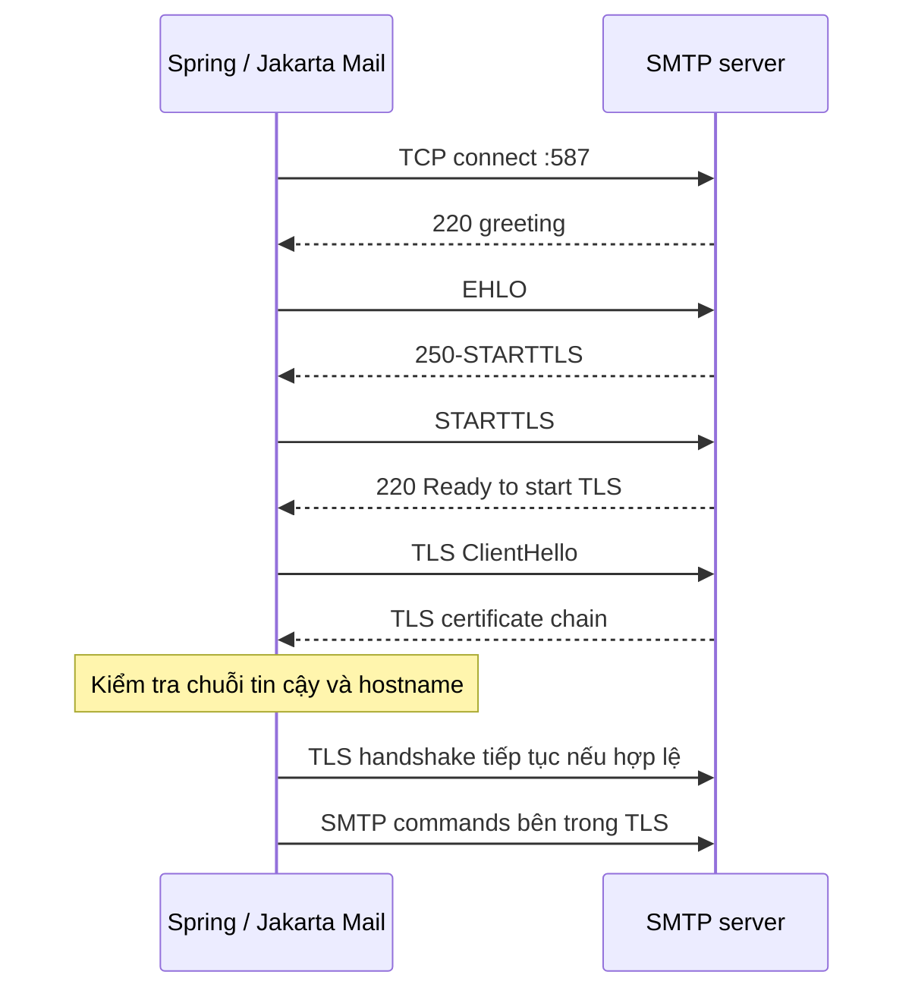
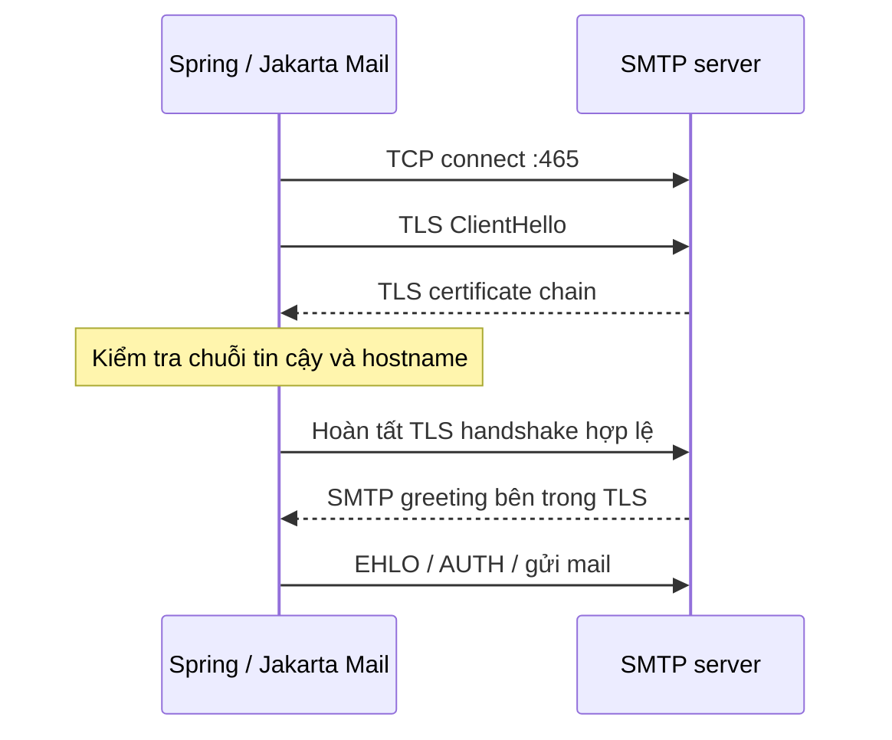

# Trust store và cách tránh tắt xác minh TLS

Khi cấu hình Spring Boot gửi email qua SMTP, một ứng dụng có thể gặp lỗi như `SSLHandshakeException: PKIX path building failed`, `unable to find valid certification path to requested target` hoặc `No subject alternative DNS name matching smtp.example.com found`. Một cách “sửa nhanh” thường xuất hiện trên diễn đàn là cấu hình `mail.smtp.ssl.trust=*`, tắt `mail.smtp.ssl.checkserveridentity` hoặc tạo một `TrustManager` chấp nhận mọi chứng chỉ. Sau thay đổi đó, email có thể gửi được, nhưng **ứng dụng đã đánh đổi khả năng xác minh danh tính SMTP server lấy việc kết nối không báo lỗi**.

Trong **Spring Framework Mail**, cấu hình an toàn phải bảo vệ cả hai điều: **mã hóa kênh truyền** và **xác minh endpoint thực sự là SMTP server mà ứng dụng định kết nối**. Trust store là kho các chứng chỉ/trust anchor mà Java tin cậy để xác minh chuỗi chứng chỉ của server. Trust store không thay thế hostname verification; ngược lại, hostname verification không có ý nghĩa đủ mạnh nếu client chấp nhận mọi chứng chỉ từ bất kỳ nguồn nào.

Bài học thuộc chương **Bảo mật SMTP** này giải thích trust store hoạt động thế nào trong Java/Jakarta Mail, cách cấu hình TLS với `JavaMailSender`, phương pháp sửa lỗi chứng chỉ **mà không tắt xác minh**, và quy trình kiểm thử, triển khai, rotation, chẩn đoán trong môi trường Spring Boot thực tế.

## 1. Mối đe dọa mà xác minh TLS cần ngăn chặn

Giả sử ứng dụng định kết nối tới `smtp.example.com:587` để gửi hóa đơn. Trên đường kết nối có thể có router, proxy doanh nghiệp, mạng cloud hoặc một endpoint bị cấu hình sai. Nếu kẻ tấn công điều hướng kết nối tới một máy khác, chỉ mã hóa lưu lượng bằng TLS là chưa đủ: client còn phải xác minh máy đang nói chuyện **đúng là endpoint được tin cậy**.

TLS có ba mục tiêu liên quan:

1. **Bí mật:** người quan sát mạng không đọc được nội dung truyền sau khi thiết lập TLS hợp lệ.
2. **Toàn vẹn:** dữ liệu truyền trên phiên TLS được bảo vệ chống sửa đổi không bị phát hiện.
3. **Xác thực server:** client xác minh chứng chỉ server thuộc một chuỗi tin cậy và chứng chỉ phù hợp với hostname mà client dự định kết nối.

Nếu tắt xác minh chứng chỉ, một máy bất kỳ có thể trình ra một chứng chỉ tự ký và vẫn được ứng dụng chấp nhận trong một số cấu hình. Khi đó SMTP username/password, nội dung thư và attachment có nguy cơ bị tiết lộ tới server giả.

**Lưu ý phạm vi bảo vệ:** TLS giữa ứng dụng và SMTP submission server là **bảo vệ từng chặng**, không phải mã hóa đầu-cuối cho người nhận. SMTP relay tiếp theo hoặc nhà cung cấp hộp thư vẫn có thể xử lý nội dung theo mô hình email thông thường. SPF, DKIM và DMARC giải quyết những bài toán xác thực domain/chính sách mail khác; chúng không thay thế xác minh chứng chỉ TLS của kết nối SMTP.

## 2. STARTTLS và implicit TLS: hai thời điểm bắt đầu bảo mật

Hai cấu hình submission phổ biến:

| Chế độ | Cổng thường gặp | Thời điểm TLS bắt đầu | Cấu hình Jakarta Mail thường dùng |
|---|---|---|---|
| STARTTLS | `587` | TCP kết nối trước; client đọc SMTP greeting/EHLO rồi nâng cấp bằng STARTTLS. | `mail.smtp.starttls.enable=true` và `mail.smtp.starttls.required=true`. |
| Implicit TLS (TLS-on-connect) | `465` | TLS handshake diễn ra ngay khi mở kết nối TCP. | `mail.smtp.ssl.enable=true`. |

Các cổng này là thông lệ phổ biến, **không phải bảo đảm rằng mọi provider hỗ trợ đúng cùng chế độ**. Luôn lấy hostname, port và TLS mode từ tài liệu của SMTP provider hoặc mail relay nội bộ.

### 2.1. Quy trình STARTTLS



Ở chế độ STARTTLS, client cần bảo đảm không gửi credential hoặc nội dung yêu cầu bảo mật qua phiên chưa nâng cấp. Đặt `mail.smtp.starttls.required=true` giúp phiên gửi **thất bại thay vì im lặng tiếp tục không TLS** khi server không hỗ trợ STARTTLS.

Một tấn công downgrade/STARTTLS stripping có thể cố làm client không thấy khả năng STARTTLS. Nếu ứng dụng chỉ bật `enable` mà không yêu cầu `required`, một số cấu hình có thể tiếp tục giao thức khi TLS không được thiết lập. Đối với SMTP submission có AUTH và thông tin nhạy cảm, nên yêu cầu TLS theo chính sách provider.

### 2.2. Quy trình implicit TLS



Cấu hình implicit TLS khác STARTTLS về **thứ tự trao đổi**, nhưng đều cần xác minh chứng chỉ và hostname. Không “sửa” SSL handshake failure bằng cách đổi cổng tùy tiện hoặc tắt kiểm tra server.

## 3. Trust store là gì?

**Trust store** là kho tin cậy mà Java sử dụng để xây dựng và xác minh đường chứng chỉ (certificate path) do server trình bày. Thông thường nó chứa một hoặc nhiều chứng chỉ CA (Certification Authority) được tổ chức hoặc hệ thống tin cậy.

Ví dụ:

```text
Trust store của ứng dụng
└── Corporate Root CA 2026 (trust anchor)

SMTP server gửi certificate chain:
  smtp.internal.example.com (leaf/server certificate)
       |
       v
  Corporate Issuing CA 2026 (intermediate)
       |
       v
  Corporate Root CA 2026 (root/trust anchor)
```

Java kiểm tra xem chuỗi server có thể được liên kết đến một trust anchor đã được chấp nhận hay không, và các điều kiện xác thực liên quan có phù hợp không.

### 3.1. Phân biệt trust store và key store

| Kho | Nội dung điển hình | Mục đích |
|---|---|---|
| **Trust store** | CA certificates, các trust anchor được phép | Xác minh chứng chỉ của **bên kia** trong TLS. |
| **Key store** | Khóa riêng cùng chứng chỉ của chính ứng dụng (khi có) | Chứng minh danh tính **chính ứng dụng** khi mTLS/client authentication được yêu cầu. |

Trong email submission thông thường, JavaMail dùng username/password hoặc OAuth2 để SMTP AUTH, còn TLS phía client xác minh server certificate qua trust store. Phần lớn ứng dụng gửi mail **không cần client certificate/mTLS**; nếu relay nội bộ yêu cầu mTLS thì mới có thêm cấu hình key store, client identity và secret lifecycle.

**Đừng nhầm việc import CA vào trust store với việc cấp private key cho ứng dụng.** Trust store dành cho xác minh đối tác; key store có thể chứa private key và cần bảo vệ đặc biệt.

### 3.2. Root CA, intermediate CA và leaf certificate

- **Root CA:** chứng chỉ gốc được chấp nhận làm trust anchor theo chính sách.
- **Intermediate CA:** CA trung gian được root CA ký và dùng để ký chứng chỉ server.
- **Leaf/server certificate:** chứng chỉ của SMTP endpoint, thường chứa hostname trong `subjectAltName`.
- **Certificate chain:** chuỗi liên kết chữ ký và thuộc tính từ leaf qua các intermediate tới trust anchor.

Một server cần trình bày chain phù hợp, đặc biệt các intermediate cần thiết. Một leaf certificate hợp lệ không đủ nếu Java không dựng được chain tới trust anchor tin cậy.

### 3.3. Trust store không phải nơi lưu tất cả chứng chỉ nhìn thấy

Nếu gặp lỗi PKIX, không nên lấy đại chứng chỉ từ kết nối lỗi và import vào trust store. Kẻ tấn công hoặc proxy không mong muốn có thể đang đưa ra chính chứng chỉ đó.

Chỉ thêm CA/trust anchor khi:

1. Nguồn của chứng chỉ được xác nhận qua **kênh tin cậy độc lập**.
2. CA đó đúng là tổ chức được phép ký chứng chỉ SMTP endpoint.
3. Fingerprint hoặc thông tin định danh được đối chiếu với nguồn chính thức.
4. Phạm vi tin cậy và kế hoạch rotation được phê duyệt.

Trust một CA đồng nghĩa trao quyền chứng thực cho những certificate mà CA đó có thể cấp trong phạm vi kiểm tra áp dụng. Đây là quyết định bảo mật, không chỉ một thao tác kỹ thuật để hết exception.

## 4. Java dùng trust store nào?

Java TLS thường dựa trên **JSSE (Java Secure Socket Extension)**. Nếu không có trust store tùy chỉnh, JSSE dùng tập trust anchor của Java runtime theo cấu hình/distribution hiện tại. Nhiều bản JDK lưu trust store mặc định dưới `$JAVA_HOME/lib/security/cacerts`, có thể có `jssecacerts` được ưu tiên nếu hiện diện.

Tuy nhiên, không nên mặc định rằng:

- Java dùng cùng tập CA với trình duyệt.
- Java dùng cùng certificate store với Windows hoặc Linux.
- Mọi container có cùng phiên bản `cacerts`.
- Máy chạy build và máy production dùng cùng JDK/trust anchors.
- Một CA mới được import vào hệ điều hành chắc chắn sẽ được JVM sử dụng.

Tùy distribution, Java runtime hoặc custom trust manager, hành vi có thể khác. **Nguồn chân lý là cấu hình TLS/trust store hiệu lực của JVM đang chạy ứng dụng.**

### 4.1. Các system properties của JSSE

Những thuộc tính JVM thường gặp:

| System property | Ý nghĩa |
|---|---|
| `javax.net.ssl.trustStore` | Đường dẫn tới trust store JSSE được cấu hình. |
| `javax.net.ssl.trustStoreType` | Loại store, ví dụ `PKCS12`. |
| `javax.net.ssl.trustStorePassword` | Mật khẩu để mở/kiểm tra integrity của store khi cần. |
| `javax.net.debug` | Debug SSL/TLS, handshake/trustmanager, chỉ bật có kiểm soát. |

Ví dụ khái niệm khi ứng dụng cần một dedicated trust store:

```text
-Djavax.net.ssl.trustStore=/etc/security/smtp-truststore.p12
-Djavax.net.ssl.trustStoreType=PKCS12
```

Mật khẩu trust store (nếu cần) phải được cấp qua cơ chế quản lý bí mật và bootstrap được phê duyệt. Không ghi password trực tiếp vào câu lệnh demo, Dockerfile, repository hoặc log; system property có chứa password có thể bị lộ qua command line/process inspection tùy môi trường.

**Quan trọng:** system properties `javax.net.ssl.*` thường tác động tới **JSSE mặc định của cả JVM**, không chỉ SMTP. Nếu ứng dụng còn gọi HTTPS/database hoặc các endpoint TLS khác, đổi default trust store có thể làm chúng mất khả năng xác minh chứng chỉ.

### 4.2. Cấu hình trust store không nằm trong `spring.mail.properties` thông thường

Các thuộc tính như `mail.smtp.starttls.enable` và `mail.smtp.ssl.checkserveridentity` là **thuộc tính Jakarta Mail**. Còn `javax.net.ssl.trustStore` là cấu hình **JSSE/JVM**, thường được cấp lúc khởi động ứng dụng.

Đừng viết một khóa tự chế như `mail.smtp.ssl.trustStore=/path/...` rồi kỳ vọng JSSE tự sử dụng nó. Nếu có giải pháp tùy chỉnh socket factory/trust manager theo SMTP client, nó phải được triển khai và kiểm thử ở tầng infrastructure bằng API cụ thể của provider.

### 4.3. Trust store tùy chỉnh có thay thế CA mặc định?

Khi ứng dụng chỉ định một trust store riêng cho default JSSE, kho mới thường **thay thế nguồn trust anchor mặc định**, thay vì tự động cộng thêm mọi CA từ `cacerts`. Nếu kho chỉ chứa internal CA, các kết nối HTTPS tới public endpoints của các thư viện khác có thể thất bại.

Các chiến lược:

- **Không custom trust store** nếu SMTP endpoint dùng public CA mà Java runtime đã tin cậy.
- **Dùng trust store được quản lý đầy đủ** nếu tổ chức chủ động kiểm soát trust anchors của toàn ứng dụng.
- **Dùng trust configuration riêng cho SMTP adapter** nếu muốn hạn chế phạm vi tin cậy mà không tác động các kết nối TLS khác; cần custom `SSLContext`/socket factory phù hợp và kiểm tra hostname riêng.
- **Quản lý CA bằng base image/JDK** nếu policy tổ chức yêu cầu và kiểm soát thay đổi tốt.

Không sao chép máy móc toàn bộ trust store công khai sang một file dự án rồi quên cập nhật CA hoặc chứng chỉ bị thu hồi.

## 5. Xác minh certificate chain và hostname là hai phép kiểm tra khác nhau

Giả sử server gửi chứng chỉ được ký bởi một CA công khai mà Java tin cậy. Điều này **chưa đủ** nếu hostname trong certificate thuộc một server khác.

Ví dụ:

```text
Ứng dụng kết nối:
  smtp.billing.example.com

Chứng chỉ trình bày:
  subjectAltName = DNS:smtp.marketing.example.com

CA ký: một CA được Java tin cậy
```

Chain có thể hợp lệ, nhưng certificate không đại diện cho `smtp.billing.example.com`. Nếu bỏ qua hostname verification, ứng dụng có thể chấp nhận nhầm endpoint.

### 5.1. Subject Alternative Name (SAN)

Với TLS server certificate hiện đại, hostname cần được khai báo phù hợp ở `subjectAltName`, ví dụ:

```text
X509v3 Subject Alternative Name:
    DNS:smtp.example.com
    DNS:mail.example.com
```

Trong thực tế:

- `smtp.example.com` phải khớp một DNS SAN phù hợp.
- Nếu kết nối trực tiếp bằng địa chỉ IP, cần đáp ứng quy tắc kiểm tra IP SAN tương ứng; đừng dùng IP thay hostname rồi tắt xác minh khi lỗi.
- Kết nối qua DNS alias/CNAME vẫn phải kiểm tra **hostname mà client được cấu hình kết nối**, không tùy tiện tin tên backend hiện ra trong log.
- Wildcard certificate có quy tắc khớp giới hạn; không hiểu `*.example.com` là khớp mọi cấp hoặc mọi hostname.
- Common Name (CN) không phải cơ chế nên dựa vào thay cho SAN trên hệ thống hiện đại.

### 5.2. SNI (Server Name Indication)

Một SMTP endpoint có thể phục vụ nhiều tên miền/chứng chỉ trên cùng IP. Trong TLS handshake, SNI giúp server biết certificate nào cần trình bày. Nếu client không gửi SNI như mong đợi hoặc hostname sai, server có thể trả certificate mặc định không khớp.

Khi chẩn đoán bằng OpenSSL, cung cấp `-servername smtp.example.com` để kết quả gần với cách kết nối theo hostname. Đồng thời lưu ý cấu hình Java/SMTP provider và TLS protocol thực tế có thể khác phiên bản OpenSSL.

### 5.3. Tại sao `mail.smtp.ssl.checkserveridentity=true` quan trọng?

JavaMail/Jakarta Mail SMTP transport hỗ trợ thuộc tính:

```properties
mail.smtp.ssl.checkserveridentity=true
```

Nó yêu cầu kiểm tra danh tính server qua hostname phù hợp trong kết nối TLS của transport. Ở nhiều phiên bản provider, không nên giả định hostname verification được bật sẵn nếu ứng dụng không cấu hình.

**Nên đặt tường minh `true`** trên cả hai mô hình STARTTLS và implicit TLS khi dùng các thuộc tính `mail.smtp.*`.

Nhưng cần đủ hai điều:

1. **Trust chain validation** phải hoạt động với trust store đúng.
2. **Hostname verification** phải được bật và hostname phải khớp.

Bật hostname verification trong khi vô hiệu hóa chain validation **không tương đương** xác minh TLS đầy đủ.

## 6. Cấu hình Spring Boot an toàn cho SMTP STARTTLS

Ví dụ `application.yml` cho provider dùng STARTTLS trên cổng 587:

```yaml
spring:
  mail:
    host: ${SMTP_HOST}
    port: 587
    protocol: smtp
    username: ${SMTP_USERNAME}
    password: ${SMTP_PASSWORD}
    default-encoding: UTF-8
    properties:
      "[mail.smtp.auth]": true
      "[mail.smtp.starttls.enable]": true
      "[mail.smtp.starttls.required]": true
      "[mail.smtp.ssl.checkserveridentity]": true
      "[mail.smtp.connectiontimeout]": 5000
      "[mail.smtp.timeout]": 10000
      "[mail.smtp.writetimeout]": 10000
```

Mỗi thuộc tính giải quyết một phần khác nhau:

| Thuộc tính | Vai trò |
|---|---|
| `spring.mail.host` | Hostname cần kết nối và đối chiếu với certificate identity. |
| `spring.mail.port` | Cổng TCP, ở ví dụ là 587. |
| `mail.smtp.starttls.enable` | Cho phép nâng cấp SMTP sang TLS bằng STARTTLS. |
| `mail.smtp.starttls.required` | Không tiếp tục nếu STARTTLS không thể được thiết lập theo yêu cầu. |
| `mail.smtp.ssl.checkserveridentity` | Bật kiểm tra hostname của chứng chỉ SMTP server. |
| `mail.smtp.auth` | Dùng SMTP AUTH theo yêu cầu provider. |
| `mail.smtp.connectiontimeout` | Giới hạn thời gian kết nối TCP. |
| `mail.smtp.timeout` | Giới hạn thời gian đọc socket. |
| `mail.smtp.writetimeout` | Giới hạn thời gian ghi socket. |

Các timeout là ví dụ cần chỉnh theo thực tế. Trust chain validation vẫn dựa trên trust configuration của TLS provider/JSSE — không có một thuộc tính `starttls.enable` nào tự sửa CA chain hỏng.

### 6.1. Ngăn STARTTLS downgrade

Chỉ đặt:

```yaml
"[mail.smtp.starttls.enable]": true
```

có thể chưa đủ với policy yêu cầu bảo mật, vì tính năng STARTTLS có thể là tùy chọn khi server không quảng bá extension hoặc không nâng cấp được. Cần:

```yaml
"[mail.smtp.starttls.enable]": true
"[mail.smtp.starttls.required]": true
```

Nếu server không hỗ trợ STARTTLS mà policy bắt buộc, connection/send phải thất bại và được điều tra. **Không fallback sang plain SMTP chỉ để email gửi được.**

### 6.2. SMTP AUTH vẫn cần đúng cơ chế

Ngay cả khi TLS xác minh đúng, SMTP AUTH có thể thất bại vì credential, OAuth2 token hoặc account policy. Đây là lớp lỗi khác. Chỉ sử dụng cơ chế AUTH do provider hỗ trợ và chính sách cho phép; không tắt TLS để “thử xem AUTH có chạy không”.

## 7. Cấu hình an toàn cho implicit TLS trên cổng 465

Nếu SMTP provider yêu cầu TLS ngay khi TCP connect:

```yaml
spring:
  mail:
    host: ${SMTP_HOST}
    port: 465
    protocol: smtp
    username: ${SMTP_USERNAME}
    password: ${SMTP_PASSWORD}
    default-encoding: UTF-8
    properties:
      "[mail.smtp.auth]": true
      "[mail.smtp.ssl.enable]": true
      "[mail.smtp.ssl.checkserveridentity]": true
      "[mail.smtp.connectiontimeout]": 5000
      "[mail.smtp.timeout]": 10000
      "[mail.smtp.writetimeout]": 10000
```

Ở ví dụ:

- `mail.smtp.ssl.enable=true` yêu cầu TLS ngay khi kết nối.
- `mail.smtp.ssl.checkserveridentity=true` vẫn bắt buộc theo policy xác minh.
- Không cần bật STARTTLS cho một transport đã dùng TLS từ lúc mở, trừ hướng dẫn đặc biệt của provider.
- Trust store và CA validation vẫn cần đúng như với STARTTLS.

Một số thư viện/phiên bản hỗ trợ protocol `smtps` riêng. Nếu chọn transport này, cần dùng đúng namespace `mail.smtps.*` theo provider. Ví dụ ở đây sử dụng `smtp` cùng `mail.smtp.ssl.enable=true` để tránh nhập nhằng.

## 8. Những cách sửa lỗi TLS không an toàn

Một số cấu hình có thể khiến handshake “thành công” nhưng vô hiệu hóa mục tiêu xác minh server.

### 8.1. Trust mọi certificate/host

Cấu hình **không nên dùng trong production**:

```yaml
spring:
  mail:
    properties:
      "[mail.smtp.ssl.trust]": "*"
```

Trong một số Jakarta Mail/JavaMail provider, cấu hình này cho phép tin cậy certificate cho mọi SMTP host theo cơ chế trust override riêng. Nó có thể bỏ qua kiểm tra chuỗi CA tiêu chuẩn, mở đường cho server giả với certificate không được tin cậy.

**Đây không phải cách import một CA hợp lệ.** Nó thay đổi chính sách tin cậy thay vì khắc phục nguyên nhân PKIX.

### 8.2. Tắt hostname verification

Cấu hình **không nên dùng**:

```yaml
spring:
  mail:
    properties:
      "[mail.smtp.ssl.checkserveridentity]": false
```

Ngay cả khi chain được ký bởi CA công khai, không kiểm tra hostname làm client có nguy cơ chấp nhận certificate đúng CA nhưng sai đích. Đặc biệt nguy hiểm khi cấu hình DNS, proxy hoặc relay bị thay đổi.

### 8.3. Trust một hostname qua thuộc tính `mail.smtp.ssl.trust`

Có ví dụ viết:

```properties
mail.smtp.ssl.trust=smtp.example.com
```

Giới hạn theo hostname có vẻ an toàn hơn `*`, nhưng đây vẫn là một **cơ chế thay đổi trust decision của provider**, không đồng nghĩa với việc xác minh chain bằng CA chuẩn. Nó có thể được dùng để tin cậy chứng chỉ không nằm trong trust store theo chính sách của provider.

Không chọn nó làm giải pháp mặc định cho lỗi PKIX trong production. Phương án ưu tiên là sửa chain hoặc trust anchor đã xác minh. Nếu tổ chức có yêu cầu trust override đặc thù, cần review bảo mật, kiểm tra hostname, giới hạn phạm vi và tài liệu hóa chính xác ngữ nghĩa của provider đang dùng.

### 8.4. Tạo TrustManager chấp nhận tất cả

Một anti-pattern khác là custom trust manager với phương thức xác minh server không kiểm tra gì. Không dùng cách này cho SMTP production.

Ngay cả khi kết nối sử dụng TLS 1.3 và cipher mạnh, **mã hóa tới máy chủ không được xác minh không bảo đảm chống người trung gian**.

### 8.5. Thay custom socket factory mà không xem xét hostname

Custom `SSLSocketFactory` hoặc `SSLContext` có thể hữu ích để dùng trust store riêng cho SMTP adapter, nhưng phải bảo đảm:

- TrustManager thực sự xác minh chain theo trust anchor mong đợi.
- Endpoint identification/hostname verification được bật.
- Cấu hình STARTTLS/implicit TLS đúng.
- Không dùng factory trust-all.
- Test fail khi server trình bày certificate sai hostname hoặc không đáng tin.

Nếu thay socket factory mà quên bước kiểm tra hostname, kết quả có thể “kết nối được” nhưng vẫn không đáp ứng yêu cầu bảo mật.

### 8.6. Tắt certificate validation trong môi trường test rồi quên bật lại

Nếu test dùng certificate tự ký, cách tốt hơn là tạo một **test CA**, ký certificate cho SMTP test server và cấp test trust store chứa test CA đó. Không dùng trust-all trong test làm hình mẫu cho production code.

Các kiểm thử bảo mật cần có case negative: untrusted CA phải thất bại, hostname mismatch phải thất bại và STARTTLS không hỗ trợ phải thất bại khi `required=true`.

## 9. Những lỗi TLS thường gặp và nguyên nhân thực sự

### 9.1. PKIX path building failed

Ví dụ message:

```text
javax.net.ssl.SSLHandshakeException:
  PKIX path building failed:
  unable to find valid certification path to requested target
```

Điều này thường chỉ ra client không xây dựng được chain từ server certificate đến trust anchor tin cậy. Các khả năng:

- SMTP server dùng CA nội bộ chưa có trong Java trust store.
- Server thiếu intermediate certificate cần thiết.
- Java runtime cũ chưa có root CA hiện hành.
- Ứng dụng trỏ nhầm trust store hoặc file rỗng.
- TLS interception proxy thay certificate bằng CA nội bộ chưa được tin.
- Container chạy một JRE khác so với môi trường đã kiểm thử.

Không kết luận chắc chắn nguyên nhân chỉ từ dòng `PKIX`. Kiểm tra chain server trình bày và trust store hiệu lực.

### 9.2. Không khớp hostname

Ví dụ:

```text
No subject alternative DNS name matching smtp.example.com found
```

Các khả năng:

- Ứng dụng dùng sai hostname.
- Server/load balancer trả certificate của dịch vụ khác.
- Certificate không có SAN đúng.
- DNS alias/endpoint chuyển sang máy có certificate không khớp.
- SNI không được gửi/không được server xử lý như dự kiến.

**Không sửa bằng cách tắt `checkserveridentity`.** Sửa hostname, certificate SAN hoặc cấu hình SNI/endpoint.

### 9.3. Certificate expired / not yet valid

Ví dụ:

```text
CertificateExpiredException: NotAfter ...
CertificateNotYetValidException: NotBefore ...
```

Cần:

- Kiểm tra ngày hiệu lực của certificate.
- Kiểm tra clock/NTP của host/container/JVM.
- Renew/rotate certificate phía SMTP provider hoặc relay.
- Xác minh server đã triển khai certificate mới lên mọi backend.

Không nhập certificate hết hạn vào trust store với hy vọng hết lỗi. Trust store **không vô hiệu hóa** kiểm tra thời hạn certificate.

### 9.4. Certificate chain thiếu intermediate

Server có thể gửi leaf certificate nhưng thiếu intermediate CA. Một số browser tự lấy intermediate qua cache/AIA, trong khi Java runtime không nhất thiết thực hiện giống nhau; vì vậy browser “không báo lỗi” chưa chứng minh chain SMTP đúng.

Sửa ưu tiên: cấu hình **SMTP server/load balancer trình bày đầy đủ chain cần thiết**. Đừng bắt mọi client import leaf certificate để che lỗi server.

### 9.5. Unsupported protocol / handshake_failure

Ví dụ:

```text
SSLHandshakeException: Received fatal alert: handshake_failure
SSLException: Unsupported or unrecognized SSL message
```

Nguyên nhân có thể là:

- Dùng implicit TLS trên cổng chỉ hỗ trợ STARTTLS, hoặc ngược lại.
- Không có phiên bản TLS/cipher suite chung.
- Server/Java runtime quá cũ.
- Middleware/proxy làm gián đoạn handshake.
- Chính sách TLS của provider thay đổi.

Không tự bật TLS 1.0/1.1 hoặc cipher yếu để “tương thích”. Nâng cấp JDK/provider, sửa cấu hình endpoint hoặc làm việc với mail relay để hỗ trợ TLS hiện đại.

### 9.6. Connection refused / connect timed out

`ConnectException` hoặc `SocketTimeoutException` lúc mở TCP thuộc **connectivity**, có thể xảy ra trước khi đến TLS. Cần kiểm tra DNS, port, firewall, route, egress. Import CA không giúp mở một cổng đang bị chặn.

### 9.7. SMTP AUTH failure

`535` hoặc `MailAuthenticationException` xảy ra khi client đã đến bước xác thực SMTP. Cần kiểm tra credential, account policy, OAuth2/app password theo provider. Đây không phải lỗi trust store nếu TLS đã xác minh thành công.

## 10. Chẩn đoán chain bằng OpenSSL mà không tắt xác minh

OpenSSL hữu ích để nhìn vào certificate chain mà SMTP server trình bày.

### 10.1. STARTTLS trên cổng 587

```bash
openssl s_client \
  -starttls smtp \
  -connect smtp.example.com:587 \
  -servername smtp.example.com \
  -verify_hostname smtp.example.com \
  -verify_return_error \
  -showcerts
```

Các tùy chọn:

- `-starttls smtp`: dùng SMTP STARTTLS negotiation trước TLS.
- `-connect`: endpoint TCP thực tế.
- `-servername`: yêu cầu SNI theo hostname.
- `-verify_hostname`: kiểm tra certificate phù hợp hostname.
- `-verify_return_error`: báo thất bại khi verification error xảy ra.
- `-showcerts`: hiển thị chain mà server cung cấp.

Hãy xem `Verify return code`, các certificate được trình bày, Subject, Issuer, SAN và thời hạn. Không chỉ thấy dòng `CONNECTED` rồi kết luận TLS hợp lệ: dòng đó có thể chỉ chứng minh TCP connection.

### 10.2. Implicit TLS trên cổng 465

```bash
openssl s_client \
  -connect smtp.example.com:465 \
  -servername smtp.example.com \
  -verify_hostname smtp.example.com \
  -verify_return_error \
  -showcerts
```

Không dùng `-starttls smtp` trên cổng implicit TLS 465 thông thường. Nếu dùng sai mode, lệnh có thể timeout hoặc báo protocol error không liên quan certificate chain.

### 10.3. Dùng CA nội bộ trong OpenSSL

Nếu tổ chức có CA root PEM chính thức:

```bash
openssl s_client \
  -starttls smtp \
  -connect smtp.internal.example.com:587 \
  -servername smtp.internal.example.com \
  -verify_hostname smtp.internal.example.com \
  -verify_return_error \
  -CAfile /etc/security/corporate-root-ca.pem
```

File CA phải được nhận từ nguồn tin cậy. Việc `openssl s_client` báo OK với CAfile xác nhận một số bước ở môi trường OpenSSL, **không tự chứng minh JSSE của JVM đã có cùng CA/trust behavior**.

### 10.4. Chẩn đoán phải thực hiện từ môi trường có cùng đường mạng

Kiểm tra trên laptop khác với kiểm tra từ:

- Kubernetes pod có egress policy riêng.
- Docker container dùng JRE truststore khác.
- VM trong VPC nối SMTP relay nội bộ.
- Máy production có TLS-inspecting proxy.

Nếu có thể, dùng test pod/debug container được cấp phép trên cùng đường egress. Không tùy tiện mở firewall hoặc cài công cụ vào production image chỉ để chạy một câu lệnh.

## 11. Kiểm tra chứng chỉ CA trước khi import

Nếu SMTP relay nội bộ sử dụng CA do tổ chức quản lý, cần xác nhận bản CA có nguồn đáng tin.

### 11.1. Xem chứng chỉ từ file

```bash
keytool -printcert \
  -file corporate-smtp-root-ca.pem \
  -v
```

Thông tin cần xem:

- Subject và Issuer.
- SHA-256 certificate fingerprint.
- Thời gian hiệu lực.
- Basic Constraints (CA certificate hay không).
- Key Usage/Extended Key Usage khi liên quan.
- Public key algorithm và signature algorithm.

**Quan trọng:** đối chiếu fingerprint với nguồn độc lập như PKI inventory hoặc tài liệu bảo mật nội bộ. Fingerprint lấy từ chính SMTP connection đang báo lỗi không đủ để xác thực nguồn gốc CA.

### 11.2. Lưu ý khi import một CA

Import CA có nghĩa ứng dụng sẽ tin các chứng chỉ server phù hợp được chuỗi CA đó ký. Nên ưu tiên CA có phạm vi tổ chức kiểm soát, được quản lý lifecycle rõ ràng và có chính sách rotation/revocation.

Đối với public SMTP service dùng CA phổ biến, thường **không cần** tạo trust store riêng. Nếu Java không nhận CA public, trước tiên kiểm tra server chain, JDK update và nguồn trust anchors mặc định.

## 12. Tạo trust store riêng chứa CA đã kiểm chứng

Giả sử tổ chức có một SMTP relay nội bộ, root CA đã được đội bảo mật xác minh và ứng dụng cần tin CA này.

### 12.1. Tạo trust store PKCS12

Ví dụ:

```bash
keytool -importcert \
  -trustcacerts \
  -alias corporate-smtp-root-2026 \
  -file corporate-smtp-root-ca.pem \
  -keystore smtp-truststore.p12 \
  -storetype PKCS12
```

`keytool` có thể yêu cầu mật khẩu và xác nhận tin cậy certificate. Hãy **kiểm tra fingerprint độc lập trước khi trả lời đồng ý**. Không dùng `-noprompt` trong hướng dẫn thao tác thủ công khi chưa có quy trình xác minh tự động được kiểm soát.

Việc này tạo/cập nhật trust store tại vị trí được chỉ định. Không cần sửa trực tiếp `cacerts` của Java cho mọi ứng dụng nếu chỉ một service dùng internal CA.

### 12.2. Kiểm tra store sau khi import

```bash
keytool -list \
  -v \
  -keystore smtp-truststore.p12 \
  -storetype PKCS12 \
  -alias corporate-smtp-root-2026
```

Xem alias, Subject, fingerprint, CA validity. File trust store phải được lưu và phân phối theo quy trình cấu hình/secret của tổ chức. Trong một số môi trường, CA certificate là public nhưng **quyền thay đổi trust store** vẫn rất nhạy cảm vì có thể thay đổi endpoint mà ứng dụng sẽ tin cậy.

### 12.3. Cấp trust store cho JVM

Ví dụ phần tùy chọn JVM:

```text
-Djavax.net.ssl.trustStore=/opt/app/security/smtp-truststore.p12
-Djavax.net.ssl.trustStoreType=PKCS12
```

Nếu store cần password để load và xác minh integrity, phải cung cấp thông qua cơ chế bootstrap/secret handling an toàn của nền tảng. Không hardcode mật khẩu vào `application.yml`, source code hoặc câu lệnh hiển thị cho người dùng khác.

**Cần nhớ:** đặt trust store mặc định này có thể ảnh hưởng mọi kết nối TLS của JVM. Không cho rằng CA public còn được tin cậy nếu store mới chỉ có internal CA.

### 12.4. Kiểm tra quyền truy cập file

Một lỗi phổ biến là path hợp lệ trên máy dev nhưng không tồn tại trong container. Với Docker/Kubernetes:

- Mount trust store vào path rõ ràng trong container.
- Bảo đảm process Java có quyền đọc.
- Bảo đảm version/certificate mong muốn đã được phân phối cho mọi instance.
- Không ghi trust store vào vị trí người dùng không tin cậy có thể sửa.
- Theo dõi thay đổi trust store như thay đổi cấu hình bảo mật có audit.

Nếu file trust store bị thiếu hoặc không load được, Java có thể không có tập trust anchor mong muốn và kết nối TLS thất bại. Không xử lý bằng cách fallback sang trust-all.

## 13. Khi nào nên tránh thay thế trust store toàn JVM?

Nếu ứng dụng cùng lúc gọi:

- SMTP relay nội bộ dùng Corporate CA.
- API thanh toán HTTPS dùng public CA.
- Dịch vụ object storage dùng public CA.
- Service mesh nội bộ dùng CA riêng.

thì một trust store chỉ chứa Corporate SMTP CA có thể làm các kết nối khác bị lỗi PKIX. Có nhiều chiến lược:

### 13.1. Dùng trust store được tổ chức quản lý cho toàn JVM

Một file truststore có thể chứa tập CA đã được duyệt cho tất cả workload của ứng dụng. Cần:

- Tự động cập nhật CA theo policy.
- Review certificate/trust anchor được thêm.
- Rollout có kiểm soát.
- Test các kết nối TLS khác, không chỉ SMTP.
- Có quy trình rotation và rollback.

Không tự copy `cacerts` vào repository rồi quên các đợt update CA tiếp theo.

### 13.2. Tách TLS configuration riêng cho SMTP adapter

Với ứng dụng cần **mỗi endpoint có tập CA khác nhau**, có thể dựng `SSLContext` dùng `TrustManagerFactory` khởi tạo từ trust store cụ thể và cung cấp socket factory cho SMTP transport. Điều này yêu cầu kiến thức về Jakarta Mail provider và cần kiểm thử hostname verification.

Ví dụ khái niệm về phần dựng **trust manager an toàn**, không có trust-all:

```java
import javax.net.ssl.SSLContext;
import javax.net.ssl.TrustManagerFactory;
import java.io.InputStream;
import java.nio.file.Files;
import java.nio.file.Path;
import java.security.KeyStore;
import java.security.SecureRandom;

public final class SmtpTlsContextFactory {

    public static SSLContext fromTrustStore(
            Path trustStorePath,
            char[] trustStorePassword) throws Exception {

        KeyStore store = KeyStore.getInstance("PKCS12");

        try (InputStream in = Files.newInputStream(trustStorePath)) {
            store.load(in, trustStorePassword);
        }

        TrustManagerFactory factory =
                TrustManagerFactory.getInstance(
                        TrustManagerFactory.getDefaultAlgorithm());
        factory.init(store);

        SSLContext context = SSLContext.getInstance("TLS");
        context.init(
                null,
                factory.getTrustManagers(),
                new SecureRandom());

        return context;
    }
}
```

Đoạn code tạo `SSLContext` sử dụng trust anchors trong store. Nó **không tự cài cấu hình vào JavaMailSender** và **không tự bảo đảm hostname verification của endpoint sử dụng nó**. Với SMTP, adapter phải gắn `SSLSocketFactory`/context theo API mà phiên bản Jakarta Mail hỗ trợ, đồng thời giữ `mail.smtp.ssl.checkserveridentity=true`. Hãy kiểm thử thực sự các case untrusted chain và sai hostname.

Nếu không có yêu cầu cô lập trust anchors theo từng connector, giải pháp đơn giản hơn thường là dùng trust store JVM được quản lý và tránh custom TLS code.

### 13.3. Hạn chế việc tự viết trust manager

Không tự triển khai `X509TrustManager` từ đầu chỉ để import một CA. JSSE đã có `TrustManagerFactory` để thực hiện kiểm tra path theo chuẩn. Custom logic tự viết dễ bỏ sót certificate validity, chain signatures, algorithm constraints hoặc endpoint verification.

Nếu doanh nghiệp cần PKI policy đặc thù, để đội an ninh/PKI thiết kế, review và test. Không sửa theo một snippet “trust all” sao chép từ diễn đàn.

## 14. Có nên import leaf certificate trực tiếp?

Một cách “hết lỗi nhanh” là lấy leaf certificate của `smtp.example.com` rồi import vào trust store như trust anchor.

Điều này có thể gây vấn đề:

- Leaf certificate được rotate thường xuyên.
- Khi đổi certificate, kết nối có thể hỏng dù server vẫn dùng cùng CA hợp lệ.
- Bạn đang thay đổi trust anchor mà chưa đánh giá CA policy.
- Nếu leaf được lấy qua đường kết nối đã bị thay thế, có nguy cơ tin certificate sai.
- Certificate đang lỗi SAN/expired không được “sửa” bằng import đơn thuần.

Với một SMTP endpoint công khai, **ưu tiên chain hợp lệ tới CA tin cậy**. Với server nội bộ, ưu tiên CA nội bộ đã xác minh và cơ chế cấp certificate có SAN đúng.

Pinning leaf/public key có thể là chiến lược bảo mật riêng trong một số môi trường kiểm soát chặt, nhưng cần thiết kế rotation/backup pin và không đồng nhất nó với giải pháp mặc định cho lỗi PKIX.

## 15. Chuỗi chứng chỉ phải được server trình bày đúng

Giả sử SMTP server dùng:

```text
Leaf: smtp.example.com
Issuer: Intermediate CA B
Intermediate CA B
Issuer: Root CA A
Root CA A: trusted in Java
```

Nếu server chỉ gửi leaf và không gửi intermediate B, Java có thể không dựng được chain, dù root A đã nằm trong trust store.

Cách sửa ưu tiên:

1. Kiểm tra chain thực tế bằng công cụ TLS có xác minh.
2. Đối chiếu leaf/issuer với tài liệu CA.
3. Cấu hình SMTP server/load balancer trình bày leaf cùng intermediate cần thiết.
4. Xác minh lại với Java runtime mục tiêu.
5. Không yêu cầu tất cả clients import certificate sai lệch để che thiếu sót.

Một số môi trường có cache intermediate hoặc AIA retrieval nên ứng dụng khác có thể kết nối được. Đừng dùng browser success làm bằng chứng JavaMail phải thành công.

## 16. Phân biệt các lỗi TLS ở nhiều lớp

Một lời gọi `JavaMailSender.send` có thể bị Spring bọc thành `MailSendException`; bên trong là `MessagingException`, SSL exception hoặc lỗi mạng.

| Tín hiệu | Lớp lỗi | Cách xử lý đúng |
|---|---|---|
| `PKIX path building failed` | Trust chain/CA | Kiểm tra CA, intermediate, JDK runtime, configured trust store. |
| `No subject alternative DNS name matching` | Hostname verification | Sửa SMTP hostname, SAN, DNS/SNI/certificate endpoint. |
| `CertificateExpiredException` | Certificate validity | Renew certificate và kiểm tra clock. |
| `CertificateNotYetValidException` | Certificate validity/clock | Kiểm tra clock và thời hạn certificate. |
| `handshake_failure` | TLS negotiation | Kiểm tra TLS mode, protocol/cipher, provider/server. |
| `Connection refused` | TCP connectivity | Kiểm tra listener/host/port/firewall. |
| `Connect timed out` | TCP connectivity | Kiểm tra routing/egress/network; không phải PKIX. |
| `535 Authentication failed` | SMTP AUTH | Kiểm tra credentials/account policy. |
| `550 Recipient rejected` | SMTP transaction | Kiểm tra recipient/policy, không sửa trust store. |

Không kết luận lỗi ở trust store khi chỉ thấy `MailSendException` ngoài cùng. Phải đọc cause chain và giai đoạn xảy ra.

### 16.1. Duyệt cause chain

JavaMail `MessagingException` có thể chứa `getNextException()` ngoài `getCause()`. Khi chẩn đoán, xem cả hai và, với `MailSendException`, xem thông tin từng message nếu batch gửi nhiều message.

Ví dụ phương pháp:

```java
try {
    mailSender.send(message);
} catch (MailException ex) {
    // Ở infrastructure adapter:
    // - phân loại nested cause và Jakarta Mail next exception;
    // - lấy SMTP stage/code nếu provider cung cấp;
    // - ghi diagnostic code an toàn;
    // - chuyển thành application-level failure.
    throw ex;
}
```

Ví dụ cần `org.springframework.mail.MailException` và adapter đã định nghĩa; không nên log raw SMTP transcript hoặc email body chỉ để xem TLS error.

### 16.2. Phân loại handshake failure có an toàn để retry không?

Một certificate invalid, hostname mismatch hoặc root CA thiếu thường là **lỗi cấu hình/bảo mật**, không phải transient SMTP rejection. Retry liên tục cùng cấu hình sẽ không làm CA tự xuất hiện.

Không tự động chuyển tất cả `SSLHandshakeException` thành `RETRY_WAIT`. Một outage tạm thời trong TLS negotiation có thể hồi phục, nhưng cần bằng chứng và retry budget; trust/identity failure nên cảnh báo và dừng cho tới khi được sửa.

## 17. Debug TLS trong JVM

Khi OpenSSL cho kết quả khác Java, cần xem JSSE và trust store thực tế.

### 17.1. Bật debug có giới hạn

Một lựa chọn JVM cho môi trường test hoặc chẩn đoán được phê duyệt:

```text
-Djavax.net.debug=ssl,handshake,trustmanager
```

Tùy JDK, debug có thể in certificate chain, hoạt động của trust manager, TLS messages và metadata khác. Không bật trên toàn bộ production cluster trong thời gian dài: log nhiều và có thể chứa thông tin nhạy cảm hoặc topology hạ tầng.

### 17.2. Đọc đúng những điểm quan trọng

Tìm các dấu hiệu:

- JVM đang dùng trust store nào?
- Trust manager đã nạp CA nào?
- Server trình bày leaf/chain nào?
- Có lỗi path building, validity hay algorithm constraints không?
- Có hostname verification failure không?
- Giai đoạn TLS bị dừng ở đâu?

**Không sửa chứng chỉ chỉ vì một dòng log chứa `certificate_unknown`**. Alert TLS thường là triệu chứng ở một đầu kết nối; cần tìm lỗi xác minh gốc trong cause chain.

### 17.3. JavaMail protocol debug khác JSSE debug

Jakarta Mail còn có debug SMTP protocol thông qua cấu hình như:

```yaml
spring:
  mail:
    properties:
      "[mail.debug]": true
```

Protocol debug có thể giúp thấy EHLO/STARTTLS negotiation. JSSE debug tập trung vào TLS handshake/trust. Cần chọn đúng công cụ cho đúng lớp lỗi và bật có phạm vi.

Không gửi credential hoặc dữ liệu khách hàng vào môi trường debug; bảo vệ log và tắt sau khi chẩn đoán xong.

## 18. Xác minh phiên bản Java và provider thực sự chạy

Một lỗi PKIX có thể chỉ xảy ra trong production dù staging gửi được email. Nguyên nhân đôi khi là **môi trường runtime**:

- Image production dùng JRE cũ hơn.
- `JAVA_HOME` trỏ sang runtime khác với CI.
- Một pod không nhận trust store volume mới.
- Corporate CA đã được thêm vào OS cert bundle nhưng Java không dùng bundle đó.
- Một số instance còn cấu hình `javax.net.ssl.trustStore` cũ.
- Provider Angus/Jakarta Mail được nâng cấp, làm khác hành vi TLS mặc định hoặc cách đọc properties.

Nên ghi nhận:

```text
Application version:
Java runtime vendor/version:
Jakarta Mail provider/version:
SMTP host and port:
TLS mode:
JVM trustStore path/type:
Trust store deployment version:
Server certificate SAN/issuer/expiry:
Failing pod/node:
```

Không log truststore password hoặc secret manager token.

### 18.1. Vì sao update JDK đôi khi giải quyết PKIX?

Nếu runtime cũ chưa chứa CA root hiện hành hoặc chính sách thuật toán cũ/khác, update JDK có thể làm đường xác minh hoạt động. Nhưng cần chứng minh nguyên nhân; không nên dùng “upgrade Java” làm câu trả lời mặc định cho một server thiếu intermediate hoặc hostname mismatch.

### 18.2. Container image và base layer

Nếu certificate store được bake vào image, rotation có thể yêu cầu rebuild và rollout. Nếu được mount ngoài image, rotation cần đồng bộ volume và cơ chế reload/restart phù hợp. JSSE/SSLContext không nhất thiết tự tải lại trust anchors khi file trên disk đổi.

Do đó, cần **chiến lược reload/rolling restart** sau khi cập nhật trust store và test kết nối của instance mới.

## 19. Rotation và trust store lifecycle

Giải pháp tin CA không chỉ cần chạy hôm nay mà còn phải an toàn khi thay certificate.

### 19.1. Một kịch bản rotation CA

Giả sử tổ chức chuyển từ Root CA A sang Root CA B:

1. Đội PKI xuất bản Root CA B qua kênh đã xác minh.
2. Tạo trust store tạm chứa cả A và B theo giai đoạn chuyển tiếp được duyệt.
3. Triển khai trust store mới tới ứng dụng.
4. Xác nhận ứng dụng tin certificate mới trên staging và production canary.
5. Chuyển SMTP server sang chain ký bởi B.
6. Theo dõi kết nối từ mọi mail worker.
7. Khi A không còn cần thiết và hết transition period, loại bỏ A theo policy.
8. Ghi lại version, fingerprint và thời điểm rollback/rollout.

Điểm mấu chốt là **client cần tin CA mới trước khi server chuyển sang chain mới** để tránh gián đoạn.

### 19.2. Rotation leaf certificate

Với public CA hoặc internal CA ổn định, việc renew leaf certificate đúng SAN thường không yêu cầu sửa Java trust store. Nếu mọi lần renew đều cần cập nhật truststore, có thể hệ thống đang pin leaf không cần thiết.

### 19.3. Expiry monitoring

Nên theo dõi:

- Ngày hết hạn leaf certificate.
- Ngày hết hạn intermediate/root CA trong chuỗi liên quan.
- Hostname/SAN còn đúng sau thay đổi DNS.
- Trust store version và thời gian cập nhật ở từng instance.
- Kết quả TLS handshake kiểm tra chủ động có xác minh.
- Tỷ lệ `SSLHandshakeException` và mail queue lag.

Cảnh báo trước expiry đủ sớm theo quy trình tổ chức. Không đưa việc renew certificate vào chuỗi retry tự động của mỗi notification.

### 19.4. Thu hồi CA hoặc certificate

Trust store chứa CA không có nghĩa hệ thống sẽ tự động kiểm tra thu hồi mọi certificate theo mọi chế độ; hành vi revocation checking trong JSSE tùy cấu hình, provider và chính sách PKI. Nếu tổ chức yêu cầu CRL/OCSP, phải thiết kế, bật và kiểm thử riêng.

Không tuyên bố “có CA trong trust store là an toàn tuyệt đối”. Còn cần certificate validity, hostname, policy/algorithm constraints và quy trình thu hồi/rotation.

## 20. Proxy kiểm tra TLS và ranh giới tin cậy

Một số mạng doanh nghiệp thực hiện TLS interception bằng một CA nội bộ. Khi đó ứng dụng có thể nhìn thấy certificate do proxy cấp, không phải certificate gốc của public SMTP provider.

Trước khi import CA của proxy, phải xác định:

- Proxy đó có được phép can thiệp **SMTP/TLS** không?
- Cơ chế hoạt động có được đội bảo mật phê duyệt không?
- Proxy xử lý dữ liệu email/credential theo policy nào?
- Hostname verification có còn giữ đúng không?
- Có thể dùng outbound relay chính thức thay vì interception không?

Nếu chính sách cấm TLS interception đối với email, giải pháp là dùng đường mạng/relay được phê duyệt, không import CA để mặc nhiên tin mọi proxy.

### 20.1. Không bỏ xác minh khi dùng private SMTP relay

Ngay cả relay nội bộ cũng có thể bị tấn công, DNS sai hoặc traffic routing nhầm. Nếu doanh nghiệp quản lý CA nội bộ, hãy cấp server certificate đúng SAN và đưa CA vào trust store theo chính sách. “Nó chạy trong VPC nên không cần kiểm tra cert” không phải một luận cứ bảo mật đủ mạnh.

## 21. Kiểm thử TLS an toàn trong Spring Framework Mail

Một bài test tốt phải kiểm tra cả **thành công đúng** và **thất bại đúng**.

### 21.1. Tạo SMTP test server có TLS

Dùng một SMTP test server có hỗ trợ STARTTLS/implicit TLS, ví dụ GreenMail khi phiên bản được cấu hình phù hợp, hoặc một SMTP test relay do đội kiểm thử quản lý.

Khuyến nghị tạo:

- Một test CA.
- Server certificate có SAN là hostname dùng trong test, ví dụ `smtp.test.local`.
- Trust store chỉ chứa test CA.
- Một certificate khác có hostname sai.
- Một certificate do CA chưa được tin ký.

Không gửi thư thật tới khách hàng trong kiểm thử. Nếu cần mô phỏng mail delivery, dùng SMTP catcher/test mailbox.

### 21.2. Các kịch bản dương tính

| Test | Kỳ vọng |
|---|---|
| Server cert do CA được tin ký, SAN khớp | TLS handshake thành công. |
| STARTTLS 587 được hỗ trợ, `required=true` | Kết nối được nâng cấp và email test được submission. |
| Implicit TLS 465 được hỗ trợ | Handshake trước SMTP greeting thành công. |
| Trust store riêng được load đúng | Test runtime kết nối tới SMTP test endpoint hợp lệ. |

### 21.3. Các kịch bản âm tính bắt buộc

| Test | Kỳ vọng |
|---|---|
| Server cert do CA không được tin ký | Handshake thất bại. |
| SAN sai hostname | Kết nối bị từ chối khi hostname verification bật. |
| Certificate hết hạn | Handshake bị từ chối. |
| STARTTLS không được server công bố nhưng client `required=true` | Không fallback sang cleartext SMTP. |
| Client dùng implicit TLS trên server chỉ hỗ trợ STARTTLS | Giao thức thất bại; không tự tắt TLS. |
| Trust store path sai/không đọc được | Cấu hình không thể xác minh server; fail closed. |

**Một hệ thống an toàn cần thất bại ở các ca âm tính này.** Nếu mọi certificate đều “thành công”, có thể test environment đã vô tình bật trust-all hoặc bỏ hostname verification.

### 21.4. Kiểm thử bằng JavaMailSenderImpl.testConnection()

Spring cung cấp `JavaMailSenderImpl.testConnection()` để thử kết nối:

```java
import jakarta.mail.MessagingException;
import org.springframework.mail.javamail.JavaMailSenderImpl;

public final class SmtpTlsDiagnostic {
    private final JavaMailSenderImpl sender;

    public SmtpTlsDiagnostic(JavaMailSenderImpl sender) {
        this.sender = sender;
    }

    public void verifyConnection() throws MessagingException {
        sender.testConnection();
    }
}
```

Khi `JavaMailSenderImpl` dùng cấu hình SMTP/TLS thật, phép kiểm tra có thể đi qua TCP/TLS/AUTH và phát hiện lỗi chứng chỉ. Nhưng nó **không chứng minh** một recipient được chấp nhận hoặc email đã delivery.

Không gọi `testConnection()` trước **mỗi** email như một tiền kiểm bắt buộc; điều đó tăng kết nối network và không ngăn lỗi xảy ra giữa hai lần thao tác. Sử dụng nó trong kiểm thử/chẩn đoán được giới hạn tần suất, có timeout.

### 21.5. Test cấu hình ứng dụng và adapter

Các kiểm tra tự động có thể xác nhận:

- `mail.smtp.ssl.checkserveridentity=true`.
- `mail.smtp.starttls.required=true` khi dùng STARTTLS submission.
- `mail.smtp.ssl.enable=true` khi chọn implicit TLS.
- Không có `mail.smtp.ssl.trust=*` trong production config.
- Không có custom trust-all `TrustManager`.
- Trust store được mount đúng path/quyền đọc trên container.
- Test negative SAN/CA thật sự fail.

Đây là kiểm thử cấu hình/security behavior, không phải chỉ unit test Java object. Dùng môi trường test có certificate chain thực để chứng minh client từ chối endpoint không đáng tin.

## 22. Áp dụng trong kiến trúc Hexagonal / Ports and Adapters

Trong ứng dụng lớn, tầng domain không nên biết trust store, `MimeMessage` hay TLS protocol. Kiến trúc có thể tách:

```text
Domain
  OrderConfirmed / InvoiceIssued
       |
       v
Application
  MailNotificationPort + OutgoingEmail
       |
       v
Infrastructure SMTP adapter
  JavaMailSender
  MimeMessageHelper
  TLS config / trust store / provider error mapping
       |
       v
SMTP relay / provider
```

Infrastructure adapter chịu trách nhiệm:

- Dùng hostname/port/TLS mode đã cấu hình và phê duyệt.
- Không tắt TLS certificate/hostname verification.
- Phân loại `SSLHandshakeException` và các lỗi hạ tầng.
- Đưa lỗi ra application bằng mã trung lập, không lộ implementation exception.
- Ghi log an toàn phục vụ chẩn đoán.

Application/worker chịu trách nhiệm:

- Lưu notification intent bền vững.
- Đặt retry/backoff có giới hạn.
- Giữ idempotency key cho một yêu cầu gửi.
- Chuyển lỗi cấu hình trust thành alert/cần can thiệp, không retry vô hạn.
- Không trả kết quả “đã delivery” chỉ vì `JavaMailSender.send()` không ném lỗi.

## 23. Retry không phải cách sửa trust failure

Một lỗi TLS có thể là transient trong một số trường hợp, nhưng các nhóm sau **thường không nên retry tự động bằng cùng cấu hình**:

- CA/trust anchor không đúng.
- Hostname/SAN mismatch.
- Leaf certificate hết hạn.
- Server chỉ hỗ trợ TLS protocol/cipher đã bị policy cấm.
- Client dùng sai implicit TLS/STARTTLS mode.
- Trust store bị missing/không load được.

Retry một lần sau 30 giây không làm hostname trên certificate thay đổi. Worker có thể cần dừng/đánh dấu `FAILED_CONFIGURATION` hoặc `BLOCKED_SECURITY` và cảnh báo.

Nếu SMTP provider vừa rotate certificate và có sự cố triển khai đã được xác minh, sau khi cấu hình sửa và test kết nối thành công có thể requeue các notification còn hợp lệ. Không giữ job retry vô hạn trong lúc trust policy chưa được khắc phục.

### 23.1. Cẩn trọng với kết quả submission không rõ

Nếu lỗi xảy ra **trong TLS handshake trước khi gửi SMTP DATA**, nguy cơ server đã chấp nhận email trong attempt đó thấp hơn nhiều so với timeout sau DATA. Tuy nhiên, không nên suy luận “không gửi” chỉ từ `MailSendException` chung nếu adapter chưa xác định giai đoạn lỗi.

Nếu timeout xảy ra sau khi gửi DATA, phải xử lý riêng như `SUBMISSION_UNKNOWN`. Unique outbox row không tự bảo đảm exactly-once submission qua SMTP.

## 24. Vận hành trust store trong Docker/Kubernetes

Một tình huống thường gặp:

```text
Laptop của developer:
  Java 21, public CA mới
  SMTP TLS OK

Production container:
  JRE cũ hoặc truststore riêng thiếu CA
  PKIX path building failed
```

Để tránh khác biệt:

1. Ghi rõ base image và Java runtime version.
2. Xác định trust store thực tế trong image/pod.
3. Nếu dùng CA nội bộ, mount phiên bản truststore được quản lý.
4. Kiểm tra quyền đọc của Java process.
5. Triển khai rolling restart khi thay truststore nếu client không reload tự động.
6. Test TLS handshake có hostname validation từ **chính môi trường deploy**.
7. Theo dõi tình trạng từng pod sau rollout.
8. Có phương án rollback truststore **an toàn**, không fallback trust-all.

### 24.1. Read-only mount và integrity

Tệp trust store nên được mount read-only trong container và bảo vệ khỏi thay đổi trái phép. Root CA public không phải bí mật, nhưng việc thêm trust anchor trái phép là thay đổi chính sách xác thực và có thể mở đường cho MITM.

### 24.2. Secret manager và password

Một số tổ chức lưu truststore password trong secret manager dù store chỉ chứa CA. Tránh truyền password qua tham số process dễ nhìn thấy khi hạ tầng không kiểm soát được. Tùy nền tảng, bootstrap có thể lấy secret và cấu hình JSSE qua cơ chế chuyên biệt; quy trình phải được review bảo mật.

### 24.3. Kết nối tới nhiều endpoint

Nếu service có provider primary và failover, cả hai SMTP hostname đều cần certificate hợp lệ theo trust policy. Không mở trust-all chỉ để failover chạy được. Kiểm tra CA/hostname và tính nhất quán trước khi kích hoạt failover production.

## 25. Runbook xử lý PKIX/hostname error khi gửi SMTP

Một runbook nhất quán giúp đội phát triển tránh vô tình vô hiệu hóa TLS.

### Bước 1 — Thu thập sự cố an toàn

```text
Environment:
Application / pod / node:
JDK vendor + version:
Jakarta Mail provider version:
SMTP hostname:
SMTP port:
STARTTLS or implicit TLS:
Trust store path/type/version:
Exception outer class:
Nested SSL exception:
First failure timestamp:
Affected notification count:
```

Không log password, key material, raw email body hoặc attachment để debug TLS.

### Bước 2 — Phân loại tầng thất bại

- **DNS/TCP:** `UnknownHostException`, `ConnectException`, connect timeout.
- **TLS trust:** PKIX/path building/trust anchor.
- **TLS identity:** SAN/hostname mismatch.
- **TLS version/config:** handshake_failure, unexpected plaintext/TLS mode.
- **SMTP AUTH:** 535/`MailAuthenticationException`.
- **SMTP transaction:** MAIL FROM/RCPT TO/DATA 4xx/5xx.

Không thay trust store nếu chưa xác minh lỗi thật sự ở trust chain.

### Bước 3 — Xác minh endpoint và TLS mode

Kiểm tra hostname/port từ provider chính thức. Dùng OpenSSL `-starttls smtp` cho 587 hoặc TLS-on-connect cho 465. Bật hostname verification trong phép thử.

### Bước 4 — Xác minh server certificate chain

Kiểm tra leaf, SAN, Issuer, intermediate, ngày hiệu lực và SHA-256 fingerprint. Đối chiếu CA với nguồn tin cậy độc lập; nếu server thiếu intermediate, sửa server chain.

### Bước 5 — Xác minh trust store JVM

Kiểm tra JDK, `javax.net.ssl.trustStore`, file path/permissions, CA alias và fingerprint. Nếu có internal CA, import qua quy trình quản lý; không lấy certificate không xác minh để import trực tiếp.

### Bước 6 — Sửa đúng nguyên nhân

| Nguyên nhân | Biện pháp |
|---|---|
| Public CA root thiếu do JDK cũ | Nâng cấp JDK/trust anchors theo policy. |
| Internal CA chưa được tin | Cài trust anchor chính thức qua truststore có quản lý. |
| Server thiếu intermediate | Sửa SMTP server gửi chain đầy đủ. |
| Certificate sai SAN | Cấp lại certificate hoặc dùng đúng SMTP hostname. |
| Certificate hết hạn | Renew/rotate certificate. |
| Sai STARTTLS/implicit TLS | Sửa port và mail properties theo provider. |
| Container trỏ nhầm store | Sửa mount, JVM flags, permissions, rollout. |
| TLS interception ngoài policy | Đưa traffic qua relay/đường mạng được phê duyệt. |

### Bước 7 — Kiểm thử negative cases

Xác nhận client từ chối CA không được tin và certificate không khớp hostname. Không chỉ kiểm tra “send được” sau sửa.

### Bước 8 — Khôi phục hàng đợi có kiểm soát

Sau khi sửa TLS và connectivity test đạt, requeue những notification còn hợp lệ theo retry policy. Không flush toàn bộ queue một lúc gây SMTP rate limit. Kiểm tra notification `UNKNOWN` trước khi retry nếu có nguy cơ provider đã nhận.

## 26. Logging, metrics và cảnh báo

Một hệ thống có thể ghi nhận:

| Dữ liệu | Mục đích |
|---|---|
| `smtpProviderKey` | Phân nhóm provider/relay. |
| `tlsMode` | STARTTLS hoặc implicit TLS. |
| `failureCategory` | TRUST_CHAIN, HOSTNAME, TLS_PROTOCOL, CONNECT, AUTH. |
| `rootCauseClass` | `SSLHandshakeException`, `CertPathValidatorException`... |
| `jdkVersion` | Phát hiện image/JRE khác nhau. |
| `trustStoreVersion` | Tương quan với rollout CA. |
| `certificateExpiryDays` | Cảnh báo trước expiry. |
| `notificationType` | Đánh giá tác động nghiệp vụ. |
| `queueLag` | Thời gian chờ gửi. |

Metric nên dùng nhãn cardinality thấp, như provider key, failure category, environment. Không đưa email address, message ID, certificate toàn văn hay raw exception messages chưa được làm sạch vào metric labels.

Cảnh báo hữu ích:

- TLS handshake failure tăng mạnh sau deploy.
- Một nhóm pod có truststore version cũ.
- Certificate sắp hết hạn.
- Queue email giao dịch chậm vì lỗi PKIX.
- Một endpoint failover không qua hostname verification.
- Cấu hình production vô tình có `mail.smtp.ssl.trust=*` hoặc `checkserveridentity=false`.

Nếu phát hiện cấu hình trust-all trong production, cần xem đây là **lỗ hổng kiểm soát xác minh server**, không chỉ lỗi hiệu năng. Lập kế hoạch khắc phục theo quy trình incident/security của tổ chức.

## 27. Những sai lầm thường gặp

### 27.1. Dùng `mail.smtp.ssl.trust=*` làm “giải pháp PKIX”

Đó là thay chính sách tin cậy, không sửa CA chain. Có thể làm client tin một server giả.

### 27.2. Tắt `mail.smtp.ssl.checkserveridentity`

Chain có thể hợp lệ nhưng hostname khác. Cần sửa SAN/endpoint, không bỏ kiểm tra identity.

### 27.3. Import ngay chứng chỉ lấy từ endpoint lỗi

Không có nguồn xác minh độc lập, bạn có thể đang tin certificate do proxy/MITM cung cấp.

### 27.4. Import leaf certificate thay vì CA được quản lý

Leaf rotate dễ gây sự cố. Nên dùng CA trust hợp lệ và server chain đúng khi có thể.

### 27.5. Nhầm trust store với key store

Trust store xác minh đối tác; key store thường chứa private key/client identity cho mTLS.

### 27.6. Thay trust store toàn JVM nhưng quên HTTPS khác

Dedicated trust store có thể không chứa public CA, làm các kết nối JSSE khác thất bại.

### 27.7. Chỉ test bằng trình duyệt hoặc OpenSSL

Java runtime có thể dùng trust anchors và TLS behavior khác. Cần test bằng JVM thật.

### 27.8. Cho rằng TCP CONNECTED là TLS valid

TCP connect chỉ xác minh đường socket. Cần check chain và hostname.

### 27.9. Bỏ `starttls.required=true`

Khi STARTTLS không có, client có thể tiếp tục plaintext ở những cấu hình cho phép. Với policy bắt buộc TLS, phải fail closed.

### 27.10. Dùng port 465 như 587

Implicit TLS và STARTTLS có thời điểm bắt đầu khác nhau, có thể gây EOF/timeout.

### 27.11. Dùng một SMTP hostname alias không có trong SAN

Sửa hostname/certificate, không tắt hostname verification.

### 27.12. Quên rotation/truststore reload

Certificate/CA mới cần được triển khai và client thực sự load lại. Không mặc định thay file trên disk là đủ.

### 27.13. Bật `javax.net.debug` không giới hạn trên production

Log rất nhiều và có thể chứa thông tin nhạy cảm. Chỉ bật có kiểm soát.

### 27.14. Retry vô hạn `SSLHandshakeException`

Lỗi cấu hình trust/hostname thường cần sửa, không tự khỏi bằng retry.

### 27.15. Tự viết trust-all `X509TrustManager`

Vô hiệu hóa nền tảng xác minh TLS; không dùng làm workaround.

## 28. Bài tập thực hành

### Bài 1 — Đọc lỗi PKIX

Ứng dụng Spring Mail nhận:

```text
SSLHandshakeException: PKIX path building failed
```

Hãy liệt kê các nguyên nhân có thể và thứ tự chẩn đoán. Khi nào cần sửa server chain, khi nào cần thêm CA vào trust store?

### Bài 2 — Chain hợp lệ nhưng hostname sai

Ứng dụng kết nối `smtp.billing.example.com`, chứng chỉ do public CA ký nhưng SAN chỉ có `smtp.marketing.example.com`. Vì sao trust store đầy đủ vẫn không đủ? Cách sửa đúng là gì?

### Bài 3 — STARTTLS chống downgrade

Viết cấu hình `application.yml` cho 587 với `mail.smtp.starttls.enable=true`, `mail.smtp.starttls.required=true` và `mail.smtp.ssl.checkserveridentity=true`. Mô tả điều phải xảy ra nếu server không hỗ trợ STARTTLS.

### Bài 4 — Implicit TLS

Viết cấu hình 465 dùng `mail.smtp.ssl.enable=true` và hostname verification. Giải thích khác biệt với STARTTLS và tác hại khi bật sai chế độ.

### Bài 5 — CA nội bộ

Đội PKI cung cấp Corporate Root CA. Thiết kế quy trình xác minh fingerprint từ kênh độc lập, tạo truststore PKCS12, phân phối tới container và test handshake.

### Bài 6 — Trust store toàn JVM

Một Spring Boot service dùng SMTP nội bộ, API thanh toán public HTTPS và object storage. Nếu đặt `javax.net.ssl.trustStore` trỏ tới file chỉ có internal CA, điều gì có thể xảy ra? Đề xuất hai phương án kiến trúc phù hợp.

### Bài 7 — Test certificate không đáng tin

Cấu hình SMTP test server có certificate do test CA A ký, trong khi trust store chỉ chứa test CA B. Viết expected outcome và giải thích vì sao test phải thất bại.

### Bài 8 — Test hostname mismatch

Tạo server certificate hợp lệ với SAN `smtp.test-a.local`, nhưng client kết nối `smtp.test-b.local`. Cần bật thuộc tính nào và kỳ vọng kết nối ra sao?

### Bài 9 — JDK khác nhau

Local gửi được nhưng production container báo PKIX. Hãy liệt kê cách kiểm tra runtime version, truststore path, CA fingerprints và container mounts.

### Bài 10 — Rotation

Root CA A sắp hết hiệu lực, SMTP relay sẽ chuyển sang Root CA B. Hãy viết kế hoạch rollout truststore với giai đoạn tin cả A+B, test canary, chuyển server chain và loại A sau transition period.

### Bài 11 — TLS interception

Một proxy doanh nghiệp thay chứng chỉ public SMTP bằng chứng chỉ do Corporate CA ký. Hãy mô tả các câu hỏi cần xác minh về chính sách, quyền riêng tư, hostname và cách chọn relay được phê duyệt trước khi tin CA proxy.

### Bài 12 — Anti-pattern review

Tìm và thay thế các cấu hình/đoạn code sau theo hướng an toàn:

```properties
mail.smtp.ssl.trust=*
mail.smtp.ssl.checkserveridentity=false
mail.smtp.starttls.enable=true
mail.smtp.starttls.required=false
```

Đề xuất cấu hình mới, cách xử lý CA chain và test negative cần có.

### Bài 13 — Retry khi lỗi TLS

Ứng dụng có outbox và gặp PKIX ở mọi attempt. Thiết kế failure category, trạng thái notification, alert và điều kiện requeue sau khi truststore đã được sửa.

### Bài 14 — TestConnection

Dùng `JavaMailSenderImpl.testConnection()` kiểm tra SMTP TLS trong môi trường test. Giải thích vì sao thành công không đồng nghĩa email đã delivery tới người nhận.

## 29. Ghi nhớ và tài liệu tham khảo

Khi triển khai **trust store và cách tránh tắt xác minh TLS** trong Spring Framework Mail:

1. TLS an toàn cần cả **certificate chain validation** lẫn **hostname verification**; chỉ mã hóa thôi chưa đủ.
2. Trust store chứa trust anchors cho Java/JSSE; không nhầm với key store chứa private key của client khi có mTLS.
3. Với STARTTLS 587, nên bật `starttls.enable=true`, `starttls.required=true` và `ssl.checkserveridentity=true` theo chính sách provider.
4. Với implicit TLS 465, dùng `mail.smtp.ssl.enable=true` và `mail.smtp.ssl.checkserveridentity=true`.
5. Không dùng `mail.smtp.ssl.trust=*`, trust-all `TrustManager` hoặc `checkserveridentity=false` làm workaround production.
6. Khi gặp PKIX, kiểm tra server chain, CA, JDK trust anchors, truststore hiệu lực và container runtime trước khi quyết định import.
7. Khi gặp hostname mismatch, sửa SAN/hostname/SNI; không tắt xác minh danh tính.
8. Chỉ import CA đã xác minh qua kênh tin cậy độc lập, có fingerprint, lifecycle và quyền thay đổi được quản lý.
9. Cân nhắc tác động toàn JVM của `javax.net.ssl.trustStore`; dùng cấu hình TLS riêng cho SMTP khi thật sự cần cô lập trust anchors.
10. Kiểm thử **negative cases**: untrusted CA, sai hostname, expired certificate, STARTTLS không khả dụng khi required.
11. Theo dõi expiry/rotation và bảo đảm mọi instance nạp truststore mới.
12. Không retry vô hạn lỗi trust/identity; giữ notification trong outbox, cảnh báo và chỉ requeue khi nguyên nhân đã được sửa.

Nguồn kỹ thuật nên tham khảo:

- **Spring Framework Reference — Email:** `JavaMailSender` và `MimeMessageHelper`.
- **Spring Boot Reference — Sending Email:** `spring.mail.*` và Jakarta Mail properties.
- **Eclipse Angus Mail / Jakarta Mail SMTP provider documentation:** `mail.smtp.starttls.enable`, `mail.smtp.starttls.required`, `mail.smtp.ssl.enable`, `mail.smtp.ssl.checkserveridentity` và `mail.smtp.ssl.trust`.
- **Java Secure Socket Extension (JSSE) Reference Guide:** `SSLContext`, `TrustManagerFactory`, trust store properties và certificate path validation.
- **Java `keytool` documentation:** `-printcert`, `-importcert`, `-list` và định dạng PKCS12.
- **RFC 3207 — SMTP Service Extension for Secure SMTP over TLS:** STARTTLS.
- **RFC 8314 — Cleartext Considered Obsolete: Use of TLS for Email Submission and Access:** bảo vệ submission bằng TLS và implicit TLS.
- **RFC 5280 — Internet X.509 Public Key Infrastructure Certificate and CRL Profile:** certificate chain, validation và CA.
- **RFC 6125 và RFC 9525 — Service Identity:** nguyên tắc kiểm tra danh tính dịch vụ trong chứng chỉ TLS.
- **RFC 8446 — The Transport Layer Security (TLS) Protocol Version 1.3:** TLS handshake hiện đại.

**Đừng giải quyết một lỗi chứng chỉ bằng cách tắt xác minh chứng chỉ.** Hãy xác minh đúng SMTP hostname, TLS mode, certificate chain và trust anchors mà JVM sử dụng; sau đó sửa CA, server chain, SAN hoặc cấu hình triển khai ở đúng tầng. Một cấu hình gửi mail chỉ thật sự an toàn khi email gửi được tới đúng server **và** client vẫn từ chối những endpoint không đáng tin.
