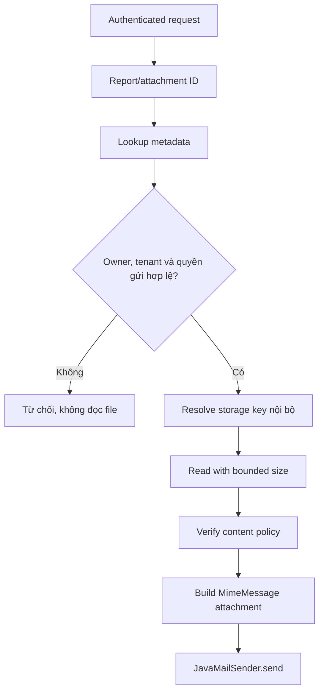
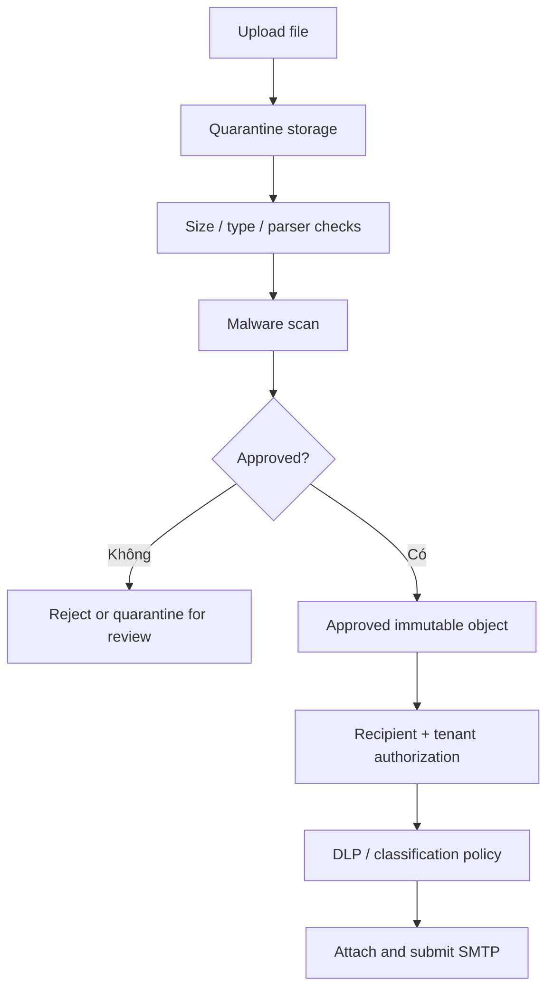

# Bảo vệ attachment và đường dẫn resource

Trong **Spring Framework Mail**, một email có thể mang theo file PDF, hóa đơn, báo cáo, ảnh inline hoặc dữ liệu sinh ra từ ứng dụng. `MimeMessageHelper` làm việc thêm attachment khá đơn giản: gọi `addAttachment(...)` với một tên tệp và một nguồn dữ liệu. Tuy nhiên, **đường dẫn của nguồn dữ liệu, quyền đọc file, nội dung file và tên hiển thị của attachment đều là ranh giới bảo mật**.

Nếu ứng dụng sử dụng đường dẫn do người dùng truyền vào để tạo `FileSystemResource`, một yêu cầu gửi email có thể vô tình trở thành chức năng đọc và gửi file tùy ý trên máy chủ. Nếu lấy ảnh từ URL tùy ý, ứng dụng có nguy cơ SSRF. Nếu gửi file từ storage nhiều tenant mà không kiểm tra quyền sở hữu, dữ liệu của khách hàng này có thể bị đính kèm vào email của khách hàng khác. Ngay cả khi file được phép đọc, nội dung có thể chứa malware, dữ liệu nhạy cảm hoặc vượt giới hạn của SMTP provider.

Bài học này tập trung vào cách **chỉ gửi đúng tệp đã được phê duyệt, cho đúng người nhận, từ nguồn có thể kiểm soát**. Nội dung bao gồm mô hình đe dọa, các loại `Resource`, phòng tránh path traversal và symlink, cấp quyền theo tenant, kiểm soát tên file và MIME type, giới hạn dung lượng, kiểm tra nội dung, quản lý lifecycle và kiểm thử bảo mật.

## 1. Tại sao attachment là một bề mặt tấn công?

Xét API cho phép người dùng gửi email kèm một tệp:

```text
POST /reports/email
  recipient = user@example.net
  filePath  = /data/reports/invoice.pdf
```

Nếu server tin trường `filePath` và đọc file từ filesystem, caller có thể thử thay đường dẫn sang:

```text
../../config/application-prod.yml
/etc/passwd
C:\service\secrets\smtp.properties
/data/reports/another-customer/invoice.pdf
```

Thậm chí nếu server không trả nội dung file trong HTTP response, nó vẫn có thể **gửi file đó ra ngoài qua email**, tức là một đường rò rỉ dữ liệu (*data exfiltration*).

Ngoài đọc file ngoài phạm vi cho phép, rủi ro còn gồm:

- **Path traversal:** dùng `..` hoặc dạng đường dẫn khác để thoát thư mục cho phép.
- **Symlink attack:** đường dẫn có vẻ nằm trong thư mục cho phép nhưng symlink trỏ ra ngoài.
- **TOCTOU:** file bị thay sau khi kiểm tra nhưng trước khi đọc.
- **Broken object-level authorization:** user được phép gửi email nhưng không được phép đọc attachment tương ứng.
- **Cross-tenant leakage:** lấy nhầm tài liệu thuộc tenant khác.
- **SSRF:** dùng URL làm resource để truy cập dịch vụ nội bộ hoặc metadata endpoint.
- **Header/filename injection:** tên attachment chứa ký tự điều khiển, dấu phân cách hoặc tên gây hiểu lầm.
- **Malicious content:** file chứa malware, macro hoặc payload có thể gây hại khi người nhận mở.
- **Oversized attachment:** làm cạn bộ nhớ, vượt hạn mức SMTP hoặc làm nghẽn hàng gửi.
- **Sensitive data exposure:** gửi tài liệu mật tới địa chỉ không được phép.

Bảo vệ attachment không chỉ là kiểm tra phần mở rộng `.pdf`. Cần thiết kế quyền truy cập và nguồn file ngay từ đầu, rồi kiểm tra ở những điểm chuyển dữ liệu.

## 2. Hiểu các nguồn dữ liệu mà MimeMessageHelper hỗ trợ

`MimeMessageHelper` có những overload để thêm attachment từ nguồn dữ liệu của Spring hoặc Jakarta Mail.

Ví dụ:

```java
helper.addAttachment("invoice.pdf", resource, "application/pdf");
```

Những nguồn thường gặp:

| Nguồn | Ví dụ | Đặc điểm và rủi ro |
|---|---|---|
| `ClassPathResource` | `new ClassPathResource("mail/logo.png")` | Thích hợp cho tài nguyên đóng gói cùng ứng dụng; đường dẫn nên là hằng số được kiểm soát. |
| `FileSystemResource` | `new FileSystemResource(path)` | Đọc file trên máy chủ; nguy hiểm nếu `path` đến từ input tùy ý. |
| `ByteArrayResource` | `new ByteArrayResource(bytes)` | Nguồn dữ liệu có thể đọc lại; cần giới hạn số byte và quản lý bộ nhớ. |
| `InputStreamResource` | `new InputStreamResource(stream)` | Thường bọc stream chỉ đọc một lần; có thể không phù hợp với thư viện MIME cần mở lại nguồn. |
| `UrlResource` | `new UrlResource(url)` | Có thể tạo truy cập mạng; cần phòng SSRF, redirect và DNS rebinding nếu URL chịu ảnh hưởng từ input. |
| `DataSource` | `FileDataSource`, `ByteArrayDataSource` | Dùng ở tầng Jakarta Mail; quyền đọc và kiểm soát nguồn vẫn là trách nhiệm ứng dụng. |

**Resource chỉ là cách trừu tượng hóa nguồn dữ liệu.** Nó không tự thực hiện authorization, kiểm tra loại file, quét malware hay phân loại dữ liệu.

### Hai quyết định độc lập

Trước khi gọi `addAttachment(...)`, cần trả lời:

1. **Có được phép gửi dữ liệu này không?** Đây là quyết định authorization và data policy.
2. **Đọc dữ liệu này bằng cách nào an toàn?** Đây là quyết định về filesystem, object storage, stream và MIME serialization.

Chọn `ByteArrayResource` không tự biến dữ liệu thành an toàn. Nếu bytes được đọc từ file bí mật bằng một đường dẫn không kiểm soát, lỗ hổng vẫn tồn tại.

## 3. Anti-pattern: dùng trực tiếp file path từ request

Ví dụ không an toàn:

```java
@PostMapping("/mail/send")
public void sendMail(
        @RequestParam String recipient,
        @RequestParam String filePath
) throws MessagingException {

    MimeMessage message = mailSender.createMimeMessage();
    MimeMessageHelper helper =
            new MimeMessageHelper(message, true, "UTF-8");

    helper.setTo(recipient);
    helper.setSubject("Your document");
    helper.setText("See attachment.");

    helper.addAttachment(
            "document.pdf",
            new FileSystemResource(filePath)
    );

    mailSender.send(message);
}
```

Ở đây, bất kỳ path nào mà process Java có quyền đọc đều có thể trở thành attachment. Nếu ứng dụng có quyền đọc secret hoặc file của tenant khác, endpoint có thể làm lộ chúng.

Các biện pháp như chỉ kiểm tra `filePath.endsWith(".pdf")` hoặc kiểm tra chuỗi `filePath.contains("..")` là **không đủ**:

- Tên file có thể giả phần mở rộng.
- Separator, đường dẫn tuyệt đối và symlink có thể vượt qua kiểm tra chuỗi đơn giản.
- Khác biệt Windows/Linux, Unicode hoặc xử lý decode có thể tạo biến thể.
- Không có kiểm tra ownership dù path nằm trong thư mục “đúng”.

**Thiết kế nên dùng:** request chỉ truyền **ID của tài liệu đã được ứng dụng quản lý**, không truyền đường dẫn filesystem.

```text
POST /reports/email
{
  "reportId": "rpt-7f42",
  "recipientId": "contact-19"
}
```

Server tự tra cứu báo cáo, xác minh quyền của principal hiện tại, xác định nguồn file nội bộ rồi gửi.

## 4. Bảo mật tại tầng nghiệp vụ: dùng ID thay vì path

Luồng đề xuất:



Những thông tin có thể lưu trong metadata:

| Trường | Mục đích |
|---|---|
| `attachmentId` | ID logic để client yêu cầu. |
| `tenantId` | Phân vùng dữ liệu theo tổ chức/khách hàng. |
| `ownerId` | Chủ sở hữu hoặc scope nghiệp vụ. |
| `storageKey` | Khóa nội bộ của file hoặc object, không phải URL tùy ý từ client. |
| `originalFilename` | Tên tải lên do user cung cấp; cần xem là untrusted. |
| `safeDownloadName` | Tên hiển thị được ứng dụng cho phép dùng trong email. |
| `declaredMediaType` | MIME type khai báo; cần xác minh theo chính sách. |
| `contentLength` | Kích thước đã ghi nhận; phải kiểm tra lại khi đọc. |
| `scanStatus` | Tình trạng quét nội dung khi quy trình yêu cầu. |
| `classification` | Mức độ nhạy cảm và chính sách chia sẻ. |
| `createdAt`, `expiresAt` | Vòng đời tài nguyên. |

Ví dụ service phải **xác thực trên bản ghi**, không chỉ xác thực rằng caller đã đăng nhập:

```java
public ApprovedAttachment requireApprovedAttachment(
        String attachmentId,
        String actorId,
        String tenantId
) {
    AttachmentRecord record = attachmentRepository
            .findById(attachmentId)
            .orElseThrow(() -> new NotFoundException("Attachment"));

    if (!record.tenantId().equals(tenantId)) {
        throw new AccessDeniedException("Attachment is not accessible");
    }

    if (!attachmentPolicy.canEmail(actorId, record)) {
        throw new AccessDeniedException("Attachment cannot be emailed");
    }

    if (record.scanStatus() != ScanStatus.CLEAN) {
        throw new IllegalStateException("Attachment is not approved");
    }

    return ApprovedAttachment.from(record);
}
```

Các kiểu `AttachmentRecord`, `ApprovedAttachment`, `AttachmentPolicy` và repository là model minh họa của ứng dụng.

Điểm mấu chốt:

- Kiểm tra **quyền gửi** có thể chặt hơn quyền tải file.
- Tenant ID nên lấy từ security context hoặc principal đã xác thực, không tin trường `tenantId` do client tự khai.
- `storageKey` phải lấy từ metadata nội bộ, không được client tự quyết định.
- Không tiết lộ file có tồn tại ở tenant khác qua thông báo lỗi quá chi tiết.

## 5. Chống path traversal khi vẫn phải đọc filesystem

Nếu ứng dụng lưu attachment trên filesystem, hãy dùng một thư mục gốc được kiểm soát, ví dụ:

```text
/srv/app/approved-attachments/
    tenant-a/
        reports/
            invoice-001.pdf
    tenant-b/
        reports/
            invoice-002.pdf
```

Dù khóa file đến từ database, vẫn cần kiểm tra rằng đường dẫn thực tế nằm trong gốc được phép. Metadata bị lỗi hoặc cấu hình sai cũng có thể dẫn tới đọc sai file.

### Vì sao ghép chuỗi path không an toàn?

Không nên:

```java
String path = root + "/" + storageKey;
FileSystemResource resource = new FileSystemResource(path);
```

`storageKey` có thể chứa `../`, đường dẫn tuyệt đối hoặc dạng đường dẫn khác. Hãy dùng Java NIO `Path` để resolve, normalize và kiểm tra đường dẫn thực.

### Ví dụ kiểm tra đường dẫn

```java
import java.io.IOException;
import java.nio.file.Files;
import java.nio.file.LinkOption;
import java.nio.file.Path;

public final class ApprovedFileLocator {

    private final Path baseDirectory;

    public ApprovedFileLocator(Path configuredBase)
            throws IOException {
        this.baseDirectory = configuredBase.toRealPath();
    }

    public Path locate(String storageKey) throws IOException {
        if (storageKey == null || storageKey.isBlank()) {
            throw new IllegalArgumentException("Missing storage key");
        }

        Path relative = Path.of(storageKey);

        if (relative.isAbsolute()) {
            throw new SecurityException("Absolute path is forbidden");
        }

        Path candidate = baseDirectory.resolve(relative).normalize();

        if (!candidate.startsWith(baseDirectory)) {
            throw new SecurityException("Path escapes approved directory");
        }

        // Theo symlink để phát hiện mục tiêu thực nằm ngoài gốc.
        Path realFile = candidate.toRealPath();

        if (!realFile.startsWith(baseDirectory)) {
            throw new SecurityException("Symlink escapes approved directory");
        }

        if (!Files.isRegularFile(realFile, LinkOption.NOFOLLOW_LINKS)) {
            throw new SecurityException("Not a regular approved file");
        }

        return realFile;
    }
}
```

Ví dụ này giúp ngăn nhiều trường hợp traversal và symlink dẫn ra ngoài thư mục gốc. Tuy nhiên, **đây không phải cơ chế bất biến trước TOCTOU** nếu một actor có thể thay đổi directory entry trong lúc ứng dụng đang đọc. Độ an toàn thực tế còn phụ thuộc quyền filesystem, cách mở file và tính bất biến của storage.

### Normalize khác với toRealPath thế nào?

- `normalize()` loại các đoạn `.` và `..` theo cú pháp, không nhất thiết truy cập filesystem.
- `toRealPath()` truy cập filesystem, kiểm tra tồn tại và giải quyết đường dẫn thực, gồm symlink theo cấu hình mặc định.
- `Path.startsWith(...)` so sánh thành phần đường dẫn, an toàn hơn phép `String.startsWith(...)` có thể nhầm `/data/reports` và `/data/reports-private`.

Không nên xác thực đường dẫn bằng so sánh chuỗi prefix tự viết.

### Điểm cần lưu ý trên Windows

Windows có đường dẫn drive, separator và UNC path khác Linux:

```text
C:\app\attachments\invoice.pdf
..\..\secret.txt
\\server\share\private.txt
```

Không viết validation chỉ bắt ký tự `/` rồi coi như an toàn trên mọi nền tảng. Dùng `Path` và kiểm thử trên hệ điều hành triển khai. Chính sách có thể từ chối cả đường dẫn tuyệt đối và các dạng storage key không theo schema dự kiến.

## 6. Symlink và TOCTOU: vì sao kiểm tra path chưa đủ?

Giả sử:

1. Ứng dụng kiểm tra `/srv/app/approved-attachments/reports/a.pdf`.
2. Path này trỏ tới một file bình thường.
3. Một actor có quyền ghi thay nó bằng symlink tới file bí mật.
4. Ứng dụng mở path và đọc dữ liệu khác so với lúc kiểm tra.

Đây là tình huống **time-of-check to time-of-use (TOCTOU)**.

```text
Check path is allowed
         |
         v
Attacker changes directory entry
         |
         v
Open file from same path string
         |
         v
Read unexpected content
```

Các biện pháp giảm rủi ro:

- Đặt attachment trong thư mục riêng, không cho người dùng hoặc process không tin cậy chỉnh sửa trực tiếp.
- Không dùng tên file do client chọn làm tên lưu vật lý; dùng storage key ngẫu nhiên hoặc object ID nội bộ.
- Không cho phép tạo symlink trong vùng attachment theo quy trình lưu trữ.
- Cố gắng mở và đọc file bằng cơ chế hạn chế theo filesystem, thay vì thực hiện kiểm tra rồi lâu sau mới mở.
- Với threat model có attacker được quyền thay directory entry, cân nhắc API hỗ trợ thao tác tương đối trên directory handle và mở file chống follow symlink, hoặc dùng object storage với khóa và quyền rõ ràng.
- Có thể sao chép file được phê duyệt sang vùng immutable/private trước khi dùng ở hàng đợi gửi.

Java NIO có các cơ chế như `LinkOption.NOFOLLOW_LINKS` và `SecureDirectoryStream`, nhưng khả năng hỗ trợ và việc chống mọi race phụ thuộc filesystem/provider. Đừng tuyên bố một cặp `normalize()` + `startsWith()` là giải pháp chống TOCTOU tuyệt đối.

### Bảo vệ filesystem bằng quyền tối thiểu

Ngay cả khi có validation, process gửi mail không nên có quyền đọc toàn bộ máy chủ. Chạy ứng dụng bằng account không đặc quyền, giới hạn mount volume và chỉ cấp quyền tới những file mà service thực sự cần.

**Giảm quyền filesystem** làm giảm thiệt hại nếu validation của ứng dụng bị lỗi.

## 7. Giới hạn số byte thực sự được đọc

Không thể tin hoàn toàn kích thước được ghi trong database, Content-Length của upload hoặc metadata từ bên ngoài. File có thể thay đổi sau khi upload hoặc metadata không đúng.

Khi cần đưa file vừa phải vào `ByteArrayResource`, nên giới hạn số byte trong quá trình đọc, không chỉ kiểm tra size trước rồi gọi `Files.readAllBytes(...)`.

Ví dụ:

```java
import java.io.ByteArrayOutputStream;
import java.io.IOException;
import java.io.InputStream;
import java.nio.file.Files;
import java.nio.file.Path;

public final class BoundedFileReader {

    private BoundedFileReader() {}

    public static byte[] readAtMost(
            Path approvedFile,
            long maxBytes
    ) throws IOException {

        if (maxBytes <= 0) {
            throw new IllegalArgumentException("Invalid maxBytes");
        }

        try (InputStream in = Files.newInputStream(approvedFile);
             ByteArrayOutputStream out =
                     new ByteArrayOutputStream()) {

            byte[] buffer = new byte[8192];
            long total = 0;
            int count;

            while ((count = in.read(buffer)) != -1) {
                total += count;

                if (total > maxBytes) {
                    throw new IOException("Attachment is too large");
                }

                out.write(buffer, 0, count);
            }

            return out.toByteArray();
        }
    }
}
```

Phương thức này giới hạn số byte được giữ trong output buffer trước khi hoàn tất. Nó không thay thế kiểm tra quyền truy cập, không loại bỏ TOCTOU và cũng không có nghĩa mọi byte đều an toàn.

**Lưu ý bộ nhớ:** `ByteArrayOutputStream` và `toByteArray()` có thể giữ nhiều bản sao dữ liệu tạm thời. Với nhiều email đồng thời hoặc attachment lớn, việc nạp toàn bộ vào heap có thể gây áp lực bộ nhớ. Khi đó cân nhắc storage/streaming phù hợp và giới hạn concurrency, nhưng phải đảm bảo nguồn stream có thể được mở lại khi Jakarta Mail cần.

## 8. Thiết kế service gửi attachment theo ID đã phê duyệt

Một thiết kế dễ kiểm soát có ba tầng:

```text
Authenticated caller
      |
      v
AttachmentAccessService
  - ownership/tenant check
  - recipient/share policy
  - classification/scan status
      |
      v
ApprovedAttachmentStore
  - internal storage key
  - safe bounded read
      |
      v
MailMessageBuilder
  - safe filename
  - approved MIME type
  - addAttachment
      |
      v
JavaMailSender
```

Ví dụ một service:

```java
import jakarta.mail.MessagingException;
import jakarta.mail.internet.MimeMessage;
import java.io.IOException;
import java.util.Set;
import org.springframework.core.io.ByteArrayResource;
import org.springframework.mail.javamail.JavaMailSender;
import org.springframework.mail.javamail.MimeMessageHelper;

public class SecureAttachmentMailService {

    private static final long MAX_ATTACHMENT_BYTES =
            8L * 1024 * 1024;

    private static final Set<String> ALLOWED_MEDIA_TYPES =
            Set.of("application/pdf", "image/png", "image/jpeg");

    private final JavaMailSender mailSender;
    private final AttachmentAccessService accessService;
    private final ApprovedAttachmentStore attachmentStore;

    public SecureAttachmentMailService(
            JavaMailSender mailSender,
            AttachmentAccessService accessService,
            ApprovedAttachmentStore attachmentStore
    ) {
        this.mailSender = mailSender;
        this.accessService = accessService;
        this.attachmentStore = attachmentStore;
    }

    public void sendApproved(
            String attachmentId,
            String authenticatedActorId,
            String authenticatedTenantId,
            String recipient
    ) throws MessagingException, IOException {

        ApprovedAttachment approved = accessService.requireApproved(
                attachmentId,
                authenticatedActorId,
                authenticatedTenantId,
                recipient
        );

        if (!ALLOWED_MEDIA_TYPES.contains(approved.mediaType())) {
            throw new SecurityException("Attachment type not allowed");
        }

        String safeName = approved.safeFilename();
        if (!safeName.matches("[A-Za-z0-9._-]{1,80}")) {
            throw new SecurityException("Unsafe attachment filename");
        }

        byte[] bytes = attachmentStore.readAtMost(
                approved.storageKey(),
                MAX_ATTACHMENT_BYTES
        );

        // Giả định accessService/store đã bảo đảm tài liệu
        // có scanStatus được phép và nội dung đúng loại.

        MimeMessage message = mailSender.createMimeMessage();
        MimeMessageHelper helper = new MimeMessageHelper(
                message,
                MimeMessageHelper.MULTIPART_MODE_MIXED,
                "UTF-8"
        );

        helper.setFrom("reports@example.org");
        helper.setTo(recipient);
        helper.setSubject("Báo cáo của bạn");
        helper.setText("Vui lòng xem tệp đính kèm.");

        helper.addAttachment(
                safeName,
                new ByteArrayResource(bytes),
                approved.mediaType()
        );

        mailSender.send(message);
    }
}
```

Các kiểu `AttachmentAccessService`, `ApprovedAttachmentStore` và `ApprovedAttachment` là abstraction do ứng dụng tự triển khai, không phải lớp có sẵn trong Spring Mail. Mục tiêu của ví dụ là cho thấy **API gửi email chỉ nhận dữ liệu đã qua kiểm tra**.

Với ứng dụng thật:

- `recipient` cũng phải được xác thực theo quyền chia sẻ tài liệu; không chỉ xác thực quyền đọc.
- MIME type trong metadata phải được xác minh từ quy trình ingest, không được tin mù quáng.
- `safeFilename` nên do server tạo hoặc được chuẩn hóa theo chính sách.
- Giới hạn tổng dung lượng mail, không chỉ từng file.
- Nếu tệp có dữ liệu mật, kiểm tra thêm policy gửi ra domain bên ngoài.

## 9. Cấp quyền theo người nhận, không chỉ theo người gửi

Một lỗi bảo mật phổ biến: người dùng A có quyền tải một file nên ứng dụng cho phép A gửi file đó tới **bất kỳ địa chỉ email nào**.

Quyền đọc và quyền chia sẻ qua email là hai hành động khác nhau.

Ví dụ:

- Nhân viên được xem bảng lương nội bộ nhưng không được gửi tới địa chỉ email cá nhân.
- Nhân viên chăm sóc khách hàng được xem thông tin đơn hàng nhưng chỉ được gửi hóa đơn tới contact đã xác minh.
- Một tenant được xuất báo cáo của mình nhưng không được dùng template gửi report của tenant khác.
- Một file có nhãn “Internal” có thể bị cấm gửi ra domain bên ngoài tổ chức.

Chính sách có thể cân nhắc:

```text
allowEmail(actor, attachment, recipient)
    = canRead(actor, attachment)
      AND canShare(actor, attachment)
      AND tenantIsCorrect
      AND recipientIsApproved
      AND classificationAllowsChannel
      AND scanStatusIsApproved
```

Đây là mô hình kiểm tra nghiệp vụ, không phải biểu thức API có sẵn. Việc quyết định người nhận nên dựa trên contact ID, account ID hoặc quan hệ nghiệp vụ đã được xác minh thay vì chỉ dựa vào địa chỉ được nhập tùy ý.

**Không đặt email recipient do user nhập vào API gửi tài liệu mật mà không có chính sách egress phù hợp.**

## 10. Bảo vệ tên file trong Content-Disposition

Tên hiển thị được đưa vào MIME header, thường ở `Content-Disposition`:

```text
Content-Disposition: attachment; filename="invoice-401.pdf"
```

Tên file do user upload là dữ liệu không đáng tin cậy. Nó có thể chứa:

- Dấu gạch chéo `/` và dấu gạch chéo ngược `\`.
- Ký tự xuống dòng `\r` hoặc `\n`.
- Ký tự điều khiển khác.
- Unicode bidirectional control gây đảo hướng hiển thị.
- Tên rất dài làm lỗi header hoặc UI.
- Tên gây hiểu lầm như `invoice.pdf.exe`.
- Tên trùng hoặc ký tự không được client email hỗ trợ.

Với file phát hành tự động, cách đơn giản là **tạo tên an toàn từ metadata đã được xác minh**, ví dụ:

```java
String displayName = "invoice-" + invoiceNumber + ".pdf";
```

Trong đó `invoiceNumber` đã qua validation theo format domain, ví dụ chỉ chữ số hoặc chữ-số-gạch ngang. Đừng nối trực tiếp một input tùy ý vào tên file.

### Ví dụ kiểm tra tên đã được server sinh

```java
public static String requireSafeAttachmentName(String filename) {
    if (filename == null
            || !filename.matches("[A-Za-z0-9._-]{1,80}")
            || filename.equals(".")
            || filename.equals("..")) {
        throw new IllegalArgumentException("Invalid attachment filename");
    }

    return filename;
}
```

Đây là allowlist rất hạn chế nhưng dễ vận hành cho tên file hệ thống. Nếu cần tên có dấu tiếng Việt hoặc Unicode quốc tế, cần xử lý chuẩn hóa, ký tự điều khiển/định hướng, độ dài và khả năng encoding của Jakarta Mail/client. Với yêu cầu tương thích cao, có thể dùng tên ASCII ổn định trong attachment và trình bày tên đẹp trong nội dung email.

### Không tự xây raw MIME header

Dùng:

```java
helper.addAttachment(
        safeFilename,
        new ByteArrayResource(fileBytes),
        "application/pdf"
);
```

Không ghép thủ công chuỗi `Content-Disposition` từ tên do user nhập. Jakarta Mail/Spring hỗ trợ encoding header, nhưng việc sử dụng API chuẩn **không thay thế validation tên file và chính sách chia sẻ**.

## 11. MIME type và extension không chứng minh file an toàn

Nếu client upload `report.pdf`, việc tên kết thúc bằng `.pdf` không chứng minh byte là PDF. Header HTTP `Content-Type: application/pdf` cũng do client có thể khai báo.

Một file có thể:

- Mang extension `.jpg` nhưng thực chất là executable.
- Có nội dung polyglot phù hợp hơn một loại file.
- Là PDF có script, embedded content hoặc nội dung gây rủi ro cho người mở.
- Là Office file chứa macro.
- Là ZIP chứa nhiều file có đường dẫn nguy hiểm hoặc nén với tỷ lệ rất cao.

Một chính sách ingest hợp lý:

1. Xác định những loại file thực sự cần cho nghiệp vụ.
2. Áp dụng allowlist MIME type và extension được phép.
3. Nhận biết loại nội dung dựa trên signature/parser phù hợp.
4. Kiểm tra file không bị lỗi định dạng theo mức cần thiết.
5. Quét malware nếu threat model yêu cầu.
6. Lưu kết quả scan và trạng thái phê duyệt.
7. Chỉ cho phép gửi những object đã được phép và chưa hết hạn.
8. Nếu file được biến đổi hoặc thay đổi, hủy hiệu lực kết quả scan trước đó.

**MIME type đúng không có nghĩa file lành tính.** Việc quét malware cũng không bảo đảm phát hiện 100% mối đe dọa; cần kết hợp quyền tối thiểu và chính sách dữ liệu.

### Nội dung do server tạo ra vẫn cần kiểm soát

Một báo cáo PDF do server render có thể ít rủi ro hơn file upload từ người dùng, nhưng vẫn cần kiểm tra quyền truy cập, dữ liệu thuộc tenant nào, độ dài và nội dung nhạy cảm. Lỗ hổng phân quyền có thể làm rò rỉ báo cáo hoàn toàn hợp lệ về mặt định dạng.

## 12. Quét malware, DLP và quy trình quarantine

Với hệ thống cho phép gửi file upload, có thể thiết kế quy trình:



**Quarantine storage** là nơi nhận file trước khi file được phép dùng. Ứng dụng gửi email không nên tự động lấy file mới upload chưa qua kiểm tra để gửi ngay.

Các trường hợp cần bổ sung DLP (Data Loss Prevention):

- Hóa đơn chứa địa chỉ, thông tin thanh toán hoặc định danh cá nhân.
- File tài chính chứa số tài khoản hoặc dữ liệu kế toán.
- Tài liệu nội bộ có nhãn bảo mật.
- File xuất dữ liệu khách hàng hoặc nhân sự.
- Báo cáo theo tenant và contact có thể nằm ngoài tổ chức.

DLP có thể dựa trên classification metadata, chính sách recipient domain và kiểm tra nội dung theo luật tổ chức. Không nên cố dùng mỗi regex để kết luận chắc chắn một file không chứa thông tin nhạy cảm.

## 13. URL resource và nguy cơ SSRF

`UrlResource` có thể đọc dữ liệu từ URL. Nếu ứng dụng chấp nhận URL do người dùng chỉ định, có thể xảy ra **Server-Side Request Forgery (SSRF)**.

Ví dụ không nên:

```java
String inputUrl = request.getParameter("attachmentUrl");

Resource remote = new UrlResource(inputUrl);
helper.addAttachment("file.pdf", remote);
```

Kẻ tấn công có thể cố ép server gọi tới:

- Dịch vụ chỉ truy cập được trong mạng nội bộ.
- Endpoint quản trị trên `localhost` hoặc private network.
- Cloud metadata endpoint.
- Dịch vụ có thông tin xác thực hoặc API token gắn theo network.
- URL chuyển hướng sang một host khác với host ban đầu.

Việc đọc được dữ liệu rồi gửi ra email có thể vừa là SSRF vừa là data exfiltration.

### Giải pháp ưu tiên: không fetch URL tùy ý

Nếu nhu cầu chỉ là gửi hóa đơn, logo hoặc báo cáo từ nguồn mà ứng dụng quản lý, hãy dùng storage key nội bộ hoặc `ClassPathResource` hằng số. Không cần API gửi mail nhận URL tùy ý.

Nếu nghiệp vụ bắt buộc fetch từ URL:

- Chỉ cho phép scheme phù hợp, thường là HTTPS.
- Dùng allowlist host/domain đã phê duyệt.
- Chặn địa chỉ loopback, link-local, private network và endpoint metadata.
- Kiểm soát DNS resolution và DNS rebinding.
- Kiểm tra lại mọi redirect; hoặc tắt redirect.
- Cấu hình kết nối/read timeout và giới hạn response size.
- Không forward credential, cookie hoặc header nhạy cảm từ request gốc.
- Áp dụng egress restriction ở mức mạng.
- Lưu/quét/phê duyệt dữ liệu tải xuống trước khi gửi.

**Chỉ kiểm tra hostname ở dạng chuỗi không đủ chống SSRF**, vì DNS, redirect và nhiều cách biểu diễn địa chỉ có thể làm request đi tới một đích khác. Nếu không thể triển khai kiểm soát network fetch an toàn, không cho phép loại resource này.

## 14. ClassPathResource: an toàn hơn nhưng vẫn cần kỷ luật

`ClassPathResource` phù hợp với file cố định của ứng dụng, chẳng hạn logo email:

```java
Resource logo = new ClassPathResource("mail/brand/logo.png");

helper.addInline("brand-logo", logo, "image/png");
```

Nếu đường dẫn classpath là hằng số do developer kiểm soát, bề mặt tấn công nhỏ hơn đáng kể so với `FileSystemResource` có đường dẫn lấy từ request.

Tuy nhiên, không nên nhận tên classpath tùy ý:

```java
// Không nên: client quyết định resource path.
Resource resource = new ClassPathResource(request.getResourcePath());
```

Classpath có thể chứa file cấu hình hoặc tài nguyên nội bộ không dành cho việc gửi email. Dùng mapping giữa enum/ID và resource đã định nghĩa:

```java
public enum BrandImage {
    PRIMARY_LOGO("mail/brand/primary-logo.png"),
    FOOTER_ICON("mail/brand/footer-icon.png");

    private final String classpath;

    BrandImage(String classpath) {
        this.classpath = classpath;
    }

    public Resource resource() {
        return new ClassPathResource(classpath);
    }
}
```

Như vậy, caller chỉ chọn từ danh sách được cho phép thay vì tự cung cấp đường dẫn. Khi ứng dụng có nhiều tenant với logo khác nhau, cần kiểm tra tenant được phép sử dụng tài nguyên tương ứng trước khi tra cứu.

## 15. Attachment khác inline resource thế nào về bảo mật?

Trong MIME, attachment thường dùng `Content-Disposition: attachment`, còn ảnh inline dùng `Content-Disposition: inline` và `Content-ID` để HTML tham chiếu.

Ví dụ:

```text
multipart/mixed
├── multipart/related
│   ├── text/html; 
│   └── image/png; Content-ID: <logo-401>; inline
└── application/pdf; attachment; filename="invoice-401.pdf"
```

Với Spring:

```java
MimeMessageHelper helper = new MimeMessageHelper(
        message,
        MimeMessageHelper.MULTIPART_MODE_MIXED_RELATED,
        "UTF-8"
);

helper.setText(html, true);

helper.addInline(
        logoCid,
        new ClassPathResource("mail/brand/logo.png"),
        "image/png"
);

helper.addAttachment(
        "invoice-401.pdf",
        new ByteArrayResource(approvedPdfBytes),
        "application/pdf"
);
```

Các nguyên tắc bảo vệ áp dụng cho **cả hai**:

- Đừng cho caller chọn đường dẫn file tùy ý.
- Kiểm tra quyền sử dụng nội dung và tenant.
- Giới hạn số lượng và kích thước.
- Xác minh content type/scan policy.
- Không nhúng dữ liệu nhạy cảm vào HTML hoặc ảnh inline khi người nhận không có quyền xem.

Đặt `Content-Disposition: inline` không làm nội dung “an toàn hơn” hoặc “bí mật hơn”. Người nhận có thể lưu nội dung email/ảnh. CID cũng không phải cơ chế xác thực.

## 16. InputStreamSource và thời điểm Jakarta Mail đọc nội dung

Một đặc điểm cần hiểu: phương thức `addAttachment(...)` thường mới thiết lập cấu trúc MIME part. Byte thực tế có thể được đọc khi message được serialize hoặc gửi.

Điều này tạo ra các vấn đề nếu resource phụ thuộc vào một stream đã bị đóng hoặc chỉ cho phép đọc một lần.

Ví dụ dễ lỗi:

```java
InputStream inputStream = Files.newInputStream(filePath);

helper.addAttachment(
        "report.pdf",
        new InputStreamResource(inputStream),
        "application/pdf"
);

// Đóng stream trước khi message được serialize.
inputStream.close();

mailSender.send(message);
```

`InputStreamResource` thường không cung cấp stream mới cho mỗi lần đọc. Một số bước MIME processing có thể cần mở lại content, vì vậy cần một `InputStreamSource` có semantics phù hợp.

Các lựa chọn:

- `ByteArrayResource` cho file nhỏ/đã có byte, có thể mở stream mới nhiều lần.
- `FileSystemResource` cho file nội bộ ổn định, đã kiểm tra path/authorization và được giữ nguyên trong thời gian gửi.
- `InputStreamSource` tùy chỉnh có `getInputStream()` trả về stream mới, đọc từ storage nội bộ an toàn.
- Đối với dữ liệu lớn, dùng cơ chế streaming phù hợp với Jakarta Mail và nguồn lưu trữ có lifecycle được kiểm soát.

Không mở stream từ external URL hoặc user path chỉ khi SMTP bắt đầu serialize mà không có kiểm tra quyền, giới hạn và timeout.

### Gửi bất đồng bộ có thêm rủi ro lifecycle

Nếu một request upload tạo file tạm, submit `@Async` rồi xóa file ngay khi HTTP request kết thúc, worker có thể không đọc được file.

```text
HTTP upload/request
    |
    +-- creates temp file
    +-- submits async mail
    +-- deletes temp file
                |
                v
        async worker runs later
        -> resource no longer exists
```

Để tránh:

1. Lưu file vào storage bền vững có quyền truy cập phù hợp.
2. Ghi storage key vào mail job/outbox.
3. Định nghĩa retention đến khi job hoàn tất hoặc hết thời hạn retry.
4. Worker đọc và kiểm tra quyền/policy theo contract.
5. Cleanup khi không còn job nào cần file, hoặc theo lifecycle quản lý rõ ràng.

Không đặt absolute path tạm trong queue rồi kỳ vọng worker ở instance khác có cùng filesystem.

## 17. Giới hạn kích thước và số lượng attachment

Một email có 8 MB dữ liệu PDF không nhất thiết chỉ chiếm 8 MB trên SMTP wire. Binary attachment thường được mã hóa qua base64, làm payload tăng khoảng một phần ba, chưa tính line breaks và header MIME.

Do đó cần giới hạn:

- Kích thước của **từng file**.
- Tổng số attachment.
- Tổng kích thước byte gốc của tất cả file.
- Tổng kích thước MIME sau khi serialize, nếu provider có giới hạn nghiêm ngặt.
- Số email có attachment đang được xử lý đồng thời.
- Tổng dung lượng lưu trữ và thời gian lưu giữ.

Ví dụ một policy minh họa:

```text
maxAttachmentCount = 5
maxEachAttachmentBytes = 8 MiB
maxTotalRawBytes = 15 MiB
maxMimeBytes = 25 MiB
```

Đây chỉ là giá trị minh họa, **không phải giới hạn của Spring Framework Mail**. Nhà cung cấp SMTP, mailbox bên nhận và ứng dụng có thể đặt giới hạn khác nhau.

Nếu cần kiểm tra MIME size thực tế, có thể serialize vào một output stream có bộ đếm trong môi trường phù hợp. Cẩn thận vì thao tác serialize có thể đọc resource; đừng thực hiện nhiều lần với nguồn chỉ đọc một lượt.

### Resource exhaustion và concurrency

Nếu mỗi job nạp một file 8 MB vào byte array, nhiều job chạy đồng thời có thể dùng hàng trăm MB heap, chưa kể template HTML và overhead encoding.

Với Spring `ThreadPoolTaskExecutor`, cần cấu hình số thread/queue capacity có giới hạn. Số worker xử lý attachment lớn nên dựa trên heap, network throughput và khả năng SMTP provider, không chỉ dựa trên CPU core.

## 18. File nén và nội dung phức tạp

Nếu ứng dụng cho phép gửi ZIP, TAR hoặc định dạng phức tạp, cần xác định chính sách:

- Chỉ chuyển tiếp nguyên file hay có giải nén/kiểm tra?
- Có cho phép encrypted archive không?
- Có giới hạn kích thước sau giải nén không?
- Có quét malware bên trong archive không?
- Có chặn file thực thi, script hoặc macro theo loại nghiệp vụ không?

Nếu ứng dụng **giải nén** để kiểm tra hoặc biến đổi dữ liệu, phải phòng thêm:

- **Zip Slip:** entry path như `../../secret` thoát thư mục đích.
- **Zip bomb:** tỷ lệ nén rất cao hoặc archive lồng nhau làm cạn CPU/disk.
- Symlink trong archive.
- Quá nhiều entry, file name rất dài hoặc kích thước sau giải nén quá lớn.

Nếu chỉ gửi archive như attachment, những lỗi giải nén có thể không phát sinh trong server, nhưng file vẫn có thể gây rủi ro cho người nhận. Hãy áp dụng policy loại file và quy trình scan phù hợp.

## 19. File CSV, Excel và nội dung có công thức

Một attachment CSV hoặc spreadsheet có thể mang dữ liệu do user nhập. Khi người nhận mở bằng ứng dụng bảng tính, các ô bắt đầu bằng ký tự công thức có thể được thực thi như formula tùy chương trình và cấu hình.

Ví dụ dữ liệu không đáng tin:

```text
=HYPERLINK("https://untrusted.example","Open")
+1+2
@SUM(1,2)
```

Nếu ứng dụng sinh CSV cho email, cần phòng **formula injection** theo mục tiêu sử dụng, bằng cách xử lý giá trị theo ngữ cảnh CSV/spreadsheet phù hợp. Không dùng HTML escaping để bảo vệ CSV; đó là hai ngữ cảnh khác nhau.

Với XLSX, cần xây cell kiểu text cho dữ liệu không đáng tin thay vì đặt formula. Những chi tiết này thuộc lớp tạo attachment, nhưng bảo mật của email phụ thuộc vào file được tạo ra an toàn.

## 20. Dữ liệu nhạy cảm và giới hạn của SMTP

SMTP có thể dùng TLS để bảo vệ đường truyền giữa ứng dụng và mail server hoặc giữa các máy chủ, nhưng đây không phải mặc nhiên là mã hóa đầu-cuối cho attachment.

Một khi nhà cung cấp hoặc người nhận có message, họ có thể lưu, sao chép hoặc chuyển tiếp attachment. Không thể “thu hồi” một file đã phát tán chỉ bằng cách xóa bản gốc trên server.

Nếu attachment chứa dữ liệu quan trọng:

- Kiểm tra có thực sự cần gửi file trực tiếp không.
- Giới hạn người nhận và xác thực contact.
- Tuân thủ chính sách phân loại dữ liệu.
- Dùng TLS đúng cấu hình khi gửi.
- Cân nhắc S/MIME, OpenPGP hoặc cơ chế bảo vệ file theo yêu cầu tổ chức.
- Với dữ liệu có thể thu hồi quyền, cân nhắc gửi **liên kết tải xuống có kiểm soát** thay vì đính kèm file.
- Thiết kế thời hạn và quyền của link; không đặt token dài hạn vào URL công khai.
- Bảo vệ attachment trong storage ở trạng thái at rest.

### File đính kèm hay liên kết tải xuống?

| Yêu cầu | Attachment | Secure download link |
|---|---|---|
| Người nhận đọc offline ngay | Phù hợp hơn | Thường cần truy cập mạng trước. |
| Cần thu hồi quyền sau khi gửi | Rất khó hoặc không thể thu hồi bản đã nhận | Có thể thu hồi truy cập tới bản lưu tại server. |
| File lớn | Dễ chạm giới hạn SMTP | Thường phù hợp hơn. |
| Dữ liệu có chính sách truy cập động | Khó kiểm soát sau khi phát tán | Dễ áp dụng authorization khi tải. |
| Người nhận ở ngoài hệ thống | Đơn giản cho file vừa phải | Cần thiết kế xác thực và trải nghiệm tải. |

Không phải link luôn an toàn hơn: URL chia sẻ sai quyền, token bị lộ và redirect không an toàn cũng có thể gây rò rỉ. Chọn kênh theo yêu cầu nghiệp vụ và khả năng kiểm soát truy cập.

## 21. Bảo vệ file trên object storage

Nếu dùng S3, Azure Blob Storage hoặc một hệ thống tương tự, ứng dụng thường lấy file theo object key. Tránh nhận object key tùy ý từ request.

Luồng an toàn:

```text
attachmentId
    |
    v
Authenticated metadata lookup
    |
    v
Authorization (tenant/owner/recipient)
    |
    v
Approved bucket + internal object key
    |
    v
GetObject with least-privilege credentials
    |
    v
Bounded read / scan policy
    |
    v
MimeMessageHelper.addAttachment
```

Các nguyên tắc:

- Bucket/container nên private theo mặc định.
- Service account có quyền tối thiểu.
- Không cho phép caller chọn bucket tùy ý.
- Lưu object key do server tạo, tránh dựa trên tên file gốc.
- Nếu file được thay thế, cần có object version hoặc checksum theo contract.
- Không dựa vào presigned URL công khai làm bằng chứng quyền gửi.
- Hạn chế thời gian sống của URL tải nếu dùng.
- Khi dùng queue, lưu ID/version/object key đã được quản lý, không lưu URL có token ngắn hạn mà worker có thể dùng sau khi hết hạn.

Trong object storage, chuỗi `../` không nhất thiết có ngữ nghĩa traversal như filesystem, nhưng việc dùng key tùy ý vẫn có thể truy cập sai object hoặc sai tenant. **Authorization là bắt buộc ở cả hai mô hình.**

## 22. Audit, log và correlation ID

Khi email gửi kèm dữ liệu nhạy cảm, audit cần trả lời:

- Ai yêu cầu gửi?
- Người nhận đã được phê duyệt theo chính sách nào?
- Attachment ID và version nào được sử dụng?
- Tài liệu thuộc tenant và classification nào?
- File đã qua scan/policy check chưa?
- Có bao nhiêu byte và MIME type nào?
- SMTP đã chấp nhận message chưa?
- Nếu gửi lỗi, có retry hoặc failover không?

Ví dụ log cấu trúc:

```text
event=MAIL_ATTACHMENT_APPROVED
correlationId=corr-7a1
notificationId=mail-91d
attachmentId=att-442
tenantRef=tenant-8
classification=INTERNAL
mimeType=application/pdf
sizeBytes=742981
policyVersion=v4
```

Sau submit:

```text
event=MAIL_SMTP_ACCEPTED
correlationId=corr-7a1
notificationId=mail-91d
smtpRoute=transactional-primary
attachmentCount=1
```

Không ghi raw bytes, attachment path bí mật, access token, presigned URL hoặc toàn bộ body email vào log. Có thể dùng attachment ID, checksum đã được quản lý và metadata để chẩn đoán mà không làm lộ nội dung.

### Correlation ID không phải quyền truy cập

Một người biết `correlationId` hoặc `attachmentId` không được phép tải file hay gửi email nếu chưa qua authorization. ID phục vụ tra cứu/đối chiếu, không phải một secret tự bảo vệ tài nguyên.

## 23. Kiểm thử bảo mật cho attachment

Một bộ test cần mô phỏng cả input sai và đường đi hợp lệ.

| Tình huống | Kỳ vọng |
|---|---|
| User gửi một attachment ID thuộc tenant khác | Từ chối trước khi đọc file. |
| User có quyền xem nhưng không có quyền email file | Từ chối theo chính sách chia sẻ. |
| Storage key là `../config.yml` | Bị từ chối; không đọc ra ngoài root. |
| Storage key là absolute path | Bị từ chối. |
| Symlink bên trong root trỏ ra ngoài | Không đọc dữ liệu ngoài root. |
| Attachment đã hết hạn hoặc bị thu hồi quyền | Không gửi. |
| File vượt giới hạn dung lượng | Từ chối mà không nạp toàn bộ vào heap. |
| Tên file chứa CR/LF hoặc path separator | Bị từ chối hoặc chuyển sang tên server tạo an toàn. |
| Extension PDF nhưng byte không phải PDF | Không tự động phê duyệt chỉ dựa trên extension. |
| Scan status chưa hoàn thành hoặc phát hiện malware | Không gửi. |
| Ảnh inline CID đúng nhưng sai tenant | Không cho phép đọc/gắn ảnh. |
| URL trỏ đến loopback/private network | Không fetch. |
| Async worker chạy sau khi file tạm bị xóa | Job có lifecycle storage bền vững, xử lý lỗi có kiểm soát. |
| Hai người dùng gửi report cùng ID giả | Authorization dựa trên owner/tenant, không chỉ ID. |
| Email có nhiều attachment và vượt tổng size | Từ chối theo chính sách tổng. |

### Ví dụ unit test cho quyền truy cập

```java
@Test
void cannotEmailAnotherTenantsAttachment() {
    String actorId = "user-a";
    String tenantId = "tenant-a";
    String foreignAttachmentId = "att-tenant-b";

    assertThatThrownBy(() -> accessService.requireApproved(
            foreignAttachmentId,
            actorId,
            tenantId,
            "recipient@example.net"
    )).isInstanceOf(AccessDeniedException.class);

    verifyNoInteractions(attachmentStore);
}
```

Ví dụ dùng AssertJ và Mockito; các dependency/fixture cần được thiết lập tương ứng trong test thực tế. Mục tiêu là xác nhận authorization thất bại **trước khi storage bị truy cập**.

### Ví dụ unit test path traversal

```java
@Test
void rejectsTraversalOutsideApprovedDirectory() throws Exception {
    Path tempRoot = Files.createTempDirectory("mail-attachments");

    ApprovedFileLocator locator =
            new ApprovedFileLocator(tempRoot);

    assertThatThrownBy(() ->
            locator.locate("../../outside-file.txt")
    ).isInstanceOf(SecurityException.class);
}
```

Test thực tế nên dọn thư mục tạm bằng cơ chế JUnit phù hợp và kiểm tra đường dẫn trên hệ điều hành của CI. Có thể thêm test symlink khi hệ điều hành/filesystem cho phép tạo symlink.

### Kiểm thử luồng email thực

Dùng `MimeMessage` và SMTP test server như GreenMail/Mailpit để xác nhận một attachment đã được phê duyệt tạo đúng MIME part:

- `Content-Type` phù hợp.
- `Content-Disposition: attachment`.
- Filename đúng giá trị an toàn.
- Byte content đúng file mong đợi.
- Không có attachment ngoài danh sách đã được phép.
- Phần HTML/ảnh inline không tham chiếu dữ liệu ngoài phạm vi.

Không gửi dữ liệu thật hoặc credential production trong integration test.

## 24. Những lỗi thường gặp và hướng xử lý

| Hiện tượng | Nguyên nhân có thể | Hướng xử lý |
|---|---|---|
| Email vô tình chứa config/secrets | Input path được dùng trực tiếp | Không nhận raw path; dùng ID và authorization trước khi đọc. |
| Gửi nhầm hóa đơn khách hàng khác | Thiếu tenant/owner/recipient check | Áp dụng object-level authorization tại service. |
| Path check đúng nhưng symlink thoát root | Chỉ normalize chuỗi, không kiểm tra real path | Kiểm tra real path và siết quyền filesystem; xét TOCTOU. |
| Email gửi lỗi với `FileNotFoundException` | File tạm bị xóa hoặc storage key không tồn tại | Quản lý lifecycle file và retention theo job. |
| `InputStream` bị đóng trước khi gửi | Source chỉ đọc một lượt | Dùng nguồn mở lại được hoặc byte array có giới hạn. |
| Attachment bị hỏng | Dữ liệu nguồn/stream không hoàn chỉnh hoặc MIME type sai | Kiểm tra byte, content length, nguồn stream và serialization. |
| Email vượt giới hạn SMTP | Không tính base64/MIME overhead | Đặt giới hạn tổng với headroom. |
| Tên file hiển thị sai | Encoding hoặc ký tự filename không tương thích | Dùng tên an toàn/đơn giản, kiểm tra client mục tiêu. |
| File được upload chưa scan đã gửi | Thiếu quarantine/approval gate | Chỉ gửi object ở trạng thái đã được phê duyệt. |
| URL attachment đọc được dữ liệu nội bộ | SSRF từ `UrlResource` | Không nhận URL tùy ý; kiểm soát egress/redirect/DNS. |
| File bị đổi sau khi scan | Storage object mutable hoặc thiếu version | Dùng object version/immutable key và chính sách rescan. |
| Người nhận mở file gây rủi ro | File có macro/malware hoặc định dạng nguy hiểm | File policy, scan và hướng dẫn người nhận phù hợp. |
| SMTP có TLS nhưng file vẫn bị chuyển tiếp | TLS không bảo đảm end-to-end confidentiality | Giảm nội dung gửi, dùng secure link/mã hóa phù hợp. |
| Audit không biết file nào đã gửi | Chỉ log “mail sent” | Ghi attachment ID/version, notification ID và policy outcome. |

## 25. Checklist trước khi triển khai

Trước khi cho phép gửi email có attachment:

1. API chỉ nhận attachment/document ID, không nhận path hoặc URL tùy ý.
2. Principal và tenant được xác thực từ nguồn đáng tin.
3. Kiểm tra quyền đọc **và quyền chia sẻ tới người nhận**.
4. Storage key được lấy từ metadata nội bộ, không đến trực tiếp từ client.
5. Nếu dùng filesystem, kiểm tra root/path/symlink và siết quyền ghi.
6. Nếu dùng object storage, bucket private và credential có quyền tối thiểu.
7. File được giữ bất biến hoặc có version/checksum trong thời gian gửi/retry.
8. MIME type, extension, scan status và classification đáp ứng chính sách.
9. Tên hiển thị của attachment được tạo/validate an toàn.
10. Số file, size từng file, tổng dung lượng MIME và concurrency có giới hạn.
11. Resource/stream có lifecycle phù hợp với thời điểm serialize và gửi.
12. URL resource tùy ý bị cấm hoặc được bảo vệ khỏi SSRF.
13. Không log raw file, secret, presigned URL hoặc thông tin nhạy cảm.
14. SMTP dùng transport security theo provider; dữ liệu mật có chính sách mã hóa/chia sẻ thích hợp.
15. Có test cross-tenant, traversal, symlink, oversize, scan gate và luồng gửi thực.
16. Với email bất đồng bộ, file còn tồn tại khi worker retry sau restart.

## 26. Ghi nhớ

- `MimeMessageHelper.addAttachment(...)` chỉ tạo MIME attachment; nó **không xác thực quyền đọc/chia sẻ**, không tự chống path traversal hay quét malware.
- Không cho user quyết định `FileSystemResource`, `ClassPathResource` hoặc `UrlResource` bằng chuỗi path/URL tùy ý.
- Dùng **attachment ID**, metadata nội bộ, tenant/owner authorization và recipient policy để chọn đúng tài liệu.
- Với filesystem, dùng `Path`, normalize, kiểm tra real path và giới hạn root; vẫn phải xem xét symlink/TOCTOU và quyền filesystem.
- Với object storage, dùng key/version nội bộ, bucket private và nguyên tắc quyền tối thiểu.
- Tên file và MIME type phải được xác minh; không tin hoàn toàn extension hoặc `Content-Type` do client khai báo.
- Giới hạn byte thật khi đọc, tổng kích thước email và số job đồng thời; nhớ tính MIME/base64 overhead.
- Resource cần có thể đọc đúng thời điểm serialize; stream một lượt hoặc file tạm bị xóa dễ làm email thất bại.
- File upload nên qua quarantine, malware scan và chính sách dữ liệu trước khi được phép gửi.
- Ảnh inline cũng chịu yêu cầu quyền truy cập và nguồn dữ liệu an toàn giống attachment.
- SMTP TLS không thay thế mã hóa đầu-cuối hoặc khả năng thu hồi quyền trên file đã đính kèm.
- Kiểm thử cả **đọc sai file**, **gửi cho sai người**, **file không an toàn** và **lifecycle của job bất đồng bộ**.

Bảo vệ attachment bắt đầu từ thiết kế: **người yêu cầu chỉ chọn tài liệu logic, hệ thống xác thực quyền và người nhận, storage trả về dữ liệu đã được phê duyệt, rồi Spring Mail mới đóng gói file vào MIME message**. Khi các ranh giới này được kiểm soát, ứng dụng không biến chức năng gửi email thành kênh đọc file tùy ý hoặc rò rỉ dữ liệu giữa các tenant.
