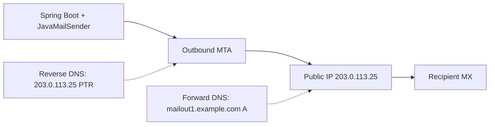

# Cấu hình PTR, reverse DNS và uy tín IP

Một dịch vụ Spring Boot dùng `JavaMailSender` gửi email xác nhận đăng ký. Ở môi trường phát triển, thư được SMTP test server chấp nhận; lên production, một số nhà cung cấp hộp thư từ chối, trì hoãn hoặc đưa thư vào Spam. Log SMTP có thể nhắc đến `reverse DNS`, `PTR`, `IP reputation` hoặc `sending IP`. Người phát triển thử thay `spring.mail.host`, thêm bản ghi SPF hoặc đổi `From` nhưng tỷ lệ nhận thư vẫn không cải thiện.

Vấn đề cốt lõi: **khi SMTP server của người nhận đánh giá nguồn gửi, nó nhìn thấy địa chỉ IP công khai của máy chủ SMTP đang giao tiếp trực tiếp với nó**, không nhất thiết là IP của ứng dụng Spring Boot. Tên miền reverse DNS (PTR), tên máy gửi trong `EHLO/HELO`, bản ghi forward DNS (A/AAAA) và lịch sử hành vi của IP đó là những tín hiệu giúp hệ thống nhận thư nhận diện và đánh giá nguồn gửi. Các tín hiệu này cần được cấu hình ở **đúng lớp mạng và đúng chủ sở hữu**.

Bài học này thuộc chương **Deliverability** trong **Spring Framework Mail**, tập trung vào vai trò của PTR/reverse DNS và uy tín IP đối với việc gửi thư, cách xác định IP gửi thực, cấu hình DNS, tương tác với SPF/DKIM/DMARC, kiểm tra từ bên ngoài và vận hành ổn định. Không có một cấu hình `MimeMessageHelper` hay một dòng `application.yml` nào tự tạo ra uy tín IP.

## 1. Phân biệt gửi thành công, chuyển phát và vào Inbox

Trước khi xem PTR, cần thống nhất ý nghĩa của các kết quả:

| Giai đoạn | Điều đã xảy ra | Điều chưa được bảo đảm |
|---|---|---|
| `JavaMailSender.send(...)` trả về không lỗi | Ứng dụng hoàn thành việc bàn giao qua transport theo điều kiện tại thời điểm gửi | Không chứng minh thư đã vào Inbox |
| SMTP relay chấp nhận message | Relay nhận trách nhiệm xử lý/chuyển tiếp | Chưa chứng minh server cuối đã chấp nhận |
| MX của người nhận chấp nhận message | Server nhận đã nhận trách nhiệm theo SMTP | Chưa chắc phân loại vào Inbox thay vì Spam/quarantine |
| Provider phát sinh delivery event | Provider báo trạng thái chuyển phát theo hợp đồng dịch vụ | Chưa chắc người dùng đã mở hay đọc thư |
| Người nhận thấy thư trong Inbox | Thư đã qua các bước phân loại liên quan | Không chứng minh mọi thư tiếp theo cũng sẽ vào Inbox |

**Deliverability** đề cập khả năng thư được các hệ thống nhận chấp nhận và đưa đến vị trí mong muốn. PTR đúng là một điều kiện vệ sinh hạ tầng quan trọng, nhưng **không phải chứng nhận thư sẽ vào Inbox**.

Một số nhà cung cấp có thể từ chối SMTP trực tiếp khi IP gửi thiếu reverse DNS hợp lệ; nhà cung cấp khác có thể chấp nhận rồi dùng tín hiệu đó trong bộ lọc. Chính sách thay đổi theo provider và thời gian, vì vậy không biến một quy tắc của một nhà cung cấp thành luật phổ quát.

## 2. SMTP topology: IP nào thực sự bị kiểm tra?

### 2.1. Gửi trực tiếp từ máy chủ của doanh nghiệp

```text
Spring Boot
  |
  | JavaMailSender -> SMTP
  v
Outbound MTA (mailout1.example.com)
  Public egress IP: 203.0.113.25
  |
  | SMTP delivery: EHLO mailout1.example.com
  v
Recipient MX (mx.recipient.example)
  |
  +--> Quan sát peer IP 203.0.113.25
  +--> Tra PTR(reverse DNS) cho 203.0.113.25
  +--> Kiểm tra forward DNS của tên PTR
  +--> Đánh giá SPF/DKIM/DMARC, hành vi IP, nội dung và policy
```

Ở mô hình này, IP `203.0.113.25` là IP **kết nối tới MX**, vì vậy PTR và danh tiếng liên quan trực tiếp đến nó. Tên `mailout1.example.com` là hostname dự kiến của máy gửi.

### 2.2. Gửi qua SMTP relay hoặc email service provider

```text
Spring Boot application
  |
  | Submission: smtp.provider.example:587
  v
Email service provider
  |
  | Hệ thống relay/chọn IP đầu ra
  v
Outbound relay IP: 203.0.113.80
  |
  | SMTP tới MX người nhận
  v
Recipient MX
```

Trong mô hình này, recipient MX thường nhìn thấy **IP relay của provider**, ví dụ `203.0.113.80`. IP của máy chạy Spring Boot, IP NAT của VPC hoặc hostname của application **không phải** nguồn trực tiếp để recipient MX tra PTR, trừ khi chính máy đó gửi SMTP trực tiếp tới MX.

Hệ quả:

- `spring.mail.host` là **địa chỉ relay mà ứng dụng kết nối tới**, không phải tên PTR của IP relay.
- `mail.smtp.localhost` có thể ảnh hưởng tên `EHLO` mà **ứng dụng nói với relay đầu tiên**, không tự thay tên `EHLO` mà relay của provider dùng khi gửi tới MX.
- Nếu dùng shared/dedicated IP của email provider, hãy xem cấu hình reverse DNS, outbound IP pool và reputation trong dịch vụ của **provider**.
- Thay hostname của container Spring Boot không làm thay đổi PTR của IP gửi email do provider quản lý.

### 2.3. Bẫy NAT và multi-homed hosts

Một mail server có thể bind socket ra địa chỉ private như `10.0.4.20` nhưng kết nối ra Internet qua NAT với public IP `203.0.113.25`. Recipient MX kiểm tra **public source IP sau NAT**.

Nếu server có nhiều NIC, nhiều public IP, IPv4 và IPv6 hoặc dùng outbound load balancer, cần xác định **từng IP thực sự dùng để kết nối**. Một A record/PTR đúng cho IP dự kiến không giải quyết được lỗi ở IP egress khác bị dùng luân phiên.

## 3. PTR record và reverse DNS hoạt động thế nào?

### 3.1. Forward DNS: tên → địa chỉ IP

Thông thường, ứng dụng hỏi DNS để biết hostname có địa chỉ nào:

```text
mailout1.example.com.  IN A    203.0.113.25
```

Với IPv6:

```text
mailout6.example.com.  IN AAAA 2001:db8::25
```

Bản ghi `A` ánh xạ hostname sang IPv4; `AAAA` ánh xạ hostname sang IPv6. Một hostname có thể có nhiều A/AAAA, ví dụ cho các IP của cùng dịch vụ.

### 3.2. Reverse DNS: địa chỉ IP → tên

Reverse DNS với IPv4 dùng nhánh `in-addr.arpa`. Ví dụ minh họa:

```dns
25.113.0.203.in-addr.arpa. IN PTR mailout1.example.com.
```

Tên reverse được tạo bằng cách đảo thứ tự các octet của IPv4:

```text
203.0.113.25
     |
     v
25.113.0.203.in-addr.arpa
     |
     v
PTR mailout1.example.com
```

Với IPv6, reverse DNS dùng `ip6.arpa` và đảo các **nibble hexadecimal**, không đảo các nhóm hextet đơn thuần. Phần lớn người vận hành nên dùng công cụ `dig -x` hoặc hệ thống quản lý rDNS của ISP thay vì tự viết chuỗi tên dài thủ công.

### 3.3. Tên PTR là một hostname

Giá trị PTR nên là **hostname đầy đủ** (FQDN) có thể tra cứu forward, ví dụ `mailout1.example.com.`, không phải một địa chỉ IP được đặt vào trường tên, không phải URL `https://...` và không phải địa chỉ email `admin@example.com`.

Dấu chấm cuối `mailout1.example.com.` trong zone file cho biết tên miền tuyệt đối. Trong giao diện quản trị, provider có thể tự thêm dấu chấm; hãy theo định dạng mà nền tảng yêu cầu.

### 3.4. Ví dụ địa chỉ trong bài là địa chỉ tài liệu

Các IP `203.0.113.0/24` và `2001:db8::/32` được sử dụng **chỉ để minh họa**. Chúng không phải IP public được cấp cho một hệ thống gửi thư thực. Lệnh DNS trên Internet không được kỳ vọng trả những bản ghi ví dụ này.

## 4. Forward-confirmed reverse DNS (FCrDNS)

**FCrDNS** thường gọi là *forward-confirmed reverse DNS*: sau khi tra từ IP sang tên PTR, hệ thống tra ngược tên đó bằng A/AAAA để xem nó có bao gồm IP ban đầu hay không.

Ví dụ tốt:

```text
Bước 1 — Reverse:
  203.0.113.25
    PTR --> mailout1.example.com

Bước 2 — Forward:
  mailout1.example.com
    A   --> 203.0.113.25

Kết quả:
  IP gửi nằm trong tập địa chỉ forward của hostname PTR.
```

Ví dụ không khớp:

```text
203.0.113.25
  PTR --> mailout1.example.com

mailout1.example.com
  A   --> 203.0.113.99

IP ban đầu 203.0.113.25 không nằm trong forward DNS.
```

Trong một số chính sách nhận thư, kết quả không khớp có thể làm giảm độ tin cậy hoặc gây từ chối. Không nên quy kết mọi thư vào Spam chỉ do FCrDNS, nhưng đây là một điều kiện kỹ thuật cần xử lý.

### 4.1. Một tên có nhiều A record thì sao?

Giả sử:

```dns
mailout1.example.com. IN A 203.0.113.25
mailout1.example.com. IN A 203.0.113.26
```

Nếu PTR của `203.0.113.25` trỏ về `mailout1.example.com` thì IP đó có trong tập A; forward check theo nghĩa **membership** có thể khớp. Không cần giả định hostname chỉ được chứa đúng một A.

Tuy nhiên, để chẩn đoán và giữ identity nhất quán cho mail server, thường nên dùng **tên riêng rõ ràng cho mỗi egress IP** như `mailout1.example.com` và `mailout2.example.com`. Điều này giảm nhầm lẫn khi IP bị thay thế, cấu hình EHLO và giám sát.

### 4.2. PTR có thể có nhiều record không?

DNS cho phép cấu trúc dữ liệu linh hoạt; về mặt vận hành email, nhiều PTR khác nhau cho một IP có thể tạo kết quả không nhất quán giữa các hệ thống kiểm tra. Một cấu hình **một PTR rõ ràng cho mỗi IP gửi**, trỏ đến hostname có forward A/AAAA phù hợp, thường dễ vận hành hơn.

Không giả định rằng nhiều PTR giúp tăng uy tín hay tăng deliverability.

### 4.3. PTR và hostname EHLO/HELO có bắt buộc bằng nhau tuyệt đối?

Trong SMTP, client giới thiệu tên ở `EHLO` hoặc `HELO`. Một số hệ thống nhận thư so sánh tên này với hostname DNS/PTR và xem tính hợp lý của chúng là một tín hiệu bổ sung.

Mục tiêu vận hành tốt là:

```text
Public outbound IP: 203.0.113.25
PTR:                mailout1.example.com
A:                  mailout1.example.com -> 203.0.113.25
EHLO:               mailout1.example.com
```

Tuy vậy, **PTR, EHLO và sender domains không nhất thiết phải là cùng một tên trong mọi kiến trúc hợp lệ**; chẳng hạn ESP dùng relay hostname của họ trong khi From thuộc domain của khách hàng. RFC SMTP cũng không định nghĩa sự trùng khớp này như một cơ chế xác thực thay cho SPF/DKIM/DMARC. Hãy bảo đảm các giá trị chính xác, có tính nhất quán và tuân thủ yêu cầu của provider/người nhận, thay vì coi “ba chuỗi phải bằng nhau” là luật tuyệt đối.

## 5. Ai có quyền cấu hình PTR?

Đây là điểm quan trọng nhất trong triển khai thực tế. **Bản ghi PTR thuộc quản lý reverse DNS của khối IP**, thường do ISP, cloud provider, datacenter hoặc chủ sở hữu/đơn vị được ủy quyền vùng IP quản lý.

Điều đó khác với zone DNS của tên miền doanh nghiệp.

| Bản ghi/cấu hình | Nơi thường quản lý | Ai cần phối hợp |
|---|---|---|
| `mailout1.example.com A 203.0.113.25` | DNS zone `example.com` | Quản trị domain DNS |
| `PTR của 203.0.113.25` | Nhà cung cấp IP hoặc reverse DNS đã được ủy quyền | ISP/cloud/network team |
| `EHLO` của outbound MTA | MTA/SMTP relay thực tế | Mail operations/ESP |
| `SPF` của envelope-sender domain | DNS của domain đó | Domain owner/ESP |
| `DKIM selector` | DNS domain ký và hệ thống ký thư | Mail platform/domain owner |
| `DMARC` | DNS của visible From domain | Domain security/mail team |
| `IP pool`, warm-up và pacing | MTA/ESP và gửi mail application | Deliverability/operations |

### 5.1. Vì sao thêm PTR vào zone example.com không được?

Nếu bạn viết trong file zone `example.com`:

```dns
mailout1.example.com. IN PTR mailout1.example.com.
```

thì đây **không phải** bản ghi trả lời cho truy vấn reverse lookup của IP `203.0.113.25`. Truy vấn reverse đến `25.113.0.203.in-addr.arpa`, thuộc cây `in-addr.arpa` do nhà quản lý IP ủy quyền.

Muốn PTR cho IP public, cần dùng:

- Portal rDNS/reverse DNS của cloud/ISP.
- API provider quản lý IP.
- Ticket yêu cầu nhà cung cấp đặt PTR.
- Reverse DNS zone được ủy quyền hợp lệ cho chính tổ chức (nếu có quyền quản lý khối địa chỉ).

Không có phương thức Spring Boot nào có thể sửa PTR thuộc ISP chỉ bằng cấu hình application.

### 5.2. Một số cloud provider yêu cầu forward DNS trước

Một số dịch vụ rDNS của cloud/ISP có thể kiểm tra hostname PTR mà bạn yêu cầu đã có A/AAAA hợp lệ trỏ tới IP tương ứng hay chưa. Vì vậy, thứ tự triển khai hữu ích thường là:

1. Xác định public outbound IP thực tế.
2. Tạo hostname forward A/AAAA trỏ tới IP.
3. Yêu cầu provider cấu hình PTR của IP trỏ về hostname.
4. Kiểm tra reverse và forward trên DNS công khai.
5. Cấu hình EHLO trên outbound MTA nếu bạn sở hữu MTA.
6. Đối chiếu với yêu cầu của provider/người nhận.

Thứ tự thao tác cụ thể có thể khác do portal, API và chính sách từng nhà cung cấp IP.

## 6. Tình huống A: tổ chức tự vận hành outbound MTA

Giả sử doanh nghiệp tự vận hành Postfix hoặc một SMTP relay công khai, và một IP `203.0.113.25` được phép gửi thư trực tiếp tới MX người nhận.

Kiến trúc:



### 6.1. Checklist cấu hình kỹ thuật

- Public egress IP có tính ổn định trong toàn bộ thời gian gửi.
- PTR thuộc IP đó trỏ về `mailout1.example.com`.
- Hostname `mailout1.example.com` có A record chứa public IP tương ứng.
- Outbound MTA giới thiệu `EHLO mailout1.example.com` khi giao tiếp tới MX nếu phù hợp thiết kế.
- MTA có thông số TLS/SMTP, retry và queue theo chính sách.
- Envelope sender domain có SPF phù hợp, hệ thống ký DKIM và domain From có DMARC alignment như yêu cầu.
- IP không nằm trong nguồn phát spam/bounce xấu; tốc độ gửi được quản lý.
- IPv6 outbound, nếu bật, cũng có reverse/forward và chính sách gửi phù hợp.

### 6.2. Ví dụ host identity trong Postfix

Cấu hình khái niệm trong `main.cf`:

```ini
myhostname = mailout1.example.com
smtp_helo_name = $myhostname
```

Trong Postfix, `myhostname` xác định tên máy mail, còn `smtp_helo_name` điều khiển tên mà SMTP client của Postfix dùng khi giao tiếp outbound. Đây là **cấu hình MTA**, không phải property của Spring Boot, và cần được quản trị mail server kiểm tra cùng các thiết lập routing, transport và security khác.

Không chỉnh sửa `main.cf` bằng cách sao chép vài dòng này rồi coi mail server đã đủ bảo mật. Relay còn cần tránh open relay, có giới hạn gửi, TLS, AUTH trên submission và quản lý queue.

### 6.3. Khi IP egress thay đổi

Nếu hạ tầng cloud chuyển public IP từ `203.0.113.25` sang `203.0.113.26`, cần kiểm tra:

- PTR của **IP mới**.
- Forward DNS của hostname PTR mới.
- Sender authorization/SPF, nếu dùng chính IP.
- EHLO/relay identity.
- IP reputation của IP mới.
- Firewall/provider allowlist.
- Tình trạng traffic đã được chuyển hoàn toàn hay đang chia cho hai IP.

Không chỉ sửa A record mà quên reverse DNS/IP pool. PTR của IP cũ không tự đi theo IP mới.

## 7. Tình huống B: Spring Boot gửi qua dịch vụ email bên ngoài

Đây là kiến trúc phổ biến của ứng dụng giao dịch:

```text
Spring Boot
  spring.mail.host = smtp.mail-provider.example
        |
        | SMTP submission qua 587 / STARTTLS
        v
ESP/SMTP provider
  shared pool hoặc dedicated IP
        |
        | Provider outbound MTA, EHLO, PTR, IP rotation
        v
Recipient MX
```

### 7.1. Việc doanh nghiệp cần cấu hình

Doanh nghiệp thường chịu trách nhiệm:

- Xác thực domain gửi theo yêu cầu ESP.
- Tạo SPF, DKIM và DMARC records phù hợp.
- Cấu hình bounce/Return-Path domain tùy model provider.
- Quản lý danh sách người nhận, consent và suppression.
- Chọn domain/subdomain gửi theo mục đích.
- Chọn shared hoặc dedicated IP và cấu hình warm-up nếu được cung cấp.
- Giám sát delivery/rejection/bounce/complaints theo provider.
- Làm việc với support khi provider IP/pool có vấn đề PTR hoặc reputation.

### 7.2. Việc ESP thường quản lý

Khi thư thực sự đi ra từ hạ tầng ESP, provider thường kiểm soát:

- Public IP outbound.
- PTR/rDNS cho các IP thuộc pool của họ.
- EHLO identity của MTA gửi ra MX.
- Queue và retry ở tầng chuyển phát.
- Routing/traffic shaping.
- Shared-pool reputation, IP allocation và warm-up features.

Vì vậy, nếu MX báo `reverse DNS missing` cho IP của provider, cách xử lý là **xác định IP trong SMTP rejection/log và làm việc với ESP**. Sửa `spring.mail.host` hoặc thêm PTR vào DNS domain của ứng dụng sẽ không tự đổi PTR của IP mà provider sở hữu.

### 7.3. Dedicated IP không đồng nghĩa uy tín tốt hơn

Shared IP có thể giúp người gửi lưu lượng nhỏ hưởng hạ tầng vận hành ổn định và uy tín chung của pool, nhưng cũng chịu ảnh hưởng từ những sender cùng pool nếu provider kiểm soát không tốt.

Dedicated IP cho phép tách reputation theo IP tốt hơn, nhưng:

- IP mới có thể thiếu lịch sử gửi.
- Cần lưu lượng hợp lý và ổn định.
- Cần warm-up có kiểm soát.
- Phải xử lý bounce, complaint và danh sách nhận.
- Nếu gửi rất ít hoặc không đều, dedicated IP có thể không mang lại lợi ích rõ ràng.
- Dedicated IP vẫn có thể bị đánh giá xấu nếu nội dung hoặc hành vi gửi không tốt.

Không có một ngưỡng lưu lượng universal để chọn dedicated IP; hãy dựa vào khuyến nghị hiện hành của ESP và nhu cầu doanh nghiệp.

## 8. Cấu hình Spring Boot: những gì có thể và không thể kiểm soát

Đây là ví dụ application gửi tới SMTP relay được quản lý:

```yaml
spring:
  mail:
    host: ${SMTP_RELAY_HOST}
    port: 587
    protocol: smtp
    username: ${SMTP_USERNAME}
    password: ${SMTP_PASSWORD}
    default-encoding: UTF-8
    properties:
      "[mail.smtp.auth]": true
      "[mail.smtp.starttls.enable]": true
      "[mail.smtp.starttls.required]": true
      "[mail.smtp.ssl.checkserveridentity]": true
      "[mail.smtp.connectiontimeout]": 5000
      "[mail.smtp.timeout]": 10000
      "[mail.smtp.writetimeout]": 10000

app:
  mail:
    from: ${MAIL_FROM:notifications@example.com}
```

Cấu hình này **kết nối ứng dụng tới relay**, bật xác thực và yêu cầu TLS cho submission. Nó không:

- Tạo PTR record.
- Chọn chắc chắn IP công khai mà ESP dùng khi gửi tiếp.
- Tạo uy tín IP tốt.
- Cài SPF/DKIM/DMARC thay domain owner/ESP.
- Bảo đảm thư vào Inbox.

Các timeout chỉ là ví dụ; điều chỉnh theo latency và SLA thực tế. Tài khoản SMTP nên được cấp qua secret manager hoặc cơ chế bảo mật của nền tảng.

### 8.1. `mail.smtp.localhost` dùng để làm gì?

Jakarta Mail SMTP transport có thuộc tính `mail.smtp.localhost` để chỉ định hostname client trình bày khi chào `EHLO/HELO` đối với server mà nó đang kết nối.

Ví dụ:

```yaml
spring:
  mail:
    properties:
      "[mail.smtp.localhost]": app-mailer.internal.example
```

Trong kiến trúc qua ESP, tên này là tên **Spring Boot SMTP client gửi tới relay**. Nó không thay thế EHLO hostname mà relay của ESP dùng khi nói chuyện với recipient MX.

Nếu ứng dụng **trực tiếp gửi tới MX** (thường không phải thiết kế tốt cho business app), tên EHLO do client phát ra cần phù hợp chính sách. Tuy nhiên, lựa chọn `mail.smtp.localhost` vẫn **không làm thay đổi PTR của IP public** hoặc thành tích gửi.

### 8.2. Header From, envelope MAIL FROM và Return-Path

Ba khái niệm có thể khác nhau:

| Thuộc tính | Vai trò |
|---|---|
| Header `From:` | Danh tính tác giả/người gửi hiển thị cho người nhận theo RFC 5322. |
| Envelope `MAIL FROM` | Reverse-path ở giao dịch SMTP; thường liên quan SPF và xử lý bounce. |
| `Return-Path` | Header được thêm ở giai đoạn giao cuối theo ngữ nghĩa SMTP; không nên tự đặt như một cách điều khiển envelope. |

Một ví dụ:

```text
Header From: notifications@example.com
Envelope MAIL FROM: bounce.mail.example.com
Outbound IP: 203.0.113.25
EHLO: mailout1.example.com
PTR: mailout1.example.com
```

Các tên không cần giống hệt nhau để hệ thống hợp lệ; chúng phục vụ những mục đích khác nhau. Điều quan trọng là SPF/DKIM/DMARC alignment và các yêu cầu của ESP/provider.

### 8.3. Property envelope sender của Jakarta Mail

Trong một số setup, có thể dùng:

```yaml
spring:
  mail:
    properties:
      "[mail.smtp.from]": bounce@example.com
```

`mail.smtp.from` điều khiển envelope sender của SMTP transport theo hỗ trợ của Jakarta Mail. **Không sử dụng bừa**: ESP có thể thay thế hoặc yêu cầu một domain bounce được xác thực riêng; SPF/DMARC alignment cần được thiết kế tổng thể.

Đặt `mail.smtp.from` không làm PTR của outbound IP đổi sang `example.com`.

### 8.4. JavaMailSender với địa chỉ From đã được xác thực

```java
import jakarta.mail.internet.MimeMessage;
import org.springframework.beans.factory.annotation.Value;
import org.springframework.mail.javamail.JavaMailSender;
import org.springframework.mail.javamail.MimeMessageHelper;
import org.springframework.stereotype.Service;

@Service
public class TransactionalMailService {

    private final JavaMailSender sender;
    private final String verifiedFrom;

    public TransactionalMailService(
            JavaMailSender sender,
            @Value("${app.mail.from}") String verifiedFrom) {
        this.sender = sender;
        this.verifiedFrom = verifiedFrom;
    }

    public void sendConfirmation(String recipient, String orderCode)
            throws Exception {
        MimeMessage message = sender.createMimeMessage();
        MimeMessageHelper helper =
                new MimeMessageHelper(message, true, "UTF-8");

        helper.setFrom(verifiedFrom);
        helper.setTo(recipient);
        helper.setSubject("Xác nhận đơn hàng " + orderCode);
        helper.setText(
                "Đơn hàng " + orderCode + " đã được xác nhận.",
                "<p>Đơn hàng <strong>"
                    + escapeHtml(orderCode)
                    + "</strong> đã được xác nhận.</p>");

        sender.send(message);
    }

    private static String escapeHtml(String value) {
        return value.replace("&", "&amp;")
                .replace("<", "&lt;")
                .replace(">", "&gt;")
                .replace("\"", "&quot;")
                .replace("'", "&#39;");
    }
}
```

Ví dụ này minh họa việc dùng From address thuộc domain đã xác thực và gửi nội dung thay thế. Với production, nên dùng template engine có escape theo ngữ cảnh, validation recipient/URL, outbox/retry và xử lý exception ở tầng infrastructure.

Không có dòng nào trong `MimeMessageHelper` ở trên cấu hình PTR hoặc IP reputation; đây là hai lớp trách nhiệm khác biệt.

## 9. SPF, DKIM, DMARC: liên quan tới PTR nhưng không thay thế PTR

PTR cung cấp thông tin về **hostname của IP gửi**. SPF, DKIM và DMARC là các cơ chế xác thực hoặc chính sách domain với mục tiêu khác.

### 9.1. SPF — cho phép IP hoặc hạ tầng gửi thay cho envelope domain

SPF được công bố bằng TXT record của domain được sử dụng cho SPF identity (thường là envelope MAIL FROM, hoặc HELO trong một số ngữ cảnh).

Ví dụ domain doanh nghiệp tự gửi:

```dns
example.com. IN TXT "v=spf1 ip4:203.0.113.25 -all"
```

Đây chỉ là **giá trị minh họa** cho IP dành cho tài liệu. Trong production, không sao chép record này mà phải khai báo đúng những outbound IP/ESP thực sự được phép gửi.

Nếu dùng ESP, nhà cung cấp có thể yêu cầu `include:`, custom MAIL FROM domain hoặc mô hình riêng; cần đọc hướng dẫn chính thức, kiểm tra giới hạn DNS lookup SPF và tránh tạo nhiều SPF records `v=spf1` cho cùng domain.

**SPF pass không sửa lỗi PTR**: chúng là hai phép kiểm tra khác nhau.

### 9.2. DKIM — ký các phần của email

DKIM cho phép MTA/provider ký email bằng private key, và hệ thống nhận xác minh chữ ký với public key công bố trong DNS theo selector.

Ví dụ record rút gọn (không phải public key sử dụng thật):

```dns
s1._domainkey.example.com. IN TXT "v=DKIM1; k=rsa; p=<PUBLIC_KEY>"
```

DKIM được kiểm tra dựa trên chữ ký/header/body theo chuẩn. Nó không cần PTR trùng với DKIM `d=`. Provider có thể ký bằng domain được ủy quyền trong khi egress IP có PTR dưới domain hạ tầng của ESP.

### 9.3. DMARC — căn chỉnh với visible From

DMARC đánh giá alignment giữa domain trong header `From:` và domain của SPF hoặc DKIM khi các cơ chế đó pass theo policy. Nó cho phép domain công bố chính sách xử lý email không đáp ứng alignment và nhận báo cáo.

Ví dụ khởi đầu để theo dõi, không phải một policy áp dụng mặc định cho mọi domain:

```dns
_dmarc.example.com. IN TXT "v=DMARC1; p=none; rua=mailto:dmarc-reports@example.com"
```

Việc chuyển `p=none` sang `quarantine` hoặc `reject` cần thực hiện theo quá trình xác minh nguồn gửi hợp lệ, báo cáo và chính sách của domain owner. Không thay policy chỉ để sửa lỗi PTR.

### 9.4. Bảng so sánh

| Cơ chế | Câu hỏi chính | Ai quản lý điển hình? |
|---|---|---|
| PTR/rDNS | IP kết nối có hostname reverse DNS nào? | IP owner/ISP/cloud |
| FCrDNS | Hostname PTR có forward quay lại IP kết nối không? | Phối hợp IP owner và DNS domain |
| EHLO/HELO | SMTP client tự giới thiệu tên gì? | Outbound MTA/relay |
| SPF | IP/host có được cho phép gửi cho SPF identity không? | Envelope domain owner/ESP |
| DKIM | Message có chữ ký hợp lệ từ domain `d=` không? | Signing MTA/ESP và domain DNS |
| DMARC | SPF/DKIM có alignment với visible From theo policy không? | Visible From domain owner |
| IP reputation | Lịch sử và hành vi của nguồn gửi ra sao? | Hệ thống nhận/ESP/operations |

Một cấu hình tốt thường cần **đồng thời** PTR/rDNS, SPF/DKIM/DMARC phù hợp, TLS gửi an toàn, danh sách người nhận chất lượng và hành vi gửi ổn định.

## 10. IPv4 và IPv6: cần cấu hình cả hai nếu cả hai được dùng

Nếu MTA có kết nối outbound qua IPv4 và IPv6, hệ thống nhận có thể thấy những IP khác nhau theo phiên kết nối.

Ví dụ:

```text
IPv4 egress:
  203.0.113.25 -> PTR mailout1.example.com
  mailout1.example.com -> A 203.0.113.25

IPv6 egress:
  2001:db8::25 -> PTR mailout6.example.com
  mailout6.example.com -> AAAA 2001:db8::25
```

Cần kiểm tra:

- Reverse DNS cho từng IP được phép gửi.
- Forward A/AAAA của tên PTR.
- EHLO identity và chính sách của MTA khi dùng mỗi IP.
- SPF cho IP4/IP6 hoặc cơ chế provider thích hợp.
- Reputation và rate limiting riêng khi cần.
- Routing IPv6 ổn định, không có địa chỉ thay đổi ngoài dự kiến.

### 10.1. Đừng bật IPv6 outbound “tự động” khi chưa sẵn sàng

Một số môi trường có IPv6 interface nhưng DNS reverse, IP reputation hoặc egress routing chưa được cấu hình. MTA có thể bất ngờ dùng IPv6 cho một phần traffic và bị recipient MX đánh giá khác IPv4.

Nếu chưa sẵn sàng vận hành IPv6 SMTP, hãy quản lý chính sách outbound ở tầng MTA/network. Không đưa ra quyết định bằng cách tắt IPv6 toàn JVM của Spring Boot mà không hiểu tác động tới các kết nối khác.

### 10.2. Lệnh kiểm tra PTR IPv6

Trên hệ thống có `dig`:

```bash
dig -x 2001:db8::25 PTR +short
```

Công cụ tự tạo truy vấn `ip6.arpa`. Khi có kết quả PTR, tiếp tục:

```bash
dig AAAA mailout6.example.com +short
```

Ví dụ IP dành cho tài liệu sẽ không có dữ liệu DNS thật trên Internet; thay bằng IP đã được cấp khi kiểm tra production.

## 11. Kiểm tra PTR và FCrDNS bằng công cụ DNS

Giả sử egress IP thực của hệ thống là một địa chỉ được ISP cung cấp. Trong ví dụ dưới, dùng IP dành cho tài liệu để minh họa cú pháp.

### 11.1. Kiểm tra reverse PTR trên Linux/macOS

```bash
dig -x 203.0.113.25 PTR +short
```

Kết quả giả định sau khi đã cấu hình đúng trong một môi trường tương ứng:

```text
mailout1.example.com.
```

Tiếp tục tra forward:

```bash
dig A mailout1.example.com +short
```

Kết quả giả định:

```text
203.0.113.25
```

Không chỉ kiểm tra tên trả về có vẻ hợp lý; phải xác nhận forward DNS thực sự chứa IP nguồn.

### 11.2. Kiểm tra trên Windows PowerShell

```powershell
Resolve-DnsName -Name 203.0.113.25 -Type PTR
Resolve-DnsName -Name mailout1.example.com -Type A
```

Tùy phiên bản Windows và resolver, reverse lookup cũng có thể được thực hiện bằng:

```powershell
nslookup 203.0.113.25
```

`nslookup` có thể hiển thị kết quả phụ thuộc resolver. Không dùng nó để suy ra toàn bộ hành vi xác minh của MX người nhận nếu chưa đối chiếu trên DNS công khai và đúng IP.

### 11.3. Kiểm tra từ resolver khác nhau

Khi vừa đổi PTR, các resolver có thể trả kết quả cũ do TTL/cache. Có thể truy vấn các recursive DNS resolver khác nhau và, khi cần, hỏi authoritative name server của vùng reverse.

Ví dụ minh họa:

```bash
dig -x 203.0.113.25 @1.1.1.1 +short
dig -x 203.0.113.25 @8.8.8.8 +short
```

Sử dụng resolver công khai phải phù hợp chính sách mạng/công ty. Nếu nội dung reverse DNS private không được public, các resolver trên Internet có thể không truy cập được; khi đánh giá SMTP gửi tới MX công khai, phải quan tâm **bản ghi public rDNS thực sự nhìn thấy từ Internet**.

### 11.4. Phân biệt NXDOMAIN, NODATA và SERVFAIL

Một kết quả rỗng từ `dig +short` không cho biết lý do đầy đủ. Xem phần status:

```bash
dig -x 203.0.113.25 PTR
```

- `NXDOMAIN`: tên reverse được hỏi không tồn tại theo kết quả DNS nhận được.
- `NOERROR` nhưng không có PTR: tên có thể tồn tại nhưng không có bản ghi thuộc loại được hỏi.
- `SERVFAIL`: resolver không hoàn thành truy vấn; có thể liên quan DNS authority/DNSSEC/upstream.
- `TIMEOUT`: có thể là vấn đề network/resolver chứ không phải PTR không tồn tại.

Trước khi gửi ticket cho ISP, nên xác định đúng lỗi và kiểm tra từ hơn một nguồn khi cần.

### 11.5. Xác định chủ quản reverse zone

Nếu không có quyền đặt PTR trong DNS dashboard của domain, đó là điều bình thường. Reverse zone của public IP thường do ISP/cloud quản lý. Cần cung cấp cho đội network/provider:

```text
Public outbound IP: <IP thực tế>
Desired PTR target: mailout1.example.com
Forward A/AAAA target: <IP thực tế>
Purpose: outbound SMTP delivery
Contact: mail operations
```

Không gửi ticket chỉ có “hãy sửa DNS email” mà thiếu IP, hostname và bằng chứng.

## 12. Kiểm tra IP thực mà MX người nhận nhìn thấy

Điều khó nhất đôi khi không phải tạo PTR mà là **biết chắc IP nào đang dùng**.

### 12.1. Không lấy IP của Spring Boot làm kết luận

Khi ứng dụng gửi tới `smtp.provider.example:587`, IP public của ứng dụng là phía **client submission**. MX người nhận sẽ quan sát IP outbound khác của provider khi thư được chuyển tiếp.

### 12.2. Dùng log SMTP relay hoặc ESP

Nguồn phù hợp:

- ESP dashboard: sending IP, pool, delivery events.
- SMTP MTA logs: source interface, outbound IP, queue ID và remote MX.
- Provider support: danh sách IP thực được cấp cho account/region.
- Hạ tầng NAT: mapping outbound source IP theo lưu lượng SMTP thực tế.

Tốt nhất là đối chiếu **một message ID/provider reference** qua log submission → relay → MX, chứ không suy đoán IP từ cấu hình UI.

### 12.3. Đọc Received header có chọn lọc

Một email test gửi tới mailbox kiểm soát có thể chứa header như:

```text
Received: from mailout1.example.com
        (mailout1.example.com [203.0.113.25])
        by mx.recipient.example with ESMTPS ...
```

Đây là header minh họa; định dạng phụ thuộc hệ thống nhận. Dòng `Received` do receiving MX đáng tin ghi lại có thể giúp nhận diện peer IP mà nó quan sát.

Cần lưu ý:

- Một message có nhiều `Received` qua nhiều relay.
- Các header do bên gửi tự thêm trước đó không nên mặc nhiên được tin.
- Một email gửi nội bộ hoặc qua forwarding service có đường đi khác.
- Header được anonymize hoặc bị bỏ bớt có thể không đủ bằng chứng.

Nếu ESP có thông tin structured về IP outbound, nên dùng kèm với header và log.

### 12.4. Không dùng website “what is my IP” để kết luận

Một request HTTPS tới dịch vụ kiểm tra IP có thể đi qua NAT/proxy khác với outbound SMTP. Public IP của HTTPS egress không chắc là SMTP egress IP.

Muốn xác định peer IP thực cho SMTP cần chứng cứ từ MTA/ESP, network flow hoặc receiving MX.

## 13. PTR trong tình huống dùng IP động hoặc residential IP

Một ứng dụng chạy trên đường truyền gia đình, VPS giá rẻ có IP động hoặc cloud IP mới có thể gặp vấn đề:

- ISP không cho thay reverse DNS.
- PTR mặc định có tên generic/dynamic host.
- IP thuộc dải thường bị người nhận xem là không phù hợp cho SMTP trực tiếp.
- Port 25 có thể bị chặn.
- IP thay đổi làm SPF/PTR/reputation thiếu nhất quán.
- IP trước đó có thể có lịch sử lạm dụng.

**Không nên cố gửi trực tiếp tới MX từ một IP mà tổ chức không kiểm soát được vòng đời và reverse DNS.** Dùng SMTP relay/ESP có quản lý thường phù hợp hơn với ứng dụng Spring Boot.

### 13.1. Generic PTR có phải lỗi chắc chắn?

Một PTR như `vm-1234.cloud-provider.example` có thể phân giải forward đúng nhưng không phản ánh tên mail server doanh nghiệp. Một số hệ thống nhận có thể đánh giá tên generic/dynamic là tín hiệu rủi ro; mức ảnh hưởng tùy provider, lịch sử IP và các tín hiệu khác.

Mục tiêu nên là hostname ổn định, rõ ràng, thuộc hạ tầng được phép gửi mail; không cần cố che nguồn gửi hoặc đặt tên gây hiểu nhầm.

## 14. Uy tín IP là gì?

**IP reputation** là đánh giá của các hệ thống nhận và các nhà cung cấp dịch vụ về lịch sử gửi, chất lượng traffic và nguy cơ abuse của một nguồn IP. Không tồn tại một điểm uy tín duy nhất áp dụng cho toàn Internet.

Các tín hiệu có thể bao gồm:

- Tỷ lệ thư không hợp lệ/hard bounce.
- Spam complaint từ người nhận.
- Hành vi gửi vào spam trap hoặc danh sách kém chất lượng.
- Tốc độ và biến động volume.
- Tính ổn định của nguồn gửi.
- Các dấu hiệu bảo mật/xác thực email.
- Nội dung, URL/domain reputation và pattern tương tác tùy provider.
- Lịch sử của IP/prefix, pool hoặc hạ tầng liên quan.
- Mức tuân thủ yêu cầu kỹ thuật như PTR/rDNS khi provider áp dụng.

Hai nhà cung cấp hộp thư có thể đánh giá cùng IP khác nhau vì có dữ liệu, policy và người dùng khác nhau.

### 14.1. Reputation không chỉ nằm ở IP

Deliverability hiện đại thường xét thêm:

- **Domain reputation:** domain trong visible From, DKIM signing domain, link/tracking domain.
- **IP/pool reputation:** nguồn SMTP và lịch sử traffic.
- **Recipient relationship:** người nhận có đăng ký nhận, tương tác và đánh dấu spam hay không.
- **Message characteristics:** nội dung, URL, attachment, định dạng và mức độ nhất quán.
- **Authentication:** SPF, DKIM, DMARC và alignment.
- **Operational hygiene:** unsubscribe, suppression, bounce handling, tốc độ gửi.

PTR đúng giải quyết phần nhận diện hạ tầng, **không bù được dữ liệu người nhận kém hoặc hành vi gửi có dấu hiệu spam**.

### 14.2. Reputation mang tính tích lũy

IP mới có thể chưa có lịch sử tốt hoặc xấu rõ ràng. Việc thay IP liên tục để tìm đường qua spam filter không phải chiến lược deliverability bền vững. Nó có thể làm mất lịch sử ổn định và gây nghi ngờ.

Một IP bị ảnh hưởng uy tín không tự được “rửa sạch” chỉ vì đổi PTR. Lý do gây bounce/complaint/abuse cần được giải quyết trước.

## 15. Shared IP, dedicated IP và IP pools

| Lựa chọn | Thuận lợi | Rủi ro/điều kiện |
|---|---|---|
| Shared IP | Provider vận hành pool, phù hợp lưu lượng nhỏ/dao động | Reputation chịu ảnh hưởng từ các sender khác và chính sách phân nhóm của provider. |
| Dedicated IP | Phân tách lịch sử gửi của tổ chức tốt hơn, kiểm soát lịch phát/traffic | Cần volume ổn định, warm-up và vận hành chủ động; IP mới có thể chưa có reputation. |
| Nhiều IP/pool | Tách traffic giao dịch, marketing hoặc vùng địa lý theo chiến lược | Tăng độ phức tạp PTR/SPF/monitoring, có nguy cơ fragment reputation nếu chia không hợp lý. |

Một startup gửi vài trăm email giao dịch mỗi ngày thường không nên mặc định mua dedicated IP chỉ vì đó là “nâng cấp”. Ngược lại, tổ chức có volume lớn, ổn định và yêu cầu cô lập reputation có thể hưởng lợi từ dedicated IP theo lời khuyên của ESP.

### 15.1. Tách transactional và marketing traffic

Email giao dịch như OTP, biên nhận, reset password có yêu cầu về độ trễ và kỳ vọng của người nhận khác email marketing.

Có thể tách bằng:

- Domain hoặc subdomain gửi.
- ESP account/config set.
- IP pool nếu provider hỗ trợ và volume phù hợp.
- Queue, rate limit và SLA riêng.
- Suppression/unsubscribe chính sách riêng theo loại thư.

Không tách chỉ bằng cách đổi header subject mà vẫn gửi mọi thứ qua một luồng không có quản lý.

### 15.2. Tách pool vẫn cần DNS và authentication đầy đủ

Nếu có nhiều IP gửi, **mỗi IP thực** vẫn cần được đánh giá PTR/forward DNS. Việc tách pool không miễn trừ SPF/DKIM/DMARC hay yêu cầu hostname hợp lệ.

## 16. Warm-up IP: xây dựng lịch sử gửi có kiểm soát

**IP warm-up** là tăng dần lưu lượng gửi trên nguồn mới, ưu tiên người nhận có mối quan hệ rõ ràng, để các hệ thống nhận có cơ sở đánh giá lịch sử gửi.

Không có lịch tăng volume cố định phù hợp mọi trường hợp; tùy volume mục tiêu, provider, danh sách người nhận, loại nội dung và tỷ lệ phản hồi.

### 16.1. Một lộ trình warm-up có thể áp dụng

1. Xác minh DNS/PTR/FCrDNS và authentication trước khi gửi.
2. Kiểm thử gửi nội bộ/seed accounts có kiểm soát.
3. Bắt đầu bằng người nhận **đã đồng ý** và có tương tác gần đây.
4. Đặt per-provider/domain rate limit.
5. Quan sát temp deferrals, bounce, complaints, delivery và queue lag.
6. Tăng lưu lượng từng bước nếu tín hiệu ổn định.
7. Giảm tốc hoặc tạm dừng khi thấy tỷ lệ lỗi/complaint tăng.
8. Chỉ mở rộng sang nhóm người nhận ít tương tác hơn khi có cơ sở và tuân thủ consent.

Không mua danh sách email hay cố tạo tương tác giả để “warm up reputation”. Điều đó không giải quyết chất lượng nguồn nhận.

### 16.2. Chống tăng đột biến

Một ứng dụng vừa mở tính năng newsletter có thể từ 100 thư/ngày sang 50.000 thư trong một lần chạy. Dù PTR đúng, spike đột ngột có thể tạo throttling hoặc phân loại không mong muốn.

Giải pháp kỹ thuật:

- Bounded queue.
- Per-domain pacing.
- Retry/backoff có jitter.
- Traffic shaping theo provider.
- Circuit breaker khi provider outage.
- Giám sát và điều chỉnh volume theo phản hồi thực tế.

Đối với email khẩn cấp như OTP, cần khả năng ưu tiên queue và bảo đảm không bị nghẽn bởi marketing batch.

## 17. Bounce, complaint và suppression ảnh hưởng thế nào?

Một IP có thể cấu hình DNS hoàn hảo nhưng vẫn gặp deliverability thấp nếu gửi tới nhiều địa chỉ không tồn tại hoặc người nhận liên tục đánh dấu spam.

### 17.1. Hard bounce và soft bounce

- **Hard bounce:** thường liên quan không thể chuyển phát lâu dài, như mailbox không tồn tại. Hành động điển hình là suppression hoặc yêu cầu sửa địa chỉ.
- **Soft bounce:** thường liên quan tình trạng tạm thời, như mailbox tạm đầy hoặc server tạm lỗi, nhưng phân loại cuối cùng phụ thuộc mã DSN/provider.

Không chỉ đọc chuỗi “bounced” rồi retry vô hạn. Dùng structured status/enhanced code và chính sách của provider.

### 17.2. Spam complaint

Người nhận nhấn “Report spam” là một tín hiệu quan trọng. Cần:

- Tôn trọng consent và preference.
- Ngừng gửi loại thư không phù hợp tới người khiếu nại.
- Hạn chế tần suất.
- Xem lại nội dung, branding, nguồn thu thập địa chỉ và link.
- Dùng feedback loop/provider events khi được hỗ trợ.

### 17.3. Unsubscribe phù hợp

Email marketing nên có cơ chế unsubscribe rõ ràng và tuân thủ yêu cầu pháp lý/chính sách provider. Một số nhà cung cấp yêu cầu cơ chế one-click unsubscribe đối với nhóm sender/bulk traffic nhất định; cần xác minh yêu cầu hiện hành của từng nhà cung cấp.

Với email giao dịch, cũng cần phân định nội dung thật sự là giao dịch, không nhét quảng cáo vào thư để tránh trách nhiệm của email marketing.

### 17.4. SPF/DKIM pass nhưng reputation vẫn thấp

Nếu authentication pass, điều đó cho biết danh tính domain có các tín hiệu hợp lệ, **không chứng minh người nhận muốn email đó**. Uy tín vẫn có thể giảm do bounce, complaint, spam traps hoặc nội dung.

## 18. Phản hồi SMTP giúp chẩn đoán PTR/reputation

Một số MX trả SMTP rejection hoặc temporary deferral có thông điệp gợi ý nguyên nhân.

Ví dụ **giả định**:

```text
550 5.7.1 Message rejected:
    connecting IP has no valid reverse DNS
```

Hoặc:

```text
421 4.7.0 Temporarily deferred:
    sending IP reputation or rate limit
```

Cần ghi nhận:

- Mã SMTP ba chữ số.
- Enhanced status code nếu có.
- Giai đoạn `CONNECT`, `EHLO`, `MAIL FROM`, `RCPT TO` hay sau `DATA`.
- Provider/MX trả lời.
- Public outbound IP tại attempt đó.
- Message/queue ID và notification ID.
- Câu trả lời an toàn đã làm sạch PII để điều tra.

Không tự suy diễn mọi `421` là lỗi PTR; nó có thể do rate limit, greylisting hoặc outage. Không khẳng định mọi `550` có thể sửa bằng đổi IP. Provider-specific diagnostic message và tài liệu chính thức mới là thông tin quan trọng.

### 18.1. Rejection sau khi ứng dụng đã gửi thành công

Nếu `JavaMailSender` gửi tới ESP thành công, ESP có thể nhận một `550` từ MX vài phút sau. Spring application **không nhất thiết nhận exception tại thời điểm đó**.

Cần tích hợp:

- ESP delivery event/webhook.
- Bounce/DSN processing.
- Provider logs/dashboard.
- Reconciliation bằng provider message ID.
- Notification status riêng với `SUBMITTED`/`DELIVERED`/`BOUNCED` theo hợp đồng.

Đây là lý do deliverability không thể chỉ đo bằng số lần `send()` không ném lỗi.

## 19. Quan sát thông tin Authentication-Results

Một email test đến mailbox do tổ chức kiểm soát có thể chứa header dạng:

```text
Authentication-Results: mx.recipient.example;
  spf=pass smtp.mailfrom=bounce.example.com;
  dkim=pass header.d=example.com;
  dmarc=pass header.from=example.com
```

Header này giúp đánh giá trạng thái SPF/DKIM/DMARC ở phía nhận. Một số hệ thống có thể thêm thông tin IP hoặc policy khác.

Cần nhớ:

- `Authentication-Results` do **một authentication service** ghi ra, và tính tin cậy phụ thuộc vị trí/nguồn header trong chuỗi Received.
- Không tin tất cả các header loại này nếu chúng có thể do bên gửi tự chèn.
- Header không tự chỉ ra PTR pass/fail trừ khi provider cụ thể công bố tín hiệu đó.
- SPF/DKIM/DMARC pass vẫn không đồng nghĩa Inbox placement.

Kết hợp Authentication-Results với thông tin IP gửi, log ESP và DNS lookup khi điều tra.

## 20. Các chỉ số deliverability nên theo dõi

Không có một dashboard nào đầy đủ cho mọi provider, nhưng có thể bắt đầu với:

| Chỉ số | Dùng để làm gì? |
|---|---|
| `submitted_total` | Số request được transport/ESP chấp nhận |
| `delivered_total` | Số message provider báo đã chuyển phát |
| `temporary_deferrals_total` | Nhận biết throttling, greylisting, outage |
| `hard_bounce_total` | Đánh giá chất lượng địa chỉ |
| `complaint_total` | Theo dõi tín hiệu người nhận báo spam |
| `suppressed_recipients_total` | Kiểm soát không gửi tiếp tới recipient không phù hợp |
| `queue_oldest_age_seconds` | Phát hiện tồn đọng hàng đợi |
| `unknown_submission_total` | Phát hiện attempt kết quả không rõ |
| `dns_ptr_missing_total` hoặc kiểm tra tương đương | Theo dõi thiếu PTR ở các outbound IP được quản lý |
| `fcrdns_mismatch_total` | Theo dõi forward-confirmation không khớp |
| `mail_ip_pool`/`provider` | Phân nhóm hiệu suất gửi theo nguồn |
| `spf_dkim_dmarc_fail_total` | Theo dõi lỗi authentication từ nguồn có thể kiểm chứng |

Metrics nên có nhãn như provider key, pool, notification type và error category. Không dùng full recipient address, notification ID hoặc message ID làm label vì cardinality và nguy cơ lộ thông tin.

### 20.1. Inbox rate cần nguồn dữ liệu phù hợp

Provider “delivered” không nhất thiết là “Inbox”. Nếu muốn đo Inbox placement, cần dữ liệu từ công cụ/provider hỗ trợ hoặc phép đo có giới hạn với mailbox test. Không tính “Inbox rate = successful SMTP submissions / total sends”.

### 20.2. Theo dõi theo recipient domain

Nếu Gmail-like recipients chậm còn một domain doanh nghiệp nhận tốt, cần phân tích theo destination domain/provider, IP pool và loại message thay vì gom mọi kết quả vào một tỷ lệ trung bình.

Không suy ra mọi provider áp dụng một ngưỡng giống nhau cho complaint/bounce; tiêu chí có thể thay đổi theo chương trình sender requirements.

## 21. Thay đổi PTR có ảnh hưởng ngay lập tức không?

Không phải lúc nào. DNS recursive resolver có cache và TTL; các bộ lọc email có thể cache thông tin hạ tầng hoặc duy trì lịch sử IP độc lập với DNS.

Ví dụ:

1. ISP đổi PTR từ `old-host.example.com` sang `mailout1.example.com`.
2. Một resolver vẫn trả bản ghi cũ theo cache.
3. Một resolver khác đã thấy bản ghi mới.
4. SMTP receiver vẫn có chính sách/reputation lịch sử cho IP gửi.

Vì vậy, sau thay đổi:

- Kiểm tra authoritative rDNS và một số recursive resolvers.
- Xác nhận forward A/AAAA có hiệu lực.
- Chờ cache cập nhật theo TTL và chính sách resolver.
- Đo phản hồi SMTP thực tế sau thay đổi.
- Không kết luận IP reputation đã cải thiện chỉ vì `dig -x` trả đúng tên.

PTR là một trong nhiều tín hiệu; **sửa DNS không xóa lịch sử gửi xấu**.

### 21.1. Có nên hạ TTL trước khi đổi?

Nếu tổ chức kiểm soát reverse zone/TTL, có thể chuẩn bị lịch thay đổi TTL hợp lý trước migration, theo chính sách DNS. Nếu ISP quản lý, TTL có thể do họ quyết định. Tối ưu TTL không thay thế việc chuẩn bị IP mới, warmed-up traffic và DNS/authentication đầy đủ.

## 22. Chiến lược khi đổi outbound IP

Một migration có thể làm mất ổn định deliverability nếu chuyển toàn bộ traffic ngay sang IP chưa có DNS/reputation phù hợp.

### 22.1. Trước migration

- Xác định danh sách IP egress mới.
- Xác nhận quyền dùng IP và quyền sửa rDNS.
- Tạo hostname forward và PTR cho mỗi IP.
- Xác minh SPF/ESP authorization nếu IP mới gửi cho envelope domain.
- Kiểm tra DKIM và DMARC alignment của các stream.
- Cấu hình MTA EHLO identity.
- Kiểm thử connectivity/TLS từ các điểm gửi.
- Lập kế hoạch warm-up, pacing và rollback.
- Chuẩn bị metrics/dashboard theo old/new pool.

### 22.2. Trong migration

- Bắt đầu với volume nhỏ/traffic phù hợp.
- Theo dõi rejection, deferral, bounce, complaints.
- Kiểm tra thực tế egress IP trong log/Received.
- Không để backend failover sang IP không có PTR.
- Giữ thông tin per-IP/per-pool để điều tra.

### 22.3. Sau migration

- Xác nhận traffic đã sang IP mới như dự kiến.
- Đối chiếu PTR và A/AAAA của IP cũ/mới.
- Theo dõi queue lag, delivery và reputation signals.
- Giữ IP cũ đủ thời gian theo kế hoạch/queue drainage.
- Loại bỏ cấu hình obsolete và quyền gửi không còn cần thiết.
- Không xóa hoặc đổi PTR của IP cũ khi vẫn còn queue gửi trên IP đó.

## 23. Một runbook chẩn đoán khi bị từ chối vì reverse DNS

### Bước 1 — Thu thập evidence của lỗi

Ví dụ ticket nội bộ:

```text
Timestamp UTC:
Notification ID:
SMTP provider/relay:
Destination MX:
SMTP reply code/enhanced status:
Clean diagnostic text:
Observed public source IP:
Outbound IP pool:
EHLO hostname:
Forward/Reverse lookup result:
Message/provider reference:
```

Không dán nội dung email, attachment hoặc credential vào ticket.

### Bước 2 — Xác định đúng IP đang bị đánh giá

Dùng log relay/ESP hoặc `Received` đáng tin từ phía nhận. Không lấy IP container ứng dụng thay thế.

### Bước 3 — Tra PTR của IP đó

```bash
dig -x <PUBLIC_SENDING_IP>
```

Trong ví dụ trên `<PUBLIC_SENDING_IP>` là placeholder, cần thay bằng IP thật trước khi chạy; kết quả có thể là `NXDOMAIN`, `NOERROR` không có PTR hoặc hostname cụ thể.

### Bước 4 — Tra forward của hostname PTR

```bash
dig A mailout1.example.com
dig AAAA mailout1.example.com
```

So sánh với IP ban đầu. Với IPv4, kiểm tra tập A; với IPv6, kiểm tra tập AAAA. Nếu PTR trỏ đến hostname không có forward record về IP, cần sửa cả phía owner PTR và DNS domain.

### Bước 5 — Xác định ai có quyền sửa

- IP thuộc doanh nghiệp/ISP/cloud: network hoặc DNS reverse owner.
- IP thuộc ESP: ESP support/admin.
- IP mới do NAT/load balancer: network team kiểm tra source NAT và danh sách IP.

Không cố sửa PTR bằng Java code hoặc bằng zone `example.com` khi không có ủy quyền reverse.

### Bước 6 — Kiểm tra EHLO/HELO

Lấy EHLO thực mà outbound MTA dùng khi nói chuyện tới MX. Nếu sử dụng ESP, hỏi provider về hostname của MTA. Nếu self-hosted, xem MTA config và log.

Đảm bảo hostname có ý nghĩa, được quản lý và phù hợp yêu cầu của receiver; không giả định nó phải bằng header `From`.

### Bước 7 — Kiểm tra SPF, DKIM và DMARC

Nếu thư đồng thời bị từ chối do authentication, chỉ sửa PTR chưa đủ. Xem dữ liệu `Authentication-Results`, logs và DNS để xác nhận từng cơ chế.

### Bước 8 — Đánh giá reputation và list quality

Nếu DNS và auth đều đúng nhưng vẫn bị deferred/spam:

- Xem bounce/complaint.
- Kiểm tra volume spike.
- Kiểm tra nguồn người nhận/consent.
- Xem shared pool hoặc IP mới.
- Đối chiếu sender guidance hiện hành và tín hiệu provider.
- Cân nhắc giảm tốc, dọn suppression và warm-up.

### Bước 9 — Thử lại có kiểm soát

Với lỗi tạm thời, dùng queue/backoff. Với lỗi hạ tầng cần sửa, tránh retry storm. Không xóa notification và tạo lại nhiều request; giữ idempotency và phân biệt `SUBMITTED`/`BOUNCED`/`RETRY_WAIT`.

### Bước 10 — Theo dõi sau sửa

- PTR/FCrDNS còn đúng từ các resolver phù hợp?
- MX có giảm rejection/deferral?
- ESP có thay IP pool?
- Thư giao dịch còn đúng SLA?
- Bản ghi DNS/auth có thay đổi ngoài kế hoạch?
- Có evidence từ một số mailbox test/provider events?

## 24. Các lỗi thường gặp khi xử lý PTR và IP reputation

### 24.1. Đổi `spring.mail.host` để sửa PTR của ESP

`spring.mail.host` chọn SMTP relay để submission. PTR của public outbound IP thuộc ESP/network owner. Hai giá trị không phải cùng một cấu hình.

### 24.2. Thêm bản ghi PTR vào zone forward

PTR của IP public nằm trong reverse namespace `in-addr.arpa` hoặc `ip6.arpa`. Thêm PTR dưới `example.com` không khiến `dig -x <IP>` trả kết quả mong muốn.

### 24.3. Tạo A record nhưng không đặt PTR

Forward DNS chỉ xác nhận tên → IP. Receiver có thể yêu cầu reverse IP → tên. Cần cả hai theo chính sách.

### 24.4. PTR trỏ tên không forward về IP

Reverse lookup có kết quả nhưng FCrDNS không khớp. Kiểm tra A/AAAA của hostname PTR.

### 24.5. Chỉ sửa IPv4 trong khi MTA gửi qua IPv6

Receiver nhìn thấy IP đã kết nối thực. Nếu IPv6 được sử dụng, cần DNS/auth/reputation cho IPv6.

### 24.6. Tin rằng PTR chính là cơ chế xác thực domain

PTR có thể được nhà quản lý IP đặt tới một hostname; nó không thay SPF/DKIM/DMARC và không chứng minh chủ header From đã cho phép gửi.

### 24.7. Cho rằng EHLO phải bằng From address

EHLO là tên SMTP client/relay. Header From là domain identity hiển thị. Chúng có mục đích khác, không bắt buộc bằng nhau.

### 24.8. Dùng hostname `localhost`/private host trong EHLO outbound MTA

Một MTA phát EHLO không phù hợp với identity public có thể bị receiver đánh giá xấu hoặc từ chối theo policy. Đặt hostname FQDN hợp lệ của MTA, không dựa vào tên container nội bộ.

### 24.9. Dùng IP động/residential để gửi trực tiếp

Không kiểm soát PTR, reputation và outbound port. Với ứng dụng thông thường, dùng SMTP relay có quản lý.

### 24.10. Nghĩ IP mới sẽ tự có uy tín tốt

IP mới có thể thiếu lịch sử. Cần warm-up phù hợp; gửi bùng nổ ngay có thể bị throttling.

### 24.11. Đổi IP liên tục để tránh complaint

Không sửa nguồn nhận kém, nội dung hoặc vấn đề consent. Có thể làm reputation tiếp tục xấu hơn.

### 24.12. Mua dedicated IP cho mọi volume

Dedicated IP đòi hỏi vận hành và lưu lượng phù hợp. Shared IP được ESP quản lý tốt có thể hợp lý hơn.

### 24.13. Coi `send()` thành công là thư đã vào Inbox

Đó thường chỉ là submission tới relay. Delivery/bounce xảy ra sau.

### 24.14. Retry nguyên batch khi ESP có partial failure

Có thể gửi trùng cho những request đã được accept. Theo dõi per-notification và provider events.

### 24.15. Cho rằng bounce luôn là lỗi tạm thời

Hard bounce cần suppression; retry mù quáng làm giảm chất lượng gửi.

### 24.16. Bỏ qua IPv6 sau khi bật outbound dual-stack

Cả IP4 và IP6 có thể có yêu cầu DNS và reputation khác nhau. Kiểm tra egress thực.

### 24.17. Chỉ kiểm tra resolver nội bộ

Recipient MX nhìn thấy public reverse DNS theo resolver của họ. Cần biết dữ liệu DNS công khai thực sự.

### 24.18. Tin một score duy nhất về IP reputation

Các mailbox providers có dữ liệu và policy riêng. Không biến điểm từ một công cụ danh sách thành sự thật toàn cục; phân tích nhiều tín hiệu.

### 24.19. Chỉ thay PTR rồi kỳ vọng spam giảm ngay

Cache DNS và lịch sử reputation không biến mất. Cần theo dõi theo thời gian và sửa hành vi gửi.

### 24.20. Mở cổng 25 bất chấp cloud policy

Nên dùng SMTP submission relay/ESP theo chính sách. Mở bừa egress và tự vận hành MX-to-MX không phải giải pháp phù hợp mọi ứng dụng.

## 25. Thiết kế kỹ thuật theo lớp trong Spring Boot

Một hệ thống tách trách nhiệm rõ ràng có thể như sau:

```text
domain/
  OrderConfirmed
  InvoiceIssued

application/
  NotificationIntent
  MailDeliveryPort
  NotificationRetryPolicy
  RecipientSuppressionPolicy

infrastructure/mail/
  SpringMailDeliveryAdapter (JavaMailSender)
  ProviderEventWebhookHandler
  BounceClassifier
  OutboundIpPoolMetadata

infrastructure/persistence/
  NotificationOutboxRepository
  DeliveryEventRepository

operations/
  DNS/PTR/FCrDNS verification
  ESP configuration and dashboards
  IP warm-up and rate limits
  SPF/DKIM/DMARC management
```

**Domain** không cần import `MimeMessage` hoặc quản lý PTR. **Application** quyết định phải gửi thông báo nào, cho ai, bằng chính sách nào. **Infrastructure/Operations** quản lý SMTP, IP, DNS, provider events và reputation.

### 25.1. Một notification intent, nhiều transport attempts

Nếu SMTP relay lỗi tạm thời, worker retry cùng notification intent với idempotency key ổn định. Nó không tạo lại email yêu cầu từ cùng `OrderConfirmed` nhiều lần.

Tuy nhiên, SMTP có trường hợp **kết quả submission không rõ** sau khi gửi DATA; unique outbox row không tự bảo đảm exactly-once external delivery. Với ESP có idempotency API, dùng khả năng đó theo contract thực tế; nếu không, chấp nhận trade-off và đối chiếu khi cần.

### 25.2. Gắn metadata nhưng không lộ nội dung

Một notification có thể có:

```text
notification_id
event_id
notification_type
provider_key
pool_name
submission_timestamp
provider_message_id
outbound_ip_when_known
smtp_result_code
delivery_status
bounce_category
retry_count
```

Đây là dữ liệu để điều tra, không nên dùng email address/subject tùy ý làm metric labels. Credential và nội dung nhạy cảm phải được bảo vệ trong log và event storage.

## 26. Kiểm thử DNS và deliverability

### 26.1. Unit test Spring Mail không thể chứng minh PTR

Một test dùng Mockito:

```java
verify(javaMailSender).send(any(MimeMessage.class));
```

chỉ chứng minh adapter gọi API, **không chứng minh DNS PTR hoặc IP reputation**. SMTP catcher trên localhost cũng không mô phỏng đầy đủ bộ lọc của recipient MX.

### 26.2. Integration test kỹ thuật

Có thể kiểm tra:

1. Spring Boot cấu hình SMTP relay đúng.
2. Kết nối STARTTLS/TLS và AUTH hợp lệ.
3. SMTP test server nhận MIME message.
4. Header From và envelope sender theo thiết kế.
5. Provider message ID được lưu.
6. Webhook xử lý bounce/deferral đúng.
7. Retry không tạo notification intent trùng.

Đây là test application/adapter; không thay được hoạt động kiểm tra DNS công khai.

### 26.3. Kiểm tra DNS trong pipeline vận hành

Có thể thiết kế một tác vụ read-only theo danh sách IP được quản lý:

- Lấy danh sách outbound IP từ inventory có nguồn tin cậy.
- Truy vấn PTR cho từng IP.
- Truy vấn A/AAAA của hostname PTR.
- Xác nhận forward set có IP tương ứng.
- Ghi kết quả với resolver, thời điểm và DNS status.
- Phát cảnh báo nếu thiếu/mismatch so với cấu hình mong đợi.

Không dùng script tự sửa PTR một cách tự động ở cấp application nếu không có quyền và quy trình DNS. Việc chỉnh reverse zone là thao tác thay đổi hạ tầng cần review/rollback.

### 26.4. Kiểm tra với mailbox/ESP thực tế

Để đánh giá hiệu quả, dùng test accounts hoặc nhóm người nhận thật đã đồng ý, theo chính sách:

- Gửi lượng thử nghiệm phù hợp.
- Đối chiếu outbound IP từ logs/Received.
- Xác minh SPF/DKIM/DMARC.
- Theo dõi SMTP rejection/deferral.
- Quan sát provider delivery event.
- Đánh giá Inbox placement bằng nguồn dữ liệu thực sự đo được.

Không gửi thử bừa đến các địa chỉ không có sự đồng ý hoặc dùng dữ liệu cá nhân thật cho thử nghiệm kỹ thuật.

## 27. Bài tập thực hành

### Bài 1 — Vẽ đường đi và tìm sending IP

Spring Boot chạy tại `10.2.0.10`, gửi tới `smtp.provider.example:587`. Provider relay ra MX từ `203.0.113.80`. Hỏi: recipient MX kiểm tra PTR của IP nào? Vì sao thay DNS hostname của `10.2.0.10` không giải quyết lỗi PTR?

### Bài 2 — Thiết kế forward và reverse DNS

Self-hosted MTA dùng public IP `203.0.113.25` và hostname `mailout1.example.com`. Viết bản ghi A và reverse PTR minh họa. Giải thích vì sao phải làm việc với IP owner để cấu hình PTR.

### Bài 3 — Phát hiện FCrDNS mismatch

`dig -x 203.0.113.25` trả `mailout1.example.com`, nhưng A record của tên đó chỉ chứa `203.0.113.30`. Hãy nêu vì sao không khớp và hai phía nào cần phối hợp sửa.

### Bài 4 — IPv6 outbound

Một MTA có IPv4 PTR đúng nhưng gửi gần một nửa traffic bằng IPv6 chưa có PTR. Hãy thiết kế checklist IP6, `ip6.arpa`, AAAA và SPF theo cấu hình thực tế.

### Bài 5 — EHLO và From

Email có From `billing@example.com` nhưng outbound relay EHLO `mailout1.mailprovider.example`. Có bắt buộc hai hostname giống nhau không? Cơ chế nào cần xác minh domain From?

### Bài 6 — Xác định đúng owner

IP bị MX từ chối thuộc shared pool của ESP. Bạn có quyền quản trị DNS của `example.com` nhưng không sở hữu IP. Ai phải thay PTR? Nêu thông tin cần gửi support.

### Bài 7 — Đọc SMTP rejection

Một MX trả `550 5.7.1 missing reverse DNS`. Hãy liệt kê thứ tự điều tra từ provider IP, PTR/FCrDNS, EHLO tới các cơ chế authentication khác.

### Bài 8 — Kiểm tra bằng CLI

Viết các lệnh `dig` hoặc PowerShell để kiểm tra PTR → A/AAAA và giải thích khác biệt giữa NXDOMAIN, NODATA và SERVFAIL.

### Bài 9 — Shared và dedicated IP

Ứng dụng gửi số lượng nhỏ, chủ yếu email giao dịch. So sánh shared vs dedicated IP theo vận hành, reputation và warm-up. Vì sao dedicated IP không mặc nhiên tốt hơn?

### Bài 10 — IP warm-up

Một công ty dự kiến tăng volume gấp nhiều lần sau launch. Đề xuất các bước gửi theo nhóm người nhận có consent, theo dõi deferral/bounce/complaint và điều tiết tải theo provider.

### Bài 11 — Deliverability sau khi PTR đúng

Sau khi PTR và FCrDNS khớp, thư vẫn vào Spam. Hãy đề xuất kiểm tra SPF/DKIM/DMARC, list quality, domain reputation, complaint và nội dung trước khi quy kết DNS.

### Bài 12 — Migration IP

Outbound IP đổi sau khi nâng cấp cloud NAT. Hãy lập kế hoạch chuẩn bị A/PTR, SPF, EHLO, IP warm-up, rollout từng phần và giám sát.

### Bài 13 — Phân tích Received header

Một message qua ba relay có ba dòng `Received`. Hãy xác định dòng nào đáng tin để chứng minh IP kết nối tới MX cuối; giải thích vì sao các dòng sớm do sender tự chèn có thể không đáng tin.

### Bài 14 — Spring Boot configuration

Viết `application.yml` cho submission 587 có AUTH, STARTTLS required, hostname verification và timeout; giải thích vì sao không có thuộc tính nào trong đó tự thay PTR của ESP.

### Bài 15 — Kiểm thử đúng tầng

Tách ba nhóm kiểm thử: unit test mail adapter, integration test SMTP catcher, và external verification PTR/FCrDNS + provider deliverability. Mỗi nhóm chứng minh điều gì, điều gì nó không thể chứng minh?

### Bài 16 — Monitoring

Thiết kế dashboard theo provider và outbound IP pool với deferrals, hard bounces, complaints, queue age, DNS mismatches và authentication failures. Chọn các label metric không làm lộ recipient hoặc gây cardinality cao.

## 28. Ghi nhớ và tài liệu tham khảo

Khi triển khai **cấu hình PTR, reverse DNS và uy tín IP** cho Spring Framework Mail:

1. **Xác định đúng public outbound IP kết nối tới MX người nhận**; đó thường là IP của MTA/ESP, không phải IP của ứng dụng.
2. **PTR** ánh xạ IP → hostname trong reverse DNS (`in-addr.arpa` cho IPv4, `ip6.arpa` cho IPv6).
3. **A/AAAA** ánh xạ hostname → IP; **FCrDNS** kiểm tra forward quay lại IP đã truy vấn.
4. PTR thường được quản lý bởi **chủ sở hữu IP/ISP/cloud/ESP**, không phải DNS zone forward `example.com`.
5. Nên dùng hostname ổn định, có A/AAAA tương ứng và EHLO identity phù hợp với outbound MTA thực tế.
6. `spring.mail.host` chọn SMTP relay của ứng dụng; `mail.smtp.localhost` ảnh hưởng EHLO của chính JavaMail client tới relay, không tự đổi PTR/EHLO outbound của ESP.
7. **PTR không thay SPF, DKIM, DMARC**; mỗi cơ chế đánh giá một khía cạnh khác nhau.
8. Nếu gửi qua IPv6, cần quản lý reverse/forward DNS và authorization của từng IPv6 egress như IPv4.
9. **IP reputation là lịch sử hành vi**, không phải cờ DNS. PTR đúng không đủ nếu có spam complaints, bounce hoặc volume bất thường.
10. Chọn shared/dedicated IP theo volume và nhu cầu cô lập; dùng warm-up, pacing, suppression và feedback loops.
11. Theo dõi provider rejections, deferrals, delivery events và queue age; `JavaMailSender.send()` thành công không đồng nghĩa Inbox.
12. Khi đổi IP, chuẩn bị DNS, authentication, reputation và kế hoạch traffic migration trước khi chuyển volume.
13. Dùng script kiểm tra DNS read-only và runbook; không cố sửa rDNS bằng Java code khi không sở hữu reverse zone.
14. Tôn trọng yêu cầu sender hiện hành của mailbox providers và quy định về consent/unsubscribe.

Tài liệu tham khảo nên đọc:

- **RFC 1034 / RFC 1035 — Domain Names:** nguyên tắc DNS, PTR và reverse namespace.
- **RFC 1912 — Common DNS Operational and Configuration Errors:** các khuyến nghị vận hành forward/reverse DNS.
- **RFC 5321 — Simple Mail Transfer Protocol:** EHLO/HELO, MAIL FROM, RCPT TO, các giai đoạn SMTP và nhận diện nguồn kết nối.
- **RFC 5322 — Internet Message Format:** header From và cấu trúc email.
- **RFC 7208 — Sender Policy Framework (SPF):** kiểm tra authorization dựa trên SPF identity và kết nối IP.
- **RFC 6376 — DomainKeys Identified Mail (DKIM):** chữ ký và domain ký.
- **RFC 7489 — Domain-based Message Authentication, Reporting, and Conformance (DMARC):** alignment và policy.
- **RFC 8601 — Message Header Field for Indicating Message Authentication Status:** `Authentication-Results`.
- **Spring Framework Reference — Email / JavaMailSender:** API gửi email qua Spring Mail.
- **Eclipse Angus Mail/Jakarta Mail SMTP provider documentation:** `mail.smtp.localhost`, `mail.smtp.from`, TLS và các thuộc tính transport.
- **Tài liệu DNS/rDNS của ISP, cloud và ESP cụ thể:** quyền sửa PTR, chính sách outbound IP, warm-up, bounce/complaint và sender requirements.
- **Hướng dẫn người gửi của các mailbox provider mục tiêu:** yêu cầu xác thực, reverse DNS, danh sách nhận và tỷ lệ complaint được cập nhật theo thời gian.

**PTR và FCrDNS giúp hệ thống nhận nhận diện hạ tầng SMTP; uy tín IP phản ánh lịch sử và chất lượng cách hạ tầng đó được sử dụng.** Muốn cải thiện deliverability, hãy tìm đúng IP thực mà recipient MX nhìn thấy, cấu hình reverse/forward DNS tại nơi có quyền quản lý, bảo đảm SPF/DKIM/DMARC và EHLO hợp lý, đồng thời xây dựng hành vi gửi ổn định, có consent và theo dõi bằng dữ liệu thực tế.
