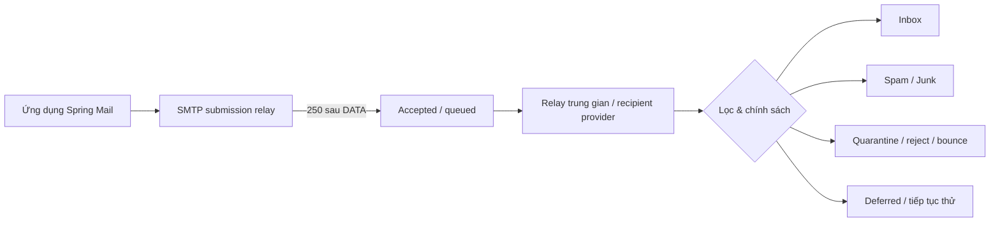
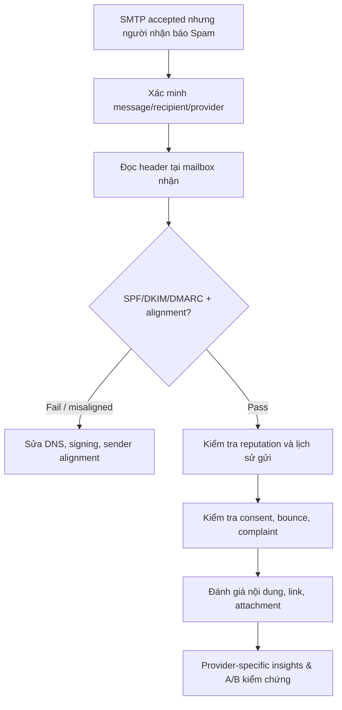
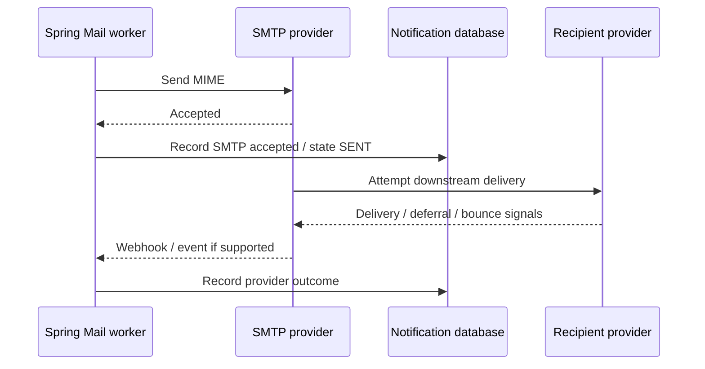

# Thư bị đánh dấu spam dù SMTP trả accepted

Khi gửi email bằng Spring Framework Mail, một kết quả thường gây hiểu lầm là `JavaMailSender.send(...)` trả về bình thường, hoặc SMTP relay trả `250 2.0.0 accepted`, nhưng người nhận vẫn thấy thư nằm trong thư mục Spam/Junk. Lập trình viên có thể tưởng “SMTP đã báo thành công thì lỗi nằm ở Spring” hoặc “chỉ cần gửi lại vài lần là thư sẽ vào Inbox”. Cả hai suy luận đều không đúng.

**SMTP accepted chỉ xác nhận một điểm trong quá trình chuyển thư.** Relay đã chấp nhận trách nhiệm xử lý message tại thời điểm phản hồi; nó không cam kết thư đã vào Inbox, không cam kết không bị lọc ở các hop tiếp theo và không cho biết người nhận đã đọc thư. Sau khi accepted, thư còn có thể đi qua các relay, lớp xác thực domain, bộ lọc chống spam/phishing/malware và chính sách riêng của mailbox provider hoặc doanh nghiệp nhận.

Để chẩn đoán, cần tách **khả năng gửi được tới relay**, **xác thực danh tính người gửi**, **độ tin cậy của luồng gửi**, **chất lượng nội dung/danh sách người nhận** và **kết quả phân loại cuối ở mailbox**. Đây là bài học thuộc chương *Deliverability* của Spring Framework Mail: cách hiểu ranh giới SMTP, xác minh SPF/DKIM/DMARC, phân tích header, cải thiện danh sách và nội dung một cách hợp lệ, theo dõi bounce/complaint, cấu hình Spring Mail và xử lý trường hợp accepted nhưng thư vào spam.

Các ví dụ hướng tới Spring Framework 6.x, Spring Boot 3.x, Java 21 và Jakarta Mail. Tên domain `example.test`, `example.org` và địa chỉ minh họa chỉ là dữ liệu ví dụ. Chính sách lọc thư và yêu cầu từng nhà cung cấp có thể thay đổi, vì vậy các ngưỡng hoặc quy tắc riêng của provider cần đối chiếu với tài liệu hiện hành khi triển khai.

## 1. Ba khái niệm phải phân biệt: accepted, delivered và inbox placement

Quá trình chuyển email có nhiều mốc, không nên gộp vào một boolean `sent=true`:



| Khái niệm | Ý nghĩa chính xác | Có phải Inbox thành công? |
|---|---|---|
| `Submitted` | Ứng dụng đã cố gửi message tới SMTP/provider | Không |
| `Accepted` | Một SMTP relay hoặc provider đã chấp nhận message để xử lý tiếp | Không |
| `Deferred` | Provider hoãn chuyển/giao vì tình trạng tạm thời | Không |
| `Delivered` trong dashboard provider | Provider ghi nhận giao tới hệ thống/mailbox đích theo định nghĩa riêng | Chưa chắc: có thể vào Spam |
| `Inbox placement` | Thư thực sự nằm trong hộp thư đến của người nhận theo quan sát có thể xác minh | Có, tại thời điểm kiểm tra |
| `Spam/Junk placement` | Thư được mailbox provider hoặc client phân vào thư mục spam | Không |
| `Bounced` | Có thông báo không thể giao hoặc bị trả về, có thể sau khi relay ban đầu accepted | Không |
| `Opened` | Có tín hiệu tương tác/đọc được ghi nhận, thường qua pixel hoặc client | Không phải bằng chứng đáng tin tuyệt đối về vị trí thư |

Đặc biệt, một dashboard provider gắn nhãn `delivered` không nhất thiết cho biết thư nằm trong Inbox hay Spam; ý nghĩa phải được kiểm tra theo contract cụ thể. Ngược lại, một thư bị đánh dấu Spam vẫn có thể đã được giao đến mailbox và người dùng mở được.

### 1.1. Phân biệt bốn loại thất bại

1. **Transport failure:** Ứng dụng không kết nối được SMTP, xác thực thất bại hoặc relay từ chối ở SMTP transaction.
2. **Delivery failure:** Relay ban đầu nhận thư nhưng downstream từ chối, deferred lâu hoặc bounce.
3. **Placement failure:** Mailbox nhận thư nhưng bộ lọc đưa vào Spam/Junk hoặc quarantine.
4. **Engagement failure:** Thư nằm ở Inbox nhưng người nhận không mở, không đọc hoặc không thực hiện hành động.

Chẩn đoán đúng bắt đầu bằng việc xác định vấn đề thuộc loại nào. Không cần thay đổi SMTP timeout để sửa một vấn đề về reputation hoặc opt-in.

## 2. Đọc đúng mã SMTP 250: nó thuộc pha nào?

Một phiên SMTP có nhiều phản hồi 250. Chỉ một phản hồi 250 ở sai pha không đủ để kết luận message đã được relay chấp nhận hoàn chỉnh.

Ví dụ transcript rút gọn:

```text
S: 220 smtp.provider.test ESMTP
C: EHLO mail-app.example.org
S: 250-smtp.provider.test
S: 250 SIZE 26214400
C: MAIL FROM:<bounce@example.org>
S: 250 2.1.0 Sender accepted
C: RCPT TO:<customer@example.test>
S: 250 2.1.5 Recipient accepted
C: DATA
S: 354 End data with <CRLF>.<CRLF>
C: [MIME content redacted]
C: [end-of-data marker]
S: 250 2.0.0 Queued as [provider-id-redacted]
```

Các prefix `C:` và `S:` chỉ hướng trao đổi, không phải format bắt buộc của logger. Địa chỉ và nội dung đã được thay bằng dữ liệu giả.

- `250` sau `MAIL FROM` chỉ nói envelope sender được chấp nhận.
- `250` sau `RCPT TO` chỉ nói recipient được chấp nhận cho transaction này.
- `354` nghĩa là server sẵn sàng nhận nội dung, **chưa** chấp nhận message hoàn chỉnh.
- `250` **sau DATA kết thúc** thường là tín hiệu relay đã tiếp nhận message cho khâu xử lý tiếp.

Ngay cả ở trường hợp cuối, provider vẫn có thể phát hiện vấn đề khi giao sang domain đích hoặc khi bộ lọc mailbox phân loại.

### 2.1. Spring Mail trả về không có exception

Với `JavaMailSender` dùng SMTP đồng bộ thông thường, `send(...)` trả về bình thường có thể được ghi nhận là lời gọi SMTP không báo lỗi. Nhưng Spring không có API chung để bảo đảm inbox placement cho người nhận. Một lời gọi `send` thành công **không** bao gồm vòng đời downstream của email.

Nếu gửi cho nhiều recipient, còn có trường hợp một số địa chỉ được relay chấp nhận và số khác bị từ chối. Hãy xem kết quả theo recipient hoặc thiết kế một notification cho mỗi recipient nếu cần retry/tracking chính xác.

### 2.2. Accepted không đồng nghĩa thư không thể bị bounce

Một relay có thể nhận message rồi cố giao tới server khác. Nếu downstream trả lỗi vĩnh viễn, relay có thể sinh bounce/DSN hoặc provider event. Điều này không mâu thuẫn với phản hồi `250` trước đó: các hệ thống đưa ra kết quả ở **những thời điểm khác nhau**.

## 3. Điều gì quyết định email vào Inbox hay Spam?

Mailbox provider không chỉ nhìn một property trong JavaMailSender. Bộ lọc thường đánh giá nhiều tín hiệu kết hợp, ví dụ:

- Xác thực domain và sự liên kết với địa chỉ From hiển thị: SPF, DKIM, DMARC.
- Độ tin cậy của domain gửi, IP gửi và hạ tầng mail provider.
- Lịch sử gửi, volume, mức tăng đột biến và tính ổn định.
- Complaints, invalid recipients, bounces và hành vi người nhận.
- Tính nhất quán của nội dung, thương hiệu, liên kết và landing page.
- Dấu hiệu giả mạo/phishing, URL nguy hiểm, attachment đáng ngờ.
- Chất lượng danh sách: có xin phép và có suppression/unsubscribe hay không.
- Chính sách riêng của tổ chức nhận, bộ lọc doanh nghiệp và thiết lập cá nhân.

Không có công thức công khai duy nhất hoặc một “spam score” phổ quát cho mọi mailbox provider. Một email có thể vào Inbox của nhà cung cấp A, vào Spam của nhà cung cấp B và bị hệ thống doanh nghiệp C quarantine. Một số provider có thể đánh giá khác nhau theo từng người dùng.

### 3.1. Thứ tự chẩn đoán hợp lý



Sửa xác thực domain là điều kiện nền tảng, nhưng không nên hứa rằng chỉ cần SPF/DKIM/DMARC pass thì mọi thư sẽ vào Inbox.

## 4. SPF: xác thực IP được phép gửi cho envelope domain

SPF (Sender Policy Framework) dùng DNS TXT record để công bố các IP hoặc nguồn gửi được phép gửi thư cho domain mà SPF kiểm tra. Trong SMTP, SPF thường dựa trên `MAIL FROM`/envelope sender domain; ở một số trường hợp đặc biệt có thể đánh giá HELO/EHLO identity.

Điều quan trọng: **SPF không đơn giản là kiểm tra địa chỉ From mà người dùng nhìn thấy trong email**.

Ví dụ:

```text
Header From: invoices@example.org
SMTP MAIL FROM: bounce.mail.example.org
Connecting IP: 192.0.2.30
```

Receiver có thể đánh giá SPF cho `bounce.mail.example.org`, không phải trực tiếp cho `example.org`. Nếu IP 192.0.2.30 được phép theo SPF của envelope domain, SPF có thể pass. Nhưng việc SPF pass có đủ để DMARC pass không còn phụ thuộc **alignment** với domain ở header From.

### 4.1. DNS SPF ví dụ

Một record minh họa:

```dns
example.org. IN TXT "v=spf1 include:_spf.sender.example.net -all"
```

- `v=spf1`: khai báo SPF record.
- `include:...`: dùng chính sách SPF của một nguồn gửi do nhà cung cấp chỉ định.
- `-all`: cơ chế mặc định fail nếu không match các nguồn được phép; chỉ dùng khi đã rà soát toàn bộ luồng gửi.

Tên host trên chỉ là ví dụ. Trong hệ thống thực, dùng hostname/SPF include chính thức của provider, không copy một record minh họa và hy vọng có hiệu lực.

### 4.2. Các lỗi SPF thường gặp

- Domain có **nhiều SPF TXT records** bắt đầu bằng `v=spf1`, gây lỗi xử lý.
- Quên đưa mail provider mới vào danh sách nguồn gửi.
- Sử dụng nguồn gửi cũ đã đổi IP, nhưng SPF chưa cập nhật.
- Quá giới hạn đánh giá DNS lookup của SPF (cơ chế nhất định có giới hạn, thường là 10 lần tra cứu trong quá trình evaluation), dẫn đến permerror.
- Dùng `+all` hoặc cấu hình cho phép gửi quá rộng, làm giảm ý nghĩa xác thực.
- Quên kiểm tra envelope domain của provider thay vì nhìn header From.
- Thư được forward khiến IP forwarder không còn khớp SPF của domain gốc.

Đừng “sửa” SPF bằng cách cho phép mọi IP. Cần lập danh mục tất cả nguồn gửi hợp lệ, hợp nhất thành **một chính sách SPF** và tối ưu lookup theo hướng dẫn provider.

## 5. DKIM: chữ ký gắn với nội dung và domain ký

DKIM (DomainKeys Identified Mail) giúp recipient server kiểm tra một số header và phần body được ký bằng private key. Public key được công bố trong DNS; message mang header `DKIM-Signature` cho biết domain ký `d=` và selector `s=`.

Ví dụ header rút gọn:

```text
DKIM-Signature: v=1; a=rsa-sha256;
 d=example.org; s=mail2026;
 h=from:to:subject:date:mime-version;
 bh=[REDACTED]; b=[REDACTED]
```

Ví dụ DNS public key:

```dns
mail2026._domainkey.example.org. IN TXT "v=DKIM1; k=rsa; p=[PUBLIC_KEY]"
```

Chuỗi `[PUBLIC_KEY]` chỉ là placeholder, không phải record hợp lệ để dùng thật. Private key phải ở hạ tầng ký thư được bảo vệ; không đưa vào repository, log hoặc tài liệu.

### 5.1. DKIM pass giúp gì?

DKIM pass chứng minh rằng chữ ký phù hợp với public key của domain `d=` và các phần được ký không bị thay đổi làm hỏng chữ ký. Nó giúp xác thực một danh tính domain, nhưng **không chứng minh sender có uy tín tốt** và không đảm bảo thư vào Inbox.

DKIM không có nghĩa nội dung thư an toàn hoặc đáng tin trong mọi ngữ cảnh; một domain do kẻ xấu kiểm soát vẫn có thể ký đúng thư của mình.

### 5.2. DKIM fail vì đâu?

- DNS selector sai hoặc không có public key tương ứng.
- Chữ ký do provider cấu hình sai domain, selector, key rotation.
- Email bị chỉnh sửa ở bước trung gian sau khi ký, chẳng hạn footer gateway thêm vào body hoặc rewrite header đã ký.
- Có hạ tầng gửi mới nhưng chưa bật DKIM signing cho custom domain.
- Một số mail flow qua forwarder/mailing list làm thay đổi phần nội dung đã được ký.

Khi DKIM fail, hãy xem `d=`, `s=`, kết quả verifier và vị trí ký/thay đổi MIME. Đừng sửa bằng cách tự thêm một header DKIM “pass” hoặc tự đặt `DKIM-Signature` chưa có chữ ký cryptographic hợp lệ.

### 5.3. Spring có tự ký DKIM không?

`JavaMailSender` và `MimeMessageHelper` xây dựng/gửi MIME message; chúng **không mặc nhiên bảo đảm custom-domain DKIM signing**. Trong triển khai phổ biến, outbound provider hoặc MTA thực hiện ký DKIM sau khi ứng dụng submit. Người vận hành cần kích hoạt domain signing ở provider, publish DNS key và kiểm tra header của email đến mailbox test.

Nếu ứng dụng chủ động ký DKIM, phải hiểu thứ tự finalization của MIME content: mọi thay đổi ở header/body đã ký sau đó có thể làm chữ ký không hợp lệ. Đối với phần lớn ứng dụng dùng managed SMTP, quản lý DKIM ở provider thường dễ vận hành hơn.

## 6. DMARC: kiểm tra alignment với địa chỉ From hiển thị

DMARC (Domain-based Message Authentication, Reporting and Conformance) liên kết xác thực SPF/DKIM với domain của header `From:` mà người dùng nhìn thấy. DMARC không chỉ yêu cầu một kết quả SPF hoặc DKIM bất kỳ là pass: phương thức pass đó phải có **domain alignment** phù hợp với RFC5322.From domain.

**Quy tắc cốt lõi:** DMARC pass nếu ít nhất **một** trong hai điều kiện đúng:

1. SPF pass **và** domain được SPF xác thực aligned với domain From; hoặc
2. DKIM pass **và** domain `d=` của chữ ký DKIM aligned với domain From.

Không bắt buộc cả SPF và DKIM đều aligned/pass cùng lúc để DMARC pass, dù vận hành cả hai phương thức thường tăng tính bền vững.

### 6.1. Ví dụ alignment thành công

```text
Header From: billing@example.org
Envelope MAIL FROM: bounce.example.org
SPF: pass for bounce.example.org
DKIM: pass, d=example.org
DMARC: pass
```

Trong relaxed alignment, domain con có thể aligned với organizational domain theo quy tắc DMARC. Cụ thể ở ví dụ này, DKIM `d=example.org` aligned trực tiếp với From, nên DMARC có thể pass ngay cả nếu SPF không đủ điều kiện alignment ở một luồng khác.

### 6.2. SPF pass nhưng DMARC fail

```text
Header From: invoices@example.org
Envelope MAIL FROM: bounce.smtp-provider.example.net
SPF: pass for smtp-provider.example.net
DKIM: pass, d=smtp-provider.example.net
DMARC: fail for example.org
```

SPF và DKIM có thể pass theo domain của provider, nhưng **không aligned với header From** của `example.org`. Để sửa, cấu hình provider ký DKIM với `d=example.org` hoặc một domain aligned thích hợp; hoặc cấu hình custom envelope MAIL FROM domain aligned, theo khả năng provider. Không đổi mọi nơi thành một domain ngẫu nhiên chỉ để “lấy pass” mà bỏ qua danh tính thương hiệu.

### 6.3. DNS DMARC ví dụ

```dns
_dmarc.example.org. IN TXT "v=DMARC1; p=none; rua=mailto:dmarc-reports@example.org; adkim=r; aspf=r"
```

- `v=DMARC1`: khai báo DMARC record.
- `p=none`: chính sách quan sát, không yêu cầu receiver quarantine/reject theo policy domain (receiver vẫn có thể lọc spam theo tiêu chí riêng).
- `rua=...`: địa chỉ nhận aggregate reports từ các receiver hỗ trợ.
- `adkim=r` và `aspf=r`: relaxed alignment theo chính sách ví dụ.

Các chính sách `p=quarantine` và `p=reject` chỉ nên được tăng cường khi đã thống kê, xác thực và bao phủ các nguồn gửi hợp lệ. Chúng được dùng để yêu cầu receiver xử lý **thư không đạt DMARC**, không phải nút bấm ép thư đạt DMARC vào Inbox.

### 6.4. Báo cáo DMARC hữu ích ra sao?

Aggregate reports có thể cho thấy những nguồn IP đang gửi với domain của bạn và kết quả SPF/DKIM/alignment theo góc nhìn receiver hỗ trợ. Chúng hữu ích để phát hiện dịch vụ gửi chưa cấu hình, nguồn giả mạo hoặc thay đổi hạ tầng. Tuy nhiên:

- Không phải mọi receiver đều gửi report.
- Report thường đến theo chu kỳ, không phải realtime cho từng notification.
- Dữ liệu report có thể chứa metadata về nguồn gửi và cần giới hạn quyền truy cập.
- “Có DMARC report” không đồng nghĩa biết inbox placement.

### 6.5. Forwarding, mailing list và ARC

Forwarder có thể làm SPF fail vì IP gửi tới mailbox cuối không còn nằm trong SPF của sender gốc. DKIM có thể vẫn pass nếu nội dung/header đã ký còn nguyên, nhưng mailing list thêm footer hoặc sửa subject có thể làm DKIM fail.

ARC (Authenticated Received Chain) cho phép một số trung gian ghi nhận thông tin xác thực qua các hop. Receiver có thể dùng ARC như **tín hiệu hỗ trợ theo policy riêng**, không phải bảo đảm DMARC pass hoặc Inbox. Đừng “sửa DMARC” bằng cách chỉ thêm ARC headers thủ công mà không có hạ tầng tin cậy.

## 7. Bắt đầu từ full headers tại mailbox nhận

Khi người nhận báo thư vào Spam, bằng chứng hữu ích nhất thường không phải log `mailSender.send(...)` của ứng dụng mà là **full message headers** của chính email đã đến mailbox nhận, nếu có thể thu được qua một tài khoản test hoặc với sự cho phép của người nhận.

Các header thường cần xem:

| Header / thông tin | Câu hỏi chẩn đoán |
|---|---|
| `From` | Domain hiển thị với người nhận là gì? |
| `Return-Path` | Envelope/bounce sender cuối cùng được ghi nhận là gì? |
| `Authentication-Results` | Receiver đánh giá SPF/DKIM/DMARC thế nào? |
| `Received` | Có các hop/relay nào, thời điểm nào? |
| `DKIM-Signature` | Domain `d=`, selector `s=` và có signature nào? |
| `Message-ID` | Message có ID hợp lý, có thể tra cứu qua provider không? |
| `List-Unsubscribe` | Bulk/subscription mail có cơ chế hủy đăng ký phù hợp không? |
| `List-Unsubscribe-Post` | Có thông tin one-click unsubscribe khi use case yêu cầu không? |
| `Date` | Thời điểm message được tạo và đồng hồ có nhất quán không? |
| Provider-specific headers | Queue ID, spam classification hints hoặc metadata khác nếu được phép xem |

### 7.1. Ví dụ Authentication-Results

```text
Authentication-Results: mx.recipient.example;
    spf=pass smtp.mailfrom=bounce.example.org;
    dkim=pass header.d=example.org header.s=mail2026;
    dmarc=pass header.from=example.org
```

Đây là ví dụ minh họa một receiver kiểm tra được SPF, DKIM, DMARC. Nếu thư vẫn vào Spam, đừng kết luận header mâu thuẫn: authentication pass chỉ là **một tín hiệu**, không phải quyết định placement.

### 7.2. Đọc một trường hợp có vấn đề

```text
From: Billing <billing@example.org>
Return-Path: <bounce@mailer.provider.example.net>
Authentication-Results: mx.recipient.example;
    spf=pass smtp.mailfrom=mailer.provider.example.net;
    dkim=pass header.d=provider.example.net;
    dmarc=fail header.from=example.org
```

Phân tích:

1. SPF xác nhận envelope domain của provider, không phải domain From.
2. DKIM ký bằng domain provider, không aligned với From.
3. Vì không có đường SPF/DKIM pass **và** aligned, DMARC fail.
4. Điều tra cấu hình custom-domain DKIM hoặc envelope sender của provider, không chỉ thay `spring.mail.host`.

### 7.3. Đừng tin Authentication-Results do bên gửi tự chèn

`Authentication-Results` là header các hệ thống kiểm tra thêm vào. Header có thể tồn tại từ nhiều hop, và một sender không tin cậy cũng có thể chèn text trông giống kết quả xác thực. Khi kết luận, xem header do **receiver hoặc trusted boundary** thêm vào, dựa trên chuỗi Received/trust policy của hệ thống nhận. Không tin một dòng “dkim=pass” bất kỳ trong raw MIME do nguồn không tin cậy cung cấp.

### 7.4. Không có quyền đọc inbox của người nhận

Nếu không thể lấy full header từ một mailbox thật, hãy dùng tài khoản test được cấp quyền tại provider đích, provider dashboard hoặc yêu cầu người nhận cung cấp **header đã redaction**. Không yêu cầu mật khẩu mailbox, không hướng người nhận chuyển tiếp email chứa token và không truy cập trái phép dữ liệu.

## 8. Domain reputation và IP reputation

Ngay cả với SPF/DKIM/DMARC pass, một sender chưa có lịch sử đáng tin hoặc có lịch sử xấu có thể bị lọc Spam.

Các tín hiệu thường liên quan:

- Số email gửi theo domain/IP và xu hướng thay đổi.
- Tỷ lệ recipient không tồn tại, bounce và complaint.
- Mức độ tương tác của người nhận (ở mức phù hợp với chính sách riêng của provider).
- Tần suất gửi tới danh sách không hoạt động hoặc đã từ chối.
- Uy tín domain trong From, domain DKIM và domain liên kết.
- Uy tín hạ tầng IP và các nguồn gửi dùng chung IP.
- Lịch sử spam/phishing/malware từ luồng gửi.

Một hệ thống mới có thể có domain mới và IP chưa có lịch sử. Gửi đột biến hàng chục hoặc hàng trăm nghìn thư ngay khi triển khai có thể làm receiver thận trọng hơn, dù authentication đã đúng.

### 8.1. Shared IP và dedicated IP

| Hạ tầng | Ưu điểm | Điều cần chú ý |
|---|---|---|
| Shared IP của provider | Dễ bắt đầu; provider quản lý vận hành nhiều phần | Uy tín IP chịu ảnh hưởng bởi chính sách và tập khách hàng dùng chung |
| Dedicated IP | Kiểm soát lịch sử gửi trên IP tốt hơn | Cần volume đủ đều, warm-up, vận hành DNS/rDNS và theo dõi reputation |

Không phải tổ chức nào cũng cần dedicated IP. Với lưu lượng nhỏ hoặc biến động, shared IP chất lượng cao có thể phù hợp hơn. Dedicated IP không tự bảo đảm Inbox và không thay thế chất lượng danh sách.

### 8.2. Warming và tăng lưu lượng có kiểm soát

Khi dùng domain/IP mới, nên bắt đầu bằng luồng **được người nhận mong đợi** và tăng volume dựa trên tín hiệu thực tế. Theo dõi bounce, complaint, deferral và phân loại theo provider. Không cố “warm up” bằng tương tác giả, mua danh sách hoặc gửi thử tới người chưa đồng ý.

Nếu volume tăng đột ngột sau migration, hãy kiểm tra:

1. Domain From, DKIM và bounce domain có thay đổi không.
2. Mức gửi theo từng provider nhận có tăng bất thường không.
3. IP pool và TLS/SMTP path có khác trước không.
4. Tỷ lệ bounce, complaint, deferral có tăng không.
5. Chỉ một mailbox provider bị Spam hay mọi provider đều bị ảnh hưởng.

### 8.3. Reverse DNS, HELO và hạ tầng

Khi tự vận hành MTA/dedicated IP, reverse DNS (PTR), forward DNS, hostname EHLO và routing nhất quán có thể là các yếu tố quan trọng trong đánh giá tính hợp lệ hạ tầng. Với managed SMTP provider, phần này thường do provider quản lý, nhưng vẫn cần xác minh domain authentication và custom sender settings.

Một PTR hợp lệ không đồng nghĩa reputation tốt; và rDNS không thay thế SPF/DKIM/DMARC.

## 9. Danh sách người nhận: consent, suppression và list hygiene

Một nguyên nhân phổ biến của vấn đề deliverability là gửi tới người **không mong đợi email**. SMTP relay vẫn có thể accepted, nhưng recipient đánh dấu Spam, xóa không đọc hoặc provider nhận nhiều tín hiệu tiêu cực.

Thiết kế đúng cần phân biệt loại thư:

- **Transactional/service email:** Thông báo phát sinh từ một nghiệp vụ thực tế, ví dụ hóa đơn, biên nhận hoặc thay đổi bảo mật.
- **Marketing/subscription email:** Người nhận chủ động đăng ký nhận nội dung định kỳ/quảng bá hoặc danh sách liên hệ có cơ sở cho phép rõ ràng.
- **Operational/system email:** Alert vận hành hoặc thông báo nội bộ theo danh sách có quản trị.

Không nên đổi nhãn “marketing” thành “transactional” chỉ để bỏ qua unsubscribe/consent hoặc lọc spam. Quy định và yêu cầu provider dành cho từng loại thư có thể khác nhau theo quốc gia, loại người nhận và nền tảng.

### 9.1. Nguyên tắc quản lý danh sách

1. Thu thập consent rõ ràng và lưu nguồn/thời điểm bằng chứng phù hợp.
2. Xác minh định dạng địa chỉ; nếu cần, dùng double opt-in để giảm đăng ký nhầm hoặc giả mạo.
3. Ngừng gửi marketing khi người nhận opt-out; cập nhật suppression list.
4. Loại hoặc tạm dừng địa chỉ hard bounce theo policy.
5. Xử lý spam complaint và không tiếp tục gửi cùng loại email cho người đã khiếu nại.
6. Phân loại recipient không hoạt động để giảm gửi không cần thiết.
7. Không mua, cào hoặc nhập danh sách email không có cơ sở cho phép.
8. Tách các luồng thư có mục đích khác nhau nếu điều đó hữu ích cho reputation và vận hành.

Consent, bounce và suppression cần được kiểm tra khi enqueue **và** khi dispatch nếu công việc có thể chờ lâu trong queue.

### 9.2. Vì sao gửi lại không chữa Spam?

Nếu nguyên nhân là recipient không muốn nhận, domain reputation kém hoặc nội dung đáng ngờ, retry cùng một email nhiều lần thường không giải quyết vấn đề. Nó còn có thể tăng complaint, gửi trùng và giảm uy tín. Retry chỉ hợp lý với **lỗi tạm thời đã được phân loại**, không phải với một thư đã được relay accepted rồi đặt vào Spam.

## 10. Unsubscribe cho thư subscription và bulk

Một email marketing/subscription cần có đường hủy đăng ký rõ ràng, dễ dùng và thực sự hoạt động theo chính sách áp dụng. Thiếu cơ chế unsubscribe hoặc cố tình làm khó có thể khiến người nhận bấm “Report spam” thay vì từ chối đăng ký.

Ngoài link trong nội dung, các chuẩn email còn có header cho unsubscribe:

```text
List-Unsubscribe: <https://mail.example.org/u/opaque-token>,
                  <mailto:unsubscribe@example.org>
List-Unsubscribe-Post: List-Unsubscribe=One-Click
```

Header `List-Unsubscribe-Post` được mô tả trong RFC 8058 cho one-click unsubscribe qua HTTPS theo cách mà các hệ thống hỗ trợ có thể sử dụng. Không phải chỉ thêm header là hoàn thành tích hợp: endpoint phải thực sự triển khai đúng semantics, xử lý yêu cầu an toàn và cập nhật suppression kịp thời.

### 10.1. Endpoint one-click an toàn

- Dùng HTTPS.
- Token đủ khó đoán, gắn với subscriber/list và mục đích unsubscribe; hạn chế phạm vi quyền.
- Đáp ứng POST one-click theo chuẩn; **không** để hành vi GET của link scanner tự động hủy đăng ký.
- Đảm bảo idempotent: người dùng hoặc provider gọi lại không sinh lỗi hoặc tạo side effect khác.
- Không yêu cầu login/phức tạp hóa hành động one-click theo policy áp dụng.
- Không đưa token raw vào application log hoặc metric.
- Chống enumeration và abuse; có rate limiting phù hợp.
- Lưu trạng thái suppression bền vững, có audit tối thiểu.

Không dùng link chứa email plaintext làm khóa quyền duy nhất. Nếu có unsubscribe qua email `mailto:`, cần quy trình nhận và xử lý thông điệp thực tế; thêm một địa chỉ không được giám sát chỉ mang tính hình thức.

### 10.2. Đừng áp dụng một cách máy móc cho mọi thư giao dịch

Thông báo reset mật khẩu hoặc cảnh báo bảo mật có thể không thuộc cùng loại subscription marketing. Phải xác định loại thư và chính sách cho từng template. Không cho người dùng “unsubscribe khỏi tất cả email” theo cách ngăn gửi những thông báo bảo mật bắt buộc; cũng không dùng nhãn transactional để lách consent của email quảng bá.

### 10.3. Yêu cầu provider có thể thay đổi

Một số mailbox provider có yêu cầu riêng dành cho bulk senders về authentication, unsubscribe và complaint handling. Các ngưỡng áp dụng theo volume/domain và mốc thời gian có thể thay đổi. Khi triển khai, đối chiếu trang chính sách sender hiện hành của provider chính thay vì dựa vào một con số cố định trong bài học này.

## 11. Nội dung email, liên kết và attachment

Thư có thể bị đánh giá là Spam hoặc phishing vì cách trình bày, dù domain authentication pass. Mục tiêu không phải tìm “mẹo qua bộ lọc”, mà là gửi **nội dung minh bạch, đúng mong đợi và dễ xác minh**.

### 11.1. Subject và sender identity nhất quán

- Subject mô tả đúng nội dung; tránh hứa hẹn hoặc mạo danh.
- Display name, header From, domain liên kết và thương hiệu không mâu thuẫn.
- Reply-To (nếu có) là địa chỉ hợp lệ, có kênh phản hồi khi phù hợp.
- Không dùng tên thương hiệu bên thứ ba nếu không được phép.
- Không viết subject như một thông báo khẩn cấp giả, fake invoice hoặc phishing lure.

Không có một danh sách “từ cấm” phổ quát: một từ cụ thể hiếm khi giải thích toàn bộ placement. Đánh giá thông điệp trong ngữ cảnh và phản hồi thực tế của người nhận.

### 11.2. HTML hợp lệ và plain-text alternative

Nên có nội dung HTML rõ ràng, responsive, dễ đọc và một phần plain-text có cùng ý nghĩa. Tránh chỉ gửi một ảnh lớn thay cho toàn bộ văn bản; dùng alt text hợp lý, link rõ mục đích và cấu trúc MIME đúng.

Spring `MimeMessageHelper` hỗ trợ multipart/alternative:

```java
MimeMessage message = mailSender.createMimeMessage();
MimeMessageHelper helper =
        new MimeMessageHelper(message, true, "UTF-8");

helper.setFrom("notifications@example.org");
helper.setTo(recipientAddress);
helper.setSubject("Hóa đơn của bạn đã sẵn sàng");
helper.setText(
        "Hóa đơn của bạn đã sẵn sàng. Xem trong tài khoản.",
        "<html><body><p>Hóa đơn của bạn đã sẵn sàng.</p>"
        + "<p><a href=\"https://app.example.org/invoices\">"
        + "Xem trong tài khoản</a></p></body></html>");

mailSender.send(message);
```

Ví dụ minh họa cách tạo hai bản nội dung; production cần tạo URL riêng theo nghiệp vụ, kiểm tra quyền truy cập, escaping HTML theo ngữ cảnh và không hardcode thông tin riêng của người dùng. Có plain-text alternative là thực hành tốt cho khả năng đọc và tương thích, **không** là cam kết thư sẽ vào Inbox.

### 11.3. Link và redirect

Kiểm tra link trong body:

- Dùng HTTPS và domain thuộc ứng dụng/provider đã được phê duyệt.
- Tránh shortener/redirect chain không rõ điểm đến.
- Không hiển thị một URL nhưng dẫn tới domain không liên quan.
- Không nhúng secret dài hạn; token một lần cần hạn dùng và scope hẹp.
- Kiểm tra trạng thái website, chứng chỉ và nội dung landing page.
- Dùng tracking links minh bạch, hạn chế lạm dụng và hiểu rằng link rewriting của gateway có thể ảnh hưởng trải nghiệm.

Nếu email chứa URL `account.example.org` nhưng thực tế đi qua nhiều host không liên quan, bộ lọc hoặc người nhận có thể nghi ngờ. Đừng cố che đích thật bằng kỹ thuật redirect phức tạp.

### 11.4. Attachment

Attachment lớn, loại file nguy hiểm, MIME type sai hoặc nội dung có malware có thể dẫn tới policy filtering. Với hóa đơn, ưu tiên tài liệu định dạng phổ biến và nguồn được kiểm soát; nếu phù hợp, gửi link HTTPS tới khu vực đăng nhập an toàn thay vì đính kèm quá nhiều dữ liệu.

Không coi chỉ cần đặt `Content-Type: application/pdf` là file đã an toàn. MIME type khai báo có thể khác nội dung. Áp dụng kiểm tra file và scan phù hợp trước khi gửi.

### 11.5. Đừng thay nội dung tùy tiện để “né spam”

Các biện pháp như thêm nhiều ký tự ngẫu nhiên, thay từ bằng ký tự đặc biệt, ẩn text, spoofing hoặc sử dụng redirect gây hiểu lầm có thể làm giảm niềm tin, tăng dấu hiệu phishing và vi phạm chính sách provider. Tập trung vào consent, xác thực, uy tín và nội dung người nhận thật sự cần.

## 12. Tách reputation của email giao dịch và marketing khi cần

Một hệ thống có thể gửi hai nhóm:

- Email giao dịch: hóa đơn, thông báo đăng nhập, xác nhận tài khoản.
- Email marketing: newsletter, chiến dịch quảng cáo, đề xuất nội dung.

Nếu marketing có tần suất lớn hoặc danh sách kém chất lượng, tín hiệu tiêu cực có thể ảnh hưởng tới luồng giao dịch khi dùng chung domain/IP/sender configuration tùy mô hình provider.

Có thể cân nhắc tách luồng qua:

- Sending subdomain theo mục đích, ví dụ `notify.example.org` và `news.example.org`.
- Provider stream/pool hoặc configuration riêng.
- Domain DKIM và bounce domain aligned hợp lý.
- Rate limit, retry policy và suppression theo từng loại thư.
- Dashboard reputation riêng cho transactional/marketing.

Tách domain con không có nghĩa tách hoàn toàn mọi yếu tố reputation. Một số receiver vẫn xem xét organizational domain và các tín hiệu liên quan. Không dùng domain mới liên tục để tránh hậu quả của hành vi gửi không được mong đợi.

## 13. Cấu hình Spring Boot Mail: trách nhiệm ứng dụng và provider

Ví dụ cấu hình Spring Boot cho một managed SMTP provider:

```yaml
spring:
  mail:
    host: smtp.provider.example.net
    port: 587
    username: ${SMTP_USERNAME}
    password: ${SMTP_PASSWORD}
    properties:
      "[mail.smtp.auth]": "true"
      "[mail.smtp.starttls.enable]": "true"
      "[mail.smtp.starttls.required]": "true"
      "[mail.smtp.connectiontimeout]": "5000"
      "[mail.smtp.timeout]": "10000"
      "[mail.smtp.writetimeout]": "10000"
```

Đây là cấu hình minh họa, không phải thông tin kết nối provider thật. Các timeout là giá trị ví dụ. Cần dùng secret manager hoặc cơ chế bảo vệ biến môi trường; không commit credential vào repository. Với provider yêu cầu implicit TLS, cấu hình có thể khác.

Những điều **Spring Boot SMTP config** giúp kiểm soát:

- Kết nối đúng SMTP host/port.
- AUTH và TLS theo contract của relay.
- Timeout và cách client submit message.
- MIME charset, header/body/attachment do ứng dụng dựng.
- Envelope sender trong những trường hợp transport/provider hỗ trợ cấu hình.

Những điều **không tự xuất hiện** khi thêm `spring-boot-starter-mail`:

- Quyền sở hữu domain From trên provider.
- DNS SPF, DKIM signing, DMARC record/alignment.
- Uy tín domain/IP và gửi có consent.
- Unsubscribe/suppression workflow.
- Hệ thống nhận bounce, complaint và delivery events.
- Quyết định inbox placement của mailbox provider.

### 13.1. Tùy biến envelope MAIL FROM

Jakarta Mail SMTP provider thông dụng hỗ trợ property `mail.smtp.from` để chọn SMTP envelope sender trong một số trường hợp:

```yaml
spring:
  mail:
    properties:
      "[mail.smtp.from]": "bounce@example.org"
```

Điều này **không tự động cấu hình SPF/DMARC alignment** và có thể bị provider override hoặc từ chối nếu sender domain chưa được đăng ký. Một số managed services dùng custom MAIL FROM/bounce domain qua dashboard/API. Hãy ưu tiên contract chính thức của provider thay vì giả định property nào cũng có hiệu lực.

### 13.2. Tách From, Reply-To và Return-Path

| Thành phần | Chức năng |
|---|---|
| `From:` trong header MIME | Danh tính người gửi được hiển thị, quan trọng cho DMARC |
| `Reply-To:` | Nơi gửi phản hồi khi người nhận bấm Reply |
| SMTP `MAIL FROM` | Envelope sender, liên quan SPF và luồng bounce |
| `Return-Path:` | Header thường được hệ thống giao thư cuối thêm từ envelope sender |

Đặt `helper.setReplyTo(...)` không thay đổi domain From cho DMARC. Đặt `helper.setFrom(...)` cũng không bảo đảm envelope sender hoặc DKIM d= được provider cấu hình đúng. Cần đối chiếu raw header và SMTP/provider settings.

### 13.3. Ví dụ service gửi thư rõ danh tính

```java
@Service
public class InvoiceMailService {

    private final JavaMailSender sender;
    private final MailTemplateRenderer renderer;

    public InvoiceMailService(
            JavaMailSender sender,
            MailTemplateRenderer renderer) {
        this.sender = sender;
        this.renderer = renderer;
    }

    public void sendInvoiceReady(
            String recipient,
            InvoiceMailData data) throws MessagingException {

        RenderedMail rendered = renderer.renderInvoice(data);
        MimeMessage message = sender.createMimeMessage();
        MimeMessageHelper helper =
                new MimeMessageHelper(message, true, "UTF-8");

        helper.setFrom("billing@example.org");
        helper.setReplyTo("support@example.org");
        helper.setTo(recipient);
        helper.setSubject(rendered.subject());
        helper.setText(rendered.plainText(), rendered.html());

        sender.send(message);
    }
}
```

`MailTemplateRenderer`, `RenderedMail` và `InvoiceMailData` là abstraction của ứng dụng. Ở production, dữ liệu và quyền recipient phải được xác thực trước khi tạo message; cấu hình sender lấy từ policy tin cậy, không nhận tùy ý từ request.

Đoạn code chỉ cho thấy cách tạo MIME rõ ràng. Nó **không cấu hình DNS hay ký DKIM**. Sau khi triển khai, cần test email thực tế qua provider để xác minh `Authentication-Results` ở mailbox.

## 14. Ghi nhận sự kiện sau SMTP accepted

Để tìm nguyên nhân vào Spam, chỉ có log “mail sent” là chưa đủ. Nên kết hợp dữ liệu ứng dụng với provider events:



Ví dụ event model:

```java
public enum MailProviderEventType {
    ACCEPTED,
    DEFERRED,
    DELIVERED,
    BOUNCED,
    COMPLAINT,
    UNSUBSCRIBED
}

public record MailProviderEvent(
        String providerEventId,
        String providerMessageId,
        String notificationId,
        MailProviderEventType type,
        Instant occurredAt,
        String safeReasonCode
) {}
```

Tên và semantics sự kiện thực tế phụ thuộc provider. Đặc biệt, `DELIVERED` có thể không phản ánh Inbox placement. Không tự sinh event `DELIVERED` từ kết quả `JavaMailSender.send(...)`; kết quả đó thuộc tầng SMTP submission.

### 14.1. Webhook phải được xác thực

Một endpoint nhận provider webhook không nên tin mọi HTTP request gắn `type=DELIVERED` hoặc `type=COMPLAINT`. Cần:

- Xác minh chữ ký hoặc cơ chế authentication của provider.
- Kiểm tra event ID, timestamp, payload schema và giới hạn kích thước.
- Xử lý idempotent vì webhook có thể được gửi lại.
- Cập nhật notification/recipient state theo transaction phù hợp.
- Không dùng event giả để xóa suppression hoặc mở lại quyền gửi.
- Log mã sự kiện và ID đã kiểm soát, tránh payload chứa PII.

### 14.2. Không trộn các trạng thái khác tầng

Một bản ghi có thể có:

```text
notificationStatus = SENT
smtpSubmission     = ACCEPTED
providerDelivery   = DELIVERED
mailboxPlacement   = UNKNOWN
```

Đây không phải mâu thuẫn. Các trường phản ánh những tầng khác nhau. Nếu chỉ có `smtpSubmission=ACCEPTED`, `providerDelivery=UNKNOWN` là kết luận đúng khi chưa có bằng chứng downstream; không được tự điền DELIVERED để dashboard đẹp hơn.

## 15. Bounce và complaint: phản hồi tiêu cực quan trọng

### 15.1. Hard bounce và soft bounce

Thông thường:

- **Hard bounce** biểu thị không thể giao mang tính vĩnh viễn theo phân loại của provider, ví dụ mailbox không tồn tại.
- **Soft bounce** thường là lỗi tạm thời, ví dụ mailbox đầy hoặc server đích chưa sẵn sàng.

Nhưng tên event và phân loại có thể khác giữa provider; phải đọc code và semantics cụ thể. Một “soft” kéo dài không đồng nghĩa nên retry mãi; cần giới hạn attempts, TTL và suppression policy.

Nếu nhận hard bounce đáng tin cậy, ứng dụng nên cập nhật suppression theo loại thư, tránh gửi tiếp cùng địa chỉ vô ích. Nếu nguyên nhân bounce là domain sending configuration chứ không phải recipient, phải sửa cấu hình thay vì suppress cả danh sách.

### 15.2. Complaint là tín hiệu từ người nhận

Spam complaint có thể đến từ feedback loop hoặc provider event nếu được hỗ trợ. Đây là tín hiệu nghiêm trọng về mức độ người nhận mong đợi thư. Cần:

1. Ghi nhận complaint event đã xác thực.
2. Đối chiếu notification và loại email.
3. Suppress các luồng phù hợp theo consent/policy.
4. Điều tra nguồn đăng ký, segment và nội dung.
5. Không cố gửi lại ngay cho người vừa complaint.

Không phải mọi mailbox provider đều cấp feedback loop đầy đủ. Tỷ lệ complaint quan sát được có thể là **một phần** thực tế; cần ghi rõ phạm vi provider và cách đo.

### 15.3. Quyết định retry theo nguyên nhân, không theo mục tiêu Inbox

Retry phù hợp khi transport gặp lỗi tạm thời **chưa accepted** hoặc provider deferred theo policy. Nếu thư đã được accepted và rơi vào Spam, việc resubmit cùng message ngay thường làm tăng volume và rủi ro duplicate. Nên sửa gốc rễ: xác thực, list hygiene, reputation hoặc nội dung, rồi đánh giá trên các lượt gửi hợp lệ tiếp theo.

## 16. Đo lường deliverability đúng định nghĩa

Một dashboard có thể chia ra:

| Chỉ số | Cách hiểu | Giới hạn |
|---|---|---|
| Submitted | Số notification/attempt gọi transport | Có thể gồm retry và duplicate |
| SMTP accepted | Số lần provider/relay chấp nhận submit | Không nói inbox placement |
| Deferred | Số event hoãn xử lý/giao | Có thể có nhiều event cho cùng message |
| Bounced | Số notification có bounce theo policy | Có thể đến muộn và không đủ provider |
| Complaints | Số complaint nhận từ feedback/event | Coverage phụ thuộc provider |
| Delivered reported | Số message provider báo giao được | Không chắc thư nằm trong Inbox |
| Inbox placement observed | Kết quả quan sát qua mailbox test/measurement được phép | Chỉ là mẫu, không đại diện mọi người dùng |
| Unsubscribes | Số người yêu cầu ngừng nhận subscription mail | Cần đo ở level recipient/list |

Khi tính tỷ lệ, phải ghi rõ **mẫu số, đơn vị và cửa sổ thời gian**. Ví dụ bounce rate có thể được định nghĩa là số notification có bounce chia số notification được provider accepted trong cùng cohort/cửa sổ theo chính sách báo cáo. Nếu dùng attempts làm mẫu số khi retry, kết quả bị méo. Khi dùng provider dashboard, hãy đọc định nghĩa chính thức trước khi so sánh với metric nội bộ.

### 16.1. Phân đoạn theo mailbox provider

Một domain có thể có vấn đề ở một nhóm recipient:

```text
Provider A: authentication pass, mailbox test vào Inbox
Provider B: authentication pass, mailbox test vào Spam
Provider C: policy reject ở RCPT
```

Đây là ba vấn đề khác nhau. Phân đoạn theo provider/domain nhận, loại email, source IP pool và thời gian giúp tránh thay đổi toàn bộ cấu hình khi chỉ có một nhóm chịu ảnh hưởng.

### 16.2. Không coi open rate là sự thật tuyệt đối

Tracking pixel có thể bị chặn, được proxy tải trước hoặc chịu privacy protections của email client. Vì vậy, open rate không phải bằng chứng chính xác rằng con người đã đọc thư hay email đã vào Inbox. Click cũng cần được diễn giải trong ngữ cảnh và có thể bị link scanner tạo ra một số request.

Không tự động đánh dấu một người đã đồng ý nhận marketing chỉ vì hệ thống ghi nhận pixel opened. Consent cần nguồn chứng cứ riêng.

### 16.3. Phép thử với mailbox mẫu

Có thể dùng các tài khoản test được phép ở những provider nhận chính, gửi nội dung đại diện và quan sát Inbox/Spam. Nhưng kết quả seed testing có giới hạn:

- Mailbox test có lịch sử tương tác khác mailbox thật.
- Bộ lọc có thể cá nhân hóa theo người nhận.
- Mẫu vài địa chỉ không đủ suy diễn tỷ lệ Inbox của toàn tập khách hàng.
- Cùng một email gửi ở thời điểm khác có thể nhận kết quả khác.

Seed test hỗ trợ điều tra và phát hiện hồi quy; không phải bằng chứng chắc chắn rằng mọi recipient sẽ nhận đúng folder.

## 17. Quy trình chẩn đoán một incident thực tế

Giả sử người dùng báo: “Email hóa đơn vẫn vào Spam, nhưng ứng dụng ghi SENT”. Có thể đi theo các bước sau:

### Bước 1 — Xác nhận đúng message

Lấy notification ID, attempt ID, thời điểm gửi, sender domain, recipient provider và provider message ID (nếu có). Không tìm kiếm bằng cách dump mọi email body. Nếu có nhiều attempt, xác định message nào thực sự nằm trong Spam.

### Bước 2 — Xác nhận kết quả tầng SMTP

Đọc log để biết relay đã trả accepted sau DATA hay chỉ có `250` tại MAIL/RCPT. Kiểm tra có timeout hoặc partial recipient failure không. Nếu `mailSender.send(...)` thành công nhưng update database thất bại, cần xử lý riêng vấn đề acknowledgment và duplicate risk.

### Bước 3 — Thu header tại mailbox test/được phép

Xem `Authentication-Results` do receiver đáng tin cậy thêm vào, cùng From, Return-Path, DKIM-Signature, Received. Ghi kết quả SPF, DKIM, DMARC **và alignment**. Nếu thiếu full header, chưa thể kết luận DNS authentication pass chỉ vì provider dashboard ghi “domain verified”.

### Bước 4 — Kiểm tra DNS và provider configuration

Đối chiếu SPF envelope domain, custom DKIM d=/selector, DMARC From alignment, DNS visibility/cache/TTL, provider sender verification và custom MAIL FROM settings. Kiểm tra migration hoặc thay đổi template/sender gần đây.

### Bước 5 — Nếu auth pass, điều tra reputation và phân đoạn

Xem lịch sử volume, deferral, hard bounce, complaint, domain/IP reputation signal (nếu provider cung cấp), và sự khác biệt giữa mailbox providers. Không kết luận content lỗi chỉ từ một seed mailbox.

### Bước 6 — Kiểm tra loại thư, consent và nội dung

Người nhận có mong đợi email này không? Template có mô tả chính xác không? Link có rõ domain đích không? Marketing có unsubscribe hoạt động không? Có attachment hay redirect đáng nghi không? Có thay đổi chiến dịch làm tăng complaint không?

### Bước 7 — Chọn hành động có tác dụng bền vững

Ví dụ:

- Fix alignment và DKIM signer.
- Sửa SPF records hoặc sender routing chưa khai báo.
- Tạm giảm volume/không gửi tới danh sách không mong đợi.
- Xử lý suppression, bounce và complaint.
- Sửa link/HTML bị lỗi hoặc thể hiện danh tính thiếu rõ ràng.
- Liên hệ provider support với message ID và bằng chứng đã redaction.

### Bước 8 — Theo dõi sau thay đổi

Gửi những thông báo **hợp lệ và được mong đợi**, kiểm tra authentication tại mailbox, đo event và placement trên nhiều điểm quan sát. DNS update không nhất thiết có tác dụng ngay vì cache/TTL. Reputation cũng có thể cần thời gian và lịch sử hành vi tốt; không đưa ra cam kết Inbox tức thời.

## 18. Một số tình huống phân tích mẫu

### Tình huống A — SMTP accepted, SPF pass, DMARC fail

```text
SMTP: 250 2.0.0 accepted
Header From: receipts@example.org
SPF: pass, smtp.mailfrom=provider.example.net
DKIM: pass, header.d=provider.example.net
DMARC: fail, header.from=example.org
Placement: Spam
```

**Kết luận hợp lý:** SMTP submission thành công nhưng xác thực không aligned với domain From. Ưu tiên cấu hình custom-domain DKIM hoặc MAIL FROM aligned ở provider. Không đủ bằng chứng để nói alignment là *nguyên nhân duy nhất* khiến thư vào Spam, nhưng đây là lỗi nền tảng cần sửa.

### Tình huống B — SPF/DKIM/DMARC đều pass, vẫn vào Spam

```text
SPF: pass
DKIM: pass, aligned
DMARC: pass
Placement: Spam
Campaign: volume tăng đột biến, nhiều complaint
```

**Kết luận hợp lý:** Authentication đã pass nên cần xem reputation, nguồn consent, segment, complaints, content và chính sách receiver. Không có lợi khi thêm một SPF record thứ hai hoặc thay DKIM selector liên tục không có nguyên nhân.

### Tình huống C — Chỉ một provider nhận bị Spam

```text
Provider A: Inbox ở mailbox test
Provider B: Spam ở mailbox test
Provider C: chưa đủ dữ liệu
```

**Kết luận hợp lý:** Chẩn đoán theo provider thay vì khẳng định mọi email đều bị spam. Kiểm tra headers tại Provider B, reputation signal của B, content variation, lịch sử người nhận và chất lượng mẫu test. Không suy rộng từ một mailbox test.

### Tình huống D — Email được forward rồi DKIM fail

```text
Original sender: SPF pass, DKIM pass, DMARC pass
Forwarding hop: modifies signed content
Final receiver: SPF fail, DKIM fail, DMARC fail
```

**Kết luận hợp lý:** Kiểm tra forwarder/mailing list đã sửa nội dung đã ký và SPF bị ảnh hưởng bởi forwarding. Nếu có ARC từ các hop đáng tin, final receiver có thể cân nhắc như tín hiệu hỗ trợ, nhưng không thể bảo đảm sẽ chọn Inbox.

### Tình huống E — SMTP accepted rồi báo bounce

```text
T0: Submission relay returns 250 accepted
T1: Downstream delivery attempt fails
T2: Provider emits BOUNCED event
```

**Kết luận hợp lý:** Không phải Spring đã “báo thành công sai”; nó báo kết quả submit tại T0. Cần ghi nhận bounce T2, phân loại hard/soft và cập nhật suppression/retry theo policy.

### Tình huống F — Email transactional bị lẫn reputation marketing

```text
Transactional and campaign mail use same sender setup
Marketing volume spikes; recipients complain
Invoice notifications begin landing in Spam
```

**Kết luận hợp lý:** Có thể cần đánh giá việc tách luồng transactional/marketing, điều chỉnh consent/list hygiene và provider pool. Không đủ bằng chứng để gán toàn bộ nguyên nhân cho shared IP; phải xem dữ liệu cụ thể.

## 19. Chẩn đoán bằng công cụ, không nhầm phép đo với nguyên nhân

Có thể dùng các nhóm công cụ tùy môi trường:

- DNS lookup cho SPF, DKIM selector, DMARC record.
- Provider domain verification và sending-domain dashboard.
- Mailbox raw-header view cho `Authentication-Results`, `Received`, `Return-Path`.
- Provider message trace/queue ID, bounce/complaint events.
- Postmaster/reputation dashboards do provider hỗ trợ.
- SMTP sandbox, test recipient và hệ thống observability nội bộ.

Ví dụ các truy vấn DNS tổng quát trên môi trường có `dig`:

```bash
dig TXT example.org
dig TXT _dmarc.example.org
dig TXT mail2026._domainkey.example.org
dig TXT bounce.example.org
```

Một số record có thể được publish dưới tên khác theo provider. Không chỉ tìm DKIM TXT ở root domain; phải lấy selector `s=` và signing domain `d=` thực tế từ message rồi truy vấn `s._domainkey.d`.

### 19.1. DNS cache và propagation

DNS không đồng bộ tức thời tới mọi receiver. Resolver có thể cache record theo TTL và hạ tầng phân tán có thời gian cập nhật riêng. Sau khi sửa SPF/DKIM/DMARC, kiểm tra kết quả từ những resolver phù hợp và test lại email mới; thư cũ trong Spam không nhất thiết được tái phân loại tự động.

### 19.2. Provider “domain verified” chưa đủ

Một dashboard báo sender domain đã verified có thể chỉ xác nhận một bước cấu hình. Để kiểm tra thực tế, cần quan sát raw header của **email đã đi qua đúng luồng provider, đúng sender và đúng recipient test**. Một hệ thống có nhiều provider hoặc tenant có thể ký đúng ở luồng A nhưng không đúng ở luồng B.

## 20. Logging an toàn và trạng thái trong ứng dụng

Không nên chỉ có log:

```text
INFO Email sent successfully to user@example.test
```

Dòng này vừa chứa địa chỉ người nhận, vừa mơ hồ về ý nghĩa “success”. Nên ghi sự kiện theo tầng:

```text
INFO event=mail_queued notificationId=... template=invoice_ready
INFO event=smtp_submit_started notificationId=... attemptId=...
INFO event=smtp_submit_accepted notificationId=... attemptId=...
INFO event=outbox_state_updated notificationId=... status=SENT
INFO event=provider_delivered notificationId=... providerMessageId=...
WARN event=provider_complaint notificationId=... category=spam_report
```

Những dòng provider event chỉ có khi đã nhận và xác minh event thực tế. Không tự tạo `provider_delivered` từ `smtp_submit_accepted`.

### 20.1. Không biến accepted thành một trạng thái chắc chắn cuối

Một mô hình lưu trữ:

```java
public record MailDeliverySnapshot(
        String notificationId,
        boolean smtpAccepted,
        String providerMessageId,
        MailProviderEventType latestProviderEvent,
        String inboxPlacement // UNKNOWN nếu không đo được
) {}
```

Trong hệ thống thực tế, có thể dùng enum hoặc nhiều bảng/sự kiện thay vì chuỗi. Điều quan trọng là tách kết quả submit, provider delivery và Inbox placement, đồng thời giữ trạng thái `UNKNOWN` khi chưa có bằng chứng.

### 20.2. Tránh log dữ liệu nhạy cảm

- Không log email body, reset token, OTP, file đính kèm, SMTP password.
- Không dump toàn bộ `MimeMessage` hoặc `MailSendException.getFailedMessages()`.
- Chuẩn hóa error code và giới hạn chiều dài response text trước khi log.
- Không dùng email người nhận hoặc notification ID làm metric label có cardinality cao.
- Chỉ lưu message ID/recipient reference cần thiết theo chính sách dữ liệu.
- Quản lý quyền, retention và redaction cho webhook payload.

## 21. Cảnh giác với việc tự gửi lại sau khi accepted

Đây là một điểm quan trọng giữa Deliverability và retry/idempotency:

1. Worker gọi SMTP.
2. Relay trả `250 accepted`.
3. Email vào Spam tại mailbox.
4. Người dùng báo chưa thấy.
5. Ứng dụng tự retry như một lỗi transport.

Bước 5 không có căn cứ: lần gửi đầu **đã được nhận**. Retry có thể tạo thư trùng, làm tăng complaint và không thay đổi nguyên nhân lọc spam. Nếu người dùng thật sự muốn gửi lại biên nhận, hãy thiết kế một thao tác resend có audit, kiểm tra quyền, hạn chế tần suất và phân biệt với retry sau lỗi tạm thời.

Trường hợp khác là timeout **sau DATA** mà client không nhận phản hồi cuối. Khi đó outcome có thể không chắc chắn; retry cũng có nguy cơ gửi trùng, nhưng quyết định có thể khác tùy mục tiêu không mất thông báo. Phải phân biệt hai trường hợp:

| Tình huống | Có bằng chứng relay accepted không? | Hành động |
|---|---|---|
| Nhận `250` cuối sau DATA | Có | Theo dõi downstream/placement, không tự retry để sửa Spam |
| Không nhận được phản hồi cuối sau DATA | Không chắc | Dùng policy UNKNOWN/reconciliation; cân nhắc duplicate |
| Relay trả `4xx` tạm thời rõ ràng trước khi accepted | Có bằng chứng từ chối tạm | Retry có backoff nếu phù hợp |
| Relay trả `5xx` vĩnh viễn rõ ràng | Có bằng chứng từ chối | Sửa dữ liệu/cấu hình/suppression, không retry nguyên xi |

## 22. Kiểm thử deliverability trong hệ thống Spring Mail

Không thể unit test một bộ lọc spam của mọi mailbox provider chỉ bằng Mockito. Nhưng có nhiều kiểm thử hữu ích để giảm rủi ro cấu hình và phát hiện hồi quy.

### 22.1. Unit test cấu trúc MIME

Với `JavaMailSender` giả và message được tạo tại chỗ, kiểm tra:

- `From` đến từ cấu hình trusted sender.
- `Reply-To` đúng mục đích.
- `Subject` không có CR/LF và được mã hóa charset phù hợp.
- Plain text và HTML có nội dung nhất quán.
- Link là HTTPS và domain được allowlist.
- Attachment, MIME type và filename được kiểm tra.
- Unsubscribe headers chỉ được gắn khi loại thư và endpoint đáp ứng yêu cầu.

Các test này không bảo đảm Inbox placement, nhưng giúp tránh lỗi đầu vào làm thư đáng ngờ hoặc vi phạm policy.

### 22.2. Integration test với SMTP sandbox

Có thể dùng Mailpit trong môi trường test:

```bash
docker run --rm --name mailpit -p 1025:1025 -p 8025:8025 axllent/mailpit
```

Gửi vào sandbox và kiểm tra MIME raw, nội dung, header From/Reply-To, multipart alternative và số recipient. Sandbox SMTP **không đại diện** cho spam filters và reputation của một mailbox provider thực.

### 22.3. Kiểm tra DNS và signing trong staging

Một phép thử qua provider đã cấu hình:

1. Gửi message tới mailbox test được phép.
2. Thu raw header.
3. Kiểm tra SPF, DKIM, DMARC pass/alignment.
4. So sánh d=/selector với domain dự kiến.
5. Xác nhận bounce domain và From nhất quán.
6. Kiểm tra sender/provider route đúng theo tenant/loại thư.

Nếu mới thay DNS, ghi thời điểm và TTL để tránh test từ cache cũ rồi kết luận sai.

### 22.4. Test suppression và complaint

Giả lập webhook complaint đã xác thực. Xác nhận recipient bị đưa vào suppression phù hợp và job marketing tiếp theo không được dispatch. Test webhook duplicate và event đến muộn; không để một webhook replay làm ghi trạng thái sai.

### 22.5. Test unsubscribe một-click

Với subscription mail, test link/header và endpoint:

- POST one-click thực sự cập nhật trạng thái.
- Gọi POST lặp lại vẫn idempotent.
- GET từ link scanner không hủy đăng ký ngoài ý muốn.
- Token không bị log.
- Người đã unsubscribe không tiếp tục nhận chiến dịch mới.

### 22.6. Test accepted nhưng bounce sau đó

Fake SMTP sender trả về bình thường, outbox ghi SENT. Sau đó provider gửi event BOUNCED. Xác nhận hệ thống cập nhật trạng thái delivery/suppression phù hợp mà không sửa lại lịch sử SMTP acceptance.

### 22.7. Test provider placement với mẫu cho phép

Một tập mailbox test có thể theo dõi Inbox/Spam theo provider, template và sender stream. Ghi rõ mẫu test, thời điểm, phương pháp và giới hạn suy diễn. Không dùng kết quả của vài seed mailbox làm cam kết toàn bộ khách hàng sẽ vào Inbox.

## 23. Những lỗi thường gặp

**“SMTP 250 tức là thư đã vào Inbox.”** Không đúng; accepted là một mốc của relay, khác delivery và placement.

**“Spring Mail không ném exception nên spam filter chắc chắn sai.”** Spring không điều khiển bộ lọc mailbox. Cần đọc header và provider events.

**“SPF pass thì DMARC chắc chắn pass.”** Không đúng nếu SPF domain không aligned với header From và không có DKIM aligned pass.

**“DKIM pass thì sẽ không bao giờ bị spam.”** DKIM chứng minh chữ ký, không chứng minh nội dung hoặc reputation tốt.

**“Tạo thêm một SPF record cho mỗi provider.”** Nhiều SPF records riêng có thể gây permerror. Cần một chính sách SPF hợp nhất.

**“Đổi DMARC p=reject để ép Inbox.”** DMARC policy hướng xử lý thư fail DMARC, không bảo đảm placement của thư pass.

**“Đổi domain/IP liên tục để thoát Spam.”** Không sửa được consent và reputation; có thể làm tình hình khó kiểm soát.

**“Chỉ cần dùng dedicated IP.”** Dedicated IP cần lịch sử gửi tốt và vận hành ổn định; không phải giải pháp tự động.

**“Gửi lại thư đã accepted đến khi vào Inbox.”** Dễ tạo duplicate và tăng complaint; không giải quyết nguyên nhân.

**“Marketing là transactional để bỏ unsubscribe.”** Phân loại sai mục đích có thể làm người nhận khó từ chối và vi phạm policy.

**“Chèn List-Unsubscribe header là đủ.”** Phải có endpoint hoạt động, token/POST semantics phù hợp và suppression thật.

**“Provider delivered chứng minh người dùng đọc.”** Delivered và opened có định nghĩa, độ chính xác và giới hạn khác nhau.

**“Một seed mailbox vào Inbox chứng minh tỷ lệ 100%.”** Bộ lọc có thể cá nhân hóa và mẫu rất nhỏ.

**“Người dùng report Spam vì nội dung có một từ khóa cấm.”** Không nên suy luận từ một từ; cần xem authentication, consent, reputation, link và lịch sử.

**“Ghi toàn bộ email body để debug.”** Làm lộ dữ liệu cá nhân và token. Ưu tiên log theo ID, pha và mã lỗi đã chuẩn hóa.

## 24. Bài thực hành

### Phần A — Phân biệt trạng thái

Cho transcript có 250 sau RCPT, 354 sau DATA và 250 sau khi kết thúc DATA. Giải thích tại thời điểm nào có thể đánh dấu SMTP accepted, và tại sao không thể đánh dấu Inbox delivered chỉ từ transcript đó.

### Phần B — SPF và domain alignment

Cho header From `sales@example.org`, MAIL FROM `bounce.mailer.example.net` và SPF pass cho domain provider. Xác định vì sao SPF pass không đủ cho DMARC nếu không aligned.

### Phần C — DKIM

Cho header DKIM có `d=provider.example.net`, `s=selector1`. Hãy nêu cách tìm DNS public key và kiểm tra xem signing domain có aligned với From hay không. Thử tình huống body bị mailing list thêm footer sau khi ký.

### Phần D — DMARC

Viết DMARC record ở chế độ quan sát và mô tả một quy trình hợp lệ để xem report, kiểm tra nguồn gửi, rồi mới cân nhắc chính sách mạnh hơn. Giải thích vì sao `p=reject` không phải giải pháp cho thư pass nhưng vẫn vào Spam.

### Phần E — So sánh hai mailbox provider

Gửi cùng một template tới các mailbox test được phép tại hai provider. Lưu header và kết quả folder placement, phân tích sự khác biệt mà không khẳng định một nguyên nhân duy nhất khi thiếu dữ liệu.

### Phần F — MIME và nội dung

Dùng `MimeMessageHelper.setText(plain, html)` để gửi một email hóa đơn có From, Reply-To, Subject và link rõ ràng. Kiểm tra HTML escaping, HTTPS URL và attachment size.

### Phần G — Consent và suppression

Tạo danh sách subscriber có consent, hard bounce và complaint flags. Viết preflight filter để loại recipient không được phép nhận marketing trước khi enqueue. Test người đã opt-out không được gửi lại.

### Phần H — One-click unsubscribe

Thiết kế endpoint HTTPS POST idempotent, token có scope hẹp, thử GET không làm mất đăng ký. Thêm hai header unsubscribe phù hợp và kiểm tra token không xuất hiện trong log.

### Phần I — Provider event

Giả lập SMTP accepted, tiếp theo DELIVERED hoặc BOUNCED theo event provider. Kiểm tra hai trạng thái submit và downstream tách riêng; webhook được xác thực và xử lý idempotent.

### Phần J — Runbook

Tạo checklist điều tra một notification vào Spam: lấy message ID, full header test, SPF/DKIM/DMARC/alignment, provider reputation, complaint/bounce, consent, nội dung và kết quả sau khắc phục.

## 25. Checklist triển khai

Trước khi kết luận và thay đổi cấu hình, hãy tự trả lời:

- `250` là phản hồi sau DATA hay chỉ ở MAIL/RCPT?
- `JavaMailSender.send(...)` thành công, còn outbox có ghi trạng thái đúng không?
- Có provider message ID hoặc event downstream không?
- Thư thực sự vào Spam/Junk hay bị reject/bounce/quarantine?
- Có full headers từ mailbox test hoặc người nhận được phép không?
- SPF pass cho domain nào? Envelope sender chính xác là gì?
- DKIM pass với `d=` và `s=` nào?
- DMARC pass hay fail, có alignment với header From không?
- Có nguồn gửi mới chưa thêm SPF/DKIM hoặc domain mới sau migration không?
- DNS selector/DMARC/SPF có thể đang chịu cache/TTL không?
- Tất cả sender streams/tenant có cùng cấu hình domain hợp lệ không?
- Domain/IP reputation, volume và complaint/bounce có thay đổi không?
- Người nhận thực sự mong đợi loại email này không?
- Marketing có opt-in, suppression và unsubscribe hoạt động không?
- From, Reply-To, subject, link và landing page có nhất quán không?
- Plain text/HTML, attachment và MIME có hợp lệ không?
- Có vấn đề chỉ ở một mailbox provider không?
- Dashboard “delivered” có thật sự đo Inbox hay chỉ giao tới server?
- Có đang dùng seed sample quá nhỏ hoặc open-rate dễ bị sai lệch không?
- Có nguy cơ gửi trùng khi resend thư đã accepted không?
- Log, header và webhook payload có được redaction đúng không?
- Sau khi sửa, có theo dõi nhiều lượt gửi hợp lệ và nhiều provider không?

## 26. Nguyên tắc kết luận

**SMTP accepted là thành công ở ranh giới submit, không phải cam kết Inbox.** Thư có thể bị lọc Spam/Junk dù SPF/DKIM/DMARC pass, và có thể bounce sau khi relay ban đầu đã nhận. Trước khi sửa code Spring Mail, hãy xác định mốc SMTP, thu bằng chứng từ header ở mailbox nhận, kiểm tra alignment, reputation, lịch sử gửi, consent và nội dung.

SPF xác thực nguồn gửi cho envelope domain; DKIM xác thực chữ ký gắn với signing domain; DMARC yêu cầu một nhánh SPF hoặc DKIM pass **và aligned với header From**. Đây là nền tảng quan trọng, nhưng không phải “vé vào Inbox”. Để cải thiện deliverability bền vững, cần người nhận mong đợi thư, danh sách sạch, unsubscribe phù hợp, nội dung minh bạch, hạ tầng gửi ổn định và xử lý bounce/complaint nghiêm túc.

Trong ứng dụng Spring, hãy tách **SMTP submission status**, **provider delivery events** và **mailbox placement**. Ghi notification/attempt/provider IDs có kiểm soát, nhận webhook đã xác thực và không tự retry thư đã accepted chỉ vì người dùng không thấy ở Inbox. Khi chưa có dữ liệu về placement, kết luận đúng là **chưa xác định**, thay vì tuyên bố đã giao tới Inbox hoặc chắc chắn thất bại.
